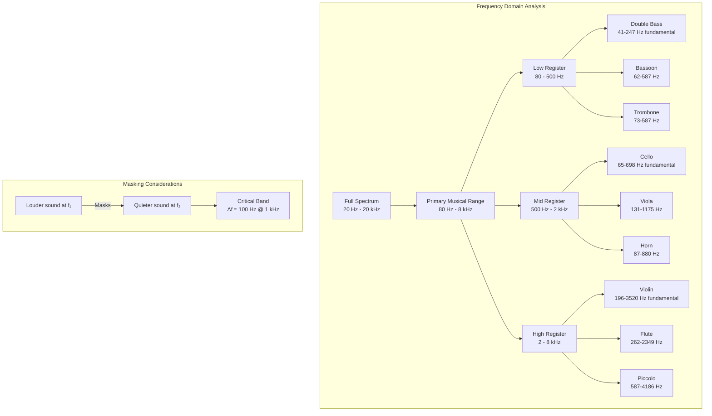
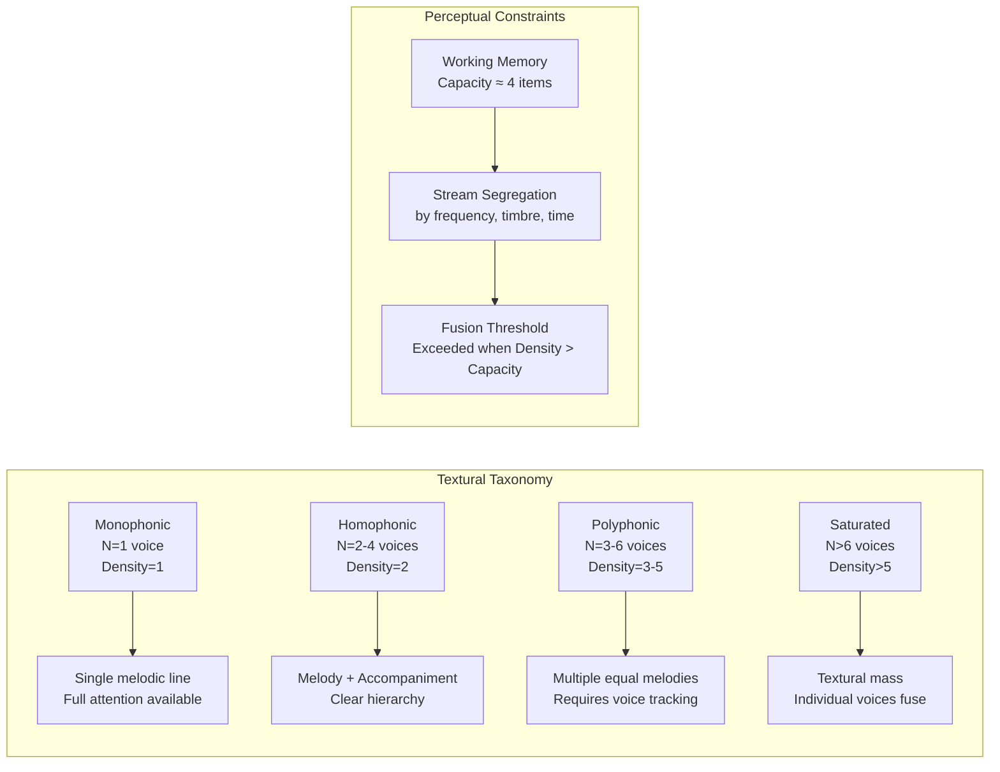
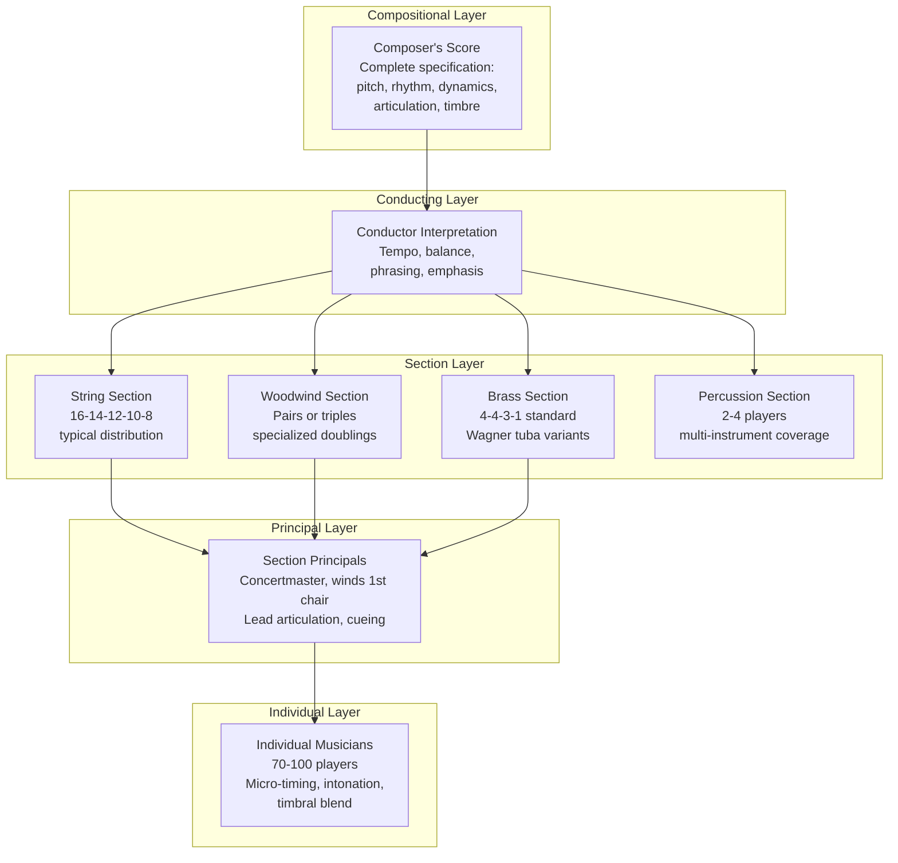
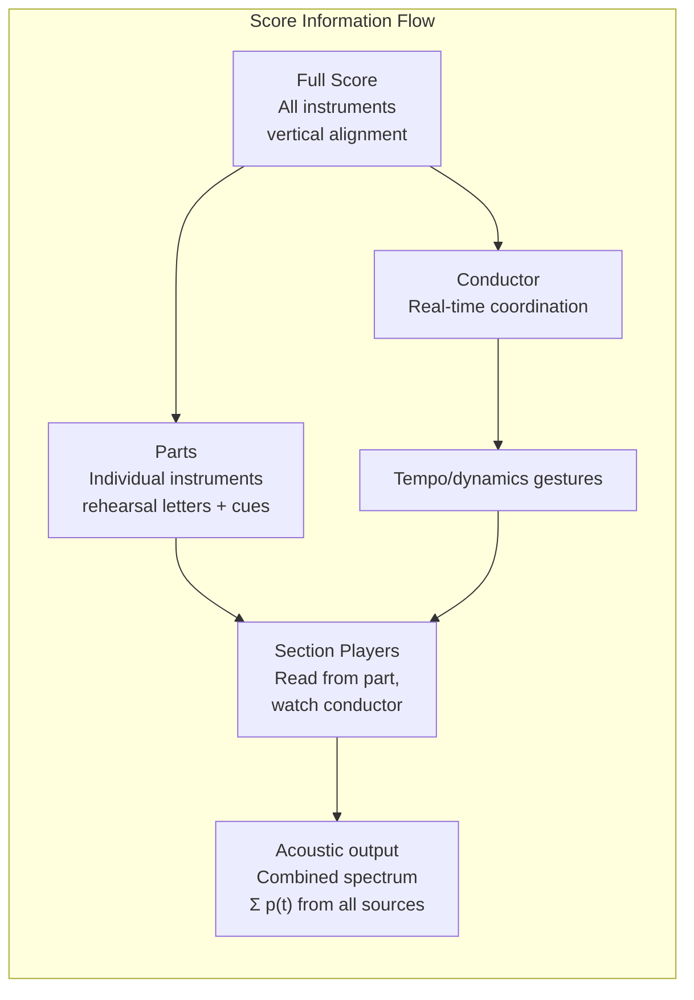
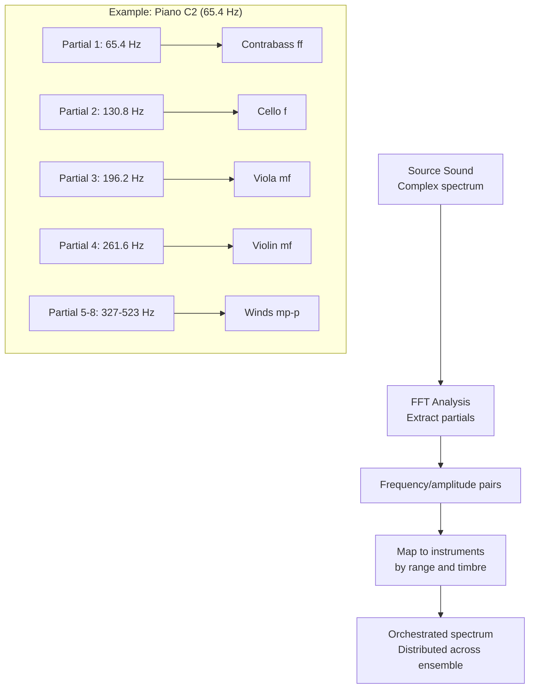

# Lesson 4: Principles of Orchestration

## 1. First-Principles Intuition & Invariants

Orchestration is the systematic distribution of musical material across the instrumental forces of an ensemble, governed by acoustic physics, psychoacoustic perception, and the mechanical constraints of instruments. At its foundation, orchestration operates on three invariant principles that emerge directly from the physical properties of sound and the architecture of human auditory perception: **spectral balance**, **timbral differentiation**, and **textural density**.

### 1.1 Spectral Balance: The Physics of Frequency Distribution

The audible spectrum spans approximately 20 Hz to 20 kHz, but musical energy concentrates in the 80 Hz to 8 kHz range where human hearing exhibits peak sensitivity. Orchestral instruments occupy specific regions within this spectrum, and effective orchestration manages the energy distribution across frequency bands to prevent masking—the psychoacoustic phenomenon where louder sounds at similar frequencies obscure quieter ones.

The string section dominates the mid-frequency range (196 Hz to 3520 Hz for violin fundamentals, though harmonics extend far higher), providing the densest spectral coverage of any orchestral section. This is not aesthetic preference but acoustic necessity: strings produce complex harmonic spectra with prominent overtones that allow multiple instruments to occupy similar frequency bands while remaining perceptually distinct through their unique harmonic ratios. The double bass fundamentals (41 Hz to 247 Hz) anchor the lower spectrum, while piccolo (587 Hz to 4186 Hz) extends into the upper clarity range where few instruments compete.

Brass instruments generate intense energy in the 200 Hz to 2 kHz range with powerful harmonics extending to 8 kHz and beyond. A single trumpet at fortissimo produces sound pressure levels exceeding 90 dB at one meter, while a violin at the same dynamic marking reaches approximately 75 dB. This 15 dB difference represents a 30-fold increase in acoustic power, explaining why a single trumpet can pierce through an entire string section if not carefully managed. The orchestrator must therefore consider not just pitch and rhythm but the power spectral density—the distribution of acoustic energy across frequency—when combining instruments.

Woodwinds occupy intermediate positions both acoustically and dynamically. The clarinet's cylindrical bore produces predominantly odd harmonics in its lower register, creating a hollow timbre distinct from the even-and-odd harmonic structure of the conical-bore oboe. This difference in harmonic content allows these instruments to coexist in similar frequency ranges without complete masking, though careful dynamic scaling remains essential.



### 1.2 Timbral Differentiation: Harmonic Signature and Transient Structure

Timbre, the quality that distinguishes one instrument from another when playing the same pitch at the same loudness, arises from two primary factors: the harmonic spectrum (the relative amplitudes of overtones) and the temporal envelope (the attack, decay, sustain, and release characteristics). These are not subjective aesthetic choices but measurable physical properties encoded in the pressure wave that reaches the listener's ear.

A violin playing A440 does not produce only 440 Hz; it generates a fundamental at 440 Hz plus harmonics at 880 Hz, 1320 Hz, 1760 Hz, and so on, with amplitudes decreasing according to the instrument's transfer function. The specific amplitude relationship between these partials—the spectral envelope—creates the violin's characteristic sound. A clarinet playing the same A440 emphasizes odd harmonics (440 Hz, 1320 Hz, 2200 Hz) in its chalumeau register due to its cylindrical bore behaving as a stopped pipe, producing a markedly different timbre despite identical pitch and loudness.

The temporal structure is equally critical. A piano hammer strikes a string, creating an instantaneous attack (rise time < 10 ms) followed by exponential decay. A violin bow drawn across a string has a slower attack (30-100 ms) and can sustain indefinitely at constant amplitude. A flute's attack depends on the tonguing technique but typically ranges from 20-80 ms. These attack transients contain crucial information for instrument identification; studies show that removing the first 30 ms of a recorded note severely impairs listeners' ability to identify the source instrument, even when the steady-state portion remains unchanged.

The orchestrator must understand these physical characteristics to achieve timbral clarity in dense textures. When multiple instruments play simultaneously, their combined waveforms superpose linearly in the acoustic domain. If two instruments with similar harmonic spectra and synchronized attacks play the same note, they will perceptually fuse into a single sound source. This fusion can be desirable (creating a unified string sound) or problematic (losing the distinct contributions of individual voices). Strategic detuning (by ±5-15 cents), slight temporal offsets (10-30 ms), or contrasting articulations can prevent unwanted fusion while maintaining ensemble cohesion.

### 1.3 Textural Density: Information Theory and Perceptual Capacity

Musical texture describes the number of independent information streams the listener must process simultaneously. This directly connects to cognitive load and attention theory. The human auditory system can reliably track 3-4 independent melodic streams before perceptual fusion occurs—a limit determined by working memory capacity and the temporal resolution of auditory scene analysis.

Monophonic texture (a single melodic line) presents zero ambiguity in voice tracking. The listener's entire attention focuses on one information stream, allowing perception of subtle nuances in phrasing, articulation, and timbre. Homophonic texture (melody plus accompaniment) divides attention but maintains clear foreground-background separation through differences in contour, rhythm, and often timbre. The melody occupies the foreground through higher pitch, rhythmic activity, or dynamic prominence, while the accompaniment recedes into the background through static harmonies, lower registration, or reduced dynamics.

Polyphonic texture introduces multiple concurrent melodies of equal hierarchical status. The listener's attention must distribute across these streams, necessarily reducing the detail perceived in each individual line. Early polyphony (12th-13th century organum) maintained clear voice independence through contrary motion and careful control of consonance/dissonance. As polyphony became denser (Renaissance motet, Baroque fugue), composers employed systematic strategies to maintain perceptual clarity: imitative entries in succession rather than simultaneously, registral separation between voices, and rhythmic differentiation (one voice moves while others sustain).

The orchestrator must quantify textural density to avoid perceptual overload. A useful metric is the **simultaneous voice count** weighted by their perceptual salience:

**Effective Density = Σ(voice_i × salience_i)**

where salience depends on dynamic level, registral prominence, and rhythmic activity. A fortissimo melody in the violins has higher salience than a pianissimo sustained note in the horns, even though both represent "one voice." When effective density exceeds cognitive capacity (typically around 4-5 salient streams), the texture becomes perceptually opaque—listeners hear an undifferentiated mass rather than distinct musical lines.



## 2. Core Architecture & Mechanics

### 2.1 Instrumental Families: Physical Mechanisms and Acoustic Characteristics

The orchestral taxonomy reflects fundamental differences in sound production mechanisms, each governed by distinct physical principles.

#### 2.1.1 String Instruments: Bowed, Plucked, and Struck Strings

**Physical Mechanism**

Strings produce sound through transverse wave propagation on a tensioned string. The fundamental frequency and overtones are determined by string length, tension, and mass density. When bowed, the bow hair (coated with rosin for friction) engages in stick-slip behavior: the string sticks to the bow, is dragged to one side, then slips back, creating periodic oscillation. This produces the characteristic Helmholtz motion—a V-shaped kink traveling along the string—which yields a rich harmonic spectrum.

**Practical Playing Ranges and Characteristics**

Violin family instruments span nearly six octaves collectively:
- **Double Bass**: E1 (41 Hz) to C4 (262 Hz) standard; soloistic passages extend to G4 (392 Hz)
- **Cello**: C2 (65 Hz) to A5 (880 Hz) practical range; harmonics extend to C7 (2093 Hz)
- **Viola**: C3 (131 Hz) to E6 (1318 Hz); alto clef notation
- **Violin**: G3 (196 Hz) to E7 (2637 Hz); harmonics reach A7 (3520 Hz)

**Acoustic Advantages for Orchestration**

The string section's dominance in orchestral scoring derives from several acoustic advantages:
- **Dynamic range**: 40+ dB from ppp to fff, exceeding most winds
- **Timbral flexibility**: sul tasto (near fingerboard, soft), ordinario (normal), sul ponticello (near bridge, bright), col legno (with wood, percussive)
- **Articulation speed**: Detaché bowing allows clean note separation up to ≈16 notes/second
- **Blend characteristics**: Similar harmonic spectra allow multiple violins to fuse into a unified sound while maintaining sufficient spectral complexity to avoid perceptual thinness

**Orchestration Techniques**

**Divisi**: Split a section into multiple parts (e.g., violins I divided into three parts for six-note chords). This reduces the number of players per part, decreasing amplitude but increasing harmonic richness.

**Unison doubling**: Multiple players on the same part create amplitude increase (approximately +10 dB for doubling player count) plus slight incoherence from timing/intonation variations, producing the characteristic orchestral string "warmth."

**Bow distribution**: Mark bowings (down-bow ∏, up-bow V) to synchronize attacks and maintain uniform timbre across the section. Principal strings lead bowing decisions; section follows.

**Muting**: Con sordino (with mute) reduces amplitude by 6-10 dB and filters high-frequency content, creating a veiled, distant timbre. Useful for nocturnal scenes, introspective passages, or spectral separation when accompaniment must recede.

#### 2.1.2 Woodwind Instruments: Air Column Resonance

**Physical Mechanism**

Woodwinds generate sound through standing waves in an air column. The excitation mechanism varies by family:

**Flutes** (edge-tone generators): Air stream splits across a sharp edge (embouchure hole), creating vortices that alternately enter and exit the tube, exciting resonances. The flute behaves as an open cylindrical pipe, supporting all harmonics.

**Clarinets** (single-reed): The reed periodically closes the mouthpiece opening, creating pressure pulses. In the low register (chalumeau), the clarinet acts as a stopped cylindrical pipe (closed at the reed end), supporting only odd harmonics (1st, 3rd, 5th, 7th...). This produces the clarinet's characteristic "hollow" timbre in the low register.

**Oboes and Bassoons** (double-reed): Two reeds vibrate against each other, creating complex pressure variations. The conical bore produces a complete harmonic series (odd and even harmonics), yielding a brighter, more penetrating timbre than the clarinet.

**Practical Playing Ranges and Characteristics**

- **Piccolo**: D5 (587 Hz) to C8 (4186 Hz); piercing, cuts through tutti textures; use sparingly above ff to avoid shrillness
- **Flute**: C4 (262 Hz) to D7 (2349 Hz); low register breathy and weak (avoid below D4 at pp), high register brilliant and cutting
- **Oboe**: Bb3 (233 Hz) to A6 (1760 Hz); nasal, penetrating; serves as tuning reference (A440); excellent for solo melodies
- **Clarinet in Bb**: D3 (147 Hz) to Bb6 (1865 Hz); three distinct registers with timbral breaks at Bb3 (throat register) and Bb4 (clarion register)
- **Bassoon**: Bb1 (58 Hz) to Eb5 (622 Hz); low register rich and resonant (foundation of woodwind section), tenor register reedy and expressive

**Orchestration Techniques**

**Breathing management**: Woodwinds require breath support, limiting sustained notes to 15-30 seconds depending on dynamic and register. Use staggered breathing (rotate entrances across multiple players) or plan rests for continuous passages exceeding 20 seconds.

**Register exploitation**: Write melodies in each instrument's strongest register. Flute: D5-D6 (clear, projects well). Oboe: D4-A5 (singing quality). Clarinet: G3-G5 (chalumeau rich, clarion brilliant). Bassoon: Bb1-Bb3 (powerful bass foundation).

**Doubling with strings**: Reduce woodwind dynamics by one level when doubling strings (strings at f, winds at mf) to add color without masking string texture. Place winds on melodically significant material where their distinct timbre provides clarity.

**Woodwind chords**: Voice chords carefully considering timbre breaks. Avoid writing clarinet parts that cross the Bb3 throat register break mid-phrase (causes audible timbral discontinuity). Use bassoon and horn for chord roots; clarinets for thirds and fifths; flutes and oboes for upper extensions.

#### 2.1.3 Brass Instruments: Lip Vibration and Bore Profiles

**Physical Mechanism**

Brass instruments produce sound through lip vibration—the player's lips act as a self-oscillating valve, opening and closing periodically to create pressure pulses in the air column. The fundamental frequency depends on lip tension, air pressure, and the instrument's tube length. Players select different harmonics of the tube's resonant series by adjusting embouchure (lip tension and aperture).

Natural brass instruments (without valves) can only produce notes in the harmonic series of their fundamental tube length. The valve system adds extra tubing to lower the fundamental:
- **1st valve**: lowers pitch by 2 semitones (major second)
- **2nd valve**: lowers pitch by 1 semitone (minor second)
- **3rd valve**: lowers pitch by 3 semitones (minor third)

Combinations fill chromatic gaps between harmonics. The trombone achieves the same result through a continuously variable slide position (seven positions corresponding to semitone lowerings).

**Bore Profile and Timbre**

- **Cylindrical bore** (trumpet, trombone): bright, focused sound; harmonics remain strong to high orders; penetrating timbre
- **Conical bore** (horn, flugelhorn): warmer, mellower sound; harmonics decay more rapidly; blends easily with woodwinds

**Practical Playing Ranges and Characteristics**

- **Tuba**: E1 (41 Hz) to F4 (349 Hz); foundation of brass section, provides harmonic root; rarely above staff; slow articulation (large mouthpiece)
- **Trombone**: E2 (82 Hz) to Bb5 (932 Hz); tenor trombone standard; bass trombone extends to C2 (65 Hz) with larger bore and F-attachment
- **Horn in F**: B1 (62 Hz) to F5 (698 Hz) written (sounds a fifth lower); extreme high register (stopped notes) extends to C6; bridge between woodwinds and brass
- **Trumpet in Bb**: E3 (165 Hz) to C6 (1047 Hz) practical; orchestral parts rarely exceed G5 (784 Hz); brilliant, heroic timbre

**Orchestration Techniques**

**Dynamic scaling**: Brass produces the highest SPL in the orchestra. A trumpet at fff can reach 100 dB SPL at 1 meter. Reduce brass dynamics by one level relative to strings for balanced blend (strings at ff, brass at f). Reserve brass fff for climactic tutti moments.

**Mutes**: Various mutes alter timbre and reduce amplitude:
- **Straight mute**: Reduces amplitude by 8-12 dB; thin, distant timbre; all brass
- **Cup mute**: Reduces by 6-10 dB; warm, muffled timbre; trumpet/trombone
- **Harmon (wah-wah) mute**: Metallic, narrow timbre; jazz/contemporary effects; trumpet
- **Stopped horn**: Hand fully in bell; raises pitch by semitone; metallic, brassy timbre; notate a semitone lower than sounding pitch

**Transposition**: Orchestral brass parts are transposed. Always notate for the specific instrument:
- Horn in F: written a fifth higher than sounding (written C5 = F4 sounding)
- Trumpet in Bb: written a major second higher (written C5 = Bb4 sounding)
- Trombone and tuba: concert pitch (written = sounding)

**Endurance management**: High, loud playing fatigues brass embouchure rapidly. After extended fortissimo or high-register passages (>1 minute), provide rest (tacet measures or soft, low playing) to allow recovery. Failure to do so results in pitch drooping, tone degradation, and cracked notes.

**Brass chorale voicing**: For balanced brass chords, use standard voicing:
- 4 horns: roots and fifths (lower two horns on root, upper two on fifth)
- 2-3 trumpets: thirds and upper extensions
- 3 trombones: complete triad (tenor 1 on third, tenor 2 on fifth, bass on root)
- 1 tuba: foundation, doubles bass trombone root

This distribution creates balanced spectral energy and avoids muddy low-register clusters.

#### 2.1.4 Percussion: Membrane, Bar, and Cymbal Resonators

**Physical Mechanisms**

Percussion instruments exhibit the most diverse sound production mechanisms:

**Membranophones** (timpani, snare, bass drum): A tensioned membrane vibrates in complex mode shapes. Unlike strings, 2D membranes have inharmonic overtones. Timpani approximates harmonic behavior through bowl design that reinforces certain overtones, but the spectrum remains slightly inharmonic, giving timpani its characteristic pitch with slight "roughness."

**Idiophones—bars** (xylophone, marimba, vibraphone, glockenspiel): Bars vibrate with overtones at non-integer ratios. Undercutting (arch-shaped carving on the underside) can tune the first overtone to an octave or two octaves above the fundamental, improving pitch clarity.

**Idiophones—plates and cymbals**: Extremely complex, dense inharmonic spectra. A cymbal produces hundreds of partials with no clear pitch, creating a noise-like spectrum concentrated in certain frequency bands depending on size and alloy.

**Orchestration Techniques**

**Timpani**: 
- Standard set: 4 drums covering two octaves (D2-D4 typical)
- Tuning changes require 5-10 seconds; notate pedal changes in score
- Articulation: single stroke (definite pitch), roll (sustained tone), muffled (hand dampening)
- Dynamics: pp (barely audible pitch with felt mallets) to fff (thunderous with hard mallets)
- Orchestral foundation: doubles bass line in forte passages; provides rhythmic punctuation

**Snare drum**:
- Indefinite pitch; centered around 200-400 Hz with bright overtones to 8 kHz
- Snares engaged (standard): crisp, rattling timbre
- Snares off: sounds like tenor drum; dry, resonant
- Rolls: buzz roll (multiple-bounce, smooth), double-stroke roll (measured)
- Military associations; rhythmic drive; use sparingly in lyrical passages

**Cymbals**:
- Crash cymbals (pair): hand-held, struck together; short, explosive sound
- Suspended cymbal: single cymbal, struck with mallets/sticks; variable decay
- Roll on suspended cymbal: continuous swell; dramatic crescendos
- Tam-tam (gong): large, thick; very low fundamental (often below 80 Hz); ominous, dramatic

**Pitched percussion**:
- **Glockenspiel**: Bright, bell-like; doubles melody at 2-3 octaves above; cuts through orchestral texture
- **Xylophone**: Dry, wooden; rapid passages; articulates clearly
- **Marimba**: Warm, resonant; rich low register; lyrical melodies
- **Vibraphone**: Sustained tone with vibrato; jazz associations; soft mallets blend with strings

**Orchestration rule**: Percussion carries through dense textures but cannot sustain melodic interest alone (except pitched percussion solos). Use for punctuation, color, rhythmic drive, and dynamic emphasis.

### 2.2 Orchestral Architecture: Hierarchical Organization and Signal Flow

The modern symphony orchestra represents a hierarchical control system where compositional intent propagates through multiple organizational levels:



**Standard Orchestral Seating Arrangement**

The standard seating optimizes acoustic blend and visual communication:

**Classical seating** (Beethoven through Brahms):
- **Violins I** (left front): 16 players, melody and high register lines
- **Violins II** (right front): 14 players, harmony and counter-melodies
- **Violas** (center-right): 12 players, inner voices and alto register
- **Cellos** (center-left): 10 players, bass line and tenor melodies
- **Double Basses** (rear center or left): 8 players, foundation and rhythmic support

This antiphonal arrangement (violins I and II facing each other) creates stereophonic effects exploited by composers from Beethoven through Mahler. Modern "American seating" places Violins II left of Violins I, creating a wider violin stereo image but losing antiphonal clarity.

**Woodwinds** (center, behind strings): Arranged in pairs (2 flutes, 2 oboes, 2 clarinets, 2 bassoons) or triples (3 flutes including piccolo, 3 clarinets including bass clarinet). The central position allows woodwind colors to project over the strings while maintaining blend with brass.

**Brass** (rear center and right): Horns (left rear) bridge woodwinds and brass; trumpets and trombones (right rear) project over the full ensemble. This placement provides maximum power for climactic moments while allowing strings to dominate in lyrical passages through proximity to the conductor.

**Percussion** (rear left or dispersed): Timpani traditionally left rear for balance with brass; other percussion distributed for practical access and acoustic isolation of loud instruments.

### 2.3 Score Notation and Information Encoding

The orchestral score is a time-synchronized, multi-track representation encoding precise performance instructions. Standard notation uses:

**Pitch encoding**: Five-line staff with clef specifying reference pitches. Transposing instruments (Bb clarinet, F horn, Eb alto sax) notate pitches different from sounding pitches to minimize ledger lines and maintain fingering consistency across instrument families.

**Temporal encoding**: Meter signature specifies beat subdivision; note durations (whole, half, quarter, eighth, etc.) define relative timing; tempo marking (♩= 120 or Allegro moderato) defines absolute timing.

**Dynamic encoding**: Logarithmic scale from ppp to fff (approximately -24 dB to +6 dB relative to mf), though absolute SPL varies by instrument and hall acoustics.

**Timbral encoding**: Playing technique specified through Italian terms (sul ponticello, con sordino, flatterzunge) or symbols (+ for stopped horn, ○ for harmonic).

The conductor's score presents all parts in vertical alignment, allowing simultaneous comprehension of all musical activity. Individual parts extract only the relevant staff, adding measure numbers, cues, and section letters for rehearsal navigation.



## 3. Practical Orchestration Techniques: Hands-On Procedures

### 3.1 Melody Distribution: Instrument Selection and Register Optimization

**Procedure: Selecting the Optimal Instrument for a Melody**

**Step 1**: Analyze melodic range and tessitura
- Determine lowest and highest pitches
- Identify where the melody spends most of its time (tessitura)
- Check if range falls within a single instrument's comfortable playing zone

**Step 2**: Consider expressive character
- Lyrical, sustained melody → strings (violin, cello) or woodwinds (oboe, clarinet, flute)
- Heroic, declamatory melody → brass (trumpet, horn, trombone)
- Ethereal, delicate melody → flute, solo violin, glockenspiel doubling
- Dark, mysterious melody → low woodwinds (bassoon, bass clarinet), violas, cellos

**Step 3**: Evaluate dynamic requirements
- pp-p melodies: flute in mid-high register, solo strings, muted brass
- mf melodies: any instrument in comfortable register
- f-ff melodies: trumpet, full string section, oboe (penetrates well)

**Step 4**: Assess articulation demands
- Rapid staccato (>8 notes/second): strings detaché, woodwind tonguing, trumpet
- Legato cantabile: strings (long bow strokes), winds (smooth breath control), horn
- Accented, marcato: brass, strings martelé, double-reed woodwinds

**Practical Example: Melody in Bb major, range F4-Bb5, lyrical character, mf dynamic**

**Option 1**: Oboe (comfortable range, penetrating timbre, lyrical capability)
**Option 2**: Violins I in unison (warm, blends well, supports crescendo to f)
**Option 3**: Clarinet (smooth legato, but less penetrating than oboe; may need dynamic boost to mf-f)

**Chosen solution**: Oboe for first phrase (timbral clarity), then add Violins I doubling at octave for second phrase (increased richness without losing oboe's character).

### 3.2 Harmonic Voicing: Orchestral Chord Distribution

**Procedure: Voicing a Four-Part Chorale for Full Orchestra**

**Given**: SATB chorale, C major triad, mf dynamic

**Step 1**: Assign bass line
- Double basses + cellos on root (C2 for basses, C3 for cellos)
- Add bassoons on same pitch for slight coloration (C3)
- For added weight: tuba and bass trombone on C2

**Step 2**: Assign inner voices (alto and tenor)
- Violas on alto voice (E3-E4 range typical)
- Horns 3&4 on alto voice for added warmth (E3)
- Cellos (upper half of section) on tenor voice (G3)
- Trombones 2&3 on tenor for brass blend

**Step 3**: Assign soprano (melody)
- Violins I on soprano line (C5-C6)
- Clarinet 1 doubles for added clarity
- Oboe 1 doubles at unison for penetration
- Trumpet 1 (muted) adds brightness without overpowering

**Step 4**: Verify spectral balance
- Low register (C2-C3): basses, cellos, bassoons, tuba (strong foundation)
- Mid register (E3-G3): violas, horns, trombones (filled interior)
- High register (C5-C6): violins, clarinet, oboe (clear soprano)
- Check for gaps: none; check for excessive doubling: soprano has 3 instruments (acceptable for melody)

**Step 5**: Adjust dynamics for balance
- Strings: mf across all sections
- Woodwinds: mf (match strings)
- Brass: mp (one level below to prevent overpowering)
- Result: balanced chord with clear soprano line

**Common Voicing Errors and Fixes**

**Error 1**: Muddy bass register (too many notes below C3)
- **Fix**: Use octaves and fifths only in bass; avoid complete triads below C3

**Error 2**: Weak soprano line (buried in texture)
- **Fix**: Add brighter timbres (oboe, trumpet), increase soprano dynamic to f while keeping accompaniment at mf

**Error 3**: Timbral discontinuity (sudden color change mid-phrase)
- **Fix**: Prepare color changes by overlapping instruments (fade out old timbre while fading in new)

### 3.3 Accompaniment Textures: Pattern Design and Orchestral Realization

**Accompaniment Types and Orchestration**

**Type 1: Sustained Pad (Whole Notes, Half Notes)**

**Orchestration**:
- Strings: divided violas + cellos, sustained bows with poco vibrato
- Horns: 2-4 horns in close harmony, mp-mf, smooth legato
- Dynamics: pp-p to avoid masking melody
- Timbre: warm, blended, homogeneous background

**Notation example** (C major triad, 4 bars):
```
Violas (div. a2):   [C4 whole note] [C4 whole note] [C4 whole note] [C4 whole note]
                    [E4 whole note] [E4 whole note] [E4 whole note] [E4 whole note]
Cellos:             [G3 whole note] [G3 whole note] [G3 whole note] [G3 whole note]
Horns 1&2:          [C4 whole note] [C4 whole note] [C4 whole note] [C4 whole note]
Horns 3&4:          [E3 whole note] [E3 whole note] [E3 whole note] [E3 whole note]

All at p, molto legato
```

**Type 2: Arpeggiated Figures (Broken Chords)**

**Orchestration**:
- Strings: violins II + violas pizzicato or arco detaché
- Harp: rolled chords or arpeggios
- Woodwinds: alternating flutes and clarinets for timbral variation
- Dynamics: mp, rhythmically precise

**Notation example** (C major arpeggio, eighth notes, ♩= 120):
```
Violin II:  [E4 eighth] [G4] [C5] [E5] [G5] [E5] [C5] [G4] (repeat)
Harp:       [C2 eighth] [E3] [G3] [C4] [E4] (arpeggiate upward)

Both at mp, leggiero
```

**Type 3: Rhythmic Ostinato (Repeated Rhythmic Pattern)**

**Orchestration**:
- Strings: short detaché or pizzicato for crisp attacks
- Timpani or bass drum: reinforces strong beats
- Brass: syncopated chords for accent placement
- Dynamics: mf-f for rhythmic drive

**Notation example** (Syncopated pattern in 4/4, ♩= 132):
```
Violins I&II (unison):  [rest eighth] [C5 eighth] [rest eighth] [C5] | [rest eighth] [C5] [C5] [C5] |
Violas + Cellos:        [C3 quarter] [rest quarter] [C3 quarter] [rest quarter] |
Timpani:                [C2 quarter] [rest quarter] [C2 quarter] [rest quarter] |
Horns 1-4:              [rest eighth] [C4-E4 eighth chord] [rest eighth] [C4-E4] | (repeat)

All at f, marcato
```

**Type 4: Contrapuntal Figuration (Independent Lines)**

**Orchestration**:
- Distribute lines across different timbres for clarity
- Use registral separation (wide spacing between voices)
- Assign rhythmically active lines to instruments with clear articulation
- Dynamics: balance so each line is audible (typically mf across all voices)

**Notation example** (Two-voice counterpoint, oboe and bassoon):
```
Oboe:    [C5 eighth] [D5] [E5] [F5] [E5] [D5] [C5] [B4] | (descending scale)
Bassoon: [C3 quarter] [G3 quarter] [F3 quarter] [E3 quarter] | (ascending leaps)

Both at mf, clearly articulated
```

### 3.4 Spectral Balance Management: Preventing Masking in Dense Textures

**Procedure: Analyzing and Fixing Masking Issues**

**Step 1: Identify frequency overlap**
- List all simultaneous instruments and their frequency ranges
- Mark instruments occupying the same 1-2 kHz band (most critical for masking)
- Identify the primary melodic material (what must be heard clearly)

**Step 2: Calculate approximate spectral energy**
- Estimate combined SPL for each frequency band
- Use rule of thumb: N identical instruments in unison ≈ +10 log₁₀(N) dB
  - 2 instruments: +3 dB
  - 4 instruments: +6 dB
  - 10 instruments: +10 dB

**Step 3: Apply separation strategies**

**Strategy A: Frequency separation**
- Move accompaniment to different register (octave higher or lower)
- Use bassline in low register (100-300 Hz) while melody stays mid-high (500-2000 Hz)

**Strategy B: Dynamic scaling**
- Reduce accompaniment dynamic by 6-12 dB (two dynamic levels) below melody
- Example: melody at mf (70 dB), accompaniment at pp (58 dB)

**Strategy C: Timbral differentiation**
- Use contrasting timbres for melody and accompaniment
- Example: oboe melody (nasal, bright) + string accompaniment (smooth, warm)

**Strategy D: Temporal separation**
- Place melody and accompaniment in rhythmic alternation (melody on beats 1&3, accompaniment on 2&4)
- Reduces simultaneous spectral overlap

**Practical Example: Violin melody + brass chord masking issue**

**Problem**: Violin section playing melody at f (400-1200 Hz, ~85 dB combined), 4 horns + 3 trumpets playing sustained chord at f (same frequency range, ~95 dB combined). Brass masks violins completely.

**Solution 1: Dynamic scaling**
- Reduce brass to mp (reduces by ~6 dB to 89 dB)
- Still marginal; further reduction to p (83 dB) allows violins to emerge

**Solution 2: Frequency separation**
- Keep brass at f but voice chord in low register (horns on C3-E3, no trumpets)
- Add trumpets on higher harmony (C5-E5), well above violin melody range
- Result: brass energy distributed above and below violin melody, reducing direct masking

**Solution 3: Timbral differentiation + dynamic scaling**
- Keep brass at mf, add solo oboe doubling violin melody at f
- Oboe's penetrating timbre cuts through brass texture
- Result: melody audible through timbral contrast, not amplitude alone

### 3.5 Textural Buildup: Progressive Orchestration for Crescendo

**Procedure: Creating a Gradual Crescendo Through Additive Orchestration**

**Goal**: Build from pp (solo instrument) to fff (full orchestra) over 32 bars

**Phase 1: Bars 1-8 (pp - p)**
- Bar 1: Solo flute, melody in mid-register (C5-C6), pp
- Bar 5: Add solo clarinet, counter-melody one octave below, pp
- Bar 7: Add harp arpeggios, pp leggiero

**Phase 2: Bars 9-16 (p - mp)**
- Bar 9: Strings enter—Violin II pizzicato eighths, accompanying harmony, p
- Bar 11: Add violas arco, sustained pads, p
- Bar 13: Flute and clarinet increase to p; add oboe doubling flute at unison
- Bar 15: Add cellos on bassline, p

**Phase 3: Bars 17-24 (mp - mf)**
- Bar 17: Full string section now playing: Violin I joins on melody, mp
- Bar 19: Add horns 1&2 on sustained harmony, mp
- Bar 21: Woodwinds increase to mp; add bassoons doubling cellos
- Bar 23: Add timpani, soft rolls on tonic/dominant, mp

**Phase 4: Bars 25-32 (f - fff)**
- Bar 25: All instruments at f; trumpets enter on melody, f
- Bar 27: Trombones enter on harmony, f; snare drum rhythmic pattern, f
- Bar 29: Full orchestra at ff; add tuba on bass, ff
- Bar 31: Cymbal crash + full orchestra fff, maximum density and amplitude

**Spectral Analysis of Buildup**:
- Bars 1-8: Sparse, mid-high frequencies (flute/clarinet range)
- Bars 9-16: Mid frequencies added (strings), bass frequencies added (cellos)
- Bars 17-24: Full spectrum coverage, moderate amplitude
- Bars 25-32: Full spectrum, maximum amplitude, all instrument families

**Dynamic Curve**:
```
fff |                                              ▓▓
 ff |                                        ▒▒▒▒▒▒
  f |                               ░░░░░░░░
 mf |                      ▓▓▓▓▓▓▓▓
 mp |            ▒▒▒▒▒▒▒▒
  p |      ░░░░░░
 pp | ▓▓▓▓
    +------------------------------------------------
       1    5    9    13   17   21   25   29   32 (bars)
```

### 3.6 Transition Techniques: Smooth Timbral Modulation

**Procedure: Changing Orchestral Color Without Abrupt Breaks**

**Technique 1: Overlap and Crossfade**

**Step 1**: Identify incoming and outgoing timbres
- Example: Transition from strings to woodwinds over 4 bars

**Step 2**: Plan overlap zone (typically 2-4 bars)
- Bar 1: Strings at mf, woodwinds enter at pp
- Bar 2: Strings at mp, woodwinds at p (crossover point)
- Bar 3: Strings at p, woodwinds at mp
- Bar 4: Strings fade to pp then tacet, woodwinds at mf

**Step 3**: Maintain melodic continuity
- Both sections play identical or complementary material during overlap
- Listener hears gradual timbral shift, not sudden change

**Technique 2: Pivot Instrument**

**Step 1**: Choose an instrument that blends with both sections
- Example: Horn blends with both strings and woodwinds

**Step 2**: Use pivot instrument as bridge
- Section A (strings) with horn at mf
- Horn continues at mf while strings fade and woodwinds enter
- Section B (woodwinds) with horn at mf
- Horn fades, leaving pure woodwind timbre

**Technique 3: Registral Shift**

**Step 1**: Move melodic line to different register while changing timbre
- Bar 1: Cellos play melody in tenor register (C3-C4), mf
- Bar 2: Add violins one octave higher (C4-C5), mf; cellos continue
- Bar 3: Cellos diminuendo to pp, violins remain at mf
- Bar 4: Cellos tacet, violins carry melody alone

**Result**: Upward registral shift accompanies timbral change from dark (cello) to bright (violin)

### 3.7 Articulation Synchronization: Coordinating Attacks Across Sections

**Procedure: Ensuring Crisp Ensemble Attacks**

**Problem**: Different instrument families have different attack speeds
- Strings (bowed): 30-100 ms attack
- Woodwinds (tongued): 20-80 ms attack
- Brass (tongued): 30-100 ms attack
- Percussion (struck): <10 ms attack

**Solution 1: Notate anticipation for slow-attack instruments**

For a tutti sforzando chord on beat 1:
```
Strings:     [grace note sixteenth before beat 1] [chord quarter on beat 1]
Woodwinds:   [grace note sixteenth before beat 1] [chord quarter on beat 1]
Brass:       [chord quarter directly on beat 1] (slightly delayed attack compensates)
Percussion:  [chord quarter directly on beat 1] (instant attack, no compensation needed)
```

**Solution 2: Conductor preparation**

- Conductor gives preparatory beat with clear ictus (precise beat point)
- All sections anticipate attack based on visual cue
- Practice rehearsal to calibrate section anticipation

**Solution 3: Reduce attack transient mismatch**

For passages requiring absolute synchrony:
- Use similar articulations across sections (all marcato, or all legato)
- Avoid mixing staccato strings with legato winds (creates rhythmic ambiguity)

**Practical Drill: Tutti Attack Precision**

**Exercise**: Full orchestra plays unison quarter notes at ♩= 60, fortissimo, with precise attacks

**Step 1**: Strings only—practice synchronized bows (all down-bow, crisp attack)
**Step 2**: Woodwinds only—practice synchronized tongue (hard "ta" attack)
**Step 3**: Brass only—practice synchronized tongue (aggressive attack)
**Step 4**: Combine sections in pairs (strings + winds, strings + brass, winds + brass)
**Step 5**: Full orchestra—adjust timing by ear; conductor adjusts preparation gesture

**Goal**: Attack transient spread <20 ms across full ensemble (perceived as single unified attack)

## 4. Advanced Techniques and Extended Palettes

### 4.1 Divisi and Section Splitting: Expanding Harmonic Possibilities

**Practical Technique: String Divisi**

**Basic Divisi (a2)**: Split one section into two parts
```
Violins I (div. a2):
  [C5 half note]  (half the section plays C5)
  [E5 half note]  (half the section plays E5)
```

**Triple Divisi (a3)**: Split one section into three parts
```
Violins I (div. a3):
  [C5 half note]  (one-third plays C5)
  [E5 half note]  (one-third plays E5)
  [G5 half note]  (one-third plays G5)
```

**Acoustic Effect**:
- Dividing 16 violins a3 = approximately 5-6 players per part
- Amplitude reduced by ~5 dB per part compared to full section unison
- Timbral blend becomes richer (more voices = more slight incoherence = warmer sound)
- Dynamic marking must increase to maintain perceived loudness (unison at mf ≈ div. a3 at f)

**Strategic Use**:
- Dense chords requiring 5-8 simultaneous notes (divide violins and violas)
- Chamber-like transparency in large ensemble (divide all strings for intimate sound)
- Spectral filling without adding new timbres (string divisi covers wide range homogeneously)

**Notation Best Practices**:
- Mark "div." at the beginning of divided passage
- Mark "unis." when section reunites
- Provide separate staves for complex divisi (e.g., Violin I divided into 4 parts = 4 staves)

### 4.2 Col Legno, Sul Ponticello, and Extended String Techniques

**Col Legno Battuto** (strike with wood of bow)

**Sound**: Dry, percussive click; indefinite pitch; weak amplitude
**Notation**: "col legno batt." or "c.l.b."
**Orchestration**: Rhythmic punctuation; eerie, skeletal textures; use full string section to achieve adequate volume (each player produces only ~50 dB)
**Return to normal**: "arco" or "ord." (ordinario)

**Practical example**:
```
Violins I, II, Violas (col legno batt.):
  [C5 eighth] [rest] [C5 eighth] [rest] (repeated pattern)
  At mf (requires forte effort for audible result)
```

**Sul Ponticello** (bow near bridge)

**Sound**: Glassy, metallic, high harmonics emphasized; reduced fundamental amplitude
**Notation**: "sul pont." or "s.p."
**Orchestration**: Eerie, ghostly atmosphere; spectral emphasis on frequencies >2 kHz; often combined with tremolo for unsettling effect
**Return to normal**: "ord." or "pos. ord." (posizione ordinario)

**Practical example**:
```
Violins I (sul pont., tremolo):
  [C5 whole note tremolo, ppp - pp - ppp dynamic swell]
  Creates unstable, shimmering high-frequency texture
```

**Sul Tasto** (bow near fingerboard)

**Sound**: Soft, hollow, muted; fundamental emphasized, high harmonics suppressed
**Notation**: "sul tasto" or "s.t."
**Orchestration**: Distant, veiled atmosphere; reduces spectral brightness; useful for non-intrusive accompaniment
**Return to normal**: "ord."

**Bartók Pizzicato** (snap pizzicato)

**Sound**: String snaps against fingerboard with sharp percussive attack
**Notation**: Circle with vertical line above notehead (⊕ with | above)
**Orchestration**: Aggressive, percussive; requires firm snap (may cause string breakage if overused); effective in rhythmic passages
**Difficulty**: Advanced technique; not all players equally proficient

**Harmonics** (natural and artificial)

**Natural Harmonics**: Lightly touch string at node point (1/2, 1/3, 1/4, etc. of string length)
**Sound**: Pure, flute-like tone; high register; weak amplitude
**Notation**: Small circle above note (○) or diamond notehead with sounding pitch indicated
**Orchestration**: Ethereal, distant effect; often combined with flute at unison for blended color

**Artificial Harmonics**: Stop string with first finger, touch lightly with fourth finger (typically perfect fourth above stopped note)
**Sound**: Two octaves above stopped pitch; very pure timbre
**Notation**: Diamond notehead shows touched note; round notehead shows stopped note; sounding pitch indicated
**Difficulty**: Advanced; requires precise left-hand coordination

**Practical example**:
```
Violins I (natural harmonics):
  [C6 quarter with ○ above, indicating harmonic on C5 string touched at 1/2 length]
  At pp, combined with flute playing same C6 for blended, ethereal timbre
```

### 4.3 Woodwind Multiphonics and Flutter-Tongue

**Multiphonics** (multiple simultaneous pitches on single woodwind instrument)

**Physical Mechanism**: Specific fingering + embouchure tension creates unstable air column, exciting multiple modes simultaneously

**Sound**: Complex, inharmonic spectrum; pitch instability; requires precise control
**Notation**: Two noteheads on same stem (indicate both sounding pitches) + fingering diagram
**Orchestration**: Avant-garde timbral color; spectral complexity; use sparingly (difficult to control, unreliable in live performance)

**Practical considerations**:
- Multiphonics vary by instrument make/model
- Not all combinations are possible on all instruments
- Provide fingering charts in parts
- Mark as ossia (alternative) with conventional passage available

**Flutter-Tongue** (flatterzunge)

**Physical Mechanism**: Roll tongue while blowing, creating amplitude modulation at ~20-30 Hz

**Sound**: Rapid tremolo-like pulsation; aggressive, somewhat distorted timbre
**Notation**: "flz." or "flutter" + wavy line above note
**Orchestration**: Dramatic, aggressive passages; effective in high woodwinds (flute, piccolo) and brass; less effective in low register

**Practical example**:
```
Flute (flz.):
  [C6 half note with wavy line above]
  At f, aggressive tremolo effect for dramatic climax
```

**Jet Whistle Tones** (flute without reed vibration)

**Sound**: Airy, breathy, pitch-ambiguous; resembles white noise centered around notated pitch
**Notation**: "whistle tone" or "jet whistle" + hollow notehead
**Orchestration**: Atmospheric, textural effect; blends with cymbal roll or string harmonics for complex spectral textures

### 4.4 Brass Mutes: Acoustic Properties and Orchestration

**Straight Mute**

**Acoustic Effect**: Reduces amplitude by 8-12 dB; filters low frequencies; emphasizes 2-4 kHz range (nasal quality)
**Notation**: "con sord." (with mute) ... "senza sord." (without mute)
**Orchestration**: Distant trumpet calls; veiled, distant atmosphere; allows brass to blend at lower dynamics with strings/winds
**Practical timing**: Allow 3-5 seconds for mute insertion/removal; plan in score

**Cup Mute**

**Acoustic Effect**: Reduces amplitude by 6-10 dB; warmer, more muffled than straight mute; less high-frequency emphasis
**Notation**: "cup mute" (specify type, as "con sord." defaults to straight mute)
**Orchestration**: Jazz influences; warm, intimate brass sound; trumpet/trombone primarily

**Harmon Mute** (wah-wah mute)

**Acoustic Effect**: Metallic, narrow-bandwidth timbre; stem in/out varies tone (stem out = "wah" sound)
**Notation**: "harmon mute" or "wah-wah mute"
**Orchestration**: Jazz idioms; Miles Davis sound; very distinctive, use when specific color desired

**Plunger Mute**

**Acoustic Effect**: Variable muting by covering/uncovering bell opening; "wah-wah" effect through motion
**Notation**: "plunger" + "+" (closed) and "○" (open) markings
**Orchestration**: Duke Ellington brass section sounds; comedic effects; requires player to hold plunger (cannot play from music stand)

**Stopped Horn** (hand in bell)

**Acoustic Effect**: Raises pitch by 1 semitone; creates brassy, metallic timbre; reduces amplitude slightly
**Notation**: "+" above note (indicates stopped) ... "○" (open)
**Transposition**: Notate stopped notes 1 semitone lower than desired sounding pitch (written B4 = sounding C5)
**Orchestration**: Aggressive, brassy accents; dramatic horn calls; contrasts with smooth open horn sound

**Practical example**:
```
Trumpet in Bb (con sord.):
  [C5 quarter] [D5] [E5] [C5] at mp
  Distant, muted fanfare; allows trumpet at mp to blend with strings at p without masking
```

### 4.5 Spatial Orchestration: Antiphonal and Surround Techniques

**Antiphonal Techniques** (spatial separation of performing groups)

**Historical Precedent**: Venetian polychoral music (Andrea and Giovanni Gabrieli, late 16th century); Baroque concerto grosso (ripieno vs. concertino)

**Modern Application**: Position two or more instrumental groups in spatially separated locations (left/right stage, front/back, or surrounding audience)

**Acoustic Effect**: 
- Spatial segregation aids perceptual stream separation (easier to track multiple lines when spatially distinct)
- Interaural time/level differences create immersive stereophonic effects
- Precedence effect allows listener to localize sound sources

**Practical Orchestration**:

**Example 1: Antiphonal Strings**
- Violins I (left stage) play ascending melody
- Violins II (right stage) respond with descending melody
- Spatial call-and-response clarifies two-voice counterpoint

**Example 2: Brass Antiphony**
- Trumpets 1&2 (left rear) play fanfare
- Trumpets 3&4 (right rear) answer with variant
- Spatial separation prevents timbral fusion, clarifies dialogue

**Example 3: Surround Orchestration** (requires non-standard setup)
- Main orchestra (front)
- Brass choir (rear center)
- Percussion (left/right sides)
- Creates immersive sound field surrounding audience

**Notation**: Clearly mark stage positions in score (e.g., "Trumpets 1&2 - Stage Left," "Trumpets 3&4 - Stage Right")

**Practical Limitations**:
- Visual communication challenges (conductor may not be visible to offstage groups)
- Acoustic timing issues (speed of sound delays, ~3 ms per meter)
- Requires extensive rehearsal for synchronization

### 4.6 Spectral Orchestration: Frequency-Based Composition

**Concept**: Analyze acoustic spectrum of a sound (via FFT), then orchestrate individual frequency components using orchestral instruments

**Procedure**:

**Step 1**: Analyze source sound
- Perform FFT on complex timbre (e.g., piano note, bell sound, vocal timbre)
- Extract prominent frequency components (partials) and their amplitudes

**Step 2**: Map frequencies to orchestral instruments
- Assign low partials to low instruments (contrabass, bassoon, tuba)
- Assign mid partials to mid instruments (cellos, violas, horns)
- Assign high partials to high instruments (violins, flutes, glockenspiel)

**Step 3**: Scale dynamics proportionally
- Loudest partial → f or ff
- Medium partials → mf or mp
- Weak partials → p or pp
- Preserve relative amplitude relationships from FFT analysis

**Step 4**: Orchestrate temporal envelope
- If source sound has quick attack, use instruments with fast attacks (pizzicato, staccato winds)
- If source has slow attack, use swells (crescendos from pp)
- Match decay characteristics (sustained vs. rapid fade)

**Practical Example: Piano C2 (65.4 Hz) Spectral Orchestration**

**FFT Analysis** (simplified):
- Partial 1: 65.4 Hz, amplitude 1.0 (fundamental)
- Partial 2: 130.8 Hz, amplitude 0.8
- Partial 3: 196.2 Hz, amplitude 0.6
- Partial 4: 261.6 Hz, amplitude 0.5
- Partial 5: 327.0 Hz, amplitude 0.3
- Partial 6: 392.4 Hz, amplitude 0.2
- Partials 7-12: 458-785 Hz, amplitudes 0.15-0.05

**Orchestration**:
```
Contrabass:   [C2 = 65.4 Hz] at ff (partial 1)
Cello:        [C3 = 130.8 Hz] at f (partial 2)
Viola:        [G3 = 196.2 Hz] at mf (partial 3)
Violin II:    [C4 = 261.6 Hz] at mf (partial 4)
Violin I:     [E4 = 327.0 Hz] at mp (partial 5)
Flute:        [G4 = 392.4 Hz] at p (partial 6)
Glockenspiel: [Mixed partials 7-12] at pp (high shimmer)

All instruments: quick pizzicato attack, immediate decay (mimics piano hammer strike)
```

**Result**: Orchestral reconstruction of piano timbre using distributed frequency components



## 5. High-Performance Optimization & Troubleshooting

### 5.1 Masking Prevention: Diagnostic Protocol and Fixes

**Diagnostic Procedure**:

**Step 1: Identify masking symptoms**
- Melody or important line is inaudible in rehearsal/performance
- Conductor must ask accompaniment to play softer repeatedly
- Score looks balanced on paper but sounds unbalanced in hall

**Step 2: Analyze spectral overlap**
- List all instruments playing simultaneously during masked passage
- Identify frequency bands: Low (80-500 Hz), Mid (500-2k Hz), High (2k-8k Hz)
- Mark which instruments share the same band as the masked melody

**Step 3: Measure dynamic imbalance**
- Estimate combined SPL of accompaniment vs. melody
- If accompaniment is >6 dB louder in the same frequency band, masking is likely

**Step 4: Apply targeted fixes** (choose most appropriate)

**Fix 1: Dynamic scaling**
- Reduce accompaniment by 1-2 dynamic levels (6-12 dB reduction)
- Mark in score: "accomp. sempre sotto" (accompaniment always under)

**Fix 2: Frequency separation**
- Move accompaniment to different register (octave displacement)
- Voice chords with wider spacing (leave melody register clear)

**Fix 3: Timbral substitution**
- Replace masking instruments with different timbre occupying different spectrum
- Example: Replace clarinets (mid-range dense spectrum) with flutes (airier, less fundamental energy)

**Fix 4: Textural thinning**
- Remove doubling instruments from accompaniment
- Reduce divisi (combine divided sections to increase individual amplitude but reduce spectral density)

**Case Study: Masked Oboe Solo**

**Problem**: Oboe solo at mf (C5-E5, 500-660 Hz fundamental) masked by:
- Violins II tremolo (C5-E5), mf
- Violas tremolo (C4-E4), mf
- Clarinets sustained (G4-C5), mf

**Analysis**: Oboe fundamental and second harmonic (500-1320 Hz) directly overlap with violin II, viola, and clarinet fundamentals and harmonics. Combined string/wind energy ≈88 dB; oboe solo ≈75 dB. Masking threshold exceeded by 13 dB.

**Fix Applied**:
1. Reduce violin II and viola to p (reduces by ~6 dB to 82 dB)
2. Remove clarinets entirely (saves additional ~3 dB, down to 79 dB)
3. Result: Oboe at 75 dB now only 4 dB below accompaniment; oboe's penetrating timbre (strong second harmonic) allows it to cut through

**Alternative Fix**:
1. Keep all accompaniment at mf
2. Transpose violin II and viola down one octave (now in 250-330 Hz range, below oboe fundamental)
3. Result: Frequency separation allows oboe to occupy 500-1320 Hz range with minimal competition

### 5.2 Balance Correction: Real-Time Adjustments in Rehearsal

**Rehearsal Procedure**:

**Phase 1: Section balance (first rehearsal)**
- Rehearse each section separately (strings, winds, brass, percussion)
- Verify intonation, rhythm, articulation within each section
- Identify problematic passages requiring sectional work

**Phase 2: Combined balance (second rehearsal)**
- Combine sections progressively (strings + winds, strings + brass, winds + brass)
- Conductor walks hall during tutti passages to assess balance from audience perspective
- Mark score with balance adjustments ("horns need mp not mf," "violin solo needs f not mf")

**Phase 3: Fine-tuning (final rehearsal)**
- Full orchestra with all dynamics adjusted per Phase 2 findings
- Record rehearsal, listen back to verify balance
- Make final micro-adjustments

**Common Balance Issues and Fixes**:

**Issue 1: Brass overpowers strings in tutti**
- **Fix**: Reduce brass by one dynamic level; or add more string doublings; or move brass to different register

**Issue 2: Inner voices (violas, second clarinet) inaudible**
- **Fix**: Extract important inner voice fragments, assign to brighter timbre (violin II + oboe); or reduce tutti dynamic to allow inner voices to emerge

**Issue 3: Bass line unclear in loud passages**
- **Fix**: Double bass line with timpani on primary beats; or add tuba/trombone doubling; or thin mid-register accompaniment to reduce masking

**Issue 4: Solo wind lost in string texture**
- **Fix**: Reduce string accompaniment to pp; or add second wind instrument doubling at unison; or move strings to different register

**Issue 5: Percussion too loud/soft**
- **Fix**: Adjust mallet type (harder mallets = louder, brighter; softer mallets = quieter, warmer); or adjust dynamic marking; or change playing position on instrument (cymbal edge vs. center)

### 5.3 Intonation Management: Tuning Strategies for Blended Chords

**Challenge**: Orchestral instruments use different tuning systems, creating potential conflicts in sustained chords

**Tuning Systems**:
- **Equal Temperament (ET)**: 12 equal semitones; all intervals except octaves slightly impure; used by piano, harp, fixed-pitch percussion
- **Just Intonation (JI)**: Simple integer frequency ratios (3:2 fifth, 5:4 major third); beatless chords; strings/winds gravitate toward JI naturally
- **Pythagorean Tuning**: Pure fifths (3:2); bright major thirds (81:64 ≈ 408 cents)

**Practical Tuning Strategy**:

**Scenario 1: Strings + Piano/Harp**
- Strings must compromise toward ET to match fixed-pitch instruments
- Rehearse string section to tune major thirds slightly wide (to ET's 400 cents, not JI's 386 cents)
- Result: Beatless chords with piano/harp

**Scenario 2: Strings + Winds (no piano)**
- Allow strings and winds to use expressive intonation (JI or exaggerated tendency tones)
- Tune thirds pure (5:4 ratio) for maximum blend and minimum beats
- Tune fifths pure (3:2 ratio) in open voicings
- Result: Warmer, more resonant chords with natural acoustic blend

**Scenario 3: Brass Choir**
- Brass naturally tunes to harmonic series (JI-based)
- Reinforce this tendency: tune triads with pure thirds and fifths
- For dissonant chords, accept slight beating as timbral richness

**Rehearsal Technique: Chord Tuning Drill**

**Step 1**: Isolate sustained chord (e.g., C major triad, 4 bars)
**Step 2**: Play chord at mf, listen for beats (amplitude modulation caused by mistuned intervals)
**Step 3**: Identify which intervals are beating (usually thirds or sixths)
**Step 4**: Adjust tuning:
- If third is beating, upper note slightly flat → raise pitch by ~5-10 cents
- If fifth is beating, adjust less critical note to match fundamental
**Step 5**: Repeat until chord is beatless or beats <1 Hz (nearly imperceptible)
**Step 6**: Memorize kinesthetic feel of correct intonation; apply to other chords

**Practical Example: String Quartet C Major Chord Tuning**

```
Violin I:  [G4] - tune to pure fifth above C3 (ratio 3:2, frequency 392 Hz if C3 = 261.6 Hz)
Violin II: [E4] - tune to pure major third above C3 (ratio 5:4, frequency 327 Hz)
Viola:     [C4] - tune to octave above C3 (ratio 2:1, frequency 523.2 Hz)
Cello:     [C3] - fundamental reference (261.6 Hz)

Result: Beatless C major triad in just intonation
```

**Common Intonation Errors**:

**Error 1: Thirds too wide (approaching ET)**
- **Symptom**: Audible beating at 4-8 Hz
- **Fix**: Flatten upper note by 10-14 cents (from ET 400 cents to JI 386 cents)

**Error 2: Octaves mismatched**
- **Symptom**: Slow beating at 1-3 Hz
- **Fix**: Match octaves precisely (beats should be inaudible); often requires upper note to be slightly flat relative to ET

**Error 3: Temperature-related drift (winds)**
- **Symptom**: Wind section sharp relative to strings (room warms during rehearsal/performance)
- **Fix**: Winds pull out slightly to flatten pitch; or adjust tuning slide; or adjust reed (oboe/bassoon)

### 5.4 Endurance Management: Sustainable Orchestration Practices

**Brass Endurance**:

**Physiological Limits**:
- Sustained high register (>written G5 trumpet, >F4 horn): 1-2 minutes before fatigue
- Continuous fortissimo: 2-3 minutes before tone quality degrades
- Embouchure recovery time: 30-60 seconds of rest or soft/low playing

**Orchestration Strategy**:
- Alternate brass-heavy passages with brass-light passages
- After fortissimo brass fanfare, transition to strings-only or winds-only texture
- Provide at least 30 seconds rest after extended high/loud passages
- Reserve fff brass for climactic moments of 30-60 seconds maximum

**Practical Example: Sustainable Brass Writing (5-minute finale)**
```
Bars 1-32:   Brass at mf, mid-register (sustainable foundation)
Bars 33-48:  Brass at f, building intensity (manageable for 15-20 seconds)
Bars 49-64:  Brass tacet, strings carry (REST for brass, allows recovery)
Bars 65-80:  Brass return at mf (recovered, ready for next buildup)
Bars 81-96:  Brass at f-ff, high register (final push)
Bars 97-112: Brass at fff, climax (maximum 15-20 seconds at peak intensity)
```

**String Endurance**:

**Physiological Limits**:
- Continuous fortissimo bowing: 2-3 minutes before right arm fatigue
- Rapid string crossings (alternating strings at sixteenth notes, ♩= 140+): 30-45 seconds
- Extreme high register (>E6 violin): 1-2 minutes before left-hand tension/fatigue

**Orchestration Strategy**:
- Alternate arco with pizzicato (pizzicato gives right arm rest)
- Vary bow distribution (long bows at mf less fatiguing than short bows at ff)
- Provide periodic rests or sustained notes (requires less energy than rapid passage work)

**Wind Endurance**:

**Physiological Limits**:
- Continuous playing without breath: 15-30 seconds depending on dynamic/register
- High register extended passages: 1-2 minutes before embouchure fatigue
- Low register extended passages (bassoon, contrabassoon): Requires more air, fatigues faster

**Orchestration Strategy**:
- Staggered breathing: Rotate wind entrances so individuals can breathe while section maintains continuity
- Mark breath marks in parts (comma or apostrophe above staff)
- For passages >30 seconds continuous, write for multiple winds (e.g., 2 flutes alternating phrases)

**Practical Example: Wind Section Staggered Breathing**
```
Flute 1:  [phrase bars 1-4] [breathe bar 5] [phrase bars 6-9]
Flute 2:  [phrase bars 1-2] [breathe bar 3] [phrase bars 4-7] [breathe bar 8] [phrase bar 9]

Result: Continuous flute sound without perceivable breath gaps (one flute always playing)
```

### 5.5 Acoustic Environment Adaptation: Hall-Specific Orchestration

**Reverberation Time (RT60) Impact**:

**Dry Hall** (RT60 < 1.5 seconds):
- Sound decays quickly; lacks natural sustain
- Rapid passages sound clear and articulated
- Sustained chords may sound thin or dry
- **Orchestration adjustment**: Add more legato phrasing; use string vibrato to sustain tone; add slight overlaps in winds (crescendo through note endings)

**Moderate Hall** (RT60 = 1.8-2.2 seconds):
- Ideal for most Classical and Romantic repertoire
- Natural blend and warmth
- Rapid passages remain clear if not excessive
- **Orchestration adjustment**: Standard orchestration practices apply; minimal adjustment needed

**Reverberant Hall** (RT60 > 2.5 seconds):
- Long decay sustains chords naturally
- Rapid passages smear (each note's tail overlaps next note's attack)
- Low frequencies especially prolonged
- **Orchestration adjustment**: Simplify rapid passages; reduce textural density; extend rests between phrases to allow decay

**Practical Example: Tempo/Articulation Adjustment for Hall Acoustics**

**Original score**: Sixteenth-note passage at ♩= 144 (9.6 notes/second)
- In dry hall (RT60 = 1.3s): Sounds crisp, clear
- In reverberant hall (RT60 = 2.7s): Sounds blurred, rhythm lost

**Fix for reverberant hall**:
- Reduce tempo to ♩= 120 (8 notes/second) - allows more separation between notes
- Add more staccato/detaché articulation markings to shorten note duration
- Thin texture (reduce accompanying instruments to minimize spectral accumulation)

**Distance and Amplitude**:

**Acoustic Law**: SPL decreases by 6 dB per doubling of distance (inverse-square law in free field; modified by room acoustics)

**Practical Implication**:
- Offstage instruments must play at higher dynamic to achieve equivalent perceived loudness
- Backstage brass fanfare marked ff will sound approximately mf from audience (due to distance + wall attenuation)

**Orchestration Strategy**:
- Mark offstage parts one dynamic level louder than desired perceived loudness
- Example: For mp distant effect, mark offstage part mf

### 5.6 Orchestrator-Conductor Collaboration: Iterative Refinement

**Workflow**:

**Stage 1: Score Completion**
- Orchestrator completes full score with detailed dynamic, articulation, and expression markings
- Includes balance notes in score ("melody should dominate," "bass foundation," etc.)

**Stage 2: First Reading**
- Conductor leads initial read-through with orchestra
- Orchestrator attends reading, takes notes on balance issues, unexpected timbral interactions, passages that don't "speak"
- Identify passages requiring revision

**Stage 3: Revisions**
- Orchestrator revises problem passages based on reading feedback
- Common revisions: dynamic adjustments, doublings added/removed, register changes, timbral substitutions

**Stage 4: Rehearsals**
- Conductor refines interpretation
- Orchestrator may attend select rehearsals to verify revisions
- Conductor documents balance decisions for future performances

**Stage 5: Performance and Documentation**
- Record performance
- Post-performance analysis: what worked, what could improve
- Document findings for future orchestration projects

**Communication Best Practices**:

- Orchestrator provides clear rationale for unusual doublings or dynamics in score
- Conductor respects orchestrator's intentions but adapts for acoustic reality of specific hall/ensemble
- Both acknowledge that notation is an approximation; real-world acoustic adjustments are necessary and expected

## 6. Case Studies: Analyzing Master Orchestrations

### 6.1 Ravel: Boléro – Additive Orchestration and Systematic Crescendo

**Compositional Strategy**: Single theme repeated 18 times with progressively denser orchestration, creating 15-minute crescendo from pp to fff through additive orchestration, not individual dynamic changes.

**Structural Invariant**: Melody and harmony remain constant; only orchestration changes.

**Orchestration Progression**:

**Repetitions 1-2** (pp - p):
- Rep 1: Solo flute, pp (thin, intimate)
- Rep 2: Solo clarinet, p (slightly warmer timbre)

**Repetitions 3-4** (p):
- Rep 3: Bassoon + pizzicato strings (adds accompanimental texture)
- Rep 4: Eb clarinet (high, piercing timbre)

**Repetitions 5-8** (p - mp):
- Rep 5: Oboe d'amore (doubling begins)
- Rep 6: Trumpet + flute (two instruments, octave apart)
- Rep 7: Tenor saxophone (unusual orchestral color)
- Rep 8: Soprano saxophone + French horn (paired timbres)

**Repetitions 9-12** (mp - mf):
- Rep 9: Piccolo, celesta, horn (high register emphasis)
- Rep 10: Oboe + oboe d'amore (double reed doubling)
- Rep 11: Trombone, winds (brass enters)
- Rep 12: Multiple winds, strings tremolo (texture thickens)

**Repetitions 13-18** (f - fff):
- Rep 13-14: Full winds, strings arco (approaching tutti)
- Rep 15-16: Brass section added (trumpets, trombones)
- Rep 17-18: Full orchestra fff, complete spectral saturation

**Acoustic Analysis**:

**Amplitude Growth**:
- Rep 1: Solo flute ≈ 60 dB SPL (pp)
- Rep 6: 2-3 instruments ≈ 72 dB SPL (p-mp, +12 dB from Rep 1)
- Rep 12: ~30 instruments ≈ 90 dB SPL (mf-f, +18 dB from Rep 6)
- Rep 18: 100+ instruments ≈ 110 dB SPL (fff, +20 dB from Rep 12)
- **Total dynamic range**: 50 dB crescendo (50× increase in sound pressure, 10,000× increase in acoustic power)

**Spectral Evolution**:
- Early reps: Narrow spectral bandwidth (single instrument's range)
- Mid reps: Expanding spectrum (octave doublings add harmonic reinforcement)
- Late reps: Full spectrum 80 Hz - 8 kHz covered by brass, strings, winds in multiple octaves

**Orchestration Lessons**:
1. Crescendo achievable through additive orchestration, not individual dynamic changes
2. Octave doublings reinforce harmonics, creating perceived amplitude increase beyond simple addition
3. Timbral variety prevents monotony despite thematic repetition
4. Spectral filling (low, mid, high registers) creates sense of growing mass

### 6.2 Stravinsky: The Rite of Spring – Polyrhythmic Layers and Timbral Blocks

**Compositional Strategy**: Revolutionary orchestration through timbral blocks (homogeneous instrumental families) rather than blended colors; polyrhythmic/polymetric layering; extreme registers.

**Key Passage: "Augurs of Spring" (Rehearsal 13)**

**Orchestration**:
- Strings (divisi, 8 parts): Repeated dissonant chord (E♭ dominant 7th + E major), pounding eighths at fff, percussive down-bow attacks
- Horns 1-8: Sustained dissonant harmony, fff (contrasting sustained vs. percussive texture)
- Bassoons 1-4: Staccato rhythmic interjections, independent rhythm
- Timpani: Punctuating accents on offbeats

**Timbral Block Technique**:
- Strings function as single timbral mass (not individual sections with distinct roles)
- Horns form contrasting sustained block
- No traditional blend; stark juxtaposition of homogeneous textures

**Polyrhythmic Structure**:
- Strings maintain steady eighth-note pulse with irregular accents (creates metric ambiguity)
- Bassoons interject in conflicting metric grouping (2+3+2+3 vs. strings' 4+4)
- Result: Multiple simultaneous meters perceived spatially (each section maintains own grid)

**Acoustic Analysis**:
- String chord at fff, 8-part divisi ≈ 95 dB SPL (strings pushed to extreme amplitude)
- Horns at fff ≈ 98 dB SPL (brass naturally dominates)
- Bassoons at ff ≈ 85 dB SPL (articulation clarity more important than amplitude)
- Combined tutti ≈ 105 dB SPL (approaching pain threshold)

**Orchestration Lessons**:
1. Timbral blocks (homogeneous families) create stark contrasts, rejecting Romantic blend aesthetic
2. Polyrhythm clarity requires spatial separation (different sections maintain independent meters)
3. Extreme dynamics and registers produce unfamiliar timbres (high bassoons, aggressive strings)
4. Balance conventions deliberately violated (brass often louder than strings, contrary to Classical practice)

### 6.3 Mahler: Symphony No. 2 – Expanded Forces and Spatial Depth

**Compositional Strategy**: Mahler expanded orchestral forces beyond Wagner; used spatial separation (offstage brass); integrated chorus and soloists; maintained clarity through meticulous textural control.

**Forces Required** (Symphony No. 2):
- Strings: 16-16-14-12-10 (expanded from standard)
- Woodwinds: 4 flutes (incl. 2 piccolos), 4 oboes (incl. English horn), 5 clarinets (incl. E♭ and bass), 4 bassoons (incl. contrabassoon)
- Brass: 10 horns, 4-6 trumpets (4 offstage), 4 trombones, tuba
- Percussion: 6-8 timpani (3-4 players), multiple bass drums, cymbals, tam-tam, glockenspiel, bells
- Voices: SATB chorus (100+ singers), soprano and alto soloists
- Organ (finale)

**Key Passage: Finale, Offstage Brass (Ferne)**

**Orchestration**:
- Trumpets 5-6 and horns 9-10 positioned offstage (backstage or in balcony)
- Play distant fanfares marked p-mf (appears even softer due to distance and obstruction)
- Onstage brass responds at f-ff (foreground vs. background spatial depth)

**Acoustic Effect**:
- Offstage brass attenuated by ~10-15 dB (distance + wall absorption)
- Creates illusion of spatial depth (foreground/background layers)
- Precedence effect: Onstage brass arrives first, localizes to stage; offstage brass arrives later, perceived as distant

**Textural Density Management**:

Despite 100+ performers, Mahler maintains clarity through:

**Technique 1: Section isolation**
- Strings alone (bars 1-20)
- Then winds alone (bars 21-40)
- Then brass alone (bars 41-60)
- Tutti reserved for climactic moments (bars 61+)

**Technique 2: Dynamic stratification**
- Foreground material: f-ff
- Background material: pp-p (even when many instruments play)
- Creates clear perceptual hierarchy despite dense orchestration

**Technique 3: Timbral grouping**
- Related timbres grouped (4 horns as single unit, not individual lines)
- Prevents perceptual overload (4 horns = 1 perceptual stream, not 4)

**Orchestration Lessons**:
1. Large forces require disciplined textural control (don't use all instruments continuously)
2. Spatial separation creates depth illusion (offstage vs. onstage)
3. Dynamic stratification (foreground loud, background soft) maintains clarity in dense textures
4. Timbral grouping reduces effective voice count despite high instrument count

### 6.4 Debussy: La Mer – Coloristic Orchestration and Timbral Wash

**Compositional Strategy**: Impressionist aesthetic—orchestration prioritizes color and atmosphere over traditional melody-accompaniment hierarchy; frequent timbral blending; spectral shimmering through rapid alternations.

**Key Passage: "Dialogue of the Wind and the Sea" (Third Movement, Opening)**

**Orchestration**:
- Strings: Divisi (6-8 parts per section), tremolo and trills, rapid alternations between sul tasto and ordinario
- Woodwinds: Rapid passing of melodic fragments (no sustained melody, just brief gestures traded between instruments)
- Brass: Sustained pianissimo pedal tones (foundation, not foreground)
- Harp + glockenspiel: Arpeggios and glissandi (spectral shimmer)

**Timbral Blending Technique**:
- Melodic fragment begins in flute (2 notes)
- Continues in oboe (2 notes) overlapping flute's release
- Continues in clarinet (2 notes) overlapping oboe
- Result: Seamless timbral morph, no single instrument dominates

**Spectral Shimmer**:
- Rapid alternations between string playing modes (sul tasto → ord. → sul pont.) create spectral fluctuation
- Harp glissandi add non-tempered pitches (all 12 chromatic pitches in rapid succession)
- Combined effect: Shimmering, liquid texture (evokes ocean waves)

**Acoustic Analysis**:
- No single frequency band dominates; energy distributed across full spectrum
- Amplitude modulation from tremolo/trills creates temporal fluctuation (~6-8 Hz modulation rate)
- Lack of clear melodic/accompanimental hierarchy (all material equal importance)

**Orchestration Lessons**:
1. Timbral blending (overlapping instrument changes) creates seamless color morphs
2. Divisi strings with varied playing modes create spectral complexity
3. Rapid timbral alternations prevent listener from focusing on single element (creates wash/texture)
4. Harp and mallet percussion add non-tempered pitch content for additional spectral richness

## 7. Practical Workflow and Production

### 7.1 From Sketch to Full Score: Systematic Expansion Procedure

**Stage 1: Short Score / Sketch**

**Purpose**: Capture musical ideas in compressed format (2-4 staves) without orchestrational detail

**Content**:
- Melody (top staff, treble clef)
- Harmony (middle staff or staves, treble/bass clef as needed)
- Bass line (bottom staff, bass clef)
- Important counterpoint or inner voices (additional staves as needed)

**Notation**: Standard rhythmic values, dynamics, articulations; may include timbral indications ("strings," "brass chord," etc.)

**Step-by-Step**:
1. Compose complete musical structure in short score
2. Verify harmonic progressions, voice leading, formal structure
3. Play through at piano or use MIDI playback for compositional verification
4. Ensure all material is playable and musically coherent before expanding

**Stage 2: Instrumentation Planning**

**Purpose**: Decide which instruments will play each element of the sketch

**Procedure**:
1. Analyze sketch phrase-by-phrase
2. Assign primary melody to appropriate instrument(s) based on range, character, dynamic
3. Assign harmony to suitable instruments/sections
4. Assign bass line to low instruments
5. Plan doublings (where instruments reinforce each other)
6. Plan transitions (how to move from one timbral area to another)

**Documentation**: Annotate short score with instrumentation notes:
```
Bars 1-8:   Melody - oboe; Harmony - strings (div.); Bass - cellos + basses pizz.
Bars 9-16:  Melody - violin I; Harmony - winds (flutes, clarinets); Bass - bassoons
Bars 17-24: Transition - overlap oboe → violin; add horns for warmth
```

**Stage 3: Full Score Expansion**

**Purpose**: Distribute material from short score across full orchestral score

**Procedure**:
1. Create full score template with all orchestral instruments listed (standard order: woodwinds, brass, percussion, strings)
2. Transfer melody from short score to assigned instruments
3. Transfer harmony, distributing chord tones across appropriate instruments
4. Transfer bass line to low instruments
5. Add doublings for reinforcement
6. Add textural fills (arpeggios, tremolos, sustained pads not present in short score but needed for continuity)
7. Verify playability: check ranges, technical difficulty, endurance demands

**Playability Checklist**:
- All pitches within instrument's practical range?
- Rapid passages technically feasible? (test against articulation speed limits)
- Breathing/bowing managed? (mark breath marks, bow direction)
- Mute changes allowed adequate time? (3-5 seconds minimum)
- Endurance reasonable? (no continuous ff for >2 minutes without rest)

**Stage 4: Balance Verification**

**Purpose**: Ensure melodic material will be audible through accompaniment

**Procedure**:
1. Review tutti passages for potential masking
2. Check dynamic relationships (melody should be 1-2 levels above accompaniment in same frequency range)
3. Verify spectral separation (melody and accompaniment in different registers if at equal dynamics)
4. Mark balance notes in score ("melody must project," "reduce winds if necessary")

**Stage 5: Part Extraction and Preparation**

**Purpose**: Generate individual parts for musicians

**Procedure**:
1. Extract each instrument's staff from full score
2. Add measure numbers every 5-10 bars
3. Add rehearsal letters or numbers (match score)
4. Add cues (brief notation of other instruments' parts for synchronization, e.g., "after oboe solo")
5. Plan page turns (avoid mid-phrase or during continuous playing; allow 2-3 seconds)
6. Proofread parts against score (verify all notes, dynamics, articulations match)

**Part Formatting Best Practices**:
- Use large, readable notation (9-11 pt staff size)
- Clearly mark dynamic changes, articulations, expression indications
- Avoid excessive page turns (consolidate onto fewer pages if possible)
- Provide fingerings or position indications for difficult passages (strings)
- Mark transposition clearly (e.g., "Clarinet in Bb," "Horn in F")

### 7.2 Notation Software: Practical Setup and Workflow

**Software Options**:
- **Sibelius**: Industry standard, extensive playback library, strong part extraction
- **Dorico**: Modern interface, excellent engraving quality, advanced expression controls
- **Finale**: Highly customizable, powerful scripting, steep learning curve

**Score Setup Procedure**:

**Step 1: Create orchestral template**
- Select "Symphony Orchestra" template or build custom
- Standard instrument order (top to bottom):
  - Woodwinds: Flutes, Oboes, Clarinets, Bassoons
  - Brass: Horns, Trumpets, Trombones, Tuba
  - Percussion: Timpani, Percussion (pitched), Percussion (unpitched)
  - Strings: Violin I, Violin II, Viola, Cello, Double Bass

**Step 2: Configure playback**
- Load high-quality sample library (NotePerformer, Vienna, Spitfire, etc.)
- Set appropriate reverb (concert hall preset, ~2 second RT60)
- Adjust mixer levels for approximate balance

**Step 3: Input music**
- Use MIDI keyboard for faster input (vs. mouse clicking)
- Input rhythms first, then pitches (step-time entry)
- Add dynamics and articulations as you go (easier than retroactively adding)

**Step 4: Verify playback**
- Listen through for obvious errors (wrong notes, missing accidentals)
- **Caution**: MIDI playback is approximate; do not rely on it for final balance decisions
- Use playback for error-checking and rough musical verification, not orchestration validation

**Step 5: Engrave and format**
- Adjust staff spacing, system breaks for readability
- Add tempo markings, rehearsal letters, title/composer information
- Generate parts automatically, then manually adjust for optimal page turns

**Limitations of MIDI Playback**:

1. **Timbral simplification**: Sample-based synthesis approximates but doesn't replicate real instrument timbres
2. **Dynamic crudeness**: MIDI velocity (0-127) maps to dynamics, but real instruments have far more nuanced dynamic response
3. **Articulation approximations**: Samples for staccato, legato, etc. are crude representations
4. **Lack of acoustic environment**: Even with convolution reverb, software cannot fully simulate real hall acoustics

**Better Approach for Balance Verification**:
- Use mental audiation (internalized hearing) based on experience
- Rely on score study and understanding of acoustic principles
- Verify balance in real rehearsal/performance, not via MIDI playback

### 7.3 Orchestral Mockup: High-Quality Virtual Realization

**Purpose**: Create realistic audio rendering of orchestral score for:
- Demonstration to performers/conductors before live reading
- Archival/study purposes
- Media applications (film, games) where live orchestra is not feasible

**Requirements**:
- **DAW** (Digital Audio Workstation): Cubase, Logic Pro, Pro Tools, Reaper
- **Sample Libraries**: Vienna Symphonic Library, Spitfire Audio, EastWest Hollywood Orchestra
- **Convolution Reverb**: Altiverb, Vienna MIR, Cinematic Rooms

**Procedure**:

**Step 1: Import MIDI from notation software**
- Export MIDI file from Sibelius/Dorico/Finale
- Import into DAW on separate tracks for each instrument

**Step 2: Load instrument patches**
- Assign appropriate sample library patch to each track
- Load multiple articulations (legato, staccato, marcato, tremolo, etc.) as needed

**Step 3: Program articulations**
- Use keyswitches or separate tracks to switch between articulations
- Match score markings (legato phrases use legato patch, staccato notes use staccato patch)

**Step 4: Adjust dynamics and expression**
- Use MIDI CC#11 (expression) to control volume dynamics
- Use MIDI CC#1 (modulation) to control timbral brightness, vibrato intensity (library-dependent)
- Draw automation curves for crescendos/diminuendos (not just single dynamic markings)

**Step 5: Adjust timing (humanization)**
- Slightly randomize note start times (±10-20 ms) to avoid machine-gun effect
- Offset section instruments slightly (violins don't attack perfectly simultaneously)
- Adjust phrase rubato (slight tempo variations for musical expression)

**Step 6: Mix and balance**
- Adjust track levels for balance (melody louder than accompaniment)
- Apply EQ if necessary (reduce low-mid mud, boost high clarity)
- Add convolution reverb (simulate concert hall; ~2s RT60)
- Pan instruments according to orchestral seating (violins left, cellos left-center, etc.)

**Step 7: Render and review**
- Export final audio (WAV or AIFF, 24-bit, 48 kHz minimum)
- Listen critically: Is balance correct? Does melody project? Are transitions smooth?

**Realistic Expectations**:
- Even high-quality mockups sound "synthetic" compared to live orchestra
- Use for demonstration and study, not as replacement for live performance
- Live orchestra has micro-variations, acoustic complexity impossible to fully replicate digitally

## 8. Progressive Practice Drills

### 8.1 Drill 1: Four-Part Chorale Orchestration (Beginner)

**Goal**: Learn to distribute four-part harmony across orchestra with balanced blend

**Given Material**: Bach chorale, 8 bars, C major, SATB voicing, moderate tempo (♩= 80)

**Step-by-Step Procedure**:

**Step 1: Analyze voicing**
- Soprano: C5 - G5 range
- Alto: G4 - D5 range
- Tenor: C4 - G4 range
- Bass: C3 - G3 range

**Step 2: Assign bass line**
- Cellos + Basses on bass line, f
- Add bassoon 1&2 for slight color, f
- Result: Strong, clear foundation

**Step 3: Assign inner voices**
- Violas on alto, mf
- Horn 3&4 on alto for added warmth, mf
- Cellos (upper half, divisi) on tenor, mf
- Trombone 2&3 on tenor, mp (one level below strings to avoid overpowering)

**Step 4: Assign soprano (melody)**
- Violin I on soprano, f (primary melody)
- Oboe 1 doubles soprano for added clarity, f
- Flute 1 doubles soprano (optional, one octave higher) for added brilliance, mf

**Step 5: Verify balance**
- Soprano: Violin I + Oboe at f (bright, clear)
- Alto/Tenor: Violas + Horns at mf (warm, blended)
- Bass: Cellos + Basses + Bassoons at f (strong foundation)
- Brass: mp (supports without overpowering)

**Practice Assignment**:
1. Orchestrate bars 1-4 following above model
2. Orchestrate bars 5-8 with different timbral distribution (try winds on melody, strings on harmony)
3. Compare both versions: which creates better balance? Which has more interesting color?

### 8.2 Drill 2: Melody + Accompaniment (Intermediate)

**Goal**: Practice spectral separation and accompaniment texture design

**Given Material**: Simple melody (8 bars, Bb major, lyrical, mf), needs accompaniment

**Step 1: Assign melody to optimal instrument**
- Analyze range: F4 - Bb5 (comfortable for clarinet, oboe, violin)
- Choose: Clarinet 1 (warm, lyrical timbre), mf

**Step 2: Design accompaniment pattern**
- Harmonic progression: I - IV - V - I
- Choose texture: Arpeggiated broken chords, eighth notes, ♩= 100
- Example: [Bb3 eighth] [D4] [F4] [Bb4] [D5] [Bb4] [F4] [D4] (repeat pattern)

**Step 3: Assign accompaniment**
- Violin II + Viola pizzicato, mp (crisp attacks, clear articulation, frequency below clarinet)
- Harp doubles arpeggios, mp (adds shimmer)
- Cello sustains roots on quarter notes, mp (harmonic foundation)

**Step 4: Verify spectral separation**
- Clarinet melody: 350-950 Hz fundamental range, harmonics 700-2800 Hz
- String pizzicato: 200-700 Hz (below clarinet fundamental)
- Cello pedal: 130-260 Hz (well below clarinet)
- Result: Clear spectral separation, no masking

**Step 5: Test alternative: Melody in low register**
- Move melody to cello (F3 - Bb4 range)
- Accompany with violin harmonics (high, ethereal)
- Bass line: Pizzicato basses (octave below cello melody)
- Result: Warm, dark melody with shimmering high accompaniment

**Practice Assignment**:
1. Orchestrate same melody with three different accompaniment textures:
   - A: Sustained pad (strings, long bows)
   - B: Arpeggiated (harp + pizzicato strings)
   - C: Rhythmic ostinato (repeated rhythmic figure)
2. Compare how each texture changes the character of the melody

### 8.3 Drill 3: Crescendo Through Additive Orchestration (Advanced)

**Goal**: Build dramatic crescendo by progressively adding instruments, not increasing individual dynamics

**Given Material**: Single sustained chord (D major triad), 16 bars, crescendo from pp to fff

**Orchestration Plan**:

**Bars 1-4 (pp)**:
- Flute 1 on D5, pp
- Clarinet 1 on F#4, pp
- Sparse, thin texture

**Bars 5-8 (p - mp)**:
- Add Violin II on A4, p
- Add Viola on D4, p
- Add Oboe 1 on D5 (doubling flute), p
- Strings enter, blend with winds

**Bars 9-12 (mf - f)**:
- Add Violin I on F#5, mf
- Add Cello on D3, mf
- Add Horn 1&2 on D4 and F#4, mf
- Add Clarinet 2 on A4, mf
- All previous instruments increase to mf
- Texture thickens, amplitude increases

**Bars 13-16 (ff - fff)**:
- Add Trumpet 1&2 on D5 and F#5, f
- Add Trombone 1&2 on D3 and A3, f
- Add Basses on D2, f
- Add Timpani on D2, f
- All instruments at ff (bar 13), then fff (bar 15)
- Full orchestra, maximum density and amplitude

**Acoustic Analysis**:
- Bars 1-4: 2 instruments ≈ 62 dB SPL
- Bars 5-8: 6 instruments ≈ 74 dB SPL (+12 dB)
- Bars 9-12: 12 instruments ≈ 84 dB SPL (+10 dB)
- Bars 13-16: 25+ instruments ≈ 105 dB SPL (+21 dB)
- **Total crescendo: 43 dB (140× increase in sound pressure)**

**Practice Assignment**:
1. Orchestrate the above crescendo exactly as described
2. Analyze how many dB of amplitude increase comes from adding instruments vs. increasing individual dynamics
3. Create alternative version using different instrument order (strings first, then winds, then brass)

### 8.4 Drill 4: Spectral Orchestration of Complex Timbre (Expert)

**Goal**: Analyze complex sound spectrum and reconstruct using orchestral instruments

**Given Material**: Piano note A2 (110 Hz), analyze partials, orchestrate spectral distribution

**Step 1: FFT Analysis** (Simulated; use actual FFT in real application)
- Partial 1: 110 Hz, amplitude 1.0 (reference)
- Partial 2: 220 Hz, amplitude 0.85
- Partial 3: 330 Hz, amplitude 0.70
- Partial 4: 440 Hz, amplitude 0.60
- Partial 5: 550 Hz, amplitude 0.45
- Partial 6: 660 Hz, amplitude 0.35
- Partial 7: 770 Hz, amplitude 0.25
- Partial 8-12: 880-1320 Hz, amplitudes 0.20-0.10
- Partial 13+: >1320 Hz, amplitudes <0.10 (high shimmer)

**Step 2: Map frequencies to instruments**

```
Contrabass:    [A2 = 110 Hz] at ff (partial 1, amplitude 1.0)
Cello:         [A3 = 220 Hz] at ff (partial 2, amplitude 0.85)
Viola:         [E4 = 330 Hz] at f (partial 3, amplitude 0.70)
Violin II:     [A4 = 440 Hz] at mf (partial 4, amplitude 0.60)
Violin I:      [C#5 = 550 Hz] at mf (partial 5, amplitude 0.45)
Oboe:          [E5 = 660 Hz] at mp (partial 6, amplitude 0.35)
Flute:         [G5 = 770 Hz] at mp (partial 7, amplitude 0.25)
Glockenspiel:  [A5-E6 mixed partials] at p (partials 8-12)
Piccolo:       [High harmonics >E6] at pp (partials 13+, shimmer)
```

**Step 3: Orchestrate attack transient**
- Piano has instantaneous attack (<10 ms)
- Use pizzicato for all strings (mimics hammer strike)
- Use staccato for winds (short, crisp attack)
- Result: Coordinated sharp attack across all partials

**Step 4: Orchestrate decay envelope**
- Piano has exponential decay (half-amplitude at ~2 seconds for mid-register note)
- Notate: Quarter note pizzicato, allow natural decay (don't use sustained bowing)
- Winds play short staccato, natural decay
- Result: All partials decay naturally, mimicking piano's characteristic envelope

**Step 5: Perform and evaluate**
- Does the orchestrated sonority resemble the original piano note?
- Which partials are most/least accurate?
- What timbral differences remain (orchestral version likely warmer, less percussive attack)

**Practice Assignment**:
1. Perform spectral analysis of different complex sound (bell, gong, electric guitar)
2. Map partials to orchestral instruments
3. Orchestrate and evaluate how closely the result matches the original

## 9. Conclusion and Continuous Mastery

Orchestration is the art and science of distributing musical material across instrumental forces, constrained by acoustic physics, psychoacoustic perception, and instrument mechanics. Mastery requires:

1. **Acoustic Understanding**: Know the frequency response, dynamic range, harmonic structure, and attack characteristics of each instrument. Understand how sound propagates and combines in real acoustic spaces.

2. **Perceptual Awareness**: Recognize masking thresholds, critical bandwidth effects, and attention limits. Design orchestrations that work with human auditory cognition, not against it.

3. **Technical Fluency**: Respect range limitations, articulation capabilities, endurance factors, and tuning systems. Write idiomatically for each instrument family.

4. **Historical Knowledge**: Study canonical orchestrations. Ravel, Stravinsky, Mahler, Debussy, Berlioz, Wagner—each solved recurring balance and color challenges. Learn from their tested solutions.

5. **Empirical Verification**: Attend rehearsals and performances. Notation is an approximation; real acoustic feedback calibrates your mental simulation against reality.

**Continuous Improvement Path**:

**Phase 1: Foundational Skills (Months 1-6)**
- Study four-part chorale orchestration (balanced blend)
- Practice melody + accompaniment distribution (spectral separation)
- Analyze simple orchestral scores (Mozart, Haydn, Beethoven symphonies)
- Attend live orchestral concerts; listen analytically for balance and color

**Phase 2: Intermediate Techniques (Months 6-18)**
- Practice additive crescendo orchestration
- Study textural density management (Brahms, Tchaikovsky)
- Experiment with extended techniques (col legno, sul pont., mutes)
- Attend orchestral rehearsals (observe balance adjustments in real time)

**Phase 3: Advanced Mastery (Months 18-36)**
- Study spectral orchestration (Murail, Grisey, Saariaho)
- Analyze complex polyrhythmic textures (Stravinsky, Messiaen, Carter)
- Practice spatial orchestration (antiphonal techniques)
- Commission or arrange pieces for live reading; learn from acoustic reality

**Phase 4: Expert Refinement (Years 3+)**
- Develop personal orchestrational voice
- Integrate orchestration with compositional structure (not just "coloring" pre-composed material)
- Collaborate with conductors and performers to refine approach
- Teach orchestration to deepen understanding through explanation

**Analytical Listening Practice**:

When hearing orchestral music, ask:
- **Spectral**: What frequency ranges do melody and accompaniment occupy? Is there spectral separation or overlap?
- **Dynamic**: What are the relative amplitudes? How many dB louder is the melody than the accompaniment?
- **Timbral**: Which instruments double? How do they blend or contrast?
- **Temporal**: How are attacks synchronized? Are there deliberate phase offsets for warmth?
- **Textural**: How many perceptual streams? How does the orchestrator manage effective density?

Compare listening impressions to score study. When notation and acoustic result differ, investigate why. Was the hall acoustics a factor? Did the conductor adjust balance? Is your mental simulation calibrated incorrectly?

**The Orchestrator as Acoustic Engineer**:

You are managing spectral resources, dynamic levels, and temporal coordination to achieve compositional intent. Unlike digital audio mixing (infinite control, instant revision), orchestration requires pre-computed decisions encoded in notation, executed by human performers in an acoustic space. This constraint—deciding in advance how physical sound production will unfold—defines both the challenge and the artistry.

The orchestra remains one of humanity's most sophisticated acoustic technologies: a multi-source, spatially distributed sound synthesis system operated in real time by 70-100 performers under unified artistic direction. Command of this technology through orchestration evolves continuously, from Classical clarity through Romantic maximalism to contemporary spectral explorations.

The underlying physics and perceptual constraints remain constant. The artistic possibilities remain inexhaustible.

**Now practice. Orchestrate daily. Attend live performances. Refine your mental acoustic models. Master the instrument.**
