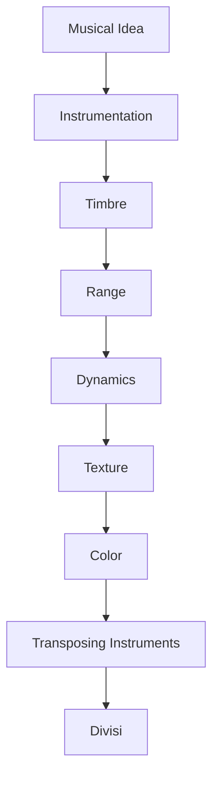

# Beginner Foundation: Orchestration

## 1. Everyday Intuition & First Principles

Orchestration is the art of assigning different musical parts to various instruments in an orchestra to create a rich and layered soundscape. Think of it as a painter choosing which colors to place where on a canvas to evoke a particular mood or scene. Just as a painter uses different hues to highlight certain areas and create depth, an orchestrator uses different instruments to bring out the nuances of a composition. Each instrument has its unique timbre, range, and dynamic capabilities, and the orchestrator's job is to harness these qualities to create a cohesive and expressive musical piece.

## 2. Foundational Vocabulary & Glossary

### 1. **Instrumentation**
   - **Definition:** The selection and use of specific instruments in a musical composition.
   - **Example:** Choosing to use a violin for a high, delicate melody and a cello for a deep, resonant bass line.

### 2. **Timbre**
   - **Definition:** The unique quality of sound that distinguishes one instrument from another.
   - **Example:** The bright, clear sound of a flute contrasts with the warm, rich sound of a French horn.

### 3. **Range**
   - **Definition:** The span of pitches that an instrument can produce.
   - **Example:** The piano has a wide range from A0 (27.5 Hz) to C8 (4186 Hz), allowing it to play both low bass notes and high treble notes.

### 4. **Dynamic**
   - **Definition:** The volume or loudness of a sound.
   - **Example:** A pianissimo (pp) dynamic is very soft, while a fortissimo (ff) dynamic is very loud.

### 5. **Texture**
   - **Definition:** The way different musical lines are combined to create a musical surface.
   - **Example:** A monophonic texture has a single melodic line, while a polyphonic texture has multiple independent melodic lines.

### 6. **Color**
   - **Definition:** The overall sound quality produced by a combination of instruments.
   - **Example:** A combination of strings and harp can create a soft, ethereal color, while brass and percussion can create a bright, energetic color.

### 7. **Transposing Instrument**
   - **Definition:** An instrument that plays at a pitch different from the written pitch.
   - **Example:** A B-flat trumpet plays a C when the music is written as a C, but it sounds a B-flat.

### 8. **Divisi**
   - **Definition:** A technique where a section of instruments splits into two or more parts to play different notes simultaneously.
   - **Example:** In a string section, the violins might be divided into two parts to play a harmonized melody.

## 3. Visual System Flow

### ASCII Diagram
```
+-------------------+
|  Musical Idea     |
+-------------------+
          |
          v
+-------------------+
|  Instrumentation  |
+-------------------+
          |
          v
+-------------------+
|     Timbre        |
+-------------------+
          |
          v
+-------------------+
|     Range         |
+-------------------+
          |
          v
+-------------------+
|     Dynamics      |
+-------------------+
          |
          v
+-------------------+
|     Texture       |
+-------------------+
          |
          v
+-------------------+
|     Color         |
+-------------------+
          |
          v
+-------------------+
|  Transposing      |
|  Instruments      |
+-------------------+
          |
          v
+-------------------+
|     Divisi        |
+-------------------+
```

### Mermaid Flowchart


## 4. Common Beginner Misconceptions & Mental Traps

### Misconception 1: **All Instruments Sound the Same**
- **Trap:** Thinking that all instruments can play any note equally well.
- **Reality:** Each instrument has a unique timbre and range, and certain notes may sound better on one instrument than another.

### Misconception 2: **Volume is the Only Dynamic**
- **Trap:** Focusing solely on how loud or soft an instrument plays.
- **Reality:** Dynamics include not just volume but also articulation, attack, and release, which can greatly affect the emotional impact of a piece.

### Misconception 3: **More Instruments Always Mean Better Sound**
- **Trap:** Believing that adding more instruments will automatically improve the quality of the music.
- **Reality:** Overusing instruments can lead to clutter and confusion. Effective orchestration involves careful selection and balance of instruments.

### Misconception 4: **All Instruments Play in the Same Key**
- **Trap:** Assuming that all instruments play in the same key as written.
- **Reality:** Transposing instruments play at a different pitch than written, and this must be taken into account when orchestrating.

### Misconception 5: **Divisi is Only for Strings**
- **Trap:** Thinking that divisi is a technique used only in string sections.
- **Reality:** Divisi can be used in any section of the orchestra, including woodwinds, brass, and percussion, to create complex textures and harmonies.

## 5. Socratic Discussion Starters

### Question 1: **Why is it important to consider the timbre of each instrument when orchestrating?**
- **Explore:** How does the unique sound of each instrument contribute to the overall color and mood of a piece?

### Question 2: **How does the range of an instrument affect its role in the orchestra?**
- **Explore:** What are the advantages and disadvantages of using an instrument at the extremes of its range?

### Question 3: **What are the different ways dynamics can be used to enhance a musical piece?**
- **Explore:** How do dynamics affect the emotional impact and narrative of a composition?

### Question 4: **How does the texture of a piece influence the choice of instruments?**
- **Explore:** What textures are best suited for different types of instruments and musical styles?

### Question 5: **What are the benefits and challenges of using transposing instruments in orchestration?**
- **Explore:** How does the use of transposing instruments affect the writing and performance of a piece?

### Question 6: **How can divisi be used to create complex textures in the orchestra?**
- **Explore:** What are some examples of how divisi can be used in different sections of the orchestra to create rich harmonies and melodies?
