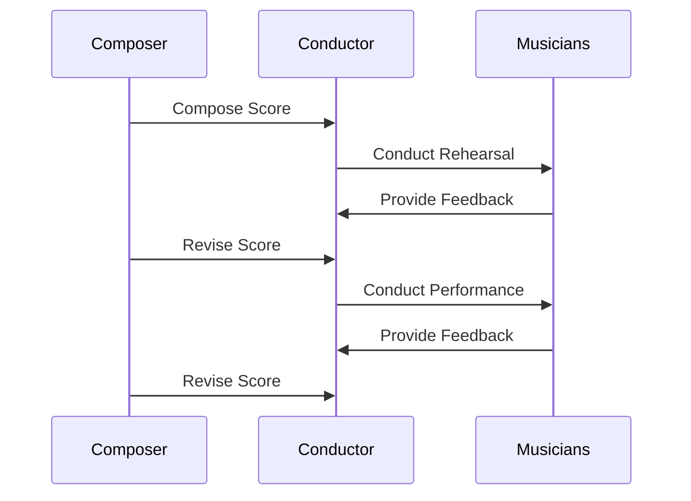

# Intermediate Foundation: Orchestration

## 1. Architectural Mental Model

In the realm of orchestration, the architectural mental model is a comprehensive framework that guides the composition and arrangement of musical works for an orchestra. This model transcends the mere selection of instruments and delves into the systematic design of how these instruments interact to create a cohesive and expressive musical texture. For an intermediate orchestrator, it is crucial to understand the orchestra as a complex system of interrelated components, each with its unique capabilities and roles.

### 1.1. The Orchestra as a System

The orchestra is a symphony of individual instruments, each contributing to the overall sound palette. The architectural mental model emphasizes the importance of understanding the orchestra's structure and the interactions between its components. This includes:

- **Instrument Families**: Strings, woodwinds, brass, and percussion.
- **Instrument Roles**: Melodic, harmonic, rhythmic, and timbral.
- **Dynamic Range**: The ability to produce a wide range of dynamics from pianissimo to fortissimo.
- **Timbral Diversity**: The unique tonal qualities of each instrument.

### 1.2. Production Architecture

In production architecture, the orchestrator must consider the practical aspects of performance. This includes:

- **Score Layout**: The physical arrangement of parts on the score, ensuring clarity and ease of reading.
- **Rehearsal Considerations**: The logistics of rehearsals, including seating arrangements and communication between sections.
- **Performance Dynamics**: The ability to control dynamics and articulations effectively during a performance.

## 2. Systems Taxonomy & Component Protocols

The systems taxonomy in orchestration involves categorizing instruments and their roles within the orchestra. Understanding these categories and the protocols that govern their interactions is essential for effective orchestration.

### 2.1. Instrument Families

- **Strings**: Violins, violas, cellos, and double basses. Strings are versatile and can produce a wide range of dynamics and articulations.
- **Woodwinds**: Flutes, oboes, clarinets, and bassoons. Woodwinds offer a variety of timbres and can be used for both melodic and harmonic roles.
- **Brass**: Horns, trumpets, trombones, and tubas. Brass instruments are powerful and can produce strong, resonant tones.
- **Percussion**: Timpani, xylophones, cymbals, and drums. Percussion instruments provide rhythmic and timbral diversity.

### 2.2. Standard Interfaces and Protocols

In orchestration, standard interfaces and protocols refer to the conventions and notations used to communicate with musicians. These include:

- **Staff Notation**: The primary method for writing music, using five-line staves to represent different ranges of instruments.
- **Dynamic Markings**: Symbols indicating the volume of a passage, such as pianissimo (pp), piano (p), mezzo-piano (mp), mezzo-forte (mf), forte (f), and fortissimo (ff).
- **Articulation Markings**: Symbols indicating how notes should be played, such as staccato (.), legato (—), and tenuto (-).
- **Tempo Markings**: Indications of the speed of a piece, using terms like adagio, andante, allegro, and vivace, or metronome markings.

### 2.3. Data Models

Data models in orchestration refer to the conceptual frameworks used to organize and represent musical information. These include:

- **Score Data Model**: Represents the entire orchestral score, including all parts and their interactions.
- **Part Data Model**: Represents individual parts for each instrument, including notes, dynamics, and articulations.
- **Performance Data Model**: Represents the performance of the orchestra, including dynamics, articulations, and timing.

## 3. Multi-Component Interaction Flow

Understanding the interaction flow between different components of the orchestra is crucial for effective orchestration. This includes the flow of musical information from the composer to the musicians and the interactions between different sections of the orchestra.

### 3.1. ASCII Sequence Diagram

```
+-------------------+       +-------------------+       +-------------------+
|   Composer        |       |   Conductor       |       |   Musicians       |
+-------------------+       +-------------------+       +-------------------+
          |                           |                           |
          |  Compose Score            |                           |
          |-------------------------->|                           |
          |                           |  Conduct Rehearsal        |
          |                           |-------------------------->|
          |                           |                           |
          |                           |  Provide Feedback         |
          |                           |<--------------------------|
          |  Revise Score             |                           |
          |-------------------------->|                           |
          |                           |  Conduct Performance      |
          |                           |-------------------------->|
          |                           |                           |
          |                           |  Provide Feedback         |
          |                           |<--------------------------|
          |  Revise Score             |                           |
          |-------------------------->|                           |
          |                           |                           |
```

### 3.2. Mermaid Sequence Diagram



## 4. Architectural Trade-offs & Production Pitfalls

In orchestration, architectural trade-offs and production pitfalls are inevitable. Understanding these trade-offs and pitfalls is essential for effective orchestration.

### 4.1. Trade-offs

- **Dynamic Range vs. Clarity**: Balancing the dynamic range of the orchestra with the clarity of individual parts.
- **Timbral Diversity vs. Coherence**: Balancing the timbral diversity of the orchestra with the coherence of the overall sound.
- **Rehearsal Efficiency vs. Performance Quality**: Balancing the efficiency of rehearsals with the quality of the performance.

### 4.2. Production Pitfalls

- **Overloading Sections**: Assigning too many parts to a single section, leading to confusion and poor performance.
- **Poor Communication**: Failing to communicate effectively with musicians, leading to misunderstandings and mistakes.
- **Inadequate Rehearsal**: Failing to provide adequate rehearsal time, leading to poor performance.

## 5. Socratic Discussion Starters

Socratic discussion starters are questions that bridge the architecture of orchestration to low-level implementation. These questions encourage critical thinking and deep understanding.

### 5.1. Questions

- **How can the architectural mental model be applied to the orchestration of a complex piece?**
- **What are the trade-offs between dynamic range and clarity in orchestration?**
- **How can the systems taxonomy and component protocols be used to improve the orchestration of a piece?**
- **What are the key considerations in designing the interaction flow between different components of the orchestra?**
- **How can architectural trade-offs and production pitfalls be avoided in orchestration?**

By exploring these questions, orchestrators can deepen their understanding of the architectural foundations of orchestration and improve their ability to create effective and expressive orchestral works.
