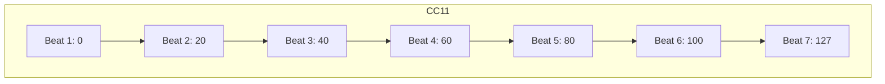

# Orchestration Masterclass: Scoring for Real Ensembles

## Who This Is For and What You Need

This is a hands-on course in orchestration — deciding which instrument plays which note, in which register, with which articulation, so the music says what you want it to say. You will write real voicings, play them on a keyboard controller into a DAW, and fix the three problems that wreck 90% of amateur scores: muddy bass register, buried middle voices, and smeared unison attacks.

**You need:**
- A DAW with per-track MIDI and CC automation (Logic, Cubase, Live, Reaper — any works)
- One orchestral sample library with dynamic layers and legato/staccato articulations (Spitfire BBC/Symphonic, VSL Synchron, Orchestral Tools Berlin, EastWest Hollywood — any works, but have at least strings + winds + brass)
- A MIDI keyboard, 61 keys minimum, with a mod wheel or expression pedal
- A free spectrum analyzer (Voxengo SPAN) and a free LUFS meter (Youlean Loudness Meter) — both zero-cost VST/AU plugins
- Manuscript paper or a notation program (Dorico, Sibelius, MuseScore) for writing voicings on real staves before you program them — **do this every time**, it's faster than hunting for wrong notes in a piano-roll

**How to practice this material:** read the physical reasoning in each section (short, never more than a paragraph), write the voicing on paper in the correct clefs with correct transpositions, program it, listen, measure it with the analyzer, and fix what's wrong. Measurement is not optional — your ear is good at telling you something's off; the spectrum analyzer tells you where and by how much.

---

## Part 1: String Orchestration

### 1.1 Why Strings Blend and How to Voice Them

A bowed string's tone is a sawtooth-like spectrum: strong fundamental, full set of harmonics decaying smoothly above it. When two violins play the same written pitch, no two players have identical pitch, bow speed, or vibrato phase — you get a natural ±5–10 cent spread and a 5–7 Hz vibrato rate that doesn't lock between players. That mismatch is *constructive*: it widens the sound without killing the attack, because the attack transients (bow catching the string) line up within a few milliseconds even though the sustained pitch wobbles independently. This is why doubled strings sound "bigger," not "flangier" — and why doing the same trick with a single sampled line pitch-shifted a few cents sounds synthetic: there's no independent vibrato on the copy.

**The spacing rule that actually matters:** below about 500 Hz, two notes closer than a minor third tend to fuse into one blurry pitch instead of being heard as a chord — harmonics from the lower note crowd the upper note's fundamental. Above 1 kHz, your ear resolves even a semitone cleanly because the ear's critical bands widen in Hz but shrink in perceived size as frequency rises. Practical consequence for voicing a string chord bottom-to-top:

- **Bass (cello/bass):** space wide — 5ths, octaves, 12ths. Never put a 2nd or 3rd between the two lowest voices.
- **Middle (viola, 2nd violin):** 3rds and 4ths are fine.
- **Top (1st violin):** close spacing is fine, even 2nds, as long as you stay above middle C (C4).

### 1.2 Four-Part Chorale, Written Out

Here's a spaced C major chorale, string quartet voicing, correctly spaced by the rule above.

| Voice | Clef | Note | MIDI | Interval above voice below |
|---|---|---|---|---|
| Violin I | Treble | C5 | 72 | minor 6th above Vln II |
| Violin II | Treble | E4 | 64 | major 6th above Viola |
| Viola | Alto | G3 | 55 | perfect 12th above Cello |
| Cello | Bass | C2 | 36 | — |

```text
Violin I   : ----------------●---
Violin II  : -----------●-------
Viola      : -------●-----------
Cello      : ---●---------------
             (low)        (high)
```

Notice the 12th between cello and viola — that's a 5th plus an octave, deliberately wide, so the cello's upper harmonics (which land around 130, 195, 260 Hz) don't crowd the viola's fundamental at 196 Hz. If you instead wrote cello C2 and viola E3 (a major 3rd), the chord would sound thick and indistinct even though it's "correct" harmony on paper. **Try both voicings back to back — this is the single fastest ear-training exercise for spacing.**

### 1.3 Programming It: Fader and Pan Starting Points

Set up seven tracks (doubling Violin I and II for a chorus effect):

| Track | Part | Fader | Pan |
|---|---|---|---|
| 1 | Violin I | −6 dB | L30 |
| 2 | Violin II | −6 dB | L20 |
| 3 | Viola | −8 dB | center |
| 4 | Cello | −10 dB | center |
| 5 | Violin I (dup.) | −6 dB | R30 |
| 6 | Violin II (dup.) | −6 dB | R20 |
| 7 | Double Bass | −13 dB | center |

For the doubled tracks (5 and 6): copy the MIDI, but **don't just duplicate it exactly** — nudge the region 8–12 ms later, and if your library has multiple mic positions or round-robin samples, switch them. This recreates the natural player-to-player timing variance described above. A perfectly identical duplicate at 0 ms offset doesn't widen the sound — it risks phase cancellation (see Part 4).

Double bass: write C2 if your library auto-transposes basses down an octave from written pitch (most do, matching real bass notation); otherwise write C1 directly. Keep it 3 dB under the cello so it reinforces the fundamental without stepping on the cello's midrange color.

**Spectrum analyzer check** (SPAN on the master bus, after rendering):
- 60–200 Hz: solid energy, this is your cello + bass fundamental — if this region is clipping or dominating, pull the bass fader down 2–3 dB
- 300 Hz–1 kHz: viola/2nd violin body — should sit visibly under the bass hump, not above it
- 1–5 kHz: violin I brilliance — a small shelf here is fine, but if it peaks more than 3 dB over everything else, cut a gentle high shelf at 4 kHz, −1.5 dB

### 1.4 Dynamics: Why Linear CC11 Automation Sounds Wrong

If you draw a straight-line crescendo in CC11 (expression) from 40 to 100 over four beats, the audio *doesn't* sound like a smooth, even crescendo — it jumps loud early and barely moves at the top. This is because loudness perception is compressive (the same physics behind the Fletcher-Munson curves): equal increments in physical intensity produce shrinking increments in perceived loudness as you get louder. Sample libraries compound this with their own velocity-layer crossfades, which are rarely linear either.

**Fix:** use an S-curve, not a straight ramp. In most DAWs you can right-click an automation ramp and select an S-curve or exponential curve shape. If your DAW only allows straight ramps, draw it manually with more breakpoints bunched toward the loud end:



Dense points near the bottom, sparse near the top — this compensates for the ear's compression and produces an audibly even crescendo. Verify with a LUFS meter in short-term mode: measure loudness every 0.5 seconds across the swell; the LUFS values should increase in roughly equal steps if your curve is shaped correctly. If the measured steps are uneven (big jumps early, tiny moves late), adjust the curve further.

### 1.5 Practice Drill: Masking in the Low Register

Play a solo cello C2, note its apparent loudness. Mute it, play a solo viola C4, note its loudness. Now play both together. The combined sound is almost always *quieter in the viola* than you'd expect from simple addition — this is called upward spread of masking: a loud low note's harmonics extend upward and bury a softer note sitting above it, even though a note of the *same* pitch an octave higher wouldn't mask it nearly as much.

**Drill:** write a passage where cello and viola must both be heard clearly (e.g., cello pedal tone under a viola melodic line). Start the cello at mf and the viola at mf — listen for burying. Pull the cello back to mp, or move the viola line up an octave, or widen the interval between them. Re-listen after each change until the viola is clearly audible without raising its own volume. This one physical fact — low loud notes mask mid notes more than high notes do — is why Rimsky-Korsakov's orchestration treatise insists on never doubling a melody's inner harmony in the bass register at full strength.

---

## Part 2: Woodwind Orchestration

### 2.1 Why Woodwinds Don't Blend the Way Strings Do

A clarinet's cylindrical, closed-at-one-end bore suppresses even harmonics — its spectrum is dominated by the fundamental, 3rd, 5th, 7th partials, giving it that hollow, "woody" character. An oboe or bassoon's conical bore produces a full harmonic series, odd and even, which is why they sound brighter and more nasal. Because these overtone *shapes* differ, two different woodwinds playing the same unison pitch never truly fuse the way two violins do — you always hear "a clarinet and an oboe," not "one bigger instrument." That's not a flaw to fix; it's the color palette. Blend in woodwinds comes from balance and register matching, not from acoustic fusion.

### 2.2 Written Woodwind Quartet: Diminished Seventh Voicing

A Bo7 chord (B♭–D♭–F♭–A♭, respelled B♭–D♭–E–G♯), voiced bottom to top in a standard flute/oboe/clarinet/bassoon quartet:

| Voice | Transposition | Sounding pitch | Written pitch (for performer) |
|---|---|---|---|
| Flute | none | A♭5 | A♭5 |
| Oboe | none | F4 | F4 |
| Clarinet in B♭ | sounds M2 lower than written | D♭4 | E♭4 |
| Bassoon | none | B♭2 | B♭2 |

**The one transposition rule you must never get backward:** a B♭ clarinet, when the player reads a written C, produces a sounding B♭ — a major second *lower*. So to get the clarinet to sound D♭4, you write E♭4 on the clarinet's part (or enter the sounding pitch D♭4 directly if your sample library auto-transposes, which most modern libraries do — check this once per library and write it on a sticky note on your monitor).

Spacing: bassoon to clarinet is a minor 10th (wide, correctly avoiding bass-register mud), oboe to flute is a major 10th (also wide at the top, avoiding woodwind shrillness from crowding).

### 2.3 Staggered Dynamics — The Real Fix for Woodwind Balance

Put a bassoon, clarinet, oboe, and flute all at the same CC11 value and the oboe will dominate every time — its conical bore and reed give it far more perceived cutting power per unit of physical loudness than the flute's breathy, nearly sine-wave tone in its low register. The fix used by every working orchestrator is to *stagger* the written dynamic by instrument, not to rely on the mixer fader after the fact (fader balancing kills the natural attack-to-sustain dynamic shape baked into the samples).

Practical starting dynamics for a balanced sustained chord, loudest instrument first in perceived cutting power:

| Instrument | CC11 target (mid-chord) | Why |
|---|---|---|
| Oboe | 70–80 | Most piercing per unit loudness — written softer than it sounds |
| Bassoon | 85–90 | Loud in low register, needs no boost but shouldn't overpower |
| Clarinet | 80–85 | Warm, blends easily, moderate level |
| Flute | 70–75 in low register / 90+ above C5 | Weak below middle C, strong and piercing above the staff — adjust by register, not a flat number |

Write these into the CC11 lane as the *baseline*, then shape your crescendo/diminuendo on top of each track's own baseline, not identical automation curves copy-pasted across all four parts.

### 2.4 Blend vs. Separation: A Panning Drill

Render the same four-part woodwind chord twice:
1. **Blended:** all four parts panned dead center
2. **Separated:** bassoon center, clarinet L25, oboe R25, flute R45

Listen to both with your eyes closed. The blended version reads as "one woodwind chord" — useful for a sustained pad under a melody elsewhere. The separated version reads as "four distinct lines" — useful whenever the four parts have independent contrapuntal motion (imitative entries, hocketing, call and response). **Rule of thumb:** pan for texture, not for habit. Block chords (homophony) → blend tight. Independent lines (counterpoint) → spread wide. Mixing styles without matching your panning to the texture is one of the most common amateur-mockup mistakes.

---

## Part 3: Brass Orchestration

### 3.1 Transient Mismatch — The Brass-Specific Problem

Brass tone starts with the player's lips buzzing against the mouthpiece — a sharp pressure spike that strings and winds don't produce the same way. But different brass instruments take different amounts of time to "speak":

| Instrument | Typical attack time | Why |
|---|---|---|
| Trumpet | 10–30 ms | Tight embouchure, small mouthpiece, fast response |
| Trombone | 20–50 ms | Larger mouthpiece, slide slightly slower to commit than valves |
| Tuba | 30–60 ms | Huge air column, slow to pressurize |
| Horn | 30–80 ms | Soft embouchure by design — horn players deliberately play "behind" the beat relative to trumpet to get their characteristic warmth |

If you write a brass chorale and all four parts attack at literally the same MIDI tick, the horn's slower natural speech means its note audibly *lags* the trumpet by up to 50–70 ms — the chord "blurs in" instead of hitting together. This is the single most common reason amateur brass mockups sound mushy compared to a real section, which locks together because professional players subconsciously compensate their attack timing for each other.

### 3.2 Written Brass Chorale: E♭ Major with Doubled Root

| Voice | Transposition | Sounding pitch | Written pitch |
|---|---|---|---|
| Trumpet in B♭ | sounds M2 lower | E♭5 | F5 |
| Horn in F | sounds P5 lower | G4 | D5 |
| Trombone | none (bass clef, concert pitch) | B♭2 | B♭2 |
| Tuba | none | E♭2 | E♭2 |

Spacing: tuba to trombone is a perfect 5th (wide bass, correct), trombone to horn is a major 6th, horn to trumpet is a minor 6th (close top, correct). Trumpet doubles the tuba's root two octaves up, reinforcing E♭ as the clear tonal center.

### 3.3 Fixing Attack Mismatch: Velocity Compensation

Most sample libraries trigger a faster, sharper attack sample at higher velocities and a softer, slower one at lower velocities (velocity-layer crossfading). You can exploit this to pull a naturally slow instrument's *perceived* attack forward without touching the actual note start time:

| Instrument | Velocity | Purpose |
|---|---|---|
| Trumpet | 100 | Baseline — fastest natural attack, no compensation needed |
| Trombone | 105 | Slight boost, moderate attack |
| Tuba | 105 | Slight boost, moderate attack |
| Horn | 110 | Largest boost — horn is the slowest instrument, needs the most help triggering a fast attack layer |

Render, then zoom into the waveform at the downbeat in your DAW's sample editor. Drag the cursor from true silence to the first visible peak for each track soloed. If the horn's peak still lands more than 15 ms after the trumpet's, you have two more tools, in order of preference:

1. **Nudge the horn's MIDI note 10–15 ms earlier** than the other three parts. This is exactly what a horn player does instinctively in a live section — they "lean in" ahead of the beat.
2. If your library offers it, switch the horn to a dedicated "marcato" or "accented" articulation instead of a plain sustain — these are built with faster attack transients specifically for chorale writing.

Never use a legato articulation for a brass chorale attack — legato patches are built around slurred, connected note transitions and have a slow, rounded onset unsuitable for a unified chord hit. Use marcato, accent, or straight sustain-with-attack patches.

### 3.4 Spectral Check for Brass Balance

After rendering the chorale, SPAN on the master bus should show:

- 70–150 Hz: tuba fundamental, smooth, no sharp spike
- 150–300 Hz: trombone/tuba overtones — if the tuba's harmonics spike here more than 6 dB over the trombone, high-pass the tuba gently below 100 Hz (6 dB/octave) to tighten the sub-bass without losing the fundamental
- 300–800 Hz: horn formant region — the horn should sit audibly present here, not buried
- 800–2500 Hz: trumpet brilliance — if it peaks more than 6 dB above the horn/trombone region, back the trumpet velocity down 5–10 points rather than reaching for EQ first; EQ on brass samples tends to reveal sample artifacts the velocity layers were designed to hide

---

## Part 4: Fault Diagnosis — Three Failures Every Orchestrator Hits and How to Fix Them

### 4.1 Fault: Phase Cancellation from Lazy Doubling

**Symptom:** you double a line to make it bigger, and it comes out thinner, hollower, or barely louder than the solo version.

**Cause:** two identical MIDI notes, same velocity, same mic position, same timing, both panned center. The waveforms are near-identical copies, and summing two near-identical waveforms doesn't double the amplitude the way you'd expect — it creates comb filtering, where certain frequencies cancel because the two copies' phases line up destructively at those frequencies.

**Diagnose it:** load both tracks into a correlation meter (SPAN has one, or any free phase-correlation plugin). A reading near **+1.0** means the two signals are near-identical copies — not a good sign for a "doubling" effect, even though it sounds satisfyingly simple on the meter. Check the amplitude gain at the note's fundamental frequency: true doubling of two *independent* (uncorrelated) sources gives roughly +3 dB of power gain, whereas perfectly correlated signals give +6 dB and anti-correlated signals cancel out. depending on correlation — if you're getting less than +3 dB of gain where you expected +6 dB, you've got partial cancellation eating your doubling.

**Fix (apply at least two):**
1. Shift the duplicate's MIDI region 10–15 ms later
2. Switch the duplicate to a different mic position in the library, or a different round robin
3. Pan the two copies apart (L30/R30 rather than both center)
4. Use a different articulation variant if the library offers one (e.g., a different legato transition sample)

Re-measure: correlation should drop to roughly **+0.3 to +0.7** — this is what *real* two-player doubling measures as, and it's the sound of genuine width rather than mono mush.

### 4.2 Fault: A Middle Voice Disappears in a Full Tutti

**Symptom:** you write a thick 8-part string texture — doubled violins, doubled violas, doubled cellos, doubled basses, all forte — and the violas vanish even though you can see their MIDI notes clearly in the piano roll.

**Diagnose it:** solo the violas — they sound fine. Bring back the full texture — they're gone. Load SPAN and compare RMS energy in three bands: 60–150 Hz (bass/cello fundamentals), 150–500 Hz (viola/cello overtone region), 500–1500 Hz (violin fundamentals). If the middle band reads 6–10 dB quieter than the outer two bands relative to where the viola's actual pitch sits, that's masking: the viola's fundamental is getting buried between the cello/bass harmonic buildup below and the violin energy above.

**Fix — pick one:**
1. **Move the violas up an octave.** The single most effective fix; it moves the viola's fundamental out of the crowded harmonic shadow of the bass instruments entirely.
2. **Boost the violas' CC11** by 15–20 points relative to the rest of the section — brute-force but works when register change isn't musically appropriate.
3. **Carve space for them with EQ on the instruments masking them** — a gentle −3 dB cut at 250 Hz (Q≈1.0) on cellos/basses removes exactly the overtone energy sitting on top of the viola's register, without touching the cello's own fundamental.

Re-measure: the middle band should land within about 3 dB of the violin band once the fix is applied — close enough that the ear perceives all three registers as present and balanced.

### 4.3 Fault: Blurred Unison from Mismatched Articulations

**Symptom:** you write the same line on two instruments in unison for extra weight — say two trumpets — but one track got left on a legato patch and the other on staccato. The unison doesn't sound "bigger," it sounds smeared, like a bad reverb.

**Diagnose it:** solo each track. The staccato track attacks in 10–20 ms. The legato track takes 50–100 ms to reach full amplitude. Combined, the onset you hear is neither — it's a mushy average that can stretch past 60 ms of ambiguous attack.

**Fix:** match the articulation across both unison tracks. If the musical context calls for legato phrasing, put *both* tracks on legato. If it calls for a sharp hit, put both on staccato or marcato. If you have a specific reason to keep them different (rare, but sometimes used deliberately for a "doubled but slightly blurred" character on purpose, e.g. in film scoring for a dreamlike effect), you can instead pre-compensate: shift the slower (legato) track's MIDI note 30–40 ms earlier so its *perceived* onset — not its literal MIDI start time — lines up with the staccato track's onset. Verify by ear and by waveform cursor until the two attacks visually and audibly converge into one transient rather than two staggered ones.

---

## Part 5: Score Study Drill — Learn From the Masters by Measuring Them

The fastest way to internalize real orchestration decisions is to compare a published score against its recording, bar by bar, with your eyes on a spectrogram.

**Procedure:**
1. Pick a 20–30 second passage with a full score available (Ravel's *Daphnis et Chloé* Suite No. 2 opening, Rimsky-Korsakov's *Scheherazade* 2nd movement opening, or Stravinsky's *Rite of Spring* "Augurs of Spring" — all in cheap Dover or Eulenburg study-score editions).
2. Load the recording into a spectrogram viewer (Sonic Visualiser, free) with an FFT size of 8192 and Hann window — this gives you fine frequency resolution appropriate for identifying which instrument family sits in which band.
3. With score in hand, mark on the spectrogram which instrument occupies which frequency region at each moment: who's carrying the bass line, who's doubling the melody an octave up, where the inner voices sit.
4. **Now recreate the passage yourself** in your DAW using your own sample library, matching the score's instrumentation, articulation markings, and dynamics exactly.
5. Render your version, load it next to the original recording, and compare spectrograms directly. Where does your mix have more or less energy than the original in a given band? That gap is where your orchestration instinct (or your sample library) deviated from what the composer actually wrote and what a real orchestra actually produces.

This single exercise, repeated across a dozen passages from different composers, teaches you more about real-world voicing decisions than any amount of reading about orchestration theory — because you are forced to reconcile what's on the page with what you actually hear.

---

## Mastery Checklist

You're operating at a competent working level when you can, without stopping to look anything up:

- [ ] Voice a four-part string, woodwind, or brass chorale with correct transpositions and idiomatic spacing (wide bass, moderate middle, close top) on the first pass
- [ ] Recognize by ear when a middle voice is being masked, and fix it by register, dynamics, or EQ without needing to be told which one to use
- [ ] Shape a crescendo with a curved (not linear) automation lane and explain why a straight ramp sounds uneven
- [ ] Diagnose phase cancellation from a doubled line by ear, then confirm and fix it with a correlation meter
- [ ] Align a brass chorale's attacks within roughly 10 ms using velocity and articulation choice, not just by quantizing note starts
- [ ] Choose panning (blended vs. spread) based on whether the texture is homophonic or contrapuntal, as a deliberate decision rather than a default habit
- [ ] Pull a real score and recording apart by ear and by spectrogram, and explain in plain terms why the composer made each registration choice

## Where to Go Next

- **Counterpoint and voice leading** — how to write the individual lines that orchestration then dresses in color (species counterpoint, suspensions, parallel-motion avoidance)
- **Extended and divisi string writing** — splitting a section into independent sub-parts for denser harmonic textures
- **Percussion and color instruments** — harp, celesta, tuned percussion, and how they cut through or blend with the rest of the orchestra
- **Mixing and mastering orchestral mockups** — convolution reverb for hall placement, EQ matching against reference recordings, and gain-staging a full virtual orchestra so nothing clips at the final mixdown

---

## Conclusion

Orchestration is not decoration applied after the fact—it is the structural decision that determines whether a musical idea will land with clarity or dissolve into mud. Every choice you make—register, doubling, articulation, panning—either reinforces the contrapuntal architecture or obscures it. The competent orchestrator does not guess; they predict masking, anticipate phase issues, and shape dynamics with an understanding of how human hearing integrates intensity over time. This requires equal fluency in the physics of sound (frequency content, attack transients, spatial separation) and the idiomatic constraints of real instruments (breath capacity, bow speed, embouchure endurance). Your mockup is not a placeholder for a future recording; it is a testable hypothesis about what will work when live players sit down with your parts. If it does not sound balanced and clear in your studio, no amount of "they'll figure it out in the session" will save it.

The gap between competent and masterful orchestration is closed not by acquiring more sample libraries, but by developing ruthless diagnostic instincts. You must be able to hear a muddy texture and isolate the cause—too many voices in the same octave, a trombone buried under horns, a violin line fighting a flute for the same frequency band—and apply the minimum effective intervention without rewriting the entire cue. This requires building a mental model of the ensemble as a frequency-domain object, where every instrument occupies not just a pitch but a spectral footprint, and every doubling either reinforces or cancels depending on phase alignment and attack synchronization. The exercises in this unit are not academic drills; they are the diagnostic workflows that separate orchestrators who produce usable parts from those who produce notation that looks plausible but collapses under the reality of bows, breath, and room acoustics.

---

## Summary & Verification Matrix

| **Invariant / Principle** | **Mechanism** | **Diagnostic Criterion** | **Failure Mode** |
|---|---|---|---|
| **Wide bass, moderate middle, close top** | Low frequencies mask more easily; tight bass voicing creates mud, while wide treble spacing sounds thin | Solo each voice and verify at least a 4th–5th between lowest two parts, 3rd in middle, 2nd or unison at top | Bass notes less than a major 3rd apart sound blurred; treble notes more than a 5th apart lose blend |
| **Masking hierarchy: low obscures high, loud obscures soft, same-timbre obscures different-timbre** | Overlapping fundamental and overtone regions cause perceptual fusion or cancellation; louder source dominates attention | Check spectrogram for frequency overlap; solo suspected masked voice to confirm it disappears in the mix | Critical melody or counterpoint line is inaudible despite correct notation and dynamics |
| **Curved (exponential) dynamics beat linear ramps** | Human loudness perception follows a logarithmic scale (dB), so linear MIDI CC ramps sound back-loaded | Draw automation with accelerating slope for crescendo, decelerating for diminuendo; A/B test against straight ramp | Linear crescendo sounds like nothing is happening until the last 20%, then suddenly too loud |
| **Phase alignment matters for doubled lines** | Identical pitches from different sources sum constructively only if wavefronts arrive in phase; slight timing/tuning offsets cause comb filtering | Use correlation meter (should read +0.7 to +1.0 for intended doubling); check for hollow/filtered tone quality | Doubled line sounds weaker or spectrally thin compared to single instrument, or has a "phaser" quality |
| **Attack alignment (not just start time) determines ensemble tightness** | Bowed/blown instruments have variable attack slopes; faster attacks need velocity adjustments, slower attacks need earlier starts | Align transient peaks within ~10 ms window; use velocity to match attack intensity, not just start time | Section sounds ragged or out-of-sync despite quantized note starts; brass entries sound staggered |
| **Panning strategy follows texture: blend homophony, spread polyphony** | Homophonic textures benefit from centered mono/narrow stereo for power; contrapuntal lines need spatial separation to remain distinct | If all voices move in rhythm, pan narrow (±15°); if independent rhythms, pan wider (±30–60°) per voice | Counterpoint becomes unintelligible mush when panned center; chordal brass loses impact when spread too wide |
