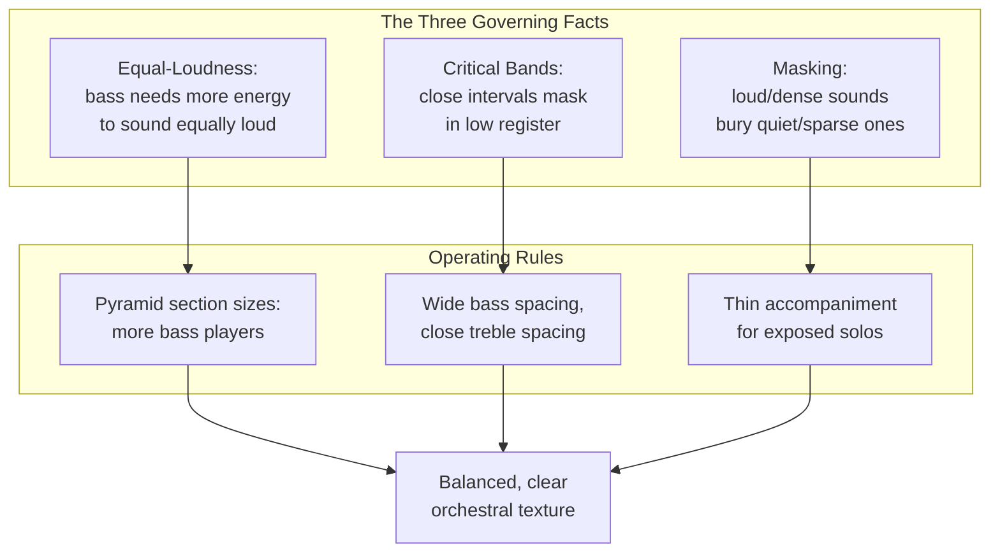
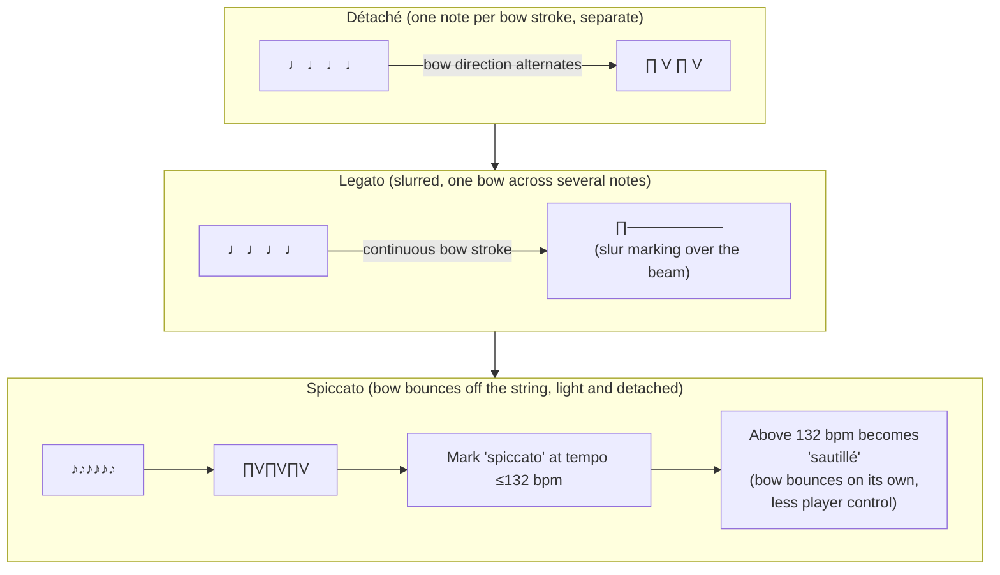
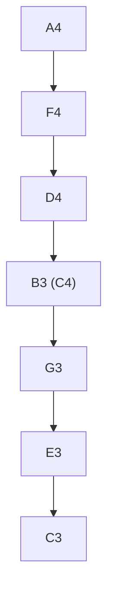
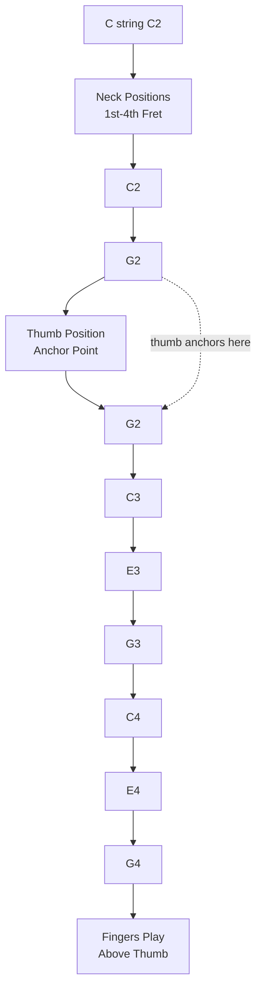
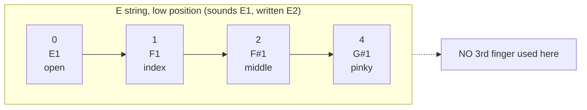
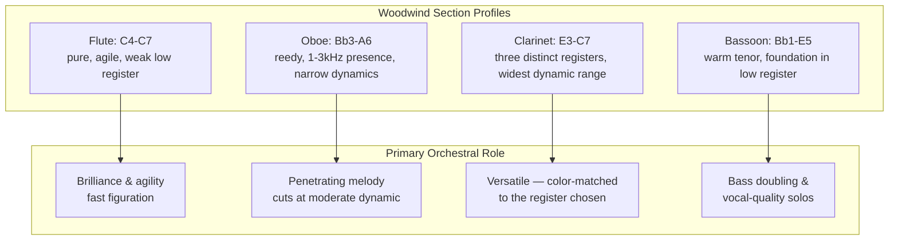

# Lesson 1: Orchestration — Writing the Orchestra Like a Working Composer

## 1. What You're Actually Doing When You Orchestrate

Orchestration is deciding which instruments play which notes, in which register, at which dynamic, with which articulation — so that the music is heard the way you intend. Every choice is a trade against three hard constraints: how loud an instrument actually is relative to others, how the ear groups and masks overlapping frequencies, and what a player can physically execute in tempo. Get the physics and the ergonomics right and the "artistic" choices become obvious. Get them wrong and no amount of talent saves the passage — it will sound muddy or will not balance, full stop, regardless of how good the harmony is on paper.

This lesson gives you the operating rules first, then drills you on real scores you can pull up and check against today.

### The three facts that explain almost every orchestration rule

**1. Low notes need more players, not more ink.** Sound pressure drops off fast at low frequencies relative to how loud we perceive it (Fletcher-Munson equal-loudness curves) — at quiet-to-moderate listening levels, a 100 Hz tone needs roughly 10 dB more acoustic energy than a 1000 Hz tone to sound equally loud. That's why basses (8-10 players) sit under cellos (10-12), violas (12-14), and violins (30+ combined) — the pyramid isn't tradition, it's compensating for ears that are deaf to bass relative to midrange. Practical consequence: if you write a solo tuba note at the same dynamic marking as a solo flute, the flute will sound louder. Write the tuba *f* against the flute's *mp* and you'll get something closer to equal presence.

**2. Close intervals in the bass turn to mud; the same interval up high stays clear.** The ear can't separate two pitches whose harmonics fall inside the same "critical band" (roughly 100 Hz wide at 100 Hz, but only ~160 Hz wide at 1000 Hz — the resolving power scales with frequency, not pitch distance). A tight C2-E2-G2 triad crams three fundamentals and a thicket of overlapping harmonics into one narrow band and reads as sludge. Spread it — C2, G2, E3, C4 — and each note's harmonics clear the next note's territory. **Rule of thumb: space the bottom of a chord by a 5th or more, the top by a 3rd or less.** This single rule fixes 80% of "why does my low brass chord sound bad" problems.

**3. Instruments don't erase each other evenly — they mask.** A loud, spectrally dense sound (full brass) will bury a quiet, spectrally sparse one (solo clarinet) that shares its frequency range, even at a "reasonable" dynamic gap. This is why delicate woodwind solos get the thin accompaniment (strings pizzicato, divisi tremolo *ppp*) and why big tutti brass chords need the woodwinds either doubled in unison for reinforcement or silenced — there's no middle ground where a lone oboe survives against *ff* brass.

Everything below operationalizes these three facts into per-section technique, real voicings, and drills.



---

## 2. Strings: The Section You Build Everything On

### Standard seating and ranges (large orchestra)

| Section | Players | Sounding Range | Open Strings |
|---|---|---|---|
| Violin I | 16-18 | G3-E7 (practical ceiling ~A6 for ensemble work) | G3 D4 A4 E5 |
| Violin II | 14-16 | G3-E7 | G3 D4 A4 E5 |
| Viola | 12-14 | C3-A6 | C3 G3 D4 A4 |
| Cello | 10-12 | C2-C6 | C2 G2 D3 A3 |
| Bass | 8-10 | E1-G4 (written 8va higher than sounds) | E1 A1 D2 G2 |

### Violin: what to actually write

**First-position fingering on the A string**, the workhorse register for ensemble writing:


**Bow articulation — notate exactly what you want, players execute literally:**



**Contact point changes timbre more than dynamic does.** This is the single most underused string tool in student orchestration:
- *Sul tasto* (bow over the fingerboard): soft attack, fundamental-heavy, flute-like — use for *ppp* atmospheric string beds.
- *Normale* (standard contact point, between bridge and fingerboard): default.
- *Sul ponticello* (bow near the bridge): glassy, overtone-rich, metallic — use for tension, horror-film shimmer, Penderecki-style effects, *not* for warm melodic material.

**Muting:** `con sordino` (mute on) dulls amplitude and kills high partials — write it for hushed, veiled string textures, never for passages that need to project. `senza sordino` cancels it. Mute changes take 3-5 seconds — never demand a mute swap inside a held phrase.

### Viola: use the C string, don't bury it

Viola read alto clef (middle line = C4):



The C string (C3-G3) is the viola's unique acoustic territory — no other string instrument's open low string lives there with that dark, slightly veiled color. **Give violas independent material in this register instead of doubling cello an octave up** — that's where the instrument actually sounds like itself rather than a weak violin.

### Cello: thumb position opens the top two octaves

Below A3, use neck positions (1st-4th). Above A3, the thumb anchors flat against the fingerboard as a movable "nut," with fingers 1-2-3 playing above it:



Cello's three-register versatility is its orchestrational superpower: low register (C2-G2) = bass foundation doubling basses at the octave; tenor register (A2-A3) = warmest singing-melody register in the orchestra, used constantly for solo lines (Elgar Cello Concerto, Tchaikovsky *Rococo Variations*); thumb-position register (A3+) = brilliant, intense, cuts through texture.

### Double Bass: Simandl 1-2-4, mandatory below 7th position

Bass notation sounds an octave below written pitch — always. Below the 7th fret-equivalent position, the hand span required for one-finger-per-fret playing causes tendon strain, so the standard pedagogy (Franz Simandl) uses **1-2-4 fingering**, skipping the 3rd finger entirely in low positions:



Above the 7th position (roughly G2 and up on the G string), switch to one-finger-per-fret (OFPF) — the frets are close enough that the 1-2-3-4 span is comfortable. **If you're writing fast chromatic bass lines below G2, check they're playable with 1-2-4 only** — a passage that needs the 3rd finger in low position will force the player to shift position mid-phrase, killing your tempo.

### Full string-section voicing: C major triad, correctly spaced

```text
Violin I (16):   C5, E5 divisi a2       ← melody register, close spacing fine here
Violin II (14):  G4, C5 divisi a2       ← upper harmony
Viola (12):      E4, G4 divisi a2       ← middle harmony
Cello (10):      C3, G3 divisi a2       ← tenor foundation
Bass (8):        C2 unison              ← bass foundation, wide below

Bass interval C2→G3 = 19 semitones (wide — stays clear)
Treble interval G4→E5 = 9 semitones (close — still clear at this register)
```

Compare this to the broken version: Cello all three chord tones stacked C2-E2-G2 inside one octave. Play both on a DAW mockup or at a reading session — the difference is not subtle. The wide-bass/close-treble spacing is not a stylistic preference, it's a direct application of critical-band theory from Section 1.

**Drill — spacing diagnosis:** Take any four-part chorale harmony (Bach chorales are ideal, all public domain on IMSLP). For each chord, check: is the interval between the bottom two voices wider than the interval between the top two? If not, rewrite before orchestrating. Do this for 10 chorales before moving on — it should become automatic.

---

## 3. Woodwinds: One Player, One Line, Three Faces Per Instrument

Unlike strings, woodwinds are written one-player-per-part. Standard large orchestra: 3 flutes (3rd doubles piccolo), 3 oboes (3rd doubles English horn), 3 clarinets (3rd doubles bass clarinet), 3 bassoons (3rd doubles contrabassoon). Chamber orchestra: 2 of each, no doubling instruments.

### Flute

Range C4-C7+. Pure, hollow tone from a cylindrical bore dominated by the fundamental with fast rolloff of upper harmonics — the opposite spectral profile from oboe.

**Register behavior you must know:**
- C4-C5 (low): warm but *weak* — easily masked by anything else playing simultaneously. Never write low flute under tutti strings expecting it to be heard.
- C#5-C6 (middle): the characteristic flute sound, projects well.
- C#6-C7 (high): brilliant, increasingly piercing — effective for brief accents, bad for sustained *ppp* passages (intonation gets unstable and the player fatigues fast).

**Simplified fingering reference, first octave:**

```text
C4:  ●●●●●●●   (all keys closed)
D4:  ●●●●●●○
E4:  ●●●●●○○
F4:  ●●●●○○○
G4:  ●●●○○○○
A4:  ●●○○○○○
B4:  ●○○○○○○
C5:  ○○○○○○○   (thumb key only)
```

**Tonguing drill (practice at 60 → 80 → 110 bpm):**

```text
Single tonguing:  Ta Ta Ta Ta Ta Ta Ta Ta   (quarter or eighth notes)
Double tonguing:  Ta-Ka Ta-Ka Ta-Ka Ta-Ka    (for passages faster than single tongue can clear)
Triple tonguing:  Ta-Ta-Ka Ta-Ta-Ka          (for compound/triplet subdivisions)
```

As an orchestrator, mark tempo realistically: single tonguing tops out around 140-150 bpm for sustained 16ths; above that, write material that works with double/triple tonguing patterns (groups of 2 or 3), not arbitrary scalar runs.

### Oboe

Range B♭3-A6. Conical bore + double reed = strong odd *and* even harmonics, concentrated heavily in the 1-3 kHz band — exactly where human hearing is most sensitive. That's why the oboe cuts through an orchestra at *mp* when a flute can't at *f*, and why it's the standard tuning reference (A4 = 440 Hz, pure and stable).

**Orchestration consequence:** oboe is your go-to for a melodic line that must be heard over moderate accompaniment without resorting to loud dynamics. Narrow dynamic range though — don't ask for a true *ppp* or true *fff*, the reed won't comfortably deliver either extreme.

**English horn** (3rd oboist doubles): sounds a 5th lower than written, range F3-C6 sounding. Darker, rounder, pastoral — the "lonely shepherd" color (Rossini *William Tell*, Dvořák Symphony No. 9 slow movement).

### Clarinet

Range E3-C7 (B♭ clarinet, written pitch). Cylindrical bore overblowing at the 12th creates **three genuinely different instruments in one**:

```text
Chalumeau (E3-Bb4):   dark, hollow, reedy — odd harmonics dominate
Clarion (B4-C6):      bright, clear, even, singing
Altissimo (C#6-C7):   shrill, penetrating, needs careful voicing to not scream
```

**The break (B4→C5) is a real technical hazard** — the player opens the register key and the fingering changes completely. Slow scale practice across the break (60 bpm, E4-F4-G4-A4-B4-C5-D5-E5, listening for timbral smoothness) is standard conservatory homework; as an orchestrator, avoid writing fast passagework that crosses the break repeatedly unless you want that timbral "seam" audible as an effect.

Clarinet has the widest dynamic range of any woodwind (40+ dB) — it is the woodwind you can genuinely trust with both a true *ppp* and a true *ff*.

**Transposition, memorize this:**

```text
B♭ Clarinet: written C5 sounds B♭4 (down a major 2nd)
A  Clarinet: written C5 sounds A4  (down a minor 3rd) — darker key color, used for
             passages in keys awkward on B♭ (many sharps)
Bass Clarinet (B♭): written C4 sounds B♭2 (down a major 9th)
```

### Bassoon

Range B♭1-E5+ (experienced players go higher). Double reed, long folded conical bore.

```text
Low (Bb1-Eb2):    deep, resonant, can sound gruff at loud dynamics — good for comic/grotesque effects
Tenor (E2-Bb3):   warm, vocal, THE register for lyrical bassoon solos
Upper (B3-E5+):   thin, reedy, plaintive — effective but needs careful support underneath
```

Contrabassoon (3rd bassoonist doubles) sounds an octave below written, down to B♭0/A0 — the lowest woodwind pitch in the orchestra, frequently doubling basses/cellos for a darker bass color than string tone alone.

### A playable woodwind chord, properly spaced

```text
Flute 1:     C6   ← brightness
Oboe 1:      E5   ← penetrating upper harmony
Clarinet 1:  C5   ← blends with flute
Clarinet 2:  G4   ← middle fill
Bassoon 1:   E3   ← tenor voice
Bassoon 2:   C3   ← bass foundation

Spans 3 octaves. Bass interval (C3-E3) narrower than you'd like on paper but
bassoon's own fundamental is weak enough that it doesn't muddy the way two
cellos stacked that close would — know your instrument, not just the interval math.
```



---

## 4. Brass: Harmonic Series, Valves, and Where Players Actually Crack

Standard large orchestra: 4 horns, 3 trumpets, 3 trombones, 1 tuba.

### Horn

Written F#2-C6, sounding a 5th lower (Horn in F). Modern players use a double horn (F/B♭) switching between tubing lengths internally — you don't need to notate the switch, the player manages it.


**The crack risk is real and affects your writing choices.** The horn's long tubing (~3.7 m unwound) and small mouthpiece make wide leaps and cold entries from silence genuinely risky — a horn entering *forte* on a high note after 40 bars of rest is a classic "miss" moment in rehearsal. **Mitigation: give horns a stepwise lead-in, or double the entrance with another instrument (bassoon, trombone) so a crack is covered.** This isn't being overly cautious — professional players and conductors plan around this constantly.

**Stopped horn** (hand fully closes the bell): raises pitch a semitone, nasal/metallic color, notated `+`. **Cuivré** (forced, brassy): increased air/lip pressure, written `cuivré` in the part. Both are real color changes, not just dynamic effects — use them when you want the horn to sound aggressive or alien, not as a volume knob.

**Four-horn chord, safe voicing (F major, sounding):**

```text
Horn 1 (written C5 → sounds F4)
Horn 2 (written A4 → sounds D4)
Horn 3 (written F4 → sounds Bb3)
Horn 4 (written C4 → sounds F3)

Sounding result: F3-Bb3-D4-F4 — root position F major, wide spacing, safe middle register.
```

### Trumpet

Written F#3-C6+, B♭ trumpet sounds a major 2nd lower (C trumpet sounds as written). Three valves: 2nd = semitone down, 1st = whole tone down, 3rd = minor third down, combinations fill the chromatic scale.

```text
Open (0):   written C4 → sounds Bb3
2nd valve:  written C4 → sounds A3
1st valve:  written C4 → sounds Ab3
1+2:        written C4 → sounds G3
2+3:        written C4 → sounds Gb3
1+3:        written C4 → sounds F3
1+2+3:      written C4 → sounds E3
```

Bright, high-harmonic-content, penetrating — built for fanfare and brilliant melodic statement, not for blending invisibly. **Safe writing register is within the staff (written A3-D5)**; above E5 you're asking for stamina and precision that should be reserved for climactic moments, not routine passagework. Mutes (straight, cup, Harmon) are frequently requested in 20th-century and film scoring for dramatic timbral shifts — always specify which mute, they sound completely different.

### Trombone

Tenor: E2-B♭4+. Bass trombone: C2-F4, extended lower with F/G♭ attachment. Slide, not valves — **this means true continuous glissando is a trombone-exclusive capability.**

```text
Position 1 (closed, shortest): Bb2 F3 Bb3 D4 F4 Ab4 Bb4...
Position 7 (fully extended):   E2  B2 E3 G#3 B3 D4  E4...
```

**Glissando drill:** from F3 (position 6) to B♭3 (position 1), slide smoothly through 6→5→4→3→2→1 over 1-2 beats, maintaining steady air pressure throughout — the slide motion must be smooth, not stepped, or you get discrete pitch jumps instead of a true gliss. Notate with a straight line between the two noteheads and the word *gliss.*

### Tuba

Contrabass tuba in C: D1-F4. Bass tuba in F/E♭: E♭1-B♭3. Deepest, most resonant brass voice — spectrum weighted toward fundamental and low harmonics, weak above a few kHz. Despite the size, a good player is genuinely agile; don't assume only whole notes are playable, but don't write virtuosic passagework as the default either — reserve it for effect.

### Full brass choir, properly voiced (B♭ major)

```text
Trumpet 1: written D5 → sounds C5
Trumpet 2: written Bb4 → sounds Ab4
Trumpet 3: written F4 → sounds Eb4
Horn 1: written F4 → sounds Bb3
Horn 2: written D4 → sounds G3
Horn 3: written Bb3 → sounds Eb3
Horn 4: written F3 → sounds Bb2
Trombone 1: Bb3 (concert, non-transposing)
Trombone 2: Eb3
Trombone 3 (bass): Bb2
Tuba: Bb1

Sounding stack bottom to top: Bb1-Bb2-Eb3-Bb3-Eb3-G3-Bb3-Eb4-Ab4-C5
Wide at the bottom, closer toward the top — same spacing logic as strings.
```

---

## 5. Percussion: What Projects, What Decays, What's Pitched

### Timpani

Standard 4-drum set covers D2-A3, pedal-tunable mid-performance. Membrane vibration is inharmonic relative to a true harmonic series — this gives timpani their characteristic "pitch with noise" character rather than a pure tone.

**Classical-style tuning convention** (Beethoven Symphony No. 5, C minor, movement I):
```text
Timpani 1: C3 (tonic)
Timpani 2: G2 (dominant)
```

**Roll drill (60 → 90 → 120 bpm):**
```text
R L R L R L R L R L R L R L R L   — single-stroke roll, even spacing,
                                      goal: individual strokes disappear into
                                      one sustained tone
```

Mallet hardness changes the attack character drastically — soft felt mallets for warm sustained rolls under lyrical passages, hard mallets for sharp rhythmic accents. Always specify mallet type in the part for anything beyond routine use.

### Snare, Bass Drum, Cymbals — functional roles

- **Snare drum**: crisp attack, inharmonic buzz from the snare wires. Martial, rhythmic punctuation. Dynamic range from barely-audible brushwork to a cracking fortissimo rimshot.
- **Bass drum**: 60-120 Hz energy, slow attack, long decay, omnidirectional — visceral low-end impact. Overuse fatigues the ear fast; one well-placed stroke at a climax beats four bars of rumble.
- **Cymbals**: broadband inharmonic spectrum extending past 20 kHz, immediate bright attack, long sustain (10+ seconds on large crash cymbals unless dampened). Suspended cymbal roll with a soft mallet is the standard "building tension" device.

### Pitched auxiliary percussion — ranges you need memorized

```text
Xylophone:    F4-C8    bright, hard attack
Marimba:      C2-C7    warm, mellow
Vibraphone:   F3-F6    sustained, motor-driven shimmer
Glockenspiel: G5-C8 (written, sounds 2 octaves higher than written)
Celesta:      C4-C8    delicate, music-box
Chimes:       C4-F5    church-bell character
```

---

## 6. Texture: The Decision That Actually Determines Clarity

Instrumentation choices mean nothing if the texture itself is wrong. Four textures, four different balancing strategies:

### Homophonic (melody + accompaniment)

Melody must win every masking contest against the accompaniment. Four tools, use at least two simultaneously:
1. **Register separation** — keep melody and accompaniment in different frequency bands.
2. **Timbral contrast** — give melody a distinct color (solo oboe, violin I) against a different-colored accompaniment (pizzicato strings, sustained horns).
3. **Dynamic scaling** — accompaniment dynamic must shrink as forces grow. Solo flute melody needs *pp* strings underneath, not *mf*.
4. **Rhythmic differentiation** — static accompaniment (sustained chords) under rhythmically active melody, or vice versa, never identical rhythm in both layers unless you want unison reinforcement, not separation.

### Polyphonic (independent simultaneous lines)

Each voice needs its own registral *and* timbral lane. A three-voice texture — violin (high, legato, bowed), oboe (middle, penetrating, marcato), cello (low-middle, resonant, staccato) — stays intelligible because no two lines share register, timbre, or articulation at once. Lose one of those three differentiators and the texture collapses toward homogeneity.

### Chordal (vertical sonority)

Apply the spacing rule from Section 1 relentlessly: wide at the bottom, closer at the top. Standard "orchestral chord" distribution — basses/contrabassoon on the root in the lowest octave, cellos/bassoons on 3rd or 5th, violas/horns filling upper middle tones, violins/flutes carrying melody or upper extensions. **Omit the 5th of the triad when voices are tight** — harmonic identity survives fine without it, and it frees a voice for better spacing elsewhere.

### Coloristic (20th-century, timbre as structure)

**Klangfarbenmelodie** — a single melodic line fragmented across instruments, each contributing only a few notes, so timbre itself becomes the melodic parameter (Webern, Schoenberg):

```text
Flute: C5 → Oboe: D5 → Clarinet: E5 → Bassoon: F5
(each instrument plays 1-2 notes, then hands off — the ear tracks the
pitch contour but the color changes every note or two)
```

**Spectral orchestration** — distributing the natural harmonic series of a fundamental across different instruments to build a composite "super-timbre":

```text
Contrabassoon: C2 (fundamental)        Horn:    C4 (4th harmonic)
Bass:          C2 (reinforcement)      Trumpet: E4 (5th harmonic)
Bassoon:       C3 (2nd harmonic)       Flute:   G4 (6th harmonic)
Cello:         G3 (3rd harmonic)
```

---

## 7. Balance in Numbers — A Chart You Can Use Today

| Solo instrument at *f* | Accompaniment ceiling |
|---|---|
| Flute | pp-p strings, p-mp winds |
| Oboe | p-mp strings, mp winds |
| Clarinet | p-mp strings, mp-mf winds |
| Trumpet | mf-f strings, f full orchestra |
| Full strings (16-14-12-10-8) | mf-f winds, f-ff brass |

**16 violins at forte will bury a single oboe at forte roughly 10:1 in perceived power** — if you need both audible at once, either pull the violins back to *mf* or double the oboe line in 2-3 players. **A full brass section at *ff* overwhelms a full orchestra marked *mf* by 2:1 or more** — the fix is always dynamic discipline on the brass part, marked explicitly lower than you'd instinctively write, never "just balance it in the mix" because there is no mix in an acoustic hall.

### Doubling — four functions, pick deliberately

1. **Reinforcement (unison, similar timbre)**: Violin I + Flute in unison — adds amplitude and brightness without changing character.
2. **Timbral fusion (unison, dissimilar timbre)**: Horn + Bassoon on the same pitch — produces a warm composite color neither instrument makes alone.
3. **Octave reinforcement**: Cello + Bass an octave apart — strengthens the harmonic sense of the pitch and adds depth without changing color much.
4. **Textural thickening (multiple simultaneous doublings)**: melody in Violin I, +Flute an octave up, +Oboe in unison, +Clarinet an octave down — spans 3 octaves, massive projection, but fatigues the ear if sustained too long. Reserve for climaxes.

---

## 8. Idiomatic vs. Unidiomatic Writing — Don't Do These

```text
BAD: fast scalar passagework for tuba, low register
     → sluggish valve/slide response, intonation drifts, rarely reads clearly
GOOD: broad sustained lines, measured melodic motion for tuba

BAD: sustained ppp in flute's extreme high register (C7) for 4+ bars
     → unstable intonation, player fatigue, breath control collapses
GOOD: brief high-register flourishes at forte-fortissimo, not sustained pp

BAD: rapid pizzicato for basses above ~120 bpm
     → string damping/decay time can't keep up, sounds smeared
GOOD: pizzicato bass at 60-120 bpm with clear articulation
```

---

## 9. Score Study Method — Do This With a Real Score Open

**Step 1 — Listen blind.** No score. Identify: what's carrying melody, what texture (homophonic/polyphonic/chordal/coloristic), what register dominates, which section is winning the dynamic balance.

**Step 2 — Listen with score.** Correlate what you heard with what's written. Find every doubling, note the actual chord spacing, compare marked dynamics to perceived balance (composers routinely mark brass *mf* against *ff* strings — that's deliberate, not an error).

**Step 3 — Analyze one passage in depth.** Example framework, using Ravel's *Daphnis et Chloé*, "Lever du jour," opening 90 seconds:

```text
1. Dynamic arc: ppp → mf over 90 seconds
2. Timbral layering order: solo flute → clarinets → oboes → strings
3. Registral spacing: flute at C6, strings down at C2-C3 — 4 octaves apart
4. Tremolo strings sul tasto create the shimmer underneath
5. Harp glissandi add sparkle in the high register at pp
6. Forces thicken gradually: solo → pairs → section → full winds
```

**Step 4 — Transcribe by ear.** Pick 4-8 bars, listen on repeat, notate pitches/instruments/dynamics/doublings from memory, then check against the real score. The gaps between your transcription and the actual score tell you exactly what your ear still can't identify — that's your practice list.

### Core repertoire, in order of what to study first

1. **Mozart, Symphony No. 41 "Jupiter"** — transparent Classical balance, clean spacing, nothing hidden.
2. **Berlioz, *Symphonie fantastique***, mvt. IV — pioneering color use, extended brass techniques, clear tutti writing.
3. **Wagner, *Tristan* Prelude** — dense chromatic harmony kept legible through careful spacing and timbral blending.
4. **Ravel, *Daphnis et Chloé* Suite No. 2** — transparent orchestration despite huge forces; the gold standard for "how do I keep 80 musicians from sounding like mud."
5. **Stravinsky, *Rite of Spring*, "Augurs of Spring"** — percussive orchestration, layered ostinatos, brutal accents.
6. **Mahler, Symphony No. 5, Adagietto** — strings only, no winds/brass/percussion; study how divisi alone creates depth and expressive nuance.

---

## 10. Four Exercises to Actually Do

### Exercise 1 — Orchestrate a Bach chorale three ways

Take any four-voice Bach chorale (free on IMSLP). (a) Strings only: soprano→Vln I, alto→Vln II/Viola, tenor→Viola/Cello, bass→Cello/Bass. (b) Full orchestra: double each voice with a matching wind/brass color. (c) Coloristic buildup: bar 1 strings alone, bar 2 add woodwinds, bar 3 add brass, bar 4 full tutti. Check against this list before calling it done:
- [ ] All four voices audible in a mockup or reading?
- [ ] Bass spacing wider than treble spacing?
- [ ] Lower voices marked louder to compensate for equal-loudness perception?
- [ ] Every doubling serves a specific purpose you can name?

### Exercise 2 — Same melody, three textures

Take any 8-bar tune. Orchestrate it (a) light/chamber: solo oboe melody over pizzicato strings at *p*; (b) medium: Violin I + Flute melody over Violin II/Viola repeated-note accompaniment, Cello/Bass pizzicato bass; (c) heavy: full tutti melody (Vln I + Flute + Oboe + Trumpet) over tremolo strings and sustained brass. Notice exactly where the balance chart from Section 7 kicks in at each dynamic level.

### Exercise 3 — Orchestral crescendo, 16 bars, ppp to fff

Plan the buildup in four 4-bar blocks: bars 1-4 solo flute + harp at *ppp*; bars 5-8 add clarinet (octave below) + viola tremolo sul tasto at *ppp-pp*; bars 9-12 add oboe doubling, violin II tremolo, cello sustained at *p-mf*; bars 13-16 full tutti with brass entering last, timpani roll crescendo, cymbal crash on the final bar at *fff*. This is the single most transferable orchestration skill — nearly every film score and symphonic climax uses this exact layering logic.

### Exercise 4 — Reduce an orchestral score to two staves

Take 16 bars of Beethoven Symphony No. 5, mvt. I (iconic, freely available, clear texture). Reduce to piano: identify the primary melody, the essential harmony notes, the bass line, the key rhythmic/articulation features, then consolidate redundant doublings away. Then re-orchestrate your own reduction from scratch and compare your choices to Beethoven's actual orchestration. The gap between the two is exactly what you need to study next.

---

## 11. Continuing Development

Score study alone won't get you there — **write for real players whenever you can get access to them**, starting with a string quartet, then a 10-15 piece chamber ensemble, before attempting full orchestra. Attend every rehearsal you can; hearing a conductor fix a balance problem in real time teaches more in five minutes than a week of reading. Talk to performers directly about what's actually comfortable versus merely possible on their instrument — method books (Arban for trumpet, Flesch for violin, Klosé for clarinet) tell you the technical ceiling, but working musicians tell you where that ceiling actually hurts in performance.

Read Rimsky-Korsakov's *Principles of Orchestration* and Adler's *The Study of Orchestration* alongside your score study — but treat every rule in both books, and every rule in this lesson, as a description of what usually works, not a law. The physics (equal-loudness, critical bands, masking) is non-negotiable. Everything built on top of it is craft, and craft gets better by writing, hearing the result, and revising — not by reading about it indefinitely.
