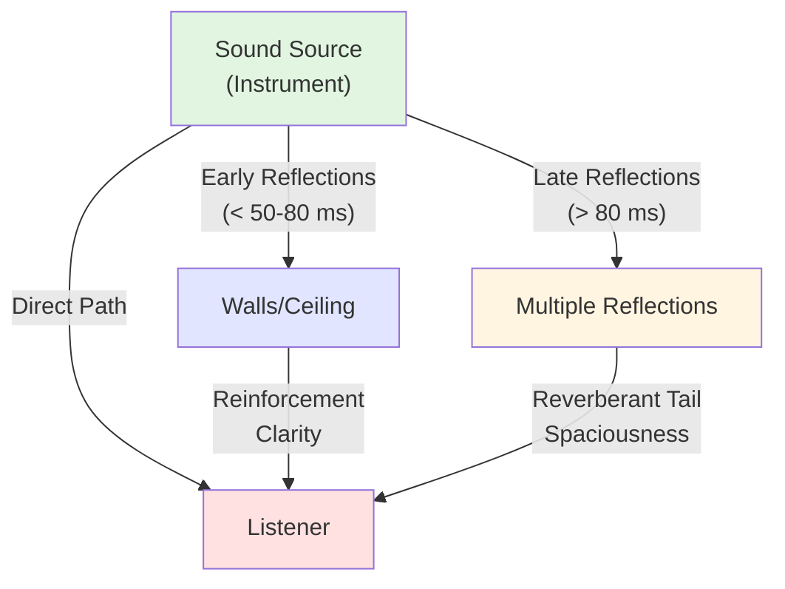
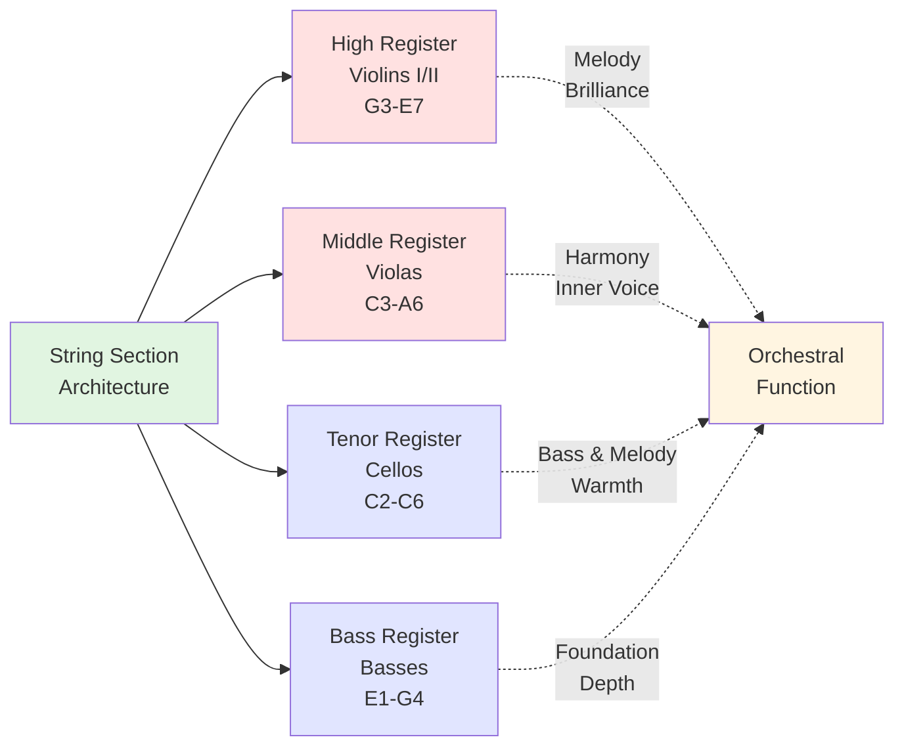
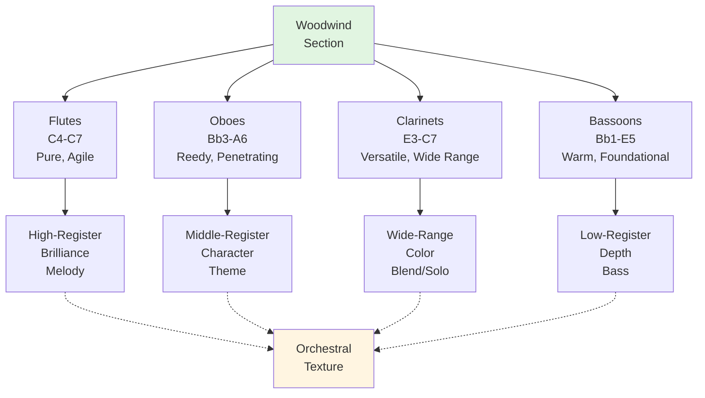
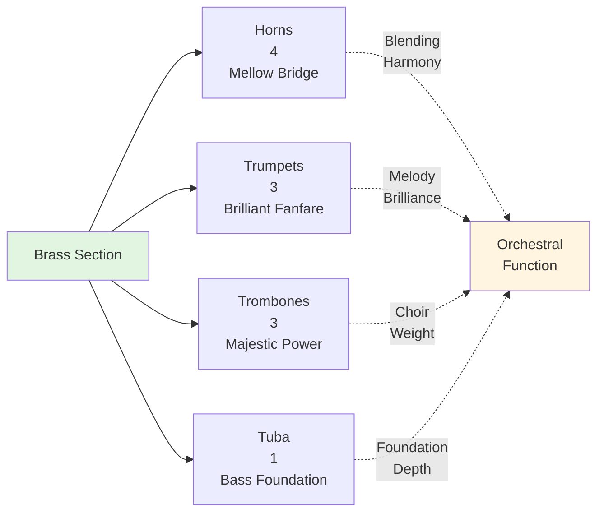
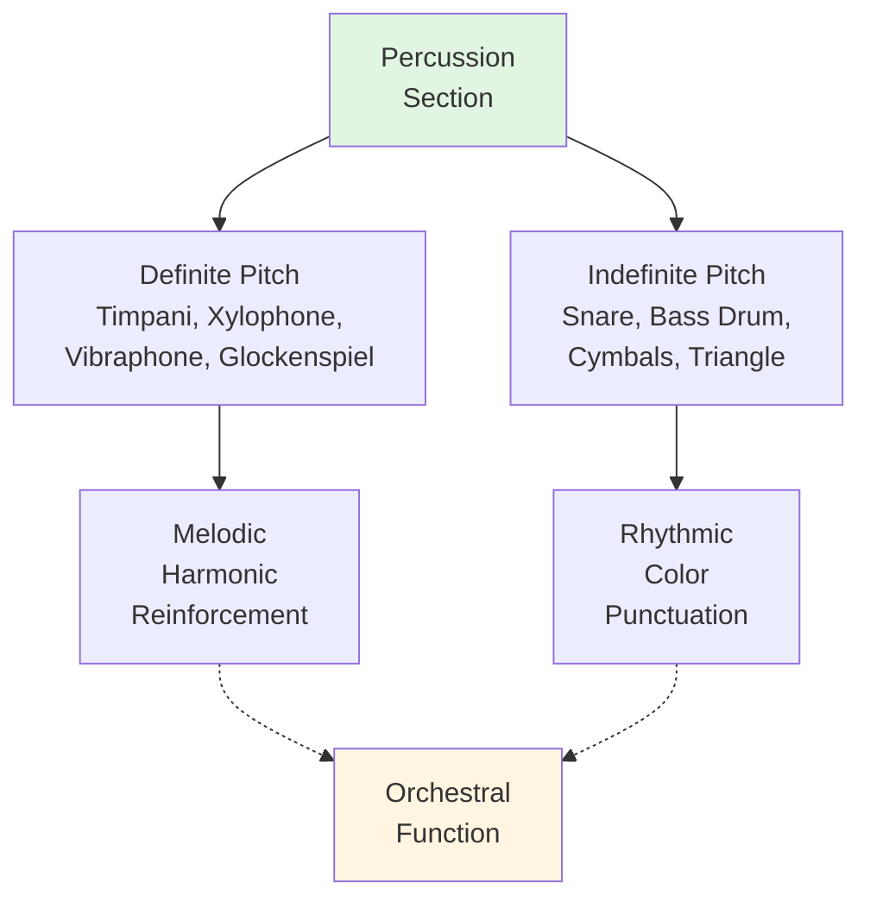

# Lesson 1: Introduction to Orchestration

## 1. First-Principles Intuition & Invariants

Orchestration—the art and science of writing music for orchestra—emerges from the intersection of three fundamental domains: the physics of acoustic phenomena, the psychoacoustics of human auditory perception, and the cultural-historical evolution of instrumental technique. Understanding orchestration from first principles requires examining how these domains interact to create the complex sonic architecture we experience in orchestral music.

### The Physics of Sound and Timbre

Sound propagates as longitudinal pressure waves through a medium, typically air at standard temperature and pressure (approximately 343 m/s at 20°C). The behavior of these waves is governed by the wave equation:

$$\frac{\partial^2 p}{\partial t^2} = c^2 \nabla^2 p$$

where *p* represents pressure perturbation and *c* is the speed of sound. While composers need not solve differential equations, this physical foundation dictates immutable acoustic realities: wavelength inversely relates to frequency (λ = c/f), standing waves form at integer multiples of fundamental frequencies, and interference patterns emerge when multiple sources interact.

Musical sound differs from simple sine waves through its harmonic structure. Any sustained tone from an acoustic instrument comprises a fundamental frequency plus integer multiples (harmonics or overtones) at varying amplitudes and phases. The relative amplitude distribution of these partials defines timbre—the qualitative "color" that distinguishes a violin from an oboe playing the same pitch.

The **harmonic series** is an invariant of acoustic instruments based on vibrating strings, air columns, or membranes:

- Fundamental: f₀
- 2nd harmonic (octave): 2f₀
- 3rd harmonic (perfect fifth above octave): 3f₀
- 4th harmonic (two octaves): 4f₀
- 5th harmonic (major third above two octaves): 5f₀
- And so on...

Instruments exhibit characteristic spectral envelopes. Violins produce strong high-frequency partials (up to 10 kHz and beyond) due to the resonance characteristics of the wooden body and the excitation mechanism of the bow. The spectral centroid—the "center of mass" of the frequency spectrum—sits relatively high, contributing to the violin's bright timbre. Conversely, flutes produce a spectrum dominated by the fundamental and lower harmonics, with rapid attenuation of higher partials, yielding a purer, more "hollow" sound.

The **attack transient**—the initial 20-100 milliseconds of a note—carries disproportionate perceptual weight. Studies demonstrate that listeners identify instruments primarily from attack characteristics; reversing a recorded note often makes identification impossible. Bowed strings exhibit a complex attack with scratch tones and pitch instability before the Helmholtz motion (the characteristic "stick-slip" bowing pattern) establishes. Woodwinds with reeds show a chaotic attack phase during which the reed's oscillation locks to the resonances of the air column. Brass instruments require the player's lips to synchronize with the instrument's resonances, creating an attack with significant spectral evolution.

### Psychoacoustics and Human Perception

The human auditory system does not respond linearly to acoustic stimuli. The ear performs a real-time spectral analysis through the mechanical properties of the basilar membrane, which executes an approximate Fourier transform. Different locations along the membrane resonate maximally to different frequencies, with frequency-to-position mapping approximately logarithmic.

**Critical bands** define frequency regions within which the ear cannot resolve individual spectral components. The bandwidth of critical bands increases with center frequency, ranging from approximately 100 Hz at low frequencies to over 2000 Hz at high frequencies. This has profound implications for orchestration: closely spaced notes in low registers create "muddiness" because their harmonics fall within the same critical bands and mask each other. The same interval in a higher register sounds clear because the harmonics distribute across multiple critical bands.

The **Fletcher-Munson curves** (ISO 226 equal-loudness contours) quantify the frequency-dependent sensitivity of human hearing. Key observations:

1. Maximum sensitivity occurs between 2-5 kHz, corresponding to resonances of the ear canal and evolutionary pressures (this range carries critical information in human speech).
2. At moderate listening levels (40-60 phons), low frequencies require significantly greater sound pressure levels (SPL) to be perceived as equally loud as mid-frequency content.
3. At high listening levels (>80 phons), the curves flatten somewhat, but bass frequencies still require more energy.
4. This non-linearity explains why recordings sound "thin" at low volumes: bass and treble content appear to disappear relative to midrange.

For orchestrators, these curves mandate careful attention to register and doubling. Bass instruments require more players or more emphatic writing to achieve perceptual balance with higher instruments. The orchestral practice of doubling bass lines in octaves (contrabassoon with double basses, for instance) compensates for both acoustic radiation efficiency (larger instruments radiate more efficiently at their fundamentals) and psychoacoustic sensitivity.

**Masking** occurs when one sound interferes with the perception of another. Simultaneous masking happens when sounds overlap in time and frequency; temporal masking (both forward and backward) affects sounds before and after a masking sound. Dense orchestral textures must account for masking: a powerful brass chord masks delicate woodwind filigree unless composers separate them in frequency, time, or spatial location.

The **missing fundamental** phenomenon demonstrates the brain's active role in perception. When a complex tone's fundamental frequency is removed but its harmonics remain, listeners perceive the pitch of the missing fundamental. This allows piccolo doublings to reinforce lower-frequency melodies through shared harmonics, and enables the orchestra to create perceptually low bass notes even when the fundamental may be weak or absent.

### Acoustic Environment and Spatial Perception

Concert halls function as complex acoustic filters. The impulse response of a hall—the pattern of sound reflections following an impulsive sound—characterizes its acoustic signature. Key parameters include:

**Reverberation time (RT60)**: The time required for sound to decay by 60 dB after the source stops. Classical music halls typically exhibit RT60 values of 1.8-2.2 seconds at mid-frequencies. The Sabine equation provides a first-order approximation:

$$RT_{60} = \frac{0.161V}{A}$$

where V is room volume (m³) and A is total absorption (m²·sabins). The equation reveals that large volumes and hard, reflective surfaces extend reverberation.

**Early reflections** (arriving within ~50-80 ms of the direct sound) contribute to perceived clarity, loudness, and spatial impression without being perceived as echoes. Later reflections blend into the reverberant tail. The ratio of early reflected energy to late reflected energy (C80 or Clarity index) distinguishes "clear" halls from "reverberant" halls.

**Spatial hearing** relies on interaural time differences (ITD), interaural level differences (ILD), and spectral cues from the pinnae. Orchestral seating arrangements exploit these cues: spacing brass left and right creates stereophonic separation; placing strings at the front prioritizes their direct sound while allowing their reflections to blend with winds and brass behind them.

The orchestrator writes not for idealized acoustic laboratory conditions but for the physical reality of concert halls where:

- High frequencies attenuate more rapidly with distance (air absorption coefficient increases with frequency).
- Low frequencies diffract around obstacles; high frequencies reflect specularly.
- Musicians hear themselves and each other differently than the audience hears them.
- Stage acoustics influence ensemble precision and intonation.

### Invariant Principles of Orchestration

Certain principles emerge as invariant across historical periods and compositional styles:

1. **Register determines clarity**: Low-register density creates acoustic mud; high-register density creates shrillness. The clearest textures distribute voices across a wide registral span.

2. **Timbre families blend; timbres within families compete**: Violins I and II blend seamlessly; violin and viola blend less perfectly; two oboes playing in unison create a single, reinforced oboe timbre. Mixing string, wind, and brass timbres creates heterogeneous colors.

3. **Acoustic radiation patterns matter**: Brass instruments radiate forward in a narrow beam at high frequencies, omnidirectionally at low frequencies. Strings radiate perpendicular to the instrument's front plate. This affects stage placement and balance.

4. **Dynamic range is instrument-specific**: A solo flute's dynamic range (pianissimo to fortissimo) spans roughly 30-40 dB. A trumpet's range may exceed 50 dB. The full orchestra spans over 80 dB. Orchestrators must account for these disparities when balancing forces.

5. **Transposition and tessitura affect timbre**: Instruments sound qualitatively different across their ranges. The clarinet's chalumeau register (written E3-B♭4) sounds dark and reedy; the clarino register (written C6 and above) sounds bright and penetrating. Writing that exploits these timbral shifts yields coloristic variety.

## 2. Core Architecture & Mechanics

The modern symphony orchestra crystallized in its essential form during the late 18th and early 19th centuries, though its constituent parts and organizational principles have medieval and Renaissance precedents. Understanding the orchestra's architecture requires examining both the functional roles of each section and the technical capabilities and limitations of individual instruments.

### Strings: The Orchestral Foundation

The string section constitutes the orchestra's core, typically comprising 60-70% of the ensemble's total personnel. Standard configuration in a large orchestra:

- Violins I: 16-18 players
- Violins II: 14-16 players
- Violas: 12-14 players
- Cellos: 10-12 players
- Double basses: 8-10 players

This pyramidal distribution reflects acoustic necessity: lower instruments radiate more acoustic power and require fewer players to balance higher instruments. Additionally, the psychoacoustic factors discussed earlier necessitate greater amplitude at low frequencies for perceptual balance.

#### Violin (Violino)

**Range**: G3 (open G string) to E7 or higher, depending on player proficiency. Professional orchestral players typically navigate up to A6 comfortably.

**Strings (standard tuning)**: G3, D4, A4, E5

**Acoustic characteristics**: The violin's small body (typically 355-360 mm body length) resonates efficiently in the 250-600 Hz range, with strong body resonances (A₀ ~270 Hz, A₁ ~470 Hz) reinforcing harmonics of notes in its middle-lower register. High-frequency radiation exceeds 10 kHz, with spectral energy remaining significant up to 15 kHz. The bowed violin exhibits a sawtooth-like waveform (Helmholtz motion) with a rich harmonic series extending well beyond the 20th partial.

**Playing techniques**:
- **Arco** (bowed): Default technique. Bow speed, pressure, and contact point (sul tasto near fingerboard vs. sul ponticello near bridge) continuously modulate timbre.
- **Pizzicato**: Plucked. Produces a sharp attack with rapid decay, emphasizing fundamental frequency with weaker upper partials compared to arco.
- **Col legno**: Struck with wood of bow. Produces a percussive, pitch-ambiguous sound.
- **Tremolo**: Rapid bow oscillation creating a sustained, shimmering texture.
- **Sul ponticello**: Bowing near the bridge increases high-frequency content, producing a glassy, metallic timbre.
- **Sul tasto**: Bowing over the fingerboard emphasizes lower partials, producing a soft, flute-like tone.
- **Mutes (sordino)**: Rubber, metal, or wooden devices dampen string vibration transmission to the body, attenuating overall amplitude and high-frequency content.
- **Harmonics**: Natural harmonics (nodes at integer fractions of string length) and artificial harmonics (stopped note plus node) produce pure, flute-like tones.
- **Double stops**: Simultaneous playing of two strings. Triple and quadruple stops possible but require arpeggiation or open strings for sustained sound.

**Orchestration considerations**: Violins function as primary melody carriers, but overuse in high tessitura causes listener fatigue. First violins traditionally carry the melodic line; second violins provide harmonic support, countermelodies, or rhythmic figuration. Divisi writing (splitting a section into two or more independent parts) reduces amplitude but increases harmonic density.

#### Viola (Alto)

**Range**: C3 (open C string) to A6 or higher.

**Strings**: C3, G3, D4, A4

**Acoustic characteristics**: The viola's body (typically 380-430 mm, with 400-410 mm most common) is proportionally small for its pitch range—an acoustically "correct" viola would be unplayably large. This compromise results in weaker low-frequency radiation than ideal, with body resonances falling in the 200-300 Hz range. The viola's timbre is darker and richer in lower partials than the violin, with less brilliance in the upper harmonics.

**Playing techniques**: Identical to violin. The C string's depth and resonance offer unique coloristic possibilities unavailable on violin.

**Orchestration considerations**: Historically relegated to "filler" harmony, the viola possesses a distinctive voice that occupies the crucial middle register between violins and cellos. Writing that places violas above second violins (but below first violins) exploits their darker color for inner-voice motion. Viola solos project a melancholic, introspective character.

#### Cello (Violoncello)

**Range**: C2 (open C string) to C6 or higher. The upper register requires thumb position technique.

**Strings**: C2, G2, D3, A3

**Acoustic characteristics**: The cello's larger body (typically 750-760 mm) produces strong fundamental frequencies and efficient radiation in the 100-400 Hz range. Body resonances (A₀ ~100 Hz, A₁ ~200 Hz) provide warmth and power to the middle-lower register. The cello's acoustic power output approximates that of the viola in the overlapping range, despite the cello's fundamental frequencies being an octave lower—a testament to the importance of body resonances and radiation efficiency.

**Playing techniques**: As violin, plus:
- **Thumb position**: Left thumb moves up the fingerboard to access high register, used approximately from A4 upward.
- More extensive use of the full dynamic range due to greater acoustic power.
- Capable of powerful bass lines that function harmonically while retaining melodic character.

**Orchestration considerations**: The cello's range spans bass, tenor, and alto registers, making it uniquely versatile. Low register provides harmonic foundation; middle register delivers warm, singing melodies (often compared to the human tenor voice); high register offers intensity and brilliance. Unison or octave doublings with violas, bassoons, or horns create blended colors.

#### Double Bass (Contrabasso)

**Range**: E1 (four-string bass with extension to C1, or five-string bass with low B0) to approximately G4. Notated an octave higher than sounding (transposing instrument).

**Strings (sounding pitch)**: E1, A1, D2, G2 (four-string standard orchestral tuning)

**Acoustic characteristics**: The double bass's large body (typically 1800-1900 mm tall) radiates efficiently at low frequencies, with body resonances in the 60-120 Hz range. The instrument's harmonics extend upward, but high-frequency content is significantly weaker than smaller string instruments. At low fundamentals (below 100 Hz), the higher harmonics provide much of the perceptual "presence" due to the psychoacoustic principles discussed earlier.

**Playing techniques**: As cello, though high register less frequently used in orchestral writing. Pizzicato common in classical and jazz contexts; sustained arco in Romantic and later music.

**Orchestration considerations**: The double bass reinforces cello bass lines an octave lower, providing acoustic foundation. Writing independent bass lines (separate from cellos) creates registral gaps unless winds fill the middle register. The section's collective mass produces substantial acoustic power at low frequencies, essential for perceptual balance with full orchestra.

### Woodwinds: Color and Agility

The woodwind section offers timbral diversity and agility. Unlike strings, where massed players create unified sound, woodwind writing typically assigns one player per part (though players may double different instruments, e.g., flute/piccolo, oboe/English horn).

Standard large orchestra woodwind configuration: 3 flutes (3rd doubling piccolo), 3 oboes (3rd doubling English horn), 3 clarinets (3rd doubling bass clarinet), 3 bassoons (3rd doubling contrabassoon). Chamber orchestras reduce to pairs: 2 flutes, 2 oboes, 2 clarinets, 2 bassoons.

#### Flute

**Range**: C4 (middle C, though some instruments have B3 foot joint) to C7 or higher.

**Acoustic characteristics**: The flute is an edge-tone instrument (air jet directed across an edge creates oscillation). The cylindrical bore produces a spectrum dominated by odd harmonics in the low register, even harmonics appearing more prominently as pitch rises. Overall spectral envelope emphasizes fundamental with rapid rolloff of upper partials, yielding a pure, somewhat hollow timbre. Low register (C4-C5) sounds warm but projects poorly; middle register (C#5-C6) projects well with characteristic flute timbre; high register (C#6-C7) becomes increasingly brilliant and penetrating.

**Playing techniques**:
- **Vibrato**: Fluctuation of pitch and amplitude, controlled by diaphragm and throat. Standard in modern orchestral playing.
- **Flutter-tonguing**: Rolled "r" while blowing creates a rattling effect.
- **Harmonics**: Overblowing produces harmonics, used for special effects.
- **Double/triple tonguing**: Rapid articulation patterns (t-k-t-k or t-t-k-t-t-k) for fast passages.
- **Whistle tones/multiphonics**: Extended techniques producing multiple simultaneous pitches or otherworldly timbres.

**Orchestration considerations**: Flute's agility suits rapid scale passages, trills, and ornamental figuration. In ensemble, flutes blend with violins (reinforcing high-frequency content) or with oboes/clarinets (creating composite woodwind timbre). Low register easily masked by other instruments; effective in solo or transparent textures. Piccolo (sounding octave higher than written) cuts through full orchestra with piercing brilliance.

#### Oboe

**Range**: B♭3 (some instruments to B3) to approximately A6.

**Acoustic characteristics**: The oboe employs a double reed (two pieces of cane vibrating against each other) and a conical bore. The conical bore geometry supports both odd and even harmonics strongly, producing a rich, complex spectrum. The characteristic "nasal" or "reedy" timbre results from prominent harmonics in the 1-3 kHz range coinciding with maximum ear sensitivity. The oboe's relatively narrow dynamic range (compared to flute or clarinet) and strong fundamental make it an ideal tuning reference (orchestras tune to oboe's A4).

**Playing techniques**: Similar to flute regarding vibrato, tonguing, and flutter-tongue. Double reed allows pitch bending and microtonal inflections. Circular breathing possible but rarely required in orchestral repertoire.

**Orchestration considerations**: The oboe's penetrating timbre projects through ensemble textures, making it suitable for melodic solos and thematic statements. Blends with flutes (brightening the composite sound) or clarinets (darkening it). Doubles with strings (especially violins or violas) for added edge. English horn (cor anglais), pitched a fifth lower (F3-C6 sounding, notated a fifth higher), offers a darker, more mellow timbre, evoking pastoral or melancholic affects.

#### Clarinet

**Range**: E3 (or D3 with extended range) to approximately C7.

**Acoustic characteristics**: The clarinet uses a single reed (one piece of cane vibrating against a mouthpiece) and a cylindrical bore. The cylindrical bore causes the instrument to overblow at the twelfth (odd harmonics dominate), creating three distinct registers with markedly different timbral characteristics:
- **Chalumeau** (E3-B♭4): Dark, warm, reedy, rich in lower harmonics.
- **Clarion** (B4-C6): Bright, clear, even timbre.
- **Altissimo** (C#6-C7): Shrill, penetrating, difficult to control.

The clarinet possesses the widest dynamic range of the woodwinds, from barely audible pianissimo to powerful fortissimo. Its spectrum in the chalumeau register is heavily weighted toward odd harmonics (1st, 3rd, 5th, 7th), giving it a hollow, warm timbre.

**Playing techniques**: As oboe/flute, plus extensive use of wide dynamic range and portamento effects. Advanced players execute rapid register changes and wide interval leaps with facility.

**Orchestration considerations**: The clarinet's agility and wide range make it highly versatile. Chalumeau register provides unique dark colors unavailable from other woodwinds; clarion register blends with flutes or oboes; altissimo register cuts through ensembles. The clarinet in B♭ is standard; clarinet in A provides alternative key centers and slightly darker timbre. Bass clarinet (sounding major ninth lower than written, range D2 to approximately G5) extends the clarinet family's range downward with a rich, resonant low register.

#### Bassoon

**Range**: B♭1 (some instruments to A1 with low A extension) to approximately E5 (experienced players exceed this).

**Acoustic characteristics**: The bassoon uses a double reed and a conical bore, with tubing folded back on itself. Its long air column and conical bore produce strong fundamental frequencies and a rich harmonic series. The timbre varies significantly by register:
- **Low register** (B♭1-E♭2): Deep, resonant, powerful, sometimes gruff.
- **Tenor register** (E2-B♭3): Warm, expressive, "vocal" quality.
- **Upper register** (B3-E5 and above): Thin, reedy, sometimes strained, but capable of plaintive, expressive solos.

**Playing techniques**: As oboe, with particular attention to embouchure control across wide range. Staccato and rapid articulation are characteristic; legato requires careful breath management.

**Orchestration considerations**: The bassoon provides bass lines and harmonic foundation for woodwinds, often doubling cellos or basses (at unison or octave). Tenor register suited for melodic solos with a lyrical, sometimes comical or grotesque character. Doubles horns for added warmth and depth. Contrabassoon (sounding octave lower than written, range B♭0 or A0 to approximately E♭4) supplies the deepest woodwind pitches, reinforcing orchestral bass foundations with a dark, resonant timbre.

### Brass: Power and Grandeur

The brass section provides acoustic power, rhythmic drive, and majestic sonority. Brass instruments employ a cup or conical mouthpiece against which the player's lips vibrate, with lip tension determining pitch within the harmonic series of the instrument's tubing length.

Standard large orchestra brass: 4 horns, 3 trumpets, 3 trombones, 1 tuba. Expanded late-Romantic and modern scores may require 6-8 horns, additional trumpets, tenor/bass trombone differentiation, and multiple tubas.

#### Horn (French Horn, Waldhorn, Cor)

**Range**: Written F#2 to approximately C6, sounding a perfect fifth lower (Horn in F). Double horns (F/B♭) standard, allowing switching between F and B♭ tubing for ease in different registers.

**Acoustic characteristics**: The horn's conical bore and narrow mouthpiece produce a mellow, warm timbre rich in harmonics across the spectrum, though less penetrating than trumpet. The instrument's characteristic sound results from the player's hand partially inserted in the bell, modifying impedance and timbre. The horn's long tubing (approximately 3.7 m unwound for Horn in F) and small mouthpiece make it prone to "cracking" (missing notes), particularly when entering from silence or executing wide leaps.

**Playing techniques**:
- **Stopped**: Right hand fully closes bell, raising pitch by semitone and creating nasal, metallic timbre. Notation: + or "chiuso."
- **Muted**: Metal, fiber, or wooden mute inserted in bell, reducing volume and modifying timbre.
- **Cuivré**: Brassy, forced tone achieved through increased lip pressure and air speed.
- **Echo horn/bell up**: Directing bell upward (normally faces backward/downward) increases presence and brightness.

**Orchestration considerations**: Horns bridge woodwinds and brass, blending with both. Four-horn sections typically divide into high pair and low pair. Sustained horn chords provide harmonic cushioning; horn calls evoke hunting, nature, and heroism. The horn's middle register (written G3-G4, sounding C3-C3) provides the most reliable intonation and tone; extreme low and high registers require caution. Unison horn passages produce powerful, noble sonority. Horns blend with strings (particularly violas and cellos), woodwinds (especially bassoons and clarinets), or create independent brass choir.

#### Trumpet (Tromba)

**Range**: Written F#3 to approximately C6, higher possible for specialist players. Modern orchestra uses trumpet in B♭ (sounding major second lower) or C (sounding as written); historical repertoire may require D, E♭, F, or other transpositions.

**Acoustic characteristics**: The trumpet's cylindrical bore (with flaring bell) and cup mouthpiece produce a bright, brilliant, penetrating timbre with strong high-frequency content. The sound is rich in harmonics extending well beyond the 20th partial. Valves (usually three piston or rotary valves) lower pitch by specific intervals (2nd valve: semitone, 1st valve: whole tone, 3rd valve: minor third; combinations access chromatic scale).

**Playing techniques**:
- **Muted**: Various mutes (straight, cup, Harmon/wah-wah, plunger) dramatically alter timbre, used extensively in jazz and 20th-century orchestral music.
- **Flutter-tongue**: Rolled "r" creates buzzing effect.
- **Double/triple tongue**: Rapid articulation (t-k-t-k or t-t-k-t-t-k).
- **Stopped (hand stopping)**: Less common than on horn; produces similar effect.

**Orchestration considerations**: Trumpets excel at fanfares, martial themes, and brilliant melodic statements. The instrument's penetrating timbre cuts through full orchestra; pianissimo playing requires substantial control. Trumpets blend with trombones for brass choir sonority or with woodwinds (especially oboes) for added brilliance. Writing in the staff (written A3-D5) provides secure intonation and tone; high register (E5 and above) demands stamina and precision. Trumpet in D or E♭ (higher transposition) offers additional brilliance for Baroque repertoire.

#### Trombone (Trombone, Posaune)

**Range**: Tenor trombone: E2 to approximately B♭4 (experienced players exceed this); Bass trombone: C2 to F4 (with F or G♭ attachment extending to B♭1 or lower).

**Acoustic characteristics**: The trombone employs a cylindrical bore with telescoping slide allowing continuous pitch variation (true glissando). The cup mouthpiece (larger than trumpet) and wider bore produce a darker, richer timbre than trumpet, with substantial acoustic power in the low-middle register. The trombone's harmonic series is clearly defined; positions on the slide correspond to specific tube lengths (first position: closed, seventh position: fully extended, six positions in between).

**Playing techniques**:
- **Glissando**: Slide continuously between pitches, exploiting the instrument's unique capability.
- **Mutes**: As trumpet; alto/tenor/bass trombones may use different mutes.
- **Pedal tones**: Notes below the normal range, utilizing the fundamental frequency (rarely used in orchestral literature, common in jazz and contemporary music).

**Orchestration considerations**: Trombones provide the orchestra's "trombone choir" sonority—majestic, solemn, sometimes ominous. Three trombones (two tenors and bass) constitute standard complement. The bass trombone's low register reinforces tuba and string basses. Trombone pianissimo produces organ-like sustained tones; fortissimo delivers overwhelming power. Historically associated with sacred and dramatic contexts (opera, oratorio, symphonic climaxes).

#### Tuba

**Range**: Varies by instrument type. Contrabass tuba in C: D1 to approximately F4; Bass tuba in F or E♭: approximately E♭1 to B♭3.

**Acoustic characteristics**: The tuba's large conical bore and cup mouthpiece produce the deepest, most resonant brass tones. The instrument's spectrum emphasizes fundamental and lower harmonics; high-frequency content is weak compared to trumpet or trombone. Despite its size, the tuba is agile in the hands of skilled players, capable of rapid articulation and melodic passages.

**Playing techniques**: As trombone (excluding glissando unless valve/slide combinations allow). Flutter-tongue and rapid articulation possible.

**Orchestration considerations**: The tuba provides the bass foundation for the brass section and reinforces orchestral bass lines. Typically one tuba suffices; some scores require two. The tuba blends with trombones, contrabassoon, and string basses. Solo passages are rare but effective, often exploiting the instrument's surprising agility or its capacity for grotesque, humorous effects (e.g., Mussorgsky's *Pictures at an Exhibition*, Ravel's orchestration). The tuba's low register (below C2) provides subterranean depth; middle register (C2-G3) offers melodic warmth.

### Percussion: Rhythm, Color, and Punctuation

The percussion section encompasses indefinite pitch instruments (providing rhythmic drive and color) and definite pitch instruments (capable of melodic or harmonic contributions). The section's size and composition vary enormously by repertoire: Baroque and Classical scores rarely employ percussion beyond timpani; Romantic and modern scores may require 4-6 percussionists managing dozens of instruments.

#### Timpani (Kettledrums, Pauken)

**Range**: Varies by drum size. Standard set of 4 timpani covers approximately D2 to A3. Larger or smaller drums extend range. Each drum is tunable via pedal mechanism (modern) or hand screws (historical), allowing pitch changes during performance.

**Acoustic characteristics**: Timpani produce definite pitches, though with significant inharmonic components. The membrane's vibration modes do not perfectly align with the harmonic series, giving timpani their characteristic "pitch with noise" timbre. The fundamental frequency dominates perception, but upper partials and the drum shell's resonances contribute to the overall sound. Attack transient is sharp; decay sustains (particularly on larger drums) unless dampened.

**Playing techniques**:
- **Mallets**: Hardness (soft felt, medium, hard) alters attack sharpness and spectral content.
- **Rolls**: Rapid alternation of strokes creates sustained tone.
- **Glissando**: Pedal manipulation while striking creates pitch sweep.
- **Dampening**: Hand or mallet mutes drum, shortening decay.

**Orchestration considerations**: Timpani reinforce harmonic structure, typically tuned to tonic and dominant (in Classical style) or other harmonically significant pitches. Rhythmic punctuation, pedal points, and melodic fragments all fall within timpani's purview. The instruments project powerfully; pianissimo passages require delicate touch. Standard complement: 2-4 drums; large-scale works may require 5 or more.

#### Snare Drum (Side Drum)

**Range**: Indefinite pitch. Typical snare drum diameter: 14 inches; depth: 5-6.5 inches (shallow snare) or 12-14 inches (field drum).

**Acoustic characteristics**: The snare drum consists of a cylindrical shell with heads on both sides. The bottom head has snares (coiled wires) stretched across it, which vibrate sympathetically when the top head is struck, producing the characteristic "crack" and buzzing decay. The sound is inharmonic, with attack transient dominating.

**Playing techniques**:
- **Sticks**: Wood (bright, articulate) or brushes (soft, swishing).
- **Rolls**: Buzz roll (multiple bounces per stroke) or double-stroke roll (two distinct strokes per hand alternation).
- **Rim shot**: Striking rim and head simultaneously for sharp accent.
- **Snares off**: Disengaging snares produces tom-like sound.

**Orchestration considerations**: Snare drum provides crisp rhythmic articulation, martial character, and sustained rolls. Military and programmatic associations abound. Dynamic range extends from barely audible brushwork to fortissimo crack.

#### Bass Drum (Gran Cassa)

**Range**: Indefinite pitch. Large orchestral bass drums typically exceed 32 inches in diameter.

**Acoustic characteristics**: The bass drum produces low-frequency energy with slow attack and extended decay. Fundamental frequency typically in the 60-120 Hz range, though the sound is heavily inharmonic. The large membrane radiates low frequencies omnidirectionally, providing visceral impact.

**Playing techniques**:
- **Mallets**: Soft, medium, or hard beaters alter attack profile and spectral content.
- **Rolls**: Sustained rumble.
- **Single strokes**: Accents, dramatic punctuation.

**Orchestration considerations**: Bass drum reinforces climactic moments, provides low-frequency underpinning for marches and forte passages, or creates ominous rumbles. Overuse fatigues listeners; judicious deployment maximizes impact.

#### Cymbals (Piatti, Becken)

**Range**: Indefinite pitch, though cymbals exhibit pitch-like characteristics based on size and thickness.

**Acoustic characteristics**: Cymbals are thin bronze discs producing complex, inharmonic spectra extending well into ultrasonic frequencies. Attack is immediate and bright; decay sustains (10+ seconds for large crash cymbals unless dampened). Spectral content heavily weighted toward high frequencies (>2 kHz).

**Playing techniques**:
- **Crash**: Two cymbals struck together.
- **Suspended cymbal**: Single cymbal struck with stick, mallet, or rolled.
- **Dampening**: Grabbing cymbals after crash shortens decay.
- **Sizzle cymbal**: Rivets inserted in cymbal add buzzing, sustained overtones.

**Orchestration considerations**: Cymbals provide brilliant, shimmering color, climactic accents, or sustained washes of high-frequency energy. Suspended cymbal rolls create tension and crescendo. Dynamic range from delicate pianissimo (soft mallet on suspended cymbal) to overwhelming fortissimo (crash).

#### Additional Percussion

Orchestral percussion encompasses dozens of instruments, each with unique timbral and functional characteristics:

- **Triangle**: Bright, metallic, indefinite pitch. Cuts through ensemble for delicate or brilliant accents.
- **Tam-tam (Gong)**: Large bronze disc, deeply resonant, ominous. Produces long, complex decay.
- **Tambourine**: Jingles and membrane. Provides rhythmic drive with bright, jingling color.
- **Xylophone/Marimba/Vibraphone**: Definite-pitch mallet instruments. Xylophone: bright, hard; Marimba: warm, mellow; Vibraphone: sustained, shimmering (motor-driven resonators).
- **Glockenspiel/Celesta**: Metallic or keyed definite-pitch instruments. Glockenspiel: brilliant, bell-like; Celesta: delicate, music-box-like.
- **Chimes (Tubular Bells)**: Suspended metal tubes producing church-bell-like tones.
- **Castanets, Wood Blocks, Temple Blocks, Claves, Maracas, Guiro**: Various indefinite-pitch color instruments from multiple cultural traditions.

## 3. Orchestral Texture and Voicing

The art of orchestration transcends mere instrumentation—assigning notes to instruments. Texture, the vertical and horizontal organization of musical lines, determines whether a passage sounds transparent or opaque, balanced or lopsided, homogeneous or stratified.

### Homophonic Texture

A single melodic line supported by harmonic accompaniment. The melody must project clearly; harmonic support must not obscure it. Achieving this balance requires:

1. **Registral separation**: Place melody above or below accompaniment, avoiding overlap in frequency.
2. **Timbral contrast**: Assign melody to penetrating or unique timbre (trumpet, oboe, violin solo) distinct from accompaniment (horns, divided strings).
3. **Dynamic balance**: Scale accompanying forces to melody. A solo flute requires lighter accompaniment than full string section.
4. **Rhythmic differentiation**: Static accompaniment (sustained chords, repeated patterns) contrasts with melodic rhythm.

Example: Melody in first violins (16 players, forte), accompaniment in violas and cellos (pizzicato chords, mezzo-piano). The violins' bowed tone, higher register, and greater dynamic projection ensure melodic clarity despite the accompaniment's proximity.

### Polyphonic Texture

Multiple independent melodic lines. Clarity requires each line to occupy distinct registral and timbral space. Considerations:

1. **Contrapuntal clarity**: Voices must not compete in the same frequency bands. Distribute across registers.
2. **Timbral differentiation**: Assign contrasting timbres to simultaneous lines (flute vs. bassoon, violin vs. horn).
3. **Dynamic hierarchy**: If one line is primary, subordinate others dynamically.
4. **Articulation**: Distinct articulations (legato vs. staccato) help differentiate lines.

Bach fugues orchestrated by 20th-century composers (Webern, Schoenberg) exemplify polyphonic clarity through timbral pointillism: each note or phrase receives a different instrumental color, making lines hyper-distinct.

### Chordal Texture

Vertical sonorities require careful spacing and doubling:

1. **Spacing**: Low-register close spacing creates mud; wide spacing in low register with closer spacing in high register provides clarity and warmth. The "ideal" spacing distributes intervals wider in lower registers, narrower in upper.
2. **Doubling**: Doubling at unison reinforces timbre; doubling at octave reinforces harmonic structure without timbral change. Doubling the bass in multiple octaves strengthens harmonic foundation.
3. **Voicing**: Omitting certain chord tones (e.g., fifth of a triad) often improves clarity without sacrificing harmonic identity.

The "orchestral chord" distributes pitch classes across the orchestra's full range: double basses and contrabassoon on root (lowest octave), cellos and bassoons on third or fifth, violas and horns on upper chord tones, violins and woodwinds on melody or upper extensions.

### Coloristic Texture

20th-century orchestration often prioritizes timbre over melodic-harmonic structures. Techniques include:

1. **Klangfarbenmelodie** (tone-color-melody): Distributing a single line across multiple instruments, each contributing a few notes. Timbre becomes a structural parameter.
2. **Spectral orchestration**: Distributing partials of a single tone across multiple instruments to create composite timbres.
3. **Textural masses**: Dense clusters or clouds of sound prioritizing overall effect over individual lines.

## 4. Practical Orchestration Principles

### Balance and Blend

Achieving balance requires understanding relative acoustic power and psychoacoustic perception:

- **String mass vs. wind solos**: 16 violins playing forte easily overpower a solo oboe. Balance requires dynamic restraint or doubling the oboe.
- **Brass vs. orchestra**: Full brass section at fortissimo overpowers full orchestra at mezzo-forte. Balance requires careful dynamic marking.
- **Low vs. high register**: Low frequencies require more acoustic energy for perceptual balance (Fletcher-Munson curves). Writing bass lines forte while upper voices are mezzo-forte achieves perceived equality.

Blend occurs when timbres fuse perceptually. Related timbres blend easily (flute + clarinet, violin + viola); disparate timbres create heterogeneous color (trumpet + bassoon). Unison or octave doublings promote blend; different rhythms or articulations prevent it.

### Doubling

Doubling serves multiple functions:

1. **Reinforcement**: Unison doubling increases amplitude without changing timbre significantly. Example: first violins doubled by flute reinforces violin line, adds brightness.
2. **Timbral fusion**: Blending dissimilar timbres creates composite colors. Example: horn + bassoon produces warm, velvety timbre unlike either alone.
3. **Octave reinforcement**: Doubling at octave strengthens harmonic series perception without timbral change. Example: cellos doubled by basses at lower octave.
4. **Textural thickening**: Multiple doublings create dense, rich textures. Example: melody in violins I, flute, oboe (all in unison or octaves) produces brilliant, complex timbre.

### Transposition and Notation

Many orchestral instruments are transposing instruments, notated at a pitch different from sounding pitch:

- **Clarinet in B♭**: Sounds major second lower than written.
- **Horn in F**: Sounds perfect fifth lower than written.
- **English horn**: Sounds perfect fifth lower than written.
- **Piccolo**: Sounds octave higher than written.
- **Double bass**: Sounds octave lower than written.
- **Contrabassoon**: Sounds octave lower than written.

Composers must mentally transpose or use transposed scores. Understanding each instrument's written range and sounding range prevents notating unplayable pitches.

### Idiomatic Writing

Each instrument has idiomatic gestures—patterns, articulations, and textures that exploit its technical and acoustic characteristics:

- **Strings**: Rapid scales, arpeggios, tremolos, sustained legato lines, pizzicato accompaniment patterns.
- **Woodwinds**: Rapid tongued passages, trills, staccato runs, lyrical solos.
- **Brass**: Fanfares, sustained chords, fortissimo proclamations, stopped/muted effects.
- **Percussion**: Rhythmic ostinatos, rolls, coloristic accents.

Idiomatic writing produces music that sounds effortless and natural; unidiomatic writing creates awkwardness and technical difficulty without artistic benefit.

## 5. Historical and Stylistic Context

Orchestration evolved alongside instrument technology, performance practice, and aesthetic ideals.

**Baroque era (c.1600-1750)**: Small ensembles, continuo-driven harmony, limited wind/brass, focus on string-dominated texture. Terraced dynamics, clear contrapuntal textures.

**Classical era (c.1750-1820)**: Standardization of orchestra (strings, pairs of winds, 2 horns, 2 trumpets, timpani). Homophonic textures predominate, clear melody-accompaniment. Dynamics more gradated (crescendo/diminuendo). Haydn, Mozart establish orchestral syntax.

**Romantic era (c.1820-1900)**: Expansion of orchestra (triple winds, 4 horns, 3 trombones, tuba, expanded percussion). Emphasis on color, programmatic associations, emotional expression. Berlioz, Wagner pioneer modern orchestration. Chromaticism increases harmonic complexity; orchestration reflects this with blended, rich textures.

**Late-Romantic/Post-Romantic (c.1890-1950)**: Massive orchestras (quadruple or greater winds, 8 horns, expanded brass, large percussion batteries). Strauss, Mahler exploit extremes of dynamic range and timbral palette. Impressionists (Debussy, Ravel) prioritize color and atmosphere over traditional thematic development.

**Modernist era (c.1900-present)**: Fragmentation of common practice. Experimentation with non-traditional techniques, extended techniques, electronic integration, microtonality. Composers explore timbre as primary structural element. Chamber-sized ensembles regain prominence alongside continued use of large forces.

Understanding historical practice informs contemporary orchestration, even when deviating from tradition.

## 6. Analytical Listening and Score Study

Mastery of orchestration requires intensive analytical listening and score study. Procedure:

1. **Listen without score**: Identify timbres, textures, registral distribution, balance, and pacing purely by ear.
2. **Listen with score**: Correlate notation with sound. Observe doublings, spacing, dynamics, articulations.
3. **Analyze specific passages**: Why does a passage achieve its effect? What combination of orchestration techniques produces clarity, blend, color, or power?
4. **Transcribe**: Attempt to notate orchestration from recording without score. Reveals gaps in timbral recognition and understanding of orchestrational logic.
5. **Compare editions/recordings**: Different conductors and orchestras realize identical scores differently. Analyzing these differences illuminates interpretive choices and acoustic variables.

Recommended repertoire for study (representing diverse approaches):

- **Berlioz, *Symphonie fantastique***: Pioneering coloristic orchestration, innovative use of winds and brass.
- **Wagner, *Prelude to Tristan und Isolde***: Dense chromatic harmony, seamless timbral blending, orchestral crescendo techniques.
- **Ravel, *Daphnis et Chloé*, Suite No. 2**: Impressionist color, transparent textures despite large forces, delicate balance.
- **Stravinsky, *The Rite of Spring***: Rhythmic drive, extreme dynamic contrasts, percussive orchestration, layered ostinatos.
- **Mahler, Symphony No. 5, Adagietto**: Strings-only texture, expressive orchestration through subtle divisi and dynamics.
- **Debussy, *La Mer***: Atmospheric orchestration, fluid textures, color as primary parameter.

## 7. Conclusion and Further Exploration

Orchestration is not a set of rules but a continually evolving practice grounded in acoustic principles, informed by historical tradition, and driven by artistic imagination. The orchestrator's task is to translate sonic vision into instrumental reality, leveraging the orchestra's vast timbral resources while respecting the constraints of physics, human perception, and instrumental technique.

Continued study should encompass:

- **Systematic score study**: Analyze diverse repertoire across eras and styles.
- **Practical experimentation**: Write for real ensembles whenever possible; recorded mockups, while useful, cannot substitute for live acoustic feedback.
- **Acoustic experimentation**: Attend rehearsals, study hall acoustics, observe how balance shifts across venues.
- **Technical mastery**: Develop fluency with each instrument's capabilities, limitations, and idiomatic gestures through consultation with performers and method books (e.g., *The Technique of Orchestration* by Kennan/Grantham, *The Study of Orchestration* by Adler).
- **Perception training**: Refine timbral recognition through blind listening tests, transcription exercises, and active analytical listening.

The orchestral palette offers limitless expressive possibilities. Mastery emerges from rigorous study, disciplined experimentation, and attentive listening to the intersection of physics, psychology, and art.
