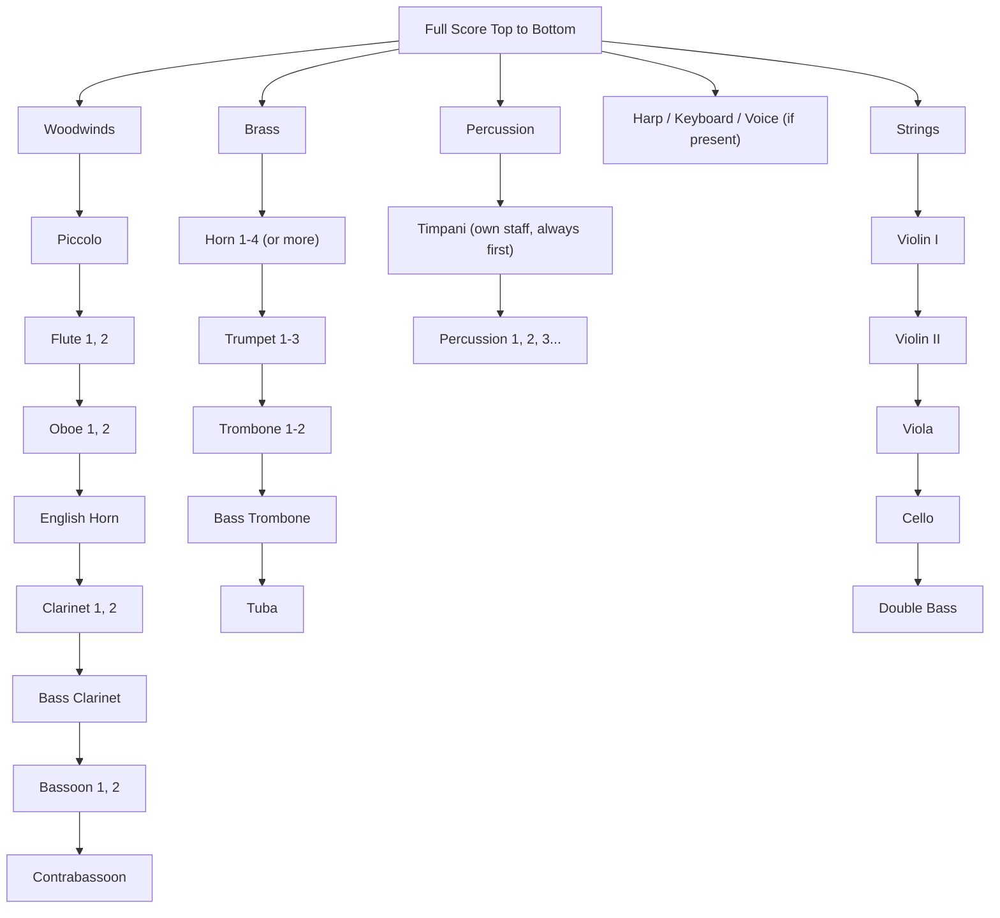
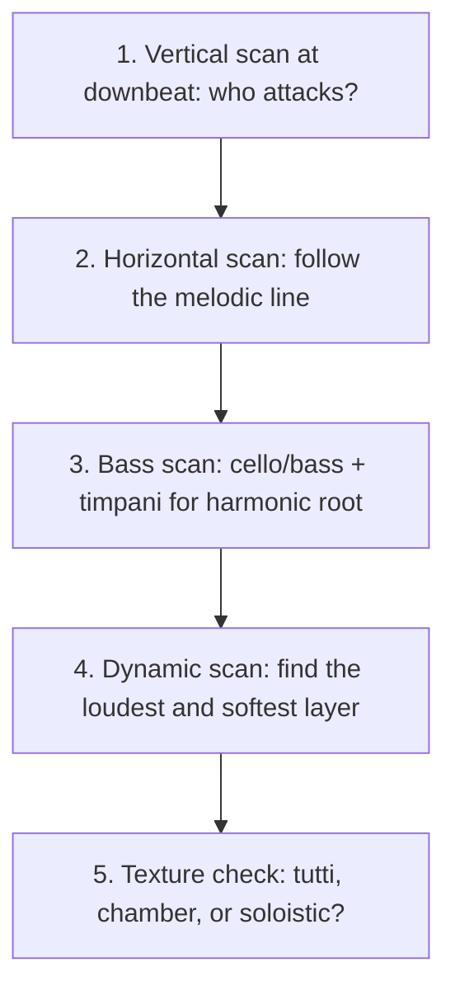
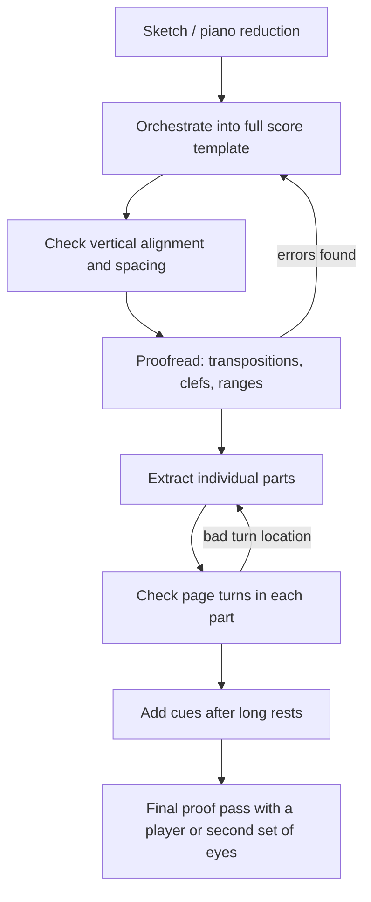

# Lesson 2: Score Layout, Orchestration Balance, and Practical Scoring Technique

## 1. Why Score Layout Is a Playing Skill, Not Just a Reading Skill

A full score is a tool you read under pressure — in rehearsal, in performance, while cuing entrances and fixing balance in real time. Everything about its layout exists to make that scan faster. Before touching any notation software, internalize the physical act of reading: a conductor's eye moves in vertical slices (what's happening *right now* across all parts) and horizontal slices (where a line is *going*). Good layout serves both motions; bad layout forces you to choose one.

**The one piece of acoustic physics you need:** dynamics are not absolute. A marking like *f* tells a player "produce roughly this fraction of your instrument's usable dynamic range," and that fraction is judged relative to everyone else playing at that moment. A solo trombone *f* and a tutti string section *f* are different physical intensities aiming at the same perceptual outcome: audible balance. Everything else in this lesson — layout order, dynamic calibration, doubling choice — follows from that one idea. We will not go further into decibel math; orchestration is learned by ear and by score study, not by SPL tables.

## 2. Standard Score Order — Memorize This Cold

Every full score you open, publisher software you use, and part you extract follows this vertical order top to bottom. Internalize it so you can locate any instrument in under a second without looking at labels.

**Drill — order recall (do this before you ever open Sibelius or Dorico):** Take a blank sheet. From memory, write the full staff order for a Brahms-sized orchestra (2222 / 4231 / timp / strings) top to bottom in under 60 seconds. Then do it again for a Mahler-sized orchestra (4 fl/3 ob/3 cl/3 bn / 6 hn/4 tpt/3 tbn/tuba / 4 perc / strings). If you cannot do this cold, you will slow down every rehearsal you conduct or every score you proof.

**Why this exact order, mechanically:**
- Woodwinds on top because they carry exposed melodic material most often — your eye lands there first by habit, matching where primary lines usually live.
- Horns sit at the *top* of the brass block (not bottom, despite being mid-range instruments) because they constantly double woodwinds and need to be visually adjacent to that choir for fast cross-checking.
- Timpani always gets its own staff directly above percussion and above strings — it is pitched and functions harmonically, so it reads as "bass support," visually close to the string bass region.
- Strings go bottom, Violin I highest down to Bass lowest — this mirrors actual pitch register, so a vertical scan through the string block visually recreates the chord stacking.

## 3. Reading the Page in Real Time — The Conductor's Scan Pattern

This is a trainable visual skill, not innate talent. Practice it explicitly with scores you already know aurally.

**Drill — silent score scan at tempo:** Pick a page you don't know. Set a metronome to the piece's actual tempo. On each downbeat click, you have exactly one beat to identify (a) which section attacks, (b) the dynamic level of the loudest part. Do this for 2 minutes continuously, moving to the next system each time. Start at a slow tempo marking (quarter = 60) and work up to the actual performance tempo over a week of daily 10-minute sessions. This single drill, repeated, is what separates fluent score readers from people who can only follow a recording.

## 4. Dynamic Balance: The Actual Craft of Orchestration

This is the single most important practical skill in orchestration and the one most books under-teach. The rule: **written dynamics balance an ensemble only when you account for each instrument's natural carrying power, not when every part says the same word.**

### Carrying-power hierarchy (ear-trained ranking, loudest to softest at equal written dynamic)

1. Brass (trumpets, trombones) — cuts through everything, very directional
2. Percussion (pitched and unpitched) — transient-heavy, masks everything briefly on the attack
3. Woodwinds in low/mid register, especially bassoon and clarinet chalumeau — surprisingly loud and reedy
4. Woodwinds in high register (flute, oboe) — penetrating but thin, easily buried by brass or thick strings
5. Strings — the most *flexible* in number but the weakest per-player; a section's power scales with player count, not individual projection

**The practical fix, used by every working orchestrator:** stagger the written dynamic by section to achieve one *perceived* dynamic.

| Section | If you want a balanced "forte" tutti, write: |
|---|---|
| Trumpets / Trombones | *mf*, occasionally *f* only at climaxes |
| Horns (when doubling melody) | *f* |
| Woodwinds (melody, exposed) | *f*, sometimes *ff* to project over brass |
| Woodwinds (inner harmony) | *mp–mf* |
| Strings (full section, harmonic support) | *f* |
| Strings (melody line, exposed solo-like) | *ff* — a melody needs real separation from accompaniment |
| Timpani / bass drum | *mf* in tutti — louder written values read as harsh, not powerful |
| Cymbals / tam-tam | *p–mp* in anything other than a true climax — these instruments are deceptively loud on paper markings |

**Drill — rebalance an existing passage:** Take any 8-bar tutti passage from a public-domain score (IMSLP) where everything is marked uniformly *f*. Rewrite the dynamics section by section using the table above so the *melodic* line (wherever it sits) would audibly project over the texture. Check your work against a professional recording of the same passage — compare where the melody actually sits in the mix versus where you predicted it would.

### Spectral masking — the one listening habit to build

Low, reedy, overtone-rich sustained tones (horns, low clarinet, bassoon, violas doubling low) mask thinner high tones (flute, oboe, high violin harmonics) even at equal or lower written dynamic. If you want a flute line to survive over sustained horns, you have three real options, in order of reliability:
1. Put the flute an octave higher than the masking instrument's main overtone content.
2. Thin the accompanying texture rhythmically (give horns off-beat or sustained-but-soft rather than full block chords).
3. Double the flute line with something more cutting (oboe, or flute + violin harmonics) rather than raising its dynamic marking — raising dynamics on a thin instrument rarely solves masking, it just makes it louder *and* buried.

## 5. Doubling and Voicing — Concrete Combinations That Work

Orchestration craft is largely a library of known-good doublings. Practice recognizing and using these by ear, not just by rule.

**Unison/octave doublings for a strong, blended melodic line:**
- Oboe + Violin I (unison): classic singing melodic line, oboe adds reed edge without changing the fundamental character
- Flute + Clarinet (unison): smooths flute's thin low register, very common Classical-era pairing
- Horn + Bassoon (unison or octave below): warm, covered color, good for inner melodic material that shouldn't dominate
- Trumpet + Oboe (octave apart, trumpet above): bright, piercing unison for fanfare-style melodic statements

**Harmonic pad construction (accompaniment, not melody):**
- Divide sustained harmony across horns (close voicing, within a 4th-5th of each other) for warmth without weight
- Add clarinets in thirds below a melodic line for a "glow" effect underneath strings — standard in Romantic-era scoring
- Low strings (cello + bass, octave apart) + bassoon doubling the cello line an octave or two above: thickens bass foundation without adding harshness

**Drill — doubling ear-test:** Using any DAW or notation software with orchestral samples, write a single 4-bar melodic phrase. Render it five ways: solo oboe, oboe+violin unison, flute+clarinet unison, horn+bassoon unison, trumpet+oboe octave. Listen back-to-back and write one sentence per version describing the resulting color in plain language (warm, bright, covered, edgy, blended). This builds the ear-to-label mapping that lets you orchestrate by intention rather than guesswork.

## 6. Transposition — What You Actually Need to Do at the Desk

You will work with transposed scores constantly. The skill is not memorizing every interval in isolation — it's being able to mentally transpose fast enough to check harmony while reading.

| Instrument | Written interval relationship to sounding pitch | Quick mental shortcut |
|---|---|---|
| Clarinet in B♭ | Sounds a major 2nd *lower* than written | Read the note, drop it one step down |
| Clarinet in A | Sounds a minor 3rd *lower* than written | Read the note, drop a step and a half |
| Horn in F | Sounds a perfect 5th *lower* than written | Read the note, count down 5 letter names |
| English Horn | Sounds a perfect 5th *lower* than written | Same shortcut as Horn in F |
| Piccolo | Sounds an octave *higher* than written | Just remember it's an octave up, nothing else changes |
| Contrabassoon | Sounds an octave *lower* than written | Octave down only |
| Double Bass | Sounds an octave *lower* than written | Octave down only (this is why it's written in a comfortable range, not its true low sound) |

**Drill — live transposition check:** Open any full score with B♭ clarinets and F horns. Pick any chord voicing in a tutti passage. Without a piano, write out the actual sounding pitches of every transposing instrument in that chord on a scratch staff. Check yourself against a concert-pitch (transposed score) version if available, or verify at a keyboard. Repeat daily with new chords for two weeks — this fluency is non-negotiable for orchestration work and score study, and it only comes from repetition, not from reading about it.

## 7. Practical Engraving Workflow (Sibelius / Dorico / Finale)

This is the actual production pipeline you'll run for any piece you write or arrange, from sketch to usable parts.

**Concrete setup steps, software-agnostic:**

1. **Use an instrumentation template matching your ensemble size from the start.** Don't build up staves manually piece by piece — use the software's built-in full-orchestra template and delete unused instruments. This guarantees correct default staff order automatically.
2. **Set the score to display transposed pitch, but keep a toggle to concert pitch for proofing harmony.** Every major platform (Sibelius: Appearance > Instruments > Concert Pitch; Dorico: Edit > Concert Pitch; Finale: equivalent toggle in Document Options) lets you flip the whole score to concert pitch instantly. Use this as your harmony-checking pass, then flip back for engraving.
3. **Check page turns per *part*, not per full score.** Open each extracted part individually. Any page turn landing mid-phrase or on a held note the player is physically playing needs a fix: either insert a rest earlier in the compositional sketch, or in a pinch use a "turn ahead" cue or ask for a page-turn assistant in the part.
4. **Insert cues after any rest longer than roughly 15-20 bars.** A one-line, small-notehead cue from a clearly audible instrument (not an inner voice buried in texture) lets a player re-enter confidently without counting blind for two minutes.
5. **Proofread transposition direction, not just pitch.** The single most common engraving bug is extracting a part and having the software apply transposition in the wrong direction (e.g., horn sounding a 5th higher instead of lower) after a manual instrument change. Always spot-check extracted parts against the concert-pitch full score at several random points, not just the beginning.

## 8. Score Markup for Performance — What Belongs in the Score vs. the Part

- **Bowings** (down-bow ⊓ / up-bow V) belong in string *parts*, decided by the principal player, not dictated wholesale by the composer unless a specific articulation effect is required (e.g., all down-bow for a martial accent). As a composer/orchestrator, mark bowings only where the result is essential to the character; otherwise trust the section.
- **Breath marks** (′) belong in wind parts at natural phrase boundaries. Don't over-mark — professional players breathe musically without being told every time, but mark them before difficult sustained passages or awkward leaps where an obvious breath point is not self-evident.
- **Fingerings** are a performer's personal tool, not something to impose from the score except in genuinely awkward or unconventional passages (extreme multiphonics, scordatura) where you must specify technique to make the passage physically possible.
- **Extended technique legends**: if you use col legno, sul ponticello, flutter-tongue, stopped horn, or any non-standard notation, put a one-page legend at the front of the score defining every symbol exactly as you use it. Do not assume standardization — notation for extended technique still varies between publishers and composers.

## 9. Common Mistakes and How to Catch Them

**Mistake: uniform dynamics across a tutti.** Symptom: in playback or rehearsal, the melody disappears. Fix: apply the staggered-dynamic table in Section 4 — drop accompaniment by one full dynamic step relative to the melodic line, every time, as a default habit.

**Mistake: writing exposed high woodwind melody under sustained low brass/strings at equal dynamic.** Symptom: melody gets swallowed by masking, even though "the dynamics matched on paper." Fix: either raise the melody an octave, thin the accompanying texture, or double the melody with a second, more cutting instrument — raising the written dynamic alone rarely fixes true spectral masking.

**Mistake: no rest before a page turn in a part.** Symptom: player drops out or misses notes at the turn. Fix: scan every extracted part specifically at page boundaries; if there's no rest of at least one full bar (ideally 2+), either add a turn-ahead cue or revise the layout so the turn falls on a sustained note or rest.

**Mistake: transposition direction error after instrument changes (e.g., clarinet to bass clarinet, horn doublings).** Symptom: wrong pitches in extracted parts that look correct in full score. Fix: always re-verify a few bars around any instrument-change point directly in the extracted part against concert pitch.

**Mistake: percussion dynamics taken literally instead of contextually.** A tam-tam or cymbal marked *ff* in a passage with full orchestral tutti is correct; the same marking in a sparse, exposed texture will overwhelm everything. Always judge percussion dynamics against the surrounding texture at that specific moment, not as a fixed value.

## 10. Score Study Routine — Weekly Practice Plan

Use this as a repeatable practice structure, not a one-time read.

- **Day 1-2:** Pick one page from a score you don't know (start with Classical-era: Mozart, Haydn — simpler texture, 2222/2200/strings). Do the staff-order recall drill from Section 2, then the silent scan drill from Section 3 at half the marked tempo.
- **Day 3-4:** Same page, full tempo scan drill. Identify every doubling on the page (Section 5) and name the resulting color out loud.
- **Day 5:** Do the transposition drill (Section 6) using any transposing instrument chords present on that page.
- **Day 6-7:** Move to a denser Romantic or 20th-century page (Mahler, Strauss, Stravinsky) and repeat the full cycle at a slower starting tempo, building toward the marked tempo across subsequent weeks.

Progress is measured by how much of the page you can account for — attacks, dynamics, melodic line, bass motion — within a single beat-length glance, at the actual performance tempo of the piece.

---

**Key Takeaways**

1. Standard staff order (woodwinds → brass → percussion → strings, pitch-descending within each choir) exists to make vertical scanning fast under time pressure — memorize it, don't look it up.
2. Dynamics are relative and context-dependent: balance a tutti by staggering written dynamics per section according to each instrument's natural carrying power, not by writing the same marking everywhere.
3. Spectral masking is real and solved by octave placement, texture thinning, or doubling — not by raising a thin instrument's dynamic marking.
4. Transposition fluency is a trainable, repeatable drill, not a lookup task — build it through daily mental-transposition practice until it's automatic.
5. Engraving workflow (template setup, concert-pitch proofing pass, per-part page-turn check, cue insertion) is a fixed pipeline you should run every time, not an afterthought before printing.
