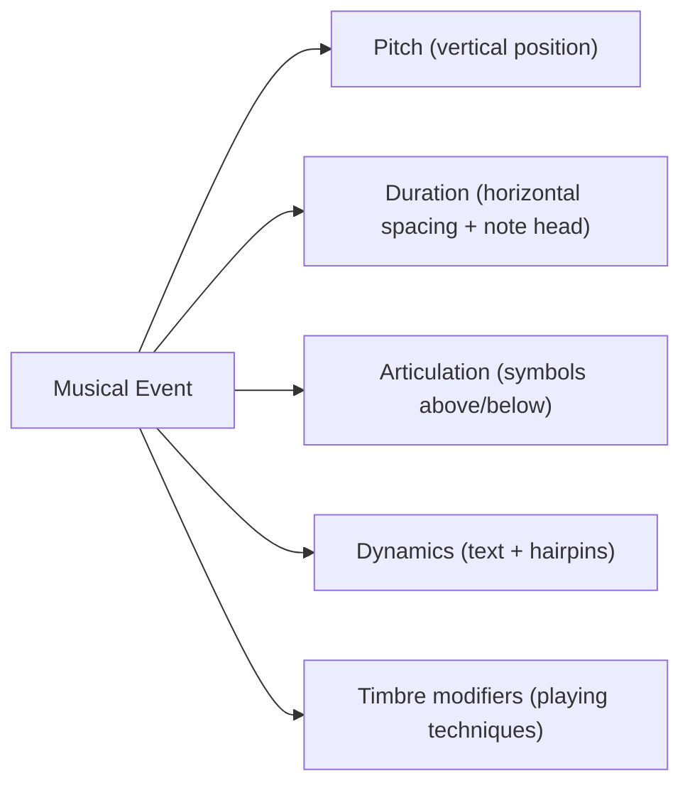
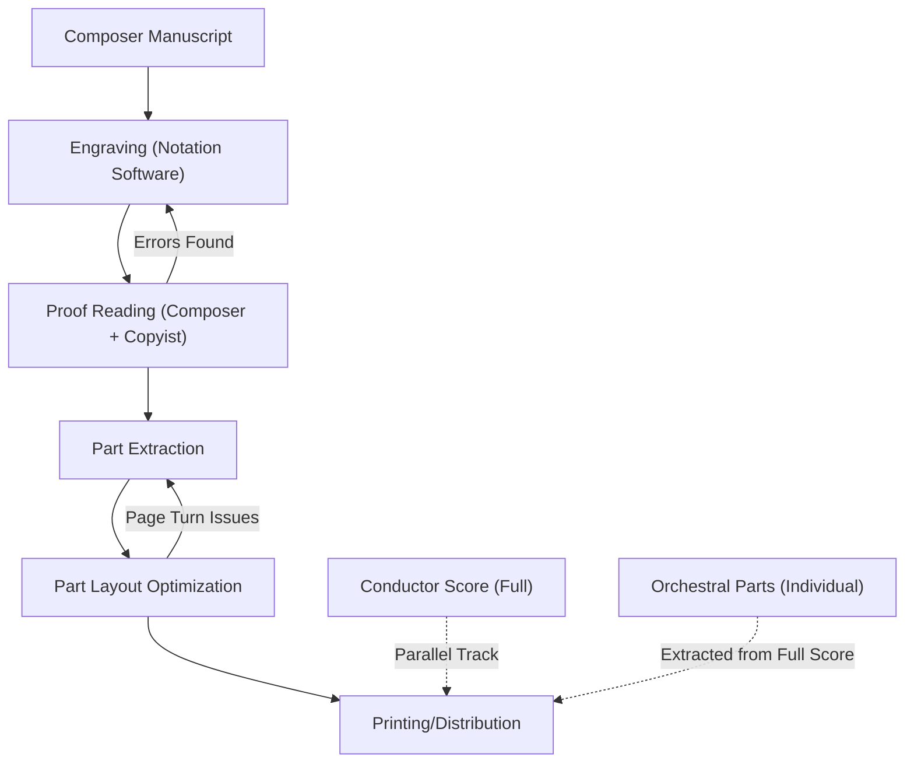

# Lesson 2: Score Layout and Notation

## 1. First-Principles Intuition & Invariants

### The Score as Communication Protocol

An orchestral score functions as a formalized communication protocol between composer and ensemble—a specification document that must resolve ambiguity while preserving interpretive flexibility. Unlike software specifications that target deterministic execution, musical notation encodes instructions for human interpreters whose cognitive and physical constraints shape the notation system itself.

The fundamental invariant governing score layout is **visual parsability under time pressure**. A conductor must scan vertically across 20+ simultaneous parts within fractions of a second during performance. This constraint drives three core design principles:

1. **Spatial grouping by acoustic function**: Instruments that blend acoustically are grouped vertically to minimize eye travel during rapid score reading
2. **Vertical alignment of simultaneous events**: Attacks occurring at the same metric position align horizontally across all staves, enabling instant recognition of texture density
3. **Consistent ordering conventions**: Standardized staff sequence reduces cognitive load, allowing musicians to internalize their position within the score topology

These principles emerge from the perceptual limitations of human visual processing. Studies of saccadic eye movements demonstrate that vertical scanning across grouped elements (instrumental families) is 40-60% faster than random-order scanning. The standard orchestral score layout optimizes for this biological constraint.

### Historical Evolution and Modern Conventions

Contemporary score layout crystallized during the Classical period (1750-1820) when orchestras standardized around four instrumental choirs. Earlier Baroque practice often grouped instruments by pitch range rather than timbre, reflecting smaller, more flexible ensembles. The modern layout convention—woodwinds, brass, percussion, strings—emerged from the acoustic realities of pre-amplification performance spaces:

- **Strings at bottom**: String sections occupy 60-70% of typical orchestral forces. Placing them at the bottom of the score reflects their foundational harmonic role and allows the conductor's eye to settle on the ensemble's timbral core
- **Brass centrally positioned**: Brass instruments project strongly and require precise dynamic balance. Central placement enables rapid assessment of brass/string balance
- **Woodwinds at top**: Woodwinds often carry melodic material that must pierce through dense orchestration. Top placement gives them visual prominence matching their acoustic role

This ordering is not universal. Some 20th-century composers (Stockhausen, Xenakis) organized scores by register rather than timbre, and graphic scores (Cage, Penderecki) abandon staff notation entirely. However, the traditional layout persists because it encodes centuries of empirical knowledge about ensemble coordination.

### The Physics of Dynamic Notation

Dynamic markings map linguistic descriptors to acoustic intensity, measured in decibels (dB SPL—sound pressure level). The standard dynamic range from *ppp* to *fff* spans approximately 40-50 dB, though actual intensity varies by:

- **Instrumental acoustics**: A trombone *fff* produces ~110 dB at 1 meter; a flute *fff* reaches ~95 dB
- **Ensemble size**: Doubling performers increases intensity by approximately 3 dB (not 6 dB, due to phase interference)
- **Performance space**: Reverberation time (RT60) and room modes shape perceived loudness independent of source intensity

The logarithmic nature of decibel scaling matches human loudness perception (Stevens' power law), making the exponential-feeling progression from *p* to *f* physiologically intuitive. This is why dynamic markings feel exponentially spaced rather than linear—they track the Weber-Fechner law of perceptual magnitude estimation.

Crucially, dynamics are **context-dependent**. A violinist's *f* in a solo passage differs from *f* in a tutti section, where balance requirements dictate playing at perhaps 70% of maximum intensity to avoid masking other instruments. This contextual interpretation distinguishes musical notation from prescriptive programming languages—the "compiler" (performer) applies situational heuristics not encoded in the score itself.

## 2. Core Architecture & Mechanics

### Hierarchical Staff Organization

The full orchestral score implements a hierarchical tree structure optimized for visual parsing:

```mermaid
graph TD
    A["Full Score"] --> B["Woodwind Choir"]
    A --> C["Brass Choir"]
    A --> D["Percussion"]
    A --> E["String Section"]
    
    B --> B1["Flutes (2-3 players)"]
    B --> B2["Oboes (2-3 players)"]
    B --> B3["Clarinets (2-3 players)"]
    B --> B4["Bassoons (2-3 players)"]
    
    C --> C1["Horns (2-8 players)"]
    C --> C2["Trumpets (2-4 players)"]
    C --> C3["Trombones (3 players)"]
    C --> C4["Tuba (1 player)"]
    
    D --> D1["Timpani"]
    D --> D2["Percussion 1"]
    D --> D3["Percussion 2+"]
    
    E --> E1["Violin I (12-16 players)"]
    E --> E2["Violin II (10-14 players)"]
    E --> E3["Viola (8-12 players)"]
    E --> E4["Cello (8-12 players)"]
    E --> E5["Double Bass (6-8 players)"]
```

This topology reflects both acoustic and practical considerations:

**Woodwinds (top)**: Positioned highest because they frequently carry melodic lines that must maintain auditory prominence. Within the woodwind choir, instruments are ordered by descending pitch range: flutes (C4-C7), oboes (B♭3-A6), clarinets (E3-C7), bassoons (B♭1-E♭5). This pitch-based ordering creates visual coherence when scanning melodic contours across multiple staves.

**Brass (upper-middle)**: Brass instruments produce high acoustic power (90-110 dB at 1m) and require careful dynamic balancing. Placing them below woodwinds but above strings allows conductors to monitor brass intensity relative to both melodic (woodwind) and harmonic (string) layers. Horns are placed at the top of the brass section despite their mid-range tessitura because they frequently double woodwind lines and serve as a timbral bridge between choirs.

**Percussion (middle)**: Percussion staves are grouped together but positioned variably depending on their role. Timpani, being pitched percussion fundamental to harmonic structure, are often placed immediately above strings. Unpitched percussion (snare, bass drum, cymbals) and auxiliary percussion (triangle, tambourine, xylophone) appear above or below timpani depending on their structural importance in a given work.

**Strings (bottom)**: String sections anchor the score's visual foundation, mirroring their harmonic foundation role. The descending pitch order (Violin I → Violin II → Viola → Cello → Bass) creates a visual analogue of the harmonic series, with upper partials (violins) at top and fundamental bass at bottom. This arrangement facilitates rapid assessment of harmonic density and voice-leading across string sections.

### Staff Notation and Visual Encoding

Each instrumental staff encodes five simultaneous information streams:

**Pitch encoding** uses the staff's five lines and four spaces to represent diatonic pitches, with ledger lines extending range beyond the staff. This design emerged in the 11th century and persists because it maps pitch space to visual space linearly—a cognitively efficient encoding for trained musicians. Clefs (treble, bass, alto, tenor) shift the pitch-to-line mapping, allowing different instruments to minimize ledger lines.

**Duration encoding** combines note head shape (filled/hollow) with stem flags and beams. The system is binary: a half note equals two quarter notes, a quarter note equals two eighth notes, etc. This hierarchical structure mirrors the metric organization of Western music and enables rapid visual parsing of rhythmic groupings through beam orientation.

**Articulation markings** (staccato, tenuto, accent, marcato) specify attack and release characteristics. These emerged as composers gained more precise control over performance nuance during the 18th century. Modern articulation vocabulary includes 20+ distinct symbols, each encoding specific acoustical envelopes:

- **Staccato (dot)**: Short duration (≈50% of notated value), rapid decay
- **Tenuto (line)**: Full duration, sustained amplitude
- **Accent (>)**: Sharp attack, increased initial amplitude (+3-6 dB)
- **Marcato (^)**: Very sharp attack, immediate decay after peak

### Dynamic Markings: Granular Control and Relative Scaling

Standard dynamic markings form a nine-level intensity scale:

| Marking | Italian | Approximate dB Range (relative to *mf*) |
|---------|---------|----------------------------------------|
| *ppp*   | pianississimo | -24 to -18 dB |
| *pp*    | pianissimo | -18 to -12 dB |
| *p*     | piano | -12 to -6 dB |
| *mp*    | mezzo-piano | -6 to -3 dB |
| *mf*    | mezzo-forte | 0 dB (reference) |
| *f*     | forte | +3 to +6 dB |
| *ff*    | fortissimo | +6 to +12 dB |
| *fff*   | fortississimo | +12 to +18 dB |

These values are **relative**, not absolute. A chamber orchestra's *fff* (~90 dB SPL in audience) differs dramatically from a Romantic symphony orchestra's *fff* (~105 dB SPL). Performers calibrate their dynamic range to ensemble size, venue acoustics, and stylistic context.

**Hairpin dynamics** (crescendo/decrescendo) encode continuous intensity change. The visual length of a hairpin correlates with temporal duration, but the *rate* of change requires interpretive judgment. A short, steep crescendo implies rapid intensity increase; a long, shallow crescendo implies gradual buildup. Some composers specify time spans ("cresc. over 4 bars") or target dynamics ("cresc. to *ff*"), but many leave the scaling curve to performer discretion.

Modern composers occasionally use numeric dynamics (0-10 scale) or decibel specifications for electronic music, but these remain rare in acoustic orchestral music due to the impossibility of measuring real-time SPL during performance.

### Transposition and Concert Pitch

Many orchestral instruments are **transposing instruments**—notation pitch differs from sounding pitch. This historical convention arose because:

1. **Fingering consistency**: A clarinetist switching between B♭ and A clarinets maintains identical fingering patterns despite different sounding pitches
2. **Optimal staff range**: Transposition minimizes ledger lines for instruments with extreme ranges
3. **Historical tuning systems**: Before standardized A=440 Hz, instruments were built in various keys

Common transpositions include:

- **B♭ Clarinet**: Sounds a major 2nd below written pitch
- **French Horn in F**: Sounds a perfect 5th below written pitch
- **English Horn**: Sounds a perfect 5th below written pitch
- **Piccolo**: Sounds an octave above written pitch
- **Contrabassoon**: Sounds an octave below written pitch
- **Double Bass**: Sounds an octave below written pitch

Conductors read transposed notation directly, performing mental transposition to assess harmonic relationships. Modern scores occasionally include a "concert pitch" score where all parts are notated at sounding pitch, eliminating transposition complexity at the cost of increasing ledger lines for some instruments.

### Page Turns and Physical Constraints

Score layout must accommodate the physical act of performance. String players cannot turn pages while playing, necessitating:

- **Strategic rests**: Composers insert rests of 2-4 bars minimum to allow page turns
- **Part preparation**: Players mark scores with cues, fingerings, and bowing markings before rehearsal
- **Stand partners**: In orchestral settings, two players share one stand; one player turns the page while the other continues playing

Conductors' scores, being larger format (typically 12" × 18"), face different constraints. Each page displays 2-4 systems (complete vertical slices of the score), and conductors must memorize music surrounding page turns to maintain eye contact with the ensemble during critical moments.

Digital scores (tablet-based) eliminate page turn constraints but introduce new challenges: screen glare under stage lights, battery life during long performances, and the loss of tactile feedback for rapid navigation. Adoption remains gradual in professional orchestras.

### Rehearsal Markings and Navigation

Large scores include navigational infrastructure analogous to line numbers in source code:

- **Rehearsal letters/numbers**: Marked above the system every 8-20 bars, enabling rapid reference ("start at letter G")
- **Bar numbers**: Displayed every 5-10 bars, providing fine-grained addressing
- **Section labels**: "Exposition," "Development," "Coda," etc., providing structural context
- **Tempo markings**: "Allegro," "Andante," "Presto," etc., specifying metric pace and character

These elements transform the score from a continuous stream into a addressable, modular structure, facilitating non-linear rehearsal workflows where ensembles isolate problematic sections for intensive work.

## 3. Practical Implementation Patterns

### Score Preparation Workflow

Professional orchestral score preparation follows a systematic pipeline:

**Engraving** (digital music typesetting) employs specialized software (Sibelius, Finale, Dorico) that automates layout while allowing manual adjustment. Engravers balance competing constraints:

- **Horizontal spacing**: Notes must be spaced proportionally to duration while maintaining visual clarity
- **Vertical alignment**: Simultaneous events across staves must align precisely
- **Collision avoidance**: Articulations, dynamics, and other markings must not overlap or obscure note heads
- **Page layout**: Systems must be distributed across pages to balance density and minimize page turns

Modern engraving software uses constraint-solving algorithms to optimize these parameters, but human intervention remains essential for handling edge cases (dense passages, unusual instrumentation, extended techniques).

**Part extraction** generates individual instrumental parts from the full score. This process involves:

1. Filtering: Extracting only the relevant staves for each instrument
2. Reformatting: Adjusting spacing and layout for individual part paper size (typically 9" × 12")
3. Cue insertion: Adding small-note cues from other instruments to help performers track their entries after long rests
4. Page turn optimization: Rearranging bars to ensure turns fall during rests or sustained notes

Extracted parts are the primary materials musicians use during rehearsal and performance. The full score remains principally a conductor's tool.

### Common Layout Patterns by Era and Style

Score layout conventions vary by historical period and compositional style:

**Classical/Early Romantic (1750-1850)**:
- Strings occupy 50-60% of score height
- Woodwinds in pairs (2 flutes, 2 oboes, 2 clarinets, 2 bassoons)
- Brass limited to 2-4 horns, 2 trumpets, sometimes trombones
- Minimal percussion (timpani only, occasionally)
- Clear sectional delineation with visual space between choirs

**Late Romantic/Post-Romantic (1850-1920)**:
- Expanded instrumentation: woodwinds in threes or fours, 6-8 horns, 4 trumpets, 4+ trombones
- Percussion section grows to 3-5 players with diverse instruments
- String section height compressed to 30-40% of score to accommodate expanded winds/brass
- Dense orchestration requires smaller notation size and tighter spacing

**20th-Century Modernist (1920-1970)**:
- Extended techniques demand new notation symbols (quarter-tones, prepared piano, multiphonics)
- Graphic elements supplement traditional notation (boxes for aleatoric sections, timelines for proportional notation)
- Unconventional staff orderings to reflect compositional structure rather than instrumental families
- Integration of electronics (tape, synthesizers) requires timing/coordination notation

**Contemporary (1970-present)**:
- Hybrid notation systems combining traditional and graphic elements
- Detailed performance instructions (sometimes multilingual)
- Computer-generated parts with extreme precision (down to millisecond timing in electronic+acoustic works)
- Increased use of tablature for non-standard string tunings

### Dynamic Balance and Orchestration as Information Theory

The allocation of dynamic markings across orchestral sections can be modeled as a **signal-to-noise optimization problem**. Each instrumental family has:

- **Maximum sustained SPL**: Peak output without distortion/fatigue
- **Minimum audible SPL**: Threshold below which instrument is masked by ambient noise
- **Dynamic range**: Ratio between max and min SPL (typically 30-40 dB for acoustical instruments)

When composing/notating, achieving audible balance requires accounting for:

1. **Spectral masking**: Low-frequency energy masks high-frequency content. Bassoons and horns playing *mf* can completely obscure flutes playing *mf* at the same pitch due to their richer overtone content
2. **Ensemble size asymmetry**: 14 first violins playing *p* produce more total acoustic power than 2 oboes playing *f*
3. **Distance/radiation patterns**: Brass instruments radiate directionally (narrow beam); strings radiate more omnidirectionally. Score notation cannot fully specify spatial acoustics

Skilled orchestrators encode balance heuristics directly in dynamic markings:

- Strings often marked one dynamic level softer than winds to achieve equal perceived loudness
- Brass marked two levels softer than strings in lyrical passages to avoid masking
- Percussion dynamics highly context-dependent (cymbal *p* in exposed passage vs. *ff* in tutti climax)

This tacit knowledge resembles the compiler optimizations that transform source code into efficient machine code—surface-level notation (dynamics) maps to complex, context-dependent acoustic outcomes through interpretive heuristics not explicitly encoded.

### Bowings, Fingerings, and Performance Annotations

String parts contain **bowing markings** that specify up-bow (⏏) and down-bow (⏐) strokes. Consistent bowing across a section ensures unified articulation and timbre. Principal players (section leaders) determine bowings during score preparation, marking them in parts so all players follow identical patterns.

Bowing affects:
- **Articulation**: Down-bows naturally accent; up-bows facilitate smooth connections
- **Dynamics**: Beginnings and ends of bow strokes have different timbral characteristics
- **Phrasing**: Bow changes at phrase boundaries versus mid-phrase alter musical line continuity

Wind parts include **breath marks** (apostrophe symbol ′) indicating where performers should breathe. Unlike string bowings, breath marks cannot always be synchronized across the section since wind players have varying lung capacities. Composers place breath marks at musical phrase boundaries to minimize disruption.

**Fingerings** (numeric indicators above/below notes) are usually added by performers rather than composers, as optimal fingerings depend on:
- Hand size and technical facility
- Instrument construction (keyboard layout, valve configurations, string instrument setup)
- Surrounding passage context (minimizing shifts, maintaining position consistency)

Editors sometimes include suggested fingerings in published editions, particularly for pedagogical purposes, but professional musicians often develop personalized fingerings optimized for their physiology and technique.

### Extended Techniques and Notation Innovation

20th and 21st-century repertoire demands notation systems for techniques beyond traditional playing:

**String Techniques**:
- **Col legno** (hitting strings with wood of bow): notated with text or "x" note heads
- **Sul ponticello/sul tasto** (bowing near bridge/fingerboard): alters timbre by emphasizing different harmonics
- **Bartók pizzicato** (snap pizzicato): string pulled perpendicular and released to snap against fingerboard
- **Scordatura** (alternate tunings): specified at beginning of movement, requires mental transposition by performer

**Wind Techniques**:
- **Multiphonics** (singing while playing, or fingerings producing multiple pitches): notated with chord symbols or pitch sets
- **Flutter-tongue** (rolling "r" while blowing): creates tremolo effect, notated with "flz." or trill marking
- **Pitch bends**: wavy lines or arrows indicating continuous pitch alteration
- **Key clicks/percussion** (striking keys without blowing): unpitched percussive sounds from wind instruments

**Brass Techniques**:
- **Stopped horn** (hand fully inserted in bell): raises pitch by semitone, muted timbre, notated with "+"
- **Mutes** (various types: straight, cup, harmon, bucket): alter timbre and reduce volume, each has specific notation
- **Lip bends/glissandi**: smooth pitch slides, notated with portamento lines

These techniques require detailed legend pages in modern scores explaining the notation system, as standardization remains incomplete. Some composers develop personal notation systems, necessitating extensive prefatory material.

## 4. Case Study: Analyzing a Score Page

Consider a typical page from a late Romantic score (e.g., Mahler Symphony No. 5, first movement):

**Visual Structure**:
- 4 flutes, 3 oboes, 3 clarinets, 3 bassoons (expanded woodwind section)
- 6 horns in F, 4 trumpets in B♭, 3 trombones, tuba (large brass section)
- 4+ percussion staves (timpani, bass drum, cymbals, tam-tam)
- String section: Violin I, Violin II, Viola, Cello, Bass (standard 5-part writing)

**Total staves**: 30-35 per system

**Information Density Analysis**:

A 20-second passage spanning two systems contains approximately:
- 600-800 individual note events
- 40-60 dynamic markings
- 20-30 articulation symbols
- 10-15 tempo/character indications
- 5-10 expressive text markings (espressivo, dolce, etc.)

This yields an **information density of 30-40 distinct symbols per second of music**, comparable to dense source code where each line encodes multiple operations.

**Reading Strategy**:

Conductors scan in a prioritized sequence:
1. **Downbeat alignment** (vertical scan): Identify which instruments attack on the beat
2. **Melodic line** (horizontal scan): Follow primary thematic material (often woodwinds or strings)
3. **Harmonic foundation** (bass register): Assess harmonic root and bass motion
4. **Dynamic contour** (global scan): Identify swells, terraced dynamics, sudden changes
5. **Textural shifts** (comparative scan): Note transitions between tutti/chamber textures

This layered reading protocol parallels compiler IR (intermediate representation) analysis, where code is parsed for control flow, data dependencies, and optimization opportunities simultaneously.

## 5. Common Pitfalls and Anti-Patterns

**Overcrowding staves**: Excessive dynamics, articulations, and text create visual clutter that impedes rapid reading. Professional engravers apply "minimum viable notation"—include only markings that alter default interpretation.

**Inconsistent alignment**: When simultaneous events misalign horizontally across staves, performers struggle to coordinate attacks. Modern notation software automates alignment, but manual adjustment remains necessary for complex passages.

**Ambiguous dynamics**: Writing "f" for trumpets and "f" for strings without considering acoustic power imbalance yields poor results. Experienced orchestrators use differentiated dynamics ("trumpets mp, strings f") to achieve perceived balance.

**Inadequate page turns**: Failing to provide 3-4 bar rests before page turns forces players to stop playing or miss notes while turning. This applies to both individual parts and conductor scores.

**Transposition errors**: When extracting transposed parts from concert-pitch scores, software bugs or manual mistakes can introduce wrong pitches. Thorough proofreading is essential.

**Ignoring playing technique limits**: Notating passages unplayable at specified tempo, requiring impossible leaps, or demanding unsustainable dynamic extremes. Composers should consult orchestration treatises or experienced players when in doubt.

## 6. Tools and Technology

### Notation Software

Modern score preparation uses three primary platforms:

**Sibelius** (Avid): Industry standard in film and commercial music. Strengths include robust MIDI playback, extensive plugin ecosystem, and efficient mouse-based input. Weaknesses: proprietary file format, occasional instability with large scores.

**Finale** (MakeMusic): Legacy standard in academic and publishing contexts. Extremely flexible, allowing pixel-level adjustment of every element. Weaknesses: steep learning curve, aging UI paradigms.

**Dorico** (Steinberg): Modern entrant with sophisticated layout engine based on SMuFL (Standard Music Font Layout) principles. Excels at automated spacing and engraving quality. Weaknesses: smaller plugin ecosystem, less established workflow.

All three support:
- MIDI input (keyboard/controller)
- MusicXML import/export (cross-software compatibility)
- VST plugin hosting (for realistic playback)
- PDF and audio rendering

### Scoring Libraries and Playback

While notation software includes basic playback, professional mockups use dedicated sample libraries:

**Orchestral Libraries**:
- **Spitfire Audio** (BBC Symphony Orchestra, Albion series): Recorded at Air Studios, London; extensive articulation sets
- **Vienna Symphonic Library**: Comprehensive coverage of all orchestral instruments with micro-variations
- **EastWest Symphonic Orchestra**: Cost-effective option with decent articulation coverage

These libraries employ:
- **Velocity layers**: Multiple recordings at different dynamic levels
- **Round-robin sampling**: Cycling through multiple recordings of identical notes to avoid machine-gun effect
- **Legato transitions**: Dedicated samples for smooth note connections

However, sample library playback remains an approximation. No MIDI mockup captures the micro-timing variations, timbral shading, and interpretive nuance of live performance.

### Historical Score Sources

Research and study require access to primary sources:

**IMSLP (International Music Score Library Project)**: Public domain score repository with 600,000+ scores and parts. Invaluable for studying historical editions and out-of-print works.

**Publishers' rental libraries**: Contemporary works often unavailable for purchase; orchestras rent scores/parts for performance. Major publishers include Schott, Boosey & Hawkes, Universal Edition.

**Urtext editions**: Scholarly editions stripping interpretive markings to present composer's original intent (e.g., Bärenreiter, Henle Verlag). Essential for historically informed performance.

## 7. Advanced Topics and Frontiers

### Algorithmic Engraving and Layout Optimization

Automated score layout involves solving multi-dimensional constraint problems. Consider horizontal spacing:

Given a sequence of note durations $(d_1, d_2, ..., d_n)$, assign horizontal positions $(x_1, x_2, ..., x_n)$ such that:
1. $x_i < x_{i+1}$ (monotonic ordering)
2. $x_{i+1} - x_i \propto \sqrt{d_i}$ (proportional spacing with sublinear scaling for readability)
3. $\sum (x_{i+1} - x_i) = W$ (total system width constraint)
4. Avoid collisions between noteheads, stems, beams, and markings

This resembles the knapsack problem (NP-hard), though heuristic solutions produce adequate results in practice. Dorico's layout engine uses linear programming to optimize spacing across multiple constraints simultaneously.

### Machine Learning for Score Recognition (OMR)

Optical Music Recognition converts scanned score images to editable notation. Modern OMR systems employ:

- **Convolutional neural networks** for staff line detection and note head classification
- **Recurrent networks** for sequential symbol parsing (beams, slurs)
- **Language models** to correct recognition errors based on musical grammar

Despite advances, OMR accuracy lags behind OCR for text (~95% vs. ~99.5%), particularly for handwritten manuscripts or complex modern notation. Human correction remains necessary.

### Networked Performance and Distributed Scores

COVID-19 pandemic accelerated development of networked performance systems (JackTrip, Elk Audio, SoundJack) enabling low-latency remote collaboration. These systems introduce new notation requirements:

- **Latency compensation cues**: Visual indicators for time-delayed attacks
- **Asynchronous notation**: Multiple simultaneous timelines for geographically distributed performers
- **Click-track integration**: Synchronization markers embedded in scores

As networking latency approaches perceptual thresholds (≤20ms), distributed orchestras become viable, necessitating notation systems that accommodate temporal uncertainty.

### Spatial Audio and 3D Score Representation

Immersive audio formats (Dolby Atmos, Ambisonics) enable sound source positioning in 3D space. Composers working in these formats require notation for:

- **Speaker/source positions**: Graphical maps showing sound trajectories through space
- **Distance encoding**: Near/far positioning of virtual sound sources
- **Spatial dynamics**: Volume/timbre changes as sources move

Early approaches include "3D score" visualizations where instruments are positioned in virtual space matching their intended acoustic positions. This remains experimental, with no standardized notation system yet emerged.

---

**Key Takeaways**:

1. Score layout is a **hierarchical information architecture** optimized for rapid human visual parsing under time pressure
2. Notation encodes five simultaneous information streams (pitch, duration, dynamics, articulation, timbre) in a compact visual representation
3. Dynamic markings specify **relative** rather than absolute intensities, requiring contextual interpretation by performers
4. Modern score preparation uses constraint-solving algorithms to balance competing layout requirements
5. Extended techniques and electronic integration continue to push notation systems beyond traditional conventions

The orchestral score remains one of the most information-dense communication protocols in use, encoding millisecond-precise instructions for 80+ human agents executing coordinated actions over 10-60 minute timescales. Its evolution reflects centuries of empirical refinement, balancing notational precision with interpretive flexibility.
