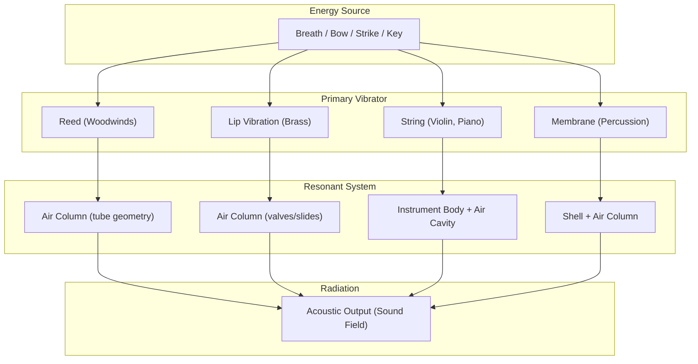
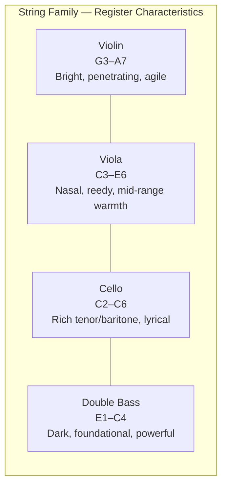
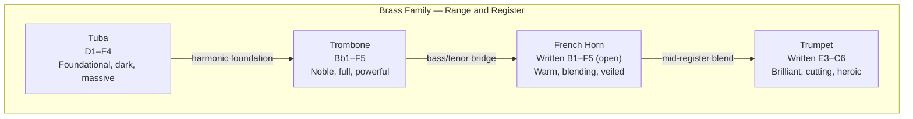
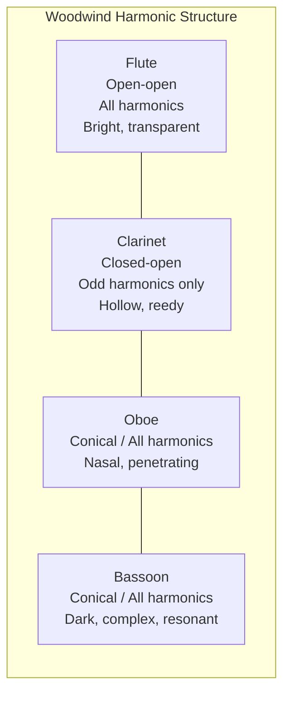
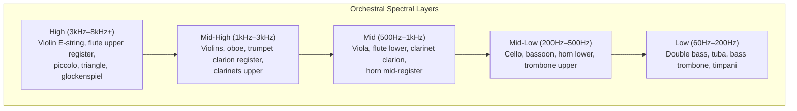
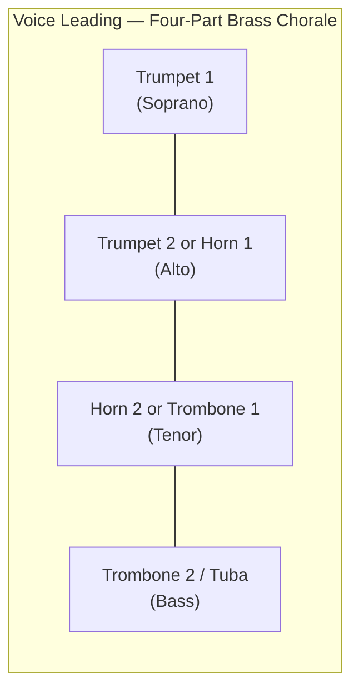
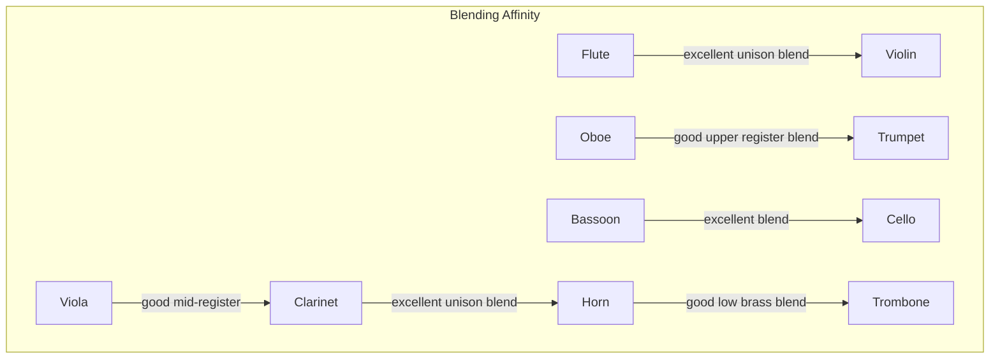

```mermaid
gantt
    title Orchestral Instrument Ranges (MIDI note numbers, C4=60)
    dateFormat X
    axisFormat %s

    section Strings
    Violin         :28, 93
    Viola          :48, 84
    Cello          :36, 76
    Double Bass    :28, 60

    section Woodwinds
    Flute          :60, 98
    Piccolo        :74, 108
    Oboe           :58, 91
    Clarinet Bb    :50, 94
    Bassoon        :34, 75

    section Brass
    Trumpet Bb     :52, 82
    French Horn F  :34, 77
    Trombone       :34, 72
    Tuba           :28, 65

    section Percussion
    Timpani        :41, 60
    Xylophone      :65, 108
    Marimba        :36, 84
```

# Lesson 3: Orchestration — Instrument-Specific Techniques

## 1. First-Principles Intuition & Invariants

Orchestration is the discipline of translating compositional intention into physical sound by selecting, combining, and deploying the specific sonic capabilities of orchestral instruments. It is not arrangement or harmonization, though it intersects both. At its core, orchestration is an engineering problem: given a set of physical transducers (instruments), each with hard constraints on frequency range, dynamic envelope, timbral palette, and acoustic radiation pattern, how does one construct a composite sound-field that realizes a musical idea with clarity, balance, and expressive power?

This requires understanding instruments not as abstract symbols on a staff but as physical systems governed by wave mechanics, material acoustics, and human physiology. The invariants below are not stylistic preferences—they are physical and mathematical facts that constrain every scoring decision.

---

### Invariant 1: The Harmonic Series as a Universal Constraint

Every pitched instrument produces not a single sinusoidal frequency but a superposition of partials whose frequencies are integer multiples of a fundamental frequency $f_0$. This is the harmonic series, and it emerges directly from the boundary conditions of standing-wave solutions to the wave equation on strings and in air columns.

For a string of length $L$, tension $T$, and linear mass density $\mu$, the fundamental and its harmonics are:

$$f_n = \frac{n}{2L} \sqrt{\frac{T}{\mu}}, \quad n = 1, 2, 3, \ldots$$

For an open cylindrical air column (flute, trumpet in first approximation) of length $L$ and speed of sound $c$:

$$f_n = \frac{nc}{2L}, \quad n = 1, 2, 3, \ldots$$

For a closed cylindrical air column (clarinet) with one open and one closed end:

$$f_n = \frac{(2n-1)c}{4L}, \quad n = 1, 2, 3, \ldots$$

This last result — odd harmonics only — is not a secondary characteristic of the clarinet. It is the defining acoustic fact that explains why the clarinet sounds hollow and reedy in its chalumeau register, why it has a pronounced break between registers (the instrument overblows at the twelfth, not the octave), and why it blends poorly with instruments whose spectra are rich in even harmonics (such as the oboe or horn) unless those instruments are carefully balanced. Ravel exploits this consciously throughout his orchestration: he almost never doubles a solo clarinet at the octave with an oboe without an intermediate voice to fill the spectral gap.

The practical implication for the orchestrator is that **timbre is a spectral distribution**, and blending or contrasting two instruments is fundamentally a question of whether their partial distributions reinforce, cancel, or mask one another. This is the same reasoning applied in digital audio when designing FIR filters for spectral shaping or when analyzing the comb-filtering artifacts of room acoustics.

---

### Invariant 2: Dynamic Envelope as a Transfer Function

Every instrument has a characteristic amplitude envelope: the time-domain evolution of a note from onset to silence. Using the ADSR model (Attack, Decay, Sustain, Release), one can characterize instruments with engineering precision:

| Instrument | Attack | Decay | Sustain | Release |
|---|---|---|---|---|
| Piano | 2–10 ms | 50–500 ms | Logarithmic decay | Variable (pedal) |
| Violin (arco) | 20–80 ms | Minimal | Constant (bow-sustained) | 20–50 ms |
| Trumpet | 10–30 ms | Minimal | Constant (breath) | 15–40 ms |
| Timpani | 5–20 ms | Moderate | Moderate (decay) | Long (resonance) |
| Flute | 15–40 ms | Minimal | Constant (breath) | 10–30 ms |
| Pizzicato (strings) | 2–8 ms | 100–300 ms | Rapid decay | Natural |

These are not soft guidelines. A piano's attack decay means that at a moderate tempo, the instrument loses significant energy before a sustained string chord even reaches full volume. This is why Beethoven and Brahms habitually double piano chord attacks with pizzicato or staccato wind figures rather than with sustained strings when they want percussive rhythmic articulation. The strings' slow attack would blur the onset; the pizzicato's fast attack reinforces it.

Similarly, the horn's relatively slow attack at soft dynamics (the muscles controlling the embouchure require a few milliseconds to stabilize) means that soft horn entries are notoriously insecure. Brahms accounts for this by writing horn entries either with a brief crescendo into the note or by supporting them with a held woodwind pitch that gives the player a tuning reference on the approach.

---

### Invariant 3: Acoustic Radiation Pattern and Spatial Deployment

An orchestra is a spatially distributed sound source, and the directional radiation of each instrument interacts with the hall's acoustic geometry to produce the audience's perceived blend. This is not a matter of seating preference — it is a physics constraint with real compositional consequences.

Strings radiate primarily upward (toward the ceiling and upper hall surfaces) due to the orientation of the bridge and soundboard. Brass instruments radiate strongly in a narrow forward lobe aligned with the bell axis. The principal horn players in most orchestras therefore face away from the audience (bell pointing stage-right), and the bell resonance is reflected from the shell to reach the audience. This is why muted horn sounds so different from muted trumpet: the horn mute displaces a radiation cone that was already reflected; the trumpet mute displaces a cone aimed directly at the audience.

Woodwinds radiate more omnidirectionally from multiple tone holes along the tube, making them acoustically diffuse and excellent for blending with strings in the mid-hall. The oboe, however, is a strongly directional instrument at its upper register, which is why solo oboe lines placed in a large hall can appear to "float" above the ensemble and project with disproportionate clarity at high frequencies.

---

### Invariant 4: Performer Physiology as a Hard Constraint

No acoustic model of an instrument is complete without modeling the human performer. Brass players require air recovery time — an orchestrator who writes for a solo trumpet player without rests for breathing is writing unperformable music. The rule of thumb: a solo brass player needs approximately one breath every 4–8 bars at moderate tempo, though this varies by dynamic level and register (high register playing is physically exhausting and shortens breath phrases).

String bowing introduces bow-change artifacts (a brief softening of amplitude at each bow reversal) that composers use deliberately for phrasing or avoid through slur markings. A slur over a long phrase means a single bow stroke, which limits dynamic range to what is achievable in one bow direction — a critical constraint Mahler and Sibelius both exploit for sustained pianissimo string textures.

Wind players on double-reed instruments (oboe, bassoon) produce more CO₂ than they consume O₂ when playing at high intensity — they need to exhale, not just inhale. This is why oboe and bassoon players sometimes appear to "breathe backward" in a phrase, taking a moment to exhale rather than inhale. Orchestrators of exposed solo woodwind lines must leave room for this.

---

## 2. Core Architecture & Mechanics



Each instrument family converts mechanical energy from the performer into acoustic radiation through a chain: energy source → primary vibrator → resonant system → radiation. Understanding where control enters this chain, and what degrees of freedom the performer has at each stage, is the foundation of practical orchestration.

---

### 2.1 The Violin Family (Bowed Strings)

The violin is a coupled-oscillator system with three primary resonant subsystems: the strings, the wooden body (plates and ribs), and the internal air cavity.

**String physics.** A bowed string is not a freely vibrating string — it is a stick-slip oscillator. The bow hair drags the string with friction until stored elastic energy in the string overcomes static friction, at which point the string slips and the bow hair re-engages. This Helmholtz motion produces a sawtooth velocity waveform at the contact point, rich in all harmonics. The player controls three primary parameters: bow speed (affecting amplitude), bow force (affecting harmonic content and tone quality), and contact point (sounding point, or *sul ponticello* near the bridge vs. *sul tasto* over the fingerboard).

The contact point is particularly powerful: bowing near the bridge (*sul ponticello*) forces the string into regimes where higher harmonics predominate, producing a glassy, nasal tone. Bowing over the fingerboard (*sul tasto*) damps the upper partials, producing a soft, flute-like tone. These are not effects to be noted as special techniques — they represent the full dynamic range of normal string timbre and are regularly exploited in standard repertoire.

**Body resonance.** The wooden body acts as a mechanical impedance transformer. Without it, a string's acoustic radiation would be negligible (strings have very small cross-sectional area and displace little air). The bridge couples string vibration to the top plate (the *table*), which has two primary resonance modes, empirically designated by luthiers as the "tap tone" modes, centered near D4 and A4 on a well-made violin. The f-holes — their geometry carefully optimized over centuries — allow the air inside the body to couple with the external air field, producing the characteristic Helmholtz air resonance near A3–B3 on the violin.

The result is a frequency response that is intentionally non-flat: the instrument's resonant peaks color the sound, emphasizing certain harmonics and suppressing others. This is not a defect — it is the timbre. A perfectly flat-response violin would sound thin and uninteresting. The luthier's art is shaping this resonance curve through plate carving, wood selection, and varnish composition.

**Range and register characteristics:**

```
Violin:   G3 – A7 (practical upper limit ~E7 in orchestral writing)
Viola:    C3 – E6
Cello:    C2 – C6 (soloists to G6)
Bass:     E1 – C4 (orchestral range; soloists higher)
```



**Register-specific orchestration notes:**

- Violin strings: G string has a dark, penetrating, almost horn-like quality. The E string is bright and can pierce through any texture. Crossing strings creates natural phrase articulations.
- Viola's C string is unique: it is the only string instrument string that sits in the same register as the tenor voice and the horn's mid-range, making it ideal for filling harmonic gaps that neither violins nor cellos naturally occupy.
- Cello in its upper register (above D5) becomes increasingly violin-like but retains a characteristic warmth. Saint-Saëns' Cello Concerto and Dvorak's exploit this register at length.
- Double bass open strings (E1, A1, D2, G2) have powerful acoustic presence and should be used deliberately — an open low E on bass under a fortissimo chord creates a foundation that changes the perceived pitch-weight of the entire ensemble.

---

### 2.2 The Piano

The piano is a percussive-string instrument with an action mechanism of remarkable mechanical precision. Its fundamental acoustic architecture:

- **Strings:** Treble notes use 3 strings per note (tri-choral), mid-range uses 2 (bi-choral), and bass uses 1 (monochoral with wound copper wire). The unison strings are tuned to deliberately slight misalignment (~0.5 cents), producing amplitude beats that give the piano its characteristic "singing" quality and gradual decay.
- **Hammer mechanism:** A felt hammer strikes the strings with a force that is a non-linear function of key velocity. The relationship between key velocity and resulting loudness is roughly logarithmic, following a psychoacoustic law. The hammer rebounds immediately, so the string vibrates freely after attack — this is the fundamental reason the piano cannot sustain beyond its natural decay.
- **Soundboard:** A large spruce plate coupled to the strings via the bridge. The soundboard's vibration modes are dense and overlapping, producing a relatively diffuse resonance spectrum that projects energy broadly across the mid and high frequency ranges.
- **Sustain pedal:** Lifts all dampers, allowing all strings to resonate sympathetically with the struck note. This is not simply "letting notes continue" — it creates harmonic cross-resonance between strings whose partials are shared, enriching the timbre dramatically. Beethoven's famous instruction in the first movement of the "Moonlight" Sonata — to hold the pedal through changing harmonies — was an intentional harmonic blur that his contemporary fortepianos could achieve without excessive muddiness due to their thinner, faster-decaying tone.

**In the orchestra,** the piano is a hybrid: percussive in attack, harmonic in content. It is most effective as a rhythmic/textural element (Bartók, Stravinsky's *Petrushka*), as a doubling instrument for articulation reinforcement, or as a solo voice against a transparently scored background. It is rarely effective as a pure harmonic sustaining instrument in a large ensemble because its decay is too rapid to compete with sustained strings or winds.

---

### 2.3 Brass Instruments

Brass instruments are half-open cylindrical or conical resonators driven by a buzzing lip valve. The physics is more nuanced than a simple tube model:

**Lip-valve oscillation.** The player's lips act as a pressure-controlled valve. Unlike a reed (which opens against air flow), lips open in the direction of air flow, making them an "outward-striking" valve. This distinction matters because it determines which modes of the air column can be excited: an outward-striking valve couples to the upward pressure modes of the tube and produces a harmonic series that is very slightly inharmonic for simple tubes but is corrected to near-perfect harmonicity in real instruments through careful bell flare design.

**Bell flare and inharmonicity correction.** The bell of a brass instrument is not decorative. The exponential flare serves as an acoustic transformer, converting the high-impedance vibration of the lips into efficient radiation. More critically, the bell's cutoff frequency determines which harmonics radiate freely: harmonics below the cutoff are reflected back into the tube and contribute to resonance; harmonics above the cutoff are radiated. The designer's task is to place the cutoff frequency so that the instrument's playing harmonics all fall in the resonant regime, while ensuring the bell radiates efficiently. The trumpet's bell is a strongly directional radiator above ~1 kHz, which is why it can project over a full orchestra — and why its dynamic level in fortissimo can easily overwhelm woodwind and string textures if not carefully balanced.

**Valve and slide mechanics.** Piston valves (trumpet, tuba, euphonium) insert additional tubing lengths when depressed. The three-valve system in standard use provides seven combinations (open, 2, 1, 1+2, 3, 2+3, 1+2+3), giving 12 chromatic semitones plus redundancies. A known tuning problem: when valves are combined, the added tube lengths are calculated for each valve independently, but the acoustic pitch of the combination is determined by the total tube length. Because each valve adds a fixed length, combined valve use creates systematic flatness, particularly on the tritone fingering (1+2+3). Players correct this in real time through embouchure adjustment or tuning slides.

The trombone avoids this entirely by using a continuous slide, giving the player complete, continuous control over tube length. This is why trombone intonation in a skilled player is superior to valve brass in slow, exposed harmonic passages — there are no discrete valve-combination compromises.

**Register and timbral stratification:**



**The French horn's special status.** The horn's conical bore, combined with its relatively narrow bell and the player's right hand inserted into the bell, gives it a unique capacity for blending with nearly every instrument family: it can blend with woodwinds (Beethoven's wind-and-horn chorales), strings (the horn choir in Brahms' symphonies), and the rest of the brass. This is because hand-stopping and the instrument's bore geometry suppress even harmonics in a way that moves its spectral profile toward that of the clarinet, allowing the two to merge almost seamlessly. When Brahms writes for clarinets and horns together, he is exploiting exactly this spectral overlap.

**Stopped horn** (achieved by fully inserting the right hand into the bell) raises the pitch by a semitone (player compensates by transposing down a semitone), fundamentally alters the harmonic content (the tube is now approximately closed at both ends, producing a predominantly odd-harmonic spectrum), and produces a bright, metallic, nasal timbre. This is not the same as a brass mute: a cup mute placed in the bell attenuates upper harmonics globally; stopping reshapes the resonant modes of the instrument itself.

---

### 2.4 Woodwind Instruments

Woodwind instruments are classified by their excitation mechanism: edge-tone (flute), single-reed (clarinet, saxophone), or double-reed (oboe, bassoon). The air column geometry — open or closed end — determines the harmonic spectrum.

**The flute** is an edge-tone instrument: the player directs a thin jet of air across a tone hole edge, creating a pressure oscillation that couples to the resonant modes of the tube. Because both ends are acoustically open (the embouchure hole is an open end, as is the far end), the flute supports all harmonics. The flute is weakest in its lowest octave (the C4–B4 range) due to the difficulty of coupling the embouchure to low-frequency modes — these notes require large volumes of air and careful embouchure shaping to maintain good tone. The upper register (D6 and above) becomes increasingly shrill and difficult to control at soft dynamic levels.

**The clarinet** is a single-reed cylindrical-bore instrument. Because one end (the mouthpiece/reed end) is acoustically closed when the reed is in contact with the mouthpiece, and the bell end is open, the instrument behaves as a closed-open tube, supporting only odd harmonics at low frequencies. The clarinet has three distinct registers:

1. **Chalumeau** (E3–B♭4): the fundamental register, odd-harmonic dominated, dark and rich
2. **Throat** (B♭4–E5): the least favorable register, produced by cross-fingerings, tonally thin and intonation-challenged
3. **Clarion/altissimo** (E5 and above): produced by overblowing at the twelfth (not the octave, because the first available even-harmonic partial is the third, the twelfth above the fundamental), bright and penetrating

The register transition — the "break" — is at approximately the written B♭4/B4 boundary. Melodic lines crossing this boundary require careful passage-writing and are a persistent challenge in clarinet writing. Mozart, Brahms, and Weber manage this with great sophistication by either avoiding the break mid-phrase or using it as an expressive articulation point.

**The oboe** is a double-reed conical-bore instrument. The conical bore — expanding from narrow to wide — has the acoustic effect of an open-open tube despite the physically closed reed end, because the geometry of the expansion compensates for the closed-end reflection. The oboe therefore supports all harmonics, like the flute, but its double-reed excitation generates a dense, complex spectrum with strong upper partials. This gives the oboe its characteristic penetrating, nasal tone that can project through nearly any texture.



**The bassoon** is acoustically analogous to the oboe (conical, double-reed, all harmonics) but pitched approximately an octave lower and with a folded tube design to make the instrument playable length practical. The bassoon's lower register (C2–G3) is rich and somewhat gruff — Stravinsky's famous opening solo in *The Rite of Spring* is written at the absolute upper extremity of this register, exploiting its strangled, vulnerable quality. The upper register (above G4) becomes sweeter and more oboe-like.

---

### 2.5 Percussion: Pitched and Unpitched

Percussion instruments divide into those that produce a definite pitch and those whose tonal spectrum is sufficiently complex or inharmonic that pitch perception is weak or absent.

**Timpani** are pitched membranophones. A circular membrane stretched under tension over a kettle-shaped resonator vibrates in circular standing-wave modes when struck. The modes of a circular membrane are **not** simple integer multiples of a fundamental; they are described by Bessel function zeros:

$$f_{mn} = \frac{\alpha_{mn}}{2\pi R} \sqrt{\frac{T}{\sigma}}$$

where $\alpha_{mn}$ are the zeros of the Bessel function $J_m$, $R$ is the membrane radius, $T$ is the tension, and $\sigma$ is the surface mass density. The first few non-trivial mode ratios are approximately 1 : 1.59 : 2.14 : 2.30, which are non-harmonic. Despite this, timpani are perceived as pitched because the kettle acts as an Helmholtz resonator that selectively reinforces the (1,1) mode (the fundamental) and suppresses the inharmonic overtones. The player's striking position also matters critically: striking near the center excites low modes preferentially; striking at approximately $\frac{1}{4}$ of the radius from the edge excites the pitch-defining (1,1) mode most efficiently while partially suppressing the inharmonic (0,2) mode.

**Mallet percussion** (xylophone, marimba, vibraphone, glockenspiel) are struck idiophones. The bars vibrate as free-free beams; their transverse vibration modes have frequencies proportional to $(n+\frac{1}{2})^2 / L^2$ for beam mode $n$, which is again non-harmonic. Instrument makers correct this by undercutting the bar beneath the center of the arch — removing mass in the region of maximum displacement for the fundamental, which lowers the fundamental's frequency without affecting higher modes, pulling the lower modes into approximate harmonic ratios. The xylophone has relatively short bars with minimal undercut, giving a dry, inharmonic "clatter." The marimba has deep undercuts, producing near-harmonic resonance and a warm, sustained tone reinforced by tuned tube resonators.

**Unpitched percussion** (snare drum, bass drum, cymbals) function primarily as transient event markers, rhythmic enforcers, and noise-band sources. The snare drum's characteristic crack is produced by the coupling between the batter head (top membrane) and the snare wires resting against the resonance head (bottom membrane). When the batter head is struck, the resulting pressure wave inside the shell drives the resonance head, which in turn excites the snare wires into rattling. The timing of the snare rattle onset — typically a few milliseconds after the initial strike — produces the characteristic double-transient that gives the snare its cutting, present quality.

---

## 3. Orchestral Texture and the Principle of Acoustic Layering

The practical task of orchestration is managing the simultaneous acoustic output of these instrument families into a coherent texture. This is fundamentally a masking and balance problem: in a full orchestra playing fortissimo, the acoustic energy in the room is dominated by the brass and low strings, and woodwind melodic lines can disappear entirely unless they are written in their most projecting registers or doubled appropriately.

### 3.1 Spectral Layering



Effective orchestration places melodic interest in registers where it will not be masked by accompanimental material. The classic error is writing a melodic woodwind line in the same frequency band as a dense string chord — the strings, with their combined acoustic power, will mask the woodwind entirely. The solution is either to place the woodwind line above the string texture (in the upper register, above violin range), to thin the accompanying strings, or to give the woodwind passage a rhythmic profile that is sufficiently distinct from the accompanying material that the auditory system can separate them through streaming.

### 3.2 The Doublings Principle

Doublings — assigning the same pitch to two or more different instruments — serve distinct purposes depending on register and context:

**Reinforcement doublings** increase the absolute power of a line without materially changing its color. Doubling a cello melody at the unison with bassoon and bass clarinet increases the acoustic energy by roughly 3 dB per doubling (since the sources are partially coherent, the actual increase is between 0 and 6 dB depending on the instruments' phase relationships) and smooths the onset transient due to the bassoon's slightly slower attack.

**Coloristic doublings** blend spectral profiles to create a new, emergent timbre. The classic example: flute + violin playing the same melodic line creates a texture that sounds like neither instrument separately. The flute's pure tone (low harmonic distortion) combines with the violin's rich bow-induced spectrum to produce a composite timbre that projects with the flute's clarity and the violin's warmth. This technique is systematically documented in Rimsky-Korsakov's *Principles of Orchestration* (1922) and continues to be the foundational reference.

**Octave doublings** extend the harmonic footprint of a line. Adding a double-bass line an octave below cellos does not simply add bass — it fundamentally changes the harmonic root, adding sub-harmonics that reinforce the tonic of the chord and anchor the low frequency range. Without bass support, cello low-register passages sound unsupported and harmonically ambiguous in a large hall because the cello fundamental (C2 at 65 Hz) radiates poorly from the instrument body relative to its upper partials.

### 3.3 Voice Leading and Harmonic Transparency

Orchestral voice leading follows the same principles as SATB choral writing but with added constraints specific to instrument transposition, register limits, and crossing:



A common error in student orchestration is allowing parallel octaves between brass parts in a chorale, which collapses the apparent number of independent voices and thins the perceived harmony. Brahms consistently avoids this in his symphony brass writing, preferring contrary motion between outer voices and smooth contrary inner-voice motion even at the cost of less obvious doublings.

**Transposition.** Many orchestral instruments are **transposing instruments**: they sound at a different pitch than written. This is a historical artifact of instrument design evolution (early horns and clarinets were built in different keys) that has persisted because it allows players to use the same fingerings across instruments of different sizes.

| Instrument | Transposition (sounds ___ from written) |
|---|---|
| Bb Clarinet | Major 2nd lower |
| A Clarinet | Minor 3rd lower |
| Bb Trumpet | Major 2nd lower |
| F Horn | Perfect 5th lower |
| Eb Alto Sax | Major 6th lower |
| Bb Tenor Sax | Major 9th lower |
| English Horn | Perfect 5th lower |
| Piccolo | Octave higher |
| Double Bass | Octave lower |

Failure to account for transpositions in a full score is one of the most common mechanical errors in student orchestration. A written middle C (C4) for Bb clarinet sounds as Bb3 — a whole step lower. For the horn in F, it sounds as F3, a perfect fifth lower. Modern notation software handles this automatically in concert-pitch vs. transposed-score modes, but the orchestrator must understand the underlying transpositions to verify that doublings land at intended unisons and octaves.

---

## 4. Historical Deployment: Case Studies in Instrument-Specific Writing

### 4.1 Beethoven — Symphony No. 9, IV: *Ode to Joy* Orchestral Introduction

The famous presentation of the *Ode to Joy* theme in the fourth movement appears first in the low strings (celli and basses in unison) with no harmonic support. Beethoven deploys the instrument at its most resonant and characteristic pitch — the cello in its tenor register — and strips the texture completely. The double basses in unison with the cellos add a foundation octave that is not an independent voice but a harmonic reinforcement of the cello tone. The absence of winds, brass, and upper strings creates an unprecedented textural clarity. When the theme is eventually presented by the full orchestra with chorus, the orchestration has been systematically thickened across approximately eight iterations (each adding more voices, more registers, more doublings), creating one of the most architecturally legible large-scale crescendos in the repertoire.

### 4.2 Ravel — *Bolero*: Systematic Exploration of Orchestral Color

Ravel's *Bolero* is analytically unique: it presents the same melodic material at the same harmonic level for approximately sixteen minutes, with the only variable being orchestration. It is the closest thing in the standard repertoire to a controlled orchestration experiment. The progression of instrumental colors — from solo flute, to solo clarinet, to bassoon, to Eb clarinet + horn, to oboe d'amore + horn + celesta + piccolo — demonstrates Ravel's principle that timbre is the primary compositional variable, subordinate to neither melody nor harmony. The choice of Eb clarinet (a transposing instrument a minor third higher than Bb clarinet, with a narrower bore and more intense, bright tone) rather than Bb clarinet for a specific iteration is a deliberate decision to increase spectral brightness without changing register. This level of instrumental specificity — not "clarinet" but which clarinet and in what exact register — is the operational definition of advanced orchestration.

### 4.3 Stravinsky — *The Rite of Spring*, "Augurs of Spring": Polytonal Layering

The famous opening of "Augurs of Spring" deploys the strings in a polytonal block: the violins and violas play a chord cluster (Eb major triad over a bassoon pedal that is not in the same harmonic region), driven by irregular sforzandi. Stravinsky achieves maximum rhythmic violence not by writing loud sustained chords — it would be simpler — but by writing brief, heavily accented attacks across sixteen independent string parts, each reinforced by the horns in a different rhythmic offset. The result is a texture that is acoustically abrasive because the attack transients from sixteen simultaneous downbow strikes arrive at the audience in a cluster of closely-spaced onsets (within approximately 20–50 ms, below the temporal fusion threshold), creating a single perceived percussive event of extreme density and timbral complexity.

---

## 5. Practical Scoring Reference

### 5.1 Standard Orchestral Ranges at a Glance



> Note: MIDI numbers shown are for concert pitch. Transposing instruments' written ranges differ from sounding ranges per the transposition table in §3.3.

### 5.2 Doublings Compatibility Matrix



---

## 6. Summary: The Orchestrator's Mental Model

Effective orchestration is not the application of recipes — it is the construction of a physical mental model of sound. The orchestrator must hold simultaneously in mind: the acoustic spectrum of each instrument in the passage's specific register, the dynamic envelope of each attack, the spatial radiation of each instrument in the hall, the physiological constraints on the performer, and the perceptual effect of the total sum on a listener seated 30 meters from the stage.

The instruments described here are not interchangeable tools. Each is a specific physical system with a specific acoustic personality that emerges from its material, geometry, and performer interface. Mastery of orchestration begins with mastery of these physical realities, proceeds through the analytical study of how great orchestrators have deployed them, and culminates in the development of a personal sonic vocabulary — a set of preferred textures, doublings, and registral strategies that are recognizable across a body of work.

The most consequential single skill in orchestration is the ability to listen to an imagined score inwardly before it is written. This auditory imagination — the capacity to hear, in detailed physical terms, the sound of a solo horn against divided violas, or a flute line above a harp arpeggio — is what separates the craftsman from the master. It is built through decades of score study, instrument familiarity, and attentive listening to live orchestral performance. There is no shortcut, but there is a methodology: instrument by instrument, register by register, ensemble combination by ensemble combination, building a comprehensive acoustic library in the mind.

---

*References and Further Study: Rimsky-Korsakov, N. — Principles of Orchestration (1922); Adler, S. — The Study of Orchestration, 4th ed. (Norton, 2016); Blatter, A. — Instrumentation and Orchestration, 2nd ed. (Schirmer, 1997); Kennan, K. & Grantham, D. — The Technique of Orchestration, 6th ed. (Prentice Hall, 2002); Piston, W. — Orchestration (Norton, 1955); Berlioz, H. & Strauss, R. (rev.) — Treatise on Instrumentation (Kalmus, 1904/1948).*
