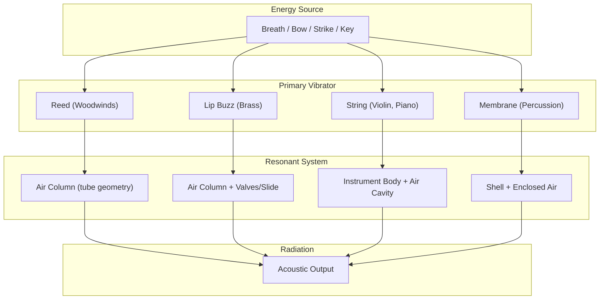
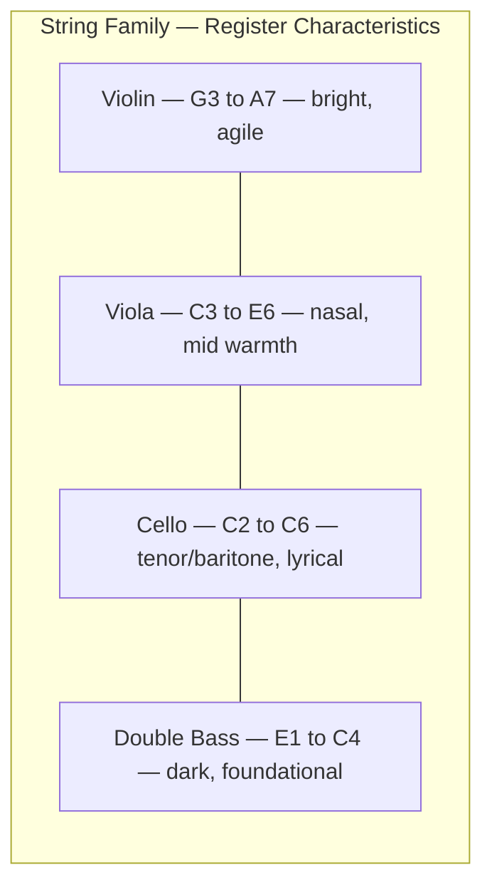
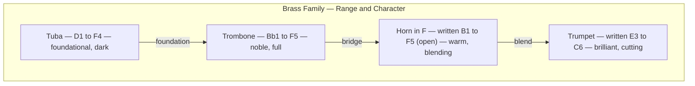
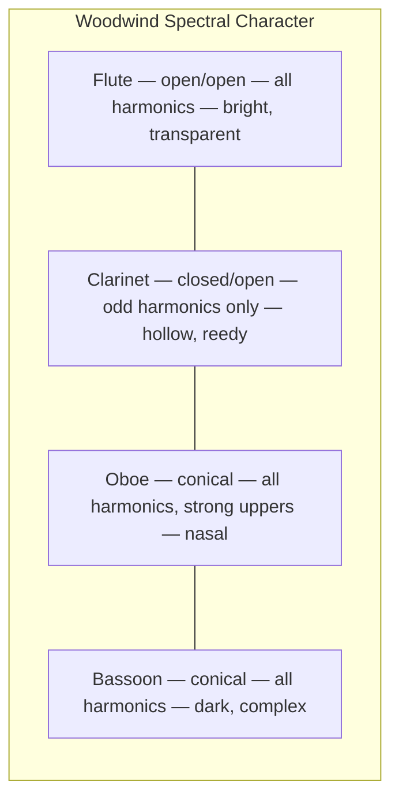
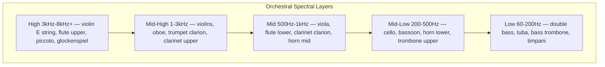
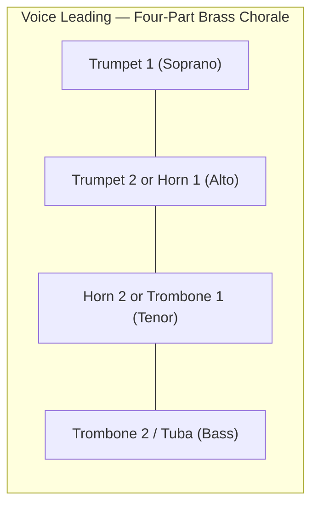
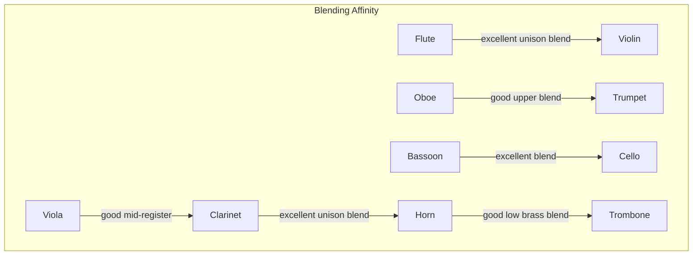

# Lesson 3: Orchestration — Instrument-Specific Techniques

## 0. How to Use This Lesson

This is a scoring lesson, not a listening-appreciation lesson. You need: manuscript paper or Dorico/Sibelius/MuseScore, a piano for checking voicings, and ideally access to a few willing instrumentalists for the final labs. Every drill below produces a piece of paper you can hand to a player. If a player winces, frowns, or asks "are you sure about this note?" — that's data. Write it down and fix the passage. Orchestration is learned by being corrected by physical reality, not by reading about it.

Work the drills in order. Each one assumes the mechanical facts from the preceding instrument section. Do not skip to Lab 4 before you can write a clean string chorale — full-orchestra texture is just chorale-writing with more failure points.

---

## 1. First-Principles Intuition & Invariants

Orchestration is the craft of translating a musical idea into physical sound by choosing which instruments play it, in what register, with what dynamic, and in what combination. It is distinct from arranging (reworking harmony/voicing) and from composition (inventing the material), though all three overlap constantly in practice. Treat it as an engineering problem: you have a fixed set of transducers, each with hard limits on range, attack speed, loudness, and timbre, and your job is to build a sound-field that makes the musical idea clear and emotionally effective to a listener thirty meters away.

The four invariants below are not trivia — they are the four questions you ask every time you orchestrate a passage: **What's the spectrum? What's the attack? Where does it radiate? Can the player actually do it?**

### Invariant 1 — Spectral Content Determines Blend

A bowed, blown, or struck note is not one frequency — it's a fundamental plus a stack of partials, and which partials are present (and how strong) is what you perceive as timbre. This comes directly from the physics of standing waves in strings and air columns, but you don't need the wave equation to use it; you need one fact per instrument family:

- **Clarinet** (cylindrical bore, closed at the reed end): produces mostly **odd** harmonics. Result: hollow, covered sound, especially in the low chalumeau register.
- **Oboe, bassoon** (conical bore): behave acoustically like an open-open tube — full harmonic series, strong upper partials. Result: nasal, penetrating, "complete" sound.
- **Flute** (open-open cylinder): full harmonic series but weaker upper partials than the double reeds. Result: pure, breathy, transparent.
- **Bowed strings**: rich, nearly-full harmonic spectrum with extra noise-band energy from bow friction. Result: warm and "fills gaps" in other instruments' spectra.

**Scoring consequence:** when you double two instruments at the unison or octave, you're adding their spectra together. Clarinet + flute = two instruments both missing content, so the blend sounds thin and hollow — a known trap. Clarinet + horn = the horn's stopped/covered tone and the clarinet's odd-harmonic spectrum overlap, producing a seamless blend (Brahms does this constantly). Flute + violin = the violin's dense bow-noise spectrum fills exactly what the pure flute tone lacks, producing the single most reliable "glow" doubling in the repertoire.

**Rule of thumb you can apply today:** before writing any unison/octave doubling, ask "does instrument B have harmonic content that instrument A is missing?" If both are spectrally thin in the same way, don't double them without a third voice to fill the gap.

### Invariant 2 — Attack Speed Is a Rhythmic Tool, Not Just a Character Trait

Every instrument has an attack time — how long it takes from onset to full loudness. This is the single most under-used lever in orchestration because composers think of it as "tone color" when it's really a **rhythmic clarity parameter**.

| Instrument | Attack time | Scoring use |
|---|---|---|
| Pizzicato strings, piano, mallet percussion | 2–10 ms | Reinforces a rhythmic downbeat with zero smear |
| Trumpet, trombone (normal) | 10–30 ms | Clean rhythmic articulation, cuts through texture |
| Timpani, snare | 5–20 ms | Percussive attack, long tail |
| Flute, clarinet, bassoon (breath attack) | 15–40 ms | Fine for melody, blurs fast rhythmic unisons |
| Horn (soft dynamic) | up to 60–80 ms | Notoriously insecure soft entries |
| Arco strings (slow bow) | 20–80 ms | Blurs the exact instant of a rhythmic attack unless accented |

**Direct consequence:** if you want a sharp, together rhythmic hit, don't rely on legato strings to deliver it — double the attack with pizzicato, piano, or short woodwind staccato. This is exactly why Beethoven and Brahms double piano chord attacks with pizzicato rather than with bowed strings: the bow's 20–80 ms rise time would smear the exact onset the composer wants to land.

**Horn-specific fix:** because a soft horn entrance is physically unstable (the embouchure needs a moment to lock in), never write an exposed pp horn entry cold. Either (a) give the player a brief crescendo into the note from silence is not possible — give them a short preparatory dynamic shape, or (b) have a woodwind sustain the same pitch a beat before the horn enters, so the player has a pitch reference in the air before committing.

### Invariant 3 — Radiation Pattern Explains Seating and Mute Behavior

Instruments don't radiate sound equally in all directions.

- **Strings** radiate mainly upward off the top plate, toward the hall ceiling — which is why the string tone you hear from the podium is brighter and more aggressive than what the audience hears after ceiling reflection smooths it.
- **Brass** radiates in a narrow forward cone aligned with the bell. Horns face away from the audience and rely on the back wall/shell for reflection — this is why a horn mute sounds different from a trumpet mute: the horn mute disturbs an already-reflected, already-diffused sound, while the trumpet mute blocks a beam aimed straight at the house.
- **Woodwinds** radiate more omnidirectionally (tone holes along the body), blending easily into the texture from almost anywhere on stage.

**Practical consequence for seating/balance in a score:** if you want a horn solo to project with brass directness, consider having it played bells-up or into the shell at a specific dynamic marking (and mark "bells up" in the part if truly needed) — otherwise trust that the horn will always sound "under" a trumpet at the same written dynamic because of this radiation difference, and compensate by writing the horn one dynamic louder when you want equal perceived volume against trumpet.

### Invariant 4 — The Performer's Body Is Part of the Instrument

No instrument exists apart from the human playing it, and physiology sets hard limits you must write around:

- **Brass players need air.** Rule of thumb: a breath every 4–8 bars at moderate tempo for sustained playing; shorter in the high register or at loud dynamics. Never write eight bars of continuous forte trumpet without at least one rest.
- **Bow direction limits dynamic shape.** A slur = one bow stroke = one direction of travel = a hard ceiling on how much crescendo/diminuendo is physically available before the bow runs out of hair and has to turn around. Long pp sustained passages (Sibelius, Mahler) depend on very slow, controlled bow distribution — mark "sul tasto" or indicate bow distribution if the passage is exposed.
- **Double-reed players exhale as much as they inhale.** Oboists and bassoonists playing sustained intense lines sometimes need a moment to *release* air, not take more in. Leave a breath mark even where you'd think there's "plenty of air left."

**Actionable rule:** in any exposed solo wind passage, physically mark breath commas (') in the part yourself. Do not leave it to the player to find a breath mid-phrase — you will get an unmusical gasp in the wrong place if you do.

---

## 2. Core Architecture & Mechanics



Every instrument converts performer energy into sound through this chain. The orchestrator's job is to know, for each link, what the performer controls and what is fixed by the instrument's construction — that's the difference between writing something idiomatic and writing something merely theoretically correct.

---

### 2.1 The Violin Family (Bowed Strings)

#### Bow Mechanics You Need to Know Before Scoring a Note

A bowed string is a stick-slip oscillator: the bow hair grips the string by friction, drags it sideways until the string's elastic restoring force overcomes the grip, the string slips back, and the cycle repeats hundreds of times a second. This is **Helmholtz motion**, and it's what makes a bowed string acoustically rich (full harmonic spectrum) compared to a plucked one.

The player has three independent controls, and you should think of these as *the* three orchestration parameters for strings — more important day-to-day than which exact pitch you write:

1. **Bow speed** → loudness. Fast bow = loud.
2. **Bow pressure** (weight into the string) → brightness. More weight near the bridge = brighter/harsher; less weight = warmer/rounder.
3. **Contact point** (distance from bridge) → timbral zone.

**Three contact-point zones you should actually write into scores, not treat as "effects":**

- **Sul ponticello** (bow very near the bridge): glassy, nasal, overtone-heavy. Write it for eerie, cold textures (think tremolo high strings under a horror or suspense cue).
- **Sul tasto** (bow over the fingerboard): soft, flute-like, overtones damped. Write it for distant, veiled pp textures.
- **Ordinario** (midpoint, the default): full balanced spectrum — this is what players do unless told otherwise.

These three settings span the *normal* expressive range of the instrument, not just special effects — use them deliberately rather than leaving tone quality to chance.

#### Range and Character by String

```
Violin:   G3 – A7 (orchestral ceiling: E7)
Viola:    C3 – E6
Cello:    C2 – C6 (soloists to G6)
Bass:     E1 – C4 (orchestral; soloists higher)
```



**Violin, string by string:**
- **G string** (G3–D5): dark, almost horn-like. Great for a melody you want to sound weighty without switching to viola.
- **D string** (D4–A5): warm, the all-purpose register.
- **A string** (A4–E6): bright, singing — the default melodic zone.
- **E string** (E5–A7): brilliant and piercing; it *will* cut through tutti texture. Use it when you want cutting, sparingly otherwise.

**Practical fingering/bowing tip:** a melodic line that crosses from D string to A string naturally gets a tiny timbral "seam" at the crossing — exploit this as free phrase punctuation instead of fighting it with fingering choices that avoid the string change.

**Viola:** the C string (C3–G4) occupies a register no violin or cello string naturally covers with the same color — this is why viola is the single best instrument for filling an inner harmonic voice that would otherwise be a hole in the texture. Treat it as a distinct voice, not a "lower violin."

**Cello:** C and G strings (C2–D4) are the orchestral tenor/baritone — your default lyrical-melody register. Above D5 (thumb position) the cello becomes bright and startlingly clear — underused; try it for an exposed solo line instead of defaulting to violin.

**Double bass:** open strings (E1, A1, D2, G2) carry enormous acoustic weight — a single open low E under a ff chord changes the perceived "floor" of the whole orchestra. Above about C4 the instrument gets thin and insecure; don't give a tutti bass section exposed melody above that line unless you have a soloist.

#### Drill 1 — Four-Part String Chorale (SATB)

Write 4 bars, D major, 4/4, quarter-note harmonic rhythm:

- Violin I — soprano (D5–A5)
- Violin II — alto (A4–D5)
- Viola — tenor (D3–A4)
- Cello — bass (D2–A3)

**Rules:** no parallel 5ths/octaves between outer voices; prefer contrary motion between soprano and bass; mark down-bow (⊓) on downbeats, up-bow (V) on upbeats; use "W.B." (whole bow) for sustained notes.

**Self-check:** play it on piano first. If the alto/tenor voices sound muddy, it's almost always because Viola and Violin II are crossing registers awkwardly — swap which one takes the higher note at that beat.

#### Drill 2 — String Tremolo Build

4 bars, building pp → ff:
- Bars 1–2: violins only, tremolo A4, pp → mp
- Bar 3: add violas, tremolo A3, mp → mf
- Bar 4: add cellos + basses, tremolo A2/A1, mf → ff

Notate as repeated 32nd notes with three slashes through the stem, "trem." marked above the first instance. Tremolo is bow staying in roughly one zone of the string, oscillating fast — it's a distinct sustained-shimmer texture, not just "play faster."

---

### 2.2 The Piano (in Orchestral Context)

The piano is percussive at the front end (felt hammer strikes the string, rebounds instantly) and harmonic in content, but **it cannot sustain** — once struck, the tone only decays. In treble, three strings per note (tri-choral) are deliberately tuned a fraction of a cent apart, which produces slow amplitude beating — that's the "singing" quality and gradual fade you hear, not a flaw.

**What this means for scoring:** never ask orchestral piano to hold a chord for several bars while winds/strings sustain over it — it will acoustically vanish after about a second. Instead, give it work that exploits the fast, percussive attack:

1. Rhythmic/textural reinforcement (Bartók, Stravinsky's *Petrushka*)
2. Doubling attacks for extra bite (reinforces pizzicato or marcato strings)
3. Exposed solo material against a transparent accompaniment

**Drill — Piano + Pizzicato Fusion:**
4 bars, 6/8, Allegro. Piano plays staccato chords on beats 1 and 4 of each bar (dotted-quarter rhythm). Strings play pizzicato on the identical attacks, doubled at the unison/octave with piano. Goal: the two sources should fuse into one composite "pluck" timbre rather than sound like two separate layers. If they don't fuse, the usual fix is tightening the rhythmic alignment to the exact same subdivision — any offset destroys the fusion.

---

### 2.3 Brass Instruments

#### Lip-Valve Mechanics

Brass tone starts with the lips buzzing against the airstream — an "outward-striking" valve (unlike a reed, which strikes inward against the flow). Because the player directly controls lip tension, brass pitch is flexible in real time: a player can lip a note sharp or flat, bend a note expressively, or correct a slightly-off pitch mid-note. This is a performer skill you're relying on, not a flaw to avoid.

#### Bell Flare and Why Brass Dominates a Tutti

The bell is an acoustic horn-transformer, converting the high-pressure, low-volume vibration at the mouthpiece into efficient radiation into the room. Above roughly 1 kHz, that radiation is strongly directional and loud — which is exactly why unbalanced brass sections overpower strings and winds.

**Working balance rule:** in a full tutti, mark brass one dynamic level softer on paper than the rest of the orchestra to get equal *perceived* loudness. If strings/winds are ff, write brass f. This single fix solves most "the brass buried everything" complaints from student scores.

#### Valves vs. Slide — Intonation Consequences

Piston valves add tubing length; combining valves (especially 1+2+3, the low tritone fingering) produces systematic flatness that the player corrects by ear and embouchure in real time. The trombone's continuous slide has no such discrete-combination compromise — it's why trombones are the superior choice for slow, exposed inner harmonic voices requiring precise tuning (hymn-style chorales, suspensions).

**Rule:** if you need a perfectly tuned sustained inner voice in a brass chorale, give it to trombone, not trumpet, wherever the part allows.



#### The Horn's Unique Blending Role

The horn's narrow bell, conical bore, and the player's hand inside the bell combine to suppress even harmonics — pushing its spectral profile toward the clarinet's. That's the acoustic reason horn blends with woodwinds, strings, and brass almost equally well, and why Brahms pairs clarinet + horn constantly.

**Stopped horn** (right hand fully inserted): raises pitch a semitone (player transposes down to compensate), reshapes the spectrum toward odd harmonics, produces a bright, metallic, nasal "+" sound. Notate "+" for stopped, "o" to release. This is *not* the same as a cup mute — a mute globally attenuates upper harmonics from outside; stopping changes the instrument's own internal resonance.

#### Drill 1 — Four-Part Brass Chorale

4 bars, Bb major, 4/4, whole-note harmonic rhythm:
- Trumpet 1 — soprano (Bb4–F5)
- Horn 1 — alto (Eb4–Bb4)
- Horn 2 — tenor (Bb3–F4)
- Trombone 1 — bass (Bb2–F3)

Rules: no parallel octaves outer voices; prefer contrary motion; mark breaths (') at ends of bars 2 and 4; keep all voices comfortably mid-register.

#### Drill 2 — Fanfare with Layered Function

4 bars, C major, 4/4, quarter-note pulse:
- Trumpets 1&2: rhythmic unison/octave figure on C–E–G–C
- Horns 1&2: sustained pedal C and G (perfect 5th)
- Trombones 1&2: punctuation on beats 2 and 4, answering the trumpet figure

Goal: three clearly separated functions (melody / sustain / punctuation) audible simultaneously.

---

### 2.4 Woodwind Instruments

#### Flute

Edge-tone excitation (air jet across the embouchure hole edge). Open-open tube → full harmonic series, but the lowest octave (C4–B4) is physically hard to produce with real volume — it needs a large air column and precise embouchure shaping. Above C6 it gets shrill and hard to control soft.

**Scoring tips:**
- Low register (C4–C5): breathy, intimate — but never write it exposed and *soft*; it won't project. If you want soft low woodwind color, use clarinet chalumeau instead.
- Middle register (C5–C6): clear, bright, the workhorse range.
- High (C6+): piercing — use sparingly in tutti.

#### Clarinet

Single-reed, cylindrical bore, closed-open acoustically → odd harmonics dominate at low pitch. Three distinct registers you must treat as three different instruments in terms of color:

1. **Chalumeau** (E3–Bb4): dark, rich, odd-harmonic — one of the most beautiful and underused orchestral colors. Use it for warm accompaniment figures or intimate solo lines.
2. **Throat** (B4–E5): thin, intonation-shaky (cross-fingered notes). Avoid exposed solo writing here.
3. **Clarion/altissimo** (E5+): bright, penetrating, produced by overblowing at the twelfth.

**The break** at Bb4/B4 is a real technical hazard — melodic lines crossing it need careful fingering logic. Either avoid crossing it mid-phrase, or use the crossing itself as a deliberate expressive gesture (Mozart does both).

#### Oboe

Double-reed, conical bore → acts like an open-open tube with a very dense upper-partial spectrum: nasal, penetrating, the most projecting woodwind by a clear margin.

**Scoring tips:** give it the top voice/melody in woodwind chords by default. If you double oboe with flute at a soft dynamic, mark the oboe a full dynamic step softer or it will swallow the flute (a very common student mistake).

#### Bassoon

Double-reed, conical bore, roughly an octave below oboe. Lower register (C2–G3) is gruff and reedy — exploited famously by Stravinsky's *Rite of Spring* opening solo, written right at the top of this register to get a strained, exposed quality. Above G4 it becomes sweeter, oboe-like.

**Scoring tip:** bassoon + cello in the tenor register is one of the most reliable warm bass-doubling combinations in the orchestra — use it whenever you want cello lines to project with more body in a big hall.



#### Drill — Four-Part Woodwind Chorale

4 bars, F major, 4/4, whole-note harmonic rhythm:
- Flute — soprano (F5–C6)
- Oboe — alto (C5–F5)
- Bb Clarinet — tenor (written G4–D5, sounding F4–C5)
- Bassoon — bass (F3–C4)

Rules: account for clarinet transposition (written note sounds a major 2nd lower); mark breaths at ends of bars 2 and 4; avoid clarinet throat register (written B4–E5); keep oboe mid-register to avoid overpowering.

---

### 2.5 Percussion: Pitched and Unpitched

#### Timpani

The kettle acts as a Helmholtz resonator, reinforcing the fundamental and damping inharmonic overtones — this is why a stretched membrane, which by itself vibrates inharmonically, sounds clearly *pitched* once mounted in the kettle.

Standard four-drum set and ranges:
- 32" — D1–A1
- 29" — F1–C2
- 26" — Bb1–F2
- 23" — D2–A2

**Practical facts:**
- Tuning changes need 2–4 bars of rest depending on the interval — mark it explicitly in the part: "change D to Eb."
- Striking at roughly 1/4 of the head's radius from the edge gives the clearest fundamental; dead-center strikes sound dull. Specify "normal" vs "center" if you want the special effect.
- Rolls are notated as tremolo (repeated 32nds with slashes) for a sustained, thunder-like sound.

#### Mallet Percussion

- **Xylophone** — short bars, dry/inharmonic, bright attack. F4–C7. Rapid rhythmic figures.
- **Marimba** — long bars with deep acoustic undercuts, near-harmonic, warm sustain. C2–C7 (5-octave concert). Lyrical lines and chordal textures — arguably the most versatile mallet instrument in a contemporary score.
- **Vibraphone** — motorized rotating discs in the resonators add amplitude modulation (vibrato). F3–F6. Jazz/film-score color.
- **Glockenspiel** — small metal bars, extremely bright. Written G5–C8, sounds two octaves above written. Cuts through anything — use sparingly.

#### Unpitched Percussion

- **Snare drum:** the crack comes from snare wires rattling against the resonant head a few milliseconds after the strike — a genuine double transient, not a single hit.
- **Bass drum:** low-frequency weight and impact, felt beater.
- **Cymbals:** suspended (mallet/stick roll), crash (pair struck together), ride (steady pattern) — add brilliance and transient energy, no pitch content.

**Scoring use:** unpitched percussion marks structural downbeats and reinforces climaxes; it doesn't carry harmony. Use it to punctuate, not to fill.

---

## 3. Orchestral Texture and Acoustic Layering

The real day-to-day job of orchestration is managing simultaneous acoustic output across the whole ensemble so nothing important gets masked. In a ff tutti, the brass and low strings dominate the room's acoustic energy by sheer power — a woodwind melody will vanish unless it's placed where it can be heard.

### 3.1 Spectral Layering



**Classic masking error:** writing a melodic woodwind line in the same frequency band occupied by a dense, loud string chord. The combined power of a full string section will bury it, full stop.

**Three fixes, in order of how often they actually get used in practice:**
1. Move the woodwind line above the string texture, into a register the strings aren't occupying.
2. Thin the strings underneath it (fewer desks, or mute them).
3. Give the woodwind line a distinct rhythmic profile so the ear can separate it from the string material by streaming, even without a clean frequency gap.

### 3.2 The Doublings Principle

**Reinforcement doublings** add power without changing color much. Cello melody doubled by bassoon + bass clarinet at the unison stays recognizably "cello" but gains projection and a smoother attack (the bassoon's slightly slower attack softens onset transients). Match spectral profiles for this to work cleanly — cello + bassoon is excellent; cello + flute is thin and incoherent because the spectra don't reinforce each other.

**Coloristic doublings** create a new emergent timbre. Flute + violin on the same melodic line is the textbook example: the flute's clean tone and the violin's bow-noise-rich spectrum combine into something that's neither instrument alone — documented systematically back to Rimsky-Korsakov and still the reference starting point. Other reliable pairs: clarinet + horn, oboe + trumpet (bright upper-register blend), bassoon + cello (warm low-mid blend), flute + harp (delicate transparent high blend).

**Octave doublings** extend harmonic footprint. Adding double bass an octave below cello doesn't just "add bass" — the cello's fundamental (C2 ≈ 65 Hz) radiates weakly relative to its upper partials, so low cello lines sound thin and unsupported in a large hall without bass reinforcement. **Default rule: support exposed low cello passages with bass unless you specifically want that thin, exposed quality.**

### 3.3 Voice Leading and Transposition

Orchestral voice leading follows SATB rules with extra bookkeeping for transposition.



**Common student error:** parallel octaves between brass parts, which collapses the apparent voice count and thins the harmony. Brahms's brass writing consistently avoids this, favoring contrary outer-voice motion even when it costs an "obvious" doubling.

#### Transposition Table (memorize this, don't look it up every time)

| Instrument | Sounds ___ relative to written |
|---|---|
| Bb Clarinet | Major 2nd lower |
| A Clarinet | Minor 3rd lower |
| Bb Trumpet | Major 2nd lower |
| F Horn | Perfect 5th lower |
| Eb Alto Sax | Major 6th lower |
| Bb Tenor Sax | Major 9th lower |
| English Horn | Perfect 5th lower |
| Piccolo | Octave higher |
| Double Bass | Octave lower |

**Verification habit:** after writing a passage with transposing instruments, play it back in concert-pitch view in your notation software before calling it done. Catching a transposition error on paper is free; catching it in a reading session wastes rehearsal time and your credibility.

#### Drill — Mixed-Instrumentation Chorale with Transposition

4 bars, G major, 4/4, half-note harmonic rhythm:
- Flute — soprano (D5–B5)
- Bb Clarinet — alto (written E4–C5, sounding D4–Bb4)
- F Horn — tenor (written A3–F4, sounding D3–Bb3)
- Bassoon — bass (G2–D3)

Rules: account for all transpositions; no parallel 5ths/octaves between flute and bassoon; prefer contrary outer-voice motion; mark breaths at ends of bars 2 and 4.

---

## 4. Case Studies in Instrument-Specific Writing

### 4.1 Beethoven, Symphony No. 9, IV — *Ode to Joy* Theme Entrance

The theme first appears in cellos and basses in unison, completely unharmonized. Beethoven picks the cello's resonant tenor register and strips away everything else — no winds, no brass, no upper strings — so the ear hears the melody with zero competing material. Across roughly eight later iterations, the orchestration thickens step by step (more voices, more registers, more doublings) until the full tutti-plus-chorus version arrives, producing one of the most clearly audible large-scale crescendos in the repertoire.

**Takeaway you can use immediately:** when introducing a theme, present it first in one clean, characteristic timbre before layering anything on top. Complexity should arrive after the listener already knows the tune.

### 4.2 Ravel, *Bolero*

Same melody, same harmony, roughly sixteen minutes, with orchestration as the only changing variable — effectively a controlled experiment in timbre. The progression runs through solo flute, solo clarinet, bassoon, Eb clarinet + horn, oboe d'amore + horn + celesta + piccolo, and onward. The choice of **Eb clarinet** instead of the standard Bb instrument for one iteration is deliberate: its narrower bore and higher transposition (a minor third above Bb clarinet) gives extra brightness at the same written register — a decision at the level of "which exact instrument variant," not just "which instrument family."

**Study assignment:** get a score and a recording and track, iteration by iteration: which instrument carries the melody, what's underneath it harmonically, what doublings appear, and how the dynamic arc is built purely by adding instruments rather than by individual players simply playing louder.

### 4.3 Stravinsky, *The Rite of Spring*, "Augurs of Spring"

The famous chord isn't one loud sustained hit — it's sixteen independent string parts attacking an Eb-major cluster with irregular sforzandi, reinforced by horns on offset rhythms. The attack transients from all those near-simultaneous downbow strikes land within roughly 20–50 ms of each other — below the ear's threshold for resolving separate events — and fuse into one dense, violent percussive hit.

**Takeaway:** rhythmic violence comes from transient density (many attacks clustered in time), not simply from raw loudness. A single ff chord is tamer than several simultaneous, slightly-offset attacks that fuse perceptually into one event.

---

## 5. Practical Scoring Reference

### 5.1 Instrument Ranges at a Glance

```mermaid
gantt
    title Orchestral Instrument Ranges (MIDI note numbers, C4=60)
    dateFormat X
    axisFormat %s

    section Strings
    Violin         :28, 93
    Viola          :48, 84
    Cello          :36, 76
    Double Bass    :28, 60

    section Woodwinds
    Flute          :60, 98
    Piccolo        :74, 108
    Oboe           :58, 91
    Clarinet Bb    :50, 94
    Bassoon        :34, 75

    section Brass
    Trumpet Bb     :52, 82
    French Horn F  :34, 77
    Trombone       :34, 72
    Tuba           :28, 65

    section Percussion
    Timpani        :41, 60
    Xylophone      :65, 108
    Marimba        :36, 84
```



Numbers shown are sounding/concert pitch. Written ranges for transposing instruments differ per §3.3.

### 5.2 Blending Affinity Map



### 5.3 Quick Reference Card

**Violin** — G string dark/horn-like; E string piercing, use sparingly; string crossings = free phrase punctuation.
**Viola** — C string is a unique voice, fills harmonic gaps; the most underused section in the orchestra.
**Cello** — thumb-position upper register projects with warmth; low register needs bass support.
**Double Bass** — open strings carry real acoustic weight; harmonic foundation, not a melody instrument.
**Flute** — low register soft/unstable; high register piercing; avoid exposed soft writing below E4.
**Clarinet** — chalumeau is dark and underused; throat register (B4–E5) is weak, avoid exposed solos there; mind the Bb4/B4 break.
**Oboe** — most projecting woodwind; mark it a step softer when unison-doubled with a quieter instrument.
**Bassoon** — pairs beautifully with cello; upper register (above G4) turns sweet and oboe-like.
**Trumpet** — directional, can overwhelm; write one dynamic step softer than strings/winds for balance.
**Horn** — blends with almost everyone; stopped horn ("+") is bright/metallic, distinct from a mute.
**Trombone** — best intonation of the brass family in slow exposed passages, thanks to the slide.
**Timpani** — tuning changes need 2–4 bars rest; mark changes explicitly in the part.

---

## 6. Hands-On Orchestration Labs

### Lab 1 — Four-Part String Chorale with Voice-Leading Analysis

8 bars, A major, 4/4, quarter-note harmonic rhythm, string quartet.
**Requirements:** no parallel 5ths/8ths between outer voices; mark all bowings; include one 4-3 or 7-6 suspension; end on a plagal (IV–I) cadence; annotate each voice-leading choice in writing.
**Submit:** full score + written annotations.

### Lab 2 — Mixed Woodwind Quartet with Transposition

16 bars, D major, 3/4, Andante — Flute, Bb Clarinet, F Horn, Bassoon.
**Requirements:** correct transpositions throughout; breath marks every 4 bars minimum; one phrase where the melody physically migrates between instruments; one coloristic unison doubling; verify everything in concert pitch.
**Submit:** transposed score and concert-pitch score.

### Lab 3 — Brass Fanfare with Dynamic Stratification

12 bars, Bb major, 4/4, Allegro maestoso — 2 Trumpets, 2 Horns, 2 Trombones, Tuba.
**Requirements:** build piano to fortissimo over the full 12 bars; tutti rhythmic unison at the climax; one 4-bar sustained chorale section; brass dynamics written one level softer than the perceived target balance; breath marks for every voice.
**Submit:** full score, dynamics and articulations marked.

### Lab 4 — Full Orchestra Tutti: Spectral Layering Exercise

16 bars, strings + paired woodwinds + 4 horns + 2 trumpets + 3 trombones + tuba + timpani + percussion, pp → ff.
**Requirements:** systematic layering (mid-register entries first, then high and low added progressively); melody in a projecting register; harmonic accompaniment mid-register; bass foundation under everything; at least one reinforcement doubling and one coloristic doubling; all transpositions verified; no frequency band left empty or overcrowded at the climax.
**Submit:** full score with a short written note on your layering strategy.

### Lab 5 — Orchestral Reduction of a Piano Work

Take 8–16 bars of a piano piece (Chopin Nocturne, Debussy Prelude, Schumann character piece) and orchestrate it for chamber orchestra (strings, winds, 2 horns).
**Requirements:** first analyze the piano texture on paper — identify melody, bass, and harmonic filling as three separate layers; assign each layer to the instrument best suited by register/timbre; do not transcribe literally — reinterpret the texture for orchestral forces; include at least one coloristic doubling that produces a color not present in the piano original.
**Submit:** full score plus a one-page written justification of your choices.

---

## 7. The Orchestrator's Mental Model

Orchestration isn't recipe-following — it's building a working mental model of sound and checking every passage against it. Hold these simultaneously for any passage you write:

- The spectral content of each instrument *in that specific register*
- The attack speed of each entrance
- Where that instrument's sound actually radiates in the hall
- What the performer's body can and can't do at that tempo/dynamic/duration
- What a listener thirty meters back actually perceives once everything sums together

No two instruments are interchangeable tools for the same job — each is a specific physical system with a specific acoustic personality rooted in its material and geometry.

**Build mastery in this order:**
1. Internalize the physical facts in this lesson until they're reflexive.
2. Study how great orchestrators deployed them (§4) — score in one hand, recording in the other.
3. Develop your own working vocabulary of go-to doublings, registers, and textures.

**The single most valuable skill:** hearing an imagined score in your head, in physical detail, before it's on paper — the sound of a solo horn against divided violas, or a flute line floating above a harp arpeggio. That's built by score study, by hearing instruments live and up close, and by sitting in different seats in the hall to notice how balance actually shifts.

**There's no shortcut — but there is a method:** instrument by instrument, register by register, combination by combination, until you've built a working acoustic library in your head that you can call on while composing.

---

## 8. Next Steps

### Score Study Repertoire

**Foundational:** Beethoven Symphonies 3, 5, 7, 9; Mozart Symphonies 40, 41 and opera overtures; Schubert Symphony No. 9.
**Advanced:** Brahms Symphonies 1–4 (study the brass writing closely); Tchaikovsky Symphonies 4–6; Dvořák Symphony No. 9.
**Coloristic:** Ravel *Daphnis et Chloé*, *Bolero*, *La Valse*, *Mother Goose Suite*; Debussy *La Mer*, *Prélude à l'après-midi d'un faune*, *Nocturnes*; Stravinsky *The Firebird*, *Petrushka*, *The Rite of Spring*.
**Modern:** Bartók *Concerto for Orchestra*, *Music for Strings, Percussion and Celesta*; Shostakovich Symphonies 5 and 10; Copland *Appalachian Spring*, *Rodeo*.

### Reference Texts

- Rimsky-Korsakov, *Principles of Orchestration* (1922) — the foundational text, own a copy.
- Adler, *The Study of Orchestration*, 4th ed. (Norton, 2016) — comprehensive, with audio examples.
- Kennan & Grantham, *The Technique of Orchestration*, 6th ed. (Prentice Hall, 2002) — clear and practical.
- Blatter, *Instrumentation and Orchestration*, 2nd ed. (Schirmer, 1997) — strong instrument-specific detail.
- Piston, *Orchestration* (Norton, 1955) — concise, slightly dated, still worth reading.
- Berlioz/Strauss, *Treatise on Instrumentation* (Kalmus, 1904/1948) — historical perspective from two master orchestrators.

### Get in the Room

Attend rehearsals, not just concerts — rehearsals let you hear sections isolated, watch a conductor make balance adjustments in real time, and notice which passages eat the most rehearsal time (almost always the hardest orchestrational problems). Sit in different seats across a hall and notice how balance shifts with position.

Write for actual players whenever you can — reading sessions with a community or university orchestra, chamber collaborations with individual instrumentalists, recorded performances you can compare against what you imagined on paper.

**The gap between what you imagined and what you actually hear is where you learn. Go find that gap on purpose, as often as you can.**

---

*End of Lesson 3: Orchestration — Instrument-Specific Techniques*
