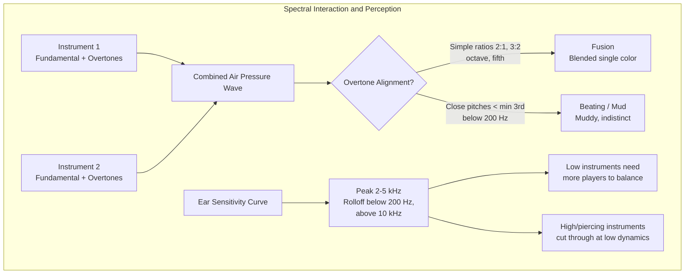
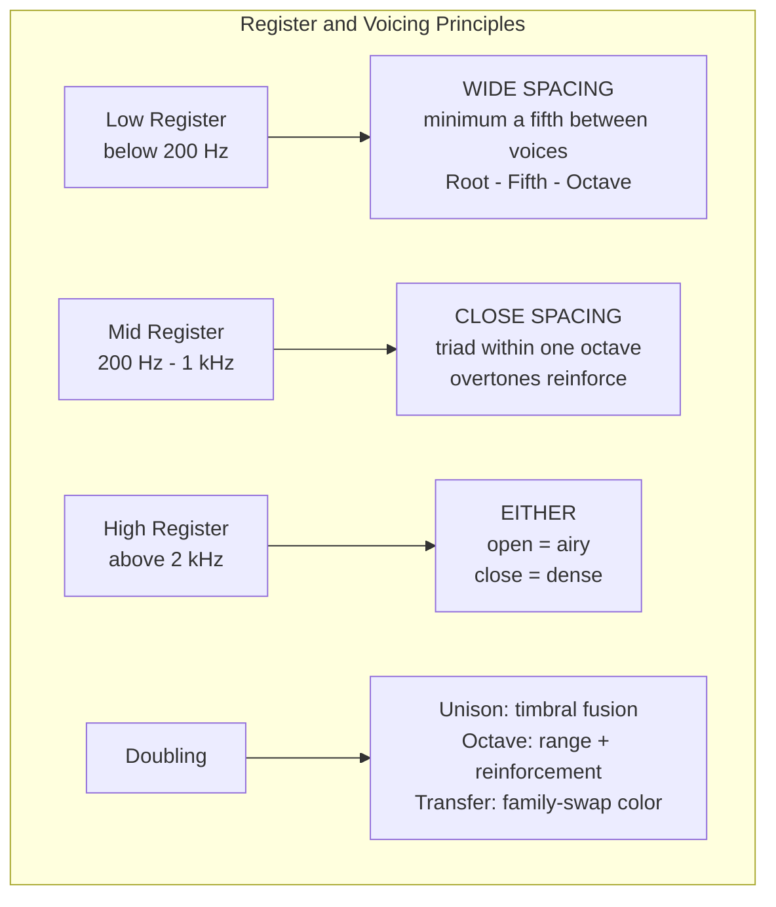
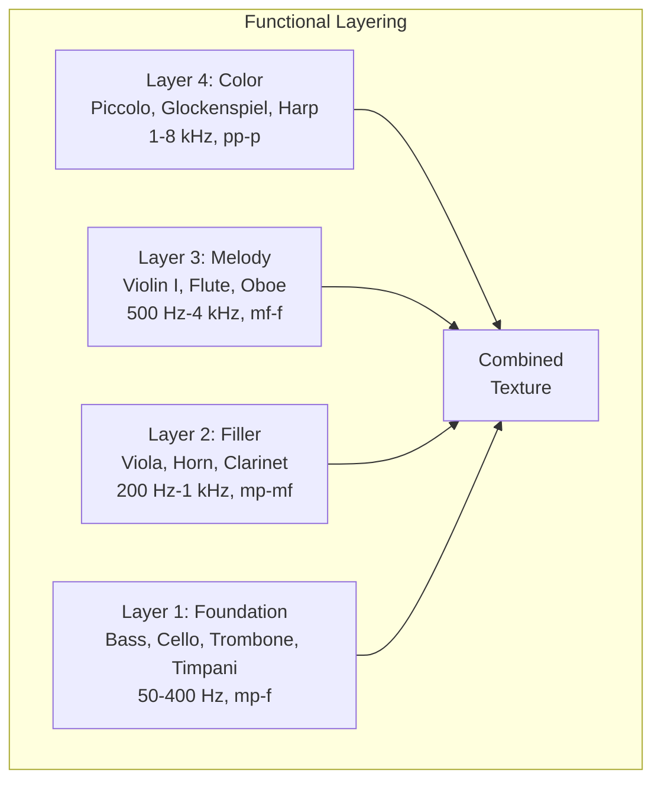
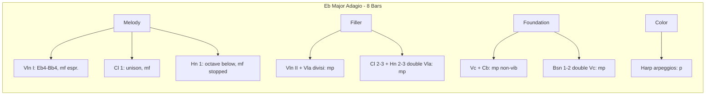

# Masterclass: Orchestration—Coordinating Instruments for Harmony, Texture, and Sonic Architecture

## 1. First-Principles Foundation (15%)

Orchestration is the craft of assigning musical material to instruments so the result sounds the way you intend — balanced, clear, and expressive. Three physical facts govern every decision: how instruments generate overtones, how those overtones interact in the air, and how the ear weighs different frequencies differently. Get these three right and 90% of "orchestration problems" never happen.

### Overtones and why instruments blend or clash

Every pitched instrument sounds a fundamental plus a stack of overtones at integer multiples of it (2f, 3f, 4f...). Timbre is just the relative loudness of those overtones. When two notes form a simple ratio — octave (2:1), fifth (3:2), fourth (4:3) — many of their overtones land on the same frequencies and reinforce each other, which the ear hears as fusion. Complex ratios (minor seconds, tritones, close major/minor thirds low down) leave overtones beating against neighbors a few Hz apart, which the ear hears as roughness.

**Critical band rule**: any two sounding pitches within roughly a minor third of each other, when both are below ~200 Hz, will have overtones close enough to beat audibly. This is the entire reason low, close chords sound like mud and wide low chords sound clean. It's not magic, it's arithmetic on the harmonic series.

**What this changes in your scores**: space bass notes a fifth or octave apart, never a second or third. Keep mid-register chords close — a violin section playing a tight triad within one octave sounds gorgeous because the overlapping overtones in that register reinforce rather than beat. In the top octave and above, critical bands shrink in absolute Hz terms relative to the music you're writing, so both close and wide spacing work; use whichever density you want.

### Equal-loudness (Fletcher-Munson) curves: the ear is not a neutral meter

Human hearing is most sensitive around 2–5 kHz and rolls off sharply below ~200 Hz and above ~10 kHz. A double bass at *ff* around 60–80 Hz is putting out real acoustic power, but you perceive it as much quieter than a violin at *mf* around 1–2 kHz. This is why a solo piccolo or a triangle can slice through a fortissimo tutti — their energy sits exactly where your ear is most sensitive, regardless of how many decibels the brass section is throwing out.

**What this changes in your scores**: low instruments need numbers (more cellos/basses, or doubling with bassoon/contrabassoon) to register as "equally loud" against a handful of violins. High, piercing instruments need very little reinforcement to cut through — one piccolo or glockenspiel at *p* reads louder than you'd expect.

## 2. The Orchestral Families: Practical Acoustic Properties

### Strings: the orchestral core

**Why they blend**: every player excites the string the same way (horsehair, rosin, bow pressure), so overtone profiles across 60+ players are nearly identical. That uniformity is what lets a string section sound like one instrument instead of 16.

**Ranges (sounding pitch)**:
| Instrument | Range | Practical sweet spot |
|---|---|---|
| Violin | G3–E7 | D4–A6 for solos, full range for sections |
| Viola | C3–A5 | G3–D5, avoid top fifth except for climax |
| Cello | C2–C5 | G2–G4 lyrical, top string bright above that |
| Double Bass | E1–G3 (sounds octave lower than written) | E1–D3, avoid above that except for solo passages |

**Standard section sizes and why**: 16-14-12-10-8 (Vln I–Vln II–Vla–Vc–Cb). This isn't tradition for its own sake — it's acoustic compensation. Each lower section has fewer players but each instrument radiates more low-frequency energy per player, and the ear is less sensitive down there, so you need the extra numbers to hold the balance against 16 violins.

**Bowing articulations you need on call**:
- *Arco legato* — smooth, connected, default for sustained lines.
- *Détaché* — separated but not short, one bow stroke per note, the workhorse articulation for moving lines.
- *Spiccato* — bow bounces off the string, light and rhythmic, works best at moderate tempo (quarter = 90–140).
- *Col legno* — wood of the bow strikes the string, dry percussive click, use sparingly for shock value.
- *Sul ponticello* — bow very close to the bridge, suppresses the fundamental, boosts upper harmonics, glassy/eerie.
- *Sul tasto* — bow over the fingerboard, emphasizes the fundamental, dark and soft, good under solo winds.
- *Tremolo* (measured or unmeasured) — rapid up-down bow strokes, sustains intensity without a literal crescendo.
- *Pizzicato* — plucked, sharp attack and fast decay, great for rhythmic punctuation or imitating harp/guitar texture.

**Orchestration drill: a C major triad, three ways**

*Muddy (what to avoid)*: Basses C2, Cellos E2, Violas G2, Violins C3 — four voices crammed into a 1.5-octave span below 260 Hz. Every pair of adjacent notes is a third or less apart in a register where that guarantees beating.

*Clean*: Basses C2 — Cellos C3 (octave above bass, clean fifth-plus spacing from nothing below it) — Violas E3+G3 divisi — Violins II C4 — Violins I G4. Wide at the bottom, close in the middle, open on top. Play both versions on a DAW or piano reduction at the extremes of the ranges; the difference is unmistakable even without a real orchestra.

### Woodwinds: soloistic color and agility

Each woodwind has a distinct "spectral fingerprint" determined by bore shape (cylindrical vs. conical) and reed type (none, single, double). Know these cold — they dictate every doubling decision you'll make.

| Instrument | Written range | Sounds | Color | Agility |
|---|---|---|---|---|
| Flute | C4–C7 | as written | breathy low, brilliant above C6 | very high, best for fast diatonic/chromatic runs |
| Oboe | Bb3–A6 | as written | bright, nasal, cuts through texture | moderate, avoid rapid altissimo |
| Clarinet (Bb) | E3–C7 | M2 lower | hollow/dark (chalumeau E3–Bb4), bright (clarion B4–C6), shrill (altissimo C#6+) | highest of the woodwinds, ideal for arpeggios |
| Bassoon | Bb1–Eb5 | as written | growling low (Bb1–Eb3), lyrical tenor (E3–Bb4), reedy/strained top | moderate, excellent legato |

**Practical pairing rules**:
- Flute + oboe = both bright, blend well for a shimmering top line.
- Clarinet + bassoon = both suppress even harmonics (closed-tube acoustics), blend into a dark, woody pair ideal for inner-voice filler.
- To thicken a string line without changing its color much, double with clarinet or bassoon at the same pitch — the woodwind adds definition to the attack without the bright edge a flute or oboe would add.

**Melodic relay drill**: pass a 16-bar melody through flute (bars 1–4) → oboe (bars 5–8) → clarinet (bars 9–12) → violin (bars 13–16). Keep dynamics and phrasing identical across the handoffs. The goal is a seamless baton pass — if the listener notices the join, the dynamics or vibrato style didn't match at the boundary. Fix by overlapping the last note of the outgoing instrument with the first note of the incoming one for one beat.

**Orchestration drill: Gmaj7 for woodwind quartet**

*Spread*: Bassoon G2, Clarinet B3, Oboe D5, Flute F#6 — four octaves, each player sits in their best register, maximum clarity.

*Closed*: Bassoon G3, Clarinet B3, Oboe D4, Flute F#4 — everyone inside one octave, tight blend, works best at *mp* or softer since closer spacing concentrates energy and can sound congested if pushed loud.

### Brass: power, nobility, and projection

Conical/cylindrical tubing and a cup mouthpiece give brass a harmonic series extending 10+ partials with huge directional output. Brass is the loudest family per player by a wide margin — treat every brass entrance as a balance decision, not just a notation decision.

| Instrument | Written range | Sounds | Character |
|---|---|---|---|
| Horn (F) | B2–F5 | P5 lower | warm, blends with both brass and winds; stopped horn (hand in bell) ≈ −50% volume, nasal/distant color |
| Trumpet (Bb) | F#3–D6 | M2 lower | warm low, effortless mid, piercing high; mutes alter spectrum drastically |
| Trombone | E2–Bb4 | as written | true glissando via slide, sonorous low, strident high, needs staggered breathing for long lines |
| Tuba | D1–F4 | as written | brass foundation, surprisingly agile in the low register |

**Standard section sizes**: Classical era 2 Horns + 2 Trumpets (trombones ad lib); Romantic and later 4 Horns + 3 Trumpets + 3 Trombones + 1 Tuba. As a rule of thumb for perceived loudness, 4 horns ≈ 8 violins — plan your string count accordingly if you want brass and strings to sit at the same perceived level in a tutti.

**Orchestration drill: brass chorale in Eb major (4 Hn, 3 Tpt, 3 Tbn, Tba)**

Root position Eb triad: Tuba Eb2; Trombones Eb3/G3/Bb3; Trumpets Eb4/G4/Bb4; Horns Eb3/G3/Bb3/Eb4 (doubling the trombone chord an octave-ish away for cushion). Mark the whole chorale *mf* — at full *ff* this voicing will bury any strings or winds sounding simultaneously.

### Percussion: rhythm, color, and punctuation

- **Timpani**: pitched, tune to tonic/dominant to reinforce harmonic downbeats. Felt mallets = warm, wood/hard mallets = articulate attack. A roll is a sustain substitute for an instrument that can't actually sustain.
- **Snare drum**: metal snares buzz against the lower head, producing a bright noise-halo. Rim shots add extra bite. Easily dominates — write at *mp* or below unless it's meant to be the focal event.
- **Bass drum**: felt more than heard below ~60 Hz; soft mallets for distant thunder, hard mallets for a sharp transient.
- **Cymbals / tam-tam**: noise-rich, no clear pitch. Suspended cymbal roll = slow tension build. Crash = climax punctuation. Tam-tam = ominous, slow-building rumble, needs several seconds to speak fully.
- **Glockenspiel / xylophone / marimba**: pitched mallet percussion, fast decay. Glock (metal) = sparkle on top of a texture. Xylophone (wood) = dry and brittle, good for grotesque or comic effects. Marimba (wood + resonators) = warm and mellow, functions almost like a pitched drum.
- **Harp**: pedal mechanism retunes each string in three positions (flat/natural/sharp), enabling full chromatic use. Idiomatic writing favors arpeggios and glissandi that follow the instrument's tuning at any given moment — a glissando across all strings only works if the pedals are set so the run is diatonic or a specific scale, so plan pedal changes in advance, not mid-phrase.

## 3. Voicing and Register: The Architecture of Vertical Spacing

### Low register: space widely, always

Below ~200 Hz, anything closer than a fifth risks audible beating.

*Bad*: Basses C2, Cellos E2, Trombones G2 — a minor third and major third stacked in the bass = mud.

*Good*: Basses C2, Cellos C3 (octave), Trombones G3 (fifth above the cellos) — every interval between adjacent voices is a fifth or more.

### Mid register (roughly 200 Hz–1 kHz): close voicing for blend

This is the band where close-position triads actually sound *better* close, because the overlapping overtones reinforce the chord instead of beating. A string section playing a tight triad here is the textbook "lush strings" sound.

*Example*: Cellos C3, Violas E3+G3 divisi, Violins II C4, Violins I E4 — everything inside one octave, melody line (if any) riding on top.

### High register (above ~2 kHz): mixed spacing, your choice

Critical bands widen out in musical terms up here, so both close and open spacing read as clear rather than muddy. Use open spacing (Flute C6, Oboe G5, Clarinet E5) for an airy, bright sonority, or close spacing (Flute G5, Oboe E5, Clarinet C5) when you want a denser top layer.

### Doubling: three distinct tools, not one

- **Unison doubling** — same pitch, different instruments, fuses timbre: violins + flutes brighten a melody; cellos + bassoons articulate a bass line more clearly than either alone.
- **Octave doubling** — expands range while keeping harmonic identity intact: basses doubling cellos an octave below is the default string bass texture; piccolo doubling flute an octave up adds brilliance without changing the harmony.
- **Register transfer** — move an entire voicing to a different family's comfortable range: a string chord at C3–G4 recast for brass at C4–G5 reads brighter and more powerful even though the chord is identical.

## 4. Texture and Layering: Functional Stratification in Practice

Think in layers with clear jobs, not in individual instrument assignments made note by note.

### Four-layer architecture

**Layer 1 — Foundation (50–400 Hz)**: double basses, cellos (low register), bassoons, trombones, tuba, timpani. Job: harmonic roots and bass motion. Voice roots and fifths, rarely thirds, with wide spacing.

**Layer 2 — Harmonic filler (200 Hz–1 kHz)**: violas, cellos (mid register), horns, clarinets, bassoons (tenor register). Job: complete the chord, sustain inner voices. Voice thirds, sevenths, extensions, close spacing for warmth.

**Layer 3 — Melody (500 Hz–4 kHz)**: violins, flutes, oboes, clarinets (clarion), trumpets (mid register). Job: the line the listener follows. Single line or octave-doubled for presence, sits in the ear's most sensitive band.

**Layer 4 — Color (1–8 kHz, intermittent)**: piccolo, glockenspiel, harp, solo high winds, triangle. Job: texture and sparkle, not harmonic weight. Fragmentary, light dynamics, high register.

### Full layering drill: 4 bars in G major, Andante

Harmony G–Em–Am–D7. Melody: stepwise ascent from D5, outline D5-E5-F#5-G5-A5-G5-F#5-G5.

**Melody (Layer 3)**: Violin I plays the line as written, *mf espressivo*. Flute doubles at the unison, *mf*, adding brightness without adding perceived weight (a doubled unison reads as "richer," not "louder," because the two sources fuse perceptually).

**Foundation (Layer 1)**: Cellos and basses on whole-note roots — G2/E2/A1/D2 (basses), G2/E2/A2/D3 (cellos, octave above basses). Timpani (tuned G–D) hits G on downbeats of bars 1 and 3, D on the downbeat of bar 4, *mp*, reinforcing the harmonic rhythm without cluttering it.

**Filler (Layer 2)**: Violas sustain thirds/fifths each bar (B3-G3, G3-C4, C4-C4, etc. — work these out from the chord tones above the bass); horns 1&2 double a different pair of chord tones; clarinets 2&3 double the violas at the unison for a darker cushion under the melody.

**Color (Layer 4)**: Harp arpeggiates each new chord on beat 1 (*p*); glockenspiel doubles the melody two octaves up at *pp* for shimmer.

**Why this works**: four frequency bands, four dynamic levels, zero register collisions. Mute any one layer mentally and the piece still makes sense — that's the test of good stratification.

## 5. Dynamic Balance: Compensating for Acoustic Power Discrepancies

A trumpet at *ff* and a flute at *ff* are not remotely equal in acoustic output — the trumpet can run 10–15 dB louder for the same dynamic marking. Written dynamics are relative to *each instrument's own range*, not an absolute scale across the orchestra.

### Numerical compensation

Standard "balanced tutti" ratios: Strings 16-14-12-10-8; Woodwinds 2-2-2-2 (or 3-3-3-3 in Romantic scoring); Brass 4-3-3-1 (Hn-Tpt-Tbn-Tba); Percussion 1 timpanist + 2–3 others. That's roughly 60 strings against 11 brass — and the brass will *still* read louder at matched dynamic markings, because per-player output is so much higher.

### Dynamic offset technique

Mark brass one notch softer than everyone else to achieve equal perceived loudness. A balanced tutti is typically: Strings *ff*, Woodwinds *ff*, Brass *f*. For a brass-led climax, flip it: Brass *ff*, Strings *mf*, Woodwinds *f*.

### Register compensation

Move the loud instrument out of its loudest register instead of just writing a softer dynamic. A trumpet melody line at *ff* in the staff (G4–C5) projects cleanly; the same line an octave higher is a laser that nothing else survives. If you need the brilliance of the high register but not the volume, add a mute instead.

### Mutes as volume control, not just color

| Mute | Volume reduction | Color |
|---|---|---|
| Straight | ~30% | brighter, slightly nasal |
| Cup | ~40% | softer, distant |
| Harmon (stem out) | ~50% | metallic, vocalized, "wah" |

Rule of thumb: muted brass *ff* ≈ unmuted brass *mf* in perceived loudness. Use this to get bright brass color at a dynamic that won't crush surrounding strings or winds.

## 6. Blend vs. Contrast: Timbral Strategy in Action

### Blend

- **Pair similar spectra**: violins + violas (both bowed strings, nearly identical excitation); oboe + clarinet (both reed, cohesive if oboe doesn't dominate); horn + viola (a Brahms signature — both warm and covered in tone).
- **Match articulation and attack**: simultaneous bow starts, simultaneous tonguing — mismatched attacks are what make a "blended" chord sound like separate instruments.
- **Shared vibrato**: a string section vibrating together at roughly 5–7 Hz fuses into one sonic object. Non-vibrato or *sul ponticello* playing exposes individual voices — use deliberately when you want separation, avoid when you want fusion.

### Contrast

- **Dissimilar spectra deliberately**: trumpet (brilliant, directional) against harp (soft attack, fast decay) for maximum timbral distance; flute (breathy, high) against bassoon (reedy, low) two octaves apart.
- **Staggered entrances**: classic fugal technique — violins enter bar 1, violas bar 3, cellos bar 5 — each new voice registers as a distinct layer before they combine.
- **Opposing articulation on simultaneous lines**: strings *legato* against woodwinds *staccato* on the same harmonic material creates rhythmic counterpoint without adding new pitches.

### Timbre as a structural parameter over time

**Progressive addition**: solo cello → + violas → + violins → + woodwinds. The crescendo comes from accumulating layers, not from players simply playing louder — this reads as "the music is growing," not just "the music got loud."

**Klangfarbenmelodie (timbral relay)**: the same melodic line passes oboe → flute → clarinet → violin, pitch identical, color constantly shifting. Used by Schoenberg and Webern as a structural device, but the technique itself is just an extreme version of the melodic relay drill from Section 2.

**Subtractive scoring**: removing a family changes character as much as adding one. Pull the brass and the ensemble lightens; pull the woodwinds and strings dominate, more homogeneous; pull the strings and you're left with an exposed, harder-edged wind-band sonority.

**Drill**: take any 8-bar melody and orchestrate it four separate ways — strings alone, woodwinds alone, brass alone, and a relay switching families every 2 bars. Play or render all four. The emotional read on identical notes and rhythm will differ sharply each time — that's proof that orchestration *is* a compositional decision, not decoration after the fact.

## 7. Complete Worked Example: Orchestrating a Homophonic Passage

**Assignment**: 8 bars, Eb major, Adagio (quarter = 60), 4/4. Lyrical melody over sustained harmony. Progression: I–vi–IV–ii⁶⁵–I⁶⁴–V⁷–I.

**Melody**: Bar 1 Eb4(dotted half)-F4(qtr); Bar 2 G4(half)-F4(half); Bar 3 Ab4(dotted half)-Bb4(qtr); Bar 4 Bb4(whole); Bar 5 Bb4(half)-Ab4(half); Bar 6 G4(dotted half)-F4(qtr); Bar 7 F4(half)-Eb4(half); Bar 8 Eb4(whole).

**Target**: warm, Brahmsian slow-movement sonority.

### Melody layer
- Violin I (full section): the written melody, *mf espressivo*, continuous vibrato.
- Clarinet 1: unison doubling, *mf* — adds woody warmth, zero added brightness.
- Horn 1 (stopped, hand in bell): doubling an octave below (Eb3–Bb3), *mf* — stopped horn's covered, distant color reinforces without adding perceived loudness since it's buried an octave down and muted in timbre.

### Harmonic filler layer
Chord tones by bar: Bar1 Eb maj (G4,Bb3,G3) / Bar2 C min (Eb4,G3,C4) / Bar3 Ab maj (C4,Eb4,Ab3) / Bar4 F min⁶⁵ (Ab3,C4,Eb4,F4) / Bar5 Eb maj⁶⁴ (Bb3,Eb4,G4) / Bar6 Bb dom⁷ (D4,F4,Ab4) / Bar7-8 Eb maj (G3,Bb3,Eb4).

- Violin II: upper filler tones, *mp*.
- Violas (divisi a2): middle filler tones, *mp*.
- Clarinets 2&3: double the violas at the unison, *mp*, reinforcing mid-register harmony.
- Horns 2&3: double the viola pitches, *mp*, adding warmth without competing with Horn 1's melodic doubling.

### Foundation layer
- Cellos: Eb2-C3-Ab2-F2-Eb2-Bb2-Eb2-Eb2, *mp*, non-vibrato (clarity over warmth in the bass).
- Double basses: same line, octave below, *mp* arco sustained.
- Bassoons 1&2: double the cellos at the unison, *mp* — brings articulate attack to a bass line that bowed cellos alone would blur slightly.

### Color layer (optional)
- Harp: light arpeggio on the downbeat of each bar, following the chord of that bar, *p*.
- Horn 4 (optional): sustained pedal Eb3 in bars 1, 7, 8 for extra warmth under the final cadence.

### Why the balance works

Melody sits at *mf* in the 500 Hz–2 kHz band — it projects by default. Filler sits a dynamic level below at *mp* and is voiced close together — present as harmonic cushion, never competing for attention. Foundation is wide-spaced and non-vibrato — audible as pitch, not audible as mud. Color enters only on downbeats at *p* — a glint, not a layer you track continuously. If you mute any single layer in your head, the remaining three still make complete musical sense — that's the signature of correct stratification.

### Verification checklist (run this on every score you write)

1. Can you isolate the melody mentally against the full texture? If not, it's buried — move it, thin the filler, or raise its dynamic one level.
2. Does the filler read as one cushion or as separate competing lines? If separate, tighten spacing or match articulation/vibrato.
3. Is the bass pitch clear or smeared? If smeared, widen spacing and check for close intervals below 200 Hz.
4. Does the color layer add sparkle or clutter? If clutter, thin it to one instrument or lower its dynamic.
5. Is every instrument in a comfortable register for its family? If not, transpose the part or reassign it.

## 8. Advanced Orchestration Techniques

**Halo doubling**: double a line two octaves above at *pp* with glockenspiel, celesta, or harmonics. Example: cello melody C3–G3 shadowed by glockenspiel C5–G5 at *pp* — adds high-frequency sparkle that enriches the cello's timbre without registering as a separate, audible voice.

**Shadow (sub-octave) doubling**: reinforce a bass line one or two octaves below for weight. Trombones on Bb2–F3, doubled by tuba an octave lower, doubled by contrabassoon two octaves lower — a massive, grounded foundation built from the same melodic shape at three depths.

**Interlocking articulation**: assign the same melodic contour to two families with different note values and articulations — oboes play the quarter notes *staccato*, strings play the half notes *legato*, both tracing the identical line. The composite texture (crisp attacks riding on a sustained bed) is something neither family produces alone.

**Tremolo bed under lyrical melody**: strings tremolo on a pedal tone (*pp*) while a solo horn or woodwind carries a slow melody (*p espressivo*) above. The classic "frozen, atmospheric" Sibelius texture — motion and stasis simultaneously.

**Pedal point orchestration**: sustain a single bass pitch for several bars while the harmony above moves freely. Basses hold C2 for 8 bars at *mp* while upper voices progress C–Am–Dm–G–C–F–Dm–G — the static bass becomes a harmonic anchor against which every chromatic or modal shift above registers clearly.

**Call-and-response**: alternate 2-bar phrases between contrasting choirs — brass *f* (bars 1–2), woodwinds *p* (bars 3–4), brass *ff* (bars 5–6), strings *pp* (bars 7–8). Each "speaker" keeps a consistent timbral identity so the dialogue reads as dramatic structure, not just alternating instrumentation.

## 9. Idiomatic Writing: Making Instruments Comfortable

**Idiomatic** writing exploits what the instrument does easily; **non-idiomatic** writing is technically possible but fights the player's hands, embouchure, or bow arm.

**Strings — idiomatic**: stepwise/small-leap melodies, chord-shaped arpeggios on adjacent strings, open strings for resonance (violin G-D-A-E), double stops in thirds/sixths on neighboring strings, tremolo/pizzicato/col legno for color. **Avoid**: large leaps requiring fast position shifts at speed, extended passages at the extreme top of the range (tiring, intonation drifts), chromatic runs low on thick strings (sluggish string response).

**Woodwinds — idiomatic**: stepwise diatonic scales in comfortable keys, arpeggios that follow natural fingering patterns, tongued passages at moderate tempo, sustained notes in mid-register. **Avoid**: fast altissimo chromatic runs (fingering complexity plus intonation risk compound), long sustained notes at the extreme bottom (excessive air required, pitch sags), awkward fingering sequences like rapid Eb-F#-Bb on oboe — know the instrument's fingering chart before writing a fast passage, or ask a player.

**Brass — idiomatic**: fanfare figures built on the natural harmonic series (C-E-G-C on trumpet uses adjacent partials, easy and secure), sustained mid-register chords, tongued rhythms, muted color passages. **Avoid**: extended time in the extreme high register (lip fatigue, cracked notes), fast chromatic passages low on trombone (slide travel is slow) or on any valve brass low down (sluggish valve response at pitch), long unbroken phrases (brass needs more air per phrase than woodwinds — stagger breathing in sectional writing, write rests).

**Revision drill**: a flute line with a rapid chromatic descent from C7 to C6 in sixteenth notes at quarter = 140 is a fingering and intonation nightmare. Three fixes, in order of preference: (1) slow the tempo to quarter = 100 if the music allows it; (2) change the run to a diatonic scale instead of chromatic — same contour, vastly easier fingerings; (3) if the chromatic color is non-negotiable, give the run to violins instead — a fingered chromatic scale on strings is far more secure than altissimo chromatic fingerings on flute.

## 10. Historical Style Reference: How Masters Orchestrated

**Classical (Haydn, Mozart)**: melody-dominated homophony, small forces (strings, paired winds, 2 horns, timpani), transparent voicing, minimal doubling. Mozart Symphony No. 40: violins carry melody, violas/cellos fill harmony, basses hold roots, winds color important chords only. *Takeaway*: clarity through economy — every part has one clear job and nothing more.

**Romantic (Brahms, Tchaikovsky, Wagner)**: rich, blended, multi-layered. Expanded forces (triple/quadruple winds, 4+ horns, 3 trombones, tuba, harp). Brahms Symphony No. 1, finale: horns and violas double inner voices for a dark, warm cushion while violins and winds interlock on the melody. *Takeaway*: blend through heavy doubling — warmth is a function of timbral fusion, not volume.

**Impressionist (Debussy, Ravel)**: transparent, shimmering, coloristic. Standard forces used for timbral exploration — widely spaced chords, parallel "planing" harmony, harp and celesta for sparkle. Debussy *La Mer*: muted brass, divided string sections, harp glissandi, glockenspiel accents evoke water without a single programmatic sound effect. *Takeaway*: timbre leads, harmony serves color rather than functional progression.

**Modernist (Stravinsky, Bartók)**: angular, rhythmic, block-like. Standard forces pushed into extreme registers with aggressive percussion. Stravinsky *Rite of Spring*: brutal *fff* brass chords, pounding percussion, stratified pizzicato strings create raw rhythmic energy. *Takeaway*: orchestration as rhythm and attack — timbre becomes a percussive force, not a coloring agent.

## 11. Practical Exercises: Building Orchestration Craft

**Exercise 1 — Chorale in three styles**: take any 4-bar SATB chorale. Score it (a) Classical: strings only, soprano=Vln I, alto=Vln II, tenor=Vla, bass=Vc, zero doubling; (b) Romantic: soprano=Vln I+Fl+Ob, alto=Vln II+Cl, tenor=Vla+Hn, bass=Vc+Cb+Bsn; (c) Impressionist: divisi strings (8 parts), harp doubling the top voice, muted horns on the inner voices. Compare — same harmony, three entirely different emotional results.

**Exercise 2 — Textural transformation**: an 8-bar C major melody, I-IV-V-I twice, quarter-note motion. Score it (1) monophonic, solo oboe, unaccompanied; (2) homophonic, melody in Vln I over sustained triads in Vln II/Vla/Vc; (3) polyphonic, add an independent countermelody in cello and a second in viola; (4) canonic, Vln I enters, Vc enters two bars later on the same material, winds sustain chords underneath.

**Exercise 3 — Dynamics through orchestration, no dynamic markings**: 16 bars, shape *pp → crescendo → ff → diminuendo → pp*, achieved purely by adding/removing instruments. Bars 1-4: solo flute + violin harmonics. Bars 5-8: add oboe, Vln I, viola. Bars 9-12: add full strings, brass, percussion. Bars 13-16: strip brass, then winds, end on solo cello. Confirm: does it still read as a dynamic arc even if you can't change a single dynamic marking? If yes, you've proven density and register drive perceived volume as much as marked dynamics do.

**Exercise 4 — Timbral relay**: a 16-bar stepwise diatonic melody, moderate tempo, assign each 2-bar phrase to a new instrument in sequence (flute, oboe, clarinet, bassoon, violin, horn, muted trumpet, then full winds tutti for the final 2 bars). Focus every handoff on matching dynamic and phrasing exactly at the join.

**Exercise 5 — Register experimentation**: a plain C major triad, whole notes, 4 bars. Score it low (Basses C2, Cellos E2, Bassoons G2 — dark, heavy), mid (Cellos C3, Violas E3, Violins II G3 — warm, balanced), high (Violins I C5, Flutes E5, Oboes G5 — bright, ethereal), and stratified (full spread from Basses C2 up through Violins I E4+G4). Same three pitches, four radically different emotional colors — register is as much a compositional choice as harmony.

## 12. Troubleshooting Common Orchestration Problems

**Melody buried**: wrong register, too much competing filler in the same frequency band, or dynamic too low relative to the texture. Fix: move it into 500 Hz–2 kHz, thin the filler layer, mark it one level louder than the accompaniment, or double it (flute + violin projects noticeably better than violin alone).

**Muddy bass**: close spacing below 200 Hz causes beating. Fix: widen to a fifth minimum between adjacent low voices, remove doubled thirds down low, use non-vibrato cellos/basses for pitch clarity, add bassoon doubling the cello line for attack definition.

**Thin, weak sound**: missing mid-register filler, insufficient doubling, or gaps in the register distribution. Fix: add viola/horn/clarinet sustaining inner voices, double the melody, confirm low register is actually populated (basses, cellos, bassoons present), and check for empty octaves between melody and bass — fill with something in the gap.

**Brass overpowers everything**: marked too loud relative to the rest, or sitting in its loudest register while everything else is comparatively weak. Fix: drop brass one dynamic level relative to strings/winds, add mutes, move brass out of its brightest register, or increase the size/doubling of the strings and winds to match.

**Monotonous color**: over-reliance on one family, no timbral evolution across the piece. Fix: relay the melody between families, use progressive addition/subtraction instead of static scoring, contrast full sections (strings alone / winds alone / brass alone / tutti), add a color layer (harp, glockenspiel, solo winds) for textural variety.

## 13. Masterclass Summary: The Orchestrator's Mindset

Orchestration is not rule-following, it's decision-making. Every choice — instrument, register, dynamic, articulation — has an audible consequence. Think in:

1. **Functional layers** — what's each instrument's job: foundation, filler, melody, color?
2. **Spectral strategy** — which frequency bands are occupied, where are the gaps or collisions?
3. **Dynamic balance** — do marked dynamics actually produce equal perceived loudness across families?
4. **Timbral evolution** — does color change meaningfully over time, or is the texture static?
5. **Idiomatic pragmatism** — can the player actually execute this comfortably?

The governing question is always: *what do I want the listener to hear?* Then work backward to the instruments, registers, and dynamics that will make that happen. Orchestration is sonic architecture — build it with the same deliberateness as a structural engineer, not as decoration added after the composing is done.

## 14. Essential Listening and Score Study

Study score in hand, recording playing. Ten essential references, one per era/approach:

- **Mozart**, Symphony No. 40 in G minor, K. 550 — Classical transparency, economical doubling.
- **Beethoven**, Symphony No. 5 in C minor, Op. 67 — motivic orchestration, dramatic weight from a tiny cell.
- **Berlioz**, *Symphonie fantastique* — pioneering orchestral color, programmatic effects.
- **Brahms**, Symphony No. 1 in C minor, Op. 68 — warm, blended, mid-register-centered doubling.
- **Tchaikovsky**, Symphony No. 6, "Pathétique" — emotional orchestration across dynamic extremes.
- **Debussy**, *Prélude à l'après-midi d'un faune* — Impressionist shimmer, timbre as primary structure.
- **Ravel**, *Daphnis et Chloé*, Suite No. 2 — master orchestral colorist, transparent dense textures.
- **Stravinsky**, *The Rite of Spring* — rhythmic orchestration, brutal block contrasts.
- **Shostakovich**, Symphony No. 5 in D minor, Op. 47 — monumental brass/strings balance, sardonic woodwind writing.
- **John Williams**, *Star Wars* Main Title — neo-Romantic film orchestration, Holst/Korngold lineage made modern.

**Study method**: (1) listen without the score — note what stands out; (2) listen with the score — identify how the composer achieved that effect; (3) mark the four functional layers directly on the score; (4) note every doubling and why it's there; (5) check whether dynamics are offset between families to achieve balance, or deliberately unbalanced for effect.

## 15. Reference: Standard Orchestral Instrument Ranges

**Strings** (sounding pitch):
- Violin: G3–E7 (practical top ~A6)
- Viola: C3–A5 (practical top ~E6)
- Cello: C2–C5 (practical top ~G5)
- Double Bass: E1–G3 (sounds an octave lower than written)

**Woodwinds** (written pitch):
- Flute: C4–C7 (sounds as written)
- Oboe: Bb3–A6 (sounds as written)
- Clarinet in Bb: E3–C7 (sounds a major 2nd lower than written)
- Bassoon: Bb1–Eb5 (sounds as written)

**Brass** (written pitch):
- Horn in F: B2–F5 (sounds a perfect 5th lower than written)
- Trumpet in Bb: F#3–D6 (sounds a major 2nd lower than written)
- Trombone: E2–Bb4 (sounds as written)
- Tuba: D1–F4 (sounds as written)

**Percussion**:
- Timpani: D2–A3 (standard 4-drum set: 32", 29", 26", 23")
- Glockenspiel: G5–C8 (sounds two octaves higher than written)
- Xylophone: F4–C8 (sounds an octave higher than written)
- Marimba: C2–C7 (sounds as written)

**Key texts for continued study**: Rimsky-Korsakov, *Principles of Orchestration* (1922); Adler, *The Study of Orchestration* (4th ed., 2016); Piston, *Orchestration* (1955); Berlioz/Strauss, *Treatise on Instrumentation* (1844/1905); Blatter, *Instrumentation and Orchestration* (1997).
