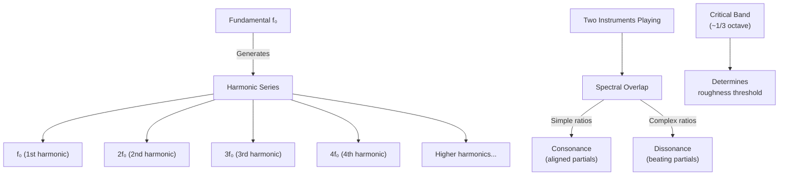
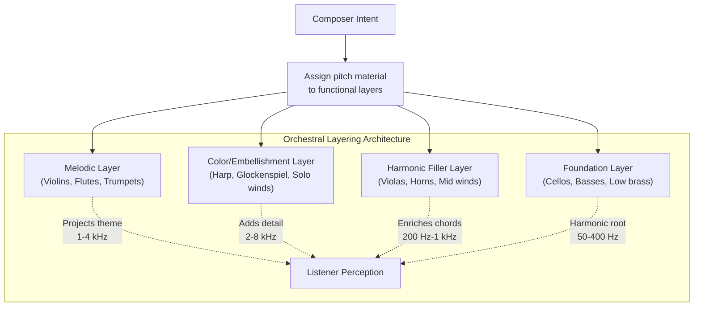
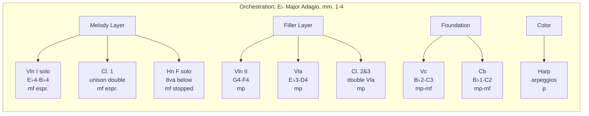

# Lesson 4: Coordinating Instruments for Harmony and Texture

## 1. First-Principles Intuition & Invariants

Orchestration transforms individual instrumental voices into a unified sonic architecture through precise coordination of harmony and texture. This coordination rests on immutable physical laws governing sound propagation, psychoacoustic perception, and the mechanical constraints of acoustic instruments.

### The Physical Foundation: Overtone Series and Spectral Interaction

Every pitched instrument generates a fundamental frequency *f₀* accompanied by a harmonic series of overtones at integer multiples: *f₀*, 2*f₀*, 3*f₀*, 4*f₀*, and so on. The relative amplitudes of these partials define an instrument's timbre. When multiple instruments play simultaneously, their harmonic spectra interact through constructive and destructive interference in the acoustic medium.

Consonance and dissonance emerge from frequency ratio relationships. Simple integer ratios (2:1 for octaves, 3:2 for perfect fifths, 4:3 for perfect fourths) produce strong alignment between overtone series, minimizing auditory roughness. Complex ratios (16:15 for minor seconds, 45:32 for tritones) create spectral beating and tension. The critical band phenomenon—frequency regions within approximately 1/3 octave where the ear cannot resolve separate components—determines when intervals shift from consonant to dissonant perception.

### Invariant: Equal Temperament and Intonation Systems

Western orchestral music predominantly employs 12-tone equal temperament (12-TET), dividing the octave into twelve equal semitones where each semitone represents a frequency ratio of 2^(1/12) ≈ 1.05946. This system enables modulation between keys while sacrificing the pure integer ratios of just intonation. The compromise creates subtle but measurable deviations:

- 12-TET perfect fifth: 2^(7/12) ≈ 1.4983 (slightly flat compared to pure 3:2 = 1.5000)
- 12-TET major third: 2^(4/12) ≈ 1.2599 (significantly sharp compared to pure 5:4 = 1.2500)

String players and vocalists instinctively adjust intonation toward just intervals within sustained chords, creating richer harmonic fusion. Wind instruments with fixed pitch mechanisms maintain 12-TET tuning. This dichotomy shapes orchestration choices: sustained string chords exploit pure intonation's spectral clarity, while mixed ensembles accommodate equal temperament's slight roughness.

### Fletcher-Munson Curves and Frequency-Dependent Perception

The human auditory system exhibits frequency-dependent sensitivity described by equal-loudness contours (ISO 226:2003 standard). At moderate listening levels (~60 dB SPL), sensitivity peaks around 3-4 kHz, with reduced sensitivity at low (<200 Hz) and high (>10 kHz) frequencies. This principle has direct orchestration implications:

- Low brass and double basses require greater acoustic power to achieve perceived balance with violins and flutes
- Piccolo and triangle maintain presence despite lower absolute SPL due to energy concentrated in high-sensitivity bands
- Mid-register instruments (horn in F, viola, clarinet) naturally occupy the ear's most sensitive range

At fortissimo dynamics (>90 dB SPL), low-frequency sensitivity increases, altering tonal balance. Orchestrators compensate by adjusting instrumental density and doubling patterns across dynamic ranges.

### Texture as Architectural Stratification

Texture describes the vertical and horizontal organization of musical voices. Three fundamental categories emerge:

**Monophonic texture**: A single melodic line without harmonic accompaniment. Rare in orchestral contexts except for dramatic solo passages or unison statements where all instruments reinforce a single pitch sequence.

**Homophonic texture**: Melody-plus-accompaniment, the dominant texture in tonal orchestral music. A primary voice carries melodic content while other instruments provide harmonic support through chordal blocks, rhythmic ostinatos, or arpeggiated patterns.

**Polyphonic texture**: Multiple independent melodic lines in simultaneous counterpoint. Each voice maintains rhythmic and melodic autonomy while contributing to harmonic progression. Fugal expositions and contrapuntal development sections exemplify polyphonic orchestration.

Sophisticated orchestration blends these categories through hierarchical stratification: a polyphonic trio in woodwinds may sit atop homophonic string accompaniment supporting a horn melody, creating multi-layered texture with distinct functional strata.

## 2. Core Architecture & Mechanics

### Orchestral Families: Acoustic Properties and Functional Roles

Each instrumental family exhibits characteristic acoustic signatures that determine orchestration functionality:

**Strings (violin, viola, cello, double bass)**: Bowed strings produce continuous excitation with rich, slowly-decaying overtones. Dynamic range spans from pianissimo sul tasto (bow near fingerboard, emphasizing fundamental) to fortissimo col legno battuto (struck with bow wood). Vibrato adds periodic frequency modulation (~5-8 Hz) that enriches spectral content and masks slight intonation discrepancies. String sections achieve seamless timbral blending through:

- Homogeneous excitation mechanism (horsehair on metal/gut strings)
- Overlapping pitch ranges enabling smooth voice-leading
- Acoustic coupling between adjacent instruments in section seating

**Woodwinds (flute, oboe, clarinet, bassoon)**: Air-column resonators with distinct spectral envelopes. Flutes (cylindrical bore, open end) emphasize odd and even harmonics with strong fundamental. Clarinets (cylindrical bore, closed end) suppress even harmonics, producing hollow, dark timbre. Oboes and bassoons (conical bore) generate bright, nasal spectra rich in high partials. Woodwind orchestration exploits:

- Timbral differentiation for melodic clarity in mixed textures
- Articulation precision (tongue-stopped transients) for rhythmic definition
- Rapid dynamic shading through embouchure and breath control

**Brass (trumpet, horn, trombone, tuba)**: Cup-mouthpiece instruments with powerful, directional radiation patterns. Brass timbre derives from strong harmonic series extending to 10+ partials. Mutes modify spectral envelope and reduce amplitude while altering radiation directionality. Brass orchestration leverages:

- Penetrating power for climactic moments and melodic projection through full ensemble
- Noble, ceremonial associations rooted in military and courtly traditions
- Homogeneous blend within brass choir formations

**Percussion**: Non-pitched percussion (snare drum, bass drum, cymbals, tam-tam) provides rhythmic articulation and timbral punctuation. Pitched percussion (timpani, glockenspiel, xylophone) adds melodic/harmonic content with characteristic transient attacks and rapid decay envelopes. Percussion orchestration emphasizes:

- Spectral density (pitched vs. noise-like spectra)
- Attack transient definition (sharp vs. soft mallets)
- Decay envelope shaping (damped vs. resonant sustain)

### Voicing Principles: Register, Spacing, and Doubling

**Register distribution** governs vertical pitch allocation across instrumental ranges. Low register (<200 Hz) provides harmonic foundation but exhibits slower transient response and reduced melodic clarity. Middle register (200 Hz - 2 kHz) offers optimal balance between harmonic warmth and melodic definition. High register (>2 kHz) projects melodic content with brilliance but requires careful harmonic support to avoid thinness.

Classical voicing guidelines:

- Wide spacing in low register prevents muddiness (critical band masking)
- Close spacing in middle register maximizes blend and warmth
- Mixed spacing in high register balances clarity and richness

**Doubling** reinforces instrumental lines by assigning identical or octave-related pitches to multiple instruments. Unison doubling amplifies without altering timbre; octave doubling expands pitch range while maintaining harmonic identity. Strategic doubling:

- Violins I + flutes: melody projection with added brilliance
- Cellos + bassoons: bass line warmth with articulation clarity
- Horns + violas: inner-voice reinforcement with tonal weight

### Layering Architecture: Functional Stratification

Effective orchestration assigns distinct functional roles to instrumental layers:

**Foundation layer**: Low strings (cellos, basses) and/or low brass (trombones, tuba) establish harmonic roots and provide rhythmic grounding. Bass motion in this layer drives harmonic progression.

**Harmonic filler layer**: Violas, horns, and middle-register woodwinds complete chord voicings, adding inner voices that enrich harmonic texture without competing with melody. This layer often sustains through melodic activity above.

**Melodic layer**: Violins, upper woodwinds, and occasionally trumpets carry primary thematic material. Positioned in the ear's sensitive mid-high frequency range for maximum intelligibility.

**Color/embellishment layer**: Harp, glockenspiel, solo woodwinds add decorative figuration, countermelodies, or timbral highlights. This layer provides textural variety without structural weight.

### Dynamic Balance and Acoustic Power

Instrumental families produce vastly different acoustic power at equivalent dynamic markings. A fortissimo trumpet generates ~110 dB SPL at 1 meter, while a fortissimo flute produces ~95 dB SPL. Orchestrators compensate through:

- Numerical doubling (multiple instruments per part)
- Register transposition (moving lines into instruments' strongest zones)
- Dynamic offset (marking brass parts one dynamic level softer than strings/woodwinds)

The orchestral tutti at fortissimo requires careful management to prevent brass and percussion from overwhelming strings and woodwinds. Typical balance strategies:

- Limit brass to 4-6 players vs. 16-20 strings per section
- Assign brass mid-register chords while strings cover outer registers
- Use brass mutes to reduce amplitude while maintaining timbral presence

## 3. Practical Orchestration Example: Harmonic and Textural Coordination

Consider orchestrating a homophonic passage in E♭ major, Adagio, with a lyrical melody over sustained harmonic support. Target sonority: warm, rich, emotionally expressive.

### Score Structure

**Melody (mm. 1-4)**: Ascending stepwise motion from E♭4 to B♭4, rhythm: quarter-half-quarter-whole.

**Harmony**: I - vi - ii⁶₅ - V progression, sustained chords with subtle inner-voice motion.

**Texture goal**: Homophonic with continuous legato flow.

### Orchestration Solution

**Melodic layer**:
- Violins I (solo desk): E♭4-F4-G4-A♭4-B♭4, played con espressione, warm vibrato
- Clarinet in B♭ (solo): Doubling violins at unison, adding woodwind warmth without overpowering strings
- Horn in F (solo, stopped): Doubling melody one octave below (E♭3-B♭3), providing subtle harmonic reinforcement with characteristic nasal color

**Harmonic filler layer**:
- Violins II: Sustained G4-F4-F4-F4 (thirds and fifths), divisi as needed
- Violas: Sustained E♭3-C4-D4-D4 (roots and sevenths), completing chord voicings
- Clarinets 2 & 3: Doubling violas at unison, reinforcing mid-register harmonic content

**Foundation layer**:
- Cellos: B♭2-C3-B♭2-B♭2 (roots and fifths), non-vibrato for clarity
- Double Basses: B♭1-C2-B♭1-B♭1 (doubling cellos at octave), pizzicato or arco sustained

**Color layer**:
- Harp: Arpeggiated chord figures on beats 1 and 3, highlighting harmonic changes with delicate articulation

### Voicing Analysis

Register distribution:
- Foundation: B♭1-B♭2 (bass register, wide spacing)
- Filler: C3-G4 (mid-register, close spacing for blend)
- Melody: E♭3-B♭4 (mid-high register, clear projection)

Doubling scheme:
- Melody: Violin I + Clarinet 1 (unison) + Horn (octave below) = three-layer reinforcement
- Filler: Strings + woodwinds (unison) = blended inner voices
- Foundation: Cello + Bass (octave doubling) = solid harmonic grounding

Dynamic balance:
- Melody: mf espressivo (moderate volume with expressive nuance)
- Filler: mp (supporting without competing)
- Foundation: mp-mf (present but not dominating)
- Color: p (delicate accent on harmonic changes)

### Spectral Considerations

This orchestration exploits complementary spectral profiles:
- Strings provide continuous, rich overtone spectra with warm fundamental emphasis
- Clarinet adds dark, odd-harmonic color that blends seamlessly with strings
- Horn contributes distant, covered timbre with complex high partials
- Harp supplies sharp transient attacks and rapid decay for textural contrast

The result: a cohesive, warm sonority where melody emerges clearly from supporting texture, harmonic progression remains transparent, and subtle timbral variety maintains listener engagement.

## 4. Advanced Considerations: Blend, Contrast, and Timbral Modulation

### Achieving Timbral Blend

Blend occurs when spectral envelopes of different instruments overlap sufficiently that the auditory system fuses them into a unified percept. Factors promoting blend:

- **Spectral similarity**: Instruments with comparable overtone distributions (e.g., violins + violas, oboes + clarinets) blend readily
- **Matched articulation**: Simultaneous attacks and releases prevent perceptual segregation
- **Shared vibrato rate**: Frequency modulation synchronization (within ~1 Hz) enhances fusion
- **Register proximity**: Voices within 1-2 octaves blend more easily than widely separated registers

Conversely, contrast exploits spectral differentiation:
- Pairing instruments with dissimilar timbres (trumpet + harp, flute + bassoon)
- Staggered entrances creating polyrhythmic stratification
- Opposing articulations (legato strings vs. staccato woodwinds)

### Timbral Modulation Over Time

Sophisticated orchestration treats timbre as a dynamic parameter, modulating orchestral color to reflect formal structure and dramatic content. Techniques include:

**Progressive instrumental addition**: Beginning with sparse instrumentation and gradually adding layers increases textural density and acoustic power, creating crescendo effects that extend beyond pure dynamics.

**Timbral substitution**: Passing melodic material between instruments of different families while maintaining harmonic/rhythmic continuity. Each instrument's characteristic color provides subtle variation without disrupting thematic unity.

**Spectral filtering**: Selectively engaging or muting instrumental families reshapes the ensemble's aggregate spectrum. Removing brass brightens and lightens; removing woodwinds darkens and homogenizes.

### Orchestration and Acoustic Venue Interaction

Concert hall acoustics profoundly affect orchestration realization. Key acoustic parameters:

- **Reverberation time (RT₆₀)**: Time for sound to decay 60 dB. Longer RT₆₀ (2.0-2.5s in large halls) blurs rapid passages but enriches sustained chords
- **Early decay time (EDT)**: Subjective reverberance perception. High EDT/RT₆₀ ratio indicates strong early reflections, enhancing clarity
- **Frequency-dependent absorption**: Halls absorb high frequencies more readily than low, affecting tonal balance

Orchestrators adapt to acoustic environments:
- Faster passages in reverberant halls require sparser textures to maintain clarity
- Dry halls benefit from sustained chords and slower harmonic rhythm to avoid harshness
- High-frequency instruments project more effectively in acoustically live spaces

## 5. Historical Evolution and Stylistic Practices

### Classical-Era Orchestration (ca. 1750-1820)

Classical orchestration emphasized clarity, transparency, and balanced proportions. Standard orchestra: strings, pairs of woodwinds (flutes, oboes, clarinets, bassoons), horns, trumpets, timpani. Texture predominantly homophonic with clear melody-accompaniment hierarchy. Harmonic progressions explicit through conventional voicing. Composers (Haydn, Mozart) exploited woodwind solos for timbral contrast against string-dominated textures.

### Romantic-Era Expansion (ca. 1820-1900)

Romantic composers expanded orchestral forces and explored extended timbral palettes. Berlioz's *Treatise on Instrumentation* (1844) systematized orchestration knowledge. Wagner developed leitmotif orchestration, associating specific timbres with dramatic ideas. Expanded brass (Wagner tubas, triple/quadruple winds), increased percussion, and harp became standard. Emphasis on timbral blend within families and dramatic contrast between families.

### Impressionist and Early Modernist Techniques (ca. 1890-1940)

Debussy and Ravel treated orchestration as primary compositional parameter. Techniques include:
- Parallel chord planing in mixed timbres
- Whole-tone and pentatonic scales creating ambiguous harmonic color
- Division of melodic lines into timbral fragments (Klangfarbenmelodie)
- Exploitation of extreme registers and unusual instrument combinations

Stravinsky's rhythmic discontinuity and block-like formal construction required orchestration emphasizing sharp attacks, rapid timbral shifts, and polystylistic juxtaposition.

### Contemporary Practices (1945-Present)

Post-war composers explored extended techniques: col legno, sul ponticello, multiphonics, prepared instruments. Spectral music (Grisey, Murail) orchestrates overtone series directly, creating slowly-evolving timbral spectra. Micropolyphonic textures (Ligeti) layer numerous independent lines into dense statistical clouds. Electronic processing and live electronics expand orchestral timbre through real-time spectral transformation.

## 6. Analytical Framework: Evaluating Orchestration Effectiveness

When analyzing or evaluating orchestration, consider:

1. **Functional clarity**: Are melodic, harmonic, and rhythmic elements perceptually distinct?
2. **Timbral efficiency**: Does orchestration achieve desired color with minimal means?
3. **Dynamic balance**: Do all intended elements project at appropriate levels?
4. **Idiomatic writing**: Are instrumental parts technically feasible and exploiting each instrument's strengths?
5. **Formal coherence**: Does timbral pacing support large-scale structure?
6. **Stylistic appropriateness**: Does orchestration align with historical period and aesthetic goals?

Ineffective orchestration exhibits:
- Spectral masking (important lines buried by dense voicing)
- Register conflicts (multiple elements competing in same frequency band)
- Unidiomatic writing (parts awkward or impossible to execute)
- Timbral monotony (insufficient contrast over extended durations)
- Imbalanced dynamics (weaker instruments overwhelmed)

Masterful orchestration demonstrates economy of means, perceptual clarity, expressive power, and seamless integration of timbre, harmony, and texture into unified artistic statements.

---

**Further Study**:
- Rimsky-Korsakov, *Principles of Orchestration* (1922): Classical-Romantic orchestration practices
- Adler, *The Study of Orchestration* (4th ed., 2016): Comprehensive modern reference
- Piston, *Orchestration* (1955): Analytical approach to timbral combination
- Berlioz/Strauss, *Treatise on Instrumentation* (1844/1905): Historical foundation text
- Acoustical Society of America, *Journal*: Research on musical instrument acoustics and perception
