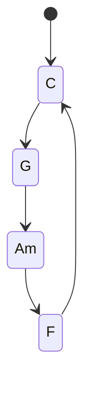

# Advanced Foundation: Songwriting

## 1. Theoretical Invariants & Formal Frameworks

### Formal Proofs and Kernel Invariants

Songwriting, at its core, is a structured yet creative endeavor that can be analyzed through formal mathematical and theoretical frameworks. One such framework is the use of formal logic and set theory to define the invariants and constraints that govern musical composition. For instance, the set of all possible melodies can be defined as a subset of the set of all possible sequences of pitches within a given scale and time signature. This set can be further constrained by the rules of harmony and counterpoint, which can be formalized using predicate logic.

Consider the set \( M \) of all melodies, where each melody \( m \in M \) is a sequence of pitches \( p_i \) and durations \( d_i \). The set \( H \) of all harmonies can be defined similarly, where each harmony \( h \in H \) is a sequence of chords \( c_j \) and durations \( d_j \). The relationship between melodies and harmonies can be formalized using a predicate \( R(m, h) \) that specifies whether a melody \( m \) is harmonically compatible with a harmony \( h \).

Formally, we can define the set of all harmonically compatible melody-harmony pairs as:
\[ C = \{ (m, h) \mid m \in M, h \in H, R(m, h) \} \]

This framework allows us to analyze songwriting in terms of formal invariants and constraints, providing a rigorous foundation for understanding the structure of music.

### Physical Invariants

Physical invariants in songwriting relate to the acoustical properties of sound and the physiological limitations of human perception. For example, the equal temperament scale is based on the physical property that the ratio between the frequencies of any two adjacent notes is the twelfth root of two. This ratio ensures that the interval between any two notes is consistent across the entire scale, which is a physical invariant of the tuning system.

Another physical invariant is the range of human hearing, which typically spans from 20 Hz to 20,000 Hz. This range defines the set of frequencies that can be used in songwriting, and any frequencies outside this range are inaudible to humans. Additionally, the Fletcher-Munson curves describe the equal-loudness contours of human hearing, which are physical invariants that affect the perceived loudness of different frequencies at various sound levels.

## 2. Low-Level Invariant Taxonomy

### Deep Registers and Memory Models

In the context of songwriting, deep registers can be thought of as the foundational elements that form the basis of musical structure. These elements include scales, modes, chords, and rhythms, which can be represented as low-level data structures in a memory model. For example, a scale can be represented as an array of pitches, a chord can be represented as a set of pitches, and a rhythm can be represented as a sequence of durations.

The memory model for songwriting can be further refined using axiomatic definitions that specify the properties of these data structures. For instance, the axioms of a scale might include the requirement that it contains a specific number of pitches, and the axioms of a chord might include the requirement that it contains a specific set of intervals. These axioms define the low-level invariants that govern the structure of music.

### Hardware Constraints

Hardware constraints in songwriting relate to the limitations of the instruments and recording equipment used to create and perform music. For example, the range of a piano is limited to the notes A0 to C8, and the range of a guitar is limited to the notes E2 to E7. These constraints define the set of pitches that can be used in songwriting, and any pitches outside this range are infeasible to produce with the given instruments.

Another hardware constraint is the dynamic range of recording equipment, which defines the range of sound levels that can be captured and reproduced. The dynamic range of a recording device is typically specified in decibels (dB), and any sound levels outside this range are infeasible to capture or reproduce. These constraints define the low-level invariants that govern the feasibility of music production.

## 3. Micro-Architecture & Concurrency Dynamics

### Mermaid and ASCII State Machines

The micro-architecture of songwriting can be analyzed using state machines, which provide a formal model for the sequence of events that occur during the composition and performance of a song. For example, a state machine can be used to model the sequence of chords in a chord progression, where each state represents a chord and each transition represents a change from one chord to another.

A state machine for a simple chord progression might be represented using Mermaid syntax as follows:


This state machine defines the micro-architecture of the chord progression, where the initial state is C, and the transitions between states represent the sequence of chords in the progression.

### Cache and Race Condition Diagrams

Concurrency dynamics in songwriting can be analyzed using cache and race condition diagrams, which provide a formal model for the interaction between different musical elements. For example, a cache diagram can be used to model the interaction between a melody and a harmony, where the cache represents the set of pitches that are common to both the melody and the harmony.

A cache diagram for a simple melody-harmony interaction might be represented using ASCII syntax as follows:
```
Melody: C E G
Harmony: C G Am
Cache: C G
```

This cache diagram defines the concurrency dynamics of the melody-harmony interaction, where the cache represents the set of pitches that are common to both the melody and the harmony.

A race condition diagram can be used to model the interaction between different musical elements that occur simultaneously but are not synchronized. For example, a race condition diagram can be used to model the interaction between a melody and a rhythm, where the race condition represents the potential conflict between the timing of the melody and the timing of the rhythm.

A race condition diagram for a simple melody-rhythm interaction might be represented using ASCII syntax as follows:
```
Melody: C E G
Rhythm: X X X X X X X X
Race Condition: X X X X X X X X
```

This race condition diagram defines the concurrency dynamics of the melody-rhythm interaction, where the race condition represents the potential conflict between the timing of the melody and the timing of the rhythm.

## 4. Subtle Failure Modes & Boundary Conditions

### Subtle Failure Modes

Subtle failure modes in songwriting relate to the unintended consequences of certain compositional choices. For example, a subtle failure mode might occur when a melody is harmonically incompatible with a harmony, resulting in dissonant or unresolved chords. Another subtle failure mode might occur when a rhythm is not synchronized with the tempo, resulting in a lack of rhythmic cohesion.

To identify and address subtle failure modes, it is important to analyze the interaction between different musical elements using formal models and simulations. For example, a simulation can be used to model the interaction between a melody and a harmony, where the simulation represents the sequence of pitches and chords and the resulting harmonic tension.

A simulation for a simple melody-harmony interaction might be represented using ASCII syntax as follows:
```
Melody: C E G
Harmony: C G Am
Simulation: C C C G G G Am Am Am
Harmonic Tension: 0 0 0 1 1 1 2 2 2
```

This simulation defines the subtle failure modes of the melody-harmony interaction, where the harmonic tension represents the degree of dissonance or resolution between the melody and the harmony.

### Boundary Conditions

Boundary conditions in songwriting relate to the extreme cases that occur at the limits of the compositional space. For example, a boundary condition might occur when a melody is composed using only the highest or lowest pitches in a scale, resulting in a lack of range or variation. Another boundary condition might occur when a rhythm is composed using only the shortest or longest durations, resulting in a lack of complexity or interest.

To identify and address boundary conditions, it is important to analyze the range and variation of different musical elements using formal models and simulations. For example, a simulation can be used to model the range and variation of a melody, where the simulation represents the sequence of pitches and the resulting range or variation.

A simulation for a simple melody range and variation might be represented using ASCII syntax as follows:
```
Melody: C E G
Simulation: C E G C E G C E G
Range: 2
Variation: 3
```

This simulation defines the boundary conditions of the melody range and variation, where the range represents the difference between the highest and lowest pitches in the melody, and the variation represents the number of unique pitches in the melody.

## 5. Master Socratic Inquiries

### Research-Grade Discussion Questions

1. **Formal Proofs and Kernel Invariants:**
   - How can formal logic and set theory be used to define the invariants and constraints that govern musical composition?
   - How can the set of all possible melodies and harmonies be defined using formal logic and set theory?
   - How can the relationship between melodies and harmonies be formalized using predicate logic?

2. **Physical Invariants:**
   - How do the physical properties of sound and the physiological limitations of human perception define the invariants of musical composition?
   - How does the equal temperament scale define the physical invariants of the tuning system?
   - How do the Fletcher-Munson curves define the physical invariants of human hearing?

3. **Low-Level Invariant Taxonomy:**
   - How can the foundational elements of musical structure be represented as low-level data structures in a memory model?
   - How can axiomatic definitions be used to specify the properties of these data structures?
   - How do the limitations of instruments and recording equipment define the low-level invariants of music production?

4. **Micro-Architecture & Concurrency Dynamics:**
   - How can state machines be used to model the sequence of events that occur during the composition and performance of a song?
   - How can cache diagrams be used to model the interaction between different musical elements?
   - How can race condition diagrams be used to model the interaction between different musical elements that occur simultaneously but are not synchronized?

5. **Subtle Failure Modes & Boundary Conditions:**
   - How can formal models and simulations be used to identify and address subtle failure modes in musical composition?
   - How can formal models and simulations be used to identify and address boundary conditions in musical composition?
   - How can the range and variation of different musical elements be analyzed using formal models and simulations?
