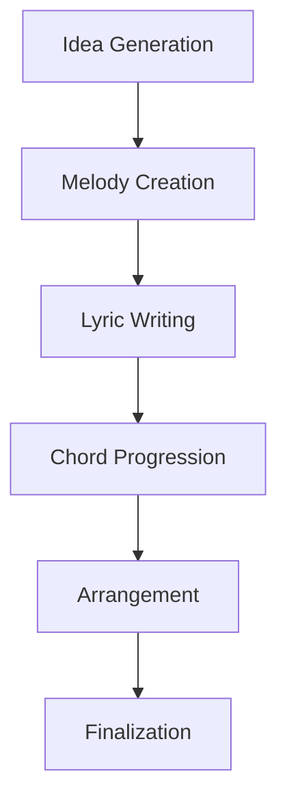

# Beginner Foundation: Songwriting

## 1. Everyday Intuition & First Principles

Songwriting is the art of crafting melodies, lyrics, and harmonies that resonate with listeners, much like how a painter creates a masterpiece on a canvas. Just as a painter uses colors and brushstrokes to evoke emotions and tell a story, a songwriter uses musical elements to convey feelings and narratives. Songs are the vehicles through which we express our deepest thoughts and emotions, and they have the power to connect us across cultures and generations. At its core, songwriting is about finding a way to communicate something meaningful in a way that is both personal and universally relatable.

## 2. Foundational Vocabulary & Glossary

### Melody
The melody is the main tune of a song, the sequence of notes that you hum or sing along to. It is the most recognizable part of a song and often carries the emotional weight of the lyrics. For example, the opening notes of "Twinkle, Twinkle, Little Star" form a simple yet memorable melody.

### Lyrics
Lyrics are the words of a song, the narrative or message that the songwriter wants to convey. They can be about love, heartbreak, personal experiences, or broader themes. The lyrics of "Imagine" by John Lennon, for instance, express a vision of peace and unity.

### Chord Progression
A chord progression is a sequence of chords that accompany the melody. Chords provide harmonic support and can significantly influence the mood and feel of a song. The progression C-G-Am-F is a common and versatile chord sequence used in many pop songs.

### Verse
The verse is a section of a song that typically sets up the story or provides background information. It often repeats with slight variations, allowing the listener to become familiar with the song's narrative. The verses in "Bohemian Rhapsody" by Queen introduce the main character and his situation.

### Chorus
The chorus is the most memorable part of a song, often containing the main hook or refrain. It is usually repeated throughout the song and is designed to be catchy and emotionally impactful. The chorus of "Hey Jude" by The Beatles is a prime example of a powerful and enduring chorus.

### Bridge
The bridge is a transitional section that provides contrast to the verse and chorus. It often appears in the middle of a song and can introduce new melodies, harmonies, or lyrics. The bridge in "Stairway to Heaven" by Led Zeppelin shifts the mood and adds a new layer to the song.

## 3. Visual System Flow

### ASCII Diagram
```
+-------------------+
|  Idea Generation  |
+---------+---------+
          |
          v
+---------+---------+
|  Melody Creation  |
+---------+---------+
          |
          v
+---------+---------+
|  Lyric Writing    |
+---------+---------+
          |
          v
+---------+---------+
| Chord Progression |
+---------+---------+
          |
          v
+---------+---------+
|  Arrangement      |
+---------+---------+
          |
          v
+---------+---------+
|  Finalization     |
+-------------------+
```

### Mermaid Flowchart


## 4. Common Beginner Misconceptions & Mental Traps

### Misconception: Songwriting is a Gift
Many beginners believe that songwriting is an innate talent that only a few people possess. In reality, songwriting is a skill that can be learned and developed with practice. Just as anyone can learn to paint or play an instrument, anyone can learn to write songs.

### Misconception: You Need to Be a Great Musician
While musical proficiency can certainly enhance your songwriting, it is not a prerequisite. Many successful songwriters are not virtuosic musicians. The ability to express yourself through music is more important than technical skill.

### Misconception: You Need to Write a Perfect Song First Time
Perfectionism can be a significant barrier to songwriting. It is natural to make mistakes and to refine your work over time. Embrace the process of writing and revising, and don't be afraid to experiment.

### Misconception: Songwriting is a Solo Activity
While many songwriters work alone, collaboration can be a powerful tool. Working with other musicians, producers, or lyricists can bring new perspectives and ideas to your work. Don't be afraid to seek out collaboration opportunities.

## 5. Socratic Discussion Starters

### Basic Questions to Explore with Your AI Tutor

1. **What is the primary purpose of a melody in a song?**
2. **How do lyrics contribute to the overall message of a song?**
3. **Can you explain the role of a chord progression in setting the mood of a song?**
4. **What is the difference between a verse and a chorus, and why are both important?**
5. **How does a bridge function in a song, and why is it useful?**
6. **What are some common chord progressions used in popular music, and why are they effective?**
7. **How can you use your personal experiences to inspire your songwriting?**
8. **What are some strategies for overcoming writer's block when it comes to songwriting?**

By exploring these questions, you can deepen your understanding of the fundamental concepts of songwriting and develop a strong foundation for your musical journey.
