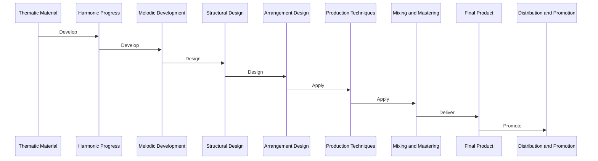

# Intermediate Foundation: Songwriting

## 1. Architectural Mental Model

In the realm of songwriting, the architectural mental model is akin to the blueprint of a musical composition. It encompasses the structural design, the flow of ideas, and the interplay between different elements to create a cohesive and engaging piece. For an intermediate songwriter, understanding this model is crucial for moving beyond basic song structures and into more complex and nuanced compositions.

### Components of the Architectural Mental Model

- **Theme and Motif:** The thematic material serves as the foundational element around which the song is built. A motif is a short, memorable musical idea that can be developed and varied throughout the composition.
- **Form and Structure:** The form of a song dictates its overall architecture, such as verse-chorus, AABA, or more complex structures like through-composition. Understanding different forms allows for the creation of varied and dynamic compositions.
- **Harmonic Progression:** The harmonic progression is the sequence of chords that underpins the melody and provides harmonic support. Intermediate songwriters should explore more complex progressions, modulations, and harmonic substitutions.
- **Melodic Development:** Melodic development involves the transformation and variation of the thematic material. Techniques such as sequence, inversion, and retrograde can be employed to create interest and cohesion.
- **Rhythm and Meter:** Rhythm and meter provide the temporal framework for the song. Intermediate songwriters should experiment with different time signatures, syncopation, and rhythmic motifs to add depth and complexity.

### Production Architecture

The production architecture of a song involves the technical and creative decisions made during the composition and arrangement process. This includes:

- **Arrangement:** The arrangement is the specific configuration of instruments and voices in a song. Intermediate songwriters should consider the role of each instrument and how they interact to create a balanced and engaging soundscape.
- **Production Techniques:** Production techniques such as layering, doubling, and effects processing can be used to enhance the arrangement and create a polished final product.
- **Mixing and Mastering:** The mixing and mastering process involves balancing the levels and frequencies of the different elements in the song to create a cohesive and professional-sounding final product.

## 2. Systems Taxonomy & Component Protocols

In songwriting, the systems taxonomy refers to the classification of different elements and their interactions within the composition. Understanding these systems and their protocols is essential for creating well-structured and effective songs.

### Standard Interfaces and Protocols

- **Chord Progression Protocols:** Chord progressions are the building blocks of harmonic structure. Intermediate songwriters should be familiar with common chord progressions and their variations, as well as more complex progressions that incorporate modulation and harmonic substitution.
- **Melodic Protocols:** Melodic protocols refer to the rules and conventions that govern the creation of melodies. Intermediate songwriters should understand techniques such as sequence, inversion, and retrograde, as well as the use of scales and modes to create interesting and memorable melodies.
- **Rhythmic Protocols:** Rhythmic protocols refer to the rules and conventions that govern the creation of rhythms. Intermediate songwriters should be familiar with different time signatures, syncopation, and rhythmic motifs, as well as techniques such as polyrhythm and polymeter.

### Data Models

- **Thematic Data Model:** The thematic data model represents the thematic material of the song, including motifs, themes, and variations. This model should include information about the harmonic, melodic, and rhythmic elements of the thematic material.
- **Structural Data Model:** The structural data model represents the overall architecture of the song, including form, section, and progression. This model should include information about the harmonic, melodic, and rhythmic elements of each section, as well as the transitions between sections.
- **Arrangement Data Model:** The arrangement data model represents the specific configuration of instruments and voices in the song. This model should include information about the role of each instrument, the specific parts assigned to each instrument, and the production techniques used to enhance the arrangement.

## 3. Multi-Component Interaction Flow

The multi-component interaction flow refers to the sequence of events and interactions between different elements in the songwriting process. Understanding this flow is essential for creating well-structured and effective songs.

### ASCII Sequence Diagram

```
+-------------------+       +-------------------+       +-------------------+
|  Thematic Material  |  -->  |  Harmonic Progress  |  -->  |  Melodic Development  |
+-------------------+       +-------------------+       +-------------------+
         |                             |                             |
         v                             v                             v
+-------------------+       +-------------------+       +-------------------+
|  Structural Design  |  -->  |  Arrangement Design |  -->  |  Production Techniques  |
+-------------------+       +-------------------+       +-------------------+
         |                             |                             |
         v                             v                             v
+-------------------+       +-------------------+       +-------------------+
|  Mixing and Master  |  -->  |  Final Product      |  -->  |  Distribution and      |
|  ing                |       |  Delivery           |       |  Promotion             |
+-------------------+       +-------------------+       +-------------------+
```

### Mermaid Sequence Diagram



## 4. Architectural Trade-offs & Production Pitfalls

In songwriting, architectural trade-offs and production pitfalls are inevitable. Understanding these trade-offs and pitfalls is essential for creating effective and engaging songs.

### Architectural Trade-offs

- **Simplicity vs. Complexity:** Simple songs can be more memorable and accessible, while complex songs can be more engaging and interesting. Intermediate songwriters should consider the balance between simplicity and complexity and choose the level of complexity that best serves the song.
- **Consistency vs. Variation:** Consistency can create a sense of unity and cohesion, while variation can create interest and surprise. Intermediate songwriters should consider the balance between consistency and variation and choose the level of variation that best serves the song.
- **Emotional Depth vs. Technical Skill:** Emotional depth can create a sense of connection and resonance, while technical skill can create a sense of mastery and expertise. Intermediate songwriters should consider the balance between emotional depth and technical skill and choose the level of technical skill that best serves the song.

### Production Pitfalls

- **Overproduction:** Overproduction can detract from the simplicity and clarity of the song. Intermediate songwriters should be mindful of the production techniques used and avoid overproduction.
- **Lack of Focus:** Lack of focus can create a sense of disunity and confusion. Intermediate songwriters should be mindful of the thematic material and structural design and ensure that the song has a clear focus.
- **Poor Arrangement:** Poor arrangement can detract from the effectiveness and impact of the song. Intermediate songwriters should be mindful of the arrangement design and ensure that the song is well-arranged.

## 5. Socratic Discussion Starters

Socratic discussion starters are questions that bridge the architecture of songwriting to the low-level implementation. These questions can be used to facilitate discussions and deepen understanding.

- **How does the thematic material influence the harmonic progression and melodic development?**
- **How does the structural design influence the arrangement and production techniques?**
- **How does the production techniques influence the mixing and mastering process?**
- **How does the mixing and mastering process influence the final product and distribution?**
- **How does the distribution and promotion process influence the reception and impact of the song?**

By exploring these questions, intermediate songwriters can gain a deeper understanding of the architectural mental model, systems taxonomy, and multi-component interaction flow of songwriting. This understanding can help them create more effective and engaging songs.
