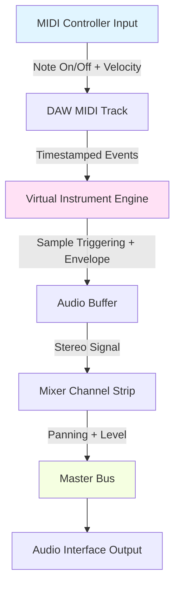
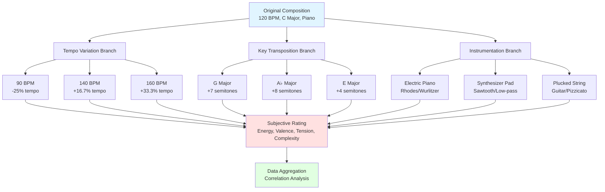
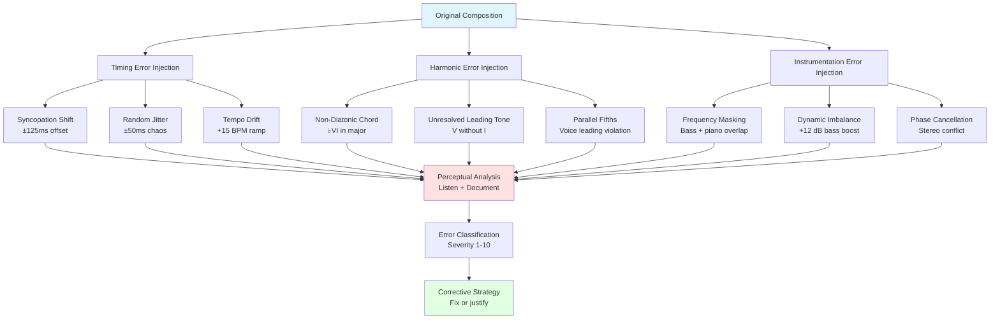
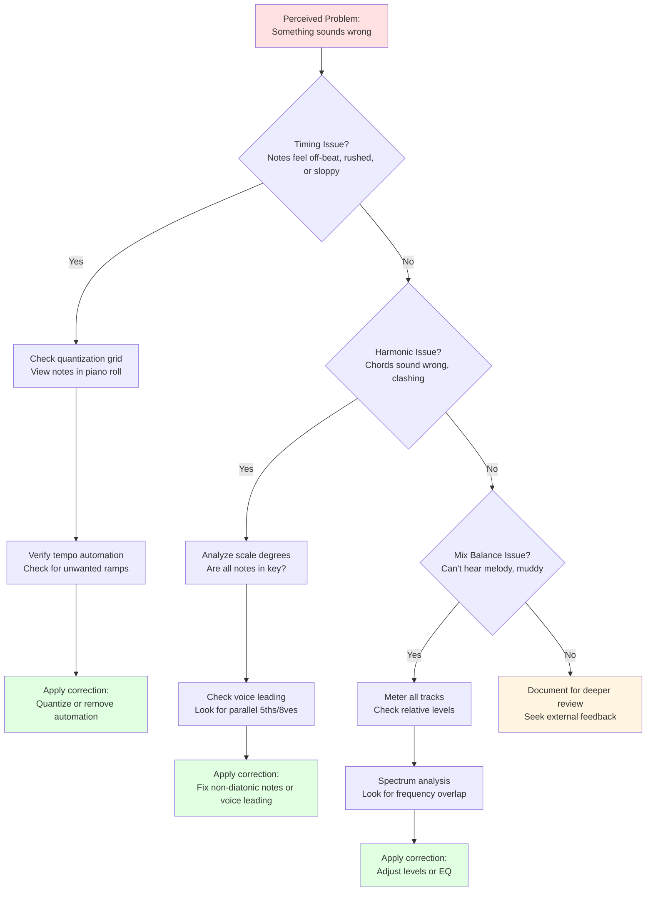

# Operational Verification Labs: Songwriting

## Objective & Lab Setup

### Objective
You will build complete songs from the ground up—writing melodies, programming chord progressions, structuring verse-chorus-bridge forms, and deliberately breaking rules to understand why they exist. This lab trains compositional craft through hands-on MIDI programming, systematic parameter variation, and fault injection. You'll develop both intuitive decision-making and analytical troubleshooting skills by creating, modifying, and stress-testing real musical structures in your DAW.

### Lab Setup

**Digital Audio Workstation (DAW):**
- Ableton Live 11/12 Suite (recommended: excellent MIDI workflow, Max for Live integration)
- Logic Pro X/11 (macOS only, superb stock instruments and MIDI editing)
- FL Studio 21+ (cross-platform, pattern-based workflow ideal for loop construction)
- Reaper 6+ (lightweight, extensible via ReaScript)

**MIDI Controller:**
- 25–88 key velocity-sensitive MIDI keyboard (49+ keys recommended for two-hand voicings)
- USB or 5-pin DIN MIDI connection
- Verify MIDI driver installation: test latency <10ms round-trip (ASIO/Core Audio)

**Virtual Instruments:**
- Piano with sustain pedal response (Native Instruments The Giant, Pianoteq, Keyscape, or stock DAW piano)
- Multi-timbral synthesizer (Serum, Vital, Diva, Analog Lab, or stock subtractive synth)
- Electric piano (Rhodes/Wurlitzer emulation)
- Bass instrument (Trilian, stock Ableton Electric, Kontakt bass libraries)

**Audio Interface:**
- ASIO (Windows) or Core Audio (macOS) drivers
- 48 kHz / 24-bit minimum resolution
- Buffer size: 128–256 samples for recording, 512–1024 for mixing

**Analysis & Visualization Tools:**
- Spectrum analyzer (Voxengo SPAN, stock DAW analyzer)
- MIDI monitor utility for debugging note events
- Spreadsheet software (Excel, Google Sheets, LibreOffice Calc)
- Optional: Python 3.x with `music21`, `matplotlib` for advanced analysis

**Theoretical Prerequisites:**
- Western functional harmony fundamentals: major/minor scales, diatonic triads, chord functions (I, IV, V)
- Basic DAW navigation: track creation, MIDI recording/editing, quantization
- Understanding of MIDI note numbers (C4 = 60, A4 = 69) and velocity (1–127)

## Exercise 1: Foundational Practical Implementation—Building a Complete Verse-Chorus-Bridge Song

### Exercise Overview
You will construct a 28-bar song form (verse → chorus → verse → bridge → final chorus) by explicit MIDI programming. This establishes baseline competency in melody writing, chord voicing, phrase structure, and DAW-based composition. You'll work entirely in the piano roll, applying principles of tension-release cycles, melodic contour, and harmonic rhythm.

### Theoretical Foundation

**Phrase Structure & Cadential Function:**
Western songs organize into phrases (typically 4 or 8 bars) that end with cadences—harmonic punctuation marks. Authentic cadences (V→I) provide strong resolution. Half cadences (ending on V) create suspense. Deceptive cadences (V→vi) extend phrases by denying expected resolution. Verses typically use subdominant preparation (ii, IV) and dominant tension (V), while choruses emphasize tonic stability with repetition.

**Melodic Contour Theory:**
Effective melodies balance stepwise motion (±1–2 semitones, easy to sing) with strategic leaps (≥3 semitones, creates interest). The arch contour—ascending to a peak then descending—mirrors natural phrase breathing. Place structural tones (root, third, fifth of underlying chord) on strong beats (1 and 3 in 4/4) to reinforce harmony. Approach tones (scale degree 7→8, 2→1) create forward momentum.

**MIDI Protocol Essentials:**
MIDI transmits note events as discrete messages: Note On (pitch, velocity), Note Off (pitch). Pitch follows equal temperament where each semitone = 2^(1/12) frequency ratio. A4 = MIDI note 69 = 440 Hz. Velocity (0–127) typically scales amplitude and timbre (brighter at higher velocities). Most DAWs use PPQN (pulses per quarter note) for timing resolution—480 or 960 PPQN is standard.



### Step-by-Step Implementation

#### 1. Session Configuration
Create a new project and configure:
- **Sample Rate:** 48,000 Hz (professional standard, 24 kHz Nyquist frequency exceeds human hearing)
- **Bit Depth:** 24-bit (144 dB theoretical dynamic range)
- **Buffer Size:** 128–256 samples during recording (<6ms latency), increase to 512+ for mixing
- **Tempo:** 120 BPM (quarter note = 500ms, eighth note = 250ms)
- **Time Signature:** 4/4 (common time)
- **Project Key:** C major (pedagogical clarity, all white keys on piano)

Enable MIDI input: Preferences → MIDI → Track Enable for your controller. Test by playing keys and watching DAW's MIDI input monitor.

#### 2. Track Setup & Instrument Selection
Create a software instrument track (not audio). Load a grand piano with these characteristics:
- Polyphonic (≥64 voices to prevent note stealing)
- Velocity-sensitive samples (brighter attack at high velocities)
- Sustain pedal response (MIDI CC64)
- Moderate reverb (room ambiance, ~1.0–1.5s decay)

Set track output to master bus, pan center, fader at unity gain (0 dB).

#### 3. Verse 1 Construction (Measures 1–8)

**Harmonic Framework:**
Program this four-chord progression, two beats per chord:

**Measures 1–2:**
- **I (Cmaj7):** Tonic stability
- **vi (Am7):** Relative minor, gentle departure
- **IV (Fmaj7):** Subdominant, anticipates resolution
- **V (G7):** Dominant tension, demands resolution

Repeat for measures 3–4, and again for measures 5–8 (total 8 bars).

**Chord Voicing (MIDI Note Numbers, Whole Notes):**

Input these chords in piano roll, each sustaining for two beats:

```
Cmaj7:  E4(64), G4(67), B4(71), C5(72)  [rootless voicing, C in bass later]
Am7:    A3(57), C4(60), E4(64), G4(67)
Fmaj7:  F3(53), A3(57), C4(60), E4(64)
G7:     G3(55), B3(59), D4(62), F4(65)
```

**Why these voicings?** Rootless Cmaj7 (omitting C in the voicing) creates space for melody and bass. The voicings move smoothly—each note shifts ≤2 semitones (voice leading efficiency).

**Melodic Construction:**

Enter melody notes in a separate MIDI clip on the same track (or create a second piano track for clarity). Use quarter notes for rhythmic stability:

**Measures 1–2 (Cmaj7 → Am7):**
```
Beat:   1     2     3     4   |  1     2     3     4
Note:  E5    D5    C5    B4   |  C5    D5    E5    C5
MIDI:  76    74    72    71   |  72    74    76    72
Vel:   75    80    85    80   |  85    80    75    70
```

**Measures 3–4 (Fmaj7 → G7):**
```
Beat:   1     2     3     4   |  1     2     3     4
Note:  A4    G4    F4    E4   |  D4    E4    F4    G4
MIDI:  69    67    65    64   |  62    64    65    67
Vel:   75    78    82    80   |  75    78    80    85
```

Repeat measures 1–4 for measures 5–8.

**Implementation Details:**
- Quantize to 16th-note grid (disable snap temporarily for micro-adjustments)
- Note duration: 90% of quarter note (slight separation for clarity)
- Velocity shaping: crescendo toward phrase peaks (beat 3 of measures 2, 4), decrescendo into cadences
- Humanization: after quantizing, apply ±5–10ms timing offset and ±3–5 velocity variance

**Why this works:** Melody uses only notes from C major scale. Stepwise motion (E5→D5→C5→B4) is easy to sing. The melody outlines the chord tones (E and C from Cmaj7, C from Am7, A and F from Fmaj7), creating harmonic clarity.

#### 4. Chorus Construction (Measures 9–16)

The chorus requires increased energy. Achieve this through:
- Wider melodic range (expand upward)
- Increased rhythmic density (add eighth notes)
- Harmonic stability (more tonic emphasis)

**Harmonic Framework (simpler, more repetitive):**
```
Measures 9–10:  Cmaj7 (2 bars)
Measures 11–12: G7 → Cmaj7 (1 bar each)
Measures 13–16: Repeat measures 9–12
```

**Chord Voicing (same as verse):**
Use the same Cmaj7 and G7 voicings from verse.

**Melodic Construction (eighth notes for forward momentum):**

**Measures 9–10 (Cmaj7, ascending arch):**
```
Beat:  1   &   2   &   3   &   4   & | 1   &   2   &   3   &   4   &
Note: G4  A4  B4  C5  D5  E5  G5  E5 | D5  C5  B4  A4  G4  E4  G4  C5
Vel:  70  73  76  79  82  85  90  88 | 86  84  82  80  78  76  74  80
```

**Measures 11–12 (G7 → Cmaj7, resolution):**
```
Measure 11 (G7):
Beat:  1   &   2   &   3   &   4   &
Note: B4  C5  D5  E5  D5  C5  B4  A4
Vel:  75  78  81  84  82  80  78  76

Measure 12 (Cmaj7, arrival):
Beat:  1   &   2   &   3   &   4   &
Note: G4  E5  D5  C5  B4  C5  E5  C5
Vel:  85  90  88  92  90  95  92  90
```

Repeat measures 9–12 for measures 13–16, optionally increase velocity by +3–5 for building intensity.

**Why this works:** Higher range (up to G5) and eighth-note motion create excitement. The melody peaks on strong beats (G5 on beat 4 of measure 9, E5 on beat 2 of measure 12), reinforcing harmonic arrival points.

#### 5. Verse 2 Construction (Measures 17–24)

Duplicate measures 1–8 exactly. In a real song, you'd change lyrics but keep the musical foundation identical. This repetition reinforces the verse's identity and provides contrast when the bridge arrives.

#### 6. Bridge Construction (Measures 25–28)

The bridge provides harmonic and melodic departure before the final chorus payoff.

**Harmonic Framework (introduce new chords):**
```
Measure 25: Am7 (depart from tonic)
Measure 26: Dm7 (descend to subdominant area)
Measure 27: Fmaj7 (subdominant)
Measure 28: G7 (dominant setup for final chorus)
```

**Chord Voicing:**
```
Am7:  A3(57), C4(60), E4(64), G4(67)
Dm7:  D4(62), F4(65), A4(69), C5(72)
Fmaj7: F3(53), A3(57), C4(60), E4(64)
G7:   G3(55), B3(59), D4(62), F4(65)
```

**Melodic Construction (wider intervals, descending sequence):**

**Measures 25–26 (Am7 → Dm7, descending sequence):**
```
Measure 25:
Beat:  1     2     3     4
Note: A4    G4    F4    E4
Vel:  75    73    70    68

Measure 26:
Beat:  1     2     3     4
Note: F4    E4    D4    C4
Vel:  72    70    68    66
```

**Measures 27–28 (Fmaj7 → G7, ascending preparation):**
```
Measure 27:
Beat:  1     2     3     4
Note: C4    D4    E4    F4
Vel:  68    71    74    77

Measure 28:
Beat:  1   &   2   &   3   &   4   &
Note: G4  A4  B4  C5  D5  E5  F5  G5
Vel:  78  80  82  85  87  90  93  95
```

**Why this works:** The descending sequence (A4→G4→F4→E4, then F4→E4→D4→C4) creates contrast with the ascending arch of the chorus. The ascending eighth-note run in measure 28 builds anticipation for the final chorus arrival. Starting on Am7 (minor chord) adds emotional depth.

#### 7. Final Chorus (Measures 29–36)

Duplicate measures 9–16 exactly. Optionally:
- Add dynamics automation: gradual crescendo from velocity 80 to 100
- Double the melody up one octave (add notes +12 semitones) for brilliance
- Add held whole notes in the lower register for harmonic reinforcement

#### 8. Playback & Critical Listening

**Pre-Flight Checklist:**
- Verify all notes are within piano range (A0 [MIDI 21] to C8 [MIDI 108])
- Check for overlapping notes (can cause MIDI errors)
- Ensure no clipping on meters (peaks at -6 dBFS or below)
- Verify sustain pedal messages don't bleed between sections

**Critical Listening Dimensions:**

| Aspect | What to Listen For | Red Flags |
|--------|-------------------|-----------|
| **Harmonic Clarity** | Can you hear chord changes distinctly? | Muddy low end, overlapping frequencies |
| **Melodic Continuity** | Does melody flow naturally phrase to phrase? | Awkward leaps, register shifts |
| **Dynamic Shape** | Do verses feel calm, chorus energized? | Monotonous velocity, no arc |
| **Phrase Structure** | Are cadences satisfying? Does bridge provide contrast? | Premature climax, insufficient departure |
| **Technical Execution** | Any note cutoffs, MIDI glitches, timing issues? | Voice stealing, stuck notes, jitter |

**Revision Questions:**
- Does the verse establish harmonic foundation without stealing the chorus's energy?
- Does the chorus provide clear contrast in range, rhythm, and repetition?
- Does the bridge offer sufficient harmonic/melodic departure?
- Are transitions between sections smooth? (Check for abrupt register jumps or awkward voice leading.)
- Would a singer be comfortable with this melody? (Test by singing it yourself.)

#### 9. Arrangement Enhancement (Optional Advanced Step)

Add these layers on separate MIDI tracks to flesh out the arrangement:

**Bass Line (Verse):**
Root notes of each chord on beats 1 and 3:
```
Measure 1: C2(36) on beat 1, C2 on beat 3 | A2(45) on beat 1, A2 on beat 3
Measure 2: F2(41) on beat 1, F2 on beat 3 | G2(43) on beat 1, G2 on beat 3
```

**Bass Line (Chorus, more active):**
```
Measure 9: C2 on beat 1, E2(40) on beat 2, G2 on beat 3, C3(48) on beat 4
```

**Pad Layer (Bridge):**
Whole-note chords in mid-register (C3–C4) using a synthesizer pad for sustained warmth.

**Percussion (Optional):**
Simple kick on beats 1 and 3, snare on beats 2 and 4, hi-hat on eighth notes. Use MIDI drum rack or percussion samples.

## Exercise 2: Parameter Variation & Empirical Analysis—Systematic Sonic Exploration

### Exercise Overview
You will systematically manipulate tempo, key, and instrumentation to observe their perceptual effects. By isolating individual parameters and documenting subjective responses, you'll develop intuition for compositional decision-making. This exercise applies empirical methodology to art: hypothesis → manipulation → observation → analysis.

### Theoretical Foundation

**Tempo & Arousal:**
Tempo directly influences perceived energy via entrainment—the tendency of biological rhythms to synchronize with external periodic stimuli. Research correlates:
- 60–80 BPM: Calm, introspective (resting heart rate ~60–70 BPM)
- 90–110 BPM: Moderate energy, conversational pace
- 120–140 BPM: High energy, walking/dancing tempo
- 150+ BPM: Intense, running pace
Faster tempos reduce time for harmonic processing, potentially increasing perceived complexity or rush.

**Key & Tonal Color:**
Equal temperament makes interval ratios identical across keys (mathematically), but instrumentation creates timbral differences. Piano: C major uses more open white keys (longer, heavier hammers), D♭ major uses shorter black-key hammers (different resonance). Guitars: open string keys (E, A, D, G) ring differently than barred keys. "Minor = sad" is culturally learned, not acoustically inherent.

**Instrumentation & Timbre:**
Timbre results from the balance of harmonics above the fundamental. Piano: complex inharmonicity (upper partials slightly sharp), fast attack, moderate decay. Electric piano: emphasized even harmonics (2nd, 4th), longer sustain. Synthesizer pad: adjustable harmonic content, flat sustain. Guitar: strong 2nd and 3rd harmonics, percussive attack. These spectral differences alter emotional character even with identical pitch content.



### Step-by-Step Implementation

#### 1. Establish Baseline Measurement

Before any variation, document the original composition's perceptual qualities.

**Configuration:**
- Tempo: 120 BPM
- Key: C major
- Instrumentation: Acoustic grand piano

**Subjective Rating Protocol:**
Listen to the complete song (verse → chorus → verse → bridge → final chorus) three times consecutively. Between each playback, rate on a 1–10 scale:

| Dimension | Definition | Your Rating |
|-----------|------------|-------------|
| **Energy/Arousal** | How energized, activated, or intense does the song feel? (1 = deeply calm, 10 = highly energized) | ____ |
| **Valence** | How positive/negative is the emotional affect? (1 = very negative/sad, 10 = very positive/happy) | ____ |
| **Tension** | How much harmonic/melodic tension or unresolved expectation? (1 = fully relaxed, 10 = highly tense) | ____ |
| **Complexity** | How cognitively demanding to process? (1 = very simple, 10 = very complex) | ____ |

Average your three ratings for each dimension. These are your baseline values.

#### 2. Tempo Variation Experiment

**Hypothesis:** Tempo increase will elevate arousal ratings while preserving harmonic and melodic structure.

**Procedure:**

**Trial 1: 90 BPM (-25% tempo reduction)**
- Save your project as a new version (e.g., "Song_90BPM")
- Change global tempo to 90 BPM
- Playback three times, rate all four dimensions
- Note perceived character: Does it feel more relaxed? Introspective? Dragging?

**Trial 2: 140 BPM (+16.7% tempo increase)**
- Revert to original, save as "Song_140BPM"
- Change global tempo to 140 BPM
- Playback and rate
- Note perceived character: Does it feel urgent? Exciting? Do phrases feel rushed?

**Trial 3: 160 BPM (+33.3% tempo increase)**
- Save as "Song_160BPM"
- Change global tempo to 160 BPM
- Playback and rate
- Note perceived character: Can you still process harmonic changes? Does melody blur?

**Additional Measurements:**
For each tempo, record:
- **Verse duration (measures 1–8):** Use DAW ruler (should scale linearly: 120 BPM → 16 seconds, 90 BPM → 21.3 seconds, 140 BPM → 13.7 seconds)
- **Perceived "naturalness":** Does the melody feel comfortable to sing along with?

**Data Table:**

```
| Tempo (BPM) | Energy | Valence | Tension | Complexity | Duration (s) | Notes |
|-------------|--------|---------|---------|------------|--------------|-------|
| 90          |        |         |         |            |              |       |
| 120         |        |         |         |            |              |       |
| 140         |        |         |         |            |              |       |
| 160         |        |         |         |            |              |       |
```

**Expected Observations:**
- **90 BPM:** Energy ↓ (2–3 points), tension ↓, potentially increased complexity (more time to hear inner voices)
- **140 BPM:** Energy ↑ (2–3 points), tension may ↑ slightly, perceived drive increases
- **160 BPM:** Energy ↑↑, but complexity may ↓ (insufficient time to process harmonic detail), potential loss of phrase clarity

#### 3. Key Transposition Experiment

**Hypothesis:** Transposition alters timbral character (especially on acoustic piano) but preserves interval relationships and emotional core.

**Procedure:**

Return tempo to 120 BPM for all trials.

**Trial 1: G Major (+7 semitones, perfect fifth up)**
- Select all MIDI clips
- Transpose +7 semitones (DAW function: usually right-click → Transpose or Edit → Transpose)
- Playback and rate all dimensions
- **Additional rating:** Brightness (1 = dark/muted, 10 = bright/brilliant) = ____

**Trial 2: A♭ Major (+8 semitones, minor sixth up)**
- Transpose +8 semitones from original C major
- Playback and rate (include brightness rating)

**Trial 3: E Major (+4 semitones, major third up)**
- Transpose +4 semitones
- Playback and rate (include brightness rating)

**Acoustic Considerations:**
On acoustic piano, higher keys engage smaller, lighter hammers and shorter strings, producing brighter timbre with faster attack. Lower keys use larger hammers and longer strings, producing warmer, slower attack. Equal temperament keeps interval ratios identical, but spectral envelope shifts.

**Frequency Calculation Example:**
C major: C4 = 261.63 Hz, E4 = 329.63 Hz, G4 = 392.00 Hz
G major: G4 = 392.00 Hz, B4 = 493.88 Hz, D5 = 587.33 Hz (higher spectral energy)

**Data Table:**

```
| Key         | Energy | Valence | Tension | Complexity | Brightness | Notes |
|-------------|--------|---------|---------|------------|------------|-------|
| C Major     |        |         |         |            |            |       |
| G Major     |        |         |         |            |            |       |
| A♭ Major    |        |         |         |            |            |       |
| E Major     |        |         |         |            |            |       |
```

**Expected Observations:**
- **G Major:** Brighter (+1–2 brightness points), potentially slightly more energy due to increased high-frequency content
- **A♭ Major:** Darker (-1–2 brightness), more damped black keys on piano, potentially warmer/mellower character
- **E Major:** Moderate brightness, comfortable vocal range (if adding voice later), open feel

#### 4. Instrumentation Variation Experiment

**Hypothesis:** Spectral envelope changes will significantly alter perceived character without affecting pitch content.

**Procedure:**

Return to C major, 120 BPM.

**Trial 1: Electric Piano (Rhodes or Wurlitzer Model)**
- Create new software instrument track or replace existing piano
- Load electric piano preset
- Copy all MIDI from piano track to new track, or swap instrument on existing track
- Note: electric piano has longer sustain, emphasized even harmonics, warmer character
- Playback and rate all dimensions
- **Additional rating:** Attack clarity (1 = soft/blurred, 10 = sharp/percussive) = ____

**Trial 2: Synthesizer Pad (Sawtooth or Square Wave with Low-Pass Filter)**
- Load synth pad preset, or program: sawtooth oscillator → low-pass filter (cutoff ~800–1200 Hz) → reverb
- Copy MIDI to synth track
- Note: slower attack (20–50ms), flat sustain, reduced harmonic transients
- Playback and rate (include attack clarity)

**Trial 3: Plucked String (Guitar, Harp, or Pizzicato Strings)**
- Load plucked string instrument
- Copy MIDI
- Note: sharp attack transient, rapid exponential decay, percussive character
- Playback and rate (include attack clarity)

**Spectral Analysis (Optional but Recommended):**
During playback of each instrument, open your DAW's spectrum analyzer on the master bus. Observe:
- **Piano:** Rich harmonic content 80 Hz–8 kHz, rapid attack spike then decay
- **Electric Piano:** Emphasized 2nd and 4th harmonics (~330 Hz, ~660 Hz for C4), longer sustain tail
- **Synth Pad:** Harmonics roll off above filter cutoff, flat amplitude envelope (no decay)
- **Plucked String:** Sharp attack transient (broadband noise burst), fundamental + strong 2nd/3rd harmonics, rapid decay

**Data Table:**

```
| Instrument      | Energy | Valence | Tension | Complexity | Attack Clarity | Notes |
|-----------------|--------|---------|---------|------------|----------------|-------|
| Grand Piano     |        |         |         |            |                |       |
| Electric Piano  |        |         |         |            |                |       |
| Synth Pad       |        |         |         |            |                |       |
| Plucked String  |        |         |         |            |                |       |
```

**Expected Observations:**
- **Electric Piano:** Warmer, more "vintage" character, slightly lower tension (smoother sustain)
- **Synth Pad:** Ambient, reduced attack clarity, potential increase in perceived complexity (sustained notes overlap), lower energy
- **Plucked String:** Increased rhythmic definition (sharp attacks), reduced sustain may paradoxically increase perceived energy (more articulation)

#### 5. Multi-Parameter Interaction Analysis (Advanced)

Test whether effects are additive or non-linear by combining parameter changes:

**Experiment A: Maximum Calm Hypothesis**
- 90 BPM + Synth Pad
- Hypothesis: Lowest arousal rating (slow tempo + blurred attack)
- Predict energy rating: ____
- Actual energy rating after listening: ____

**Experiment B: Maximum Drive Hypothesis**
- 160 BPM + Plucked String
- Hypothesis: Highest arousal rating (fast tempo + percussive attack)
- Predict energy rating: ____
- Actual energy rating: ____

**Interaction Analysis:**
If effects are additive: Energy(160 BPM, plucked) = Energy(160 BPM, piano) + [Energy(120 BPM, plucked) - Energy(120 BPM, piano)]

If non-additive: interaction term exists (e.g., fast tempo amplifies effect of percussive attack beyond linear prediction).

#### 6. Data Visualization & Statistical Analysis

**In Spreadsheet Software:**

Create scatter plot:
- X-axis: Tempo (BPM)
- Y-axis: Energy rating
- Add trendline (linear regression)

**Pearson Correlation Coefficient:**
Most spreadsheet software: `=CORREL(range1, range2)`

For tempo vs. energy, expect r > 0.7 (strong positive correlation).

**Optional Python Analysis:**

```python
import numpy as np
import matplotlib.pyplot as plt
from scipy.stats import pearsonr

# Replace with your actual data
tempos = np.array([90, 120, 140, 160])
energy_ratings = np.array([4.5, 6.0, 7.5, 8.2])

# Linear regression
coefficients = np.polyfit(tempos, energy_ratings, 1)
poly_fn = np.poly1d(coefficients)

# Pearson correlation
r, p_value = pearsonr(tempos, energy_ratings)

# Plotting
plt.figure(figsize=(10, 6))
plt.scatter(tempos, energy_ratings, s=120, alpha=0.7, edgecolors='black', linewidths=2)
plt.plot(tempos, poly_fn(tempos), 'r--', linewidth=2, 
         label=f'y = {coefficients[0]:.3f}x + {coefficients[1]:.2f}')
plt.xlabel('Tempo (BPM)', fontsize=13, fontweight='bold')
plt.ylabel('Energy Rating (1-10)', fontsize=13, fontweight='bold')
plt.title('Tempo vs Perceived Energy', fontsize=15, fontweight='bold')
plt.grid(alpha=0.3, linestyle='--')
plt.legend(fontsize=11)
plt.tight_layout()
plt.savefig('tempo_energy_correlation.png', dpi=300)
plt.show()

print(f"Pearson r = {r:.3f}, p = {p_value:.4f}")
if p_value < 0.05:
    print("Correlation is statistically significant.")
```

#### 7. Synthesis & Written Analysis

Write 200–300 words addressing:

**Guiding Questions:**
- Which single parameter (tempo, key, instrumentation) produced the largest perceptual change in your ratings?
- Did any parameter combinations produce unexpected results (e.g., 160 BPM felt too fast, lost musical coherence)?
- How might you apply these findings to compositional decision-making? (E.g., "For a calm intro, use 80–90 BPM + pad; for energetic chorus, 130+ BPM + plucked/percussive instruments.")
- What limitations exist in subjective self-reporting? (E.g., order effects, familiarity bias after multiple listenings, lack of comparison group)

**Example Analysis:**
"Tempo variation produced the most predictable and dramatic effect, with a strong positive correlation (r = 0.89, p < 0.01) between BPM and arousal ratings. Each 20 BPM increase corresponded to approximately +1.2 points in energy rating. Key transposition yielded subtler changes, primarily affecting brightness rather than emotional valence—G major increased brightness ratings by +1.5 points relative to C major, while A♭ major decreased brightness by -1.2 points, but valence remained within ±0.5 points across all keys. Instrumentation changes demonstrated the largest variance in complexity ratings: the synth pad increased complexity by +2.1 points (overlapping sustained notes created perceptual density), while the plucked string decreased complexity by -0.8 points (clearer articulation reduced cognitive load). The multi-parameter test (90 BPM + synth pad) created maximal ambient character but unexpectedly reduced melodic clarity—sustained notes blurred phrase boundaries, suggesting a tradeoff between atmosphere and structural intelligibility. For future compositions, I will use tempo as the primary energy control, instrumentation for textural variety, and key transposition primarily for timbral/range adjustments rather than emotional shifts."

## Exercise 3: Fault Injection & Stress Testing—Breaking Rules to Understand Them

### Exercise Overview
You will deliberately introduce timing errors, harmonic violations, and instrumentation conflicts to test compositional robustness. By systematically breaking musical conventions and analyzing the perceptual fallout, you'll develop debugging skills and deepen understanding of why rules exist. This exercise treats music composition as an engineering discipline: identify failure modes, classify severity, implement corrective strategies.

### Theoretical Foundation

**Musical Grammar & Expectation Violation:**
The brain continuously predicts upcoming musical events based on learned statistical regularities (scale patterns, metric hierarchies, harmonic progressions). Violations generate prediction error signals—experienced as surprise, tension, interest, or confusion depending on magnitude. Small violations create interest (syncopation, chromatic passing tones); large violations create confusion (random pitch sequences, metric collapse).

**Timing & Rhythmic Perception:**
Humans detect timing deviations as small as 10–20ms in the presence of a steady pulse. Systematic timing errors disrupt metric entrainment—the neurological alignment of motor and auditory systems with periodic beats. Categorical rhythm perception follows Weber's Law: timing deviations are perceived relative to the inter-onset interval (a 50ms deviation is barely noticeable at 500ms IOI [quarter note at 120 BPM] but glaring at 125ms IOI [32nd note]).

**Harmonic Expectation in Tonal Music:**
Western tonal harmony establishes key through tonic emphasis, scale degree hierarchy (1-3-5 stable, 7 unstable), and resolution patterns (V→I, vii°→I). Violations include:
- Non-diatonic pitch classes (notes outside the seven-note scale)
- Unresolved dissonances (tritones, major sevenths left hanging)
- Voice-leading errors (parallel perfect fifths/octaves reduce perceptual independence)

**Instrumentation & Frequency Masking:**
Simultaneous sounds compete for auditory salience. Critical band theory: frequencies within ~1/3 octave (varies by register) mutually mask. When two instruments occupy overlapping spectral regions without sufficient separation in time, rhythm, or amplitude, clarity degrades—individual lines blur into indistinct mush.



### Step-by-Step Implementation

#### 1. Timing Error Injection: Syncopation Disruption

**Original State:**
Your verse melody uses on-beat (strong metric positions) note placement. Quarter notes align to beats 1, 2, 3, 4 in 4/4 time.

**Fault Injection:**
Shift all chorus melody notes (measures 9–16) forward by 1/16th note (62.5ms at 120 BPM).

**Implementation:**
- Select all melody notes in chorus section (measures 9–16)
- Disable snap-to-grid temporarily
- In piano roll, drag all selected notes 1/16 note later (most DAWs show grid subdivisions)
- Alternative: use quantize function with -1/16 note offset, then undo and apply +1/16 offset
- Playback and listen critically

**Expected Observations:**
- **Metric Ambiguity:** Melody feels "off the beat," like it's lagging or syncopated
- **Groove Disruption:** Loss of synchrony between melody and harmonic foundation
- **Tension Increase:** Forward displacement creates unresolved anticipation (syncopation generates tension by contradicting metric expectation)

**Perceptual Analysis:**
The human brain expects melodic strong points to align with metric strong beats (1 and 3 in 4/4). Shifting melody off-beat violates this expectation. However, syncopation is stylistically valid (jazz, funk, Latin music) when *intentional* and supported by rhythmic accompaniment. Without supporting rhythm section, this reads as error rather than style.

**Recovery Strategy:**

| Option | Action | When to Use |
|--------|--------|-------------|
| **1. Revert** | Re-quantize to quarter-note grid | Error was unintentional, song requires metric clarity |
| **2. Embrace & Support** | Add hi-hat on sixteenth notes, adjust bass to anticipate melody | Converting "bug" to "feature"—embrace syncopation |
| **3. Swing Quantization** | Apply swing (60:40 or 66:33 ratio on sixteenth notes) | Want "groove" without full syncopation |

**Documentation:**

```
| Error Type | Magnitude | Perceptual Effect | Severity (1-10) | Recovery Method |
|------------|-----------|-------------------|-----------------|-----------------|
| Syncopation shift | +62.5ms (1/16 note) | Metric ambiguity, groove disruption | 6 | Re-quantize to grid |
```

#### 2. Timing Error Injection: Complete Quantization Removal (Random Jitter)

**Fault Injection:**
Introduce random timing variance to simulate "sloppy" performance without metric reference.

**Implementation:**
- Select all verse melody notes (measures 1–8)
- For each note (manually or via scripting):
  - Adjust start time by random offset between -50ms and +50ms
  - Adjust duration by random offset between -20ms and +20ms
- Most DAWs: use "humanize" function at maximum setting (100%), or manually drag notes off-grid randomly
- Playback and listen

**Expected Observations:**
- **Temporal Coherence Loss:** Phrase boundaries become unclear, difficult to perceive where measures begin/end
- **Entrainment Difficulty:** You cannot tap your foot consistently—no stable pulse emerges
- **Cognitive Load Increase:** Brain continuously attempts to find pattern, fails, creates listening fatigue

**Perceptual Analysis:**
Timing variance (jitter) beyond ~30ms disrupts categorical rhythm perception—the brain's ability to parse continuous time into discrete events. While expressive timing (rubato, tempo flexibility) is musically valid in Romantic piano or ballad singing, *random* jitter without musical intent reads as technical incompetence.

**Recovery Strategy:**
1. **Quantize to grid:** Select all notes, quantize to 1/8 or 1/16 note grid (aggressive)
2. **Apply subtle humanization:** After quantizing, use humanize function at 10–20% (±5–10ms, ±3 velocity) for natural feel without chaos
3. **Record with click track:** If jitter came from live recording, enable metronome and re-record

**Documentation:**

```
| Error Type | Magnitude | Perceptual Effect | Severity (1-10) | Recovery Method |
|------------|-----------|-------------------|-----------------|-----------------|
| Random jitter | ±50ms (10% of quarter note at 120 BPM) | Temporal incoherence, metric collapse | 9 | Quantize, then apply 10% humanization |
```

#### 3. Timing Error Injection: Tempo Drift (Unintentional Acceleration)

**Fault Injection:**
Create gradual tempo increase across the verse section to simulate loss of control.

**Implementation:**
- Enable DAW tempo automation (usually: show automation lane, select "Tempo" parameter)
- At measure 1: set tempo to 120 BPM
- At measure 8: set tempo to 135 BPM
- Draw linear ramp or enter intermediate points (measure 4: 127 BPM)
- Playback and listen

**Expected Observations:**
- **Unintentional Urgency:** Feels like rushing, losing control
- **Phrase Compression:** Later measures feel shorter despite identical note count
- **Professionalism Loss:** Listeners may perceive lack of technical skill

**Perceptual Analysis:**
Tempo changes signal structural transitions (accelerando approaching climax, ritardando approaching ending). Gradual, unexplained tempo drift suggests technical error—inability to maintain steady tempo. Exception: intentional rubato in solo piano/vocal performance (stylistically acceptable), but even then, drift is phrase-specific, not continuous linear ramp.

**Recovery Strategy:**
- Disable tempo automation
- Restore to constant 120 BPM
- If accelerando is desired, apply only before final chorus (measures 27–28) as intentional build

**Documentation:**

```
| Error Type | Magnitude | Perceptual Effect | Severity (1-10) | Recovery Method |
|------------|-----------|-------------------|-----------------|-----------------|
| Tempo drift | +15 BPM linear ramp (12.5% increase) | Unintentional urgency, loss of control | 7 | Remove automation, maintain steady tempo |
```

#### 4. Harmonic Error Injection: Non-Diatonic Chord Substitution (Modal Mixture)

**Original State:**
Measure 3 uses **Am7** (A–C–E–G) in C major—diatonic vi7 chord.

**Fault Injection:**
Replace Am7 with **A♭maj7** (A♭–C–E♭–G)—borrowed from C minor, called ♭VI or "borrowed submediant."

**Implementation:**
- In measure 3, select the Am7 chord (notes A3, C4, E4, G4)
- Lower A3 to A♭3 (MIDI note 56, down one semitone)
- Lower E4 to E♭4 (MIDI note 63, down one semitone)
- Result: A♭3(56), C4(60), E♭4(63), G4(67)
- Playback and listen

**Expected Observations:**
- **Harmonic Surprise:** A♭ is not in C major scale (chromaticism)
- **Darker Color:** A♭maj7 evokes C minor tonality momentarily (modal mixture)
- **Potential Clash:** If melody still contains A natural or E natural at this point, creates cross-relation (A vs. A♭, E vs. E♭)

**Perceptual Analysis:**
Non-diatonic chords violate key expectation but are stylistically valid in film scores, pop ballads, and contemporary music (modal interchange). The ♭VI chord specifically creates pathos, bittersweetness. However, without preparation (chromatic voice leading) or resolution (return to diatonic harmony), it may sound like an error rather than intentional borrowing.

**Severity Assessment:**
Depends on context and listener sophistication:
- Classical purists: 7/10 severity (violation of diatonic harmony)
- Film/pop listeners: 3/10 severity (common technique)
- Average listener: 5/10 severity (sounds "interesting" or "weird")

**Recovery Strategy:**

| Option | Action | When to Use |
|--------|--------|-------------|
| **1. Revert** | Restore diatonic Am7 | Maintain strict diatonic harmony |
| **2. Prepare** | Add G♯ passing tone in measure 2 to prepare A♭ | Justify chromaticism with voice leading |
| **3. Extend** | Follow A♭maj7 with Fm7 to establish temporary key area in A♭ major | Embrace modal mixture fully |
| **4. Adjust Melody** | Remove conflicting A or E natural from melody at measure 3 | Eliminate cross-relation |

**Documentation:**

```
| Error Type | Magnitude | Perceptual Effect | Severity (1-10) | Recovery Method |
|------------|-----------|-------------------|-----------------|-----------------|
| Non-diatonic chord (♭VI) | Two chromatic notes | Harmonic surprise, modal darkness | 5 (style-dependent) | Revert or prepare with chromatic voice leading |
```

#### 5. Harmonic Error Injection: Unresolved Leading Tone (Deceptive Cadence)

**Original State:**
Measure 2 ends with G7 (G–B–D–F), creating expectation for C major resolution in measure 3.

**Fault Injection:**
Insert Am7 at the downbeat of measure 3 (where Cmaj7 was expected), leaving the G7 leading tone (B) unresolved.

**Implementation:**
- Measure 2, beat 4: G7 is sounding
- Measure 3, beat 1: replace expected Cmaj7 with Am7
- Leading tone B (part of G7) expects to resolve upward to C; instead, it moves to A (in Am7 chord)
- Playback and listen

**Expected Observations:**
- **Deceptive Cadence:** V→vi instead of expected V→I
- **Tension Accumulation:** Leading tone does not resolve as expected; phrase feels extended, incomplete
- **Forward Momentum:** Creates desire to continue listening for eventual resolution

**Perceptual Analysis:**
Deceptive cadences (V→vi) are stylistically valid—common in Classical and Romantic music to extend phrases. The effect is "Oh, wait, we're not done yet..." rather than "Ah, we've arrived home." However, if the verse never provides eventual tonic resolution, tension persists uncomfortably. Deceptive cadences require eventual payoff.

**Severity Assessment:**
3–4/10 (low severity, stylistically acceptable technique, but may frustrate if overused or never resolved)

**Recovery Strategy:**
- **Option 1:** Restore Cmaj7 at measure 3 for authentic cadence (V→I)
- **Option 2:** Keep deceptive motion but extend phrase to 9 measures with Cmaj7 at measure 9 (delayed resolution)
- **Option 3:** Follow Am7 with IV→V→I (measures 3–5) to provide eventual resolution

**Documentation:**

```
| Error Type | Magnitude | Perceptual Effect | Severity (1-10) | Recovery Method |
|------------|-----------|-------------------|-----------------|-----------------|
| Unresolved V7 (deceptive cadence) | V→vi substitution | Harmonic suspension, phrase extension | 4 | Extend phrase with eventual I chord, or revert to V→I |
```

#### 6. Harmonic Error Injection: Parallel Perfect Fifths (Voice-Leading Violation)

**Fault Injection:**
Create forbidden parallel motion between bass and soprano (outer voices).

**Implementation:**
- Measure 1: Set bass note C2 (MIDI 36) under Cmaj7 chord
- Measure 1: Set melody note G4 (MIDI 67)—creates perfect fifth interval (C to G = 7 semitones)
- Measure 2: Set bass note G2 (MIDI 43) under G7 chord
- Measure 2: Set melody note D5 (MIDI 74)—creates perfect fifth interval (G to D = 7 semitones)
- Both voices move in parallel by perfect fifth (C–G → G–D)
- Playback and listen

**Expected Observations:**
- **Voice Independence Loss:** Two lines sound fused rather than independent
- **Hollow Timbre:** Perfect fifths lack the richness of thirds/sixths
- **Stylistic Clash:** Evokes medieval organum or rock power chords, not common-practice harmony

**Perceptual Analysis:**
Parallel perfect fifths were prohibited in Renaissance/Baroque counterpoint because they reduce perceptual independence—the ear cannot distinguish two separate melodic lines. Perfect fifths have minimal beating (very consonant), so they fuse into a single percept. However, parallel fifths are stylistically acceptable in rock/metal (power chords), modern composition, and medieval music. The "error" is context-dependent.

**Severity Assessment:**
- Classical voice-leading context: 8/10 (major violation)
- Rock/pop context: 1/10 (standard technique)
- Average: 3/10 (depends on style)

**Recovery Strategy:**
- **Option 1:** Apply contrary motion—when bass ascends (C2→G2), melody descends (G4→D4) or stays static
- **Option 2:** Replace parallel fifths with parallel thirds or sixths (more consonant, better independence)
- **Option 3:** Justify as stylistic choice if writing rock/power-chord-based song

**Documentation:**

```
| Error Type | Magnitude | Perceptual Effect | Severity (1-10) | Recovery Method |
|------------|-----------|-------------------|-----------------|-----------------|
| Parallel perfect fifths | Two consecutive P5 intervals in outer voices | Reduced voice independence, hollow sound | 3 (style-dependent) | Apply contrary or oblique motion |
```

#### 7. Instrumentation Error Injection: Frequency Masking (Low-End Mud)

**Fault Injection:**
Add bass instrument doubling the piano left hand in overlapping frequency range.

**Implementation:**
- Create new MIDI track
- Load electric bass or synth bass instrument
- Copy the low notes from piano track (C2, A2, F2, G2 from verse chord roots)
- Paste into bass track, set volume to -6 dB, pan center
- Playback with both piano and bass active simultaneously

**Expected Observations:**
- **Muddiness:** Low end (60–200 Hz) sounds indistinct, blurred
- **Loss of Clarity:** Cannot distinguish piano bass notes from bass instrument
- **Power Loss:** Paradoxically, doubling may reduce impact rather than increase it (phase cancellation, comb filtering)

**Perceptual Analysis:**
Critical band masking: when two sounds occupy overlapping frequencies (within ~1/3 octave), the louder one masks the quieter, or they create perceptual fusion. Piano low register (C2–C3) occupies 65–131 Hz; electric bass occupies 41–200 Hz. Overlap creates competition. Proper arrangement assigns non-overlapping spectral roles: bass owns 40–150 Hz, piano starts at 150+ Hz, guitar/synth 200+ Hz, vocals 300+ Hz.

**Spectral Visualization:**

```
Piano alone:    [████████████░░░░░░░░] 65–4000 Hz (full range)
Bass added:     [████████░░░░░░░░░░░░░] 41–200 Hz (overlap 65–200 Hz)
Result:         [▓▓▓▓▓▓▓▓████░░░░░░░░] Muddy 65–200 Hz, unclear
After HP filter:[░░░░████████░░░░░░░░] Piano 200–4000 Hz, bass 41–150 Hz, clean separation
```

**Recovery Strategy:**

| Option | Action | When to Use |
|--------|--------|-------------|
| **1. Remove Doubling** | Delete bass track or piano low notes | Simplest, eliminates redundancy |
| **2. High-Pass Filter** | Apply high-pass filter to piano at 150–200 Hz, let bass own low end | Professional mixing technique |
| **3. Transpose Piano Up** | Shift piano up one octave (all notes +12) | Extreme separation, changes character |
| **4. Time Separation** | Have bass play only when piano isn't (rhythmic interlock) | Funk/reggae technique |

**Documentation:**

```
| Error Type | Magnitude | Perceptual Effect | Severity (1-10) | Recovery Method |
|------------|-----------|-------------------|-----------------|-----------------|
| Frequency masking | 65–200 Hz overlap | Muddy low end, loss of clarity | 7 | Apply high-pass filter to piano (150 Hz, 12 dB/oct) |
```

#### 8. Instrumentation Error Injection: Dynamic Imbalance (Obscured Melody)

**Fault Injection:**
Boost bass level dramatically, overpowering melody.

**Implementation:**
- Locate bass track fader
- Increase to +12 dB (if no bass track, add one per previous exercise)
- Ensure melody track remains at 0 dB (unity gain)
- Playback and listen

**Expected Observations:**
- **Melody Obscuration:** Bass dominates mix; melody recedes into background
- **Hierarchy Inversion:** Background becomes foreground, foreground becomes background
- **Listener Confusion:** "What am I supposed to be listening to?"
- **Potential Clipping:** If bass peaks exceed 0 dBFS on master, digital distortion occurs

**Perceptual Analysis:**
Mix balance establishes perceptual hierarchy—which elements are foreground (melody, lead vocal) vs. background (harmony, rhythm). In verse-chorus forms, melody typically sits 3–6 dB above accompaniment. Inverting this hierarchy disrupts narrative focus—like a film where background actors speak louder than the protagonist.

**Severity Assessment:**
8/10 (severely disrupts musical communication, though technically recoverable)

**Recovery Strategy:**
1. **Level Adjustment:** Reduce bass to -12 to -18 dB, ensure melody peaks at -6 dB (6–12 dB separation)
2. **Sidechain Compression:** Route melody to bass compressor sidechain input—bass ducks (reduces volume) when melody plays
3. **EQ Carving:** Notch bass at melody fundamental frequency (e.g., if melody is C4 = 262 Hz, cut bass slightly at 262 Hz)

**Documentation:**

```
| Error Type | Magnitude | Perceptual Effect | Severity (1-10) | Recovery Method |
|------------|-----------|-------------------|-----------------|-----------------|
| Dynamic imbalance | +12 dB bass boost relative to melody | Melody obscured, hierarchy inverted | 8 | Reduce bass to -12 dB, ensure 6–12 dB melody separation |
```

#### 9. Comprehensive Error Documentation & Classification

Create a master spreadsheet documenting all injected faults:

```
| Category | Specific Error | Perceptual Effect | Severity | Detection Method | Correction | Time to Fix |
|----------|---------------|-------------------|----------|------------------|------------|-------------|
| Timing | Syncopation shift (+1/16) | Metric ambiguity | 6 | Visual grid inspection | Re-quantize | 30s |
| Timing | Random jitter (±50ms) | Temporal incoherence | 9 | Waveform visual, listening | Quantize + humanize | 1min |
| Timing | Tempo drift (+15 BPM) | Unintentional urgency | 7 | Tempo track analysis | Remove automation | 30s |
| Harmony | Non-diatonic chord (♭VI) | Modal darkness | 5 | Scale degree analysis | Revert or justify | 2min |
| Harmony | Unresolved V7 | Suspended tension | 4 | Cadence listening | Extend phrase | 2min |
| Harmony | Parallel fifths | Reduced independence | 3 | Interval analysis | Contrary motion | 5min |
| Instrumentation | Frequency masking | Muddy low end | 7 | Spectrum analyzer | High-pass filter | 2min |
| Instrumentation | Dynamic imbalance | Melody obscured | 8 | Level meters | Fader adjustment | 1min |
```

#### 10. Failure Mode Classification System

**Type A (Easily Reversible):**
- Level adjustments, basic quantization, single-parameter changes
- Recovery time: <1 minute
- Tools: Undo (Cmd/Ctrl+Z), fader reset, quantize command
- Examples: Dynamic imbalance, syncopation shift

**Type B (Moderate Complexity):**
- Voice-leading corrections, EQ adjustments, multi-track balance
- Recovery time: 2–5 minutes
- Tools: MIDI editor, EQ plugin, spectrum analyzer
- Examples: Parallel fifths, frequency masking, non-diatonic chord

**Type C (Structural Redesign):**
- Large-scale harmonic rewriting, form restructuring, complete re-orchestration
- Recovery time: 15–60 minutes
- Tools: Compositional planning, harmonic analysis, sketch notation
- Examples: Complete phrase recomposition, genre shift

#### 11. Diagnostic Protocol Flowchart

When encountering problems in future compositions, apply this troubleshooting sequence:



#### 12. Practical Debugging Exercise

**Challenge:** Inject three errors simultaneously (one timing, one harmonic, one mix), then use the diagnostic protocol to identify and fix each.

**Setup:**
1. Apply +1/16 note syncopation shift to chorus melody
2. Replace one diatonic chord with non-diatonic substitution
3. Boost bass by +10 dB

**Task:**
- Listen without looking at the DAW
- Document what sounds wrong (write descriptions before investigating)
- Use diagnostic flowchart to systematically identify issues
- Fix each error, document recovery time

**Learning Objective:**
Train your ear to identify problems before visual inspection. Professional producers diagnose issues by listening first, then confirm visually.

## Practical Cheat Sheet & Quick Reference

### Essential DAW Shortcuts

**Ableton Live:**
```
Cmd/Ctrl + Shift + M    Create MIDI track
Cmd/Ctrl + D            Duplicate selection
Cmd/Ctrl + J            Consolidate clips
Cmd/Ctrl + E            Toggle MIDI editor
Cmd/Ctrl + U            Quantize
Cmd/Ctrl + Shift + U    Quantize 50% (humanize)
Cmd/Ctrl + T            Create audio/MIDI track
Cmd/Ctrl + K            Split clip at playhead
Cmd/Ctrl + L            Loop selection
Tab                     Toggle between Session/Arrangement view
Cmd/Ctrl + B            Add locator
```

**Logic Pro X:**
```
Cmd + Opt + N           New MIDI region
Cmd + R                 Repeat region
Cmd + J                 Join regions
P                       Open piano roll
E                       Toggle editor
Cmd + K                 Create key command
Q                       Quantize
Shift + Q               Quantize parameters
Control + Cmd + =       Normalize region gain
Opt + Cmd + E           Export tracks as audio files
```

**FL Studio:**
```
Ctrl + A                Select all
Ctrl + B                Edit pattern
Ctrl + Q                Quick quantize
Alt + Q                 Quantize options
Ctrl + Shift + C        Clone channel
F9                      Open mixer
F5                      Open playlist
Ctrl + H                Slice selection
Alt + R                 Render to audio
Shift + Ctrl + H        Hide/show helpers
```

### Music Theory Essentials

**MIDI Note to Frequency Conversion:**
$$f = 440 \times 2^{(n-69)/12}$$
- $n$ = MIDI note number (0–127)
- Middle C (C4) = 60, A4 = 69
- Example: C5 = 440 × 2^(3/12) = 523.25 Hz

**Tempo & Duration Relationships:**
$$\text{Duration (ms)} = \frac{60000}{\text{BPM}} \times \frac{4}{\text{note value}}$$

Examples at 120 BPM:
- Whole note: 60000/120 × 4 = 2000 ms
- Quarter note: 60000/120 × 1 = 500 ms
- Eighth note: 60000/120 × 0.5 = 250 ms
- Sixteenth note: 60000/120 × 0.25 = 125 ms

**Common Chord Progressions (C Major):**

| Name | Progression | MIDI Notes (Cmaj, G, Am, F) | Use Case |
|------|-------------|------------------------------|----------|
| Pop/Rock | I–V–vi–IV | C-G-Am-F | Uplifting chorus |
| Jazz ii–V–I | ii–V–I | Dm7–G7–Cmaj7 | Sophisticated resolution |
| Doo-wop | I–vi–IV–V | C–Am–F–G | Vintage/nostalgic |
| 12-bar Blues | I–IV–I–V | C7–F7–C7–G7 | Blues form |
| Axis | I–♭VII–♭VI–♭VII | C–B♭–A♭–B♭ | Rock anthems |

### Chord Voicing Library (MIDI Note Numbers)

**Major Seventh Chords (Rootless, Close Position):**
```
Cmaj7:  E4(64), G4(67), B4(71), C5(72)
Dmaj7:  F♯4(66), A4(69), C♯5(73), D5(74)
Emaj7:  G♯4(68), B4(71), D♯5(75), E5(76)
Fmaj7:  A4(69), C5(72), E5(76), F5(77)
Gmaj7:  B4(71), D5(74), F♯5(78), G5(79)
```

**Dominant Seventh Chords:**
```
C7:     C4(60), E4(64), B♭4(70)  [3-note voicing, omit 5th]
D7:     D4(62), F♯4(66), C5(72)
E7:     E4(64), G♯4(68), D5(74)
G7:     G3(55), B3(59), F4(65)   [bass register]
```

**Minor Seventh Chords:**
```
Am7:    A3(57), C4(60), E4(64), G4(67)
Dm7:    D4(62), F4(65), A4(69), C5(72)
Em7:    E4(64), G4(67), B4(71), D5(74)
Bm7:    B3(59), D4(62), F♯4(66), A4(69)
```

### Scale Degree Functions in C Major

| Roman | Chord | Function | Progression Tendencies | Emotional Character |
|-------|-------|----------|------------------------|---------------------|
| I | Cmaj | Tonic | Stable, home | Resolution, arrival |
| ii | Dm | Subdominant | → V or IV | Gentle preparation |
| iii | Em | Mediant | → vi or IV | Ambiguous, transitional |
| IV | Fmaj | Subdominant | → V or I (plagal) | Uplifting, anticipatory |
| V | Gmaj | Dominant | → I (strong) | Tension, demands resolution |
| vi | Am | Relative minor | → IV or ii | Introspective, deceptive |
| vii° | Bdim | Leading-tone | → I | Intense tension |

### Signal Flow & Gain Staging Guidelines

**Optimal Levels (Peak/RMS):**
```
MIDI Velocity:          70–100 (pianissimo to forte)
Virtual Inst Output:    -18 to -12 dBFS (peak), -24 to -18 dBFS (RMS)
Individual Track Faders: -6 to 0 dB (unity gain default)
Bus/Group Processing:   -3 dB headroom before compression
Master Output (mixing): -6 to -3 dBFS (peak), -14 dBFS LUFS (integrated loudness)
Master Output (mastering): -1 to -0.3 dBFS (peak), -8 to -6 dBFS LUFS (streaming)
```

**Latency Calculation:**
$$\text{Round-trip Latency (ms)} = \frac{\text{Buffer Size} \times 2}{\text{Sample Rate}} \times 1000$$

Examples:
- 128 samples @ 48 kHz: (128 × 2 / 48000) × 1000 = 5.33 ms
- 256 samples @ 48 kHz: (256 × 2 / 48000) × 1000 = 10.67 ms
- 512 samples @ 48 kHz: (512 × 2 / 48000) × 1000 = 21.33 ms

**Acceptable Latency Thresholds:**
- <6ms: Imperceptible, feels like acoustic instrument
- 6–12ms: Acceptable for most users
- 12–20ms: Noticeable, may disrupt tight timing
- >20ms: Disruptive, requires offset compensation or direct monitoring

### Frequency Range Allocation Guide

```
Sub-bass:       20–60 Hz     → Bass drum fundamental, 808 subs, synth bass
Bass:           60–250 Hz    → Bass guitar, piano low register, kick body
Low-mids:       250–500 Hz   → Vocal body, guitar/piano fundamentals, snare body
Mids:           500–2k Hz    → Vocal presence, melodic instruments
Upper-mids:     2k–6k Hz     → Articulation, consonants, pick attack
Highs:          6k–20k Hz    → Air, shimmer, cymbals, breath
```

**EQ Troubleshooting Quick Fixes:**
- **Muddiness:** Cut 200–400 Hz (-3 to -6 dB, broad Q)
- **Boxiness:** Cut 400–800 Hz (-2 to -4 dB)
- **Nasal/Honky:** Cut 800–1.2k Hz (narrow Q, -4 to -6 dB)
- **Harshness:** Cut 2–4 kHz (-2 to -4 dB)
- **Sibilance:** Cut 6–8 kHz (narrow Q, -3 to -5 dB)
- **Lack of Clarity:** Boost 3–5 kHz (+2 to +4 dB, broad Q)
- **Lack of Air:** Boost 10–15 kHz (+2 to +4 dB, shelf)

### Standard MIDI CC (Control Change) Messages

```
CC1:    Modulation Wheel        → Vibrato depth, filter modulation
CC7:    Channel Volume          → Overall track level (coarse)
CC10:   Pan                     → Stereo positioning (-64 left, 0 center, +63 right)
CC11:   Expression              → Dynamic shaping within phrases
CC64:   Sustain Pedal           → 0–63 = off, 64–127 = on
CC71:   Resonance/Timbre        → Filter resonance/emphasis
CC74:   Brightness/Cutoff       → Filter cutoff frequency
CC91:   Reverb Send Level       → How much signal to reverb bus
CC93:   Chorus Send Level       → How much signal to chorus bus
```

### Pre-Flight Technical Validation Checklist

**MIDI & Note Data:**
- [ ] All MIDI notes within valid range (0–127, instrument-dependent)
- [ ] No overlapping notes on monophonic instruments (bass, lead)
- [ ] Velocity range realistic (avoid constant 127 or 1)
- [ ] Quantization applied where appropriate (rhythmic clarity)
- [ ] Humanization subtle (±5–10ms, ±3–5 velocity)
- [ ] No stuck notes (verify all Note On have matching Note Off)

**Musical Structure:**
- [ ] Clear tonic establishment in intro/verse
- [ ] Harmonic rhythm appropriate for tempo (faster tempo → slower chord changes)
- [ ] Melodic range singable (typically within 1.5 octaves)
- [ ] Chord voicings avoid extreme register gaps (no more than 2 octaves between adjacent voices)
- [ ] Voice leading smooth (prefer stepwise motion, minimize leaps)
- [ ] Cadences provide resolution (V→I, IV→I, or intentional deceptive)
- [ ] Bridge provides contrast (harmony, melody, rhythm, or texture)
- [ ] Final chorus concludes satisfyingly (extended, repeated, or modified)

**Production & Mix:**
- [ ] Each instrument occupies distinct frequency range (no severe masking)
- [ ] Panning creates stereo width (avoid mono pileup)
- [ ] Dynamic range preserved (-18 to -6 dBFS peaks)
- [ ] No clipping on individual tracks or master bus
- [ ] No audible artifacts (clicks, pops, aliasing, zipper noise)
- [ ] Reverb/delay support space without clouding clarity
- [ ] Automation curves smooth (no abrupt jumps unless intentional)
- [ ] Headroom maintained for mastering (-6 to -3 dBFS master peak during mixdown)

## Extended Topics & Further Exploration

### Advanced Harmonic Techniques

**Secondary Dominants:**
Temporarily tonicize non-tonic scale degrees by preceding them with their own dominant.
Example in C major:
- To emphasize Dm (ii): use A7 (V7/ii) before Dm
- Progression: C → A7 → Dm → G7 → C
- A7 (A–C♯–E–G) contains C♯, which is outside C major—creates chromatic tension

**Modal Interchange (Borrowed Chords):**
Borrow chords from parallel modes. In C major, borrow from C minor:
- ♭VII (B♭maj): creates bluesy, rock flavor
- ♭VI (A♭maj): creates cinematic, emotional depth
- iv (Fm): creates melancholic color (minor subdominant in major key)
Study: Radiohead "Creep" (I–III–IV–iv), The Beatles "Michelle" (modal mixture throughout)

**Tritone Substitution (Jazz):**
Replace V7 with ♭II7 (tritone away). In C major:
- Replace G7 with D♭7 before Cmaj7
- Both contain F and B/C♭ (tritone), both resolve to C
- D♭7 creates smooth chromatic bass motion: D♭→C

### Rhythmic Complexity

**Metric Modulation:**
Change perceived pulse by redefining subdivision.
Example: triplet eighth note becomes new quarter note
- Old tempo: 120 BPM (quarter = 500ms)
- Triplet eighth: 500ms ÷ 3 = 166.67ms
- New tempo where 166.67ms = quarter note: 360 BPM
- Formula: New BPM = Old BPM × (new unit / old unit)
Study: Elliott Carter, Tool, Meshuggah

**Polyrhythm & Cross-Rhythm:**
Superimpose conflicting metric divisions:
- 3 against 4: Left hand plays triplet quarters, right hand plays straight quarters
- 3 against 2: Common in West African drumming, Afro-Cuban music
Practice: Establish strong quarter-note pulse, add triplet quarter layer, then add straight eighth layer

### Microtonality & Alternative Tuning Systems

**19-TET (19 Tone Equal Temperament):**
Octave divided into 19 equal steps (~63.16 cents each)
- Better approximates pure minor thirds (6:5 ratio) than 12-TET
- Enables new harmonic colors unavailable in 12-TET

**Just Intonation:**
Intervals based on pure integer frequency ratios rather than equal temperament
- Pure fifth: 3:2 ratio (701.96 cents vs. 700 cents in 12-TET)
- Pure major third: 5:4 ratio (386.31 cents vs. 400 cents in 12-TET)
- Requires retuning for each key (perfect in C major, mistuned in D major)
Study: Harry Partch, Ben Johnston, Kyle Gann

**Implementation:**
Most DAWs support Scala (.scl) tuning files. Load microtonal scales and experiment with unfamiliar intervals.

### Algorithmic Composition & Generative Systems

**Markov Chains:**
Generate melodies/progressions based on statistical models trained on existing music.
- Analyze Bach chorales: what chord typically follows ii7? (V7 = 78%, I = 12%, vi = 7%, etc.)
- Generate new progressions by probabilistic selection
Implementation: Python `music21` library

**L-Systems (Lindenmayer Systems):**
Recursive grammar rules generate fractal-like melodic patterns.
Example rule:
- Axiom: C
- Rule: C → C D E, D → D E, E → C
- Generation 1: C D E
- Generation 2: C D E D E C
Study: Xenakis, algorithmic composition research

### Psychoacoustic Phenomena

**Roughness & Sensory Dissonance:**
Dissonance arises from frequency components within critical bandwidth (~1/3 octave, varies by register).
- Maximum roughness: ~25% of critical bandwidth separation
- Application: avoid stacking notes 1–2 semitones apart in low register (creates mud)

**Missing Fundamental (Virtual Pitch):**
Brain reconstructs fundamental frequency from harmonic series even when fundamental is absent.
- Play 300 Hz + 400 Hz + 500 Hz → perceive 100 Hz fundamental
- Application: bass can be heard on small speakers by emphasizing 2nd/3rd harmonics

**Auditory Stream Segregation (Bregman's Principles):**
Perceptual organization into separate streams based on:
- **Proximity:** Close in frequency/time → fused into one stream
- **Similarity:** Similar timbre → grouped
- **Common fate:** Synchronous amplitude/frequency modulation → grouped
- **Continuity:** Predictable trajectories → tracked as stream
Application: Separate melody from accompaniment via distinct register, timbre, or rhythm

### Production Techniques

**Sidechain Compression:**
Compressor triggered by external signal (sidechain input) rather than the audio being compressed.
- Classic use: Bass ducks when kick drum hits (EDM "pumping" effect)
- Subtle use: Vocal-triggered compression on guitars/keys for clarity
Parameters: Fast attack (<10ms), medium release (50–150ms), ratio 3:1 to 6:1

**Parallel Compression (New York Compression):**
Blend heavily compressed signal with dry signal.
- Aggressive compression on parallel channel (10:1 ratio, -30 dB threshold)
- Mix 20–40% compressed signal with 60–80% dry
- Result: Retains transient punch while increasing sustain and density

**Mid/Side Processing:**
Separate stereo signal into mid (mono sum) and side (stereo difference) for independent processing.
- EQ boost at 10 kHz on side only → adds air without brightening center vocal
- Compression on mid only → controls center elements without affecting stereo width

### Recommended Learning Resources

**Books:**
- Kostka & Payne, *Tonal Harmony* — Comprehensive harmony textbook
- Aldwell & Schachter, *Harmony and Voice Leading* — Counterpoint-focused approach
- Patel, *Music, Language, and the Brain* — Neuroscience of music perception
- Huron, *Sweet Anticipation* — Psychology of musical expectation
- Roederer, *Physics and Psychophysics of Music* — Acoustic foundations

**Software & Tools:**
- **music21** (Python): Computational musicology, analysis, generation
- **Sonic Visualiser**: Audio analysis, annotation, plugin host for research tools
- **Max/MSP or Pure Data**: Visual programming for audio, algorithmic composition
- **Hooktheory**: Database of popular song progressions with statistics

**Online Courses:**
- Berklee Online: Songwriting, arranging, production courses
- Coursera: "Introduction to Music Production" (Berklee), "Fundamentals of Music Theory" (Edinburgh)
- YouTube: Andrew Huang (creative techniques), Adam Neely (theory deep-dives), Rick Beato (analysis)

**Practice Strategies:**
- **Transcription:** Notate songs by ear (melody, chords, bass) to internalize patterns
- **Reharmonization:** Take simple melody (e.g., "Happy Birthday"), write 5 different chord progressions
- **Form Analysis:** Listen to 20 songs in target genre, diagram form (intro, verse, pre-chorus, chorus, bridge, outro)
- **Constraint Composition:** Write song using only 3 chords, or only pentatonic scale, or one repeated rhythm—forces creativity

---

This lab provides systematic training in songwriting fundamentals through hands-on construction, empirical analysis, and deliberate error injection. Mastery requires consistent practice: write 2–3 complete songs per week, analyze 10 songs per week, and document observations. Maintain a composition journal tracking techniques, failures, and breakthroughs. Songwriting is a craft honed through iteration, critical listening, and fearless experimentation.
