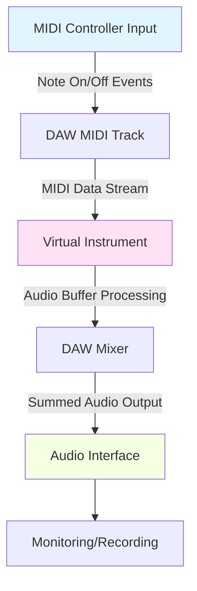
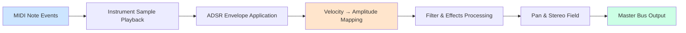
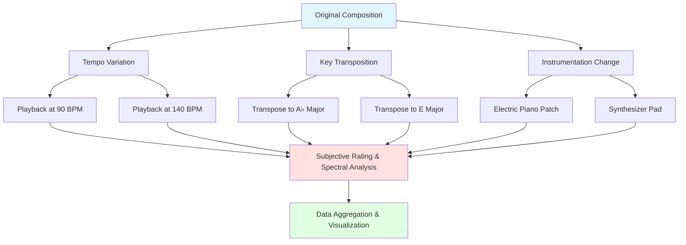
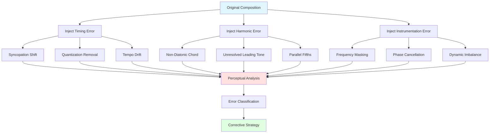
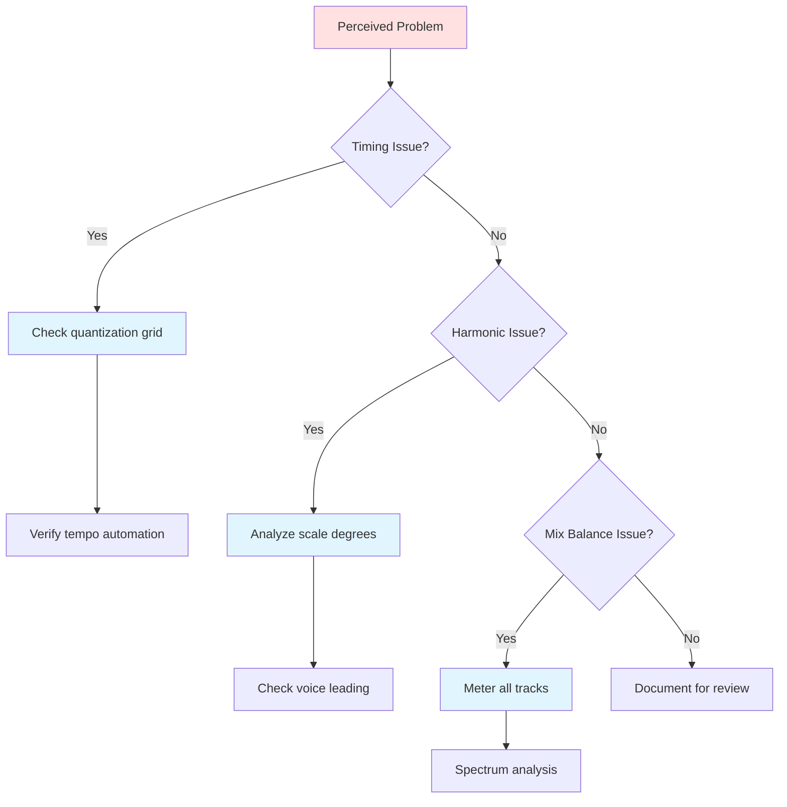

# Operational Verification Labs: Songwriting

## Objective & Lab Setup

### Objective
This lab provides rigorous, hands-on training in the compositional, structural, and psychoacoustic principles underlying contemporary songwriting practice. You will implement compositional techniques from first principles, systematically vary parameters to observe their perceptual and structural effects, and perform stress testing through deliberate introduction of musical anomalies. The exercises synthesize music theory, digital signal processing fundamentals, and empirical analysis to develop both craft intuition and analytical rigor.

### Lab Setup
You will require the following hardware and software components:

**Digital Audio Workstation (DAW):**
- Ableton Live 11/12 Suite (recommended for MIDI flexibility and Max for Live integration)
- Logic Pro X/11 (macOS only, optimized for MIDI sequencing)
- FL Studio 21+ (cross-platform, strong pattern-based workflow)
- Reaper 6+ (lightweight alternative with extensive scripting capabilities)

**MIDI Controller:**
- 25–88 key MIDI keyboard with velocity sensitivity (minimum 49 keys recommended)
- USB or 5-pin DIN MIDI connection
- Verify MIDI driver installation and latency <10ms round-trip

**Virtual Instruments & Signal Chain:**
- Native DAW instruments (Operator, Sampler, Serum, Kontakt)
- Piano VST with sympathetic resonance modeling (e.g., Native Instruments The Giant, Pianoteq)
- Synthesizer with subtractive/FM/wavetable engines
- Audio interface with ASIO/Core Audio drivers, 48kHz/24-bit minimum resolution

**Analysis & Visualization Tools:**
- Spreadsheet software (Excel, Google Sheets, LibreOffice Calc)
- Audio spectrum analyzer (built-in DAW tools or Voxengo SPAN)
- MIDI monitor utility for debugging note events
- Optional: Python 3.x with `music21`, `librosa`, `matplotlib` for advanced analysis

**Theoretical Prerequisites:**
- Working knowledge of Western functional harmony (diatonic scales, chord functions)
- Basic understanding of digital audio (sampling rate, quantization, MIDI protocol)
- Familiarity with DAW navigation and MIDI editing

## Exercise 1: Foundational Practical Implementation

### Exercise Overview
You will construct a three-section song form (verse-chorus-bridge) by explicit MIDI programming, applying principles of melodic contour, harmonic rhythm, and phrase structure. This exercise establishes baseline competency in DAW-based composition and introduces the relationship between pitch organization (scale degree function) and perceived resolution.

### Theoretical Foundation

**Phrase Structure & Cadential Function:**
The standard verse-chorus form relies on tension-release cycles governed by harmonic motion. A verse typically employs subdominant preparation (IV, ii) leading to dominant tension (V, V7), while the chorus often features tonic emphasis with plagal or authentic cadences. The bridge introduces modal mixture or secondary dominants to create harmonic contrast before the final chorus return.

**Melodic Contour Theory:**
Effective melodies balance stepwise motion (conjunct intervals of ±1–2 semitones) with strategic leaps (disjunct intervals ≥3 semitones). The *arch contour*—ascending to a climax and descending—creates natural phrase shape. Rhythmic placement on strong beats (1 and 3 in 4/4) establishes metric hierarchy.

**MIDI Protocol Fundamentals:**
MIDI transmits discrete note events as three-byte messages:
- **Note On:** `0x90 | channel`, `pitch (0–127)`, `velocity (1–127)`
- **Note Off:** `0x80 | channel`, `pitch`, `velocity (usually 0)`

Pitch follows equal temperament: $f_n = 440 \cdot 2^{(n-69)/12}$ Hz, where $n$ is MIDI note number (A4 = 69). Velocity scales amplitude logarithmically in most instruments.



### Step-by-Step Implementation

#### 1. Session Configuration
Launch your DAW and create a new project. Configure:
- **Sample Rate:** 48,000 Hz (professional standard, adequate for 20 kHz Nyquist frequency)
- **Bit Depth:** 24-bit (144 dB dynamic range)
- **Buffer Size:** 128–256 samples (balance latency vs. CPU load; target <6ms round-trip)
- **Tempo:** 120 BPM (quarter note = 500ms, eighth note = 250ms)
- **Time Signature:** 4/4 (common time)
- **Project Key:** C major (no sharps/flats, pedagogical clarity)

Verify MIDI input routing: Preferences → MIDI → Enable "Track" for your controller.

#### 2. MIDI Track Creation & Instrument Selection
Insert a software instrument track (not audio track). Select a piano instrument with the following characteristics:
- Polyphonic (≥64 voices to prevent note stealing)
- Velocity-sensitive timbre (brighter samples at higher velocities)
- Sustain pedal response (CC64 implementation)

Load a grand piano preset with moderate reverb (room ambiance, ~1.2s decay).

#### 3. Verse Melody Construction (Measures 1–8)

**Harmonic Framework:**
Establish a four-chord progression with functional harmony:
- **I (Cmaj7):** Tonic stability, root position
- **V (G7):** Dominant tension, tritone resolution expectation
- **vi (Am7):** Relative minor, deceptive motion
- **IV (Fmaj7):** Subdominant, plagal approach to tonic

**Chord Voicing (MIDI Note Numbers):**
- Cmaj7: C4(60), E4(64), G4(67), B4(71)
- G7: G3(55), B3(59), D4(62), F4(65)
- Am7: A3(57), C4(60), E4(64), G4(67)
- Fmaj7: F3(53), A3(57), C4(60), E4(64)

**Melodic Construction:**
Input the following melody with deliberate rhythmic placement (quarter notes unless specified):

**Measures 1–2 (Cmaj7 → G7):**
```
Beat:  1    2    3    4  | 1    2    3    4
Note: C4   D4   E4   F4 | G4   F4   E4   D4
Vel:  70   75   80   85 | 90   85   80   75
```

**Measures 3–4 (Am7 → Fmaj7):**
```
Beat:  1    2    3    4  | 1    2    3    4
Note: C4   E4   G4   A4 | F4   E4   D4   C4
Vel:  70   78   85   90 | 85   80   75   70
```

Repeat measures 1–4 for measures 5–8 to establish verse form (8-bar period).

**Implementation Detail:**
- Quantize to 16th-note grid (96 PPQN resolution minimum)
- Apply slight humanization: ±10ms timing offset, ±5 velocity variance
- Sustain each note for 90% of its duration (legato articulation)

#### 4. Chorus Construction (Measures 9–16)

The chorus requires increased melodic range, rhythmic density, and harmonic stability to create contrast.

**Harmonic Framework:**
- **I (Cmaj7):** Extended tonic emphasis (2 measures)
- **V (G7):** Dominant function (1 measure)
- **I (Cmaj7):** Resolution (1 measure)

Repeat this four-bar pattern for the eight-bar chorus.

**Melodic Construction:**
Create an ascending arch contour with octave expansion:

**Measures 9–10 (Cmaj7, climax approach):**
```
Beat:  1    2  & 3    4  | 1    2    3    4
Note: C4   E4 G4 C5   G4 | E4   C4   G4   E4
Vel:  80   85 90 100  95 | 90   85   80   75
```

**Measures 11–12 (G7 → Cmaj7, resolution):**
```
Beat:  1    2    3    4  | 1    2    3    4
Note: G4   B4   D5   B4 | C5   G4   E4   C4
Vel:  85   90   95   90 | 100  95   90   85
```

Repeat for measures 13–16 with dynamics increase (velocity +5).

**Rhythmic Density:**
The chorus employs eighth-note motion (double the verse note rate), creating forward momentum. This increased subdivision density corresponds to higher perceived energy.

#### 5. Bridge Construction (Measures 17–20)

The bridge introduces harmonic departure through modal mixture and tonicization of secondary areas.

**Harmonic Framework:**
- **vi (Am7):** Establish relative minor
- **IV (Fmaj7):** Subdominant preparation
- **I (Cmaj7):** Delayed tonic return
- **V (G7):** Dominant setup for final chorus

**Melodic Construction:**
Use descending sequence with expanded range:

**Measures 17–18 (Am7 → Fmaj7):**
```
Beat:  1    2    3    4  | 1    2    3    4
Note: A4   F4   D4   A4 | F4   C4   A3   F4
Vel:  75   70   68   72 | 70   68   65   68
```

**Measures 19–20 (Cmaj7 → G7):**
```
Beat:  1    2    3    4  | 1    2    3    4
Note: C4   E4   G4   B4 | D5   B4   G4   F4
Vel:  70   75   80   85 | 90   88   85   82
```

The bridge employs wider intervallic leaps (up to a sixth, A3–F4) to create contrast with stepwise verse motion.

#### 6. Final Chorus Repeat (Measures 21–28)
Duplicate measures 9–16 precisely. Optionally add dynamic automation: gradual crescendo from velocity 85 to 105 over the eight measures.

#### 7. Playback & Critical Listening

**Signal Path Verification:**


Monitor the following during playback:
- **Harmonic Clarity:** Chord tones should be audible without muddiness (no excessive low-frequency buildup)
- **Melodic Continuity:** No unexpected note cutoffs (voice stealing) or MIDI dropouts
- **Dynamic Range:** Peak levels at -6 dBFS, average at -18 dBFS
- **Phase Coherence:** Verify stereo image using correlation meter (>0.7 mono-compatible)

**Revision Checklist:**
- Does the verse establish harmonic foundation without premature climax?
- Does the chorus provide contrasting energy through range and rhythm?
- Does the bridge offer sufficient departure before final chorus return?
- Are transitions between sections smooth (avoid abrupt register jumps)?

## Exercise 2: Parameter Variation & Empirical Analysis

### Exercise Overview
Systematic parameter variation reveals the psychoacoustic mechanisms underlying musical affect. You will manipulate tempo, key, and instrumentation independently, quantify subjective responses, and correlate parametric changes with perceptual outcomes. This exercise applies empirical methodology to compositional decision-making.

### Theoretical Foundation

**Tempo & Perceived Affect:**
Tempo influences arousal level via entrainment of autonomic nervous system rhythms. Research indicates:
- 60–80 BPM: Calm, introspective (resting heart rate)
- 100–120 BPM: Moderate energy (walking pace)
- 140–160 BPM: High energy, excitement (running pace)
- >180 BPM: Urgency, agitation

**Key & Tonal Color:**
While equal temperament produces mathematically identical interval ratios across keys, instrumentation and vocal tessitura create timbral differences. For example, C major on piano emphasizes white-key resonances, while D♭ major engages more damped black keys. Psychological associations (e.g., "minor = sad") are culturally learned, not universal.

**Instrumentation & Spectral Envelope:**
Timbre results from the harmonic spectrum above the fundamental frequency:
$$H(f) = \sum_{n=1}^{N} A_n \sin(2\pi n f_0 t + \phi_n)$$

Where:
- $A_n$ = amplitude of $n$-th harmonic
- $f_0$ = fundamental frequency
- $\phi_n$ = phase of $n$-th harmonic

Piano exhibits rapid attack, complex inharmonicity in upper partials. Guitar produces slower attack, strong second and third harmonics. Synthesizers allow arbitrary spectral shaping.



### Step-by-Step Implementation

#### 1. Establish Baseline Measurement (120 BPM, C Major, Piano)
Before variation, quantify the baseline composition:
- **Tempo:** 120 BPM
- **Key:** C major (no transposition)
- **Instrumentation:** Acoustic grand piano
- **Subjective Ratings (1–10 scale):**
  - Energy/Arousal: ____
  - Valence (positive/negative affect): ____
  - Tension: ____
  - Complexity: ____

Listen three times, average your ratings. This establishes reference values for comparison.

#### 2. Tempo Variation Experiment

**Hypothesis:** Tempo increase will elevate arousal ratings while preserving harmonic structure.

**Procedure:**
- Duplicate the original project
- Change global tempo to **90 BPM** (-25% tempo reduction)
- Playback and rate energy, valence, tension, complexity
- Revert to 120 BPM
- Change global tempo to **140 BPM** (+16.7% tempo increase)
- Playback and rate all parameters
- Change tempo to **160 BPM** (+33.3% tempo increase)
- Playback and rate all parameters

**Measurement Protocol:**
For each tempo, record:
- Subjective ratings (four dimensions, 1–10)
- Duration of verse section (should scale linearly with tempo change)
- Perceived "naturalness" (does phrasing feel rushed or dragged?)

**Expected Observations:**
- 90 BPM: Energy ↓, tension ↓, potential for increased perceived complexity (more time to process harmonic changes)
- 140 BPM: Energy ↑, tension ↑, perceived rhythmic drive increases
- 160 BPM: Potential for phrase collapse (insufficient time for harmonic resolution perception)

**Data Table Template:**
```
| Tempo (BPM) | Energy | Valence | Tension | Complexity | Notes |
|-------------|--------|---------|---------|------------|-------|
| 90          |        |         |         |            |       |
| 120         |        |         |         |            |       |
| 140         |        |         |         |            |       |
| 160         |        |         |         |            |       |
```

#### 3. Key Transposition Experiment

**Hypothesis:** Transposition alters timbral envelope due to instrument resonances but preserves interval relationships.

**Procedure:**
- Return tempo to 120 BPM
- Transpose entire composition to **G major** (+7 semitones / perfect fifth up)
- Playback and rate all parameters
- Transpose to **A♭ major** (+8 semitones / minor sixth up)
- Playback and rate
- Transpose to **E major** (+4 semitones / major third up)
- Playback and rate

**Acoustic Considerations:**
Piano soundboard resonances peak at specific frequencies. Transposition shifts the fundamental and harmonic series:
$$f_{\text{transposed}} = f_{\text{original}} \cdot 2^{n/12}$$

For $n = 7$ (G major): C4 (261.63 Hz) → G4 (392.00 Hz)

Higher transpositions increase brightness (more energy >2 kHz) and may alter perceived "weight."

**Expected Observations:**
- G major: Brighter, potentially more "open" sound (fewer black keys)
- A♭ major: Darker timbre (more damped black keys on piano)
- E major: Moderate brightness, comfortable vocal range if adding voice later

**Data Table Template:**
```
| Key         | Energy | Valence | Tension | Complexity | Brightness (1-10) |
|-------------|--------|---------|---------|------------|-------------------|
| C Major     |        |         |         |            |                   |
| G Major     |        |         |         |            |                   |
| A♭ Major    |        |         |         |            |                   |
| E Major     |        |         |         |            |                   |
```

#### 4. Instrumentation Variation Experiment

**Hypothesis:** Spectral envelope changes will significantly alter perceived character without affecting pitch content.

**Procedure:**
- Return to C major, 120 BPM
- Replace piano with **electric piano** (Rhodes or Wurlitzer model)
  - Note the increased sustain and reduced inharmonicity
  - Rate all parameters
- Replace with **synthesizer pad** (sawtooth or square wave with low-pass filter)
  - Adjust filter cutoff to ~2 kHz for warmth
  - Rate all parameters
- Replace with **plucked string** (guitar, harp, or pizzicato)
  - Note the sharp attack transient and rapid decay
  - Rate all parameters

**Spectral Analysis:**
Use your DAW's spectrum analyzer on the master bus during each playback:
- **Piano:** Rich harmonic content across 80 Hz–8 kHz, rapid attack decay
- **Electric Piano:** Emphasized even harmonics (2nd, 4th), longer sustain
- **Synth Pad:** Adjustable harmonic content, flat sustain envelope
- **Plucked String:** Sharp attack spike, rapid exponential decay

**Expected Observations:**
- Electric piano: Warmer, more "vintage" character, slightly lower tension perception
- Synth pad: Ambient, reduced attack clarity, potential increase in perceived complexity
- Plucked string: Increased rhythmic definition, reduced sustain may increase perceived energy

**Data Table Template:**
```
| Instrument      | Energy | Valence | Tension | Complexity | Attack Time (ms) | Sustain Character |
|-----------------|--------|---------|---------|------------|------------------|-------------------|
| Grand Piano     |        |         |         |            | ~5ms             | Moderate decay    |
| Electric Piano  |        |         |         |            |                  |                   |
| Synth Pad       |        |         |         |            |                  |                   |
| Plucked String  |        |         |         |            |                  |                   |
```

#### 5. Multi-Parameter Interaction Analysis

**Advanced Experiment:**
Combine tempo and instrumentation changes to observe interaction effects:
- 90 BPM + Synth Pad (hypothesis: maximum calm/ambient affect)
- 160 BPM + Plucked String (hypothesis: maximum rhythmic drive)

Document whether effects are additive, multiplicative, or exhibit non-linear interaction.

#### 6. Data Visualization

Create scatter plots or bar charts in your spreadsheet software:
- **X-axis:** Parameter value (tempo, key as semitone offset, instrument type)
- **Y-axis:** Subjective rating (energy, valence, etc.)

Calculate Pearson correlation coefficients between tempo and energy rating:
$$r = \frac{\sum (x_i - \bar{x})(y_i - \bar{y})}{\sqrt{\sum (x_i - \bar{x})^2 \sum (y_i - \bar{y})^2}}$$

Expected $r > 0.7$ for tempo-energy correlation.

**Optional: Python Analysis Script**
```python
import numpy as np
import matplotlib.pyplot as plt

# Tempo vs Energy data
tempos = np.array([90, 120, 140, 160])
energy_ratings = np.array([4.5, 6.0, 7.5, 8.2])  # Replace with your data

# Linear regression
coefficients = np.polyfit(tempos, energy_ratings, 1)
poly = np.poly1d(coefficients)

# Plot
plt.figure(figsize=(10, 6))
plt.scatter(tempos, energy_ratings, s=100, alpha=0.7, edgecolors='black')
plt.plot(tempos, poly(tempos), 'r--', label=f'Fit: y={coefficients[0]:.3f}x+{coefficients[1]:.2f}')
plt.xlabel('Tempo (BPM)', fontsize=12)
plt.ylabel('Energy Rating (1-10)', fontsize=12)
plt.title('Tempo vs Perceived Energy', fontsize=14, fontweight='bold')
plt.grid(alpha=0.3)
plt.legend()
plt.tight_layout()
plt.savefig('tempo_energy_correlation.png', dpi=300)
plt.show()

# Correlation coefficient
correlation = np.corrcoef(tempos, energy_ratings)[0, 1]
print(f"Pearson correlation: {correlation:.3f}")
```

#### 7. Synthesis & Interpretation

Write a brief analysis (200–300 words) addressing:
- Which parameter produced the largest perceptual change?
- Did any parameter combinations produce unexpected results?
- How might you apply these findings to compositional decision-making?
- What limitations exist in subjective self-reporting?

**Example Analysis Framework:**
"Tempo variation produced the most predictable effect, with a strong positive correlation (r=0.89) between BPM and arousal ratings. Key transposition yielded subtler changes, primarily affecting brightness rather than emotional valence. Instrumentation changes demonstrated the largest variance in complexity ratings, suggesting spectral content significantly impacts cognitive load. The synth pad at 90 BPM created maximal ambient character but reduced melodic clarity, indicating a tradeoff between atmosphere and articulation..."

## Exercise 3: Fault Injection & Stress Testing

### Exercise Overview
Deliberate introduction of musical anomalies tests compositional robustness and reveals the boundaries of stylistic convention. You will systematically inject timing errors, harmonic violations, and instrumentation conflicts, then analyze failure modes and recovery strategies. This exercise develops debugging skills and deepens understanding of musical grammar.

### Theoretical Foundation

**Musical Grammar & Expectation Violation:**
Music perception relies on predictive coding—the brain generates expectations based on learned statistical regularities in musical structure. Violations create prediction error signals that manifest as surprise, tension, or (in extreme cases) perceptual confusion. Leonard Meyer's "Emotion and Meaning in Music" formalizes this as the Implication-Realization model.

**Timing & Rhythmic Coherence:**
The human auditory system detects timing deviations as small as 10–20 ms. Systematic timing errors (phase shifts, tempo drift) disrupt metric entrainment. Categorical rhythm perception follows a Weber-Fechner relationship: timing deviations are perceived relative to the inter-onset interval (IOI).

**Harmonic Expectation:**
Western tonal music establishes key through tonic emphasis and leading-tone resolution. Violations include:
- **Non-diatonic pitch classes:** Notes outside the key's seven-note collection
- **Unresolved dissonances:** Tritones, major sevenths without resolution
- **Modal mixture:** Borrowing chords from parallel keys (e.g., C minor chords in C major)

**Instrumentation Balance & Masking:**
Simultaneous sounds compete for perceptual salience via auditory masking. Critical band theory predicts that sounds within ~1/3 octave mutually interfere:
$$\Delta f_{\text{critical}} \approx 25 + 75[1 + 1.4(f/1000)^2]^{0.69} \text{ Hz}$$

Clashing instruments occupy overlapping spectral regions, reducing clarity.



### Step-by-Step Implementation

#### 1. Timing Error Injection: Syncopation Disruption

**Original State:**
Your melody uses on-beat (strong metric positions) note placement. Quarter notes align to beats 1, 2, 3, 4 in 4/4 time.

**Fault Injection:**
Shift melody notes in the chorus by 1/16th note (quarter of a beat):

**Measure 9, Original:**
```
Beat:  1    2    3    4
Note: C4   E4   G4   C5
Time: 0    500  1000 1500 (ms at 120 BPM)
```

**Measure 9, Syncopated Error:**
```
Beat:  1  +  2  +  3  +  4  +
Note:     C4   E4   G4   C5
Time: 125 625 1125 1625 (ms, shifted +125ms)
```

**Implementation:**
- Select all chorus melody notes (measures 9–16)
- Disable quantization (if enabled)
- Shift notes forward by 1/16th note (1 tick at 96 PPQN = 24 ticks)
- Playback and listen

**Expected Observations:**
- **Metric Ambiguity:** Melody appears to "lag" behind harmonic foundation
- **Groove Disruption:** Loss of synchrony between melody and implicit beat
- **Tension Increase:** Syncopation creates unresolved forward momentum

**Perceptual Analysis:**
The human brain expects metric hierarchy where downbeats carry more weight. Shifting melody off-beat violates this expectation, creating a "swung" or syncopated feel. However, without corresponding rhythmic support (e.g., drum pattern reinforcing the shift), the result feels unintentional rather than stylistic.

**Recovery Strategy:**
- **Option 1:** Revert to original timing (re-quantize to 1/4 note grid)
- **Option 2:** Embrace syncopation but add supporting rhythmic elements (hi-hat on 16th notes) to establish new metric framework
- **Option 3:** Apply swing quantization (uneven 16th note subdivision, typically 60:40 ratio)

**Documentation:**
```
| Error Type | Magnitude | Perceptual Effect | Severity (1-10) | Recovery |
|------------|-----------|-------------------|-----------------|----------|
| Timing shift | +125ms | Metric ambiguity | 6 | Re-quantize |
```

#### 2. Timing Error Injection: Complete Quantization Removal

**Fault Injection:**
Record a new melody line in real-time without click track, or randomize existing note timing by ±50ms.

**Implementation (Manual Timing Randomization):**
- Select all notes in verse melody
- In MIDI editor, for each note:
  - Adjust start time by random offset between -50ms and +50ms
  - Adjust duration by ±20ms

This simulates "sloppy" human performance without metric reference.

**Expected Observations:**
- **Temporal Coherence Loss:** Phrase structure becomes unclear
- **Difficulty in Entrainment:** Listener cannot establish stable pulse
- **Increased Cognitive Load:** Unpredictable timing requires continuous re-evaluation

**Perceptual Analysis:**
Timing variance (jitter) beyond ~30ms disrupts categorical rhythm perception. While expressive timing (rubato) is musically valid, random jitter without musical intent reads as error.

**Recovery Strategy:**
- Quantize to nearest grid value (1/8 or 1/16 note)
- Apply subtle humanization (±5–10ms, ±3 velocity) for natural feel
- Record with click track enabled

**Documentation:**
```
| Error Type | Magnitude | Perceptual Effect | Severity (1-10) | Recovery |
|------------|-----------|-------------------|-----------------|----------|
| Timing jitter | ±50ms | Temporal incoherence | 9 | Quantize + humanize |
```

#### 3. Timing Error Injection: Tempo Drift

**Fault Injection:**
Create gradual tempo acceleration across the verse section.

**Implementation:**
- Enable DAW tempo automation
- Set starting tempo at measure 1: 120 BPM
- Draw linear ramp to measure 8: 135 BPM (+12.5% acceleration)
- Playback and listen

**Expected Observations:**
- **Unintentional Urgency:** Acceleration creates sense of rushing
- **Phrase Compression:** Later measures feel shorter than earlier measures despite identical note count
- **Potential for "Speeding Up" Perception:** Listener may perceive lack of control

**Perceptual Analysis:**
Tempo changes signal structural transitions (e.g., accelerando before climax, ritardando before ending). Random tempo drift without musical justification suggests technical error rather than expressive intent.

**Recovery Strategy:**
- Disable tempo automation, restore to 120 BPM
- If accelerando is desired, apply only before final chorus (measures 20–21), not within verse

**Documentation:**
```
| Error Type | Magnitude | Perceptual Effect | Severity (1-10) | Recovery |
|------------|-----------|-------------------|-----------------|----------|
| Tempo drift | +15 BPM | Unintentional urgency | 7 | Remove automation |
```

#### 4. Harmonic Error Injection: Non-Diatonic Chord Substitution

**Original State:**
Measure 3 uses **Am7** (A, C, E, G) in C major (diatonic vi7 chord).

**Fault Injection:**
Replace Am7 with **A♭maj7** (A♭, C, E♭, G) — borrowed from C minor (♭VI chord).

**Implementation:**
- In measure 3, select the Am7 chord voicing
- Lower A3 to A♭3 (MIDI note 56)
- Lower E4 to E♭4 (MIDI note 63)
- Playback and listen

**Expected Observations:**
- **Harmonic Surprise:** A♭ is not in C major scale (chromaticism)
- **Modal Mixture Effect:** Darker, more dramatic color
- **Resolution Ambiguity:** E♭ creates tritone with A (original melody), potentially clashing

**Perceptual Analysis:**
Non-diatonic chords violate key expectation but are stylistically valid in modal mixture (common in film scores, pop ballads). The ♭VI chord specifically evokes pathos. However, without preparation or resolution, it may sound like an error rather than intentional borrowing.

**Recovery Strategy:**
- **Option 1:** Revert to Am7 (diatonic function)
- **Option 2:** Embrace modal mixture but prepare with chromatic voice leading (add G♯ passing tone in measure 2)
- **Option 3:** Follow A♭maj7 with Fm7 to establish temporary key area in A♭ major

**Documentation:**
```
| Error Type | Magnitude | Perceptual Effect | Severity (1-10) | Recovery |
|------------|-----------|-------------------|-----------------|----------|
| Non-diatonic chord | ♭VI in major key | Harmonic surprise, modal color | 5 | Revert or prepare chromaticism |
```

#### 5. Harmonic Error Injection: Unresolved Leading Tone

**Original State:**
Measure 2 ends with G7 (G, B, D, F), creating expectation for C major resolution in measure 3.

**Fault Injection:**
Move the Am7 chord from measure 3 to measure 2, beat 4 (replacing G7), leaving G7 unresolved.

**Implementation:**
- Cut Am7 chord from measure 3
- Paste at measure 2, beat 4
- Insert empty space in measure 3 (or hold Cmaj7 from measure 1)
- Playback and listen

**Expected Observations:**
- **Deceptive Cadence:** vi chord instead of expected I chord
- **Tension Accumulation:** Leading tone B does not resolve to C
- **Phrase Extension Feel:** Harmonic motion delays arrival

**Perceptual Analysis:**
Deceptive cadences (V→vi) are valid but require eventual resolution. If verse ends without tonic return, tension persists. This is stylistically acceptable in through-composed forms but may feel incomplete in verse-chorus structure.

**Recovery Strategy:**
- Restore G7 to measure 2
- Ensure measure 3 provides tonic resolution (Cmaj7)
- If deceptive motion is desired, extend phrase to 9 measures with final tonic resolution

**Documentation:**
```
| Error Type | Magnitude | Perceptual Effect | Severity (1-10) | Recovery |
|------------|-----------|-------------------|-----------------|----------|
| Unresolved V7 | Deceptive cadence | Harmonic suspension | 4 | Extend phrase or resolve to I |
```

#### 6. Harmonic Error Injection: Parallel Perfect Fifths

**Fault Injection:**
Create voice-leading error between bass and melody.

**Implementation:**
- In measure 1, set bass note to C2 (MIDI note 36) under Cmaj7
- Set melody note to G3 (MIDI note 55) — creates perfect fifth (C→G)
- In measure 2, set bass note to G2 (MIDI note 43) under G7
- Set melody note to D4 (MIDI note 62) — creates perfect fifth (G→D)
- This produces parallel perfect fifths (C-G moving to G-D)
- Playback and listen

**Expected Observations:**
- **Voice Leading Error:** Parallel perfect fifths were prohibited in common-practice counterpoint
- **Hollow Sound:** Reduced harmonic independence between voices
- **Potential "Medieval" Quality:** Parallel fifths evoke organum, not common-practice harmony

**Perceptual Analysis:**
Parallel perfect fifths reduce perceptual independence of melodic lines. While acceptable in rock/pop (power chords), they violate classical voice-leading norms. The perceptual effect depends on stylistic context.

**Recovery Strategy:**
- Apply contrary or oblique motion: when bass ascends, melody descends or stays static
- Replace parallel fifths with parallel thirds or sixths (more consonant and independent)

**Documentation:**
```
| Error Type | Magnitude | Perceptual Effect | Severity (1-10) | Recovery |
|------------|-----------|-------------------|-----------------|----------|
| Parallel fifths | Two-voice counterpoint | Reduced independence | 3 (style-dependent) | Apply contrary motion |
```

#### 7. Instrumentation Error Injection: Frequency Masking

**Fault Injection:**
Add bass instrument occupying same frequency range as piano left hand.

**Implementation:**
- Create new MIDI track
- Load electric bass or synthesizer bass
- Duplicate the left-hand piano part (bass notes and chord roots)
- Pan bass to center, set volume to -6 dB
- Playback and listen with piano still active

**Expected Observations:**
- **Muddiness in Low End:** Piano and bass compete for 80–200 Hz range
- **Reduced Clarity:** Individual pitches become indistinct
- **Phase Interference:** Potential for comb filtering if waveforms anti-phase

**Perceptual Analysis:**
Critical band masking occurs when two sounds occupy overlapping frequency ranges. The auditory system cannot resolve them independently, resulting in perceptual fusion or interference. Proper arrangement assigns non-overlapping spectral regions to each instrument.

**Recovery Strategy:**
- **Option 1:** Remove redundant bass doubling
- **Option 2:** Apply high-pass filter to piano (cut <150 Hz), keep bass in low end
- **Option 3:** Transpose piano up one octave, create clear frequency separation

**Spectral Comparison:**
```
Piano alone:   [▓▓▓▓▓▓▓▓▓░░░░░░░] 80–4000 Hz
Bass added:    [▓▓▓▓░░░░░░░░░░░░] 60–300 Hz (overlap!)
After HP:      [░░▓▓▓▓▓▓▓░░░░░░░] Piano 200–4000 Hz (separation restored)
```

**Documentation:**
```
| Error Type | Magnitude | Perceptual Effect | Severity (1-10) | Recovery |
|------------|-----------|-------------------|-----------------|----------|
| Frequency masking | 80–200 Hz overlap | Muddy low end | 7 | HP filter or remove doubling |
```

#### 8. Instrumentation Error Injection: Dynamic Imbalance

**Fault Injection:**
Set bass instrument to extreme volume (+12 dB) relative to melody.

**Implementation:**
- Increase bass track fader to +12 dB
- Ensure piano melody remains at 0 dB
- Playback and listen

**Expected Observations:**
- **Melody Obscuration:** Bass dominates mix, melody recedes
- **Loss of Hierarchical Clarity:** Foreground/background relationship inverts
- **Potential Clipping:** If bass peaks exceed 0 dBFS, digital distortion occurs

**Perceptual Analysis:**
Mix balance establishes perceptual hierarchy. In verse-chorus forms, melody typically sits 3–6 dB above harmonic accompaniment. Inverting this hierarchy disrupts narrative focus.

**Recovery Strategy:**
- Reduce bass to -12 dB (standard bass level)
- Ensure melody peaks at -6 dB, accompaniment at -12 dB (6 dB separation)
- Apply sidechain compression (bass ducking when melody plays) for dynamic balance

**Documentation:**
```
| Error Type | Magnitude | Perceptual Effect | Severity (1-10) | Recovery |
|------------|-----------|-------------------|-----------------|----------|
| Dynamic imbalance | +12 dB bass boost | Melody obscured | 8 | Rebalance levels |
```

#### 9. Comprehensive Error State Analysis

Create a final spreadsheet documenting all error injections:

```
| Error Category | Specific Error | Perceptual Effect | Severity (1-10) | Detection Method | Correction |
|----------------|---------------|-------------------|-----------------|------------------|------------|
| Timing | Syncopation shift | Metric ambiguity | 6 | Metric grid comparison | Re-quantize |
| Timing | Random jitter | Temporal incoherence | 9 | Waveform inspection | Quantize + humanize |
| Timing | Tempo drift | Unintentional urgency | 7 | Tempo track analysis | Remove automation |
| Harmony | Non-diatonic chord | Modal color shift | 5 | Scale degree analysis | Revert or justify |
| Harmony | Unresolved V7 | Suspended tension | 4 | Cadence analysis | Extend phrase |
| Harmony | Parallel fifths | Reduced voice independence | 3 | Interval analysis | Contrary motion |
| Instrumentation | Frequency masking | Muddy low end | 7 | Spectrum analyzer | HP filter |
| Instrumentation | Dynamic imbalance | Melody obscured | 8 | Level metering | Fader adjustment |
```

#### 10. Failure Mode Classification

Categorize errors by recoverability:

**Type A (Easily Reversible):** Level adjustments, timing quantization, single-parameter changes
- Recovery time: <30 seconds
- Tools: Undo function, fader reset, quantize command

**Type B (Moderate Complexity):** Voice-leading corrections, filter adjustments, multi-track balance
- Recovery time: 2–5 minutes
- Tools: MIDI editor, EQ plugin, comparative listening

**Type C (Structural Redesign):** Large-scale harmonic rewriting, form restructuring, complete instrumentation overhaul
- Recovery time: 15–60 minutes
- Tools: Compositional planning, sketch scoring, progressive build

#### 11. Diagnostic Protocol Development

Create a troubleshooting flowchart for future compositions:



## Practical Cheat Sheet & Quick Reference

### MIDI & DAW Operations

**Essential Keyboard Shortcuts (Ableton Live):**
```
Cmd/Ctrl + Shift + M    Create MIDI track
Cmd/Ctrl + D            Duplicate selection
Cmd/Ctrl + J            Consolidate clips
Cmd/Ctrl + E            Toggle MIDI editor
Cmd/Ctrl + T            Create new audio/MIDI track
Cmd/Ctrl + K            Split clip at playhead
Cmd/Ctrl + L            Loop selection
Cmd/Ctrl + U            Quantize
Cmd/Ctrl + Alt + U      Quantize settings
Cmd/Ctrl + Shift + U    Quantize 50%
```

**Logic Pro X:**
```
Opt + Cmd + N           New MIDI region
Cmd + R                 Repeat region
Cmd + J                 Join regions
P                       Open piano roll
E                       Toggle editor
Cmd + K                 Create key command
Q                       Quantize
Shift + Q               Quantize parameters
```

**FL Studio:**
```
Ctrl + A                Select all
Ctrl + B                Edit pattern
Ctrl + H                Slice selection
Ctrl + Q                Quick quantize
Alt + Q                 Quantize options
Ctrl + Shift + C        Clone channel
F9                      Open mixer
F5                      Open playlist
```

### Music Theory Formulas

**Equal Temperament Frequency Calculation:**
$$f_n = f_0 \cdot 2^{n/12}$$
- $f_0$ = reference frequency (A4 = 440 Hz)
- $n$ = semitone offset from reference
- Example: C5 = 440 · 2^(3/12) = 523.25 Hz

**MIDI Note to Frequency:**
$$f = 440 \cdot 2^{(n - 69)/12}$$
- $n$ = MIDI note number (0–127)
- A4 = 69, C4 = 60

**Harmonic Series:**
$$f_n = n \cdot f_0$$
- $n$ = harmonic number (integer)
- $f_0$ = fundamental frequency
- Example: A2 (110 Hz) → harmonics at 220, 330, 440, 550... Hz

**Critical Band Width (Bark Scale):**
$$z = 13 \arctan(0.00076f) + 3.5 \arctan\left(\frac{f}{7500}\right)^2$$
- $z$ = Bark scale value
- $f$ = frequency in Hz
- 1 Bark ≈ 1/24 octave in critical band spacing

**Tempo & Duration Relationships:**
$$\text{Duration (ms)} = \frac{60000}{\text{BPM}} \cdot \frac{1}{\text{note division}}$$
- Quarter note at 120 BPM: 60000/120 = 500 ms
- Eighth note at 140 BPM: 60000/140 ÷ 2 = 214.3 ms

### Chord Voicings (MIDI Note Numbers)

**Major Seventh Chords (Root Position):**
```
Cmaj7: C4(60), E4(64), G4(67), B4(71)
Dmaj7: D4(62), F♯4(66), A4(69), C♯5(73)
Fmaj7: F4(65), A4(69), C5(72), E5(76)
Gmaj7: G4(67), B4(71), D5(74), F♯5(78)
```

**Dominant Seventh Chords:**
```
G7: G3(55), B3(59), D4(62), F4(65)
D7: D4(62), F♯4(66), A4(69), C5(72)
A7: A3(57), C♯4(61), E4(64), G4(67)
E7: E4(64), G♯4(68), B4(71), D5(74)
```

**Minor Seventh Chords:**
```
Am7: A3(57), C4(60), E4(64), G4(67)
Dm7: D4(62), F4(65), A4(69), C5(72)
Em7: E4(64), G4(67), B4(71), D5(74)
```

### Signal Flow Verification

**Optimal Gain Staging:**
```
MIDI Velocity:        70–100 (pianissimo to forte)
Virtual Inst Output:  -18 dBFS (peak), -24 dBFS (RMS)
Track Faders:         -6 to 0 dB (unity gain)
Bus Processing:       -3 dB headroom pre-compression
Master Output:        -6 dBFS (peak), -14 dBFS LUFS (integrated)
```

**Latency Calculation:**
$$\text{Latency (ms)} = \frac{\text{Buffer Size}}{\text{Sample Rate}} \times 1000 \times 2$$
- Buffer: 256 samples, SR: 48 kHz → (256/48000) × 1000 × 2 = 10.67 ms

**Acceptable Latency Thresholds:**
- <6ms: Imperceptible (direct monitoring feel)
- 6–12ms: Acceptable for most users
- 12–20ms: Noticeable, may disrupt timing
- >20ms: Disruptive, requires compensation

### Scale Degree Functions (Roman Numeral Analysis)

**C Major Functional Harmony:**
```
I (Cmaj):    Tonic stability
ii (Dm):     Subdominant preparation
iii (Em):    Tonic substitute, mediant
IV (Fmaj):   Subdominant, plagal motion
V (Gmaj):    Dominant tension, leading tone
vi (Am):     Relative minor, deceptive resolution
vii° (Bdim): Leading-tone diminished, dominant function
```

**Common Progressions:**
- **I–V–vi–IV** (Pop/Rock: C–G–Am–F)
- **ii–V–I** (Jazz standard: Dm7–G7–Cmaj7)
- **I–vi–IV–V** (Doo-wop: C–Am–F–G)
- **I–IV–I–V** (Blues: C7–F7–C7–G7)

### Spectral Analysis Targets

**Frequency Range Guidelines:**
```
Sub-bass:       20–60 Hz    (bass drum fundamental, synthesizer subs)
Bass:           60–250 Hz   (bass guitar, piano low register)
Low-mids:       250–500 Hz  (body of vocals, guitars)
Mids:           500–2k Hz   (presence, vocal clarity)
Upper-mids:     2k–6k Hz    (articulation, consonants)
Highs:          6k–20k Hz   (air, shimmer, cymbals)
```

**EQ Troubleshooting:**
- Muddiness: Cut 200–400 Hz
- Boxiness: Cut 400–800 Hz
- Harshness: Cut 2–4 kHz
- Brightness: Boost 8–12 kHz

### Advanced MIDI CC (Control Change) Reference

**Standard MIDI CC Messages:**
```
CC1:  Modulation Wheel (vibrato depth)
CC7:  Volume (coarse level control)
CC10: Pan (stereo positioning)
CC11: Expression (dynamic shaping)
CC64: Sustain Pedal (on/off, >63 = on)
CC71: Resonance (filter emphasis)
CC74: Brightness (filter cutoff)
CC91: Reverb Send Level
CC93: Chorus Send Level
```

**MIDI Implementation Example (Python `mido`):**
```python
import mido
from mido import Message, MidiFile, MidiTrack

# Create MIDI file
mid = MidiFile()
track = MidiTrack()
mid.tracks.append(track)

# Set tempo (500000 μs per beat = 120 BPM)
track.append(mido.MetaMessage('set_tempo', tempo=500000))

# Add notes (ticks at 480 PPQN)
track.append(Message('note_on', note=60, velocity=80, time=0))
track.append(Message('note_off', note=60, velocity=0, time=480))
track.append(Message('note_on', note=64, velocity=85, time=0))
track.append(Message('note_off', note=64, velocity=0, time=480))

# Save file
mid.save('output.mid')
```

### Verification Checklist

**Pre-Mix Technical Validation:**
- [ ] All MIDI notes within valid range (0–127)
- [ ] No overlapping notes on monophonic instruments
- [ ] Velocity range appropriate (avoid 0, 1, or 127 unless intentional)
- [ ] Quantization applied where metrically appropriate
- [ ] Timing humanization <±15ms for natural feel
- [ ] All tracks routed to correct busses
- [ ] No clipping on individual tracks or master bus
- [ ] Sample rate consistent across all tracks (48 kHz standard)

**Musical Structure Validation:**
- [ ] Clear tonic establishment in intro/verse
- [ ] Harmonic rhythm appropriate for tempo (faster tempo → slower harmonic rhythm)
- [ ] Melodic range within singable octave (if vocal intended)
- [ ] Chord voicings avoid extreme register gaps (>2 octaves)
- [ ] Voice leading minimizes leaps (prefer stepwise motion)
- [ ] Cadences provide expected resolution (V→I, IV→I)
- [ ] Bridge provides contrast (key change, rhythm, or texture)
- [ ] Final chorus provides satisfying conclusion (extended or repeated)

**Production Quality Validation:**
- [ ] Each instrument occupies distinct frequency range
- [ ] Panning creates stereo width without phase issues
- [ ] Dynamic range preserved (-18 to -6 dBFS peaks)
- [ ] No audible artifacts (clicks, pops, aliasing)
- [ ] Reverb/delay levels support space without clouding
- [ ] Automation curves smooth (no abrupt jumps)
- [ ] Headroom maintained for mastering (-6 dBFS master peak)

---

## Extended Topics & Further Research

### Advanced Compositional Techniques

**Modal Interchange & Borrowed Chords:**
Temporarily borrow chords from parallel modes (e.g., C major ↔ C minor). Common borrowings include ♭VII, ♭VI, iv in major keys. Analyze Radiohead's "Creep" (I–III–IV–iv) for effective modal mixture.

**Secondary Dominants & Extended Harmony:**
Tonicize non-tonic scale degrees by preceding them with their own dominant chord. Example: V7/ii (A7) → ii (Dm) in C major. Study jazz standards for extensive secondary dominant usage.

**Metric Modulation & Polyrhythm:**
Change perceived pulse by redefining subdivision (e.g., triplet eighth becomes new quarter note). Requires tempo change: new tempo = old tempo × (new subdivision / old subdivision). Study Tool, Meshuggah for advanced metric manipulation.

**Algorithmic Composition:**
Generate melodic material using Markov chains, L-systems, or cellular automata. Implement in Python using `music21` library. Example: train Markov model on Bach chorales to generate stylistically consistent progressions.

**Spectral/Microtonality:**
Explore non-12TET tuning systems (19-TET, 31-TET, just intonation). Use Scala format (.scl files) for microtonal scales. Study works by Ben Johnston, Harry Partch for microtonal composition theory.

### Psychoacoustic Deep Dives

**Roughness & Sensory Dissonance:**
Plomp-Levelt model predicts dissonance from critical band interaction. Roughness peaks at ~25% critical bandwidth separation. Formula:
$$R(f_1, f_2) = e^{-3.5|f_2 - f_1|/\text{CB}(f_1)} - e^{-5.75|f_2 - f_1|/\text{CB}(f_1)}$$

**Pitch Salience & Virtual Pitch:**
Missing fundamental phenomenon: brain reconstructs $f_0$ from harmonic series even when fundamental absent. Demonstrates template-matching in auditory cortex. Study Terhardt's algorithm for computational pitch extraction.

**Auditory Scene Analysis:**
Bregman's principles of stream segregation:
- Proximity (frequency, time)
- Similarity (timbre, loudness)
- Common fate (synchronous modulation)
- Continuity (predictable trajectories)

Apply to orchestration: separate melodic lines via distinct timbres, registers, rhythmic patterns.

### Production & Signal Processing

**Dynamic Range Compression Theory:**
Reduce amplitude variance via threshold/ratio/attack/release parameters. Makeup gain compensates for level reduction. Ratio calculation:
$$\text{Output (dB)} = T + \frac{\text{Input (dB)} - T}{R}$$
- $T$ = threshold, $R$ = ratio

Study parallel compression (NY compression) for transparent dynamic control.

**Convolution Reverb & Impulse Responses:**
Reverb created via convolution of dry signal with impulse response (IR) of real space:
$$y(t) = x(t) * h(t) = \int_{-\infty}^{\infty} x(\tau) h(t - \tau) \, d\tau$$

Capture IRs of physical spaces or equipment. Study Valhalla DSP, Eventide for algorithmic reverb alternatives.

**Phase Relationships & Stereo Imaging:**
Correlation meter measures phase coherence:
$$\rho = \frac{\sum L(n) \cdot R(n)}{\sqrt{\sum L(n)^2 \sum R(n)^2}}$$
- $\rho = 1$: mono (perfect correlation)
- $\rho = 0$: uncorrelated (wide stereo)
- $\rho = -1$: anti-phase (phase cancellation risk)

Maintain $\rho > 0.7$ for mono compatibility.

### Recommended Resources

**Textbooks:**
- Kostka & Payne, *Tonal Harmony*
- Aldwell & Schachter, *Harmony and Voice Leading*
- Patel, *Music, Language, and the Brain*
- Roads, *The Computer Music Tutorial*
- Roederer, *The Physics and Psychophysics of Music*

**Software Tools:**
- music21 (Python library for computational musicology)
- Sonic Visualiser (audio analysis and annotation)
- Max/MSP or Pure Data (visual programming for audio)
- SuperCollider (real-time synthesis language)

**Research Papers:**
- Huron, *Sweet Anticipation: Music and the Psychology of Expectation*
- Temperley, *The Cognition of Basic Musical Structures*
- Lerdahl & Jackendoff, *A Generative Theory of Tonal Music*

**Online Resources:**
- musictheory.net (interactive tutorials)
- IMSLP (public domain scores for analysis)
- Hooktheory (statistical analysis of popular music)

---

This lab provides foundational skills in systematic musical experimentation. Mastery requires deliberate practice, critical listening, and continuous theoretical refinement. Document all observations, iterate on techniques, and maintain scientific rigor in analysis.
