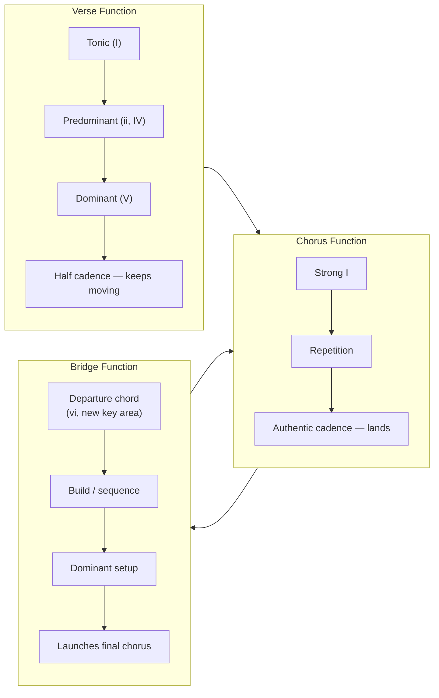
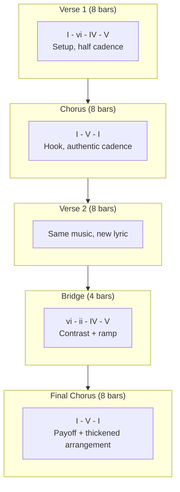
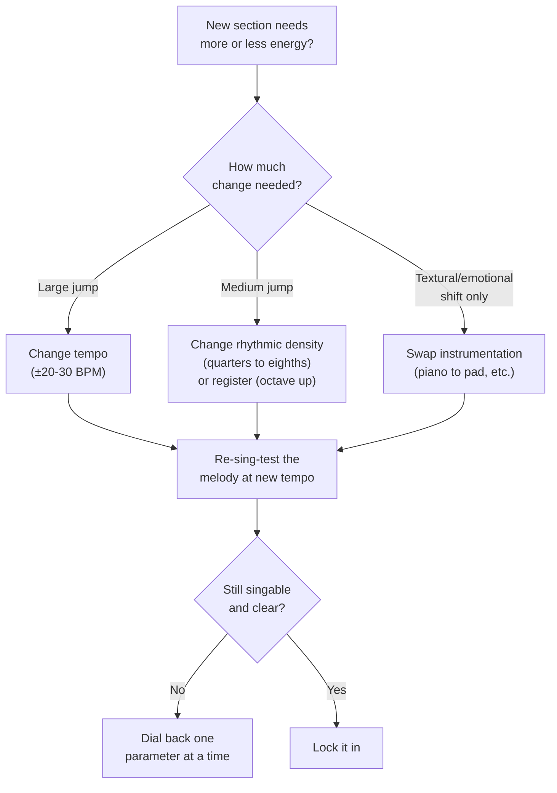
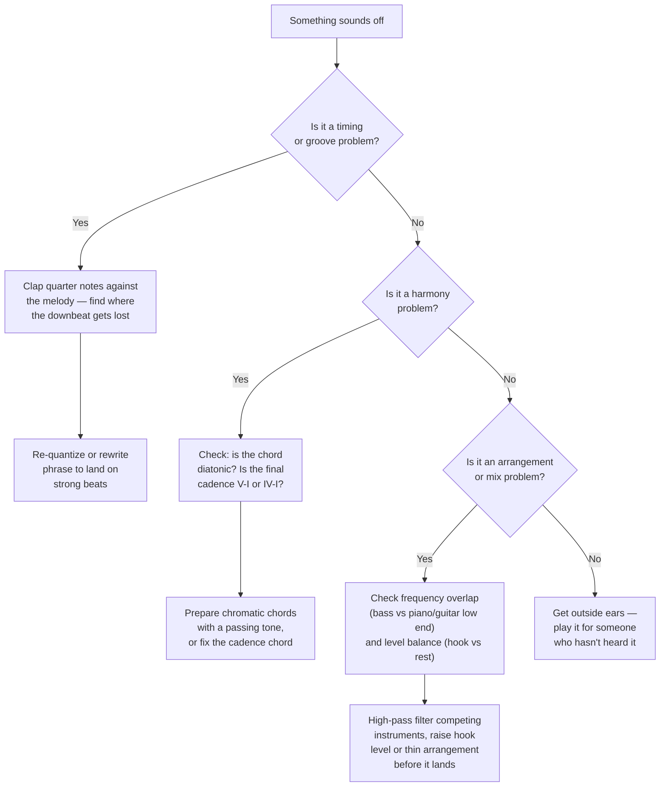

# Songwriting Masterclass: From Blank Page to Finished Song

## Who This Is For and What You Need

This is a hands-on craft course, not a music-tech seminar. You will write actual songs — melody, chords, lyrics, form — and you'll use a DAW only as a notepad for capturing and arranging what you write. If you can hum a melody and strum four chords, you can do every exercise here.

**Gear:**
- Any DAW (Ableton, Logic, FL Studio, Reaper) or even just a voice memo app and a guitar/keyboard
- A MIDI keyboard (25 keys is enough) is useful but not required — these exercises are playable on guitar, ukulele, or just by singing
- A capo if you're on guitar (useful for the key-transposition exercise)

**Theory you need going in:** major/minor scales, how to count scale degrees (1–7), what a triad is. Everything else is taught as we go.

---

## Part 1 — Building a Complete Song: Verse, Chorus, Bridge

### The Craft Problem

A song is not a chord progression with words on top. It's an emotional argument told in three stages: **setup (verse)** → **statement (chorus)** → **complication (bridge)** → **restatement, now landed harder (final chorus)**. Every structural choice below exists to serve that argument. If a technique doesn't move the emotional needle, cut it.

### Why Cadences Matter (the one paragraph of theory you need)

A cadence is harmonic punctuation. **V→I** (authentic cadence) sounds finished — like a period. **Ending on V** (half cadence) sounds like a comma — it wants to keep going, which is exactly what you want at the end of a verse, because the verse's job is to create momentum into the chorus. **V→vi** (deceptive cadence) sounds like the sentence took a left turn — useful for extending a phrase or avoiding a too-early sense of arrival. Choruses lean on repeated I chords because repetition at a point of harmonic stability is what makes a chorus feel like "home" — the part you can sing along to on first listen.



### Step 1: Write the Verse — Harmonic Framework

**Progression (C major), two beats per chord, repeated for all 8 bars of the verse:**

```text
| Cmaj7  Am7   | Fmaj7  G7   |  (x2, then repeat whole thing once more = 8 bars)
  I       vi      IV      V
```

**Guitar voicings (open position, capo-friendly):**
```text
Cmaj7:  x32000   (C-E-G-B)
Am7:    x02010   (A-C-E-G)
Fmaj7:  xx3210   (or use Dm7 shape barred, or just play Fmaj as x33210)
G7:     320001
```

**Piano voicings (right hand, rootless — left hand plays the root an octave below):**
```text
Cmaj7:  E4-G4-B4-C5   (fingers 1-2-3-5 if spread, or 1-2-4-5)
Am7:    A3-C4-E4-G4
Fmaj7:  F3-A3-C4-E4
G7:     G3-B3-D4-F4
```

**Why rootless voicings?** Leave the root to your left hand or a bass instrument. This frees your right hand to move in smooth, close intervals — compare moving E-G-B-C → A-C-E-G: every voice moves by 2 semitones or less. Small motion between chords is what makes a progression feel connected rather than like four unrelated blocks. This is the single most useful voice-leading habit you can build at the keyboard.

### Step 2: Write the Verse Melody

The craft rule that matters more than any scale: **put chord tones on strong beats (1 and 3), and connect them with stepwise motion.** This is why melodies sound "right" even when you can't explain why — the ear hears the chord tone land exactly where the harmony needs it, and the passing notes in between feel like motion, not accident.

**Melody over Cmaj7 → Am7 (bars 1–2), sung or played on a lead instrument:**
```text
Beat:    1    2    3    4   |  1    2    3    4
Note:    E5   D5   C5   B4  |  C5   D5   E5   C5
          (E,C = Cmaj7 tones)   (C = Am7 tone)
```

**Drill:** Sing this phrase with a metronome at 70 BPM. Nail the pitch and rhythm cold before moving to 90, then 110 BPM. If your voice cracks reaching for E5, drop the whole phrase down an octave — melody *shape* matters more than absolute register at the writing stage. You can always transpose later to fit a singer's range (see Part 2).

**Over Fmaj7 → G7 (bars 3–4):**
```text
Beat:    1    2    3    4   |  1    2    3    4
Note:    A4   G4   F4   E4  |  D4   E4   F4   G4
```

Notice the melody here descends in bar 3 then rises into bar 4, ending on G — the fifth of the scale, hanging in the air. That's your half cadence: the melody, like the harmony, is deliberately unresolved, so the listener leans forward into the next section.

**Lyric-writing pass:** Once the melody is locked, write your verse lyric to the rhythm you already have, not before. Scan the syllables against the quarter-note grid: one syllable per beat for the quarter-note sections, two syllables (eighth notes) if you want a word to feel conversational. Verse lyrics should set a scene and a specific detail (a place, an object, a time) — concrete imagery is what makes a verse feel lived-in rather than generic.

### Step 3: Write the Chorus

A chorus needs to feel like "more" than the verse along at least two of these three axes: **range** (go higher), **rhythm** (move faster — add eighth notes), **harmonic motion** (land on I more often, more directly).

**Progression — simpler and more repetitive than the verse, on purpose:**
```text
| Cmaj7 . . . | G7  . Cmaj7 . |  (x2 = 8 bars)
    I            V      I
```

Repetition in the chorus progression is a feature. A listener should be able to predict the chorus harmony by the second time they hear it — predictability at this structural level is what lets the *melody and lyric* carry the surprise and interest instead.

**Melody — eighth notes, wider range, arching up then settling:**
```text
Bar 1 (Cmaj7):
Beat:  1   &   2   &   3   &   4   &
Note: G4  A4  B4  C5  D5  E5  G5  E5

Bar 2 (G7 → Cmaj7, resolving):
Beat:  1   &   2   &   3   &   4   &
Note: D5  C5  B4  A4  G4  E5  C5  (hold)
```

The G5 on the peak of bar 1 is your "money note" — the highest, most memorable pitch in the song. Place your hook lyric (the title, or the most important line) exactly on that note. This is not a coincidence in hit songwriting — it's a deliberate technique called **melodic peak placement**, and it works because the ear remembers the highest point of a contour disproportionately well.

**Drill:** Practice singing verse → chorus back to back at 90 BPM. The jump in energy should be audible even if you strip away the words — hum both sections and confirm the chorus physically feels bigger. If it doesn't, raise the chorus melody's register further, or simplify the chorus rhythm so the eighth notes read as more active by contrast.

### Step 4: Verse 2

Repeat the verse music exactly. Change only the lyric. This is deliberate — the listener's brain has just learned the verse's melodic and harmonic "shape" during verse 1; verse 2 cashes in that familiarity so the new information (new lyric, new scene detail) lands clearly instead of competing with new music to learn.

### Step 5: Write the Bridge

The bridge's entire job is contrast. If verse and chorus are both in the "home" key area, send the bridge somewhere else emotionally — a new chord outside the main progression, a melodic shape that moves opposite to the chorus (descending instead of arching), or a shift from "about a situation" to "about a feeling" lyrically.

**Progression (4 bars, borrowing the relative minor as the bridge's temporary home):**
```text
| Am7  | Dm7  | Fmaj7 | G7  |
  vi     ii      IV     V
```

Starting the bridge on **vi (Am7)** instead of **I (Cmaj7)** is the single cheapest, most reliable way to create harmonic contrast without leaving the key — same seven notes, completely different center of gravity.

**Melody — descending sequence (opposite contour to the chorus's arch):**
```text
Bar 1 (Am7):  A4  G4  F4  E4
Bar 2 (Dm7):  F4  E4  D4  C4
Bar 3 (Fmaj7): C4  D4  E4  F4   (turn the corner, start climbing)
Bar 4 (G7):   G4  A4  B4  C5  D5  E5  F5  G5   (eighth notes, rising run)
```

That rising eighth-note run in bar 4 is a **ramp** — a classic device for building anticipation into a final chorus. Crescendo through it: start around mezzo-forte and push to forte by the last note.

**Drill — bridge-to-chorus transition:** This is the moment most amateur songs feel awkward. Practice the last two beats of the bridge directly into the first beat of the final chorus, in isolation, over and over, at a slow tempo (70 BPM) until the handoff feels inevitable rather than abrupt. Then bring it up to tempo.

### Step 6: Final Chorus

Repeat the chorus, but make it feel like a payoff, not a repeat:
- Add a harmony vocal a third above the lead on the hook line
- Thicken the accompaniment (add bass, pad, or a second guitar)
- Optionally raise the final chorus a whole step (common pop technique — more on this below) for a last jolt of lift

### Full Form Map



### Checking Your Work — Sing Test, Not Screen Test

Before trusting anything you've written in the piano roll, step away from the DAW and sing the whole song a cappella, with no instrument. This surfaces problems that look fine on a screen:

| Problem | How it shows up when you sing it | Fix |
|---|---|---|
| Melody too wide-ranging | You crack or run out of breath | Narrow the range, move the climax lower |
| Chorus doesn't lift | You can't feel the energy jump without the backing track | Raise register, simplify rhythm for contrast, add repetition |
| Bridge too similar to verse | You lose track of which section you're in | Change contour direction, change starting scale degree |
| Awkward word stress | Natural speech accents fall on weak beats | Rewrite the line so stressed syllables land on beats 1/3 |

---

## Part 2 — Changing Key, Tempo, and Instrumentation: What Actually Moves the Listener

### The Craft Problem

Songwriters constantly ask "should this be faster, should this be in a different key, should this be a piano song or a guitar song." These aren't abstract questions — they have practical, audible answers, and you can test them yourself in twenty minutes.

### Tempo Is Your Primary Energy Dial

Tempo controls felt energy more reliably and more powerfully than almost any other decision you'll make. As a rule of thumb anchored to resting heart rate (~60–70 BPM):

| Tempo range | Feel | Typical use |
|---|---|---|
| 60–80 BPM | Intimate, reflective | Ballads, verses that need to breathe |
| 90–110 BPM | Conversational, groove-driven | Mid-tempo pop, R&B |
| 120–140 BPM | Driving, danceable | Rock, pop choruses, uptempo |
| 150+ BPM | Urgent, intense | Punk, drum and bass, climactic sections |

**Drill:** Take your finished verse and play it at 90, then 120, then 150 BPM, back to back, with no other changes. Notice at what point the melody starts to feel rushed or unsingable — that's your tempo ceiling for that melodic rhythm. If your eighth-note chorus melody blurs above 150 BPM, either simplify the rhythm (switch busy eighth notes to quarters) or accept the lower tempo ceiling.

### Key Choice Is a Singer-Range Decision, Not a Mood Decision

The biggest myth in songwriting pedagogy is that minor key = sad and specific major keys have inherent emotional colors. In equal temperament, every major key has the identical interval structure — C major and G major are the same shape, just moved. What *does* change with key is:

1. **Singer comfort.** This is the real reason to transpose. If your melody peaks at G5 and your singer's comfortable top note is E5, transpose the whole song down a minor third.
2. **Instrument resonance.** Guitars ring more openly in keys that use open strings (E, A, D, G, C) because the open strings vibrate sympathetically. A song in B major on guitar loses that resonance unless you use a capo.
3. **Capo strategy (guitar):** If a song feels right in open-string shapes in the key of C, but needs to sit in E♭ for the singer, capo at fret 3 and keep playing C-shapes. You get the resonant open-chord feel in the target key.

**Drill:** Find your melody's highest note and lowest note. If the span exceeds a 10th (an octave plus a third) for an untrained singer, you're asking for trouble — either narrow the melody or pick the key based on landing the climax note in the singer's strong upper range (not their screaming limit).

### The Key-Change Trick (Truck Driver's Gear Change)

Modulating up a whole step or half step for a final chorus is a genuinely effective, well-worn device — not a cliché to avoid, a tool to use deliberately.

**How to execute it cleanly:** Insert a short pivot — often just the last chord of the bridge reinterpreted as the V of the new key — then land the final chorus a whole step higher.

```text
Original key: C major, final bridge ends on G7 (V of C)
Pivot: reinterpret / reharmonize that G7 briefly as a secondary dominant leading to D
New key: D major, final chorus
```

On guitar: if you were playing open C-shapes, use a capo at fret 2 the moment the key change hits (works live by having a second guitar pre-capo'd, or by using a transposable keyboard patch in the studio).

### Instrumentation Changes the Emotional Temperature Without Changing a Single Note

Play the identical chorus melody and chords on three different instruments and you get three different songs emotionally:

- **Acoustic piano:** immediate percussive attack, decays naturally — reads as direct, intimate, slightly formal
- **Electric piano (Rhodes/Wurli):** softer attack, longer sustain, warm — reads as nostalgic, relaxed, "vintage soul"
- **Synth pad (sawtooth through a low-pass filter):** slow attack (try 20–40ms), sustained, no decay — reads as ambient, floating, cinematic
- **Nylon or steel-string acoustic guitar fingerpicked:** sharp pluck transient, fast decay — reads as folk, confessional, organic

**Drill — the "instrument swap" test:** Record your verse on piano. Then record the identical MIDI or chord part on an electric piano patch, then on a pad. Listen to all three back to back and ask: *which version makes the lyric's emotional content land hardest?* A breakup verse often works better on a decaying, lonely-sounding instrument (nylon guitar, sparse piano) than on a lush pad that fills all the space the lyric needs to feel empty in.

### Practical Decision Framework



---

## Part 3 — Troubleshooting: Diagnosing Why a Song Isn't Working

### The Craft Problem

Every songwriter hits the wall where a song "feels off" but they can't say why. This section is a diagnostic checklist built from the actual failure modes that show up over and over in developing writers' work. Work through it top to bottom — timing issues first, then harmony, then arrangement/mix — because fixing a mix problem won't help if the underlying issue is a harmonic one.

### Diagnostic 1: "The groove feels wrong" — Timing Problems

**Symptom: Melody feels like it's dragging or rushing against the band.**

Cause is almost always one of two things:
- **Notes placed slightly late relative to the beat without intention.** Your rhythm section is locked to the grid, your vocal/lead performance drifted. Fix: re-quantize the problem phrase to the nearest 8th or 16th note, then reintroduce a *small* amount of deliberate lateness (10–20ms) only if you want a laid-back feel — and only after confirming the quantized version works.
- **You wrote a melody that straddles the barline awkwardly** — a phrase that starts on beat 4 of one bar and the listener loses the downbeat. Fix: sing the phrase while clapping quarter notes. If you lose the clap, the phrase's starting point needs to move to land more clearly on a strong beat, or the surrounding rhythm section needs a clearer downbeat accent (kick drum, bass note) to anchor it.

**Symptom: Tempo feels like it's crawling or rushing across a whole section, not just drifting slightly.**

This is almost always a genuine mismatch between the words-per-line density of your lyric and the chosen tempo. If you've written a verse with long, multisyllabic lines, a fast tempo will force a rushed, crammed-in delivery. Fix: either slow the tempo, or cut the lyric down to fit the existing rhythmic real estate (fewer words, same melody).

### Diagnostic 2: "Something in the chords sounds wrong" — Harmonic Problems

**Symptom: A chord sounds like a mistake, not a choice.**

Ask: is the chord diatonic (built only from the key's seven notes)? If not, you've borrowed a chord from a parallel mode (modal mixture) — that's a legitimate, powerful technique (see Part 4), but it needs *preparation* or it reads as an error. The fix isn't always to remove the chord — it's often to add a chromatic passing note in the melody or bass leading into it, so the ear hears it coming.

**Symptom: The chorus doesn't feel like it "arrives."**

Check your final chorus cadence. If you're ending on anything other than a clear V→I or IV→I motion, the chorus will feel unresolved — fine for a verse, wrong for a chorus's final landing. Count backward from the last chord: is the second-to-last chord the dominant (V) or subdominant (IV) of your key? If it's something else, that's your arrival problem.

**Symptom: Two voices (melody and bass, or two guitar lines) sound fused together, lifeless.**

This is parallel perfect fifths or octaves — when two voices move in lockstep a 5th or octave apart, the ear fuses them into one thick line instead of hearing two independent voices. Fix: make one voice move while the other holds still (oblique motion), or make them move in opposite directions (contrary motion). This single fix is the fastest way to add perceived depth to a two-part arrangement.

### Diagnostic 3: "The vocal gets buried" — Arrangement and Mix Problems

**Symptom: Can't understand the lyric, bass and melody blur together.**

This is frequency masking — bass instrument and the low end of your piano/guitar occupying the same 60–200 Hz range, fighting for the same sonic real estate. Fix:
- High-pass filter the piano/guitar around 150–200 Hz, let the bass own everything below that
- Or, arrangement-level fix: have bass and piano play rhythmically interlocking parts (bass plays when piano holds, piano plays when bass rests) instead of both sustaining simultaneously

**Symptom: The hook line doesn't pop even though the melody is good.**

Check relative level and *space*. A hook needs 3–6 dB of headroom over the rest of the arrangement, and it needs a moment of relative silence or thinning in the accompaniment right before it lands — drop out a layer (guitar, pad) for one beat right before the hook so the ear's attention resets.

### Master Diagnostic Flowchart



### The Deliberate Rule-Break Drill

Rules in songwriting exist because they describe what the ear expects by default. Breaking them on purpose, with a reason, is how you get interesting music instead of just correct music. Practice this directly:

1. Take your finished verse progression (I–vi–IV–V).
2. Replace the vi chord with a borrowed ♭VI (in C major: A♭maj7 instead of Am7).
3. Sing the existing melody over it unchanged.
4. Listen for clashes — does the melody have a note that now fights the new chord? (In this case, if your melody has an A natural or E natural landing on that chord, you'll hear a clear clash against the A♭ and E♭.)
5. Resolve the clash one of two ways: adjust the melody note to fit the new chord, or keep the clash deliberately for one beat as a passing dissonance that resolves on the next beat.

This single exercise — borrow a chord, find the clash, decide whether to fix it or keep it — teaches you more about harmonic tension than any amount of reading about modal interchange.

---

## Reference: Chord Progressions, Voicings, and Quick Lookups

### Workhorse Progressions (transpose to any key by shifting the Roman numerals)

| Name | Progression (C major) | Character | Famous use |
|---|---|---|---|
| Pop/Rock anthem | I–V–vi–IV | Uplifting, open-ended | Huge swath of 2000s–2010s pop |
| Doo-wop / 50s | I–vi–IV–V | Nostalgic, circular | "Stand By Me" |
| Jazz turnaround | ii7–V7–I | Smooth, resolved | Jazz standards |
| Axis progression | vi–IV–I–V | Melancholic but driving | Alternative rock anthems |
| Pachelbel-style | I–V–vi–iii–IV–I–IV–V | Descending bass, cinematic | "Canon in D"-inspired pop |
| Blues (12-bar) | I7–I7–I7–I7–IV7–IV7–I7–I7–V7–IV7–I7–V7 | Grounded, cyclical | All of the blues |

### Scale Degree Cheat Sheet (Major Key)

| Degree | Chord (C major) | Function | Where to use it |
|---|---|---|---|
| I | C | Home | Verse start, chorus landing |
| ii | Dm | Gentle motion toward V | Pre-chorus setup, jazz turnarounds |
| iii | Em | Transitional, ambiguous | Connecting phrases, rarely a destination |
| IV | F | Lift, anticipation | Pre-chorus, plagal "amen" endings |
| V | G | Tension, demands resolution | End of verse (half cadence), setting up chorus |
| vi | Am | Wistful, deceptive | Bridge start, "Axis" progressions |
| vii° | Bdim | Maximum tension | Passing chord, rarely sustained |

### Guitar Voicing Library (Open Position)

```text
C:    x32010      Cmaj7: x32000      C7: x32310
D:    xx0232      Dmaj7: xx0222      D7: xx0212
Em:   022000      Em7:   022030      E7: 020100
F:    xx3211      Fmaj7: xx3210      
G:    320003      Gmaj7: 320002      G7: 320001
Am:   x02210      Am7:   x02010      
```

### Piano Voicing Library (Rootless Jazz Voicings, "A form" and "B form")

```text
Cmaj7 (A form): E4-G4-B4-C5
Cmaj7 (B form): B3-C4-E4-G4
Dm7   (A form): F4-A4-C5-D5
Dm7   (B form): C4-D4-F4-A4
G7    (A form): F4-A4-B4-D5
G7    (B form): B3-D4-F4-A4
```

Practice alternating A and B forms for a ii–V–I so your left hand barely moves: Dm7(B form) → G7(A form) → Cmaj7(B form) keeps every voice within a 4th of its previous position.

### Lyric-Writing Quick Reference

| Section | Job | Practical tip |
|---|---|---|
| Verse | Set scene, give specific detail | Name a real object, place, or action — avoid abstractions ("my heart," "the pain") until the chorus |
| Pre-chorus (if used) | Build urgency, raise the emotional register | Shorten the lines, increase rhyme density |
| Chorus | State the core idea plainly, repeatably | The title or hook phrase should appear on the melodic peak |
| Bridge | Reframe or complicate the idea | Shift point of view (you → I, or past → present) or introduce the one new piece of information the song has been withholding |

### Practice Routine (Weekly Target)

- **Daily (15–20 min):** Sing/play one full verse-chorus pair from a song you admire, by ear, no sheet music. This trains your ear to internalize phrase structure faster than analysis alone.
- **2–3x per week:** Write one complete verse + chorus from scratch, start to finish, in under 45 minutes. Speed forces instinct over second-guessing.
- **Weekly:** Take one finished verse and run it through the tempo/key/instrument drills in Part 2. Document which version felt strongest and why.
- **Weekly:** Pick one song structure problem from Part 3 and deliberately inject it into an old draft, then fix it. This builds diagnostic speed for your own future work.

Keep a notebook (physical or a simple text file) logging: the date, what you wrote, what worked, and what you'd change. The single biggest predictor of songwriting improvement is volume of completed songs, not hours spent theorizing about them — finish the song, log the lesson, start the next one.
