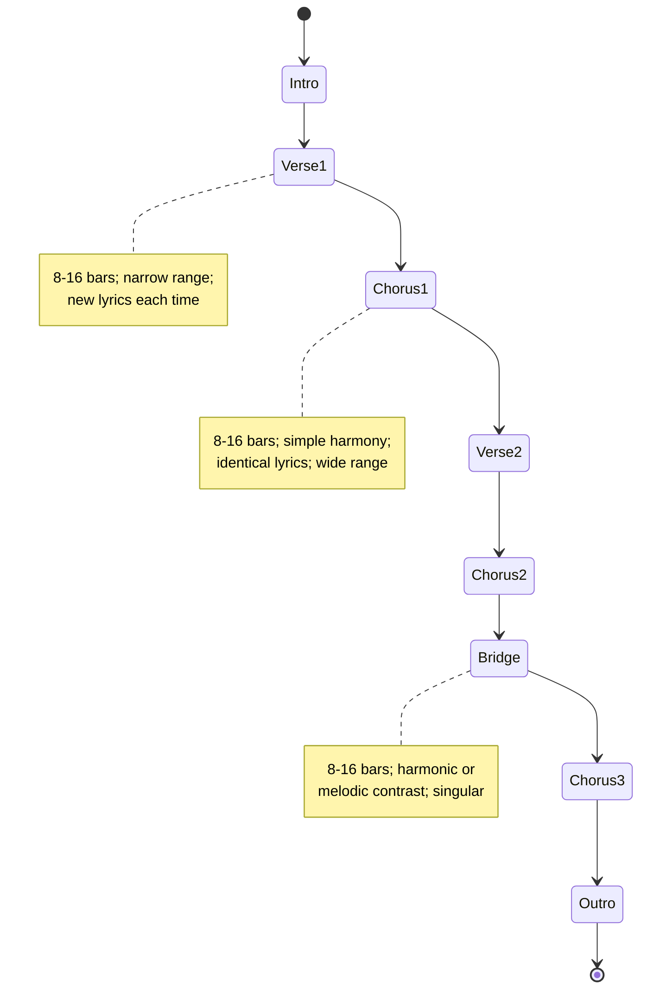
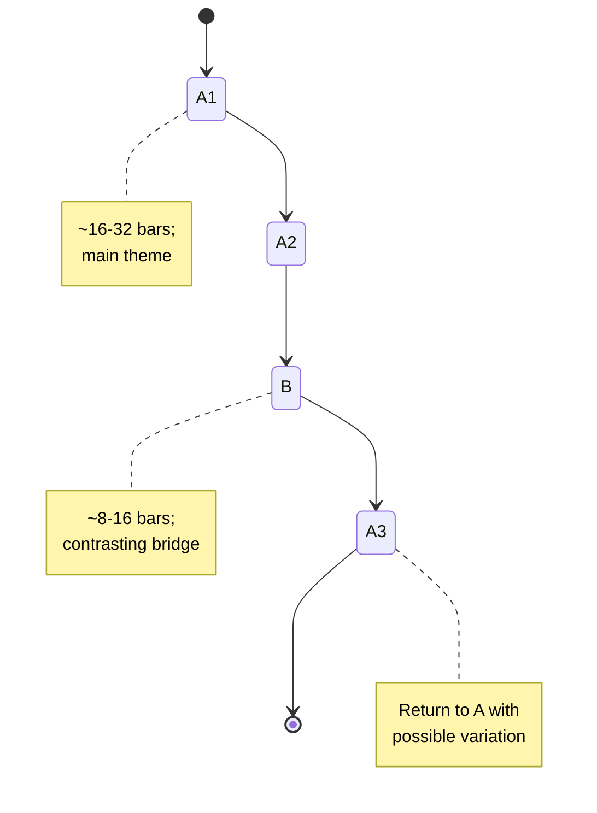
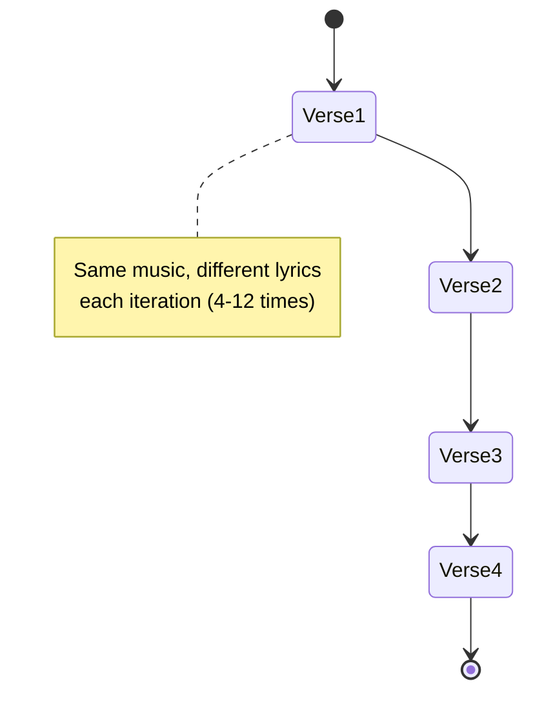
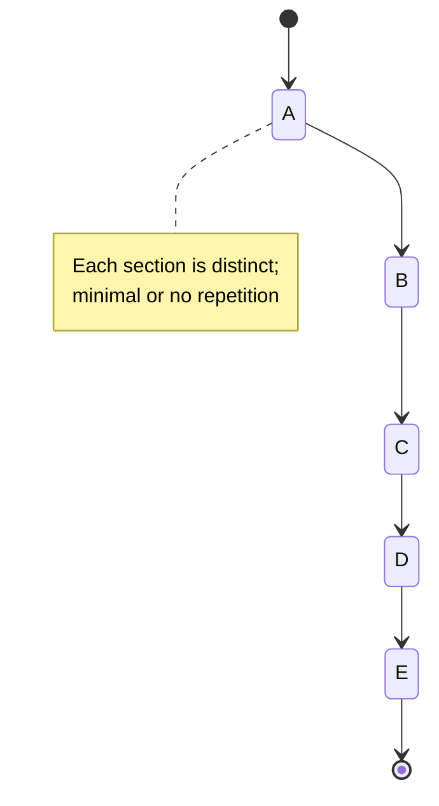
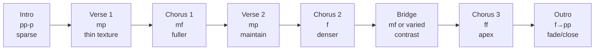

# Lesson 1: Song Structure — Foundations to Execution

## 1. First-Principles Intuition & Why Structure Matters

Song structure isn't decorative—it's a cognitive technology. The human brain simultaneously craves **pattern recognition** (which encodes memory) and **novelty** (which prevents boredom). Effective song structure exploits this tension by establishing predictable frameworks while varying their content.

Think of structure as a container that *contains* surprise. The verse-chorus-bridge architecture evolved because it solves three specific listener problems:

- **The verse** carries unique information (new lyrics, new details) within a familiar harmonic and melodic scaffold. You remember the *song*, but each verse teaches you something new.
- **The chorus** is the song's identity compressed into its smallest, most memorable form—higher notes, simpler harmony, repeated words, fuller sound. It's the single moment a casual listener will hum back to you.
- **The bridge** breaks the pattern deliberately. After two or three repetitions of verse-chorus, the brain *expects* the pattern to continue. The bridge violates that expectation, creating tension that resolves when the chorus returns.

From a practical standpoint: if every section sounded identical, listeners would tune out after 30 seconds. If every section differed completely, nothing would stick in memory. Structure is the balance point.

---

## 2. The Four Core Section Types

### Verse: Narrative & Context

**Function**: Deliver lyrical content, establish emotional tone, set up the chorus.

**Characteristics**:
- Narrower melodic range (often a 6th to octave span)
- Conjunct motion (stepwise intervals, singable)
- Moderate dynamic level (mp to mf)
- Harmonic movement—typically more chords than the chorus
- Each verse has different lyrics

**Typical duration**: 8–16 bars at your song's tempo.

**Practical design**:
- Keep the melodic contour simple enough to sing over new lyrics without cognitive overload.
- Use harmonic movement (I → vi → IV → V, for example) to create gentle forward motion toward the chorus.
- Reserve your highest notes for the chorus, not the verse.
- Ensure the verse ends on a harmonic arrival that *invites* the chorus (often a dominant chord: V, or a I with momentum).

**Example (C major, 16 bars)**:
```
Bars 1–4:   | C      | Am     | F      | G      |
Bars 5–8:   | C      | Am     | F      | G      |
Bars 9–12:  | Dm     | G      | Em     | Am     |
Bars 13–16: | F      | G      | C      | C      |
```

This verse establishes C major, explores the vi–IV–V relationships in bars 1–8 (creating gentle intrigue), then intensifies with a descending-fifths motion (Dm–G–Em–Am) in bars 9–12, finally resolving to tonic with forward momentum in bars 13–16.

---

### Chorus: The Hook & Identity

**Function**: Deliver the song's emotional and melodic peak; be maximally memorable.

**Characteristics**:
- Wider melodic range (often a 9th to 12th span)
- Apex notes (highest pitches of the entire song) appearing at or near phrase boundaries
- Simple, stable harmonic progression (often 2–4 distinct chords)
- Identical lyrics across all iterations (repeating the "hook")
- Fuller instrumentation and increased dynamic level (f to ff)
- Rhythmic simplicity (fewer, more sustained notes than the verse)

**Typical duration**: 8–16 bars (often shorter than the verse).

**Practical design**:
- Choose a 4-chord progression that maximizes voice-leading smoothness and tonal clarity. The I–V–vi–IV progression (C–G–Am–F) dominates pop because it locks into muscle memory: voice leading is stepwise, harmonic transitions are strong, and the progression can repeat without sounding stale.
- Place your highest note(s) on the most emotionally important lyric syllable.
- Use open vowels (ah, oh, ay) on sustained or accented notes to maximize vocal resonance.
- Simplify rhythm: sustained quarter or half notes tend to stick better than rhythmic fragmentation.

**Example (C major, 8 bars)**:
```
Bars 1–4:   | C      | G      | Am     | F      |
Bars 5–8:   | C      | G      | F      | G      |
```

This chorus compresses harmonic motion into 8 bars. Bars 1–4 establish the I–V–vi–IV axis progression (the single most memorable progression in modern music). Bars 5–8 return to I–V but substitute F for Am, then land on dominant (G) to propel back into the next section. Notice: only four distinct chords, no adventurous voice-leading, maximum clarity.

**Melody atop this progression (notated as scale degrees)**:
```
1̂  2̂  3̂  4̂  | 1̂  2̂  3̂  4̂  |  (ascending scale on the progression)
5̂  5̂  5̂  5̂  | 3̂  2̂  1̂ rest |  (descend from the apex on bars 5–8)
```

The ascending 1̂–2̂–3̂–4̂ on the I–V–vi–IV progression (bars 1–4) is *singable* because the melody moves stepwise and aligns with the harmonic motion. The apex (5̂) lands on bar 5 and sustains, then descends for resolution.

---

### Pre-Chorus (Optional): The Build

**Function**: Transition from verse to chorus; build tension and anticipation.

**Characteristics**:
- 4–8 bars (shorter than verse or chorus)
- Harmonic tension (prolonged dominant, secondary dominants, or chromatic approach)
- Increased dynamic and textural intensity
- Often rhythmically distinct from verse (syncopation, driving pulse)
- Lyric can be the hook phrase or a setup line

**Practical design**:
- Employ dominant prolongation (V chord held or repeated for multiple bars) to create forward momentum toward the chorus.
- Add instrumentation (electric guitar power chords, drum fill, bass movement) that the verse lacks.
- Keep melody simple—listeners should anticipate the chorus, not focus on new melodic detail.

**Example (C major, 8 bars)**:
```
Bars 1–4:   | G      | G      | Am     | D      |
Bars 5–8:   | G      | G      | G      | G      |
```

Bars 1–4 establish secondary dominant motion (Am–D is ii–V in G, building toward a G arrival). Bars 5–8 land on and sustain G (the V of C), which then *resolves* to C when the chorus arrives. This creates audible tension and release.

---

### Bridge: Controlled Disruption

**Function**: Introduce a distinctive element; provide harmonic, melodic, or rhythmic contrast; prevent listener habituation.

**Characteristics**:
- 8–16 bars (appears once, in the latter third of the song)
- Harmonic departure (new chord progression, modulation, or modal mixture)
- Often *begins* on a chord not used elsewhere as a section starter
- May feature instrumental solo, rap, spoken word, or stripped-back vocal
- Typically lower dynamic level than the final chorus (dynamic contrast), though may spike with intensity

**Practical design**:
- Break one established pattern:
  - **Harmonic**: Begin on vi or IV instead of I; modulate to the relative minor or major; borrow chords from parallel keys.
  - **Melodic**: Introduce a new motif or recontextualize existing material at a different pitch level.
  - **Rhythmic**: Switch from straight eighths to triplets, or from simple meter to syncopation.
  - **Textural**: Feature a unique instrument (strings, synth pad, vocal harmony, instrumental solo) not heard in verse/chorus.
- Design the bridge to *lead back* to the final chorus: end on a dominant chord or at a harmonic/melodic point that invites the chorus's return.

**Example (C major, 8 bars)—Harmonic departure via relative minor**:
```
Bars 1–4:   | Am     | F      | C      | G      |
Bars 5–8:   | Dm     | Am     | F      | G      |
```

This bridge opens on vi (Am), not I, immediately signaling contrast. It emphasizes minor harmony (Am, Dm) within the C major context, creating affective shift. Bar 8 lands on dominant (G), which resolves to C when the chorus returns.

**Alternative bridge strategy—Mediant modulation to E♭ major (3 semitones up)**:
```
Bars 1–4:   | E♭     | B♭     | Gm     | Cm     |
Bars 5–8:   | B♭     | B♭     | B♭     | B♭     |
```

This shifts to a remote key (E♭ major shares no common chords with C major, though both are diatonic to no shared parent scale). Bars 5–8 sustain dominant (B♭ of E♭ major), which becomes secondary dominant of the C major chorus when it returns.

---

### Outro: Closure or Continuation

**Function**: Signal the song's ending; provide emotional resolution or fade-out continuity.

**Characteristics**:
- 4–16 bars
- Either **fade-out** (repeats a section—typically the final chorus or a stripped version—at reducing volume) or **conclusive ending** (harmonic resolution, decrescendo, final cadence)
- If fade-out: energy remains constant while volume decreases, suggesting the song could continue
- If conclusive: dynamic and harmonic closure (often a final tonic chord held or played with finality)

**Practical design**:
- **Fade-out outro**: Loop the final chorus (or a chorus variant) 2–4 times, allowing the mix engineer to gradually reduce volume and/or remove instrumental layers. Listeners perceive this as "the song fading into the distance." Works well for uptempo, energetic songs.
- **Conclusive outro**: Reduce dynamics, simplify instrumentation (verse-level sparsity), and end on tonic with a strong cadential motion (V–I or IV–I). Conveys finality.

---

## 3. Structural Architecture & Common Forms

### Standard Verse-Chorus-Bridge Form (ABABCB)

This is the dominant structure in contemporary pop, rock, and R&B:



**Typical timing (at 120 BPM, 4/4 time, 90 bars = 180 seconds ≈ 3 minutes)**:

| Section    | Bars | Cumulative | Notes |
|------------|------|------------|-------|
| Intro      | 8    | 8          | Establishes groove |
| Verse 1    | 16   | 24         | First narrative content |
| Chorus 1   | 8    | 32         | First hook exposure |
| Verse 2    | 16   | 48         | Lyric development |
| Chorus 2   | 8    | 56         | Hook reinforcement |
| Bridge     | 8    | 64         | Contrast; ~111 sec (near golden ratio) |
| Chorus 3   | 8    | 72         | Final hook, building to climax |
| Chorus 4   | 8    | 80         | Optional repeat for emphasis |
| Outro      | 10   | 90         | Fade or conclusive closure |

The bridge placement at bar 56 (112 seconds) approximates the golden ratio division of a 180-second song, creating asymmetric balance that feels natural rather than mechanical.

---

### AABA Form (Tin Pan Alley / Early Standards)

Used in jazz standards, early rock, and contemporary singer-songwriter work:



**Key difference from ABABCB**: The A section combines verse *and* chorus material—the same music repeats with different lyrics, then the B section (bridge) provides contrast. The A repeats one more time with possible melodic embellishment or shortened length. This form emphasizes thematic unity over sectional contrast.

**Example**: The Beatles' "Yesterday" uses modified AABA (each A is ~8 bars, B is ~8 bars).

---

### Strophic Form (Verse-Only)

Each verse uses identical music with different lyrics. No chorus. Folk, art song, and narrative-driven pieces often use this:



**Advantage**: Lyric narrative becomes primary; repetition deepens through changing text, not repetition of hook.

**Disadvantage**: Lower immediate memorability (no chorus hook).

**Examples**: Bob Dylan's "The Times They Are A-Changin'", Leonard Cohen's "Hallelujah" (though modern versions add a chorus).

---

### Through-Composed Form (Continuous Development)

No section repeats. Material continuously develops without recapitulation. Progressive rock, art song, and contemporary composition use this:



**Advantage**: Maximum novelty; prevents boredom in longer forms.

**Disadvantage**: Lower memorability; demands active listening.

**Example**: Queen's "Bohemian Rhapsody" (though it contains internal repetitions within distinct movements).

---

## 4. Harmonic & Melodic Design Within Sections

### Verse Harmonic Progression Design

Verses work best when they establish a harmonic "conversation"—movement that feels purposeful but not final. Avoid landing on tonic (I) midway through; instead, use:

- **Tonic opening** (establish home) → **subdominant/supertonic** (vi, ii, or IV) → **dominant** (V) or **leading-tone** (vii°) → **back toward tonic** with forward momentum.

**Four-chord verse template** (8 bars):
```
| I      | vi     | IV     | V      |
```

This I–vi–IV–V progression (in C: C–Am–F–G) creates gentle harmonic motion: I to vi (down a third), vi to IV (up a second), IV to V (up a second). The progression lands on dominant, inviting the chorus. Each chord lasts 2 bars, allowing lyrics to settle.

**Eight-bar verse with internal tension** (16 bars):
```
Bars 1–4:   | I      | vi     | IV     | V      |
Bars 5–8:   | I      | vi     | IV     | V      |
Bars 9–12:  | ii     | V      | iii    | vi     |
Bars 13–16: | IV     | V      | I      | I      |
```

Bars 1–8 establish the I–vi–IV–V loop (repetition aids memory). Bars 9–12 introduce a descending-fifths sequence (ii–V–iii–vi), creating textural variation without melodic disruption. Bars 13–16 resolve: IV–V lands hard on I (tonic), then repeats I to establish arrival and forward momentum into the chorus.

### Verse Melodic Design

Verse melodies should be **singable over changing lyrics**—which means:
- Mostly stepwise motion (conjunct intervals)
- Avoid large leaps (major 6ths, minor 7ths, octaves) that demand syllable stretching
- Land on strong scale degrees (1̂, 3̂, 5̂) at phrase ends
- Stay in a mid-to-narrow range (6th to octave span)

**Example verse melody** (in C major, over the 16-bar verse progression above):

```
Bars 1–4:   1̂ 2̂ 3̂ | 3̂ 2̂ 1̂ | 1̂ 2̂ 3̂ 4̂ | 5̂ rest |
Bars 5–8:   5̂ 4̂ 3̂ | 2̂ 1̂ 7̂ | 1̂ rest | rest |
Bars 9–12:  2̂ 3̂ 4̂ | 5̂ 4̂ 3̂ | 2̂ 1̂ 7̂ | 1̂ rest |
Bars 13–16: 1̂ rest | 2̂ 3̂ 5̂ | 1̂ 1̂ 1̂ | 1̂ rest |
```

Notice: mostly stepwise motion (1̂→2̂→3̂, 3̂→2̂→1̂), phrase endings on strong scale degrees, and repetition of melodic fragments (bars 1–2 repeat in bars 5–6 with lyric variation).

### Chorus Harmonic Progression Design

Chorus progressions should be **simple, stable, and repetitive**. Aim for 2–4 distinct chords, repeatable in a 4-bar or 8-bar loop:

**Most common chorus progression** (the "axis progression"):
```
| I      | V      | vi     | IV     |
```

In C major: **C–G–Am–F**. Why this progression dominates:
- Only three harmonic transitions (no chromatic movement)
- Voice leading is stepwise: C (root) → G (a 5th up) → Am (changes by one note, E→A) → F (changes by one note, G→F)
- It fits a repeating 4-bar loop seamlessly
- When melody is 1̂–2̂–3̂–4̂ over this progression, every scale degree aligns with strong harmonic motion

**Alternative chorus progressions**:
- **I–IV–V–IV** (C–F–G–F): Simple, energetic, folk-influenced
- **vi–IV–I–V** (Am–F–C–G): Starts on relative minor for melancholic tone, same chords as I–V–vi–IV reordered
- **I–V–vi–I** (C–G–Am–C): Tighter loop, returns to tonic more frequently

### Chorus Melodic Design

Chorus melodies should be:
- **High register**: Apex notes (highest pitches in the entire song) appear in the chorus.
- **Rhythmically simple**: Longer note values (quarters, halves, wholes) than the verse.
- **Contoured**: Clear shape (ascending, descending, or arch) that creates memorable profile.
- **Singable in unison**: Background vocals and crowd-sing must land on the same notes.

**Example chorus melody** (in C major, over I–V–vi–IV):

```
Bars 1–4:   1̂  2̂  3̂  4̂ | 1̂  2̂  3̂  4̂ |
Bars 5–8:   5̂  5̂  5̂  5̂ | 3̂  2̂  1̂  rest |
```

The ascending 1̂–2̂–3̂–4̂ (bars 1–2, 3–4) parallels the I–V–vi–IV progression and is immediately memorable. The apex (5̂) sustained in bar 5 lands on the emotional peak of the chorus. Bars 7–8 descend for resolution.

### Bridge Harmonic Design

Bridges should **violate** one or more established patterns:

**Bridge strategy 1: Begin on vi (relative minor entry point)**
```
| vi     | IV     | I      | V      |
```

In C major: Am–F–C–G. This opens on vi, not I—immediate contrast. The progression mirrors verse/chorus chords but in a rearranged order, creating familiarity with novelty.

**Bridge strategy 2: Modulate to relative minor (A minor)**
```
| Am     | F      | G      | E      |
```

This shifts harmonic context to A minor (same pitch collection as C major, but different emotional tone). The progression emphasizes minor chords (Am, F, E°) within the A minor framework, then returns to C major chorus.

**Bridge strategy 3: Secondary dominant chain (chromatic approach)**
```
| V/V    | V      | V/IV   | IV     |
```

In C major: D–G–E–F. These secondary dominants create chromatic pull: D (V of G) resolves to G (V of C), E (V of F) resolves to F (IV of C). High harmonic tension that propels back to the stable chorus.

**Bridge strategy 4: Rhythmic/harmonic shift (simplification then acceleration)**
```
Bars 1–4:   | I      | I      | I      | I      |
Bars 5–8:   | V      | V      | V      | V      |
```

In C major: C–C–C–C then G–G–G–G. Strip the progression to root position, whole-bar static harmony. Bars 1–4 ground the listener on tonic; bars 5–8 prolong dominant, building anticipation. Extreme simplicity contrasts with the verse/chorus complexity.

---

## 5. Instrumentation & Dynamic Layering

Structural clarity emerges not only from harmonic and melodic change but from **textural transformation**. As sections progress, add or remove instrumental layers:

### Typical Instrumentation Build

| Section | Drums | Bass | Guitar | Keys | Vocals | Pads/Atmosphere |
|---------|-------|------|--------|------|--------|-----------------|
| Intro | minimal | — | acoustic pad | — | — | atmospheric |
| Verse 1 | basic groove | root notes | acoustic fingerpicking | — | lead vocal | — |
| Chorus 1 | full kit, fills | syncopated movement | electric power chords | enters | lead + harmony | — |
| Verse 2 | groove maintained | moderate | acoustic + electric layer | sustained | lead + ad-lib | — |
| Chorus 2 | intensified (tighter kick) | active bass line | doubled electric | full voicings | lead + 2-part harmony | synthetic pad |
| Bridge | stripped back or syncopated | minimal or syncopated | single-note solo or removed | sparse | lead (isolated) or rap | — |
| Chorus 3 | maximal (kick + snare layered) | driving line | doubled, panned | full, high register | lead + 3-part harmony + effects | pad amplified |
| Outro | fade kick/snare gradually | fade | fade | fade | lead vocal on repeat loop | fade |

**Key principle**: Each chorus iteration should feel *slightly denser* than the previous—more layers, more harmonic voices, more harmonic complexity. This creates macro-level crescendo without raising tempo or changing fundamental structure.

### Specific Instrumentation Techniques by Genre

**Acoustic/Singer-Songwriter**:
- Verse 1: solo acoustic guitar, vocals
- Chorus 1: acoustic guitar + light percussion (shaker or light brushes)
- Verse 2: acoustic + cello or string pad
- Chorus 2: previous + bass, drums enter
- Bridge: back to solo vocals + acoustic guitar (textural stripping for intimacy)
- Chorus 3: full arrangement

**Pop/Electronic**:
- Verse 1: synth pad + kick/clap pattern (minimal)
- Chorus 1: synth pad + full drum kit + bass synth + electric guitar (stabs)
- Verse 2: reduced to synth pad + kick (drummer plays fewer notes)
- Chorus 2: full + additional synth layer (strings or lead synth)
- Bridge: isolated vocals or rap with minimal percussion (snare/hi-hat only)
- Chorus 3: layered drums, doubled synth pad, bass solo, vocal layers

**Rock**:
- Verse 1: bass + drums (straight groove) + acoustic guitar + lead vocal
- Chorus 1: previous + electric guitar (power chords, doubled)
- Verse 2: maintained or add subtle keys
- Chorus 2: guitar solo counterpoint or added vocal harmony
- Bridge: stripped to bass + snare/kick or electric guitar solo
- Chorus 3: full arrangement, crash cymbals, kick doubles

---

## 6. Dynamic Contour & Climax Placement

### The Macro Dynamic Arc

A well-designed song follows an **emotional arc**: quiet/introspective → building tension → climax → resolution.



**Critical decisions**:

1. **First chorus level**: Should feel *significantly* louder than verse 1 (at least 3–6 dB perceived difference). If chorus 1 and verse 1 feel similar, listeners won't identify the structural boundary.

2. **Second chorus intensity**: Slightly louder than chorus 1 (add a vocal harmony layer, double a drum element, or introduce new instrumental voice).

3. **Final chorus peak**: The *loudest* moment in the entire song. Techniques:
   - **Key modulation**: Shift the final chorus up a half-step or whole-step (transposes all chords). C major becomes D♭ major (half-step) or D major (whole-step). This is the "truck driver's modulation"—simple, instantly effective.
   - **Layered vocals**: Add 3–4-part vocal harmony beneath the lead.
   - **Drum intensification**: Add kick doubles (kick plays eighth notes instead of quarter notes), snare rolls, or crash cymbals on structural downbeats.
   - **Bass movement**: Shift from root-note bass to walking/syncopated lines, or add a bass solo.
   - **Register shift**: Move melody to the highest register possible without straining the vocalist.

4. **Bridge dynamic choice**: 
   - **Option A (contrast via reduction)**: Strip to vocals + minimal accompaniment, creating tension through *sparsity*. When the final chorus arrives with full instrumentation, the contrast is dramatic.
   - **Option B (contrast via texture, not volume)**: Maintain energy but change instrumental character (strings instead of guitar, rap instead of melodic singing, percussion-focused instead of harmonic).

### Loudness vs. Density: The Distinction

**Loudness** is absolute decibel level. **Density** is the number of simultaneous instrumental/vocal layers.

A sparse bridge can be *loud* (if each element is heavily compressed and present in the mix) or *quiet* (if minimal layers are used). Both create contrast—but for different reasons.

- **High density + high loudness** = explosive energy (final chorus typically)
- **High density + moderate loudness** = rich, complex (mid-song sections)
- **Low density + high loudness** = tense, exposed (bridge solo or intimate moment)
- **Low density + low loudness** = introspective (intro, verse, or outro)

Choose based on emotion: a powerful bridge rap section might be low density but high loudness (isolated vocals + beat). A final chorus is typically high density AND high loudness.

---

## 7. Temporal Proportions & Duration Planning

Most contemporary songs cluster between 2:30 and 3:30 (150–210 seconds). Streaming platforms favor 3-minute targets due to payola metrics. Within this window:

### Section Duration Guidelines (in measures, at 120 BPM 4/4)

| Section | Typical Range | Common Choice |
|---------|---|---|
| Intro | 4–12 bars | 8 bars (16 sec) |
| Verse | 8–16 bars | 16 bars (32 sec) |
| Chorus | 8–16 bars | 8 bars (16 sec) |
| Pre-chorus | 4–8 bars | 4 bars (8 sec) |
| Bridge | 8–16 bars | 8 bars (16 sec) |
| Outro | 4–16 bars | 8 bars (16 sec) |

### Calculating Total Duration

**Formula**: (Total bars ÷ bars per beat) × 60 ÷ tempo in BPM = seconds

At 120 BPM in 4/4 (4 beats per measure, 2 beats per second):
- 1 bar = 2 seconds
- 90 bars = 180 seconds (3 minutes)

### Golden Ratio Placement (Optional Aesthetic Refinement)

The golden ratio (φ ≈ 1.618) appears in listener perception of climax placement. For a 180-second song:
- Climax point ≈ 180 ÷ 1.618 ≈ 111 seconds
- In bars at 120 BPM: 111 sec ÷ 2 sec/bar ≈ 56 bars

A song structure that positions the bridge *arrival* or *final chorus entrance* around bar 56–60 tends to feel proportionally balanced.

### Practical 3-Minute Song Template

```
Intro:        8 bars  (0–16 sec)
Verse 1:     16 bars  (16–48 sec)
Chorus 1:     8 bars  (48–64 sec)
Verse 2:     16 bars  (64–96 sec)
Chorus 2:     8 bars  (96–112 sec)     ← Golden ratio ~111 sec
Bridge:       8 bars  (112–128 sec)
Chorus 3:     8 bars  (128–144 sec)
Chorus 4:     8 bars  (144–160 sec)    ← Optional repeat for climax emphasis
Outro:       10 bars  (160–180 sec)    ← Fade or final cadence
──────────────────
Total:       90 bars  (0–180 sec / 3 min)
```

---

## 8. Common Structural Failure Modes & Diagnostics

### Failure Mode 1: Verse-Chorus Undifferentiation

**Symptom**: Listeners cannot distinguish verse from chorus; no clear "hook" emerges; song feels amorphous.

**Root causes**:
- Chorus melody stays in the same register as the verse (no apex notes)
- Chorus harmonic progression is as complex as the verse (too many chords, too much movement)
- Chorus rhythm is identical to verse rhythm (same note values, same melodic density)
- Chorus dynamics are similar to verse (no audible volume or instrumentation increase)

**Diagnostic checklist**:
- [ ] Does the chorus occupy a higher register (at least a 4th higher than verse average)?
- [ ] Does the chorus use fewer distinct chords (ideally 2–4) than the verse?
- [ ] Does the chorus rhythm feature longer note values (half-notes, whole-notes) than the verse?
- [ ] Is the chorus audibly louder or denser (more instruments) than the verse?

**Remedy**:
- Ensure chorus differentiates on *at least three* of these four axes: register, harmonic simplicity, rhythmic density, dynamic intensity.
- If melody is identical between verse and chorus (unusual but possible), *require* harmonic simplification and dynamic increase.
- Test by listening to verse + chorus in isolation: they should sound like different sections.

### Failure Mode 2: Bridge Redundancy ("Another Verse")

**Symptom**: Bridge section feels like filler; listeners don't perceive it as a distinct moment; no tension or release occurs when chorus returns.

**Root causes**:
- Bridge harmonic progression mirrors verse progression (same chords in same order)
- Bridge melody reuses verse melodic fragments without transformation
- Bridge begins on tonic (I) like verse and chorus, obscuring structural boundary
- Bridge lacks distinctive instrumental element (same arrangement as verse/chorus)

**Diagnostic checklist**:
- [ ] Does the bridge begin on a chord other than I (vi, IV, or a chord from outside the diatonic collection)?
- [ ] Does the bridge introduce a new harmonic sequence (secondary dominants, modal mixture, or new chord not heard in verse/chorus)?
- [ ] Does the bridge feature a distinctive instrument or texture (rap, strings, solo, synth pad, or instrumental break)?
- [ ] Does the bridge rhythm or metric feel differ from verse/chorus?

**Remedy**:
- Bridge must violate at least two established patterns. Ideal bridge violates all four:
  - Begins on vi or IV (not I)
  - Introduces new harmony or modulation
  - Features new rhythmic pattern or meter (triplets if verse/chorus were straight eighths)
  - Highlights a unique instrumental voice
- If unsure, the "rap bridge" pattern (isolated rap vocals + minimal instrumental) is nearly always effective: it's instantly distinctive and allows lyrical content to shift genre/tone.

### Failure Mode 3: Structural Imbalance (Back-Loaded or Front-Loaded)

**Symptom**: Song feels lopsided—either exhausts ideas early (then trails off) or dumps material in the back half, leaving the front underdeveloped.

**Root causes**:
- **Front-loaded**: Strongest melodic/harmonic idea appears in verse 1 or chorus 1 with no development after. Bridge is weak. Final chorus feels like repetition, not climax.
- **Back-loaded**: Intro is too long; verses are too long relative to choruses; bridge arrives too late; final chorus feels rushed.

**Diagnostic checklist**:
- [ ] Does the first chorus feel *distinct from* verse 1, or merely a continuation?
- [ ] Do verses 1 and 2 offer narrative or textural progression, not identical repetition?
- [ ] Does the bridge *break* the pattern, or repeat it?
- [ ] Does the final chorus feel louder/more intense than chorus 2, or identical?
- [ ] Is the intro shorter than 12 bars (avoiding "wasted" time before content)?

**Remedy**:
- **Front-loaded fix**: Ensure each chorus iteration increases in intensity. Chorus 3 must be objectively louder or denser than chorus 2 (add harmonies, modulate key, layer drums). If it isn't, listeners will perceive anti-climax.
- **Back-loaded fix**: Trim intro to 8 bars max. Ensure verses don't exceed 16 bars (unless the song is intentionally slow/contemplative). Move bridge earlier (around bar 50–60, not bar 70+).
- **Golden rule**: Climax (final chorus) should arrive between 60–70% through the song, not at 90%.

### Failure Mode 4: Chorus Hook Unmemorable

**Symptom**: Listeners remember the *song* title but cannot hum the chorus melody; no "earworm" quality.

**Root causes**:
- Chorus melody is rhythmically complex (many sixteenth-note runs, syncopation that changes measure-to-measure)
- Chorus melody spans too wide a range (greater than 12th), straining vocalist memory
- Chorus melody is overly angular (too many large leaps: major 6ths, minor 7ths, octaves) instead of stepwise
- Hook lyrics are too long or complex; cannot be sung in one breath

**Diagnostic checklist**:
- [ ] Can the chorus melody be sung in a single breath, or does it require multiple breaths?
- [ ] Does the melody mostly move in stepwise motion (conjunct intervals)?
- [ ] Is the highest note landing on the most important lyric syllable?
- [ ] Can a non-musician sing the chorus after hearing it 2–3 times?

**Remedy**:
- **Simplify rhythm**: Replace sixteenth-note runs with quarter-note or half-note sequences.
- **Constrain range**: Ensure the span between lowest and highest note doesn't exceed a 10th (easier to remember than wider ranges).
- **Increase repetition**: Repeat the hook phrase (first 4 bars) twice before moving to new material (bars 9–16).
- **Emphasize stepwise motion**: Rework large leaps into scale-step connections, even if it requires octave displacement.

---

## 9. Hands-On Practice: Constructing a Song from Scratch

### Exercise 1: Harmonic Skeleton

**Goal**: Build a complete song's harmonic progression without melody or lyrics.

1. **Choose a tempo**: 100 BPM (moderate), 120 BPM (standard), or 90 BPM (slow).

2. **Define total duration**: Aim for 3 minutes = ~90 bars in 4/4 time at 120 BPM.

3. **Allocate bars**:
   - Intro: 8 bars
   - Verse 1: 16 bars
   - Chorus 1: 8 bars
   - Verse 2: 16 bars
   - Chorus 2: 8 bars
   - Bridge: 8 bars
   - Chorus 3: 12 bars (extended for climax)
   - Outro: 8 bars
   - **Total: 84 bars** (adjust outro to reach 90 if needed)

4. **Compose progressions**:

   **Intro (8 bars)**: Establish tonal center with a repeating 4-bar loop:
   ```
   | I      | vi     | IV     | V      |
   | I      | vi     | IV     | V      |
   ```
   (In C major: C–Am–F–G repeated twice)

   **Verse 1 (16 bars)**:
   ```
   Bars 1–8:   | I      | vi     | IV     | V      | I      | vi     | IV     | V      |
   Bars 9–16:  | ii     | V      | iii    | vi     | IV     | V      | I      | I      |
   ```
   (Establish then develop with descending-fifths sequence in bars 9–12, then resolve)

   **Chorus 1 (8 bars)**:
   ```
   | I      | V      | vi     | IV     | I      | V      | IV     | V      |
   ```
   (Four-chord axis progression, then V arrival for forward momentum)

   **Verse 2 (16 bars)**: Repeat verse 1 progression (same harmony, new lyrics)

   **Chorus 2 (8 bars)**: Repeat chorus 1 progression

   **Bridge (8 bars)**: Introduce contrast:
   ```
   | vi     | IV     | I      | V      | vi     | vi     | IV     | V      |
   ```
   (Begin on vi, prolong in bars 5–6, then dominant arrival in bar 8)

   **Chorus 3 (12 bars)**: Repeat chorus progression (I–V–vi–IV) three times, building by repetition.

   **Outro (8 bars)**: Fade or conclusive:
   ```
   | I      | I      | I      | I      | IV     | I      | V      | I      |
   ```
   (Tonic repetition for settling, then final V–I cadence if conclusive; or loop first 4 bars if fade)

5. **Verification**: Play or notate the progression with a chord chart. Ensure each section sounds distinct.

### Exercise 2: Melodic Composition Over Harmonic Skeleton

**Goal**: Compose verse and chorus melodies in a singable, memorable range.

1. **Establish verse melodic contour** (16 bars):
   - Range: one octave centered around the tonal center (in C: B–C)
   - Mostly stepwise motion
   - Phrase endings on strong scale degrees (1̂, 3̂, 5̂)
   - Avoid the apex note in the verse (save for chorus)

   **Example verse melody** (notated as scale degrees):
   ```
   Bars 1–4:   1̂  2̂  3̂  4̂  | 3̂  2̂  1̂  rest |
   Bars 5–8:   1̂  2̂  3̂  2̂  | 1̂  rest rest rest |
   Bars 9–12:  2̂  3̂  4̂  5̂  | 5̂  4̂  3̂  2̂ |
   Bars 13–16: 1̂  2̂  3̂  4̂  | 5̂  rest rest rest |
   ```

2. **Establish chorus melodic contour** (8 bars):
   - Range: wider (9th to 12th span), with apex above the verse
   - Rhythmically simpler (longer note values)
   - Clear singable shape (ascending, descending, or arch)
   - Direct repetition of a hook phrase (bars 1–4) in modified form (bars 5–8)

   **Example chorus melody** (8 bars):
   ```
   Bars 1–4:   1̂  2̂  3̂  4̂  | 5̂  5̂  5̂  5̂ |
   Bars 5–8:   3̂  2̂  1̂  7̂  | 1̂  rest rest rest |
   ```
   (Ascending hook in bars 1–4, descent in bars 5–8, apex on bar 5)

3. **Compose bridge melody** (8 bars):
   - Minimal repetition from verse/chorus
   - Could isolate a single note (rap section, isolated vocals)
   - Or a new melodic motif that stands alone

   **Example bridge melody** (8 bars):
   ```
   Bars 1–4:   6̂  6̂  5̂  4̂  | 3̂  2̂  1̂  rest |
   Bars 5–8:   5̂  rest rest 5̂ | 5̂  rest rest rest |
   ```
   (Descend from the submediant, then sustain dominant for tension)

4. **Record or notate**. Play melody + harmonic progression together. Assess clarity and memorability.

### Exercise 3: Lyric & Rhythmic Integration

**Goal**: Fit lyrics and rhythmic notation into the harmonic/melodic skeleton.

1. **Verse lyrics** (16 bars, ~2 syllables per beat or ~60–80 syllables total):
   - Lines 1–2 (bars 1–4): Setup, establish tone
   - Lines 3–4 (bars 5–8): Develop narrative
   - Lines 5–6 (bars 9–12): Intensify
   - Lines 7–8 (bars 13–16): Lead to chorus

   **Example**:
   ```
   [Verse 1, bars 1–4]
   I've been walking down this road too long,
   Can't remember where I started from.
   
   [Verse 1, bars 5–8]
   Every step feels like a heavy stone,
   But I'm still moving, still moving on.
   
   [Verse 1, bars 9–12]
   Shadows growing longer in the fading light,
   But I can see a horizon burning bright.
   
   [Verse 1, bars 13–16]
   So I'll keep walking, keep my head held high—
   ```

2. **Chorus lyrics** (8 bars, ~2–3 syllables per beat, ~40–50 syllables total):
   - Hook statement (bars 1–4): The core emotional/thematic idea (highly repetitive)
   - Reinforcement or variation (bars 5–8): Restate with slight lyric shift or extend

   **Example**:
   ```
   [Chorus 1, bars 1–4]
   I'm alive, I'm alive, I'm alive in this night,
   I'm alive, I'm alive, burning strong and burning bright.
   
   [Chorus 1, bars 5–8]
   I'm alive (I'm alive), I'm alive (I'm alive),
   I'm alive in this night.
   ```

3. **Rhythm notation** (over each melodic line):
   - Use note durations (quarter note, half note, whole note, eighth note) that align with syllable count
   - If verse melody is 1̂–2̂–3̂–4̂ over 4 beats, use quarter notes
   - If chorus melody has sustained 5̂ for 4 beats, use a whole note or tied half notes

4. **Verify singability**: Read lyrics aloud over the melody. Check that breaths occur at natural phrase boundaries (end of bar 4, bar 8, etc.). Adjust lyric syllable count or rhythmic notation if needed.

### Exercise 4: Instrumentation & Arrangement Sketch

**Goal**: Plan which instruments enter/exit each section.

1. **Create an arrangement chart** (spreadsheet or simple notation):

   | Section | Drums | Bass | Guitar | Keys | Vocals | Special |
   |---------|-------|------|--------|------|--------|---------|
   | Intro | — | — | acoustic (open strums) | — | — | Pad reverb tail |
   | Verse 1 | light kick/hi-hat | root notes | fingerpicking pattern | — | lead vocal | — |
   | Chorus 1 | full kit (fills) | syncopated | power chords (electric) | enters (sustained) | lead + harmony | — |
   | Verse 2 | groove maintained | moderate | acoustic + electric doubled | sustain | lead | subtle pad |
   | Chorus 2 | intensified | active bass line | doubled electric | full voicing | lead + 2-part harmony | pad maintained |
   | Bridge | stripped (snare/kick only) or altered | minimal | solo or removed | sparse or pad only | lead (rap or isolated) | — |
   | Chorus 3 | maximal (kick doubles, crash) | driving | doubled, panned | high register | lead + 3-part harmony | pad amplified, effects |
   | Outro | fade kick/hi-hat | fade bass | fade guitar | fade keys | lead on loop (fade) | fade all |

2. **Assign instrumental specifics**:
   - **Drums**: Define kick pattern (quarter-note pulse vs. syncopated), hi-hat rhythm (eighth-note closed vs. open), snare (on-beat vs. off-beat syncopation).
   - **Bass**: Root-note simple lines in verse vs. walking bass or syncopation in chorus.
   - **Guitar**: Fingerpicking pattern, strumming pattern (folk, rock, funk), chord voicing (open, barre, power chords).
   - **Keys**: Pad, pluck, or percussive attack? Register (low, mid, high)?
   - **Vocals**: Lead, harmony (unison, thirds, fifths), or effects (reverb, delay)?

3. **Notate entry/exit points**:
   - Intro → Verse 1: instruments enter at what bar?
   - Verse 1 → Chorus 1: which new instruments arrive?
   - Chorus 1 → Verse 2: which instruments drop out or reduce?
   - Bridge → Chorus 3: full re-entry or gradual build?

### Exercise 5: Recording & Iteration (Metronome Practice)

**Goal**: Execute the song at performance tempo and evaluate.

1. **Set metronome to your chosen tempo** (e.g., 120 BPM).

2. **Record each section separately**:
   - Intro: Play or sing the harmonic progression (chord stabs or arpeggios)
   - Verse 1: Sing melody + hum harmonic progression underneath
   - Chorus 1: Sing melody + harmony (overdub or multi-track)
   - Repeat for all sections

3. **Playback & evaluation**:
   - Does the verse feel distinct from the chorus? (If not, increase dynamic contrast.)
   - Is the bridge memorable and contrasting? (If not, reconsider bridge harmonic progression or melody.)
   - Does the song feel balanced in length? (If intro is too long or outro too short, adjust.)
   - Are lyrics singable and comprehensible? (If syllables rush, trim or simplify.)

4. **Iterate**:
   - If verse-chorus distinction is unclear, increase chorus register by a step or two.
   - If bridge feels generic, replace harmonic progression with secondary dominants or modulation.
   - If final chorus feels flat, modulate up a half-step and re-record.

5. **Full arrangement playback**: Once sections are solid, add instrumentation (real instruments or VST plugins) and compile into a full mix. Evaluate macro dynamic arc: Is there a clear crescendo from intro to final chorus? Does the outro provide satisfying closure?

---

## 10. Genre-Specific Structural Variants

### Pop / Contemporary

**Defining characteristic**: Chorus emphasis; early hook exposure.

**Structure**:
```
Intro (4–8 bars) → Verse 1 (8 bars) → Chorus 1 (8 bars) → Verse 2 (8 bars) → Chorus 2 (8 bars) → Bridge (8 bars) → Chorus 3 (16 bars, double-length for climax emphasis) → Outro (4–8 bars, fade)
```

**Key strategy**: Chorus appears by the 30-second mark (critical for streaming skip metrics). Each chorus iteration must increase in intensity (layer additions, key modulation, vocal doubling). Bridge often features rap, isolated vocals, or instrumental break.

### Hip-Hop / Rap

**Defining characteristic**: Repetitive beat/production; flexible vocal phrasing; emphasis on lyrical narrative over harmonic progression.

**Structure**:
```
Beat intro (8–16 bars) → Verse 1 (16 bars, rap/speaking over beat) → Chorus/Hook (8 bars, sung or rhythmic chant) → Verse 2 (16 bars, rap) → Chorus/Hook (8 bars) → Verse 3 (16 bars, rap or different rapper) → Bridge (4–8 bars, often instrumental showcase or beat switch) → Chorus/Hook (repeated or extended) → Outro (4–16 bars, fade or abrupt stop)
```

**Key strategy**: Verse lengths are often longer (16 bars) to accommodate lyrical complexity. Chorus/hook is frequently sung (non-rap), providing tonal/melodic contrast to rapped verses. Beat remains largely constant across sections; contrast emerges from lyrical density and flow pattern, not instrumentation.

### Rock / Alternative

**Defining characteristic**: Instrument-centric; often longer sections; emphasis on guitar solos and textural evolution.

**Structure**:
```
Intro (8–16 bars, guitar riff) → Verse 1 (12–16 bars, restrained energy) → Pre-Chorus (4–8 bars, build) → Chorus (8–16 bars, maximal) → Verse 2 (12–16 bars, maintained or layered) → Pre-Chorus (4–8 bars) → Chorus (8–16 bars, intensified) → Bridge (12–16 bars, often guitar solo or stripped vocals) → Final Chorus (16–24 bars, extended, key modulation possible) → Outro (8–16 bars, fade or conclusive)
```

**Key strategy**: Pre-chorus usage is common (building tension before chorus release). Bridge often features extended instrumental solo (guitar lead, drum break). Total song length often exceeds 4 minutes due to extended sections and solos.

### Singer-Songwriter / Acoustic

**Defining characteristic**: Lyrical narrative; intimate vocal delivery; minimal instrumentation; emotional arc over hook memorability.

**Structure**:
```
Intro (4–8 bars, acoustic fingerpicking) → Verse 1 (16 bars, story setup) → Verse 2 (16 bars, story development) → Chorus (8 bars, emotional refrain) → Verse 3 (16 bars, story climax) → Chorus (8 bars) → Bridge (8–12 bars, often instrumental or minimal vocals for reflection) → Final Verse or Chorus variant (8–16 bars) → Outro (8–16 bars, concluding instrumental or fade)
```

**Key strategy**: Often lacks traditional verse-chorus-verse-chorus opening; may open with two verses before chorus appears, emphasizing narrative setup. Chorus may not have a "hook" in the pop sense; instead, it's an emotional statement or philosophical reflection. Instrumentation builds gradually (verse 1: solo vocals + guitar; verse 2: add light strings or pad; verse 3: fuller arrangement; chorus: minimal again for intimacy).

### Electronic / Dance / EDM

**Defining characteristic**: Repetitive beat; build/drop structure; emphasis on texture/timbre over melody/harmony.

**Structure**:
```
Intro/Build (16–32 bars, repetitive beat, layering synths and pads) → Verse 1 (16–32 bars, melodic hook introduced over consistent beat) → Pre-Drop (8–16 bars, stripped beat, creating tension) → Drop (8–32 bars, maximal beat + bass + synth layers, often no melodic element or simple repeating motif) → Verse 2 (16–32 bars, vocal or synth melody) → Pre-Drop → Drop (longer or more intense) → Bridge (16–32 bars, often half-time feel or complete beat change) → Final Build (16–32 bars, gradual re-layering of elements) → Final Drop (16–32 bars, climax) → Outro/Breakdown (16–32 bars, de-layering, fade)
```

**Key strategy**: Songs often exceed 5–6 minutes; the build/drop cycle repeats multiple times, with each iteration increasing in intensity or textural richness. Harmony is often minimal or absent; emphasis is on rhythmic progression and timbre. Vocal elements (hook, rap, sung chorus) appear sparingly, usually over a pre-drop or in the verse to provide contrast to the instrumental drop sections.

---

## 11. Advanced Topics: Non-Standard Structures

### Modulation & Key Changes

**Half-step modulation (truck driver's modulation)**:
Shift entire harmonic content up a half-step (semitone) at a structural point, typically before the final chorus. In C major, shift to C#/D♭ major. Effect: heightened energy, perceived brightness, illusion of climax.

**Whole-step modulation**:
Shift up a whole-step (C major → D major). More dramatic than half-step; less commonly used (risk of excessive brightness).

**Relative key modulation**:
From C major to A minor (share the same pitch collection; different tonic). Effect: affective shift (major to minor = more somber), while maintaining harmonic familiarity.

**Secondary dominant modulation**:
Introduce chords that "tonicize" non-tonic scale degrees temporarily (e.g., E major in a C major context functions as V/vi, tonicizing the vi chord without full modulation).

### Metric & Time Signature Modulation

**Simple meter (4/4, 3/4) to compound meter (6/8, 9/8)**:
Shift from straight eighth-note subdivisions to triplet-feel subdivisions. Effect: rhythmic shift without tempo change.

**Example**: Verse in 4/4 → Bridge in 6/8 (or brief 2 bars of 6/8 within 4/4). Sounds like rhythmic displacement or "sway."

### Rhythmic Motif Development

**Verse**: Straight sixteenth-note rhythmic pattern (even, driving)

**Chorus**: Same melody over syncopated sixteenth-note pattern (rhythmic displacement = differentiation without melodic change)

**Bridge**: Triplet feel (three notes per beat instead of four) over same harmonic progression, creating rhythmic novelty.

### Vocal Layering & Harmony

**Unison**: Lead vocal + one or more voices on the same note (thickens lead without harmonic change).

**Thirds**: Lead vocal + harmony a third above or below (most common in pop/rock).

**Fifths**: Lead vocal + harmony a fifth above (more open, less blended; common in folk/rock).

**Stacked thirds (jazz voicing style)**: Lead vocal + harmony a third above + harmony a third above that (creating a chord built from thirds).

**Canon or round**: Multiple vocal lines enter in sequence, each singing the same melody but offset in time (creates textural density).

---

## 12. Common Inspirations & Reference Study

When designing a song structure, reference works in your genre:

**Pop Classics**:
- "Don't Stop Believin'" (Journey): Textbook ABABCB with early chorus, key modulation in final chorus
- "Like It or Not" (David Guetta feat. Usher): EDM structure with multiple drop cycles
- "Blinding Lights" (The Weeknd): Minimal verse → maximal chorus contrast; half-step modulation final chorus

**Rock**:
- "Bohemian Rhapsody" (Queen): Through-composed structure with distinct movements
- "Comfortably Numb" (Pink Floyd): Extended bridge with guitar solo; dynamic arc via instrumentation build
- "Stairway to Heaven" (Led Zeppelin): Gradual tempo/energy build; tempo modulation in bridge

**Hip-Hop**:
- "Lose Yourself" (Eminem): Long, rhythmically complex verses; minimal sung hook; beat variation
- "One Dance" (Drake): Minimal production; repetitive hook over beat consistency

**Singer-Songwriter**:
- "Hallelujah" (Leonard Cohen): Multiple verses before chorus; introspective bridge
- "Fast Car" (Tracy Chapman): Long, narrative-focused verses; minimal chorus (more statement than hook)

**Electronic**:
- "Deadmau5 — Professional Wrestler": Extended build/drop cycles; no traditional verse/chorus distinction
- "Daft Punk — One More Time": Dance structure with multiple drop cycles; simple sung hook repeated extensively

---

## 13. Final Checklist: Pre-Production Song Structure Evaluation

Before recording or producing, assess your song structure:

### Verse Assessment
- [ ] Verse melody is singable (mostly stepwise, narrow range)?
- [ ] Verse lyrics carry unique content (different for each iteration)?
- [ ] Verse harmonic progression has 2–6 distinct chords (not overly simple, not overly complex)?
- [ ] Verse ends with forward momentum (V arrival or I with anticipatory rhythm)?

### Chorus Assessment
- [ ] Chorus is higher in register than the verse (apex notes > verse average)?
- [ ] Chorus harmonic progression is simpler than verse (2–4 distinct chords)?
- [ ] Chorus lyrics are repetitive and/or singable as a unison group hook?
- [ ] Chorus rhythm is simpler than verse (longer note values, fewer syllables per beat)?

### Bridge Assessment
- [ ] Bridge begins on a non-tonic chord (vi, IV, or secondary key)?
- [ ] Bridge introduces new harmonic, rhythmic, or textural element?
- [ ] Bridge is singular (appears once, not twice)?
- [ ] Bridge lands on dominant or tonic with forward momentum into final chorus?

### Macro Structure Assessment
- [ ] Song duration is within target (180–240 seconds for commercial; longer for extended forms)?
- [ ] Climax/final chorus is positioned 60–70% through the song?
- [ ] Each chorus iteration is slightly more intense than previous (instrumentation, harmony, or dynamics)?
- [ ] Intro is 12 bars or fewer (avoiding wasted time before content)?

### Differentiation & Memory Assessment
- [ ] Verse and chorus sound like different sections (listener can identify boundary without lyrics)?
- [ ] Chorus hook is memorable after 2–3 listens (singable, simple, repetitive)?
- [ ] Bridge provides meaningful contrast (not a repetition of verse/chorus)?
- [ ] Song has a clear emotional arc (quiet intro → building mid-song → climactic final chorus → resolved outro)?

### Lyric & Narrative Assessment
- [ ] Song title/hook is the core of the chorus?
- [ ] Verse lyrics advance a story or emotional narrative?
- [ ] Bridge lyric (if present) provides philosophical or narrative shift?
- [ ] Overall song "makes sense" thematically and emotionally?

---

## 14. Quick Reference: Chord Progressions for Instant Use

### Universal Progressions (Transpose to any key)

**"The Axis" (I–V–vi–IV)**
- Pros: Universally memorable, voice-leading efficient, fits most genres
- Use case: Chorus, pre-chorus, or any "hook-friendly" section
- Variation: I–IV–V–I (simpler, more folk-oriented)

**"Descending 5ths" (ii–V–I–IV)**
- Pros: Forward momentum, jazzy sophistication, harmonic interest
- Use case: Verse, build section, pre-chorus
- Example: In C, Dm–G–C–F

**"iii–vi–ii–V" (Relative minor cycle)**
- Pros: Dark, introspective, creates tension
- Use case: Bridge, verse in melancholic songs
- Example: In C, Em–Am–Dm–G

**"vi–IV–I–V" (Reordered axis)**
- Pros: Starts on relative minor, softer entry, then resolves to I
- Use case: Verses, introspective chorus openings
- Example: In C, Am–F–C–G

**"I–IV–V–IV" (Simple folk/pop)**
- Pros: Extremely memorable, singable, minimal harmonic complexity
- Use case: Verse, chorus, or entire song
- Example: In C, C–F–G–F

### Genre-Specific Progressions

**Blues (jazz/funk influence)**
- 12-bar blues: I | I | IV | I | V | IV | I | V |
- Shuffle feel, triplet emphasis
- Repeat cyclically; variations in chord duration (2 bars vs. 4 bars)

**Funk / R&B**
- i–IV–i–IV (minor cyclic): Cm–F–Cm–F (creates groove repetition)
- Emphasis on syncopated bass, minimal harmonic change
- Variation: i–V–i–V

**Minor-key progression (dark/dramatic)**
- i–VII–VI–VII (in A minor: Am–G–F–G)
- Creates descending motion, dark atmosphere
- Often used in rock, metal, dark pop

---

## 15. Implementation: From Theory to Recording

Once you've designed the structure on paper:

1. **Create a chord chart** (lead sheet format: one line per bar, chord name above bar number).

2. **Record a "skeleton" arrangement**: Choose one chord-playing instrument (guitar, piano, or synth) and record all sections sequentially at your target tempo with metronome.

3. **Layer melodic elements**: Overdub vocal melody (verse, chorus, bridge) atop the chord progression.

4. **Add rhythm instrumentation**: Overdub drums or percussion (kick, snare, hi-hat patterns).

5. **Add bass line**: Typically follows chord roots but can walk (stepwise notes between chord tones) for activity.

6. **Evaluate and iterate**: Listen to full skeleton mix. If any section feels underdifferentiated, adjust harmony, melody, or arrangement before full production.

7. **Full production**: Add final layers (strings, pads, guitar textures, vocal effects) based on the genre-specific instrumentation guide (Section 5).

---

## Closing: The Why Behind Structure

Structure exists because the human brain is wired for **pattern + novelty**. A song without clear sections feels chaotic; a song that repeats identically feels stagnant. The finest songwriters—Prince, Joni Mitchell, The Beatles, Max Martin—master the balance: they establish enough repetition for memory and recognition, but deliver sufficient novelty to prevent boredom.

The technical apparatus (verse-chorus-bridge, I–V–vi–IV progressions, dynamic contours) is not creative constraint; it's a **proven toolkit**. Master it, then use it to express your specific artistic voice. Structure is freedom, not limitation.
