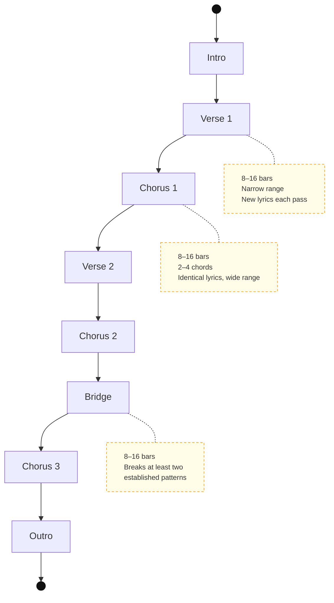
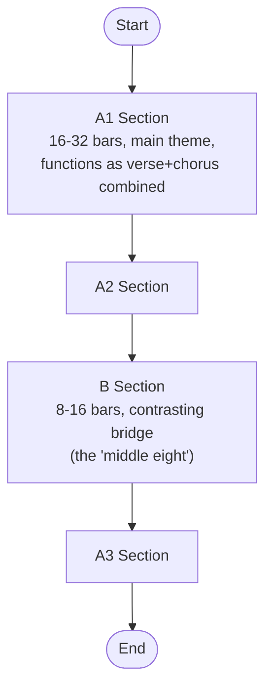

# Lesson 1: Song Structure — From Blank Page to Finished Form

## 1. Why Structure Works (Read Once, Then Get to the Guitar/Piano)

Your brain does two contradictory things while listening to music: it hunts for **repetition** (so it can predict what's coming and relax into the groove) and it hunts for **change** (so it doesn't get bored and switch songs). Structure is the tool that serves both appetites in the same three minutes.

Three jobs get handled by three different sections:

- **Verse** — delivers new information (next part of the story) riding on familiar harmony and a melody shape the listener already trusts.
- **Chorus** — strips the song down to its most repeatable, most singable core. Same words every time, highest energy, simplest chords.
- **Bridge** — breaks the pattern on purpose, right when the listener's brain has locked into "verse-chorus-verse-chorus" autopilot. The disruption is what makes the final chorus hit harder.

That's the entire theory section. Everything from here is execution.

---

## 2. Verse: Build the Scaffolding for the Story

**Job:** carry lyric content, stay out of the chorus's way melodically.

**Hands-on targets:**
- Melodic range: a 6th to an octave. If you're reaching for notes outside that, you're already writing the chorus by accident.
- Motion: mostly stepwise (adjacent scale degrees). Big leaps (6ths, 7ths, octaves) force singers to "aim" for notes, which breaks flow when lyrics change every pass.
- Dynamic: mp–mf. Leave headroom.
- End every verse on something that wants to move — a V chord, or a I chord with rhythmic push (an eighth-note pickup, a drum fill) — never on a dead stop.

**Guitar/piano chart (C major, 16 bars, verse that actually breathes):**

```text
Bars 1–4:   | C      | Am     | F      | G      |
Bars 5–8:   | C      | Am     | F      | G      |
Bars 9–12:  | Dm     | G      | Em     | Am     |
Bars 13–16: | F      | G      | C      | C      |
```

Bars 1–8 repeat the I–vi–IV–V loop so the ear settles in. Bars 9–12 walk a descending-fifths chain (Dm–G–Em–Am) — this is the "something's happening" moment that keeps verse 2 from feeling identical to verse 1 even over the same chords, because the vocal melody can lean into new intervals here. Bars 13–16 resolve back to C with a half-bar of extra tonic (bar 16) that functions as a launch pad into the chorus.

**On guitar:** play this as open-position cowboy chords (C, Am, F, G, Dm, Em) for a folk feel, or move it up with barre-chord CAGED shapes (C-shape at fret 0, A-shape for Am at fret 5 if you want brightness) if the song needs more edge.

**On piano:** left hand plays root-fifth or root-octave in quarter notes; right hand plays simple triads in root position, voice-led so the top note moves the least distance between chords (C→Am: keep C and E, move G to A; Am→F: keep A and C, move E to F).

**Metronome drill:** play the 16-bar progression at 70 BPM until it's clean, then 90, then performance tempo (110–120 for most pop/rock). Sing a placeholder lyric ("la la la, walking down the road") over it at each tempo — if you fumble the words at 110 but not 90, your rhythm, not your fingers, is the weak link. Slow back down and nail the subdivision before pushing tempo again.

---

## 3. Chorus: Compress the Song into Ten Seconds Anyone Can Hum

**Job:** be the moment a stranger could sing back to you after one listen.

**Hands-on targets:**
- Range: 9th to 12th, apex (highest note of the whole song) landing on the most important word.
- Chords: 2–4 total, no exceptions while you're learning this. Complexity kills memorability.
- Rhythm: longer note values than the verse — quarters and halves, not syncopated runs.
- Vowels: put sustained notes on open vowels ("ah," "oh," "ay"), not closed ones ("ee," "oo") — open vowels resonate longer and louder without strain.

**The progression to learn cold: I–V–vi–IV ("the axis")**

```text
Bars 1–4:   | C      | G      | Am     | F      |
Bars 5–8:   | C      | G      | F      | G      |
```

Why this exact progression shows up in hundreds of hits: the top note of each chord moves by a small step or stays put (C→G shares the note G but moves by a 5th, which is still the strongest harmonic motion in Western music; G→Am moves the bass up one step; Am→F shares two notes). Your fretting hand or your right hand on piano barely has to travel, which means you can play it fast and clean under pressure, live.

**Guitar fingering (open position):** C (x32010) → G (320003) → Am (x02210) → F (133211, or the easier xx3211 using only the top four strings). The C-to-G transition is the one beginners fumble — practice it alone at 60 BPM, four beats per chord, until your fingers move as one block, not finger-by-finger.

**Piano voicing (right hand, rootless-ish for smoothness):** 
- C: E-G-C (top note C)
- G: G-B-D or B-D-G (keep a common tone with the previous chord where possible)
- Am: A-C-E
- F: F-A-C

Keep your hand roughly in the same five-key zone; let your thumb and pinky do the small adjustments instead of relocating your whole hand.

**Melody (scale degrees):**
```text
Bars 1–4:   1̂ 2̂ 3̂ 4̂ | 1̂ 2̂ 3̂ 4̂ |
Bars 5–8:   5̂ 5̂ 5̂ 5̂ | 3̂ 2̂ 1̂ rest |
```
The ascending run in bars 1–4 tracks the chord roots moving upward, so it feels inevitable rather than random. The apex (5̂, which is G in C major) sustains for a full bar on bar 5 — that's your hook moment. Put your most important lyric word right there.

**Metronome drill:** sing the chorus melody alone (no instrument) at 100 BPM with a click, hitting the apex note cleanly without scooping up to it. Record yourself. If the apex sounds strained, you're either pitching too high for your range — transpose the whole song down a step or two — or you're attacking the note from below instead of placing it directly (practice starting cold on just that note before attempting the full phrase).

---

## 4. Pre-Chorus (Optional): The 4-Bar Ramp

**Job:** make the listener want the chorus more than they currently do.

**The move:** park on the V chord (or ii–V) and don't resolve it.

```text
Bars 1–4:   | G      | G      | Am     | D      |
Bars 5–8:   | G      | G      | G      | G      |
```

Here, Am–D briefly acts like a ii–V aimed at G (the dominant of C), then bars 5–8 just sit on G for four full bars. That sustained, unresolved dominant is uncomfortable to the ear in a good way — it's the "ready… ready… ready…" before the drop.

**Execution tips:**
- Add a drum element the verse didn't have (open hi-hat, a tom build, a rising cymbal swell) during bars 5–8.
- Keep the melody simple here — a repeated note or small rise. This is not where you show off; it's where you build appetite.
- If you're playing this live on guitar, switch from fingerpicking (verse) to strumming eighth notes during the pre-chorus — the textural shift alone signals "something's about to happen" before the listener consciously notices the chords.

---

## 5. Bridge: Break the Pattern on Purpose

**Job:** violate at least two things the listener has gotten used to, then point back toward the final chorus.

By the time the bridge arrives, the listener has heard verse-chorus twice. Their brain has the pattern memorized and is coasting. The bridge's entire value comes from refusing to continue that pattern — harmonically, melodically, rhythmically, or texturally.

**Strategy A — Start on vi instead of I:**
```text
Bars 1–4:   | Am     | F      | C      | G      |
Bars 5–8:   | Dm     | Am     | F      | G      |
```
Opening on Am instead of C is immediately audible as "not a verse, not a chorus." Bar 8 lands on G (dominant), which resolves hard into C when the final chorus hits.

**Strategy B — Secondary dominant chain (more chromatic pull):**
```text
| D      | G      | E      | F      |
```
D is the V of G (which is the V of C) — it tonicizes G briefly before E tonicizes F. This creates a stepwise chromatic bassline (D→G is a leap, but the overall sequence pulls the ear forward through unfamiliar chords before snapping back to the home key).

**Strategy C — Strip everything and rebuild (works great live and in the studio):**
```text
Bars 1–4:   | C      | C      | C      | C      |
Bars 5–8:   | G      | G      | G      | G      |
```
Drop to just vocal + one instrument for bars 1–4. Add one element every two bars after that (bass enters bar 5, drums re-enter bar 7, everything's back by the chorus). The payoff isn't harmonic complexity, it's the physical sensation of the room filling back up.

**Guitar execution for the stripped bridge:** mute the low strings with your palm, play only triads on the top three strings, let dynamics (not chord complexity) carry the section. On piano, drop to single-note melody line in the right hand with sparse left-hand bass notes on beat 1 only.

**Metronome drill:** practice the transition bar — the last bar of the bridge into the first bar of the final chorus — in isolation. This is the single most important bar in the whole song for audience impact. Loop just those two bars at 80 BPM, then gradually push to performance tempo, until the entrance feels inevitable rather than announced.

---

## 6. Outro: Land the Plane

**Fade-out** (for high-energy songs): loop the chorus 2–4 times while gradually dropping instruments and reducing volume. Easiest version: drummer drops to just hi-hat, bass simplifies to root notes only, vocal ad-libs over the fade.

**Conclusive outro** (for ballads, narrative songs): strip back to verse-level instrumentation, end on a clear V–I or IV–I cadence, let the final chord ring out fully (no cutoff). On piano, this often means a slow arpeggiated tonic chord with the sustain pedal held through the final beat.

**Practical rule:** don't write a third kind of outro ("new musical idea that's never been heard"). It confuses the listener right when they expect closure. Recycle existing material; change only the dynamics.

---

## 7. Full Form Map



### Timing map for a 3-minute song (120 BPM, 4/4 — 1 bar = 2 seconds)

| Section | Bars | Cumulative bars | Time |
|---|---|---|---|
| Intro | 8 | 8 | 0:00–0:16 |
| Verse 1 | 16 | 24 | 0:16–0:48 |
| Chorus 1 | 8 | 32 | 0:48–1:04 |
| Verse 2 | 16 | 48 | 1:04–1:36 |
| Chorus 2 | 8 | 56 | 1:36–1:52 |
| Bridge | 8 | 64 | 1:52–2:08 |
| Chorus 3 | 8 | 72 | 2:08–2:24 |
| Chorus 4 (optional repeat) | 8 | 80 | 2:24–2:40 |
| Outro | 10 | 90 | 2:40–3:00 |

**Why bridge placement around bar 56 works:** it sits close to the point where roughly 60–65% of the song has elapsed. Arrive earlier and the final chorus feels rushed; arrive later and the listener's attention has already started drifting before you deliver the payoff. You don't need to calculate this precisely — just don't let your bridge show up after the 70% mark.

---

## 8. Other Forms Worth Knowing

### AABA (jazz standards, early rock, singer-songwriter)



The A section does double duty — it's melodically memorable like a chorus but carries new lyrics like a verse. There's no separate hook section. "Yesterday" (The Beatles) runs this with ~8-bar A sections and an 8-bar B. If you're writing something intimate and lyric-driven, this form avoids the "shout the hook four times" feel of pop structure.

### Strophic (pure verse repetition, no chorus)

Each pass uses identical music, new lyrics, no chorus at all. Trades hook memorability for narrative depth — used in folk ballads and story songs ("The Times They Are A-Changin'"). If your song is lyric-first and the story is the hook, don't force a chorus onto it. Write four or five verses and let repetition of the melody (not the words) carry the memorability.

### Through-composed (no repeated sections)

Each section is new material. High novelty, low hummability — use sparingly, and only when the piece is long enough (4+ minutes) to support continuous development without feeling like a medley of unrelated song fragments ("Bohemian Rhapsody" is the reference case, though even it repeats material within sections).

---

## 9. Dynamics: Making the Chorus Actually Feel Bigger

Differentiating verse from chorus isn't only a harmony problem — it's an arrangement and dynamics problem. Here's a build that works across most genres:

| Section | Drums | Bass | Guitar/Keys | Vocal |
|---|---|---|---|---|
| Verse 1 | kick + hi-hat only | root notes, simple | fingerpicking or sparse chords | lead, solo |
| Chorus 1 | full kit, open hi-hat or ride | moving/syncopated | strummed or power chords | lead + harmony |
| Verse 2 | same as V1, maybe add a ghost snare | same, slight variation | add one texture (pad, second guitar) | lead |
| Chorus 2 | tighter kick pattern, crash on downbeat | more active | doubled, fuller voicing | lead + 2-part harmony |
| Bridge | strip to almost nothing, or flip the pattern entirely | minimal or silent | solo instrument or isolated vocal | lead alone, or rap |
| Chorus 3 (final) | maximal — kick doubles, layered cymbals | driving, highest activity | doubled and panned wide | lead + 3-part harmony |

**Rule of thumb you can apply on any instrument, right now:** each chorus must be audibly denser than the one before it. If chorus 2 sounds identical to chorus 1, add exactly one new layer before you record it — a harmony vocal, a second guitar an octave up, a tambourine. One new element is enough; you're not trying to double the arrangement, just signal escalation.

**The half-step/whole-step trick for the final chorus:** transpose the last chorus up a half-step (C→Db) or whole-step (C→D). On guitar, use a capo if the new key is awkward in open position, or shift your barre-chord shapes up one or two frets. On piano, you'll need to adapt your hand shapes and fingerings to account for the new layout of black and white keys. This single move creates an instant, cheap-but-effective lift; use it once per song, never twice.

---

## 10. Build-the-Song Lab: Full Workflow

### Step 1 — Harmonic skeleton (30–45 minutes)

Pick a key you can comfortably sing in (test this first — hum your melody idea before committing to a key, not after). Write out the chord chart for every section before touching melody:

```text
Intro (8 bars):   | C | Am | F | G | C | Am | F | G |
Verse (16 bars):  | C | Am | F | G | C | Am | F | G | Dm | G | Em | Am | F | G | C | C |
Chorus (8 bars):  | C | G | Am | F | C | G | F | G |
Bridge (8 bars):  | Am | F | C | G | Dm | Am | F | G |
Outro (8 bars):   | C | C | C | C | F | C | G | C |
```

Play this straight through on one instrument with a metronome at 90 BPM before adding anything else. If a transition feels awkward under your fingers, it will feel awkward to the listener too — fix it now, not after you've written melody and lyrics on top of it.

### Step 2 — Melody (30–45 minutes)

Sing scratch syllables ("da da da") over the chord chart. Don't write lyrics yet — lyrics lock you into syllable counts before the melodic shape is solid. Record yourself improvising over each section 5–10 times and keep the take that:
- Is easiest to repeat identically on the second try (that repeatability is the test for "is this actually memorable or did I just get lucky once")
- Lands the highest note in the chorus, not the verse or bridge
- You can sing in one breath per 4-bar phrase

### Step 3 — Lyrics (45–60 minutes)

Now fit words to the melody you already locked in. Count syllables against the scratch vocal — if your scratch melody had 8 notes in a phrase, your lyric needs roughly 8 syllables (allowing for held notes covering 2+ syllables, or rests). Write the chorus hook line first — it's your title, your most repeated phrase, and the hardest constraint, so solve it before the easier verse narrative.

### Step 4 — Arrangement pass (30 minutes)

Using the dynamics table in Section 9, assign specific parts: what does the drummer play in bar 9 vs bar 25? What drops out at the start of the bridge? Write it down — vague arrangement plans ("make it bigger") don't survive contact with an actual recording session.

### Step 5 — Record and diagnose

Record a rough "skeleton" take: one chord instrument + scratch vocal, straight through, with the metronome audible in your headphones (or visible on a click track). Listen back and ask:
- Can I tell verse from chorus with the vocal muted, just from the instrumental texture?
- Does the bridge sound like a different section, or a third verse?
- Does the final chorus feel like the loudest/densest moment, or does chorus 2 already peak?

Fix problems at this stage — it's much cheaper to re-chart eight bars now than to redo a full multitrack session later.

---

## 11. Diagnosing a Broken Structure

### Verse and chorus sound the same
**Check:** Is the chorus using 2–4 chords while the verse uses more? Is the chorus melody at least a few scale steps higher on average? Is the chorus rhythm using longer note values?
**Fix:** Pick the two weakest contrast points and exaggerate them. If melody is nearly identical, simplify the chorus harmony hard and add one instrumental layer that isn't in the verse at all.

### Bridge feels like a third verse
**Check:** Does it start on I? Does it reuse the exact same chord progression as the verse? Is there zero new instrumentation?
**Fix:** Change the starting chord to vi or IV at minimum. If you can only change one thing, change the opening chord — it's the cheapest, most effective fix available.

### Song peaks too early or too late
**Check:** Is your strongest melodic idea sitting in verse 1 with nothing left for the climax? Is your intro eating more than 12 bars before any vocal enters?
**Fix:** Save your best idea (highest note, strongest lyric line) for the final chorus. Trim the intro — 8 bars is almost always enough; anything past 12 risks losing a streaming listener before the hook arrives.

### Chorus isn't sticking in people's heads
**Check:** Can you sing it back after hearing it twice, without the recording playing? Is the range under a 10th? Is the rhythm free of rapid-fire syncopation?
**Fix:** Cut the range. Simplify the rhythm to mostly quarter and half notes. Repeat the hook phrase within the chorus itself (first half states it, second half restates with minor variation) — repetition inside the chorus is what makes it stick after only one listen.

---

## 12. Quick-Reference Chord Progressions (Transpose to Any Key)

| Name | Progression (in C) | Best use |
|---|---|---|
| The Axis | C–G–Am–F | Chorus, pre-chorus, universal hook |
| Simple folk | C–F–G–F | Verse or whole song, maximum singability |
| Descending motion | Dm–G–C–F (ii–V–I–IV) | Verse, pre-chorus, adds sophistication |
| Relative minor cycle | Em–Am–Dm–G (iii–vi–ii–V) | Bridge, melancholic verse |
| Reordered axis | Am–F–C–G (vi–IV–I–V) | Introspective verse or chorus opening |
| 12-bar blues | C–C–C–C–F–F–C–C–G–F–C–G | Blues, roots rock, shuffle feel |
| Minor descent | Am–G–F–G (i–VII–VI–VII, relative to A minor) | Dark pop, rock, dramatic verses |

Learn each of these in closed voicings on guitar (so you can transpose by sliding the whole shape up the neck) and in root-position triads on piano before you try inverting or adding extensions — get the functional motion under your fingers first.

---

## 13. Genre Snapshots (Adjust the Template, Don't Discard It)

**Pop:** chorus must land by the 30-second mark. Short intro (4–8 bars), 8-bar verses and choruses, bridge often features a rap, breakdown, or isolated vocal. Each chorus repeat adds one audible layer.

**Hip-hop:** 16-bar verses carry the lyrical weight; the beat stays largely constant across sections, so contrast comes from flow density and delivery, not harmony. Hook is usually sung, providing melodic relief from the rapped verses.

**Rock:** pre-chorus is standard. Bridge often means an instrumental solo section (8–16 bars) rather than a vocal moment. Songs commonly run past 4 minutes because solos and extended choruses add length without adding new "sections" to track.

**Singer-songwriter:** may run two verses before the first chorus — narrative setup matters more than hitting the hook fast. Instrumentation often builds gradually across verses (solo guitar → add strings/pad → full band) rather than jumping instantly at the chorus.

**EDM:** structure is build/drop, not verse/chorus. Pre-drop strips the beat down for 8–16 bars; the drop is the "chorus" equivalent — maximal density, often with no lyric. Multiple build/drop cycles are normal; songs commonly run 5+ minutes.

---

## 14. Session Checklist Before You Hit Record

**Verse**
- [ ] Range stays within a 6th–octave
- [ ] Mostly stepwise melody
- [ ] Ends on V or a tonic with forward rhythmic push

**Chorus**
- [ ] 2–4 chords only
- [ ] Apex note on the most important lyric
- [ ] Rhythm simpler (longer notes) than the verse
- [ ] You can sing it back after two listens

**Bridge**
- [ ] Opens on a non-tonic chord, or introduces new harmony/texture/rhythm
- [ ] Appears exactly once
- [ ] Final bar points toward the chorus (dominant chord, rising dynamic, or both)

**Whole song**
- [ ] Each chorus repeat is denser than the last
- [ ] Climax (final chorus) lands around 60–70% through the total runtime
- [ ] Intro is 12 bars or fewer
- [ ] You can tell verse from chorus with the vocal muted

---

## Closing

The verse-chorus-bridge toolkit isn't a cage — it's scaffolding that lets you spend your creative energy on melody, lyric, and tone instead of re-solving "how do I keep this listener's attention" from scratch every time. Learn the chord shapes under your fingers, drill the transitions at a slow metronome tempo before pushing to performance speed, and use the diagnostic checklist after every rough recording. Once the mechanics are automatic, the structure disappears into the background and all anyone hears is the song.
