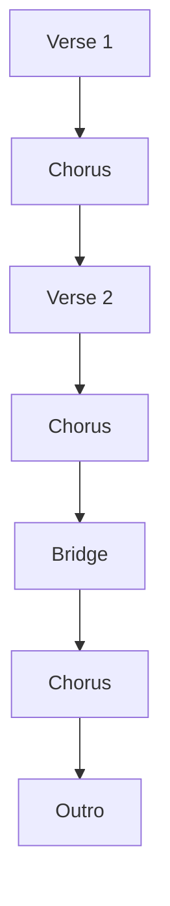

# Lesson 1: Song Structure

## 1. First-Principles Intuition & Invariants

The architecture of a song mirrors the design of a complex software system, where each component must harmonize to produce a cohesive and compelling whole. Just as a software engineer relies on principles of data structures, algorithms, and system architecture to build robust applications, a composer must understand the fundamental components of song structure to craft meaningful and engaging musical narratives. At the heart of song structure lies the interplay between repetition and variation, a principle that resonates across all domains of music and beyond.

In songwriting, the primary components are the verse, chorus, and bridge. These sections serve distinct yet interconnected roles, akin to the modules in a well-designed software system. The verse typically introduces the thematic material, setting the scene and developing the narrative. It forms the foundational layer, providing context and depth to the song. The chorus, in contrast, is the climax, the moment of peak emotional intensity and recognition. It is the hook that lingers in the listener's mind, the refrain that ties the song together. The bridge serves as a transitional element, offering a moment of respite or a twist, before leading back to the chorus or conclusion.

Mathematically, song structure can be viewed through the lens of symmetry and asymmetry. The repetition of the chorus, for instance, creates a sense of symmetry, reinforcing the song's central theme and providing a familiar anchor for the listener. Conversely, the verse and bridge introduce asymmetry, presenting new material and maintaining the listener's interest. This balance between repetition and variation is crucial for the structural integrity of the song, ensuring that it remains both memorable and engaging.

From a systems perspective, song structure can be likened to a state machine, where each section represents a distinct state, and transitions between sections are governed by specific rules. The verse-to-chorus transition, for example, is typically marked by a change in dynamics, melody, or harmony, signaling a shift in emotional intensity. Similarly, the bridge-to-chorus transition often involves a modulation or a change in rhythm, creating a sense of anticipation and resolution.

## 2. Core Architecture & Mechanics

To dissect the internal architecture of a song, we can employ a Mermaid diagram to visualize the typical flow of sections in a verse-chorus-bridge structure. This diagram will serve as a blueprint for understanding the relationships between different components and the mechanisms that govern their interactions.

In this diagram, we see the typical progression of a verse-chorus-bridge song. The verse introduces the thematic material, setting the scene for the chorus, which provides the emotional climax. The second verse reinforces the narrative, leading back to the chorus for another round of emotional intensity. The bridge introduces a new element, offering a moment of respite or a twist, before leading back to the chorus for the final emotional peak. The outro serves as a conclusion, bringing the song to a close.

To further illustrate the mechanics of song structure, consider a concrete example. Suppose we are composing a song in the key of C major, with a verse-chorus-bridge structure. The verse might begin with a simple chord progression, such as C - Am - F - G, establishing the tonal center and introducing the thematic material. The chorus could then feature a more prominent melody and a change in dynamics, perhaps using a progression like C - G - Am - F, to create a sense of emotional intensity and recognition. The bridge might introduce a new chord progression, such as Dm - G - Em - C, offering a moment of contrast and resolution before leading back to the chorus for the final emotional peak.

## 3. High-Performance Optimization & Failure Modes

In songwriting, high-performance optimization involves maximizing the emotional impact of each section while ensuring structural coherence. This requires careful consideration of the relationships between different components and the mechanisms that govern their interactions. One key aspect of optimization is the use of repetition and variation to create a sense of symmetry and asymmetry, as discussed earlier. By repeating the chorus and varying the verse and bridge, we can create a sense of familiarity and novelty, keeping the listener engaged throughout the song.

Another important aspect of optimization is the use of dynamics and instrumentation to create contrast and emphasis. For example, the verse might feature a simple piano melody and sparse instrumentation, while the chorus could feature a full band and a more prominent melody, creating a sense of emotional intensity and recognition. The bridge might introduce a new element, such as a solo or a change in rhythm, offering a moment of contrast and resolution before leading back to the chorus for the final emotional peak.

Failure modes in songwriting can arise from a lack of structural coherence or emotional impact. A song that lacks a clear verse-chorus-bridge structure may feel disjointed and confusing, failing to create a sense of familiarity and novelty. Similarly, a song that fails to generate emotional intensity or recognition may leave the listener indifferent or disinterested. To mitigate these failure modes, it is crucial to carefully consider the relationships between different components and the mechanisms that govern their interactions, ensuring that each section serves a distinct yet interconnected role in the overall narrative.

The architecture of a song is a complex and multifaceted system, requiring careful consideration of repetition and variation, symmetry and asymmetry, and dynamics and instrumentation. By understanding the fundamental components of song structure and the mechanisms that govern their interactions, we can craft meaningful and engaging musical narratives that resonate with listeners. Just as a software engineer relies on principles of data structures, algorithms, and system architecture to build robust applications, a composer must grasp the fundamental components of song structure to craft compelling and memorable music.
