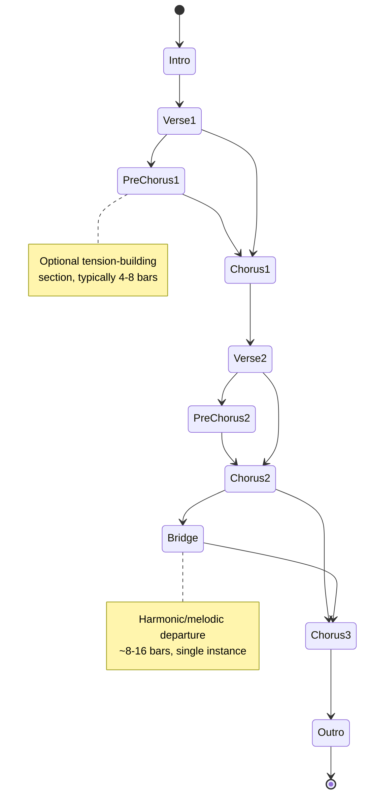
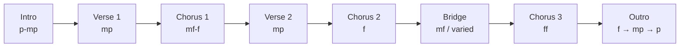

# Lesson 1: Song Structure

## 1. First-Principles Intuition & Invariants

Song structure operates on a fundamental tension: the human cognitive system craves both pattern recognition and novelty. This duality emerges from the architecture of memory consolidation—repetition encodes information into long-term storage, while variation maintains attentional engagement by preventing habituation. A song's structure exploits this by establishing predictable frameworks (formal sections) while modulating their content (melodic, harmonic, and textural variation).

The basic building blocks—verse, chorus, and bridge—are not arbitrary conventions but rather evolved solutions to specific cognitive and emotional functions. The **verse** serves as the narrative vehicle, carrying unique lyrical content across iterations while maintaining consistent melodic and harmonic scaffolding. This creates semantic variance within formal constancy. The **chorus** functions as the song's identity kernel—the maximally compressed representation of its emotional and melodic core. It achieves high memorability through four mechanisms: melodic contour salience (often occupying the highest register of the song), harmonic stability (frequently emphasizing tonic or dominant functions), lyric repetition (identical text across instances), and dynamic intensity (fuller instrumentation and amplitude). The **bridge** introduces controlled instability—a deliberate departure from established patterns that heightens structural tension before resolution. Neurologically, this maps to prediction error: the brain's expectation model encounters a deviation, triggering increased attention and dopaminergic response upon the subsequent return to familiar material.

From an information-theoretic perspective, song structure optimizes the balance between entropy (information content) and redundancy (predictability). Pure entropy—continuous novelty with no repetition—overwhelms cognitive processing and yields no memorable anchors. Pure redundancy—unvarying repetition—triggers rapid habituation and attentional withdrawal. Effective song structure maintains entropy in local details (verse lyrics, harmonic embellishments) while establishing redundancy in global architecture (chorus recurrence, overall form).

The mathematical backbone of song structure can be expressed through graph theory and formal grammars. Each section type represents a node, and transitions between sections constitute edges. A typical verse-chorus song forms a directed graph with specific traversal rules: verses generally precede choruses (establishing context before climax), bridges appear in later structural positions (after pattern establishment), and choruses often serve as terminal nodes for multiple paths (acting as attractor states). This graph structure constrains compositional choices while permitting sufficient variation for artistic expression.

Temporal proportions exhibit cross-cultural regularities. The Golden Ratio (φ ≈ 1.618) appears in the placement of structural climaxes: in a 3-minute song (180 seconds), the primary structural arrival often occurs around 111 seconds (180/φ), corresponding to the final chorus or bridge transition. This reflects deep perceptual preferences for asymmetric balance rather than exact midpoint divisions. Section durations themselves tend toward powers of two in measure count (4, 8, 16 bars) due to the hierarchical metric structure of Western tonal music, where phrase lengths nest recursively: a 16-bar verse comprises two 8-bar periods, each containing two 4-bar phrases, each containing two 2-bar subphrases. This fractal-like organization facilitates cognitive parsing.

The harmonic trajectory of song sections follows predictable patterns derived from tonal syntax. Verses typically begin on tonic harmony, establishing tonal center, and may modulate through predominant regions (ii, IV, vi) before reaching dominant arrival points. Choruses gravitate toward simpler, more stable progressions—often I-V-vi-IV or variants—that maximize tonal clarity. Bridges frequently employ harmonic departure: relative major/minor shifts, modal mixture (borrowing chords from parallel modes), or secondary dominant chains that create forward momentum. These harmonic strategies are not stylistic choices but rather exploit the psychoacoustic properties of pitch relationships and voice-leading efficiency.

## 2. Core Architecture & Mechanics

Song structure manifests as a finite state machine with section types as states and compositional rules as transition functions. The following diagram models a standard verse-chorus-bridge architecture with common variants:



This state machine encodes several invariant properties:

1. **Unidirectional flow**: Sections generally progress forward temporally, with the exception of returns to the chorus (the only section permitting multiple instantiations in standard forms).

2. **Chorus as attractor**: Multiple paths converge on chorus states, reflecting its role as the structural and emotional fulcrum.

3. **Bridge singularity**: The bridge appears at most once, positioned in the latter third of the song's duration, serving as a one-time contrast agent.

4. **Terminal sections**: Intro and outro occupy boundary positions, framing the core material.

To examine the internal mechanics at a granular level, consider the harmonic and melodic transformations across sections. A verse-chorus pair in C major might employ the following architecture:

**Verse harmonic structure** (16 bars):
```
| C      | Am     | F      | G      |  (bars 1-4: tonic → submediant → subdominant → dominant)
| C      | Am     | F      | G      |  (bars 5-8: repeat, establishing pattern)
| Dm     | G      | Em     | Am     |  (bars 9-12: predominant exploration, rising tension)
| F      | G      | C      | C      |  (bars 13-16: dominant resolution to tonic, cadential arrival)
```

**Chorus harmonic structure** (8 bars):
```
| C      | G      | Am     | F      |  (bars 1-4: I-V-vi-IV, "axis progression")
| C      | G      | F      | G      |  (bars 5-8: variation with dominant emphasis for cadential drive)
```

The verse employs a 16-bar period with internal tension (Dm-G-Em-Am represents a descending-fifths sequence in measures 9-12) before resolution. The chorus compresses this trajectory into 8 bars, using the ubiquitous I-V-vi-IV progression—a harmonic pattern that maximizes voice-leading efficiency and tonal clarity. This progression's prevalence stems from its optimal balance of harmonic movement (three chord changes) and melodic stepwise motion in the upper voice: C → D → E → F (scale degrees 1̂-2̂-3̂-4̂), creating a singable melodic contour.

Melodic design follows complementary principles. Verse melodies typically occupy a narrower range (often a sixth or octave) and feature conjunct motion (stepwise intervals) to facilitate lyric delivery and narrative focus. Chorus melodies expand the range (often to a tenth or greater), emphasizing the highest pitches of the song (the "apex notes") to maximize salience and emotional intensity. This register differentiation exploits psychoacoustic brightness: higher frequencies attract attention and convey excitement or urgency.

The bridge introduces deliberate disruption. Common bridge strategies include:

1. **Relative key modulation**: From C major to A minor, preserving the pitch collection while shifting tonal center.
2. **Parallel mode mixture**: From C major to C minor, altering the third scale degree (E → E♭) for affective contrast.
3. **Mediant relationships**: Modulating to E♭ major or A♭ major, creating chromatic relationships that sound remote yet share common tones.
4. **Rhythmic/metric shift**: Introducing syncopation, tempo changes, or time signature variations (e.g., transitioning from 4/4 to 6/8 for two bars).

A concrete bridge implementation in C major might employ:

**Bridge harmonic structure** (8 bars):
```
| Am     | F      | C      | G      |  (bars 1-4: begins on vi, inverting typical I-start)
| Dm     | Am     | F      | G      |  (bars 5-8: predominant emphasis, building tension toward chorus return)
```

This bridge leverages the submediant (vi) opening to create immediate contrast—the first time in the song we begin a section away from tonic. The predominant emphasis in bars 5-8 (Dm, subdominant minor, pulling strongly toward dominant) generates forward momentum into the final chorus.

Dynamic contour across sections follows an archetypal envelope:



This dynamic architecture creates a macro-level crescendo, with each chorus iteration increasing in intensity. The bridge often employs dynamic contrast—either stripping back to sparse instrumentation (highlighting the texture change) or maintaining intensity but altering timbre. The outro decrescendos, providing structural closure through energy dissipation.

Instrumentation layers contribute to sectional differentiation. A typical arrangement might deploy:

- **Verse 1**: Bass, drums (minimal pattern), acoustic guitar, lead vocal
- **Chorus 1**: Previous + electric guitar (power chords), background vocals (harmony), increased drum complexity
- **Verse 2**: Return to verse instrumentation, possibly adding subtle pad or texture
- **Chorus 2**: Previous chorus instrumentation + additional harmonic layers
- **Bridge**: Instrumentation reduction OR introduction of new timbre (strings, synthesizer solo, isolated vocal line)
- **Chorus 3**: Full instrumentation, maximal density

This layering strategy creates textural differentiation that reinforces formal boundaries, allowing listeners to parse structure through timbral cues even without conscious analysis.

## 3. Temporal Proportions & Formal Variants

Standard song durations cluster around 3-4 minutes (180-240 seconds) in commercial contexts, a constraint historically imposed by physical media (7-inch vinyl singles) but now maintained by streaming economics and attention metrics. Within this window, section proportions follow regular patterns:

- **Intro**: 4-8 bars (8-16 seconds at 120 BPM)
- **Verse**: 8-16 bars (16-32 seconds)
- **Pre-chorus**: 4-8 bars (8-16 seconds)
- **Chorus**: 8-16 bars (16-32 seconds)
- **Bridge**: 8-16 bars (16-32 seconds)
- **Outro**: 4-16 bars (8-32 seconds)

A prototypical 3-minute song at 120 BPM (2 beats per second) comprises 360 beats or 90 bars of 4/4 time. A common distribution:

```
Intro:      8 bars   →   8 bars elapsed
Verse 1:   16 bars   →  24 bars elapsed
Chorus 1:   8 bars   →  32 bars elapsed
Verse 2:   16 bars   →  48 bars elapsed
Chorus 2:   8 bars   →  56 bars elapsed
Bridge:     8 bars   →  64 bars elapsed
Chorus 3:   8 bars   →  72 bars elapsed
Chorus 4:   8 bars   →  80 bars elapsed
Outro:     10 bars   →  90 bars total
```

This structure places the bridge arrival at bar 56 (approximately 112 seconds), close to the golden ratio division of 180 seconds (111 seconds), creating asymmetric balance.

Beyond the standard verse-chorus-bridge form, several architectural variants serve specific functions:

**AABA Form** (Tin Pan Alley standard, prevalent in jazz and early rock):
```
A section (8-16 bars): Main thematic material
A section (repeat): Reinforces theme with lyric variation
B section (8-16 bars): Contrasting material (bridge equivalent)
A section (return): Thematic return, often with variation
```

This form predates the verse-chorus distinction, treating the A section as a self-contained unit combining narrative and melodic hook. The Beatles' "Yesterday" exemplifies this structure.

**ABABCB Form** (verse-chorus with extended bridge):
```
A (Verse 1) → B (Chorus 1) → A (Verse 2) → B (Chorus 2) → C (Bridge) → B (Chorus 3)
```

This represents the standard modern pop architecture, with the bridge (C) providing a one-time contrast before the final chorus.

**Through-composed Form** (continuous development without recapitulation):

Sections progress without returning to earlier material. Common in art song, progressive rock, and contemporary composition. Queen's "Bohemian Rhapsody" approximates this structure, though it incorporates internal repetitions within its distinct movements.

**Strophic Form** (verse-only structure):

Each verse uses identical music with different lyrics. Folk traditions frequently employ this form (e.g., Bob Dylan's "The Times They Are A-Changin'"), prioritizing lyric narrative over melodic hook. The absence of a chorus shifts memorability to the verse melody itself.

**Rondo Form** (ABACA or ABACADA):

A refrain (A) alternates with contrasting episodes (B, C, D). Less common in popular music but appears in extended compositions. The refrain functions similarly to a chorus, but the multiple contrasting sections exceed typical bridge singularity.

## 4. High-Performance Optimization & Failure Modes

Optimizing song structure requires balancing multiple competing objectives: memorability (high repetition), engagement (sufficient novelty), emotional arc (dynamic trajectory), and efficiency (time constraints). These objectives can be formalized as an optimization problem:

**Maximize**: Memorability (M) + Engagement (E) + Emotional Impact (I)  
**Subject to**: Duration constraint (D ≤ D_target), structural coherence (C > C_min)

Where:
- M increases with chorus repetition and melodic simplicity
- E increases with harmonic/melodic variation and textural contrast
- I relates to dynamic range and climax placement
- C represents formal clarity (distinct sections, clear transitions)

**Memorability optimization** strategies:

1. **Chorus front-loading**: Positioning the first chorus early (within the first 30-45 seconds) accelerates hook exposure. Many contemporary pop songs employ 8-bar verses followed immediately by the chorus, maximizing the "skip window" capture on streaming platforms.

2. **Melodic contour salience**: Choruses should feature distinctive interval leaps (fourths, fifths, or octaves) at phrase boundaries, creating memorable "shape" patterns. The opening of Journey's "Don't Stop Believin'" uses a rising fourth (G → C) as its primary motif.

3. **Lyric economy**: Chorus lyrics should compress to 10-20 syllables, maximizing repetition efficiency. "Hey Jude" reduces to 6 syllables in its primary hook.

4. **Phonetic optimization**: Emphasize open vowels (ah, oh, ay) on apex notes, as these maximize vocal resonance and brightness. Consonants like 't', 'k', and 'p' work well on rhythmically accented short notes.

**Engagement optimization** strategies:

1. **Verse lyric variation**: Each verse iteration should advance narrative or present new imagery while maintaining musical consistency. Identical verse lyrics (except in strophic forms) represent a missed opportunity for content delivery.

2. **Pre-chorus deployment**: Inserting a 4-8 bar pre-chorus between verse and chorus adds structural complexity and creates anticipation through harmonic/dynamic build. The pre-chorus often employs dominant prolongation or chromatic approach chords.

3. **Rhythmic displacement**: Shifting melodic motifs by half a beat across sections (e.g., on-beat verse phrasing versus syncopated chorus phrasing) creates subtle differentiation without requiring new melodic material.

4. **Bridge content maximization**: The bridge should introduce the most distinctive element of the song—a new chord progression, unexpected modulation, instrumental solo, or rhythmic pattern not heard elsewhere. Bridges that merely transpose existing material to a new key underutilize this structural opportunity.

**Emotional impact optimization** strategies:

1. **Climax placement**: The final chorus should represent the song's emotional and dynamic peak. Strategies include: key modulation up a half-step or whole-step (the "truck driver's modulation"), addition of background vocal layers, doubling of rhythmic density in drums, or introduction of highest register notes.

2. **Dynamic range exploitation**: The difference between softest (verse) and loudest (final chorus) sections should span at least 6-10 dB in perceived loudness, creating dramatic contrast. Over-compression (limiting dynamic range for loudness) sacrifices this impact.

3. **Texture gradient**: Introduce instrumentation incrementally across sections rather than deploying the full arrangement immediately. A sparse first verse allows room for textural build.

4. **Outro design**: Effective outros either maintain energy (fade-out while repeating final chorus, suggesting the song could continue indefinitely—see "Don't Stop Believin'") or achieve resolution (decrescendo with harmonic closure, providing definitive structural end). The choice affects perceived emotional finality.

**Common failure modes** and diagnostic patterns:

**Failure Mode 1: Verse-Chorus Undifferentiation**

Symptom: Listeners cannot distinguish verse from chorus; no clear "hook" emerges.

Diagnosis: Insufficient contrast in one or more parameters: melody, harmony, rhythm, dynamics, or instrumentation. Often results from compositional incremental development without step-back evaluation of section distinctiveness.

Remedy: Ensure chorus differentiates on at least three axes:
- Register (apex notes in chorus)
- Harmonic simplicity (clearer progressions in chorus)
- Dynamic intensity (increased amplitude/density in chorus)
- Rhythmic density (more syllables per bar or more sustained notes)

**Failure Mode 2: Bridge Redundancy**

Symptom: Bridge section feels like "another verse" or fails to provide meaningful contrast.

Diagnosis: Bridge reuses verse harmonic progression or melodic material without sufficient transformation. Occurs when bridge is composed as "filler" rather than deliberate contrast.

Remedy: Bridge must violate at least one established pattern:
- Begin on a chord not used as an initial sonority elsewhere (e.g., vi or IV)
- Introduce new rhythmic pattern (triplets if previous sections used straight eighths)
- Feature instrumental solo rather than vocal lead
- Employ harmonic sequence not heard in verse or chorus

**Failure Mode 3: Structural Imbalance**

Symptom: Song feels "back-loaded" (too much material in the latter half) or "front-loaded" (exhausts ideas early, trailing off).

Diagnosis: Disproportionate section durations or improper climax placement. Back-loading often results from extended bridges or excessively long final choruses. Front-loading occurs when the strongest material appears in the first chorus with insufficient development afterward
