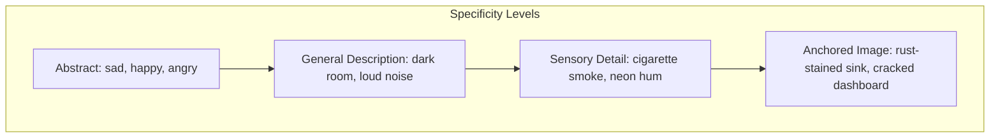
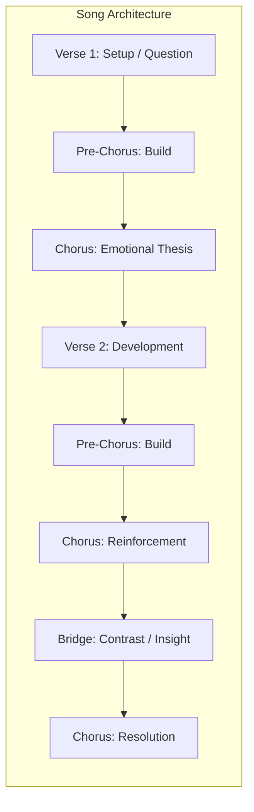
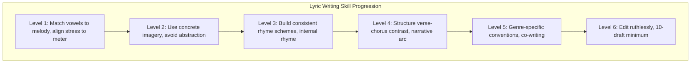

# Lesson 2: Lyric Writing

## 1. First-Principles Intuition & Invariants (15%)

Lyric writing is the discipline of fitting words to music. Unlike poetry, which exists independently on the page, lyrics must synchronize with melody, rhythm, and harmonic motion while transmitting emotion through sung vowels and articulated consonants. Three invariants govern all effective lyric writing:

**1. Phonological Fit:** Vowels sustain melody; consonants articulate rhythm. Open vowels (/aː/, /oʊ/, /iː/) hold long notes cleanly. Plosives (/p/, /t/, /k/) create percussive attacks. Fricatives (/s/, /f/, /ʃ/) generate sustained tension. Nasals (/m/, /n/, /ŋ/) resonate through the vocal tract. The distribution of these phonemes within a line must align with the music's contour and character.

**2. Prosodic Mapping:** Natural speech stress must align with musical accent. English is a stress-timed language—we emphasize "HOME-less" not "home-LESS." Misaligned stress creates awkward phrasing ("I LOVE you" on downbeats sounds forced if the melody emphasizes "LOVE" when speech would emphasize "you"). Skilled lyricists map semantic emphasis to strong beats and long note durations.

**3. Semantic-Emotional Economy:** A three-minute song delivers 200-400 words. Every word must justify its presence through specificity, emotional resonance, or structural necessity. Replace generic descriptors ("beautiful," "amazing") with concrete sensory detail ("rust-stained," "neon-lit"). Use active verbs over passive constructions. Cut unnecessary articles and pronouns when the music's rhythm demands it.

Understanding these constraints allows you to write lyrics that feel inevitable—where the words seem inseparable from the melody.

## 2. Hands-On Practice & Execution (85%)

### 2.1 Vowel Mapping & Melodic Contour

**Core Technique:** Match vowel shapes to melodic phrase peaks and valleys. High notes require open vowels; closed vowels strain the voice and obscure pitch.

**Vowel Classification by Singing Height:**
- **High-range friendly:** /aː/ (ah), /oʊ/ (oh), /ɔː/ (aw), /æ/ (ah as in "cat")
- **Mid-range stable:** /ɛ/ (eh), /ʌ/ (uh), /eɪ/ (ay)
- **Low-range or short notes:** /ɪ/ (ih), /ʊ/ (oo as in "book"), /uː/ (oo as in "moon")

**Drill 2.1.1: Vowel-Melody Mapping**

Take a simple melodic phrase (use the melody of "Twinkle, Twinkle, Little Star" or any folk melody you know):

```
Melody:  C  C  G  G  A  A  G  (half note)
         1  1  5  5  6  6  5
```

**Step 1:** Sing the melody on pure vowels, notating which feel comfortable:
- "ah ah ah ah ah ah ah" ✓ (open, easy throughout)
- "ee ee ee ee ee ee ee" ✗ (strained on high A)
- "oh oh oh oh oh oh oh" ✓ (resonant, stable)

**Step 2:** Now set the phrase "I wish I could go home tonight":

```
Melody:  C    C    G    G    A     A     G
Words:   I    wish I    could go    home  to-night
Vowels: /aɪ/ /ɪ/  /aɪ/ /ʊ/  /oʊ/  /oʊ/  /aɪ/
```

The word "home" falls on the high A—perfect, because /oʊ/ is an open vowel. If you had written "I wish I could live there tonight," the word "live" (/ɪ/) on the high A would feel closed and pinched.

**Drill 2.1.2: Vowel Substitution Repair**

Given this melody and lyric:

```
Melody:  D  E  F#  G  A  (whole note)
Words:   I  am  liv-ing  free
Problem: "living" places /ɪ/ on the high A
```

**Repair strategies:**
1. **Substitute with open vowel word:** "I am finally free" (/aɪ/ on high A)
2. **Restructure phrase:** "I am free at last" (moves /iː/ to high A)
3. **Accept and work with it:** Use the closed vowel for intentional tension, then resolve

**Exercise:** Take a melody you've written or a familiar tune. Sing it on pure vowels first, noting where open vs. closed vowels feel natural. Then set words, ensuring your most important emotional beats land on singable vowels at their respective melodic heights.

### 2.2 Stress Pattern & Metric Alignment

**Core Technique:** Align natural speech emphasis with strong beats in the meter. English speech stress precedes unstressed syllables in most words (TRA-vel, BEau-ti-ful, un-der-STAND). Musical meter organizes beats into strong-weak patterns (4/4: STRONG-weak-medium-weak).

**Drill 2.2.1: Clap-and-Speak Alignment**

Set a metronome to 80 BPM in 4/4 time. Clap on beats 1 and 3 (strong and medium beats). Speak the following phrases, ensuring the capitalized syllables land on claps:

```
Beat:    1    &    2    &    3    &    4    &
Clap:    X              X
Phrase:  "I    WALKED  down   an    EM-   pty   STREET  last"
         |    STRONG        |    medium        |
```

Correct alignment feels natural. Now deliberately misalign:

```
Beat:    1    &    2    &    3    &    4    &
Clap:    X              X
Phrase:  "WALKED I     down   an    STREET EM-  last    pty"
         |    forced         |    awkward      |
```

This forced alignment sounds robotic and unnatural.

**Drill 2.2.2: Lyric Stress Mapping**

Take these common phrases and mark natural stress:

1. "I don't want to lose you" → "I don't WANT to LOSE you"
2. "Beautiful morning" → "BEAU-ti-ful MORN-ing"
3. "Understand me" → "un-der-STAND me"

Now map them to a 4/4 bar:

```
Correct (stress on beats 1 & 3):
1     &     2     &     3     &     4     &
I     don't WANT  to    LOSE  you   to -  night

Incorrect (stress misaligned):
1     &     2     &     3     &     4     &
I     WANT  don't to    you   LOSE  to -  night
```

**Exercise:** Write a four-bar phrase to a pre-existing chord progression (I - V - vi - IV is a good start). Before setting words, establish the strong beats. Then write a line ensuring your most important words (usually verbs and nouns) land on beats 1 or 3. Use articles, pronouns, and conjunctions as upbeats or weak beats.

### 2.3 Concrete Imagery & Sensory Specificity

**Core Technique:** Replace abstract emotional declarations with concrete sensory detail. "I feel sad" transmits information. "The rust-stained sink won't drain" transmits sadness through visual and tactile imagery, allowing the listener to construct the emotion themselves.

**Specificity Hierarchy:**



**Drill 2.3.1: Abstraction to Image Translation**

Convert these abstract emotional statements into concrete images:

| Abstract | Concrete Sensory Image |
|----------|------------------------|
| "I'm lonely" | "The phone screen glows—no names, no calls" |
| "I'm angry" | "I threw your keys across the parking lot" |
| "I miss you" | "Your coffee mug still sits beside the sink" |
| "I'm hopeful" | "The first green shoots broke through the snow" |

**Drill 2.3.2: Five-Sense Inventory**

Choose an emotional scene (a breakup, a reunion, a memory). List one detail for each sense:

**Scene: Leaving home at dawn**
- **Visual:** "Headlights cut through fog on the county road"
- **Auditory:** "Gravel crunching under tires, radio static"
- **Tactile:** "Cold vinyl seat, fingernails on the steering wheel"
- **Olfactory:** "Coffee smell mixing with gasoline"
- **Gustatory:** "Metallic taste of 4 a.m., tongue still bitter"

Now construct a verse using 2-3 of these:

```
Headlights cut through fog on the county road
Cold vinyl seat, my hands locked on the wheel
Coffee smell mixing with gasoline
I'm leaving this town but I still can't feel
```

**Exercise:** Take a lyric you've written that relies on emotional declarations ("I love you," "I'm heartbroken," "I'm free"). Rewrite it using only concrete sensory images that imply the emotion without naming it. Compare both versions aloud. The concrete version will feel more immediate and allow the listener to inhabit the emotion rather than observe it.

### 2.4 Rhyme Schemes & Phonetic Architecture

**Core Technique:** Rhyme creates structure and expectation. Masculine rhymes (single stressed syllable: "bright" / "night") create closure. Feminine rhymes (stressed + unstressed: "walking" / "talking") create forward motion. Internal rhymes and assonance (vowel repetition) create texture.

**Standard Rhyme Schemes:**
- **AABB (Couplet):** Immediate resolution, suitable for storytelling
- **ABAB (Alternating):** Suspends resolution, creates tension
- **ABCB (Simple):** Only rhymes lines 2 and 4, loose structure
- **AAAA (Monorhyme):** Intense repetition, use sparingly

**Drill 2.4.1: Rhyme Type Identification**

Identify rhyme types in these lines:

```
"I walked alone down Maple Street" (A)
"The rain was falling at my feet"  (A) ← Masculine rhyme: street/feet

"She was dancing in the kitchen light" (A)
"Her shadow spinning, holding me tight" (A) ← Masculine: light/tight

"Running through the morning haze"    (A)
"Chasing all my yesterdays"           (A) ← Feminine: haze/days (weak)
"Nothing here but empty space"        (A) ← Masculine: haze/space, days/space
```

**Drill 2.4.2: Building a Rhyme Bank**

Choose a key emotional word for your song (e.g., "home"). Generate 20 rhymes and organize by syllable count:

**Masculine (single syllable):**
- Perfect: foam, chrome, roam, comb, dome
- Near: bone, stone, phone, known, grown

**Feminine (two syllables):**
- Perfect: alone, unknown, postpone
- Near: open, broken, stolen

**Multisyllabic (three syllables):**
- metronome, chromosome, monochrome

Now write a quatrain using your rhyme bank:

```
I left my keys inside that chrome-plated dome  (A)
Three thousand miles from anywhere like home    (A)
The static on the line said you're alone       (A)
I'm driving through the dark, no map, just known (A)
```

**Drill 2.4.3: Internal Rhyme & Assonance**

Beyond end rhymes, place rhymes within lines:

```
"I left my HEART in the DARK of the PARK where we used to meet"
       (internal rhymes: heart/dark/park)

"The NIGHT was BRIGHT with STREETLIGHT glow"
       (assonance: night/bright/light)
```

**Exercise:** Write a verse in ABAB scheme. Once complete, add at least two internal rhymes or assonant phrases within lines. Read both versions aloud—the internal texture should make the lyric feel denser and more musical even before melody is applied.

### 2.5 Prosody Exercises: Matching Speech Rhythm to Meter

**Drill 2.5.1: Speech Rhythm Transcription**

Speak the following sentences naturally and mark the stressed syllables:

1. "I want to go home" → "I WANT to go HOME"
2. "She doesn't understand me" → "She DOES-n't un-der-STAND me"
3. "Walking in the rain" → "WALK-ing in the RAIN"

Now fit them to a 4/4 bar with quarter notes:

```
Beat:     1      2      3      4
Pattern:  STRONG weak   MED    weak
Words:    I      WANT   to go  HOME
```

If a phrase doesn't fit, you have three options:
1. **Adjust word choice:** "I need to go home" → "I NEED to go HOME"
2. **Add or remove syllables:** "I wanna go home" → "I WAN-na go HOME"
3. **Use syncopation:** Place stress off the beat intentionally for tension

**Drill 2.5.2: Syncopation & Anticipation**

Sometimes you want to break the expected stress pattern for emphasis:

```
Expected (on-beat):
1    &    2    &    3    &    4    &
I    got  no-  thing left  to   say

Syncopated (anticipates beat 3):
1    &    2    &    3    &    4    &
I    got  no - thing     LEFT to  say
          (anticipates)
```

The syncopation on "left" creates urgency.

**Exercise:** Take a verse you've written. Clap it out with a metronome at 80 BPM, marking where natural speech stress falls. If stress patterns fight the meter, rewrite specific words or phrases. Then deliberately break the pattern once per verse for a moment of emphasis or surprise.

### 2.6 Verse-Chorus Architecture & Function

**Core Technique:** Verses deliver narrative progression and detail; choruses deliver emotional thesis and memorable hooks. Verses change with each repetition; choruses repeat with minimal variation.

**Structural Functions:**



**Verse Function:**
- Introduce characters, setting, situation
- Advance narrative chronologically or emotionally
- Use specific, varied imagery
- Build question or tension for chorus to answer

**Chorus Function:**
- State the song's central emotional truth
- Repeat with minimal variation (allows audience to sing along)
- Use broader, more universal language than verses
- Satisfy harmonic and melodic expectation established by verse

**Drill 2.6.1: Verse-Chorus Contrast Analysis**

Compare verse and chorus language in this example:

**Verse 1 (specific, narrative):**
```
I found your photograph inside a book
You're standing on the pier, your hair blown back
The date stamp reads 1992
I wasn't born yet, you were just a kid
```

**Chorus (universal, emotional thesis):**
```
We're all just ghosts in photographs
Fading in the sun
Time keeps moving, never looking back
Until the light is gone
```

Notice: Verse uses concrete nouns (photograph, book, pier, date stamp). Chorus uses abstract nouns (ghosts, time, light) and delivers the emotional theme.

**Drill 2.6.2: Write Contrasting Verse and Chorus**

**Step 1:** Write your chorus first—state your emotional theme in 4 lines:

```
Chorus template:
[Line 1: Core emotional statement]
[Line 2: Metaphor or image supporting the statement]
[Line 3: Variation or consequence]
[Line 4: Resolution or hook phrase]
```

**Step 2:** Write Verse 1—tell a specific story or describe a scene that creates the conditions for your chorus:

```
Verse template:
[Line 1: Establish setting or character]
[Line 2: Add detail or action]
[Line 3: Develop tension or question]
[Line 4: Transition to pre-chorus or chorus]
```

**Example:**

**Chorus (universal):**
```
I can't go home again
The door is locked, the lights are out
I can't go home again
The past is just an echo now
```

**Verse 1 (specific):**
```
I drove past the house on Miller Street
Where we used to play in the yard
The oak tree's gone, the paint is gray
And I don't recognize a single car
```

**Exercise:** Write a complete verse-chorus pair. Ensure your verse uses at least three concrete sensory details and your chorus uses no more than one. The contrast between specific verse and universal chorus creates emotional resonance.

### 2.7 Editing & Revision Protocol

**Core Technique:** First drafts serve the writer; revised drafts serve the listener. Cut ruthlessly. Every line must justify its existence through emotional impact, narrative necessity, or structural function.

**Revision Checklist:**

**Pass 1: Singability**
- Read lyrics aloud without melody. Do they flow naturally?
- Sing lyrics with melody. Do stress patterns align?
- Are vowels on high notes open and sustainable?
- Are there tongue-twister consonant clusters? (Fix: "sixth strength" → "your power")

**Pass 2: Clarity & Economy**
- Can you cut any line without losing meaning? Cut it.
- Are there filler words ("just," "really," "so")? Remove them unless rhythmically necessary.
- Does every verse advance the narrative or deepen the emotion?
- Is the chorus memorable after one listen?

**Pass 3: Imagery & Specificity**
- Replace any abstract emotional declarations with images.
- Are there clichés? ("heart of gold," "time will tell") Replace with fresh language.
- Is there at least one unexpected word choice or image per verse?

**Pass 4: Structural Integrity**
- Does the song have a clear arc (setup → development → resolution)?
- Does the bridge offer contrast or new perspective?
- Does the final chorus feel satisfying or does it need variation?

**Drill 2.7.1: Line-by-Line Justification**

Take your current draft. For each line, ask:
1. **Narrative:** Does this line advance the story or situation?
2. **Emotional:** Does this line deepen or complicate the feeling?
3. **Musical:** Does this line fit the melody and rhythm naturally?
4. **Unique:** Is there a fresher way to say this?

If a line fails on three of four counts, rewrite or cut it.

**Drill 2.7.2: The 10% Cut**

Most lyrics improve when 10% of words are removed. Take your chorus:

```
Original (32 words):
"I'm walking down this empty road alone tonight
The stars are shining bright but I can't see the light
I'm searching for a way to find my way back home
I'm lost and I'm afraid and I'm so far from home"
```

Cut 10% (3-4 words):

```
Revised (28 words):
"Walking down this empty road alone tonight
Stars are shining bright but I can't see the light
Searching for a way to find my way back home
I'm lost, afraid, and so far from home"
```

Better. But we can cut more:

```
Final (21 words):
"Walking this empty road tonight
Stars shine bright but I can't see
Searching for my way back home
Lost, afraid, so far from home"
```

Notice: Removing "I'm" and "the" (weak words) doesn't reduce meaning but increases rhythmic drive.

**Exercise:** Print your current lyric. Cross out every word that doesn't carry weight. Rewrite the lyric without the crossed-out words. Compare the density and impact.

### 2.8 Collaboration & Co-Writing Dynamics

**Core Technique:** Co-writing multiplies perspectives but requires clear process. Establish roles and decision-making protocols before starting.

**Co-Writing Roles:**
- **Lyricist:** Leads on words, imagery, narrative
- **Melodist:** Leads on vocal line, phrasing, prosody
- **Arbiter:** When disagreement occurs, this person breaks ties (rotate this role)

**Drill 2.8.1: Structured Co-Writing Session**

**Phase 1: Establish Concept (10 minutes)**
- Agree on emotional core and narrative premise
- Establish point of view (first person, second person, third person)
- Set any constraints (rhyme scheme, structure, tempo)

**Phase 2: Independent Draft (20 minutes)**
- Each writer creates a rough verse and chorus independently
- Focus on capturing different angles of the same theme

**Phase 3: Compare & Synthesize (20 minutes)**
- Read both versions aloud
- Identify strongest lines from each
- Combine the best elements into a hybrid version

**Phase 4: Refinement (10 minutes)**
- Sing the hybrid version with melody
- Make prosody and singability adjustments together

**Exercise:** Find a co-writer (or use AI as a collaborator). Set a 60-minute timer. Follow the four phases above, creating a complete verse-chorus draft in one session. The time pressure forces decisions and prevents over-editing during the creative phase.

### 2.9 Genre-Specific Conventions

Different genres have distinct lyric expectations:

**Pop (Radio-Friendly):**
- Chorus arrives within 45 seconds
- Universal themes (love, heartbreak, self-empowerment)
- High repetition of hook phrases
- Avoid dense literary references

**Country:**
- Strong narrative focus (storytelling)
- Place-based imagery (small towns, highways, fields)
- Conversational language, contractions
- Often includes a moral or lesson

**Hip-Hop / Rap:**
- Dense internal rhyme schemes
- Multisyllabic rhyme (compound rhymes)
- Wordplay, double meanings, cultural references
- Rhythmic complexity, syncopation

**Folk / Singer-Songwriter:**
- Literary language acceptable
- Longer verses, fewer choruses
- Metaphor and symbolism encouraged
- Less strict rhyme schemes

**Rock:**
- Shorter, punchier lines
- Emphasis on attitude and energy over narrative
- Repetition for anthemic quality
- Often addresses rebellion, identity, struggle

**Drill 2.9.1: Genre Translation**

Take this neutral lyric:

```
I left you standing by the door
You didn't say a word to me
I walked away and didn't look back
Now I'm wondering if I'm free
```

**Rewrite for Pop:**
```
(Add repetition, simplify)
I left you standing at the door (door, door)
Didn't say goodbye, didn't say goodbye
Walked away but now I'm not sure (sure, sure)
If I'm free or just alone tonight
```

**Rewrite for Country:**
```
(Add place, make conversational)
Left you standin' on that old front porch
You didn't say a word, just watched me go
I drove that truck 'til I hit the county line
Now I'm wonderin' if I'm free or just alone
```

**Rewrite for Hip-Hop:**
```
(Add internal rhyme, syncopation)
Left you standing, understanding this is war
Didn't utter, just a shutter when I'm out the door
Walked away, dismay written on my face for sure
Now I'm pondering if freedom's what I'm searching for
```

**Exercise:** Choose your target genre. Write a verse-chorus using that genre's conventions. Reference current successful songs in that genre for prosody, rhyme density, and thematic approach.

### 2.10 Complete Song Development Workflow

**Week 1: Concept & Emotional Core**
- Identify the central feeling or story
- Write 10 concrete images related to the theme
- Choose point of view and tense

**Week 2: Chorus First**
- Write 3 different chorus options (different melodies, different words)
- Test each for memorability (can you recall it an hour later?)
- Select the strongest, refine prosody and vowel placement

**Week 3: Verse 1 & 2**
- Write Verse 1: introduce situation or character
- Write Verse 2: develop or complicate the situation
- Ensure verses contrast with chorus in specificity and language

**Week 4: Bridge & Refinement**
- Write bridge that offers new perspective or intensifies emotion
- Run through editing passes (singability, economy, imagery)
- Sing complete song, mark awkward moments, revise

**Final Drill: The One-Week Song Challenge**

Set a constraint: Write and revise a complete song (2 verses, chorus, bridge) in 7 days.

**Day 1:** Concept and emotional core. Write 20 images.  
**Day 2:** Draft Chorus (3 versions). Choose one.  
**Day 3:** Draft Verse 1 & Verse 2.  
**Day 4:** Draft Bridge.  
**Day 5:** Revision Pass 1 (singability).  
**Day 6:** Revision Pass 2 (economy and imagery).  
**Day 7:** Sing complete song 5 times. Make final prosody adjustments.

This workflow forces completion over perfection and builds disciplined writing habits.

## 3. Progressive Skill Ladder



**Advancement Criteria:**
- **Level 1 → 2:** Write 5 lyrics with correct vowel-melody mapping and natural stress alignment
- **Level 2 → 3:** Write 5 lyrics replacing all abstract emotion with sensory imagery
- **Level 3 → 4:** Write 3 complete songs with ABAB or ABCB rhyme schemes and internal rhymes
- **Level 4 → 5:** Write 2 complete songs with clear verse-chorus contrast and narrative arc
- **Level 5 → 6:** Co-write 3 songs; write 3 genre-specific songs (different genres)
- **Level 6:** Edit 10 drafts of a single song, each improving clarity, economy, or impact

## 4. Real-World Applications & Production Context

### Professional Workflow

**Demo Recording:**
- Record a scratch vocal with phone voice memos to test prosody
- Identify lines that don't sing naturally—revise immediately
- Never wait until the studio to discover a line doesn't fit

**Lyric Sheets for Session:**
- Print lyrics with chord changes above syllables
- Mark breath points with slashes
- Note any intentional prosody deviations

**Topline Writing (Melody + Lyrics over Production):**
- Listen to the instrumental track 20+ times before writing
- Identify the track's emotional character (dark, uplifting, tense)
- Match lyric theme to production vibe
- Write dummy lyrics ("la la la" or placeholder words) to establish melody, then replace with real words maintaining the same prosody

**Sync Licensing Considerations:**
- Avoid profanity if targeting TV/film placements
- Universal themes (overcoming obstacles, love, freedom) license more easily than specific political or controversial content
- Keep pronouns ambiguous ("you," "we") rather than gendered unless gender is central to the story

### Common Failure Modes & Troubleshooting

| Problem | Diagnosis | Solution |
|---------|-----------|----------|
| Melody feels strained on chorus | Closed vowels on high notes | Remap words with open vowels to peaks |
| Lyrics sound robotic, forced | Stress misalignment | Clap the rhythm, speak naturally, rewrite to match speech stress |
| Chorus isn't memorable | Too much detail, not enough repetition | Simplify, repeat key phrases, use broader language |
| Verse feels disconnected from chorus | Tonal mismatch (verse abstract, chorus concrete) | Ensure verse is specific, chorus universal |
| Bridge feels redundant | Repeating verse or chorus sentiment | Introduce contrast: new perspective, time jump, or intensified emotion |
| Lyrics feel generic, clichéd | Relying on common phrases | Replace every cliché with original sensory image |

### Advanced Techniques

**Compound Rhyme (Hip-Hop / Rap):**

```
"I never let a setback get me off track when I'm stacking facts" 
 (setback / get back, off track / stacking facts)
```

**Enjambment (Carrying Thought Across Lines):**

```
"I thought I saw you in the crowd but it was just another face
That looked like someone I used to know"
```

The thought completes across the line break, creating forward momentum.

**Slant Rhyme (Near Rhyme):**

Use when perfect rhyme feels forced:

```
"I walked away from home  (A)
The rain was in my face  (B)
I couldn't find a place  (B)
To rest my tired bones" (A slant rhyme: home/bones)
```

**Conversational Syntax:**

Remove formal grammar for natural speech:

```
Formal: "I do not want to see you anymore"
Conversational: "Don't wanna see you anymore"
```

The contraction and dropped pronoun match spoken English, improving singability.

## 5. Practice Regimen

**Daily (15 minutes):**
- Write one quatrain (4 lines) to a pre-existing melody
- Focus on vowel mapping and stress alignment
- No editing—just repetition to internalize prosody

**Weekly (2 hours):**
- Complete one full verse-chorus draft
- Run through editing passes (singability, economy, imagery)
- Record a scratch vocal, identify problem lines, revise

**Monthly (8 hours):**
- Write one complete song (verse, chorus, bridge)
- Co-write one song with another writer
- Analyze 3 professionally written songs in your target genre: map their rhyme schemes, identify their verse-chorus contrast, note their imagery choices

**Quarterly Review:**
- Listen to all songs written in the past 3 months
- Identify recurring weaknesses (stress misalignment, clichéd imagery, weak choruses)
- Set targeted improvement goals for next quarter

## 6. Recommended References & Deep Dives

**Books:**
- *Writing Better Lyrics* by Pat Pattison (Berklee) — Prosody, rhyme schemes, and object writing exercises
- *Tunesmith: Inside the Art of Songwriting* by Jimmy Webb — Craft and professional workflow
- *The Addiction Formula* by Friedlander — Hook construction and commercial songwriting

**Analysis Practice:**
- Transcribe lyrics of 10 favorite songs by hand
- Map their rhyme schemes (AABB, ABAB, etc.)
- Identify their verse-chorus contrast patterns
- Note where they use concrete vs. abstract language

**Exercises from Pat Pattison (Berklee Method):**
- **Object Writing:** Set a timer for 10 minutes. Choose an object (coffee cup, streetlight, doorway). Write sensory details using all five senses without stopping. This builds the muscle for concrete imagery.
- **Metaphor Lists:** Choose an emotional state (loneliness, anger, joy). Write 20 metaphors for it. "Loneliness is an empty room." "Loneliness is a phone that never rings." Use these as seeds for lyrics.

**Collaboration Platforms:**
- Collaborate online via SoundBetter, Vampr, or Kompoz
- Join local songwriter meetups or ASCAP/BMI workshops
- Use co-writing sessions to expose yourself to different approaches and challenge your habits

---

**Final Note on Completion:**  
Lyric writing is a craft of infinite refinement. A "finished" lyric is one that feels inevitable—where the words seem inseparable from the melody, where every line justifies its presence, and where the listener feels the emotion before they intellectually parse the meaning. Aim for inevitability. Write 100 songs. The first 20 will be learning. The next 30 will be competent. Somewhere in the 50-100 range, you will write something that surprises you—a line or image or turn of phrase that feels like discovery rather than construction. That moment is the signal that you have internalized the craft and are ready to transcend it.
