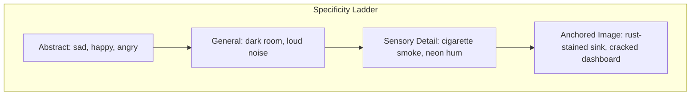
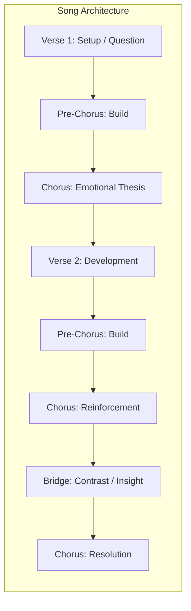
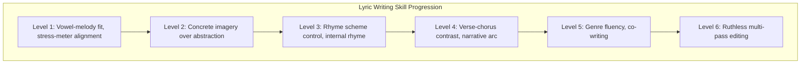

# Lesson 2: Lyric Writing

## 1. First-Principles Intuition & Invariants (15%)

Lyric writing fits words to music under constraints poetry never faces. A page poem controls its own rhythm. A lyric surrenders rhythmic control to melody, harmony, and the physical act of singing. Three invariants govern everything that follows.

**Phonological fit.** Vowels are what you sustain; consonants are what you articulate. Open vowels (/aː/ "ah," /oʊ/ "oh," /iː/ "ee" when placed mid-range) ride long notes and high pitches without strain. Plosives (/p/ /t/ /k/ /b/ /d/ /g/) stop airflow and land like percussion hits — great for rhythmic emphasis, bad for sustain. Fricatives (/s/ /f/ /ʃ/ /v/) hiss and sustain tension but can't carry pitch center the way vowels do. Nasals (/m/ /n/ /ŋ/) resonate and blend well into legato phrases. When you choose a word for a note, you're choosing its vowel first, its consonants second.

**Prosodic mapping.** English is stress-timed: every multisyllabic word has a fixed accent pattern baked in (HOME-less, not home-LESS), and connected speech follows a content-word-stressed / function-word-unstressed rhythm ("I WANT to GO HOME," not "I want TO go HOME"). Music imposes its own stress grid — the strong beats of the bar. Your job is to marry the two grids. When they clash, the brain registers "wrong" before it can name why.

**Semantic-emotional economy.** A three-minute song carries roughly 200–400 sung words — a thimble of language compared to a page of prose. Every word competes for that space. "Beautiful" and "amazing" cost a word slot and return almost no image. "Rust-stained" or "neon-lit" cost the same slot and hand the listener a picture. Economy isn't minimalism for its own sake — it's maximizing emotional return per syllable sung.

Everything in this lesson is a drill for reconciling these three constraints until the lyric stops feeling written and starts feeling inevitable.

## 2. Hands-On Practice & Execution (85%)

### 2.1 Vowel Mapping & Melodic Contour

**Why it works:** Pitch accuracy and vocal ease both depend on an open, unobstructed vocal tract. High notes stretch the vocal folds thin; a closed vowel (/ɪ/ "ih," /uː/ tight "oo") narrows the throat and mouth at exactly the moment you need maximum opening, producing strain, pitch flatting, or a "pinched" tone color. This isn't taste — it's vocal tract acoustics, and it's testable on your own voice in under five minutes.

**Vowel classification by singing register:**

| Register | Vowel examples | Behavior |
|---|---|---|
| High-range friendly | /aː/ "ah," /oʊ/ "oh," /ɔː/ "aw" | Jaw drops naturally, tract stays open |
| Mid-range stable | /ɛ/ "eh," /ʌ/ "uh," /eɪ/ "ay" | Comfortable across most of the voice |
| Strain-risk on peaks | /ɪ/ "ih," /iː/ "ee," /ʊ/ "book-oo" | Fine on low/mid notes, tightens on belted highs |

**Drill 2.1.1 — Vowel-Melody Mapping (do this out loud, right now)**

Take the opening phrase of "Twinkle, Twinkle": scale degrees 1-1-5-5-6-6-5, melodically C-C-G-G-A-A-G with the second A the highest, longest note in the phrase.

Step 1. Sing the whole phrase on one vowel at a time and rate the high A (6th degree) for ease:
- "ah-ah-ah-ah-ah-ah-ah" — open, no strain
- "ee-ee-ee-ee-ee-ee-ee" — throat tightens on the A
- "oh-oh-oh-oh-oh-oh-oh" — open, resonant

Step 2. Now set real words and check where they land:

```text
Scale deg: 1    1    5    5    6     6     5
Melody:    C    C    G    G    A     A     G
Words:     I    wish I    could go    home  to-night
Vowel:    /aɪ/ /ɪ/  /aɪ/ /ʊ/  /oʊ/  /oʊ/  /aɪ/
```

"Home" lands on the long high A as /oʊ/ — open vowel, long note, correct match. Swap in "I wish I could live there tonight" and "live" (/ɪ/) takes that same high A: sing both versions aloud back-to-back and you'll hear the second one pinch.

**Drill 2.1.2 — Vowel Substitution Repair**

Given a clash — "living" placing /ɪ/ on a sustained high A — you have three legitimate fixes, in order of preference:

1. **Swap the word for a synonym with an open vowel:** "living" → "finally" (/aɪ/ lands on the high note cleanly, same meaning register).
2. **Restructure the line** so the problem word falls on a shorter or lower note instead: "I am free at last" moves the open /eɪ/ ("late") or /aː/ ("last") onto the peak.
3. **Keep it and use the tension deliberately** — a slight pinch on a word like "trapped" or "stuck" can reinforce the meaning. Reserve this for maybe one moment per song, not a pattern.

**Practice routine:** Take any melody you've already written. Sing it on "ah" only, all the way through, and mark every note above the staff's middle line with a star. Those starred notes are where vowel choice matters most. Write your lyric draft, then check: does every starred note carry an open vowel? Fix the ones that don't before you touch anything else.

### 2.2 Stress Pattern & Metric Alignment

**Why it works:** Musical meter is a repeating strong-weak template (4/4: STRONG-weak-medium-weak). Spoken English has its own stress template baked into every word and phrase. When you set lyrics, you're overlaying one grid on another. Mismatches don't just sound "off" aesthetically — they force the singer to either mispronounce the word or fight the beat, and audiences register this as amateurish within the first line.

**Drill 2.2.1 — Clap-and-Speak Alignment**

Metronome at 80 BPM, 4/4. Clap on beats 1 and 3 only. Speak this phrase so the capitalized syllables land exactly on your claps:

```text
Beat:     1        2    3        4
Clap:     X             X
Words:    I  WALKED down an  EMP-ty  STREET  last  night
```

Say it at tempo until it feels unforced. Now say the deliberately broken version and notice the physical wrongness:

```text
Beat:     1        2    3        4
Clap:     X             X
Words:    WALKED I down   an  STREET EMP- last  ty  night
```

The second version makes you want to stop and restart — that discomfort is your diagnostic tool. Any time a draft lyric produces that feeling when clapped, you have a stress clash to fix.

**Drill 2.2.2 — Mapping Natural Speech Stress to the Bar**

Mark stress the way you'd say the phrase to a friend, not how you think it should sound "poetic":

1. "I don't want to lose you" → "I don't WANT to LOSE you"
2. "Beautiful morning" → "BEAU-ti-ful MORN-ing"
3. "Understand me" → "un-der-STAND me"

Correct placement (content words on strong beats 1 and 3):

```text
1      &    2      &    3     &    4    &
I don't    WANT    to   LOSE  you  to-  night
```

Broken placement (stress forced onto weak beats):

```text
1      &    2      &    3     &    4    &
I      WANT don't  to   you   LOSE to-  night
```

**Practice routine:** Pick a I–V–vi–IV progression on piano or guitar, four bars, one chord per bar. Clap the strong beats (1 and 3) first with no words. Write one line where your most important noun or verb lands on beat 1 or 3; let articles ("the," "a"), pronouns ("I," "you"), and conjunctions ("and," "but") fall on the weak beats 2 and 4. Sing it against the chords at 80 BPM before judging it — stress problems that look fine on paper often surface only when sung at tempo.

### 2.3 Concrete Imagery & Sensory Specificity

**Why it works:** Naming an emotion ("I'm sad") tells the listener what to feel. Describing a sensory detail that implies the emotion ("the rust-stained sink won't drain") lets the listener's own imagination construct the feeling — which produces stronger, more personal engagement than being told. This is show-vs-tell applied to a medium where you only get a few words per line.



**Drill 2.3.1 — Abstraction-to-Image Translation**

| Abstract | Concrete sensory image |
|---|---|
| "I'm lonely" | "The phone screen glows — no names, no calls" |
| "I'm angry" | "I threw your keys across the parking lot" |
| "I miss you" | "Your coffee mug still sits beside the sink" |
| "I'm hopeful" | "First green shoots broke through the snow" |

**Drill 2.3.2 — Five-Sense Inventory**

Pick one emotionally loaded scene. Force yourself to generate one detail per sense before writing a single lyric line.

Scene: leaving home at dawn.
- Visual: "Headlights cut through fog on the county road"
- Auditory: "Gravel crunching under tires, radio static"
- Tactile: "Cold vinyl seat, fingernails on the wheel"
- Olfactory: "Coffee smell mixing with gasoline"
- Gustatory: "Metallic taste of 4 a.m."

Select 2–3, not all 5 — a verse crammed with every sense reads like a checklist, not a scene:

```text
Headlights cut through fog on the county road
Cold vinyl seat, my hands locked on the wheel
Coffee smell mixing with gasoline
I'm leaving this town but I still can't feel
```

**Practice routine:** Take any lyric draft you own that leans on emotional declarations ("I love you," "I'm heartbroken," "I'm free"). Rewrite it using only images — no emotion word allowed anywhere in the lines. Read both aloud. The image version should land harder; if it doesn't, the images aren't specific enough yet — push for the one detail only this particular situation would have (not "the rain fell," but "the gutter overflowed onto your porch light").

### 2.4 Rhyme Schemes & Phonetic Architecture

**Why it works:** Rhyme sets up a pattern the ear starts predicting, then rewards or withholds that prediction — which is a cheap, reliable way to generate anticipation and closure without touching the music. Masculine rhyme (stress on the final syllable: "bright"/"night") lands hard and final. Feminine rhyme (stressed + unstressed: "walking"/"talking") trails off and keeps momentum moving forward into the next line.

**Standard schemes and what they're for:**

| Scheme | Feel | Best use |
|---|---|---|
| AABB (couplet) | Immediate resolution | Storytelling verses, narrative momentum |
| ABAB (alternating) | Delayed resolution | Builds tension across 4 lines |
| ABCB (simple) | Loose, conversational | Folk/country, lines that need breathing room |
| AAAA (monorhyme) | Relentless, driving | Rap, anthemic hooks — use sparingly, fatigues fast |

**Drill 2.4.1 — Identify Rhyme Type by Ear**

```text
"I walked alone down Maple Street"   (A)
"The rain was falling at my feet"    (A)  — masculine: street/feet

"She was dancing in the kitchen light"  (A)
"Her shadow spinning, holding me tight" (A)  — masculine: light/tight

"Running through the morning haze"   (A)  — haze
"Chasing all my yesterdays"          (A)  — days (feminine-leaning near rhyme)
"Nothing here but empty space"       (A)  — space (masculine match to haze/days)
```

**Drill 2.4.2 — Build a Rhyme Bank Before You Write**

Pick your song's key word (e.g., "home"). Spend five minutes generating every rhyme you can by syllable count, out loud, before writing any lines — this avoids the trap of settling for the first rhyme that comes to mind.

- Masculine, perfect: foam, chrome, roam, comb, dome
- Masculine, near: bone, stone, phone, known, grown
- Feminine, perfect: alone, unknown, postpone
- Feminine, near: open, broken, stolen
- Multisyllabic: metronome, chromosome, monochrome

Quatrain from this bank:

```text
I left my keys inside that chrome-plated dome   (A)
Three thousand miles from anywhere like home     (A)
The static on the line said you're alone         (A)
I'm driving through the dark, no map, just known (A)
```

**Drill 2.4.3 — Internal Rhyme and Assonance**

End rhyme alone leaves the middle of the line acoustically flat. Internal rhyme (rhymes inside a line) and assonance (repeated vowel sound without a full rhyme) add density without changing the structural rhyme scheme:

```text
"I left my HEART in the DARK of the PARK where we used to meet"
   internal: heart / dark / park

"The NIGHT was BRIGHT with STREETLIGHT glow"
   assonance: night / bright / -light
```

**Practice routine:** Write a verse in strict ABAB. Once the end rhymes lock, go back and insert at least two internal rhymes or assonant pairs inside the lines without disturbing the end-rhyme scheme. Read both drafts aloud — the internal-rhyme version should feel noticeably denser and more musical even with no melody attached yet.

### 2.5 Prosody Drills: Matching Speech Rhythm to Meter

**Drill 2.5.1 — Transcribe, Then Fit**

Say each sentence the way you'd actually say it to someone, mark the stress, then fit it to quarter notes in 4/4:

```text
"I want to go home" → "I WANT to go HOME"

Beat:     1       2      3      4
Pattern:  STRONG  weak   MED    weak
Words:    I       WANT   to-go  HOME
```

If the natural stress doesn't fit the bar, you have three fixes, in order of how much they change the line:

1. **Swap the word:** "I want to go home" → "I need to go home" (if "need" scans better against the melody's accent).
2. **Add or remove a syllable:** "I want to go home" → "I wanna go home" (adds a weak syllable that absorbs an off-beat).
3. **Syncopate on purpose:** place a stressed syllable deliberately off the beat for tension, and mean it.

**Drill 2.5.2 — Syncopation for Emphasis**

```text
On-beat (expected):
1     &    2     &    3     &    4    &
I     got  no-   thing left  to   say

Syncopated (anticipates beat 3):
1     &    2     &    3     &    4    &
I     got  no-   thing LEFT  to   say
                       ^ anticipates the downbeat by an eighth note
```

Pulling "LEFT" ahead of the beat creates a small jolt of urgency — reserve this move for the line in the song that needs the most emotional weight. Using it on every line cancels the effect.

**Practice routine:** Clap a verse draft against a metronome at 80 BPM while speaking it naturally (not "performing" it). Mark every syllable that fights the clap. Rewrite those specific words — don't rewrite the whole line, isolate the clash. Once the verse claps clean, pick exactly one spot to deliberately break the pattern for emphasis.

### 2.6 Verse-Chorus Architecture & Function

**Why it works:** A verse that changes with repetition carries narrative information; a chorus that repeats near-identically carries emotional information the audience can memorize and sing back. Conflating the two jobs — writing a verse that tries to be as universal as the chorus, or a chorus stuffed with narrative detail — produces a song where nothing lands clearly.



**Verse job:** introduce character/setting/situation, advance chronologically or emotionally, use varied specific imagery, build the question the chorus will answer.

**Chorus job:** state the central emotional truth in language broad enough to be universal, repeat with minimal variation so the audience can sing along by the second listen, resolve the harmonic and melodic tension the verse set up.

**Drill 2.6.1 — Contrast Analysis**

```text
Verse 1 (specific, narrative):
I found your photograph inside a book
You're standing on the pier, your hair blown back
The date stamp reads 1992
I wasn't born yet, you were just a kid

Chorus (universal, thesis):
We're all just ghosts in photographs
Fading in the sun
Time keeps moving, never looking back
Until the light is gone
```

The verse's nouns are all countable, specific objects (photograph, book, pier, date stamp). The chorus's nouns are abstract and shared by every listener (ghosts, time, light). That contrast is the mechanism, not an accident.

**Drill 2.6.2 — Write the Chorus First, Then the Verse That Earns It**

```text
Chorus (write this first — 4 lines, universal):
I can't go home again
The door is locked, the lights are out
I can't go home again
The past is just an echo now

Verse 1 (specific — must create the conditions for the chorus to make sense):
I drove past the house on Miller Street
Where we used to play in the yard
The oak tree's gone, the paint is gray
And I don't recognize a single car
```

**Practice routine:** Write a complete verse-chorus pair. Enforce a hard rule: the verse must contain at least three concrete sensory details; the chorus may contain no more than one. If you can't hit that ratio, you likely wrote the chorus too specific or the verse too vague — fix whichever side broke the rule.

### 2.7 Editing & Revision Protocol

**Why it works:** A first draft is written to get the idea out of your head; it is not written for the listener. Every subsequent pass should be judged against one question: does this serve someone hearing the song once, with no context, through a car speaker?

**Pass 1 — Singability.** Read the lyric aloud with no melody — does it flow as speech? Sing it with the melody — do stress patterns line up? Are the vowels on the highest, longest notes open? Any consonant clusters that trip the tongue ("sixth strength") — replace them ("your power").

**Pass 2 — Clarity & economy.** Can any line be cut without losing meaning? Cut it. Hunt filler words ("just," "really," "so," "kind of") and remove unless the rhythm genuinely needs the syllable. Does every verse line either advance the story or deepen the feeling? Is the chorus's hook recallable after one listen — test this by having someone else hear it once and try to repeat the hook line back.

**Pass 3 — Imagery & specificity.** Replace any remaining emotional label with an image. Flag clichés ("heart of gold," "time will tell") and force a fresh replacement for each. Confirm at least one surprising word or image exists per verse.

**Pass 4 — Structural integrity.** Is there a clear arc — setup, development, resolution? Does the bridge add a genuinely new angle, or does it restate the chorus in different words? Does the final chorus need a lyric variation to land as a resolution rather than a repeat?

**Drill 2.7.1 — Line-by-Line Justification**

For every line in a draft, score it against four questions: does it advance the narrative, does it deepen the emotion, does it fit the melody/rhythm naturally, is there no fresher way to say it. A line that fails three of the four gets rewritten or cut — no exceptions for lines you're attached to.

**Drill 2.7.2 — The 10% Cut**

```text
Original (32 words):
I'm walking down this empty road alone tonight
The stars are shining bright but I can't see the light
I'm searching for a way to find my way back home
I'm lost and I'm afraid and I'm so far from home

Revised (28 words, cut weak function words):
Walking down this empty road alone tonight
Stars are shining bright but I can't see the light
Searching for a way to find my way back home
I'm lost, afraid, and so far from home

Final (21 words, cut again):
Walking this empty road tonight
Stars shine bright but I can't see
Searching for my way back home
Lost, afraid, so far from home
```

Each cut removes a weak word ("I'm," "the," "down," "alone") without losing a single image or plot point. The rhythm tightens as the word count drops — this is the usual outcome of a disciplined cut pass, not a coincidence specific to this example.

**Practice routine:** Print a current draft. Physically cross out every word that doesn't carry narrative or emotional weight. Rewrite clean. Compare density and impact against the original aloud.

### 2.8 Collaboration & Co-Writing Dynamics

**Why it works:** Co-writing adds perspective but also adds friction points — without agreed roles, sessions stall on taste disagreements that have no objective answer. Assigning roles up front converts subjective arguments into "who has final call" decisions, which keeps momentum.

**Roles:**
- **Lyricist** — leads words, imagery, narrative.
- **Melodist** — leads vocal line, phrasing, prosody.
- **Arbiter** — breaks ties when the other two disagree; rotate this role session to session so no one person dominates long-term.

**Drill 2.8.1 — Structured 60-Minute Co-Write**

- Phase 1, 10 min — agree emotional core, narrative premise, point of view (1st/2nd/3rd person), and any constraints (rhyme scheme, tempo).
- Phase 2, 20 min — each writer drafts a rough verse and chorus independently, capturing a different angle on the same theme.
- Phase 3, 20 min — read both aloud, identify the strongest lines from each, combine into a hybrid.
- Phase 4, 10 min — sing the hybrid against the melody, fix prosody and singability together.

**Practice routine:** Run this 60-minute structure with a real co-writer (or treat an AI collaborator as the second independent draft source in Phase 2). The hard time limit is doing real work — it forces decisions and prevents over-polishing material that hasn't proven itself yet.

### 2.9 Genre-Specific Conventions

| Genre | Chorus timing | Language | Rhyme density | Typical theme |
|---|---|---|---|---|
| Pop | Within ~45 sec | Universal, simple | Moderate, high repetition | Love, heartbreak, empowerment |
| Country | Standard verse-chorus | Conversational, place-based | Light to moderate | Narrative, often with a moral |
| Hip-hop/Rap | Variable, hook-driven | Wordplay, cultural reference | Very high, multisyllabic/compound | Identity, struggle, status |
| Folk/Singer-songwriter | Often delayed or sparse | Literary, metaphorical | Loose | Introspection, memory |
| Rock | Fast arrival, anthemic | Punchy, attitude-driven | Moderate | Rebellion, identity, energy |

**Drill 2.9.1 — Genre Translation**

Neutral source lyric:

```text
I left you standing by the door
You didn't say a word to me
I walked away and didn't look back
Now I'm wondering if I'm free
```

Pop (add repetition, simplify vocabulary):

```text
I left you standing at the door (door, door)
Didn't say goodbye, didn't say goodbye
Walked away but now I'm not sure (sure, sure)
If I'm free or just alone tonight
```

Country (add place, make conversational):

```text
Left you standin' on that old front porch
You didn't say a word, just watched me go
I drove that truck 'til I hit the county line
Now I'm wonderin' if I'm free or just alone
```

Hip-hop (internal rhyme, syncopated delivery):

```text
Left you standing, understanding this is war
Didn't utter, just a shutter when I'm out the door
Walked away, dismay written on my face for sure
Now I'm pondering if freedom's what I'm searching for
```

**Practice routine:** Pick a target genre. Write a verse-chorus in its conventions. Pull up three currently successful songs in that genre and compare your rhyme density, line length, and theme against theirs before calling the draft done.

### 2.10 Complete Song Development Workflow

**Week 1 — Concept & emotional core.** Identify the central feeling or story. Write 10 concrete images tied to the theme. Lock point of view and tense.

**Week 2 — Chorus first.** Write three different chorus options (different melodic shapes, different wording). Test memorability: can you recall each an hour later with no reference? Select the strongest and refine its prosody and vowel placement.

**Week 3 — Verses.** Verse 1 introduces the situation. Verse 2 develops or complicates it. Confirm both verses stay specific where the chorus stays universal.

**Week 4 — Bridge & refinement.** Write a bridge that shifts perspective or intensifies the emotion — not a restatement. Run the full editing protocol (2.7). Sing the complete song straight through, flag every awkward moment, revise.

**One-Week Song Challenge**

```text
Day 1: Concept + 20 images
Day 2: Three chorus drafts, select one
Day 3: Verse 1 and Verse 2 drafts
Day 4: Bridge draft
Day 5: Revision pass — singability
Day 6: Revision pass — economy and imagery
Day 7: Sing complete song 5x, final prosody fixes
```

This constraint trades perfection for completion — a finished average song teaches more than an unfinished great one.

## 3. Progressive Skill Ladder



**Advancement criteria:**
- L1 → L2: 5 lyrics with correct vowel-melody mapping and natural stress alignment, verified by clapping and singing each aloud.
- L2 → L3: 5 lyrics where every abstract emotion word has been replaced with sensory imagery.
- L3 → L4: 3 complete songs using ABAB or ABCB with at least two internal rhymes each.
- L4 → L5: 2 complete songs with clear verse (specific) / chorus (universal) contrast and a narrative arc.
- L5 → L6: 3 co-written songs plus 3 genre-specific songs in different genres.
- L6: 10 full revision drafts of a single song, each one demonstrably improving clarity, economy, or impact over the last.

## 4. Real-World Applications & Production Context

### Professional workflow

**Demo recording.** Record a scratch vocal on a phone voice memo as soon as a verse or chorus has words and melody. Any line that doesn't sing naturally will reveal itself immediately — don't wait for the studio session to discover it.

**Lyric sheets for a session.** Print lyrics with chord symbols placed above the syllable where the chord change occurs. Mark breath points with a slash. Note any intentional prosody deviations (syncopation, stretched syllables) so the singer doesn't "correct" them back to speech-natural phrasing.

**Topline writing (melody + lyric over an existing track).** Listen to the instrumental 20+ times before writing a word — you're identifying its emotional character (dark, uplifting, tense) so the lyric theme matches the production, not fights it. Write a dummy lyric pass first ("la la la" or nonsense syllables matching the intended prosody) to lock the melody, then replace syllables with real words while preserving the exact vowel and stress pattern you dummied in.

**Sync licensing considerations.** Avoid profanity if targeting TV/film placement — it narrows usable context dramatically. Universal themes (overcoming obstacles, love, freedom) clear and license more easily than politically specific or narrowly personal content. Keep pronouns ("you," "we") rather than gendered nouns unless gender is structurally central to the story — this widens the pool of scenes a music supervisor can place the song against.

### Common failure modes & troubleshooting

| Problem | Diagnosis | Fix |
|---|---|---|
| Melody strains on the chorus | Closed vowel on a high/long note | Remap the word choice to put an open vowel on the peak |
| Lyric sounds robotic | Speech stress misaligned with meter | Clap the bar, speak the line naturally, rewrite to match |
| Chorus isn't memorable | Too much detail, not enough repetition | Simplify language, repeat the hook phrase, broaden the vocabulary |
| Verse feels disconnected from chorus | Tonal mismatch — verse too abstract or chorus too specific | Push verse toward concrete detail, chorus toward universal language |
| Bridge feels redundant | Restates verse or chorus sentiment | Add genuine contrast: new perspective, time jump, or intensified stakes |
| Lyric feels generic | Reliance on stock phrases | Replace every cliché with an original sensory image specific to this song's scene |

### Advanced techniques

**Compound rhyme** (rap/hip-hop) rhymes multi-word phrases rather than single syllables:

```text
"I never let a setback get me off track when I'm stacking facts"
(setback / get-back, off-track / stacking-facts)
```

**Enjambment** lets the grammatical thought run past the line break, creating forward pull instead of a full stop:

```text
I thought I saw you in the crowd but it was just another face
That looked like someone I used to know
```

**Slant rhyme** (near rhyme) works when a perfect rhyme would force an awkward word choice:

```text
I walked away from home   (A)
The rain was in my face   (B)
I couldn't find a place   (B)
To rest my tired bones    (A — slant: home/bones)
```

**Conversational syntax** drops formal grammar to match spoken rhythm and improve singability:

```text
Formal: "I do not want to see you anymore"
Natural: "Don't wanna see you anymore"
```

## 5. Practice Regimen

**Daily (15 min):** Write one quatrain to a pre-existing melody. Focus only on vowel mapping and stress alignment — no editing, just repetition to internalize prosody by feel.

**Weekly (2 hr):** Complete one full verse-chorus draft. Run the four-pass edit (2.7). Record a scratch vocal, flag problem lines, revise same day.

**Monthly (8 hr):** Write one complete song (verse, chorus, bridge). Co-write one song with another writer. Transcribe and analyze 3 professionally written songs in your target genre — map rhyme scheme, verse/chorus contrast, and imagery choices by hand.

**Quarterly review:** Listen through everything written in the past 3 months. Identify the recurring weakness (stress misalignment, clichéd imagery, weak choruses — it's usually the same one). Set one targeted goal for next quarter, not five.

## 6. Recommended References & Deep Dives

**Books:**
- *Writing Better Lyrics* — Pat Pattison (Berklee): prosody, rhyme schemes, object writing.
- *Tunesmith: Inside the Art of Songwriting* — Jimmy Webb: craft and professional workflow from a working songwriter.
- *The Addiction Formula* — Friedlander: hook construction and commercial songwriting mechanics.

**Analysis practice:** Hand-transcribe the lyrics of 10 favorite songs. Mark their rhyme scheme. Identify their verse/chorus contrast pattern. Note every place they choose concrete over abstract language, and vice versa.

**Pattison exercises (Berklee method):**
- **Object writing** — 10-minute timer, one object (coffee cup, streetlight, doorway), write sensory detail across all five senses without stopping. Builds the concrete-imagery muscle on demand.
- **Metaphor lists** — pick an emotional state, write 20 metaphors for it without judging quality ("Loneliness is an empty room," "Loneliness is a phone that never rings"). Mine these as seeds for future lyrics.

**Collaboration platforms:** SoundBetter, Vampr, and Kompoz for online co-writes; local songwriter meetups and ASCAP/BMI workshops for in-person sessions and exposure to different working habits.

---

**Final note on completion.** A finished lyric is one that feels inseparable from its melody — where every line earns its place and the listener feels the emotion before parsing the meaning. That quality doesn't arrive from theory; it arrives from volume. Write 100 songs. The first 20 teach you the mechanics in this lesson. The next 30 make those mechanics automatic. Somewhere between 50 and 100, a line will surprise you — it will feel discovered rather than constructed. That's the signal the craft has moved from conscious rule-following into instinct.
