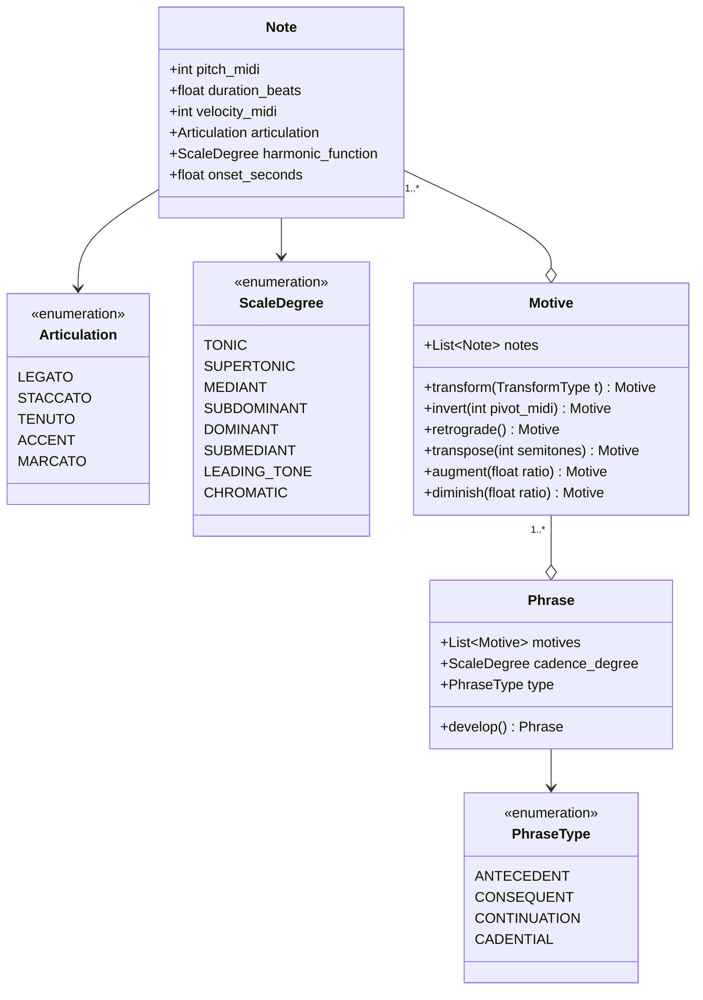

# Lesson 3: Melodic Development

## Table of Contents

1. [First-Principles Intuition & Invariants](#1-first-principles-intuition--invariants)
2. [Core Architecture & Mechanics](#2-core-architecture--mechanics)
3. [Transformational Operations: Theory & Implementation](#3-transformational-operations-theory--implementation)
4. [Phrase Structure & Hierarchical Form](#4-phrase-structure--hierarchical-form)
5. [Psychoacoustic Foundations](#5-psychoacoustic-foundations)
6. [High-Performance Failure Modes & Their Remedies](#6-high-performance-failure-modes--their-remedies)
7. [Annotated Analytical Examples](#7-annotated-analytical-examples)
8. [Practical Exercises](#8-practical-exercises)

---

## 1. First-Principles Intuition & Invariants

A melody is not merely a sequence of pitches. It is a time-ordered structure that encodes expectation, fulfillment, and violation — the three cognitive primitives through which a listener constructs musical meaning. Understanding melody from first principles means understanding what invariants must hold for a sequence of pitch events to cohere as a *line* rather than a collection of unrelated sounds.

### 1.1 The Fundamental Invariant: Gestalt Continuation

The psychologist Max Wertheimer's Gestalt principle of *good continuation* (1923) describes the perceptual tendency to group elements that form a smooth, predictable trajectory. Applied to pitch, a listener will group notes into a single melodic voice if their intervallic motion is small and directional. Large leaps disrupt this grouping and demand resolution — either a return to the previous register or a stepwise descent that "fills in" the gap. This is not aesthetic preference; it is a property of auditory streaming, the neural mechanism by which the auditory cortex segregates simultaneous sound sources (Bregman, *Auditory Scene Analysis*, 1990).

The practical invariant derived from this: **melodic lines that are principally stepwise (seconds) are maximally perceivable as single, coherent objects.** Leaps are permissible and expressive, but they create a registral "debt" that the melodic line must repay through subsequent contrary motion or stepwise fill. When this debt is not repaid, the listener perceives a register change as structurally significant — a technique composers exploit deliberately (e.g., the opening of Beethoven's Fifth Symphony, Op. 67, where the ascending sixth in the fourth measure is answered by stepwise descent).

### 1.2 Pitch as a Discrete Logarithmic Space

Western equal temperament divides the octave into 12 logarithmically equal semitones. The frequency of note $n$ semitones above A4 (440 Hz) is:

$$f(n) = 440 \cdot 2^{n/12}$$

This means intervals are defined by *ratios*, not differences. A major second from C4 to D4 spans the same perceptual distance as a major second from G4 to A4, because both are a frequency ratio of $2^{2/12} \approx 1.122$. This is the foundational reason melodic analysis works in interval space (semitone counts) rather than absolute frequency space.

The MIDI pitch numbering system encodes this directly: MIDI note 60 = C4, with each integer increment representing one semitone. All melodic interval arithmetic reduces to integer subtraction in MIDI space, which is why MIDI became the dominant computational representation for melody.

### 1.3 The Melodic Line as a Markov Process

Statistically, the pitch of a note in a tonal melody is not independent of its predecessor. Analyses of large corpora (Temperley, *Music and Probability*, 2007; Huron, *Sweet Anticipation*, 2006) show that:

- Steps (intervals of 1–2 semitones) account for approximately 65–75% of all melodic motions in Western tonal music.
- Leaps are followed by stepwise motion in the opposite direction more than 75% of the time.
- The distribution of melodic intervals is heavily skewed toward small values, following approximately a Zipfian distribution.

This statistical regularity is not accidental. It reflects a first-order Markov dependency: the transition probability from pitch $p_n$ to pitch $p_{n+1}$ is conditioned on $p_n$ and, with weakening weight, on $p_{n-1}$. This is the empirical foundation of the "melodic gravity" principle formalized by Hindemith (*The Craft of Musical Composition*, 1937) and later extended by Narmour's Implication-Realization model (1990).

### 1.4 The Tension-Resolution Duality as an Invariant

Every note in a tonal melody occupies a position in the tension hierarchy of its governing key. The scale degrees have characteristic stability values:

| Scale Degree | Name | Stability (1 = most stable) |
|---|---|---|
| 1̂ (tonic) | Do | 1 |
| 5̂ (dominant) | Sol | 2 |
| 3̂ (mediant) | Mi | 3 |
| 2̂ (supertonic) | Re | 4 |
| 6̂ (submediant) | La | 4 |
| 4̂ (subdominant) | Fa | 5 |
| 7̂ (leading tone) | Ti | 6 |

This hierarchy, formalized by Lerdahl in *Tonal Pitch Space* (2001), means that melodic motion from an unstable degree (7̂) to a stable one (1̂) is experienced as resolution regardless of rhythmic context. A melody that consistently ends phrases on 1̂ or 5̂ establishes closure. One that ends phrases on 7̂ or 2̂ creates forward momentum. This is the structural invariant that governs phrase endings across virtually all tonal repertoire from Bach to Tin Pan Alley.

---

## 2. Core Architecture & Mechanics

### 2.1 The Note as a Multi-Dimensional Object

A note in a melodic line is not a scalar pitch value. It is a composite object with at least six independently variable dimensions:



### 2.2 The Melodic Line as a Linked Temporal Structure

```mermaid
graph LR
    subgraph "Melodic Line (Phrase Level)"
        P1["Phrase A\n(Antecedent)"] --> P2["Phrase A'\n(Consequent)"]
        P2 --> P3["Phrase B\n(Continuation)"]
        P3 --> P4["Phrase A''\n(Cadential)"]
    end

    subgraph "Phrase A (Motive Level)"
        M1["Motive α"] --> M2["Motive α
