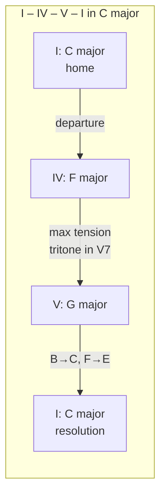
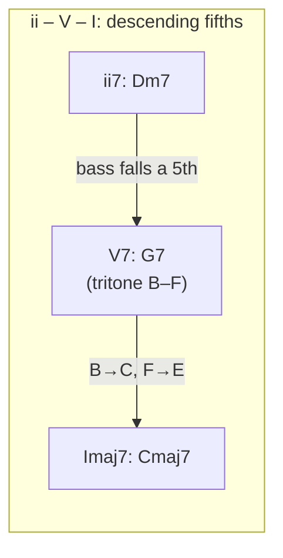
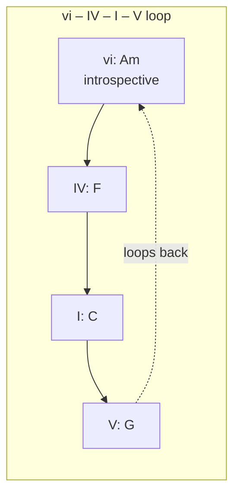
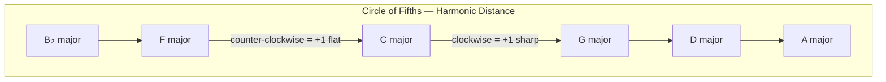
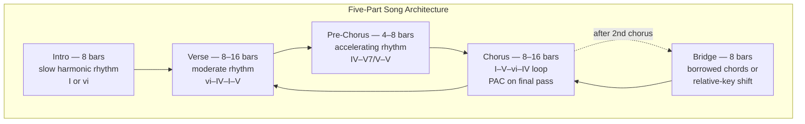

# Songwriting: Harmonic Craft, Melody, and Composition Workflow

## 1. How Harmony Creates Feeling (The 15% You Need)

A vibrating string produces a fundamental pitch plus a stack of overtones above it (2×, 3×, 4× the fundamental frequency, and so on). Two notes sound stable together when their overtones line up; they sound restless when the overtones clash and beat against each other. That's the entire acoustic basis for why a V chord "wants" to move to I and why a tritone feels like it must resolve. You don't need the full physics paper to use this — you need three practical facts:

1. **The perfect fifth (3:2 ratio) is the strongest consonance after the octave.** This is why basslines built on descending fifths (D→G→C) feel unshakably solid, and why the V chord, sitting a fifth above I, is the natural launchpad back home.
2. **The tritone is the most unstable interval in Western harmony.** In a V7 chord (G–B–D–F in C major), the B and F form a tritone. It resolves by both notes stepping inward: B→C, F→E. That two-semitone pull is the engine behind almost every cadence you'll write.
3. **Equal temperament (12-TET) spreads tuning error evenly across all 12 keys**, which is why you can freely modulate anywhere on guitar or piano without it sounding "broken." Every key is equally, imperceptibly out of tune. That's a feature, not a flaw — it's what lets you write in any key on a fixed-pitch instrument.

Everything below this point is execution: chord shapes, fingerings, progressions, and a repeatable workflow for building a song.

---

## 2. The Diatonic Palette: Chords You Actually Play

### Major key (example: C major)

| Degree | Chord | Notes | Guitar (open) | Piano (RH, root position) | Function |
|---|---|---|---|---|---|
| I | C | C–E–G | x32010 | C-E-G (1-3-5) | Tonic — home |
| ii | Dm | D–F–A | xx0231 | D-F-A (1-3-5) | Subdominant |
| iii | Em | E–G–B | 022000 | E-G-B | Tonic (weak) |
| IV | F | F–A–C | xx3211 (or x33211 barre) | F-A-C | Subdominant — departure |
| V | G | G–B–D | 320003 | G-B-D | Dominant — tension |
| vi | Am | A–C–E | x02210 | A-C-E | Tonic (relative) |
| vii° | Bdim | B–D–F | x2340x | B-D-F | Dominant (rare, passing) |

**Minor key (example: A minor)** — use these borrowed/altered forms depending on whether you want the melodic pull of a raised 7th:

| Degree | Natural minor | Harmonic minor (raised 7th) | Function |
|---|---|---|---|
| i | Am | Am | Tonic |
| ii° | Bdim | Bdim | Subdominant |
| III | C | C+ (rare) | Tonic (relative) |
| iv | Dm | Dm | Subdominant |
| v / V | Em | E (G♯ raised) | Dominant — use E major for a real pull to Am |
| VI | F | F | Subdominant |
| VII / vii° | G | G♯dim | Dominant |

**Practical rule:** in minor keys, swap the v minor chord for V major (raise the 7th) whenever you want a cadence that actually resolves. Em→Am is soft; E→Am has a leading tone (G♯→A) and lands hard.

### Guitar CAGED mapping for these chords
Every chord above has five movable positions across the neck via CAGED (C-shape, A-shape, G-shape, E-shape, D-shape). For songwriting purposes you don't need all five — you need **two**: an open/low-fret version for a warm, ringing verse, and a barre version 5–7 frets up for a tighter, more aggressive chorus. Try writing the same progression in both positions and listen to how register changes the emotional weight.

### Piano voicing tip: rootless jazz voicings
Once you're comfortable with root-position triads, drop the root in your right hand and let the left hand (or bass) carry it. For Dm7–G7–Cmaj7:
- **Dm7 (no root):** F–A–C (3-5-7), RH fingers 1-2-4 or 2-3-5
- **G7 (no root):** B–D–F (3-5-7)
- **Cmaj7 (no root):** E–G–B (3-5-7)

Notice the top note barely moves (F→F→E, essentially a drone), while the middle voices do the work. This is the "smooth jazz piano" sound — smooth because nothing leaps.

---

## 3. Seventh Chords: Adding Color Without Adding Clutter

| Quality | Formula | Where to use it | Guitar shape (movable, E-shape barre) |
|---|---|---|---|
| maj7 | 1–3–5–7 | I, IV — bright, floating | x-x-(fret)-(fret+1)-(fret)-x variants; easiest: Cmaj7 = x32000 |
| dom7 | 1–3–5–♭7 | V — tension, blues | G7 = 320001 |
| m7 | 1–♭3–5–♭7 | ii, iii, vi — dark, stable | Am7 = x02010 |
| m(maj7) | 1–♭3–5–7 | vi substitute, noir/neo-soul color | Am(maj7) = x02110 |
| sus4 | 1–4–5 | transitional only, resolve to the triad | Dsus4 = xx0233 |
| add9 | 1–3–5–9 | I, IV — open, modern/folk | Cadd9 = x32030 |

**Drill:** play I–IV–V as plain triads, then replay as Imaj7–IVmaj7–V7. Nothing about the chord roots changed — only the color. This is the fastest way to make a stock progression sound more considered without altering your harmonic plan.

---

## 4. Voice Leading: Making Chord Changes Feel Smooth

Voice leading means tracking what each individual note does when you move from one chord to the next, not just naming the chords.

**Rule 1 — keep common tones still.** C major (C–E–G) → F major (F–A–C) shares the note C. If you're voicing this on piano, keep C in the same hand position and only move E→A and G→F.

```
C major:  C  E  G
F major:  C  F  A
          |  |  |
       (hold)(step)(step)
```

**Rule 2 — move by the smallest distance available.** When a chord tone has to change, check whether it can move by a half or whole step before leaping. In G7→C, the leading tone B wants to go up to C (half step), and the 7th (F) wants to go down to E (half step) — don't fight this by inverting unnecessarily.

**Rule 3 — avoid parallel fifths/octaves in close vocal or string writing**, because two voices moving in lockstep by a fifth briefly stop sounding independent and start sounding like one fat unison. This matters for choir/string arrangements. It does **not** matter in rock rhythm guitar — power chords are built on exactly this effect, and that's why they sound massive rather than "wrong."

**Guitar-specific application:** when changing chords, look for a shared fret or finger you can pivot on instead of lifting the whole hand. Am (x02210) → C (x32010) shares the open high E and B strings fretted the same way — only your 3rd finger moves from the D string to the A string. Minimizing hand movement isn't just about tone, it's what makes fast chord changes physically possible.

---

## 5. The Core Progressions You'll Use 90% of the Time

### I–IV–V–I — the universal arc



Play it: C (2 bars) – F (2 bars) – G (2 bars) – C (2 bars), 80 BPM, four-on-the-floor strum. This is the harmonic shape behind thousands of hymns, pop choruses, and folk songs. It works because each chord does a distinct emotional job: stability, departure, maximum tension, return.

### ii–V–I — the smoothest possible motion



The bass falls by a fifth twice in a row (D→G→C), which is the most stable root motion in tonal music, and the top voices only move by semitone at the final resolution. **Use this for bridges and refined sections** — it's the backbone of jazz standards and neo-soul choruses (think D'Angelo, Corinne Bailey Rae).

### vi–IV–I–V — the contemporary pop loop



This progression (Adele's *Someone Like You*, Journey's *Don't Stop Believin'*, countless others) opens on the relative minor instead of the tonic, which makes the first chord feel reflective rather than triumphant, then resolves through all three harmonic functions before looping. It can repeat indefinitely because the melody — not the harmony — carries the sense of progress.

### Circle of fifths as a modulation map



Adjacent keys on the circle share six of seven notes. If you want a chorus or bridge to feel like a *lift* without jarring the listener, move one step clockwise (C→G, add one sharp). Moving several steps in one jump (C→A♭) reads as a dramatic, deliberate shift — save it for key-change choruses in the last third of a song.

---

## 6. Modes and Borrowed Chords: Coloring Outside Major/Minor

You don't need to "think in modes" while writing — you need to know which single note to alter to borrow a mode's flavor.

| Want this feeling | Alter this note | Result | Example use |
|---|---|---|---|
| Minor but hopeful, not sad (Dorian) | Raise the ♭6 to 6 in a minor key | Am → add F♯ (A Dorian) | Cold, driving minor-key verses — Radiohead, Pink Floyd |
| Major but bluesy/grounded (Mixolydian) | Flatten the 7th | C major → add B♭ | Rock/blues verses, Southern rock riffs |
| Dreamy, suspended, unresolved (Lydian) | Raise the 4th | F major → add F♯ instead of F natural | Film-score shimmer, dream-pop choruses |
| Darker, heavier major-key moment | Borrow iv (minor subdominant) | C major verse → drop into Fm briefly | Emotional pivot without a key change |
| Anthemic rock lift | Borrow ♭VII | C → B♭ → F → C | The Beatles' *Hey Jude*, countless stadium choruses |

**Concrete drill:** take your I–IV–V–I progression in C and replace the final IV with ♭VII (B♭ major) before landing on I: **C – B♭ – F – C**. Play it at 90 BPM. Notice the lift feels bigger than a plain IV→I because B♭ sits outside the key, creating a brief sense of a wider harmonic world before snapping back home.

### Secondary dominants: a fast way to add intrigue
A secondary dominant is just "the V chord of a chord that isn't your tonic." The only one you need memorized cold is **V7/V**, because it's the most common pre-chorus tool in pop and rock:

- Key of C: V7/V = **D7** (resolves to G)
- Progression: **C – Am – D7 – G** (I – vi – V7/V – V), ending unresolved on G to launch into the chorus.

Play this at the end of a pre-chorus and let it sit on G for a full bar before the chorus drops — the D7 makes G feel like a mini-arrival, raising the stakes right before the hook.

---

## 7. Cadences: How You End a Phrase Changes What the Listener Expects

| Cadence | Motion | Feeling | Where to use it |
|---|---|---|---|
| Perfect Authentic (PAC) | V→I, both root position, melody lands on tonic | Full stop, total resolution | Final chorus, song ending |
| Imperfect Authentic (IAC) | V→I but inverted or melody lands on 3rd/5th | Resolved but not final | Mid-song chorus endings (leaves room for another verse) |
| Half Cadence | anything→V, unresolved | A question — demands continuation | End of verse, right before pre-chorus |
| Plagal ("Amen") | IV→I | Gentle, accepting, settled | Codas, outros, after the main cadence already landed |
| Deceptive | V→vi instead of V→I | Surprise, delayed resolution | Extending a bridge, avoiding a too-early ending |

**Drill:** write one 4-bar phrase and end it four different ways — half cadence, PAC, plagal, deceptive — recording each on your phone. Listen back immediately. You'll hear the difference in finality within seconds; this ear-training matters more than memorizing the names.

---

## 8. Harmonic Rhythm: Pacing Your Chord Changes

Harmonic rhythm is how *often* chords change, independent of tempo. It's a separate lever from melody and arrangement, and it's the fastest fix for a section that "feels flat."

| Harmonic rhythm | Typical rate | Effect | Use it for |
|---|---|---|---|
| Slow | 1 chord per 4–8 bars | Spacious, ambient, patient | Intros, sparse verses |
| Moderate | 1 chord per 1–2 bars | Grounded, conversational | Most verses and choruses |
| Fast/accelerating | Chord changes every 1–2 beats | Urgency, lift | Pre-choruses, bridge climaxes |

**The single most useful trick in this entire lesson:** if your pre-chorus feels like it's not building, don't change the chords — change the *rate* of the chords. Stretch the same two chords (say IV and V) so IV lasts a full bar, then compress the next bar into two beats of IV and two beats of V7/V, then land on V for the final bar. Nothing new harmonically, but the acceleration alone creates the sensation of momentum.

---

## 9. Full Song Architecture and Build Workflow



### Step-by-step build (concrete, in C major)

**1. Verse (8 bars) — vi–IV–I–V, 2 bars each.**
```
Bars 1–2: Am   | melody opens on A or C, stepwise motion
Bars 3–4: F    | melody moves to F or A
Bars 5–6: C    | melody settles on C, G, or E
Bars 7–8: G    | melody rises toward B (leading tone), left unresolved
```
Metronome: 85 BPM. The verse ends on an unresolved V — this is a half cadence, and it's deliberate. It pulls the listener into the pre-chorus.

**2. Pre-chorus (4 bars) — accelerate toward the dominant.**
```
Bar 1: F          (full bar)
Bar 2: F          (full bar)
Bar 3: F (2 beats) → D7 (2 beats)   [V7/V — secondary dominant]
Bar 4: G          (full bar, held, unresolved — setup for chorus)
```
The melody should rise in pitch across these 4 bars, mirroring the harmonic acceleration. Try ending bar 4 on a sustained high note over G, then cut it off right as the chorus hits — the silence before the downbeat does as much work as the chord does.

**3. Chorus (8 bars) — I–V–vi–IV loop, repeated once, catchy and repetitive on purpose.**
```
Bars 1–2: C
Bars 3–4: G
Bars 5–6: Am
Bars 7–8: F  → loop back to C, or on final repeat resolve V→I for a PAC
```
Melody rule: land on the root or fifth of each chord on beat 1, keep rhythm identical across all four chords (this repetition is what makes hooks memorable — the harmony changes, the rhythmic shape doesn't).

**4. Bridge (8 bars) — contrast via relative minor or borrowed chords.**
```
Bars 1–2: Am  (i in A minor — reframe the vi chord as a new home)
Bars 3–4: E   (V of A minor — secondary dominant, raises tension)
Bars 5–6: Dm  (iv — emotional low point)
Bars 7–8: E   (V, held, sets up return to C major chorus)
```
This works because Am was already present in your verse/chorus as vi — pivoting it to feel like a temporary tonic costs you nothing structurally but buys a real sense of departure.

---

## 10. Reharmonization: Changing the Chords Under an Existing Melody

Reharmonization keeps the melody fixed and swaps what's underneath it — the single most powerful tool for turning a plain idea into something that sounds considered.

**Melody (C major): C – E – G – E – C** (quarter notes, one per bar)

| Version | Chords | Why it works |
|---|---|---|
| Plain | I – iii – V – iii – I | Every chord tone matches the melody directly; stable, a little static |
| Smoother bass | I – vi – IV – I – I | vi and IV both contain the melody notes (C is in vi, E is in IV) while giving the bass more movement |
| Jazz | Imaj7 – V7/ii – ii7 – V7 – Imaj7 | Bass walks C→A→D→G→C, mostly descending fifths; melody floats, harmony does the work |

**How to reharmonize anything, step by step:**
1. List every chord that legally contains each melody note (E, for instance, lives in I, iii, vi, and V7/ii).
2. Pick a chord for each melody note that also gives you a strong bass line — favor roots that move by descending fifth or by step.
3. Check voice leading between your chosen chords: are the inner voices moving by step or common tone? If a jump appears, see if a different legal chord choice removes it.
4. Play it against the original melody. If a chord sounds wrong even though it "contains" the note, it's because the note is being treated as a tension (7th, 9th) rather than landing on a stable chord tone — that's fine for a jazzier color, just make sure it's a choice, not an accident.

---

## 11. Practice Drills

### Drill 1 — Internalize function (20 min)
Play Am–F–C–G (vi–IV–I–V) in C major at 70 BPM, then transpose the same shapes to F major (Dm–B♭–F–C) and G major (Em–C–G–D). On guitar, this means relearning the same four chord *qualities* in new fret positions — on piano, it means shifting your hand block up by the same intervals. Goal: recognize that the *function* (introspective → departure → home → tension) stays identical regardless of key.

### Drill 2 — Harmonic acceleration (15 min)
Take any two chords (IV and V work well). Play IV for 4 full beats, then 2 beats IV / 2 beats V, then 1 beat IV / 1 beat V / 1 beat IV / 1 beat V, then land on V held for a full bar. Metronome at 90 BPM. This single exercise trains the "build" feeling you need for every pre-chorus you'll ever write.

### Drill 3 — Cadence ear training (15 min)
Record yourself playing the same 4-bar phrase with four different endings: half cadence, PAC, plagal, deceptive. Listen back without looking at notation and name which is which purely by feel. If you can't tell them apart yet, slow down to 60 BPM and isolate just the last two chords of each.

### Drill 4 — Full song skeleton (60 min)
Using the Section 9 workflow verbatim, write a complete verse/pre-chorus/chorus in C major. Record a rough guitar or piano take at 85 BPM with a click. Then transpose the entire thing up to D major (one step clockwise on the circle of fifths) and play it again — this forces you to actually understand the shapes rather than relying on muscle memory in one key.

---

## 12. Troubleshooting

| Symptom | Likely cause | Fix |
|---|---|---|
| Verse feels static | Harmonic rhythm too slow, or chords never leave tonic/subdominant | Add a secondary dominant (V7/V) two bars before the section ends; shorten chord durations in the back half |
| Chorus doesn't feel like a payoff | Same progression as verse, no distinct arrival chord | Borrow ♭VII or iv for one chord; end the final chorus pass with a full PAC (root-position V→I, melody on the tonic) |
| Verse-to-chorus transition is jarring | No pre-chorus, or pre-chorus doesn't end on V | Insert 4 bars that accelerate harmonic rhythm and land squarely on V, held |
| Bridge feels like a different song | Bridge chords share no notes with verse/chorus | Pivot off a chord already in your palette (usually vi) and reframe it as a temporary tonic, rather than introducing unrelated chords |
| Melody feels "off" against the chords | Melody landing on tensions (2nds, 4ths against the chord) on strong beats | Move melody notes that fall on beat 1 to a chord tone (root, 3rd, 5th); keep non-chord tones on weak beats as passing motion |
| Progression sounds thin on guitar | All open-position root triads, no movement in inner voices | Add a 7th to one chord (I→Imaj7), or invert one chord by playing it higher up the neck |
| Song has no sense of ending | Final chord is ambiguous or faded out mid-phrase | End on root-position I with the melody landing on the tonic note, held for at least 2 full beats after the V chord resolves |

---

## 13. Pre-Release Checklist

- [ ] Key is unambiguous within the first 4 bars
- [ ] All three harmonic functions (tonic, subdominant, dominant) appear in verse and chorus
- [ ] Harmonic rhythm is deliberately varied: slower in verse, accelerating in pre-chorus
- [ ] At least one voice-leading pass done — no unnecessary leaps, common tones held where possible
- [ ] Verse ends on a half cadence or IAC; final chorus ends on a PAC
- [ ] Melody lands on a chord tone on beat 1 of each bar; passing tones only on weak beats
- [ ] Any borrowed chord (♭VII, iv, ♭VI) serves a specific emotional beat, not used by accident
- [ ] Bridge shares at least one chord with the rest of the song to avoid feeling disconnected

---

## Further Study

1. **Kostka & Payne**, *Tonal Harmony* — the standard reference for diatonic and chromatic progressions, with a strong progression library.
2. **Everett, Walter**, *The Foundations of Rock* — harmonic analysis specifically of pop/rock repertoire, highly practical for songwriters.
3. **Terefenko, Dariusz**, *Jazz Theory: From Basic to Advanced Study* — reharmonization, secondary dominants, tritone substitution in depth.
4. **Riemann, Hugo**, *Vereinfachte Harmonielehre* — the original source for tonic/subdominant/dominant functional theory.
