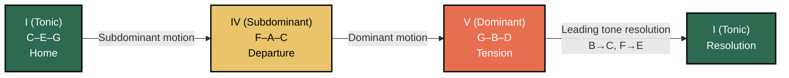
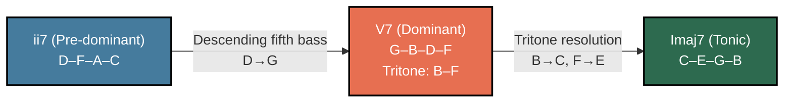
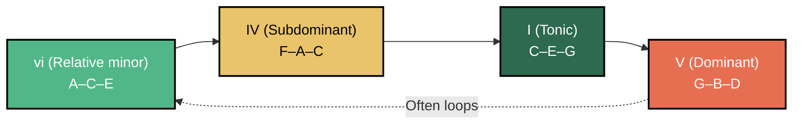
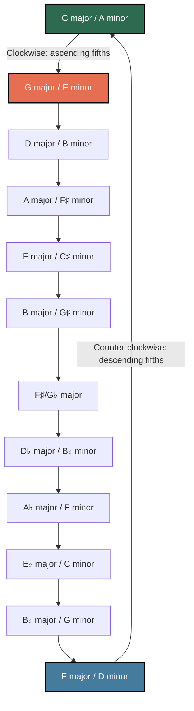
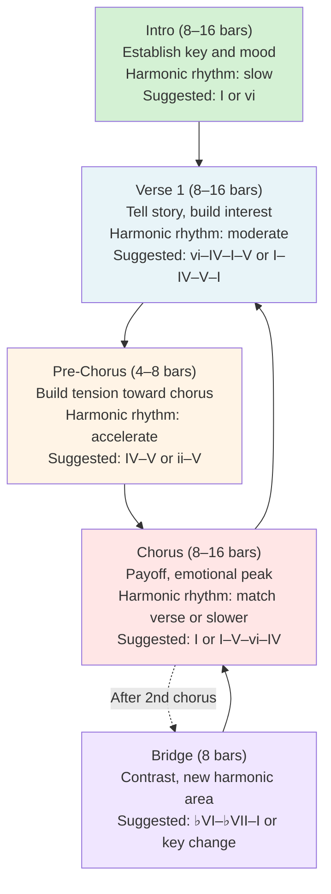

# Songwriting: Harmonic Architecture and Composition Craft

## 1. First-Principles Intuition & Acoustic Foundations

### The Harmonic Series as the Source of Songwriting Coherence

Every song is built on harmonic progressions that feel *inevitable* or *surprising* — but this inevitability is not arbitrary. It emerges from the physics of vibrating strings and the neuroscience of how the human auditory system processes pitch relationships.

When a string vibrates at a fundamental frequency *f₀*, it simultaneously produces overtones at integer multiples: 2f₀, 3f₀, 4f₀, 5f₀, and so on. This **harmonic series** is the acoustic foundation of all tonal music. Two pitches sound consonant when their overtone series share many common partials — the basilar membrane in the inner ear experiences minimal beating (amplitude fluctuation). Two pitches whose overtones collide at incongruent frequencies produce roughness, which the brain encodes as dissonance.

The critical frequency ratios that govern songwriting:

| Interval | Ratio | Cents (Just) | Cents (12-TET) | Acoustic Character |
|---|---|---|---|---|
| Perfect Fifth | 3:2 | 701.96 | 700 | Most consonant after octave; backbone of tonal harmony |
| Perfect Fourth | 4:3 | 498.04 | 500 | Consonant; weaker than fifth |
| Major Third | 5:4 | 386.31 | 400 | Consonant; slightly bright in 12-TET |
| Minor Third | 6:5 | 315.64 | 300 | Consonant; slightly dark in 12-TET |
| Major Seventh | 15:8 | 1088.27 | 1100 | Dissonant; used to create tension |
| Tritone | 45:32 | 590.22 | 600 | Maximally dissonant; demands resolution |

The perfect fifth (3:2 ratio) dominates songwriting because the third harmonic of the lower pitch coincides exactly with the second harmonic of the upper pitch — perfect acoustic alignment. This is why V→I cadences feel like *home*, and why progressions built on descending fifths (ii–V–I, V–I) feel structurally inevitable.

### Why Equal Temperament Enables Modern Songwriting

Just intonation produces pure consonance, but creates a problem: a scale tuned purely in C major will have severely mistuned chords when you modulate to F♯ major. Western songwriting solved this around 1700 by adopting **twelve-tone equal temperament (12-TET)**, where every semitone is an identical frequency ratio:

$$r = 2^{1/12} \approx 1.05946$$

This distributes the Pythagorean comma (≈23.46 cents) uniformly across all 12 fifths, flattening each by approximately 1.96 cents. No key is perfectly in tune, but every key is *equally out of tune* — which is perceptually acceptable and allows free modulation between any keys. This is the acoustic reason why modern songwriting can move between any harmonic regions without listeners perceiving it as "broken."

### The Tonic as Gravitational Center

In any song, the **tonic** is the gravitational center around which all other harmonies orbit. This is not a theoretical abstraction — neuroscience shows that the auditory cortex maintains an active harmonic expectation model. When an unexpected chord from a distant key appears (breaking the listener's tonal model), measurable ERAN (Early Right Anterior Negativity) responses appear in fMRI scans.

The tonic chord is stable because:
1. Its root is reinforced by the harmonic series — it appears as a prominent partial in many other chords in the key.
2. It contains no unresolved tendency tones (scale degrees that aurally "pull" toward adjacent semitones).
3. It shares the most overtones with other diatonic chords, making it acoustically central.

### Harmonic Function: The Three Forces Organizing Every Song

Every chord in a song operates in one of three **harmonic functions**, formalized by Hugo Riemann's functional harmony (1893):

**Tonic function (T):** Chords I, iii, and vi. These are stable. They require no further motion and can end phrases. In C major: C major, E minor, A minor.

**Subdominant function (S):** Chords IV and ii. These move *away* from the tonic, creating tension and forward momentum. IV (F–A–C in C major) is the acoustic mirror of I (C–E–G), rotated around the tonic — it feels like a departure. ii7 is functionally identical but smoother in voice leading. ii–V–I is the most elegant harmonic progression in songwriting.

**Dominant function (D):** Chords V and vii°. These create the strongest pull back to the tonic. The V chord (G–B–D in C major) contains the leading tone (B, one semitone below C), which aurally *wants* to resolve upward. The V7 chord (G–B–D–F) adds the minor seventh (F), which forms a tritone with B — a maximally unstable interval that resolves by contrary semitone motion (B→C, F→E), landing directly on the tonic triad. This is mechanical: the tritone is the most dissonant possible interval, and resolution is the only way to discharge that tension.

```
V7→I Resolution (G7→Cmaj in C major):

V7:  G  B  D  F
        |     |
        ↓     ↓
I:   C  C  E  E
    (B→C: leading tone, up 1 semitone)
    (F→E: seventh resolution, down 1 semitone)
```

This is not aesthetic preference. It is the most efficient harmonic resolution available in tonal music.

---

## 2. Building Songs: Diatonic Chord Palette and Voice Leading

### The Seven Diatonic Chords and Their Functions

In any major key, you have seven diatonic triads, one built on each scale degree:

| Degree | Chord | Notes | Quality | Primary Function |
|---|---|---|---|---|
| I | Imaj | C–E–G | Major | Tonic |
| ii | ii | D–F–A | Minor | Subdominant |
| iii | iii | E–G–B | Minor | Tonic (weak) |
| IV | IV | F–A–C | Major | Subdominant |
| V | V | G–B–D | Major | Dominant |
| vi | vi | A–C–E | Minor | Tonic (relative) |
| vii° | vii° | B–D–F | Diminished | Dominant (rare) |

In a minor key, the situation is more complex because the 6th and 7th scale degrees can be natural or raised, giving you access to more chords:

| Degree | Natural Minor | Harmonic Minor | Melodic Minor | Function |
|---|---|---|---|---|
| i | i | i | i | Tonic |
| ii° | ii° | ii° (rare) | ii° | Subdominant |
| III | III | III+ | III | Tonic (relative) |
| iv | iv | iv | iv | Subdominant |
| v | v | V (raised 7th) | v | Dominant (variable) |
| VI | VI | VI | VI | Subdominant |
| VII | VII | vii° | vii° | Dominant |

Most songwriters in rock, pop, and folk operate in a hybrid space between major and minor, borrowing chords from parallel keys to add emotional color.

### Seventh Chords: The Vocabulary of Modern Songwriting

Extending triads to seventh chords (stacking a third above the fifth) is how modern songwriting adds harmonic sophistication:

| Quality | Formula | Sonic Character | Common Usage |
|---|---|---|---|
| maj7 | R–M3–P5–M7 | Bright, open, jazzy | I, IV |
| 7 (dominant) | R–M3–P5–m7 | Tense, bluesy, demands resolution | V (strongest resolution force) |
| m7 | R–m3–P5–m7 | Dark, floating, stable | ii, iii, vi |
| m(maj7) | R–m3–P5–M7 | Introspective, uncommon but striking | vi variations in jazz/neo-soul |
| sus2, sus4 | R–M2/P4–P5 | Ambiguous, suspenseful | Transitional chords; avoid as endpoints |
| add9 | R–M3–P5–M9 | Modern, open, folk-influenced | I, IV variations |

The dominant seventh (V7) is the workhorse of songwriting. Its tritone (between the third and seventh: B–F in G7) creates maximum tension and demands resolution to I. This is why V7→I is the most powerful cadence available.

### Voice Leading: How Individual Notes Create Smoothness

A chord progression is not really about chords in isolation — it is about **voice leading**, the independent melodic motion of each voice (soprano, alto, tenor, bass) through the progression.

Four canonical voice-leading principles from 18th-century counterpoint pedagogy:

**1. Stepwise motion is preferred.** Each voice should move by step (a second) when possible, not leap. This minimizes acoustic discontinuity between chords.

```
Smooth voice leading (stepwise motion):

C major → F major:
Soprano:  C ──→ F (leap, necessary)
Alto:     E ──→ A (step up)
Tenor:    G ──→ F (step down)
Bass:     C ──→ F (fifth down, structural)

C–E–G
│ │ │
F–A–C
```

**2. Common tones are retained.** If adjacent chords share a pitch, keep it in the same voice — it acts as an acoustic anchor.

```
I → IV (C major → F major):
Both chords contain C and G.

Voice 1: C ──→ C (retained)
Voice 2: E ──→ F (step)
Voice 3: G ──→ A (step)
Voice 4: C ──→ F (bass fifth)
```

**3. Parallel perfect fifths and octaves should be avoided in classical/jazz writing** (but are exploited deliberately in rock for power and density). Two voices moving in the same direction by perfect fifth or octave momentarily merge into a single acoustic entity.

```
AVOID (classical):
Voice 1: C → G (up 7 semitones)
Voice 2: F → C (up 7 semitones)
Result: Loss of independence.

EMBRACE (rock/stadium):
Power chord slides maintain rhythmic/percussive emphasis.
```

**4. Contrary motion is preferred to parallel motion.** When voices must move, opposite directions (one ascending, one descending) preserve independence.

```
Contrary motion (preferred in classical):
Voice 1: C ──→ E (up)
Voice 2: G ──→ D (down)

Parallel motion (less preferred in classical, fine in rock):
Voice 1: C ──→ D (up)
Voice 2: G ──→ A (up)
```

These rules encode solutions to how the auditory system tracks multiple independent melodic lines simultaneously — voice-leading rules maximize the perceptual conditions for stream segregation.

---

## 3. The Fundamental Progressions: The Backbone of Songwriting

### I–IV–V–I: The Universal Narrative Arc



The I–IV–V–I progression maps onto the fundamental narrative of departure and return: stability → tension → maximum tension → resolution. This is the skeleton of countless songs across genres (The Beatles' *Let It Be*, thousands of pop choruses, hymns, classical sonatas).

**Why it works:**
- I is home (tonic stability).
- IV moves away (subdominant function), introducing a new tonal area.
- V maximizes distance with the tritone (B–F in G7), creating maximum tension.
- I provides return and resolution.

### ii–V–I: Jazz's Engine and Modern Songwriting's Secret Weapon



The ii–V–I is the most efficient progression in modern songwriting. Why:

1. **All three harmonic functions present:** ii (subdominant), V (dominant), I (tonic).
2. **Bass moves by descending fifths (D→G→C)** — the most acoustically stable bass motion, rooted in the harmonic series.
3. **Minimal voice leading:** Only semitone movements between V7 and Imaj7 (B→C, F→E).
4. **Universally applicable:** Works in jazz, R&B, neo-soul, modern pop ballads.

**Practical application:** If you want a smooth, sophisticated harmonic motion for a song's bridge or final chorus, ii–V–I is your template.

### vi–IV–I–V: The Pop Ballad Loop



This progression (also known as the "vi–IV–I–V" or "sensitive female chord progression") has become ubiquitous in contemporary pop ballads, singer-songwriter material, and indie rock. Why:

1. **Starts on vi (relative minor)**, creating an introspective opening.
2. **Moves through all three functions naturally.**
3. **Can loop indefinitely** without feeling repetitive if melodic interest is maintained.

Examples: Adele *Someone Like You* (uses vi–IV–I–V), Lady Gaga *Bad Romance* (uses variations), countless indie ballads.

### The Circle of Fifths as Harmonic Navigation



The circle of fifths is not a mnemonic — it is a topological map of harmonic distance. Keys adjacent on the circle share six of seven diatonic pitches and differ by one accidental. Progressions moving clockwise (I→V, ascending fifths) create *tension*. Progressions moving counter-clockwise (V→I, descending fifths) create *resolution*. The ii–V–I is a counter-clockwise motion: D→G→C.

**Practical application:** To modulate smoothly between keys in a song, move clockwise on the circle of fifths. C major → G major (add F♯) requires only one new accidental. C major → A♭ major (move counter-clockwise three times) requires a more dramatic shift.

---

## 4. Emotional Color: Modal Harmony and Borrowed Chords

### The Seven Modes: Beyond Major and Minor

A major scale rotated onto different roots produces seven distinct modes, each with a different emotional character:

| Mode | Formula from C | Characteristic Interval | Emotional Quality | Song Application |
|---|---|---|---|---|
| Ionian (Major) | C D E F G A B | Major 7th | Bright, resolved, victorious | Choruses, affirmative statements |
| Dorian | C D E♭ F G A B♭ | Major 6th on minor | Dark but hopeful, jazzy | Verses, introspection with momentum |
| Phrygian | C D♭ E♭ F G A♭ B♭ | Flat 2nd | Tense, Spanish/Flamenco, exotic | Avant-garde, world music, drama |
| Lydian | C D E F♯ G A B | Sharp 4th | Dreamy, floating, ethereal | Ambient passages, strangeness |
| Mixolydian | C D E F G A B♭ | Flat 7th | Bluesy, rock, blues-rock dominant | Verses in blues/rock, groovy sections |
| Aeolian (Natural Minor) | C D E♭ F G A♭ B♭ | No leading tone | Melancholic, resigned | Minor verses, sad sections |
| Locrian | C D♭ E♭ F G♭ A♭ B♭ | Flat 5th | Extremely unstable, dark, disorienting | Rare; horror/avant-garde contexts |

**Practical application:** To add emotion without changing key signature:

- **Use Dorian** when you want a minor sound that feels active (add a major 6th to a minor chord: Am → Am(maj6) or A–C–E–F♯).
- **Use Mixolydian** when you want a major sound with blues flavor (C major with a B♭ floating on top: C–E–G–B♭, the "blues I7").
- **Use Lydian** to create dreamy, timeless moods (substitute the IV chord's F with F♯: C–E–G–F♯ instead of C–E–G–F).

### Modal Mixture (Borrowing): Pulling from Parallel Keys

Modal mixture — borrowing chords from the parallel minor or other modes — is one of the most powerful expressive tools in songwriting. In C major, you can borrow from C minor, C Dorian, C Mixolydian, etc.

**Most common borrowed chords in pop/rock/classical:**

| Borrowed Chord | Source | Contains | Effect | Song Context |
|---|---|---|---|---|
| ♭VII (B♭ major) | C Mixolydian | C Mixolydian ♭7 | Anthemic, power, uplift | The Beatles *Hey Jude* (IV–♭VII–I), stadium rock |
| iv (F minor) | C minor | F–A♭–C | Emotional depth, heaviness | Dramatic descents, minor subdominant |
| ♭VI (A♭ major) | C minor | A♭–C–E♭ | Contrast, distance from I | ♭VI–♭VII–I power progression |
| ♭III (E♭ major) | C minor | E♭–G–B♭ | Mediant color, tonal distance | Chromatic planing, Renaissance/Romantic passages |
| ii° (D diminished) | C minor | D–F–A♭ | Passing chord, darkness | Rare; baroque counterpoint |

**Practical application in songwriting:**

To create an emotional pivot in your song without changing key, borrow ♭VII (the flatted seventh chord) or iv (the minor subdominant). In C major:

- **I → ♭VII → IV** (C major → B♭ major → F major): Creates anthemic lift and has been used in countless rock songs.
- **I → iv → V** (C major → F minor → G major): Adds darkness and introspection to a major-key progression.

These moves maintain the key signature (no accidentals needed for ♭VII if you think of it as borrowed; for iv you add A♭) but shift emotional color dramatically.

### Secondary Dominants: Tonicization Without Modulation

A **secondary dominant** is a V7 chord applied to a chord other than I, creating a momentary sense that this chord is a local tonic. It creates harmonic intrigue without a full key change.

In C major, the most common secondary dominants:

| Secondary Dominant | Resolves To | Leading Tone Of | Example |
|---|---|---|---|
| V7/ii (A7) | ii (D minor) | A7 → Dm (F♯ is leading tone of D) |
| V7/iii (B7) | iii (E minor) | B7 → Em (A♯ is leading tone of E) |
| V7/IV (C7) | IV (F major) | C7 → F (B♭ makes C a dom. 7th) |
| V7/V (D7) | V (G major) | D7 → G (C♯ is leading tone of G) |
| V7/vi (E7) | vi (A minor) | E7 → Am (D♯ is leading tone of A) |

```
Secondary Dominant Flow (C major key):

I ──→ V7/V (D7) ──→ V (G) ──→ I
      (tonicizes G    (G feels like
       momentarily)   temporary home)
```

This is how songwriters add harmonic sophistication and interest without key changes. Use it in bridges, transitions between sections, or as a surprise harmonic detour.

---

## 5. Harmonic Rhythm and Phrase Structure

### Harmonic Rhythm: The Pulse of Harmonic Change

**Harmonic rhythm** is the rate at which chords change, independent of the notated beat. It is a structural dimension entirely separate from melodic or rhythmic content.

| Harmonic Rhythm | Rate | Emotional Effect | Songwriting Application |
|---|---|---|---|
| Slow | One chord per 4–8 bars | Spacious, contemplative, ambient | Intro passages, sustained verses |
| Moderate | One chord per 1–2 bars | Conversational, grounded, standard | Most pop/rock verses and choruses |
| Fast | Chord changes per half-beat or quarter-beat | Urgency, complexity, dense texture | Transitions, climactic sections, bridge builds |

In classical and jazz composition, harmonic rhythm often **accelerates toward cadences** — the density of chord changes increases as the phrase approaches its conclusion, creating a sense of forward momentum and arrival.

**Practical application:** If your song's verse feels static, increase harmonic rhythm in the pre-chorus (more frequent chord changes) to build momentum. If your chorus feels chaotic, slow harmonic rhythm to let each chord breathe.

### Cadences: How Phrases End and Demand Continuation

A **cadence** is a harmonic formula that punctuates and terminates a musical phrase. There are four primary types:

#### 1. Perfect Authentic Cadence (PAC): V→I

The strongest possible ending. The bass moves from V root to I root (both in root position). This is the conclusive close — any listener knows the phrase has ended.

```
Soprano:  D ──→ C
Alto:     B ──→ E
Tenor:    G ──→ G (held)
Bass:     G ──→ C

V: G–B–D
I: C–E–G
```

The leading tone (B) resolves upward to the tonic (C), and the seventh (if present in V7) resolves downward. This is the cadence of finality.

#### 2. Imperfect Authentic Cadence (IAC): V→I (inverted or non-root position)

A softer landing than PAC. Either the V chord is inverted (bass not on G), or the I chord is inverted, or the melody does not arrive on the tonic (arrives on the third or fifth). It creates closure but leaves a sense that something could still happen.

#### 3. Half Cadence: (any chord)→V

A phrase that ends on V without resolving to I. It is a **question** without an answer — it demands continuation. Often used for antecedent phrases in period forms or song structures.

```
Verse ends on V (unresolved):
Listener's expectation: "What comes next?"
```

#### 4. Plagal Cadence: IV→I (the "Amen" Cadence)

The bass descends by a fourth (F→C in C major). It lacks the leading-tone urgency of the authentic cadence and therefore feels gentle, accepting, almost liturgical. Often used as a coda or final confirmation after V→I has already resolved.

#### 5. Deceptive Cadence: V→vi (or V→♭VI)

The expected resolution to I is interrupted by a substitution. This delays resolution and creates harmonic surprise. Schubert, Brahms, and Wagner used this repeatedly to avoid premature closure and extend emotional tension.

**Practical application in songwriting:** End your verse with a half cadence (V unresolved) or IAC to propel the listener into the chorus. End your final chorus with a perfect authentic cadence (V→I, both in root position, melody on C) for maximum finality.

---

## 6. Composing a Song: Step-by-Step Harmonic Framework

### The Five-Part Song Architecture

Most successful songs follow this harmonic skeleton:



### Practical Composition Workflow

**Step 1: Choose a tonic and harmonic function palette.**
Decide: Are you in major or minor? Will you borrow chords from parallel keys? This determines your available harmonic vocabulary.

**Step 2: Create the verse harmonic progression (8–16 bars).**
Use one of the fundamental progressions (I–IV–V–I, ii–V–I, vi–IV–I–V, or a borrowed-chord variant). Keep harmonic rhythm moderate (one chord per 1–2 bars). Write a melody *over* these chords.

```
Verse example in C major (8 bars):
Bar 1–2: vi (A minor) – melody over A–C–E
Bar 3–4: IV (F major) – melody over F–A–C
Bar 5–6: I (C major) – melody over C–E–G
Bar 7–8: V (G major) – melody over G–B–D
```

**Step 3: Create the pre-chorus (4–8 bars).**
Increase harmonic rhythm and move toward the dominant via secondary dominants or fast chord changes. Build momentum.

```
Pre-chorus example (4 bars):
Bar 1–2: IV (F major) – preparation
Bar 3: V7/V (D7) – secondary dominant tonicizing V
Bar 4: V (G major) – arrival on dominant, unresolved
(Listener expects chorus on I)
```

**Step 4: Create the chorus (8–16 bars).**
This is your emotional and harmonic payoff. You can either:
- **Repeat the verse harmonic progression** but with stronger melody and arrangement (common in pop).
- **Use a new progression** (e.g., a loop like I–V–vi–IV for maximum catchiness).
- **End with a strong authentic cadence** (V→I) to emphasize resolution.

```
Chorus example (8 bars):
Bar 1–2: I (C major)
Bar 3–4: V (G major)
Bar 5–6: vi (A minor)
Bar 7–8: IV (F major), then loop or V→I cadence
```

**Step 5: Create the bridge (8 bars).**
Harmonic contrast is key. Options:
- **Modulate to the relative minor** (C major → A minor): Reharmonize the melody in A minor.
- **Use borrowed chords** (♭VI–♭VII–I in C major: A♭–B♭–C): Creates dramatic pivot.
- **Modulate to a related key** (C major → G major or F major): Moves clockwise or counter-clockwise on circle of fifths.

```
Bridge example in C major (8 bars):
Modulate to A minor (relative):
Bar 1–2: vi (A minor) in the key of A minor (i)
Bar 3–4: V/iv (E major) – secondary dominant
Bar 5–6: iv (D minor) – emotional nadir
Bar 7–8: V (E major) – return to home key momentum
Then: Return to chorus in original key (C major)
```

---

## 7. Reference: Harmonic Progressions Organized by Emotional Character

### Progressions for Uplifting, Major-Key Moments

| Progression | Function | Song Context | Execution |
|---|---|---|---|
| I–V–vi–IV | Modern pop backbone | Chorus, main hook | Play each for 2 bars; end with IV on beat 4 as setup for next loop |
| I–IV–V–I | Classic cadence | Verse, chorus, or bridge | Slow harmonic rhythm (1 bar per chord) for weight |
| I–vi–IV–V | Introspective major | Verse opening, reflective chorus | Begin on I, establish tonic before descending to vi |
| IV–I–V–I | Inverted opening | Surprising opener, bridge | Starts away from tonic; tension before resolution |

### Progressions for Dark, Minor-Key or Borrowed-Chord Moments

| Progression | Function | Song Context | Execution |
|---|---|---|---|
| vi–IV–I–V | Relative minor intro | Verse, pre-chorus tension | Introspective opening, builds toward dominant |
| i–VII–VI–VII (or i–♭VII–♭VI–♭VII) | Minor cadential loop | Dark verse, minor chorus | Modal mixture; creates hypnotic, heavy feel |
| i–V | Minimal minor | Sparse verse, ambient section | Extreme harmonic rhythm simplification |
| iv–V | Pre-dominant tension | Bridge, climax setup | Tight, driving motion without tonic |
| i–III–VI (C minor: Cm–E♭–A♭) | Chromatic planing | Dramatic shift, key change setup | Mediant chords (non-functional); move stepwise |

### Progressions for Sophisticated, Jazz-Influenced Modern Writing

| Progression | Function | Song Context | Execution |
|---|---|---|---|
| ii–V–I | Jazz standard foundation | Verse, chorus refrain, bridge | Descending bass fifths; most elegant cadential motion |
| ii7–V7–Imaj7 | Extended jazz voicings | Contemporary ballad, R&B verse | Use seventh chords throughout for sophisticated color |
| vi–ii–V–I | Jazz reharmonization of I–IV–V–I | Verse underneath instrumental solo | Extend functional harmony |
| IVmaj7–V7sus4–V7 | Rhythmic suspension tension | Pre-chorus, transition | Suspend resolution; build anticipation |
| I–♯IV° (tritone substitution of V7) | Chromatic dominant sub | Modern jazz, neo-soul detour | ♯IV diminished functions as V7 (B♭° in C major ≈ G7) |

---

## 8. Computational Harmonic Analysis: Understanding Chord Relationships

### Pitch-Class Set Representation (Forte Theory)

Every chord can be represented as a set of pitch classes (0–11, where C=0, C♯=1, etc.), independent of octave. This allows systematic harmonic analysis:

```
C major triad:  {0, 4, 7}    (C, E, G)
F major triad:  {5, 9, 0}    (F, A, C) = {0, 5, 9}
G7 chord:       {7, 11, 2, 5} (G, B, D, F) = {2, 5, 7, 11}
```

**Forte Prime Form:** Every pitch-class set has a canonical form (prime form) that is unique under transposition and inversion. For example:
- Prime form of {0, 4, 7} (major triad) is [0, 4, 7].
- Prime form of {0, 3, 7} (minor triad) is [0, 3, 7].

This formalization allows:
1. **Harmonic distance measurement:** Two chords are harmonically close if they differ by one or two pitch classes.
2. **Chord substitution rules:** A vi chord (A–C–E = {0, 4, 9} in relation to C) shares pitch classes with I (C–E–G = {0, 4, 7}), explaining why vi feels like a tonic substitute.
3. **Algorithmic composition:** Rules for valid progressions can be encoded computationally.

---

## 9. Advanced Techniques: Reharmonization and Variation

### Reharmonization: Substituting New Chords Under the Same Melody

Reharmonization is the art of placing different chords underneath an existing melody to change its emotional character without changing the melody itself.

**Example: Reharmonizing a simple melody (C–E–G–E) in C major**

| Harmony Version | Chords | Effect |
|---|---|---|
| Simple | I (C–E–G over C) → I (G over E) → I (E over G) → I (E over E) | Homophonic, static |
| Jazz reharmonization | Imaj7 → V7/V → V7 → I | Sophisticated, walking bass |
| Minor-key borrowed | vi → IV → ii → V | Introspection before resolution |
| Chromatic planing | I → ♭VII → ♭VI → V | Descending chromatic bass, dramatic |

Reharmonization is the secret tool of jazz musicians and modern arrangers. To reharmonize a melody:

1. **Identify the melody notes** and their target arrival points (cadence, phrase endings).
2. **Under each melody note, choose a chord that contains it.** (E can be in I, iii, vi, V7/ii, etc.)
3. **Prioritize voice leading:** Choose chords such that the lower voices move smoothly.
4. **Create bass line independent of the original chords** (often using circle-of-fifths descending motion or chromatic descent).

### Chromatic Voice Leading: Moving Between Chords

Chromatic voice leading — moving one or more voices by semitone between chords — is a 20th-century and contemporary technique that adds sophistication and smoothness.

Example in C major:

```
I to ♭VII (C major to B♭ major):
Soprano:  C ──→ B♭ (semitone down, chromatic)
Alto:     E ──→ D (semitone down, chromatic)
Tenor:    G ──→ B♭ (leap to doubled root)
Bass:     C ──→ B♭ (semitone down)

Creates: Smooth, unexpected shift to ♭VII
```

This technique is central to neo-Riemannian theory and is widely used in contemporary pop (Radiohead, Bon Iver, modern indie) and classical (Debussy, Ravel).

---

## 10. Practical Songwriting Exercises

### Exercise 1: Compose a Simple Verse (Duration: 30 minutes)

**Objective:** Internalize the relationship between harmonic function and emotional narrative.

**Steps:**

1. Choose a major or minor key (suggest: C major or A minor for keyboard/guitar simplicity).
2. Compose an 8-bar verse using the progression **vi–IV–I–V** (in C major: Am–F–C–G).
3. Each chord gets 2 bars. Write a melody line that:
   - Starts on the root or third of each chord.
   - Moves mostly by step within each chord.
   - Ends on a tendency tone (B in this case) at bar 8 to pull toward the next section.
4. Play it through on your instrument with a metronome at 90 BPM. Does it feel balanced?
5. Transpose the same progression to two other keys (suggest F major and G major) to internalize the pattern.

**Variation:** Replace the I chord (bar 5–6) with a IV chord. How does the emotional arc change?

### Exercise 2: Compose a Pre-Chorus with Acceleration (Duration: 20 minutes)

**Objective:** Understand how increasing harmonic rhythm builds momentum.

**Steps:**

1. Use the same key as Exercise 1 (C major).
2. Compose a 4-bar pre-chorus with **accelerating harmonic rhythm:**
   - Bar 1: IV (F major) for full bar (slow).
   - Bar 2: IV (F major) for full bar (slow).
   - Bar 3: IV (F major) for 2 beats, then V7/V (D7) for 2 beats (faster).
   - Bar 4: V (G major) for full bar (unresolved, setting up chorus).
3. Write a melody that rises in pitch as harmonic rhythm accelerates (creates parallel tension).
4. Play it at 90 BPM. Does the listener feel anticipation at bar 4?

### Exercise 3: Compose a Chorus with Maximum Catchiness (Duration: 45 minutes)

**Objective:** Create a self-repeating harmonic loop that is instantly memorable.

**Steps:**

1. Use the **I–V–vi–IV loop** in C major: C–G–Am–F.
2. Each chord gets 2 bars (8-bar total loop).
3. Compose a memorable melody that:
   - Emphasizes the root of each chord (C over I, G over V, A over vi, F over IV).
   - Has rhythmic repetition (same rhythmic phrase repeated over each chord).
   - Uses singable intervals (no leaps larger than a sixth).
4. Play the loop 4 times (32 bars total). Is it catchy after repetition?
5. Variation: On the 4th loop, break the pattern by inserting a V→I cadence (ending the loop with resolution to I instead of returning to C).

### Exercise 4: Reharmonize a Simple Melody (Duration: 60 minutes)

**Objective:** Understand chord substitution and voice leading depth.

**Given melody (in C major):** C–E–G–E–C (5 notes, quarter notes)

**Task A: Simple Diatonic Reharmonization**

```
Melody:        C    E    G    E    C
Harmony 1:     I    iii  V    iii  I
Harmony 2:     I    vi   IV   I    I (using voice leading to prioritize stepwise motion)
```

Write both out and play them. Which feels more interesting? Why?

**Task B: Jazz Reharmonization**

Underneath the same melody, compose this progression:
```
Melody:        C    E    G    E    C
Harmony 3:     Imaj7 V7/ii ii7  V7  Imaj7
Bass line:     C (whole) ─→ D (whole) ─→ G (whole) ─→ C
```

The bass moves by descending fifths (circle of fifths); the melody floats on top. This is the texture of jazz arrangements.

---

## 11. Troubleshooting: Common Songwriting Harmonic Problems and Solutions

| Problem | Cause | Solution |
|---|---|---|
| "My verse feels static / boring" | Harmonic rhythm too slow; same chords for too long | Increase harmonic rhythm by 50% (split chords in half). Add a secondary dominant (V7/V) in bar 6. |
| "My chorus doesn't feel like a payoff" | Chorus uses same progression as verse; no climactic chord | Shift to a borrowed chord (♭VII) or modulate up by a step. End with a strong authentic cadence (V→I). |
| "The transition from verse to chorus is awkward" | No bridge harmony; abrupt jump | Insert a 4-bar pre-chorus that accelerates harmonic rhythm and arrives on V. |
| "My bridge feels disconnected from the rest of the song" | Bridge uses chords unrelated to verse/chorus | Modulate to relative minor (vi becomes i) or to a key one step up (circle of fifths). Establish relationship early. |
| "My melody doesn't sit on the chords; feels 'off'" | Melody contains wrong notes relative to harmony | Transpose melody so it starts on root, third, or fifth of opening chord. Check for passing tones that align with chord tones on strong beats. |
| "Parallel major triads in my progression sound thin/empty" | Root-position chords only; no voice leading | Invert some chords (play IV/ii—F/C in second inversion). Add seventh extensions (I → Imaj7). Use voice leading to create smooth bass line. |
| "My song ends abruptly; no sense of finality" | No final cadence; last chord is ambiguous | End with a clear V→I cadence. Play V on beat 3, I on beat 1 of the next measure; hold for 2–4 beats. |

---

## Summary: The Harmonic Composing Checklist

Before finalizing your song, verify:

- [ ] **Tonic established:** The key is clear by bar 4.
- [ ] **Three functions present:** Tonic, subdominant, and dominant appear in your verse/chorus.
- [ ] **Harmonic rhythm varied:** Verse slower (1–2 bars per chord), pre-chorus faster (accelerating).
- [ ] **Voice leading smooth:** Most voices move by step or hold common tones; no awkward leaps.
- [ ] **Cadences clear:** Verse/chorus/bridge endings use recognizable cadences (V→I, half cadence, plagal).
- [ ] **Emotional arc complete:** Intro establishes, verse tells, pre-chorus builds, chorus resolves, bridge contrasts, final chorus closes.
- [ ] **Melody sits on harmony:** Melody notes align with chord tones on strong beats; passing tones on weak beats.
- [ ] **Borrowed chords intentional:** Any out-of-key chords serve a clear emotional purpose (not accidental mistakes).

---

## Core References & Further Study

1. **Piston, Walter.** *Harmony* (5th ed., 1987). — Classical voice-leading reference; highly technical.
2. **Kostka, Stefan, and Dorothy Payne.** *Tonal Harmony* (8th ed., 2017). — Comprehensive diatonic and chromatic harmony; excellent progression library.
3. **Forte, Allen.** *The Structure of Atonal Music* (1973). — Pitch-class set theory for systematic harmonic analysis.
4. **Everett, Walter.** *The Foundations of Rock* (2019). — Harmonic analysis of rock and pop; highly practical.
5. **Terefenko, Dariusz.** *Jazz Theory: From Basic to Advanced Study* (2014). — Jazz reharmonization, secondary dominants, tritone substitution.
6. **Riemann, Hugo.** *Vereinfachte Harmonielehre* (1893, English trans. 1895). — Original functional harmony theory; foundational.
