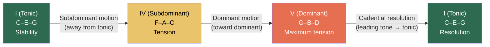
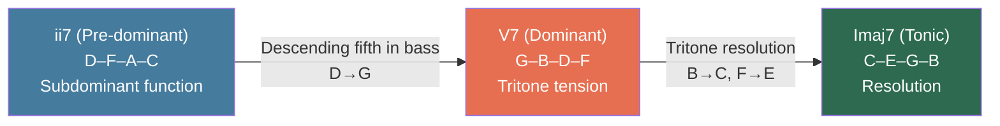
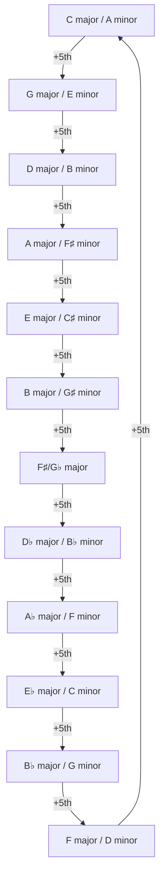
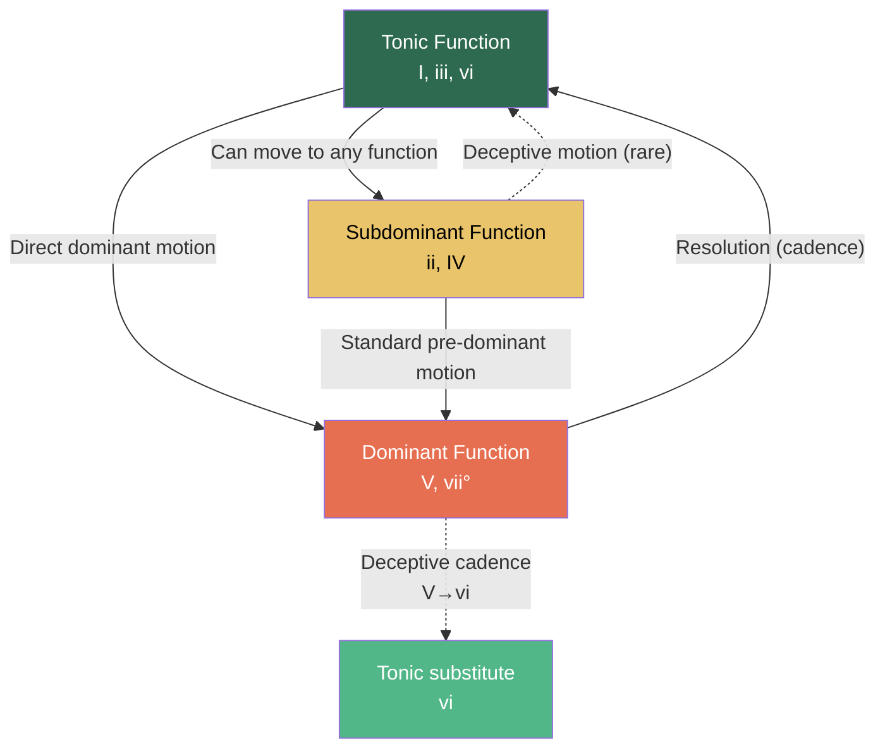
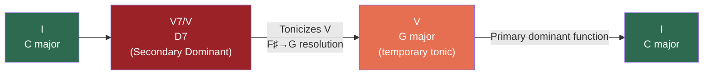

# Lesson 4: Harmonic Progressions

## 1. First-Principles Intuition & Physical Foundations

### The Acoustic Basis of Consonance

Harmonic progressions are not stylistic conventions imposed on music arbitrarily. They emerge directly from the physics of vibrating bodies and the neuroscience of auditory processing. To understand *why* a V→I cadence feels like resolution, you must start with vibrating strings.

When a string vibrates at a fundamental frequency *f₀*, it simultaneously produces overtones at integer multiples: 2f₀, 3f₀, 4f₀, 5f₀, and so on. This is the **harmonic series**. The ratios between these partials determine which interval combinations the human auditory system perceives as consonant. Two pitches sound consonant when their overtone series share many common partials — the basilar membrane in the cochlea experiences minimal "beating" (amplitude fluctuation caused by closely-spaced but non-identical frequencies). Two pitches whose overtones collide at incongruent frequencies produce roughness, which the auditory cortex encodes as dissonance.

The critical frequency ratios, expressed as just (pure) intonation values, are:

| Interval | Ratio | Cents (Just) | Cents (12-TET) | Deviation |
|---|---|---|---|---|
| Unison | 1:1 | 0 | 0 | 0 |
| Perfect Fifth | 3:2 | 701.96 | 700 | −1.96 |
| Perfect Fourth | 4:3 | 498.04 | 500 | +1.96 |
| Major Third | 5:4 | 386.31 | 400 | +13.69 |
| Minor Third | 6:5 | 315.64 | 300 | −15.64 |
| Minor Seventh | 7:4 | 968.83 | 1000 | +31.17 |

The perfect fifth (3:2) is the most consonant interval after the octave because the third harmonic of the lower pitch coincides exactly with the second harmonic of the upper pitch. No other interval above the unison and octave shares this degree of overtone alignment. This is why the perfect fifth is the structural backbone of tonal harmony.

### Why Equal Temperament is a Compromise — and Why It Works

Just intonation produces the purest consonance, but it is harmonically stranded: a scale tuned purely in the key of C will produce audibly mistuned chords in the key of F♯. Western music solved this by adopting **twelve-tone equal temperament (12-TET)** around the early 18th century, standardized through the theoretical work of Andreas Werckmeister and popularized by J.S. Bach's *Das Wohltemperirte Clavier* (1722).

In 12-TET, every semitone is an identical frequency ratio of:

$$r = 2^{1/12} \approx 1.05946$$

This distributes the Pythagorean comma (the ≈23.46-cent gap between 12 stacked perfect fifths and 7 octaves) uniformly across all 12 fifths, flattening each by approximately 1.96 cents. The result is that no key is perfectly in tune, but every key is *equally out of tune* — which is perceptually tolerable because the deviations are small enough to fall within the cochlea's frequency-resolution limits for most listeners.

The major third in 12-TET is 13.69 cents sharp relative to the pure 5:4 ratio. This audible sharpness is why close-voiced major triads on sustained instruments (pipe organ, choir) sound slightly more "tense" than the same triads on a lute tuned in meantone — a distinction that informed different compositional styles across periods.

### The Tonic as a Gravitational Center

The term **tonality** describes the perceptual organization of all pitches and chords around a privileged reference point: the tonic. This is not merely a theoretical construct. EEG and fMRI studies show that hearing an unexpected chord in a tonal context (e.g., a chord from a distant key) produces measurable ERAN (Early Right Anterior Negativity) responses in the brain, indicating that the auditory system maintains an active harmonic expectation model while listening to music.

The tonic chord is stable because:
1. Its root is reinforced by the acoustic overtone series — the tonic pitch appears as a prominent partial in many other chords.
2. It has no tendency tone: a **tendency tone** is a pitch that aurally "pulls" toward an adjacent semitone (e.g., the leading tone B in C major wants to resolve to C). The tonic triad (C-E-G in C major) contains no such unresolved tension.
3. It possesses the most shared overtones with the key's other diatonic chords, making it the acoustically "central" sonority.

### Harmonic Function: Tonic, Subdominant, Dominant

The functional theory of harmony — systematized by Hugo Riemann in *Vereinfachte Harmonielehre* (1893) — classifies every diatonic chord into one of three **functions** based on its relationship to the tonic:

**Tonic function (T):** Chords I and vi (and iii, with caveats). These chords are stable and require no further motion, though they can initiate motion. In C major: C major and A minor.

**Subdominant function (S or Pre-dominant):** Chords IV and ii. These chords move away from the tonic toward the dominant. The IV chord (F-A-C in C major) is the inversion of the I chord around the tonic: where I is a 3:2 above the tonic, IV is a 3:2 *below* it. This is the acoustic reason IV sounds like a "departure" rather than a "return." The ii chord is functionally equivalent and in many progressions smoother (ii→V→I is the most common jazz cadential motion).

**Dominant function (D):** Chords V and vii°. These chords create the strongest pull back to the tonic. The V chord (G-B-D in C major) contains the leading tone (B), which is a semitone below the tonic (C), and the seventh scale degree. When the V chord is extended to a V7 (dominant seventh, G-B-D-F), it additionally contains the minor seventh (F in G7), which forms a tritone with the leading tone (B-F = diminished fifth, 6 semitones). The tritone is maximally unstable: it resolves by contrary semitone motion (B→C, F→E), landing directly on the tonic chord. This is the mechanical reason the V7→I cadence is harmonically conclusive — two voices each move by the smallest diatonic step in contrary motion to the two most stable tones of the tonic.

```
Dominant Seventh Tritone Resolution (V7→I in C major):

G7:   G  B  D  F
         |     |
         ↓     ↓
Cmaj: G  C  E  E
      (B→C: leading tone resolution, semitone up)
      (F→E: chordal 7th resolution, semitone down)
```

This is not aesthetic preference. It is the most acoustically efficient resolution path available within the diatonic system.

---

## 2. Chord Architecture & Diatonic System

### Building the Diatonic System from Intervallic Stacks

A major scale is generated by stacking perfect fifths (3:2 ratios) and folding the results into a single octave. Begin on C and stack seven fifths:

```
C → G → D → A → E → B → F#
```

Folded into one octave: C D E F# G A B — this is the Lydian mode. The major scale (Ionian) is instead generated starting from F: F C G D A E B, folded to C D E F G A B. This matters because it explains why the perfect fourth (F) is the one diatonic note that is *not* generated by ascending fifths from the tonic — it arrives by descending a fifth — which is why IV has subdominant function (it pulls away from, not toward, the tonic).

Stacking thirds onto each scale degree produces the seven diatonic triads. In C major:

| Degree | Roman Numeral | Notes | Quality | Function |
|---|---|---|---|---|
| I | I | C E G | Major | Tonic |
| II | ii | D F A | Minor | Subdominant |
| III | iii | E G B | Minor | Tonic (weak) |
| IV | IV | F A C | Major | Subdominant |
| V | V | G B D | Major | Dominant |
| VI | vi | A C E | Minor | Tonic (relative) |
| VII | vii° | B D F | Diminished | Dominant (weak) |

Each triad is a stack of two thirds. A major triad has an interval structure of a major third (4 semitones) followed by a minor third (3 semitones): M3 + m3. A minor triad inverts this: m3 + M3. A diminished triad stacks two minor thirds: m3 + m3, producing the unstable tritone between the root and fifth.

### Seventh Chords and Modal Color

Extending diatonic triads to seventh chords (stacking a third above the fifth) adds an additional degree of harmonic color and tension:

| Degree | Chord | Notes | Quality |
|---|---|---|---|
| I | Imaj7 | C E G B | Major 7th |
| II | ii7 | D F A C | Minor 7th |
| III | iii7 | E G B D | Minor 7th |
| IV | IVmaj7 | F A C E | Major 7th |
| V | V7 | G B D F | Dominant 7th |
| VI | vi7 | A C E G | Minor 7th |
| VII | viiø7 | B D F A | Half-diminished 7th |

The dominant seventh chord (V7) is the only naturally occurring dominant seventh in the major scale — it uniquely possesses both the leading tone and the minor seventh in the same chord. This is why the V7 has stronger resolution force than a plain V triad. Jazz and post-Romantic harmony systematically exploits upper extensions (9ths, 11ths, 13ths), which add color without fundamentally altering harmonic function.

### Voice Leading: The Hidden Architecture

Chord progressions are not really about chords in isolation — they are about **voice leading**: the independent melodic motion of individual voices (soprano, alto, tenor, bass) through a chord sequence. Good voice leading determines whether a progression sounds smooth or disjointed, whether resolutions feel inevitable or awkward.

The four canonical voice-leading principles, formalized in 18th-century counterpoint pedagogy (Fux, *Gradus ad Parnassum*, 1725), are:

1. **Stepwise motion is preferred.** Each voice should move by step (a second) or hold common tones where possible, rather than leap. This minimizes the acoustic discontinuity between chords.
2. **Common tones are retained.** If two adjacent chords share a pitch, that pitch should remain in the same voice — it acts as an acoustic anchor.
3. **Avoid parallel perfect fifths and octaves.** When two voices both move in the same direction by the same interval and that interval is a perfect fifth or octave, the two voices momentarily merge into a single acoustic entity, reducing the apparent number of independent voices. Renaissance and Baroque style prohibits this; it is permitted and exploited in rock/pop parallel harmony.
4. **Contrary motion is preferable to parallel motion.** When voices must move, their moving in opposite directions (one ascending, one descending) preserves the independence of voice lines.

These rules are not arbitrary aesthetic prohibitions. They are encoding solutions to the perceptual problem of maintaining multiple auditory streams simultaneously — the auditory system uses spatial frequency differences and temporal continuity to track independent melodic lines, and voice-leading rules preserve the conditions that allow this tracking to succeed.

---

## 3. Structural Diagrams of Common Progressions

### The I–IV–V–I Progression: Functional Anatomy



The I–IV–V–I is the fundamental tension/release arc. It maps directly onto the narrative structure of departure and return: the IV chord begins a journey away from tonal stability, the V chord maximizes that departure by introducing the tritone, and the I chord closes the cycle.

### The ii–V–I Progression: Jazz's Engine

The ii–V–I replaces the IV with its functional equivalent ii, producing tighter voice leading (the ii chord shares two notes with IV but descends by fifth to V, creating a more directed bass motion):



The ii–V–I is ubiquitous in jazz because: (1) it uses all three harmonic functions; (2) the bass moves by descending fifths — the most acoustically stable bass motion (fifths are rooted in the overtone series); and (3) the voice leading is maximally efficient, with only semitone movements between V7 and Imaj7.

### The Circle of Fifths as a Harmonic Map



The circle of fifths is not a mnemonic device — it is a topological map of harmonic distance. Keys adjacent on the circle share six of seven diatonic pitches and differ by exactly one accidental. Progressions that move clockwise (ascending fifths: I→V) create tension; those that move counter-clockwise (descending fifths: V→I) release it. The ii–V–I is a counter-clockwise motion on this circle: D→G→C.

### Chord Function Flow in the Diatonic System



The deceptive cadence (V→vi) works because vi shares two of three pitches with I (in C major: A-C-E shares C and E with C-E-G), so the ear briefly accepts vi as a tonic substitute before realizing the resolution was redirected. Composers use this to extend phrases and delay final resolution.

---

## 4. Modal Harmony and Borrowed Chords

### The Seven Modes and Their Characteristic Tensions

The major scale is the Ionian mode. The other six modes are rotations of the same interval collection, each with a different tonic and therefore a different set of diatonic chords and a distinct "color":

| Mode | Scale (from C) | Characteristic Interval | Affective Quality |
|---|---|---|---|
| Ionian | C D E F G A B | Major 7th | Bright, stable |
| Dorian | C D E♭ F G A B♭ | Major 6th on minor | Dark but hopeful |
| Phrygian | C D♭ E♭ F G A♭ B♭ | ♭2 | Tense, Spanish/Flamenco |
| Lydian | C D E F♯ G A B | ♯4 | Dreamy, floating |
| Mixolydian | C D E F G A B♭ | ♭7 on major | Bluesy, rock |
| Aeolian | C D E♭ F G A♭ B♭ | Natural minor | Melancholy |
| Locrian | C D♭ E♭ F G♭ A♭ B♭ | Diminished 5th | Extremely unstable |

Dorian and Mixolydian are the two modes most exploited in rock, blues, and folk because they differ from pure major/minor by only a single accidental, maintaining familiarity while introducing a distinctive tension. The Mixolydian ♭7 is what gives the blues dominant seventh chord on the I degree its characteristic color (C7 in the key of C: C-E-G-B♭, which is "wrong" in pure Ionian but natural in Mixolydian).

### Modal Mixture (Borrowing)

Modal mixture — borrowing chords from the parallel mode — is one of the most powerful expressive tools in tonal writing. In C major, the most commonly borrowed chords are from C minor (Aeolian/Dorian/Phrygian):

**♭VII chord (B♭ major in C major):** Borrowed from C Mixolydian. Contains the characteristic Mixolydian ♭7. Produces the "anthemic" quality in classic rock (Guns N' Roses' *Sweet Child O' Mine* verse, The Beatles' *Hey Jude* outro IV–♭VII–I loop).

**iv chord (F minor in C major):** Borrowed from C minor. The minor subdominant is more emotionally heavy than the major IV because it replaces the characteristic major-scale 6th degree (A) with A♭, introducing chromatic descent in voice leading. The progression I–IV–iv–I (or the cadential ii°–V–i descent in minor) is ubiquitous in dramatic contexts.

**♭VI chord (A♭ major in C major):** Borrowed from C minor. This chord shares no pitches with the C major tonic triad, creating maximum contrast. The ♭VI–♭VII–I progression (A♭–B♭–C major) is a staple of stadium rock and power ballads.

**♭III chord (E♭ major in C major):** Borrowed from C minor. The mediant chord in this role often functions as a tonic expansion or as part of a chromatic planing sequence.

---

## 5. Secondary Dominants and Tonicization

### Tonicization vs. Modulation

**Tonicization** is the temporary application of dominant function to a chord other than the tonic — treating that chord momentarily as a local tonic without fully committing to a key change. **Modulation** is a permanent shift of tonal center, confirmed by a cadence in the new key.

The mechanism of tonicization is the **secondary dominant**: the V7 chord of a non-tonic scale degree. In C major, the V7/V is D7 (D-F♯-A-C), which is the dominant seventh of G major. When you hear D7→G major, your ear briefly interprets G as a temporary tonic. The F♯ in D7 is the leading tone of G, and the C is the minor seventh — replicating the exact tritone-resolution mechanism of the primary V7→I but targeting G instead of C.



The most common secondary dominants in C major:

| Secondary Dominant | Resolves To | Contains Leading Tone Of |
|---|---|---|
| V7/ii = A7 | ii (D minor) | A7 → Dm |
| V7/iii = B7 | iii (E minor) | B7 → Em |
| V7/IV = C7 | IV (F major) | C7 → F (makes C the dom. 7th, adding B♭) |
| V7/V = D7 | V (G major) | D7 → G |
| V7/vi = E7 | vi (A minor) | E7 → Am |

The V7/IV (C7 in C major) is a special case: since the root *is* the tonic, it is generated by lowering the major 7th by a half step. This is the "blues I7" — it explains why the tonic seventh chord in blues doesn't feel like a dominant seventh that needs to resolve away; the entire key is implicitly Mixolydian.

---

## 6. Harmonic Rhythm, Phrase Structure, and Cadences

### Harmonic Rhythm

**Harmonic rhythm** is the rate at which chords change. It is independent of melodic or notated rhythm and operates at a higher structural level. Fast harmonic rhythm (chord changes every beat or half-beat) creates urgency and density. Slow harmonic rhythm (chord changes every two or four bars) creates space and allows melodic development over a stable harmonic plane.

In Baroque music, harmonic rhythm often accelerates toward cadences — the density of chord changes increases as the phrase approaches its conclusion, creating a kinetic "arrival" feeling. In classical sonata form, the second theme in the exposition typically has slower harmonic rhythm than the transitional passage that preceded it, encoding structural contrast in the harmonic dimension.

### Cadence Types and Their Resolution Force

A **cadence** is a harmonic formula that punctuates a phrase. The four primary cadence types in tonal music:

**Authentic cadence (V→I):** The strongest available resolution. If the bass moves from the dominant root to the tonic root (both chords in root position), it is a **perfect authentic cadence (PAC)** — the most conclusive possible phrase ending. If either chord is inverted or the melody does not arrive on the tonic, it is an **imperfect authentic cadence (IAC)**, which creates closure but with a sense that something remains unsaid.

**Plagal cadence (IV→I):** The "Amen" cadence of liturgical music. The bass descends by a fourth (F→C in C major). It lacks the leading-tone resolution of the authentic cadence and therefore feels gentler, more "accepting" than conclusive. Often used as a coda extension after an authentic cadence has already resolved the main structural tension.

**Half cadence (any→V):** A phrase that ends on V without resolving to I. It is a question without an answer, structurally demanding continuation. Common in antecedent phrases of period forms.

**Deceptive cadence (V→vi or V→♭VI):** The expected resolution to I is interrupted by a substitution. V→vi is the diatonic deceptive cadence; V→♭VI is the chromatic (Romantic-era) variant, used heavily by Schubert and Wagner to defer resolution almost indefinitely.

---

## 7. Computational Representations of Harmonic Progressions

This section treats harmonic progressions as formal computational objects — which is useful for algorithmic composition, music information retrieval (MIR), and digital audio workstation plugin development.

### Representing Chords as Pitch-Class Sets

A pitch class is an equivalence class of all pitches that share the same name regardless of octave. There are 12 pitch classes, numbered 0–11 (C=0, C♯=1, D=2, ..., B=11). A chord is a set of pitch classes. Pitch-class set theory, formalized by Allen Forte in *The Structure of Atonal Music* (1973), provides a systematic way to analyze chord identity independent of transposition and inversion.

```python
from __future__ import annotations
from dataclasses import dataclass, field
from typing import FrozenSet, Sequence, Tuple
import itertools

# Pitch class constants
PITCH_CLASSES = {
    'C': 0, 'C#': 1, 'Db': 1, 'D': 2, 'D#': 3, 'Eb': 3,
    'E': 4, 'F': 5, 'F#': 6, 'Gb': 6, 'G': 7, 'G#': 8,
    'Ab': 8, 'A': 9, 'A#': 10, 'Bb': 10, 'B': 11
}

INTERVAL_NAMES = {
    0: 'P1', 1: 'm2', 2: 'M2', 3: 'm3', 4: 'M3',
    5: 'P4', 6: 'TT', 7: 'P5', 8: 'm6', 9: 'M6',
    10: 'm7', 11: 'M7'
}


@dataclass(frozen=True)
class PitchClassSet:
    """
    A pitch-class set (pc-set) in mod-12 space.
    Provides normal form, prime form, and interval vector
    following Forte's conventions.
    """
    pcs: FrozenSet[int]

    def __post_init__(self):
        for pc in self.pcs:
            if not (0 <= pc <= 11):
                raise ValueError(f"Pitch class {pc} out of range [0, 11]")

    @classmethod
    def from_note_names(cls, *notes: str) -> "PitchClassSet":
        return cls(frozenset(PITCH_CLASSES[n] for n in notes))

    def transpose(self, n: int) -> "PitchClassSet":
        return PitchClassSet(frozenset((pc + n) % 12 for pc in self.pcs))

    def invert(self, axis: int = 0) -> "PitchClassSet":
        return PitchClassSet(frozenset((axis - pc) % 12 for pc in self.pcs))

    def normal_form(self) -> Tuple[int, ...]:
        """
        Returns the most compact ordering of the pitch-class set
        (
