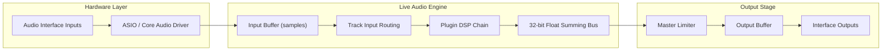
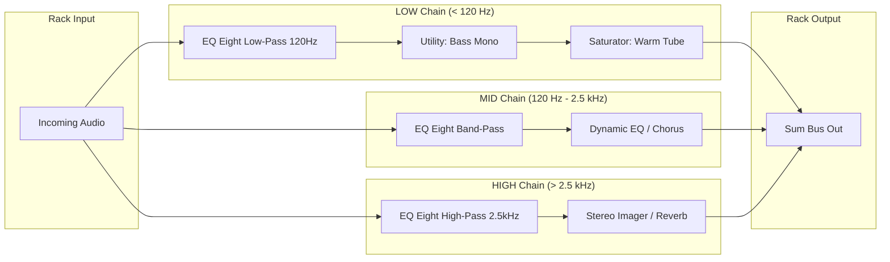

# Ableton Live Suite: Production Workflow Masterclass

## Who This Is For and What You Need

This is a hands-on operator's manual for Ableton Live Suite 11/12. You should have Live installed with a working audio interface. Every exercise assumes you're sitting at the computer with headphones or monitors on, actually clicking and dragging as you read. Skip nothing — muscle memory for routing and warping is what separates someone who "knows Live" from someone who can track, mix, and sound-design under a studio clock.

Session tempo for all exercises: **124 BPM**, 4/4, unless stated otherwise.

---

## Studio Signal Flow: What Actually Happens Between Input and Output

Understanding the signal path matters because every latency complaint, phase problem, or CPU spike traces back to one of these stages.



**The one paragraph of theory you need:** Live sums every track in 32-bit floating point internally, so you cannot clip anything *inside* the mixer — only the final analog-to-digital conversion at your interface's output, or a plugin that clips internally (most saturators, some compressors), can actually distort. This is why gain-staging rules below target headroom on the Master bus and on individual plugins, not on Live's mixer itself. Buffer size is a direct trade: a 128-sample buffer at 48 kHz gives roughly 2.7 ms one-way latency through the input stage alone (128 ÷ 48000 = 2.67 ms), doubled roughly for round-trip plus driver overhead, which is why the real-world monitoring latency you feel sits around 5–6 ms. Smaller buffers cost CPU headroom because the engine has to service interrupts more often; bigger buffers trade latency for stability. That's the entire trade-off, no more math needed.

### Calibration Procedure (Do This First, Every Session)

1. Open **Preferences → Audio**.
2. **Sample Rate**: `48000 Hz` for anything touching video, `44100 Hz` for music-only release work matching CD/streaming masters. Pick one per project and never change it mid-session — changing sample rate retroactively re-renders warped clips and can shift pitch on unwarped ones.
3. **Buffer Size**:
   - Tracking a performer (vocals, guitar, keys with a software instrument): `128 samples`.
   - Programming, arranging, comping, browsing samples: `512` or `1024 samples` — your CPU will thank you.
   - Final mixdown with heavy plugin chains (convolution reverbs, multiband compressors, oversampled saturators): `1024` or `2048 samples`. Latency doesn't matter when you're not playing live into the track.
4. **Driver Error Compensation**: In Preferences → Audio, click **Test** next to Driver Error Compensation if your interface supports loopback, or manually measure with a cable from an output to an input and Live's built-in latency test. Target: `0.00 ms` reported offset. Skipping this causes audio recorded alongside MIDI or other audio to sit consistently early or late — a few milliseconds is inaudible as timing but will visibly misalign waveforms and defeat warp marker precision.
5. **CPU overload indicator** (top right of the screen): if it flickers red during playback, raise the buffer before you troubleshoot anything else.

---

## Exercise 1: Session View Clip Launching, Follow Actions, and Generative Arrangement

**Goal:** build a self-playing, non-repeating percussion arrangement using probability-weighted Follow Actions — the technique behind most "generative" Ableton live sets and installations.

### Step 1: Build the Track Matrix

In Session View, create:

| Track | Type | Purpose |
|---|---|---|
| `KICK_SUB` | Audio | Dry sub kick, unwarped, one-shot |
| `PERC_LOOP` | Audio | Four 2-bar loop variations |
| `PAD_HARMONY` | MIDI (Wavetable) | Sustained harmonic bed |
| `LEAD_MPE` | MIDI (Drift, MPE-enabled) | Expressive lead with per-note pressure |

To enable MPE on `LEAD_MPE`: load Drift, then in the track's input routing confirm "MPE" mode is active if you're using an MPE controller (ROLI, Linnstrument, Osmose). Without MPE hardware this track still works as a normal MIDI track — polyphonic aftertouch just won't be per-note.

### Step 2: Load and Configure Follow Actions

1. Drag in four 2-bar audio loops to `PERC_LOOP`'s clip slots: `Perc_A`, `Perc_B`, `Perc_C`, `Fill_D`.
2. Double-click `Perc_A` to open Clip View. Click the **Follow Actions** disclosure arrow (bottom right of Clip View, looks like a small triangle next to clock icon).
3. Set:
   - **A:** `Next`, weight `7`
   - **B:** `Other`, weight `3`
   - **Follow Action Time:** `2 Bars 0 Beats 0 16ths` (must equal the clip's own length or you'll get early retriggers)
4. Repeat on `Perc_B` and `Perc_C` with the same weights — this creates a loosely-ordered chain that occasionally jumps to a random other clip instead of advancing in sequence.
5. On `Fill_D`, set:
   - **A:** `First`, weight `10`
   - **Time:** `1 Bar`
   
   This guarantees that after the fill plays once, playback always resets to `Perc_A` — the fill acts as a turnaround.

**Why weight 7/3 and not something more extreme:** at 7:3 you get noticeable variation roughly every 3rd loop cycle on average, often enough to feel alive, rare enough that the groove doesn't feel random. Push toward 9:1 for subtlety, or 5:5 for near-chaotic variation — dial by ear, not by formula.

### Step 3: Global Quantization and Launch Verification

1. Top-left of the Session View, set **Global Quantization** to `1 Bar`.
2. Click the Scene 1 launch button. Watch the clip header: a small progress ring fills around the launch button between trigger and actual start — this is quantization waiting for the next bar boundary.
3. **Verification check:** solo `PERC_LOOP`, let Follow Actions run for 2 minutes, and watch for any visible waveform jump or audible click at transition points. If you hear a click, the loop's start/end points aren't sample-accurate — go to Step 4 below (warping) before continuing.
4. For legato-feeling transitions (no silence gap, no re-trigger thump), enable **Legato mode** (the `🔗` icon next to Follow Action) on `PERC_LOOP` — this makes a newly triggered clip continue from the same playback position as the clip it replaced, rather than restarting from bar 1. Essential for percussion loops that should feel continuous rather than retriggered.

---

## Exercise 2: Warp Algorithms — Choosing the Right Engine for the Material

Live's warp engine isn't one algorithm, it's five, each built for different audio content. Picking the wrong one is the single most common cause of "why does my stretched audio sound grainy/robotic/smeared."

### Warp Mode Decision Table

| Mode | How it Works | Use For | Key Settings |
|---|---|---|---|
| **Beats** | Slices audio at transients, replays slices at new tempo, stretches gaps between hits | Drums, percussion loops, plucked rhythmic material | Transient Resolution `1/16` for busy loops, `1/8` for sparse ones. Loop Mode `Off` for one-shot feel. |
| **Tones** | Overlapping grains sized around the fundamental pitch | Monophonic bass, solo horns/woodwinds, single vocal lines | Grain Size `30–45 ms` — too small sounds metallic, too large smears pitch |
| **Texture** | Randomized overlapping grains, no pitch tracking | Pads, ambient drones, string sections, noise | Grain Size `60–100 ms`, Flux `35–50` for natural chorus-like movement |
| **Re-Pitch** | Classic turntable/tape behavior: speed change = pitch change | DJ-style tempo transitions, vinyl/tape emulation, risers | No independent pitch control — this is the point |
| **Complex Pro** | Spectral resynthesis with formant preservation | Full mixes, layered vocal stacks, mastered reference tracks you need to time-stretch without pitch artifacts | Formants `100` for natural voices, lower if you want a de-pitched/robotic character |

**The physics in one paragraph:** time-stretching without pitch change is only possible because audio isn't one continuous unbreakable waveform — it has transient (attack) and tonal (sustain) components that can be separated and repositioned independently. Beats mode exploits percussive transients directly; Tones and Texture modes use overlapping grains (a decades-old granular synthesis trick) to stretch the sustain portions without altering pitch; Complex Pro goes further and does a full FFT-based spectral decomposition so even dense polyphonic material holds together. The cost of all this cleverness is CPU and, at extreme stretch ratios (beyond roughly ±20%), audible artifacts no algorithm fully escapes — at that point consider re-recording at the target tempo instead.

### Hands-On: Warping a Multitrack Drum Session

Scenario: acoustic drum stems recorded at 110 BPM, project tempo is 124 BPM.

1. Import `Kick_In.wav`, `Kick_Out.wav`, `Snare_Top.wav`, `OH_L.wav`, `OH_R.wav` onto five audio tracks, aligned at the same start point (bar 1, beat 1).
2. Select all five tracks (click track 1 header, shift-click track 5 header), right-click → **Group Tracks** (`Cmd/Ctrl+G`). Name the group `DRUMS_LIVE`.
3. Select all five clips simultaneously (they must be selected together, not one at a time, so warp settings apply identically — this is what keeps the stems phase-locked to each other).
4. In the Clip View, enable the **Warp** switch. Set **Warp Mode: Beats**.
5. Set **Transient Resolution** to `1/16` (dense), and set the Transient Loop Mode selector (small icon next to each transient marker, looks like `→|`) to **"Loop Off"** — this stops the engine from looping a tiny slice of the transient's tail when stretched slower, which is what causes that "stuttery flutter" artifact on snare hits.
6. Confirm Live auto-detected the source tempo as `110 BPM` (shown in Clip View warp section) — if it guessed wrong (common with sparse kick patterns), manually type `110` into the BPM field.
7. **Phase check on the kick mics:** insert **Utility** on `Kick_Out`, enable **Phase Invert (∅)**. Solo `Kick_In` + `Kick_Out` together, A/B the invert switch. If the combined low end (45–80 Hz, check with an EQ Eight's spectrum analyzer) gets *louder and fuller* with invert ON, leave it on — that means the mics were originally out of phase relative to each other. If it gets thinner, leave invert OFF. Never assume — always A/B by ear and by analyzer.

**Common failure mode:** if after warping the snare sounds "doubled" or smeared, your Transient Resolution is too coarse for the material (try `1/32`), or the clip's detected transients (visible as small markers in the waveform) are misplaced — right-click a marker and **Delete Warp Marker**, then manually drag-create one exactly on the transient peak.

---

## Exercise 3: 3-Band Frequency-Split Audio Effect Rack

**Goal:** process bass fundamentals, midrange body, and stereo top-end through independent effects chains inside a single reusable rack — this is how professional "parallel multiband" processing is built in Live without a dedicated multiband plugin.



### Step 1: Build the Rack Structure

1. Select your bass or synth-bass track. Drag **Audio Effect Rack** onto it from the browser.
2. In the empty rack, click the **Chain List** button (top of the device, looks like a horizontal strip). Right-click in the empty chain area → **Create Chain**, three times. Rename them `LOW`, `MID`, `HIGH` (double-click each name).
3. Each chain now receives the full incoming signal in parallel — the crossover filtering happens per-chain, not before the split, so you must build complementary filters on each chain by hand:

**LOW chain:**
- Insert **EQ Eight**. Set Band 1 to **Low Pass**, frequency `120 Hz`, and switch the filter slope selector to the steepest option available (48 dB/oct on EQ Eight's high-order mode — click the small slope icon beneath the band number repeatedly to cycle slopes).
- After the EQ, insert **Utility**. Click **Bass Mono** — this collapses everything below ~120 Hz to mono, which prevents phase cancellation on subwoofers and in mono playback systems (clubs, phones) without affecting stereo width above that frequency.
- After Utility, insert **Saturator**. Drive mode `Warm`, Drive `2–4 dB`. This adds harmonic content that makes low bass audible on small speakers that can't physically reproduce the fundamental.

**MID chain:**
- Insert **EQ Eight**. Band 1: **High Pass** at `120 Hz`. Band 2: **Low Pass** at `2500 Hz`. Same steep slope setting on both.
- Insert **Dynamic EQ** or **Chorus** depending on whether you're taming resonances (Dynamic EQ) or adding width/movement (Chorus).

**HIGH chain:**
- Insert **EQ Eight**. Band 1: **High Pass** at `2500 Hz`, steepest slope.
- Insert **Stereo Imager** or **Reverb** for air and space.

**Why match crossover points exactly across chains:** if LOW's low-pass sits at 120 Hz and MID's high-pass sits at 100 Hz, you get a 20 Hz gap with nothing covering it — a dip in the spectrum. If they overlap instead (LOW low-pass at 120 Hz, MID high-pass at 100 Hz reversed), you get a 2–3 dB bump from both chains reinforcing that range. Keep crossover frequencies numerically identical across adjacent chains and use matching filter slopes so the two curves cross at the -3 dB point of each — that's what a textbook Linkwitz-Riley crossover actually guarantees, and it's why both chains above use `120 Hz` and `2500 Hz` exactly.

### Step 2: Sidechain the Low Band to the Kick

This is the "ducking" trick that keeps bass and kick from fighting for the same low-end space — standard in nearly every modern electronic mix.

1. On the `LOW` chain (inside the rack), insert Live's **Compressor** after the Saturator.
2. Click the sidechain disclosure triangle (bottom-left of the Compressor UI, small arrow).
3. Enable the **Sidechain** toggle. Set **Audio From** to your kick track (`KICK_SUB`), and select **Post FX** so the sidechain reacts to the kick's final processed sound, not its raw signal.
4. In the sidechain's own EQ section, enable **Side-Chain EQ**, set a **High-Pass at 100 Hz** — this stops the compressor from reacting to anything but the kick's attack transient, ignoring low rumble or bleed.
5. Compressor main settings:
   - **Attack:** `0.8 ms` — fast enough to duck before the kick's energy fully arrives
   - **Release:** `45 ms` — short enough to recover before the next beat, long enough to avoid audible pumping artifacts
   - **Ratio:** `4:1`
   - **Threshold:** `-18 dBFS` — adjust by watching the gain reduction meter
6. **Verification:** solo `LOW` chain + `KICK_SUB` together. Watch the Compressor's gain reduction meter on every kick hit — target `-4 to -6 dB` of reduction. Less than that and the ducking is inaudible; more than that and the bass audibly disappears on every beat, which reads as pumping rather than clarity.

---

## Exercise 4: Drum Rack Multi-Out Routing and Max for Live Modulation

**Goal:** route individual Drum Rack pads to dedicated mixer channels for independent outboard-style processing, then add organic per-hit variation using Max for Live's LFO device.

### Step 1: Discrete Pad Routing

1. Create a MIDI track, drag **Drum Rack** onto it from Instruments.
2. Load samples: Kick on pad `C1`, Snare on `D1`, Closed Hi-Hat on `F#1`.
3. Create three new audio tracks: `AUX_KICK`, `AUX_SNARE`, `AUX_HH`.
4. On each aux track, open **Audio From** dropdown (top of the track in the In/Out section — enable In/Out view with `Cmd/Ctrl+Alt+I` if hidden). Select your Drum Rack's track name, then in the second dropdown that appears, choose the specific pad output:
   - `AUX_KICK` ← `Drum Rack → Kick`
   - `AUX_SNARE` ← `Drum Rack → Snare`
   - `AUX_HH` ← `Drum Rack → Closed Hi-Hat`

   (Each individual pad must have its own **Chain Output** assigned inside the Drum Rack's chain list first — right-click each pad's chain in the Drum Rack chain list, set output to a dedicated number if not already separated by default.)
5. Set **Monitor** to `In` on all three aux tracks so they always pass audio live without needing record-arm.
6. **Verification:** solo `AUX_SNARE` only. Confirm you hear only the snare — no kick or hat bleed. Add a Compressor insert on `AUX_SNARE` alone and confirm the kick and hi-hat signal paths are completely unaffected (they're on separate tracks now, so this should be automatic — if you hear changes on other drums, you routed to the master pad output instead of the discrete one).

### Step 2: Organic Variation with Max for Live LFO

Static, identical hi-hat hits every 16th note sound programmed and lifeless. This fixes that.

1. On the Drum Rack MIDI track, drag the **LFO** device (Max for Live, found under Max for Live → Max Audio Effect, or Max MIDI Effect depending on build) onto the track, positioned before the Drum Rack in the chain if it's a MIDI effect, or on the hi-hat's own chain if targeting post-synthesis parameters.
2. Click the **Map** button on the LFO device. In the Drum Rack, click into the Closed Hi-Hat pad's chain, then click its sample/filter device's **Filter Cutoff** knob — the LFO now targets that parameter.
3. Configure the LFO:
   - **Waveform:** `Random` (sample & hold character — avoids smooth, obviously-synthetic sweeps)
   - **Rate:** `1/16` synced
   - **Amount/Depth:** `25%`
   - **Offset:** `60%` (keeps the modulation centered in a useful range rather than sweeping to extremes)
4. Play a straight 16th-note hi-hat pattern. Each hit now lands with a slightly different filter cutoff — this mimics the natural inconsistency of a drummer's hand position and strike velocity on a real hi-hat, which static sample playback can't replicate on its own.

**Extending this:** map a second LFO (or the same one, multi-mapped) to **Velocity** or **Volume** with a smaller depth (`10–15%`) for combined timbral and dynamic variation — real hi-hats vary in both at once.

---

## Pre-Master Gain Staging and Export Checklist

Run through this before bouncing stems or a final master. Each line is a concrete, checkable action, not a vague aspiration.

```text
[ ] Master Bus peak meter: peaks sit at or below -6.0 dBFS with zero red clip indicators,
    even on the loudest downbeat of the arrangement.
[ ] Individual channel gain staging: open each track's meter, confirm RMS (average) level
    sits between -18 dBFS and -14 dBFS during the densest section — not peak level, RMS.
[ ] Mono compatibility: insert Utility on the Master track, toggle "Mono" on and off while
    soloing full mix. Bass and snare body should NOT disappear or thin out in mono — if they
    do, find the phase issue (usually a stereo-widened bass synth or a mic pair out of phase)
    before proceeding.
[ ] Plugin delay compensation: Options menu (or Preferences on some builds) → confirm
    "Delay Compensation" is checked. Without this, linear-phase EQs and lookahead limiters
    on different tracks will drift relative to each other.
[ ] CPU headroom: during full mix playback, the CPU meter (top right) should not spike past
    ~80%. If it does, freeze heavy tracks (right-click track → Freeze Track) before export.
[ ] Export settings: File → Export Audio/Video. Set "All Individual Tracks" if delivering
    stems, or "Master" for a single mix. Sample Rate matches project (do not resample
    unnecessarily). Bit Depth 24-bit for stems, 16-bit only if delivering a final dithered
    consumer master. Dither: "Triangular" only when reducing bit depth (24→16), "None" when
    exporting 24-bit or 32-bit float stems for further mastering.
```

**Why RMS and not peak for channel gain staging:** peak level tells you how close a signal is to clipping at any single instant, but it says nothing about how loud a track *sounds* or how hard it's driving a compressor or saturator downstream — two tracks can peak identically at -3 dBFS while one sounds twice as loud because its RMS (average energy over time) is far higher. Staging by RMS keeps every channel hitting downstream plugins (compressors, saturators, tape emulations) with a consistent, predictable amount of drive, which is what actually makes a mix sit together instead of fighting itself.
