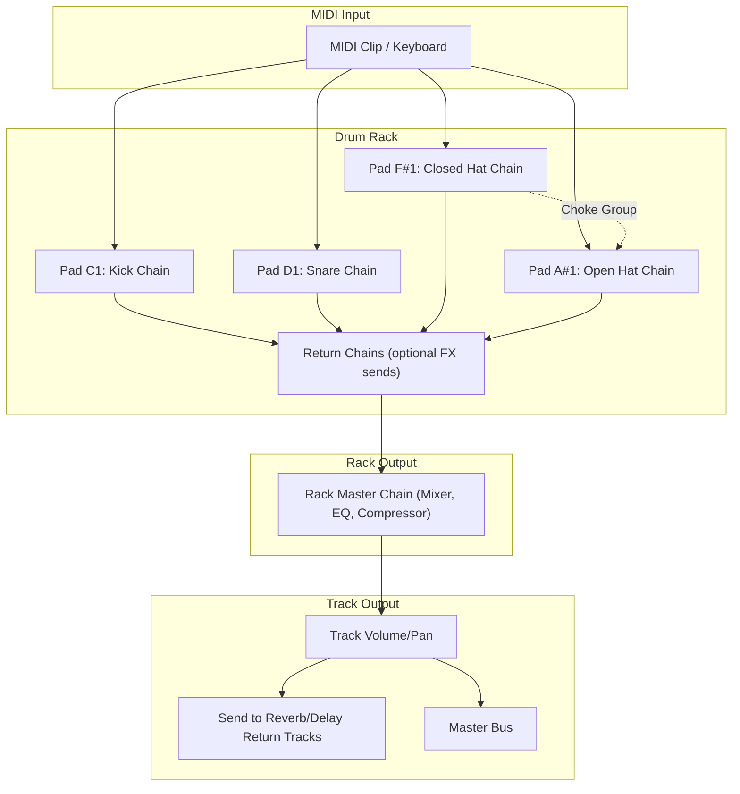

# Lesson 1: Drum Racks — Building, Programming, and Mixing Beats in Ableton Live

## 1. What a Drum Rack Actually Is (Core Concept, No Fluff)

A Drum Rack is Ableton's 128-pad sampler/instrument container. Each pad is a **chain** — its own mini audio channel with a sample (or a whole synth), its own volume, pan, filter, envelope, and effects, plus its own choice of **MIDI note** that triggers it. One Drum Rack replaces an entire drum machine: kick on C1, snare on D1, closed hat on F#1, open hat on A#1 — the General MIDI-ish layout Ableton ships by default.

The one piece of acoustic theory worth internalizing: a kick drum's energy sits mostly below 100 Hz with a pitch "thump" around 50–80 Hz; a snare's body sits around 150–250 Hz with its snap/crack living in the 2–6 kHz band; hats and cymbals are mostly inharmonic noise above 7 kHz. You EQ and arrange drum rack chains around this split — it's why kick and bass fight for the same 50–100 Hz space, and why snare and vocal both want that 3–5 kHz presence zone. Everything else in this lesson is hands-on.

## 2. Building Your First Drum Rack — Step by Step

1. **Insert the instrument.** In the browser, go to Instruments → Drum Rack, drag it onto a MIDI track (or double-click it with the track selected).
2. **Load samples per pad.** Open the browser's Samples/Drums folder. Drag a kick onto pad C1, a snare onto D1, a closed hat onto F#1, an open hat onto A#1, a clap onto D#1. Each drop auto-creates a chain with a Simpler inside it.
3. **Save your kit.** Click the Drum Rack's name, hit Ctrl/Cmd+S (or drag the rack's hot-swap icon to a User Library folder) so this exact kit reloads instantly in future projects.
4. **Name your pads.** Double-click each pad name (Kick, Snare, CH, OH, Clap) — this is what will show up in the piano roll and makes editing MIDI fast instead of guessing which black key is which.

### Chain-level controls you will touch constantly
- **Choke groups:** Assign closed-hat and open-hat pads to the same Choke group number (top-right of the chain, in the Chain List view). This makes a closed-hat hit cut off a ringing open-hat the way a real hi-hat pedal does. This is the single most-forgotten realism fix in programmed hats.
- **Velocity → Volume/Filter:** On each chain, there's a Velocity amount knob tied to volume and (optionally) filter cutoff. Set velocity-to-volume around 70–100% on hats and ghost-note-heavy snares so dynamics actually read.
- **Random pitch/volume per chain:** Small amounts (±2–3 cents pitch, ±1 dB volume) under the chain's "Vel/Rnd" section kill the machine-gun static feel of repeated hat hits.

## 3. Programming the Groove: MIDI Mechanics That Matter

### 3.1 Step entry vs. live playing
Open a MIDI clip, hit the pencil icon (Draw Mode) or just double-click into the grid. Set grid resolution with the magnet/grid menu — 1/16 notes is the standard starting resolution for most electronic genres.

**Basic four-on-the-floor house/techno pattern (1 bar, 1/16 grid, 16 steps numbered 1–16):**

| Step | 1 | 2 | 3 | 4 | 5 | 6 | 7 | 8 | 9 | 10 | 11 | 12 | 13 | 14 | 15 | 16 |
|---|---|---|---|---|---|---|---|---|---|---|---|---|---|---|---|---|
| Kick | X | | | | X | | | | X | | | | X | | | |
| Clap | | | | | X | | | | | | | | X | | | |
| CH   | X | | X | | X | | X | | X | | X | | X | | X | |
| OH   | | | X | | | | X | | | | X | | | | X | |

Program the kick/clap first (the "frame"), then layer hats, then add syncopated percussion last. This order keeps the groove anchored instead of drowning in hat noise before the skeleton exists.

### 3.2 Velocity and groove — don't program robots
- Select all notes, right-click → set velocity, or manually drag each note's velocity tail at the bottom of the piano roll.
- Typical pattern: downbeat kick velocity 110–127, ghost/off-grid hits 60–85, hat accents on the "and" of each beat slightly louder (90–100) than the straight 16ths (70–80).
- **Groove pools:** Drag a MIDI clip into Live's Groove Pool (or load a factory groove like `MPC 60` or `Logic Swing 16`), then drag that groove onto your clip and dial the **Timing** amount to 40–60% and **Velocity** amount to 20–40%. This is the fastest way to turn a quantized grid into something that feels played, without manual nudging.

### 3.3 Micro-timing by hand (when you want full control)
With a note selected, `Alt`-drag (Win) / `Option`-drag (Mac) it left/right in small increments, or zoom into the clip and nudge with arrow keys after setting a smaller nudge grid. Classic human-feel moves:
- Push the snare 5–10 ticks **late** on backbeats for a laid-back, head-nod feel (common in hip-hop and lo-fi).
- Pull the kick slightly **ahead** of the grid (a few ms) for aggressive, driving techno.

## 4. Rack Signal Flow

The dotted choke-group link isn't literal audio routing — it's a trigger-cutoff relationship inside the rack: a new closed-hat MIDI note forcibly silences any currently-ringing open-hat chain in the same group.

## 5. Processing Inside the Rack (Where the Sound Actually Gets Shaped)

### 5.1 Per-chain device chains (do this before touching the mixer)
Click a pad to select its chain, then build a mini chain in the device view:

- **Kick:** Simpler (sample) → EQ Eight (high-pass everything below 30 Hz to remove sub-sonic rumble, cut a narrow notch around 300–400 Hz if it sounds "boxy") → Saturator (small drive, 2–4 dB, for punch) → Glue Compressor only if layering multiple kick samples.
- **Snare:** Simpler → EQ Eight (boost +2–3 dB around 3–5 kHz for crack, high-pass below 100 Hz) → Overdrive or Saturator for grit.
- **Hats:** Simpler → EQ Eight (high-pass aggressively, 200–400 Hz, hats carry zero useful low end) → short Reverb send only, never on the chain itself unless you want a washed-out sound.

### 5.2 Return chains inside the rack
Drum Racks support **Return Chains** — internal buses fed by sends on each pad, exactly like the main mixer's return tracks but scoped to this one rack. Use this for a shared drum-bus reverb or parallel compression that only touches the kit, not the rest of the song.

### 5.3 The rack's master chain
At the top of the chain list sits the Drum Rack's own master chain. This is the ideal spot for:
- **Glue Compressor** (Ableton's or any bus compressor): ratio 2:1–4:1, attack 10–30 ms (let the transient through), release set to "Auto" or matched to tempo, 2–4 dB of gain reduction on the loudest hits. This is what makes a programmed kit feel like one cohesive drum kit instead of disconnected samples.
- **EQ Eight** for overall tonal shaping (a gentle high-shelf boost above 8 kHz for "air," or a broad dip around 400–600 Hz to remove mud) — only after individual chains are already dialed in.

## 6. Layering and Multi-Sampling for Thicker Drums

- **Layering kicks:** Put two kick samples on the same MIDI note by adding a second chain mapped to C1 (drag a second sample onto the same pad while holding nothing special — Live stacks chains automatically when you drop onto an occupied pad with multiple selected, or manually duplicate a chain and change its sample). Layer a sub-heavy "boom" sample with a click-heavy "thwack" sample — EQ each to occupy a different frequency lane (boom: 50–100 Hz, thwack: 2–4 kHz with the rest cut) so they reinforce instead of mask each other.
- **Velocity-switched layers:** In the Chain List, select two chains assigned to the same pad and set their velocity ranges (bottom of the chain list view) to split — e.g., chain A plays 0–80, chain B plays 81–127. This gives you a quiet ghost-note sample and a loud accent sample triggered automatically by how hard you play or program the velocity.
- **Round-robin via Chain Select:** Set the Chain Selector's play mode to "Random" or "Cycle" across several near-identical snare samples mapped to the same note/key-range, eliminating the machine-gun repetition artifact on fast rolls.

## 7. Practice Drills (Metronome-Anchored)

These drills build the actual skill of programming grooves fast and musically, not just reading about it.

1. **Drill — Basic 4-on-the-floor (60–110–128 BPM):** Program kick/clap/hat pattern from Section 3.1 from scratch in under 3 minutes at each tempo. Time yourself. Goal: muscle memory for grid navigation and quick velocity edits.
2. **Drill — Humanization pass:** Take a fully quantized 1-bar pattern and, without using the Groove Pool, manually nudge every snare hit 5–8 ticks late and vary hat velocities by ear until it sounds played. A/B against the robotic original repeatedly.
3. **Drill — Choke group correction:** Deliberately program overlapping open/closed hats without a choke group, listen to the ugly phase-ringing collision, then assign the choke group and listen to the fix. This builds the ear to catch this problem instantly in future sessions.
4. **Drill — Frequency-lane layering:** Layer two kick samples, solo each individually, then EQ one as "sub" and one as "click" until soloing either alone sounds thin but together they sound full. Repeat for snare (body + snap layers).
5. **Drill — 16-bar build:** Starting from a 1-bar kick+hat loop, add one new element (clap, percussion, open hat variation, fill) every 2 bars for 16 bars without ever muting what came before, training arrangement instinct directly inside the rack's pattern.

## 8. Performance, CPU, and Reliability

### 8.1 CPU load — real causes, real fixes
Drum Racks are rarely the CPU bottleneck themselves — the devices *inside* each chain are. Common offenders and fixes:
- **Too many real-time convolution reverbs per chain** → consolidate to one shared reverb on a Return Chain instead of one per pad.
- **High sample rate source material on every pad** → if a sample is 96 kHz and your project runs at 48 kHz, Live resamples it live; for huge kits, batch-convert samples to project sample rate first (Edit → Convert, or use a tool like `sox input.wav -r 48000 output.wav` outside Live) to cut conversion overhead.
- **Freeze + Flatten:** Once a Drum Rack's part is finished, `Freeze Track` (renders to audio, keeps automation editable at the freeze level) then `Flatten` if you need to permanently reclaim CPU and don't need to tweak the rack further.

### 8.2 Latency
- Set your audio interface buffer size (Live Preferences → Audio) to 128 or 256 samples while actively programming/playing pads live; bump to 512–1024 only for mixdown/export where round-trip latency doesn't matter anymore.
- If you're playing the rack from an external MIDI controller and feel lag, check `Preferences → Link/MIDI` — Track Delay compensation set too high, or a loaded sample starting with silence/fade-in, both masquerade as "latency" when they're actually something fixable inside the rack.

### 8.3 Common real failure modes and the actual fix
| Symptom | Real Cause | Fix |
|---|---|---|
| Open hat "flams" with closed hat | No choke group assigned | Assign both to same choke group number |
| Kit sounds thin in a mix | No bus compression tying chains together | Add Glue Compressor on rack's master chain |
| Fast hat rolls sound machine-gun robotic | Identical sample retriggering identically | Add micro pitch/volume randomization, or round-robin chain select |
| Rack feels "behind" the beat live | High audio buffer size | Drop buffer to 128 samples during tracking |
| CPU spikes only when this track plays | Per-chain heavy reverb/convolution | Move shared FX to a Return Chain, process once not per-pad |
