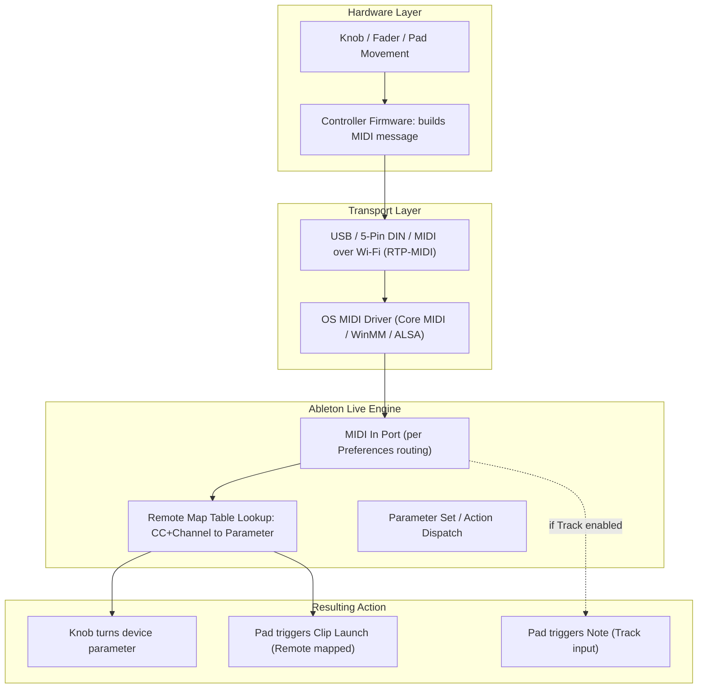

# Lesson 2: MIDI Mapping in Ableton Live

## 1. Why MIDI Mapping Matters (Core Intuition, Kept Short)

MIDI messages are tiny packets: a status byte says what kind of event this is (note on, note off, control change), followed by one or two data bytes carrying the details (which note or controller number, and what value from 0–127). A knob turn sends a **Control Change (CC)** message like "CC 74, value 93" roughly 100+ times a second as you twist it. Ableton's MIDI Map Mode listens for the *next* message that arrives after you click a control, remembers its CC number and channel, and from then on routes that exact message straight to that parameter — bypassing your mouse entirely.

That's the entire mechanism. Everything else in this lesson is about exploiting it efficiently: which controls are worth mapping, how to avoid the common wiring mistakes, and how to build a controller layout you can play without looking.

The one invariant that matters in daily use: **MIDI CC data is 7-bit**, meaning every knob and fader you map has only 128 steps of resolution (0–127). This is why a mapped filter cutoff knob feels "steppy" compared to dragging it with a mouse (which has far finer resolution) — and why for mix-critical parameters (precise gain staging, fine EQ) you may prefer high-resolution mapping via **MIDI CC 14-bit (NRPN)** on gear that supports it, or Max for Live's MPE/float-based mapping, rather than standard 7-bit CC.

## 2. Setting Up MIDI Map Mode — Step by Step

### 2.1 Entering and using Map Mode

1. Click the **MIDI** button, top-right of the Ableton window (or `Cmd/Ctrl + M`). The screen tints blue; every mappable control gets a highlighted outline.
2. Click the target control in Live (a knob, a track's Volume fader, a clip slot via a "Launch" button, a device parameter).
3. On your hardware, move the knob/fader/pad you want bound to it. Live captures the CC number + channel instantly.
4. A blue number badge appears on the control showing its assigned CC. Click **MIDI** again to exit map mode and test it.

No typing CC numbers manually required — this is "learn mode," the standard workflow. You only hand-type CC/channel numbers when editing an existing mapping or building templates in a text-based controller script.

### 2.2 Reading and managing existing mappings

- Open the **MIDI Mappings** browser: in Map Mode, the bottom-left Help/Info panel is replaced by a list of every active mapping in the current Set (control name → CC/Note → channel).
- Click any row to jump directly to that control, useful when you inherited a Set and need to audit what's bound.
- To remove a single mapping: enter Map Mode, click the control, press `Delete`.
- To clear **everything** at once: `Options > MIDI Mappings... (or the Mappings list) > right-click > Delete All`. Use this when a Set has accumulated stale mappings from a controller you no longer use.

### 2.3 Channel and port discipline

Before mapping anything, lock down **Preferences > Link/Tempo/MIDI**:

- Under **MIDI Ports**, enable **Track** (lets the controller play notes into tracks) and **Remote** (lets the controller send mappable CC/Note data) independently for each input port. A controller sending on a port with Remote off will never be learnable in Map Mode, even though it shows up in the mixer — this is the #1 "my mapping won't take" support ticket.
- If a controller exposes multiple MIDI channels (many have a "global channel" setting in their own firmware), pick ONE and stick to it per device. Mixing channels across pads and knobs on the same controller causes ghost triggering when you later add a second controller with overlapping default CCs.

## 3. Architecture: What Actually Happens Between Your Hand and the Screen

Two distinct data paths matter here and are the source of most confusion:

- **Track path**: MIDI Notes routed to a MIDI track's instrument, for playing/recording performances.
- **Remote path**: MIDI CC/Note messages consumed by the Map Table to control Live's UI (knobs, clip launch, device on/off). A pad can do BOTH simultaneously if Track and Remote are both enabled and the pad happens to be mapped — this is how a drum pad can both record a note into a clip AND launch a scene on press, which is powerful but can also be an accidental double-trigger bug if you forgot you mapped it.

## 4. Practical Mapping Patterns (What to Actually Map)

### 4.1 Session View performance rig (clip launching + mixer)

A typical 4x4 pad grid + 8 knobs + transport controller should be laid out like this:

| Control | Map Target | Why |
|---|---|---|
| Pad 1–8 (row 1) | Clip slots, Track 1–8, Scene A | Primary performance triggers |
| Pad 9–16 (row 2) | Scene Launch buttons, Scenes A–H | Launch whole arrangement sections |
| Knob 1–8 | Track Volume, Tracks 1–8 | Live mix control without the mouse |
| Shift + Knob 1–8 (via controller's own shift layer) | Track Send A, Tracks 1–8 | Reverb/delay send riding, hands-free |
| Transport buttons | Play / Stop / Record (map via Options, not MIDI Map Mode — these are "Key/MIDI Map" global commands) | Hands never leave the controller |

Map order matters for sanity: map all pads first (Map Mode stays on, click next control, move next hardware control — Live does not require you to exit between mappings), then all knobs, then save as a **Default Set template** (`File > Save Live Set` into your User Library template slot) so every new project opens pre-wired.

### 4.2 Instrument/effect rack performance control (macro mapping)

This is where MIDI mapping becomes genuinely expressive rather than just a mouse replacement:

1. Build or load a Rack (Instrument Rack, Audio Effect Rack).
2. Assign 1–8 chain parameters to the Rack's **Macro knobs** (drag any device parameter onto a Macro slot, or right-click parameter > "Map to Macro N").
3. Exit assignment mode, enter MIDI Map Mode, map your hardware knobs directly to the **Macros**, not to the underlying parameters.

Why map to Macros instead of mapping 8 hardware knobs straight to 8 separate device parameters: a single Macro can drive multiple parameters at once with custom min/max ranges and inverted curves per target (right-click a mapped parameter inside the Macro's "Map" tab to set a custom range, e.g., filter cutoff mapped 20Hz–2kHz on one chain while resonance on another chain maps inversely on the same knob). This gives you one physical knob performing a complex multi-parameter morph — the foundation of "performance patches" in live electronic sets.

### 4.3 Velocity and Note-based mapping for drum pads

Pads sending **Note On/Off** (not CC) can map to:

- **Clip Launch** — triggers regardless of velocity value, but if "Velocity" is enabled on the clip (`Clip > Launch tab > Velocity` checkbox), harder hits launch at full volume/different follow-behavior — useful for expressive loop triggering.
- **Device on/off toggles** — map a pad to a device's power switch for instant effect kill/bring-back during a performance (classic dub delay throw).

## 5. The 7-Bit Resolution Problem and When It Actually Bites

A fader moving over 128 discrete values across its full throw sounds fine for most mixing and sweeps, but becomes audible as "staircasing" in two specific situations:

1. **Slow filter sweeps on a resonant low-pass filter.** Each of the 128 steps is a small but real jump in cutoff frequency; with high resonance, each step can produce an audible "tick" or "zipper" artifact.
2. **Long automated fade-outs on Volume.** A fader throw mapped 1:1 covers the full -inf to +6dB range in 128 steps — most of that resolution is wasted in the loud region and starved in the critical -60dB to -inf tail, causing audible stepping right at the end of a fade.

**Fix for both:** don't map the fader directly to Volume. Instead, map it to a **Macro** on a Utility device inserted on the track, with the Macro's range custom-set to cover only the useful span (e.g., -24dB to -inf), effectively spreading your 128 steps over a narrower, more perceptually relevant range. Alternatively, automate the fade in the Arrangement view with a drawn breakpoint curve instead of live-fader riding when the tail needs to be sample-smooth.

## 6. Troubleshooting Failure Modes

| Symptom | Root Cause | Fix |
|---|---|---|
| Control won't enter Map Mode highlight | That control isn't MIDI-mappable (some are, like "Device On" toggles aren't always; browser/view navigation items usually aren't) | Confirm via the manual: mappable controls show the highlight in blue when Map Mode is active, system/view switches typically don't |
| Mapped, but moving the knob does nothing | Remote not enabled for that MIDI input port in Preferences | Preferences > Link/MIDI > enable Remote on the correct port |
| Knob jumps the parameter value instantly on first touch ("value snap") | Normal MIDI absolute-mode behavior: parameter jumps to match the physical knob's current position | Either physically match knob position before grabbing, or if your controller supports it, switch that control to **relative/encoder mode** in its firmware, which sends increment/decrement messages instead of absolute position |
| Pad double-triggers (fires note AND launches a clip) | Both Track and Remote enabled on the same port, and the pad happens to be both note-mapped into the track and Remote-mapped to clip launch | Disable Track on that input if you only need performance control, or renumber the pad's note so it doesn't collide with an active clip's note-mapped launch |
| Mapping disappears after reopening the Set | Mapping was made against a controller not connected at save time, or Live auto-remapped ports alphabetically on a different machine | Re-save with the controller connected; for portability across machines, build a **Control Surface script** (User Remote Scripts) instead of ad hoc Map Mode for critical show rigs |
| High-speed knob sweeps feel laggy compared to mouse drag | 7-bit resolution + USB polling rate of the controller (often 100Hz–1kHz depending on hardware) | Accept as an inherent limit of standard MIDI CC; for mix-critical fast automation, draw the curve in Arrangement view instead of live-riding the hardware |

## 7. Drill: Build a Complete Performance Template (30–45 min)

1. Create a new Live Set with 4 MIDI tracks loaded with Instrument Racks (any presets).
2. Build 8 Macro knobs per rack following §4.2, mapping at least 3 real parameters to each Macro with at least one inverted range.
3. Map your controller's 8 physical knobs to the 8 Macros of the currently selected track (remap per track if your controller lacks per-track bank switching — or better, learn your controller's bank-switch button and map 4 tracks x 8 macros = 32 mappings total across 4 banks).
4. Map a 4x4 pad grid: top row to Clip Slots 1–4 on Track 1, remaining rows to Scene Launch.
5. Save as a Default Template (`File > Save as Default Set`) so this rig loads automatically on every new Set.
6. **Performance test:** play through a 2-minute improvisation using only the controller — zero mouse clicks. Note every moment you reached for the mouse; those are your next mapping gaps to close.
