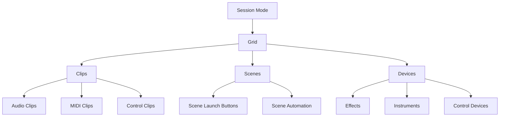

# Lesson 4: Session Mode

## 1. First-Principles Intuition & Invariants

Session Mode in Ableton Live is a powerful environment designed for live performance and improvisation, offering a dynamic and intuitive interface for musicians and producers to explore and manipulate audio and MIDI in real-time. At its core, Session Mode embodies the essence of spontaneity and creativity, allowing performers to spontaneously trigger clips, launch samples, and modulate parameters on the fly. This mode is particularly advantageous for live performances where the ability to adapt and respond to the moment is paramount.

The theoretical foundation of Session Mode is rooted in the principles of modular and parallel processing. Unlike Arrangement Mode, which is linear and time-based, Session Mode operates in a non-linear, grid-based structure. This grid is a matrix of cells, each capable of holding a clip—an audio sample, a MIDI sequence, or a control signal. The grid itself serves as a canvas for musical ideas, where each cell represents a potential musical event or transformation. Key invariants of Session Mode include the ability to trigger clips in any order, the capacity for real-time parameter modulation, and seamless integration with external MIDI controllers and hardware devices.

The mathematical and system invariants of Session Mode are deeply intertwined with the principles of digital signal processing and control systems. Each clip in the grid can be thought of as a discrete signal, and the act of triggering a clip is akin to sampling a signal at a specific time. The grid itself can be seen as a two-dimensional array of these discrete signals, where the x-axis represents time and the y-axis represents different channels or layers of audio and MIDI. The ability to manipulate these signals in real-time is facilitated by the underlying algorithms that handle clip launching, parameter automation, and MIDI control. These algorithms must be efficient and responsive to ensure that the performer can interact with the system without latency or delay.

## 2. Core Architecture & Mechanics

The architecture of Session Mode is built around a modular and flexible system of clips, scenes, and devices. Each clip in the grid is a self-contained unit of audio or MIDI, and can be independently triggered and manipulated. Clips are organized into scenes, which are horizontal rows in the grid. Each scene captures the active clips and their parameters, representing a snapshot of the current performance state. Scenes can be cycled through using the Scene Launch Buttons, allowing the performer to transition between different musical ideas or arrangements.

The core mechanics of Session Mode are centered around the interaction between clips, scenes, and devices. Clips are the building blocks of the performance, created using various sources such as audio recordings, MIDI sequences, and control signals. Clips can be triggered using the grid itself or via external MIDI controllers, such as pads or keyboards. When a clip is triggered, it is launched and played back, and can be stopped or looped using the clip controls.

Scenes provide a higher level of organization, enabling the performer to transition between different musical ideas or arrangements. Scenes can be cycled through using the Scene Launch Buttons or triggered using external MIDI controllers. They also store and recall different parameter settings, allowing the performer to quickly switch between various musical textures or effects.

Devices in Session Mode are the tools that allow the performer to manipulate clips and scenes in real-time. Devices can be inserted into clips and include a variety of effects, such as reverb, delay, and distortion, as well as instruments like synthesizers and samplers. Devices can be controlled using device controls or external MIDI controllers. They can also be automated using automation features, enabling the creation of complex and dynamic performances.

The architecture of Session Mode can be visualized using a Mermaid diagram:

## 3. High-Performance Optimization & Failure Modes

High-performance optimization in Session Mode is critical for ensuring that the performer can interact with the system without latency or delay. The system must handle a large number of clips, scenes, and devices in real-time. Optimization is achieved through a combination of efficient algorithms, optimized data structures, and hardware acceleration.

Efficient algorithms are designed to minimize latency and ensure responsiveness. The clip launching algorithm, for example, is optimized to launch clips as soon as they are triggered. The scene cycling algorithm is also optimized to cycle through scenes smoothly, while the parameter automation algorithm ensures that parameters are updated in real-time.

Data structures are optimized for performance. The grid is a two-dimensional array of clips, optimized for fast access and modification. Clips, scenes, and devices are stored in compressed formats, decompressed only when necessary.

Hardware acceleration is achieved through dedicated audio processing hardware, such as DSP chips and GPUs. Audio processing hardware offloads the processing of audio signals, allowing the CPU to focus on other tasks. The GPU offloads the rendering of the user interface, further enhancing performance.

The primary failure modes of Session Mode are related to latency and performance. Latency occurs when the system fails to process audio signals in real-time, causing a delay between trigger and playback. Performance issues arise when the system cannot handle a large number of clips, scenes, and devices, leading to unresponsiveness. These failure modes can be mitigated through the use of efficient algorithms, optimized data structures, and hardware acceleration.

Session Mode in Ableton Live is a powerful environment for live performance and improvisation, offering a dynamic and intuitive interface that supports spontaneity and creativity.
