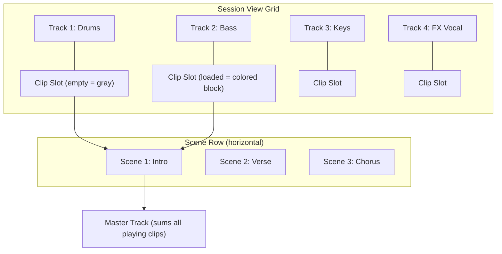

# Lesson 4: Session View Mastery — Clip Launching, Scenes & Live Performance

## 1. What Session View Actually Is (And Why It Works This Way)

Session View is a grid. Columns are tracks, rows are scenes, and each cell is a clip slot that can hold one audio or MIDI clip. That's the entire mental model you need before touching anything else.

The reason this layout exists: Arrangement View is a timeline, so it answers "what happens at 1:32"? Session View has no timeline — it answers "what happens when I press this button, right now, in whatever order I want." That's the whole point. You're not scrubbing a playhead, you're firing events. This is why DJs, live electronic acts, and loop-based composers build entire sets here instead of in Arrangement.

**The one piece of theory you actually need:** clip launching is quantized to the Global Quantization setting (top-left of the Live window, default is 1 Bar). When you click a clip, Live doesn't play it instantly — it waits for the next bar boundary (or whatever quantize value you set) before starting playback. This is what keeps everything in sync when you're triggering clips of different lengths against each other. Set it too loose (1 Bar) and your fills feel sluggish to trigger; set it to `None` and you'll get clips firing mid-beat and falling out of phase. For most performance work, **1/4 or 1/8 note quantization** gives you tight response without destroying sync.

## 2. The Grid, Scenes, and Clip Slots — Hands-On Setup

### Building your first performance grid

Open a new Live set, switch to Session View (`Tab` key toggles between Session and Arrangement). Here's the anatomy:

**Core workflow — building a 4-track loop set from scratch:**

1. Create 4 tracks: Drums, Bass, Keys, FX (Create menu → Insert Audio/MIDI Track, or `Ctrl+T`).
2. Double-click the first clip slot on the Drums track → record or drag in an 8-bar drum loop.
3. Set Record Quantization via the top menu (**Edit → Record Quantization → 1 Bar**) so recordings snap cleanly. so recordings snap cleanly.
4. Select the scene and press `Enter` (or `Shift+Spacebar`) to trigger **Scene 1**., which fires every clip slot across that row simultaneously.
5. Name scenes meaningfully — double-click the scene name field and type `Intro`, `Build`, `Drop`, `Breakdown`. You will thank yourself during a live set when panicking under stage lights.

### Clip slot states — know these on sight

| Visual state | Meaning | Action available |
|---|---|---|
| Empty gray slot | No clip loaded | Drop audio/MIDI file, or record |
| Solid colored block | Clip loaded, stopped | Click to launch |
| Green triangle (playing) | Clip currently playing | Click again to stop (if Launch Mode = Trigger) |
| Yellow square | Clip queued to launch on next quantize boundary | Wait, or click again to cancel |
| Red/orange flashing outline | Clip recording | Click stop button or press clip slot again |

## 3. Scenes: Snapshot-Based Arrangement

A **scene** is a horizontal row — pressing its Scene Launch button (the triangle on the right side of each row) fires every clip in that row at once, respecting each clip's own quantization and length. This is how you structure a live set without a timeline: each scene is a "section" of your song (Intro, Verse A, Build, Drop, Breakdown, Outro).

**Practical scene-building drill:**

1. Build Scene 1 (Intro): just a filtered pad clip on Keys, nothing else. Leave Drums/Bass/FX slots empty in that row.
2. Build Scene 2 (Verse): add a sparse drum loop + bass. Keys continues from Scene 1 if you don't retrigger it — **empty clip slots in a scene do not stop already-playing clips on that track**. This is critical: scenes only act on slots that contain clips.
3. Build Scene 3 (Drop): full drums, bass, keys, FX swell.
4. Practice firing scenes in sequence with a metronome running at your track's tempo (set Live's tempo field, top-left, e.g. 128 BPM for house). Trigger each scene on bar 1, let it ride 8 bars, trigger the next. Do this clean 10 times in a row with zero early/late triggers before calling it performance-ready.

**Scene automation via Follow Actions (Live 11+):** Right-click a clip → enable **Follow Actions**. Set "Jump to" or "Next" with a time value (e.g. after 4 bars, automatically jump to another clip). This lets scenes self-advance without you touching anything — useful for generative or hands-off sections of a set where you want to step away from the controller and tweak a filter knob instead.

## 4. Clip Launch Modes — The Setting Everyone Skips

Click a clip, open the Clip view (bottom panel), look at the **Launch** box. Four modes, each behaves completely differently on a MIDI pad:

- **Trigger** (default): press once to play, plays until the end or until another clip in the same track launches. Press again does nothing until it finishes — good for drum loops you don't want accidentally restarted.
- **Gate**: plays only while you hold the pad/key down; stops the instant you release. Essential for stutter/chop performance effects and vocal chops triggered from a pad controller.
- **Toggle**: press once to start, press again to stop. Best default for most live-looping work because it matches how your brain thinks about on/off.
- **Repeat**: retriggers the clip from the start every time the quantization value hits, as long as you hold the pad. Use this for glitch/stutter effects on breakdown sections.

**Set this per clip, not globally.** A typical live-electronic performer's setup: drum and bass loops = Trigger, one-shot vocal stabs and risers = Gate, pad/atmosphere clips = Toggle.

## 5. Real-Time Manipulation — What You Actually Twist During a Performance

### Clip-level real-time controls

- **Transpose/Detune** (MIDI clips): drag the transpose field in Clip view, or automate it with a MIDI CC mapped to a controller knob — instant key changes mid-performance without stopping playback.
- **Warp Mode** (audio clips): for live tempo-synced work, set Warp Mode to **Complex Pro** on melodic/vocal material (best transient preservation at the cost of CPU) and **Beats** on drum loops (cheap, cuts at transients, zero artifacts on percussive material). Wrong warp mode on a vocal clip = robotic artifacts; wrong warp mode on a drum loop = wasted CPU for no audible benefit.
- **Clip gain / Sample offset**: drag inside the waveform display to nudge the start point live — classic "scratch the loop start" trick for build-ups.

### Device automation during live performance

Map device parameters to MIDI CCs for hands-on control:

1. Click **MIDI Map Mode** button (top-right, or `Ctrl+M` / `Cmd+M`).
2. Click a device parameter (e.g. a filter's Cutoff knob on a Auto Filter device).
3. Move a physical knob on your MIDI controller — Live binds it automatically.
4. Exit MIDI Map Mode (`Ctrl+M` again). Now that physical knob sweeps the filter live.

**Macro Controls** (on Instrument/Audio Effect Racks) let you map up to 16 device parameters to a single physical knob with custom scaling per parameter — this is how pro live sets get one fader to simultaneously open a filter, increase reverb send, and boost distortion drive for a single dramatic build.

## 6. Session-to-Arrangement Workflow (And Back)

You will often sketch in Session, then commit to Arrangement for final production, or the reverse — build in Arrangement, then convert sections to clips for live performance.

- **Session → Arrangement:** select clips/scenes, hit the Arrangement **Record** button (`F9` or the circle top-left), then trigger scenes in the order you want them recorded into a linear timeline. Live captures every clip launch as a time-stamped arrangement.
- **Arrangement → Session:** select a region in Arrangement, right-click → **Consolidate**, then drag the consolidated clip into an empty Session slot. Use this to turn a finished bridge or breakdown section into a performable, loopable element.

## 7. Performance-Ready Optimization & Failure Modes

These are the real things that break a live set, and how to prevent them before you're on stage.

**CPU overload / audio dropouts:**
- Freeze CPU-heavy tracks (right-click track header → **Freeze Track**) once the part is finalized. This renders the track to audio and suspends plugin processing.
- Set **Buffer Size** in Audio Preferences higher (256–512 samples) during a live set for stability; lower it (64–128) only during studio tracking where you need minimal monitoring latency. Live performance prioritizes stability over the last few milliseconds of latency — a dropout mid-set is catastrophic, 10ms of extra latency is not.
- Disable unused tracks' **Track Activator** (the small power button next to each track name) rather than deleting — keeps CPU load down while preserving the option to bring a part back in.

**Clip launch timing drift:**
- If clips feel like they're firing late, check Global Quantization isn't set to a large value (1 Bar) when you need tight response — drop it to 1/4 or 1/8.
- If audio clips drift out of sync with MIDI/drums over a long loop, check the Warp Markers — a single mis-placed warp marker will cause progressive drift. Double-click the clip, verify warp markers land exactly on transients.

**MIDI controller mapping lost on reopening a set:**
- Live saves MIDI mappings inside the `.als` file itself, not the controller. If mappings disappear, check you're opening the correct saved version — "Save As" during a set build can fork your mapping state across multiple files without you noticing.

**Scene misfires during a live set (wrong scene triggered):**
- Rename every scene before performing — never perform from a set of "Scene 1, Scene 2, Scene 3" labels under stage pressure.
- Use **Scene Follow Actions** sparingly in sets where you need precise manual control; they're powerful for generative passages but can trigger an unwanted jump if you're not tracking bar counts.

## 8. Practice Drill: Building a Performable 16-Bar Live Loop Set

Metronome target: 100 BPM → 120 BPM → your actual set tempo.

1. **(100 BPM)** Build 3 scenes: Intro (pad only), Build (pad + drums, filter closed), Drop (full mix, filter open). Practice triggering Intro → Build → Drop cleanly, each firing exactly on the bar, for 5 consecutive run-throughs.
2. **(110 BPM)** Add a Gate-mode vocal stab clip on a 5th track. Practice holding/releasing it rhythmically against the Drop scene — aim for confident 8th-note stabs without rushing.
3. **(120 BPM)** Map a Macro Control (filter cutoff + reverb send combined) to a physical knob. Practice sweeping it open across an 8-bar build into the Drop, timed so it reaches fully open exactly on the first beat of the Drop scene.
4. **(Full tempo)** Run the entire sequence start to finish, recording your output into Arrangement (`F9`) for self-review. Listen back specifically for: late scene triggers, clipped audio from gain staging errors, and filter sweeps that don't land on the beat.

Session View rewards repetition under a metronome exactly like an instrument does — the grid is unforgiving about timing, and the only fix is practicing the trigger sequence until your hand finds the right pad or mouse-click without you having to think about it.
