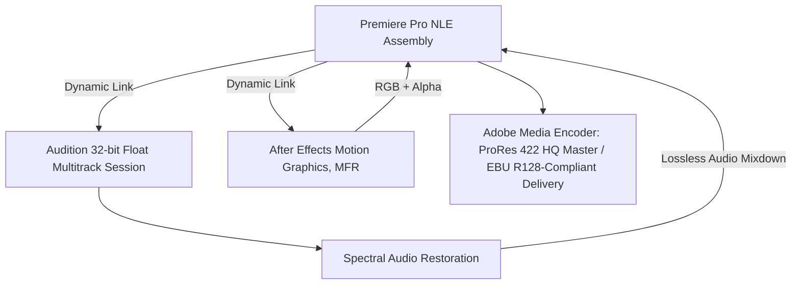
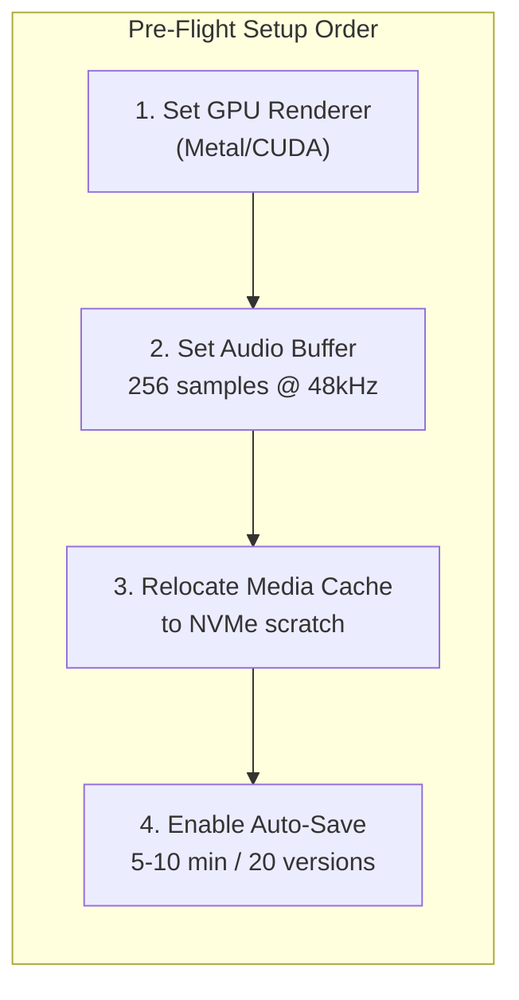
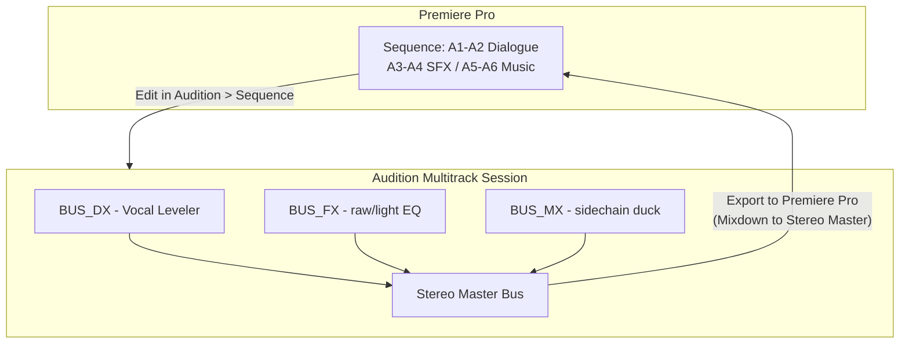
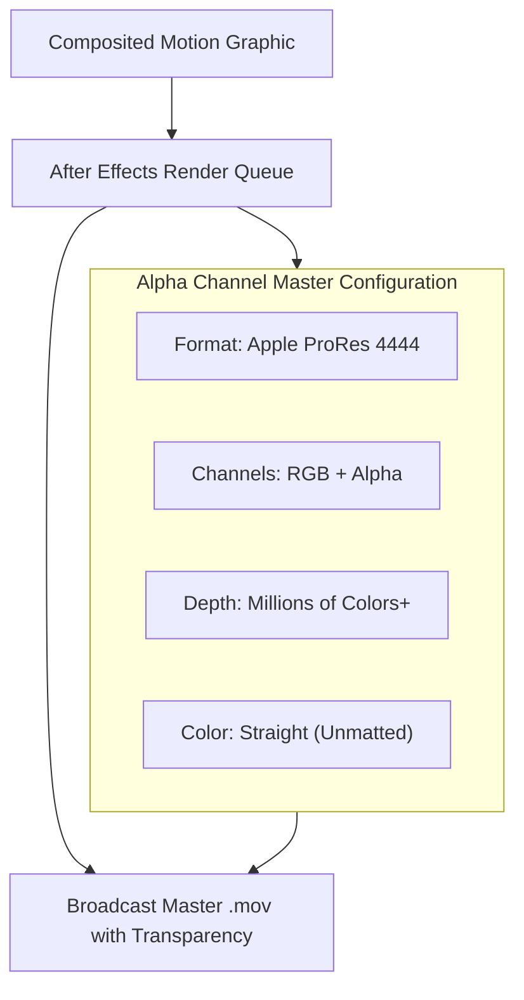

# Operational Mastery Labs: Adobe Creative Cloud Audio/Video Post-Production Pipeline

## Who This Is For & What You Need

These labs assume working knowledge of basic editing (cuts, timeline navigation, markers) in Premiere Pro. The focus here is the **professional finishing pipeline**: cross-app round-tripping, broadcast-legal color and loudness, spectral audio surgery, and GPU-accelerated motion graphics delivery. You need:

- Premiere Pro, Audition, After Effects, and Media Encoder — same version family within the current CC release. Dynamic Link breaks across mismatched major versions (e.g. a 24.x Premiere project referencing a 25.x Audition session will throw a relink error on open).
- A discrete GPU with ≥6 GB VRAM (Metal on Apple Silicon/AMD, CUDA on NVIDIA). Mercury Playback Engine in Software Only mode makes every exercise below 3–8x slower — color scopes lag the transport, and MFR renders in Exercise 4 degrade to single-core throughput.
- A dedicated NVMe scratch disk, not your boot drive, for Media Cache and Audition peak files.
- Multi-mic interview or documentary footage with at least dialogue, one SFX layer, and a music bed — or substitute your own project.



**Why Dynamic Link matters operationally**: without it, moving audio to Audition or graphics to After Effects means exporting an intermediate file, editing it, then re-importing — a lossy round trip where you lose sync the moment someone trims the Premiere sequence. Dynamic Link keeps a live project reference: edit the Audition session or AE composition, hit save, and Premiere's timeline updates in place with zero re-import step. This is the habit that separates an amateur workflow from a studio one.

---

## Studio Hardware & Engine Setup (Do This Before Touching Footage)

1. **GPU Renderer** — In Premiere Pro and After Effects: `Project Settings → General → Renderer` → set to **Mercury Playback Engine GPU Acceleration (Metal / CUDA)**. If this option is greyed out, your GPU driver is outdated or unsupported. Check `Help → About` for the renderer actually in use before grading color — CPU-only playback stutters during scrubbing and gives false confidence about real-time scope readings.
2. **Audio Hardware** — In Audition: `Edit → Preferences → Audio Hardware`. Set I/O buffer to **256 samples** at **48,000 Hz**, 24-bit (broadcast) or 32-bit float (if your interface supports it, for mixing headroom). Lower buffer (128) reduces monitoring latency for live narration punch-ins at the cost of CPU load; raise to 512 only if you hear crackling during playback of large sessions.
3. **Media Cache & Scratch Disks** — `Preferences → Media Cache`: point Media Cache Files and Database to a dedicated NVMe volume, not your OS drive or your media drive. Audition peak files and Premiere conform files are small but constantly read/written — contention here is a common silent cause of dropped frames during export.
4. **Auto-Save & Project Versioning** — Enable auto-save every 5–10 minutes with 20 versions retained. Dynamic Link sessions are live references between two running applications; a crash in one without a recent save in the other breaks the link and forces a relink dialog.



---

## Exercise 1: Spectral Repair in Adobe Audition

**Goal**: remove HVAC hum and an isolated cell-phone ring from a dialogue track without audibly degrading speech.

**Why spectral editing works**: the Spectral Frequency Display is a real-time FFT (Fast Fourier Transform) spectrogram — it decomposes the waveform into simultaneous frequency bins across time, rendered as a heat map (loud = bright, quiet = dark). A steady HVAC hum occupies a narrow, continuous frequency band that stays visually constant over time, which separates it from speech, whose energy constantly shifts in pitch and formant structure. A phone ring is a near-pure tone — a thin bright horizontal line — sitting on top of broadband speech energy, which is why you can repair it surgically instead of filtering the whole track.

### Step 1 — Configure the Spectral Display

1. Open the contaminated dialogue file in Audition's Waveform Editor.
2. Press `Shift+D` to toggle **Spectral Frequency Display** (X = time, Y = frequency 0–24 kHz, color = amplitude).
3. `Edit → Preferences → Spectral Displays`:
   - **FFT Size**: `4096` samples. Larger FFT size gives sharper frequency resolution (better for isolating narrow tonal noise like hum or ring) at the cost of time resolution. For dialogue-heavy material where you need to see fast transients clearly, use `2048` instead — 4096 is correct here because HVAC hum and the ring are both narrowband, slow-moving targets.
   - **Windowing Function**: `Blackman-Harris` — minimizes spectral leakage (energy smearing into adjacent bins), giving cleaner, tighter noise bands to select.

### Step 2 — Capture Noise Print & Apply Reduction

1. Scrub to a silent gap with only the HVAC tone present (a continuous horizontal low-frequency band, typically 50–120 Hz plus harmonics, with no speech energy above it). Select roughly 300 ms of this.
2. Press `Shift+P` — **Capture Noise Print**. Audition now has a frequency/amplitude fingerprint of the noise floor.
3. `Cmd/Ctrl+A` to select the full file, then `Cmd/Ctrl+Shift+P` to open **Noise Reduction (Process)**:
   - **Noise Reduction**: `65%` — pushing past ~80% on dialogue starts producing the metallic "underwater" chirping artifact (audible pre-echo on consonant transients caused by over-aggressive bin subtraction).
   - **Reduce by**: `12 dB`.
   - **Spectral Decay Rate**: `65%` — controls how fast gain reduction releases after a transient; too fast re-introduces chirp, too slow mutes natural room tone excessively.
   - Click **Apply**.
4. **Verify, don't trust the slider**: open `Window → Amplitude Statistics` on a silent passage before and after. Confirm the noise floor measured roughly -42 dBFS before and dropped below -62 dBFS after. If consonants ("s", "t", "f" sounds — high-frequency, low-energy) sound dull or swallowed, back the Noise Reduction % down to 50% and apply twice instead of once at 65% — two gentler passes preserve high-frequency detail better than one aggressive pass.

### Step 3 — Surgical Healing of the Phone Ring

1. In the spectrogram, locate the bright, thin, perfectly horizontal line at roughly 1.2 kHz that appears only during the ring — distinguishable from speech because speech harmonics constantly bend and move while a ring tone sits dead flat.
2. Select the **Spot Healing Brush** (`B`), set **Size** to `18 px` (increase to `30–40 px` if the ring is loud and wide; decrease to `8–10 px` for thin, quiet artifacts near dialogue formants to avoid eating adjacent speech energy).
3. Paint directly over the bright line, scrubbing back and forth across its full time duration. Audition interpolates replacement spectral content from the immediately adjacent time frames — it pattern-matches the ambient texture around the artifact rather than just silencing it, which is why the repair sounds like missing noise rather than a dropout.
4. **Troubleshoot "zipper" artifacts**: if the healed region sounds choppy, your brush strokes were too short/discontinuous. Paint in one continuous motion across the full ring duration rather than in multiple separate dabs.

---

## Exercise 2: Premiere Pro ↔ Audition Dynamic Link Round-Trip

**Goal**: send a multi-track documentary sequence to Audition for a proper stem mix, then return a mastered stereo mixdown to Premiere without ever exporting an intermediate file.



### Step 1 — Send the Sequence to Audition

1. In Premiere Pro, confirm your sequence has dialogue on A1–A2, SFX on A3–A4, and music on A5–A6 — Dynamic Link preserves this track layout.
2. `Edit → Edit in Adobe Audition → Sequence`.
3. In the dialog:
   - **Name**: `DOCU_MASTER_MIX`
   - **Selection**: `Entire Sequence` (or `Time Selection` if fixing one scene — much faster for iterative tweaks)
   - **Audio Handles**: `1.00 second` — gives Audition extra material before/after each clip boundary so crossfades and room-tone fills don't hit a hard edge
   - ✅ **Export Video via Dynamic Link** — lets you scrub picture inside Audition for sync reference without rendering a video proxy
4. Click **OK**. Audition opens and assembles a phase-coherent 32-bit float Multitrack Session, one Audition track per Premiere audio track, perfectly time-aligned to the original timeline.

### Step 2 — Bus Routing and Stem Processing

1. In Audition's Multitrack Editor, create three **Bus Tracks**: `BUS_DX` (dialogue), `BUS_FX` (effects), `BUS_MX` (music). Right-click the track header → **Add Bus Track**.
2. On each source track, set the **Output Routing** dropdown (bottom of the track header) to the matching bus — A1/A2 → BUS_DX, A3/A4 → BUS_FX, A5/A6 → BUS_MX.
3. **BUS_DX**: insert **Vocal Leveler** (Effects Rack → Amplitude and Compression). Set **Mode**: `Dialogue Leveler`, **Target RMS Amplitude**: `-18 dBFS`. This auto-rides level across loud and quiet speakers so you aren't manually keyframing gain on every line.
4. **BUS_MX**: insert a Parametric EQ and create a dynamic duck in the 1.5–3.5 kHz band (the core speech-intelligibility range where consonants live) by -2.5 dB whenever dialogue is present. For true auto-ducking rather than a static cut, insert **Effects Rack → Special → Streamline** or automate the EQ gain with keyframes synced to dialogue-present regions — a static -2.5 dB cut works as a safe baseline, but a sidechain-style duck sounds more natural and only engages when speech is actually playing.
5. `Multitrack → Export to Premiere Pro` → **Mixdown Session to Stereo Master** → Export. Premiere automatically imports the stereo stem and drops it onto a new linked audio track in the original sequence, time-aligned — no manual import, no relinking.

**Troubleshooting Dynamic Link breaks**: if Premiere shows a red "Media Offline" or a broken link icon after reopening the project later, it's almost always because the Audition session (`.sesx`) file was moved or renamed outside the project folder. Keep all Dynamic Link assets inside the same project directory tree and never rename them mid-project.

---

## Exercise 3: Broadcast-Legal Color with Lumetri Scopes

**Goal**: grade a clip so it passes ITU-R BT.709 broadcast gamut requirements, verified by scope reading rather than by eye.

**Why scopes, not your monitor**: consumer and even calibrated reference monitors differ in brightness, contrast curve, and color temperature from device to device. Scopes read the actual numeric pixel values in the signal — IRE (luminance) and hue/saturation vectors — so two colorists on two different monitors reading the same scope reach the same legal, deliverable result. Eyeballing alone is how illegal super-whites and crushed sub-blacks sneak past QC.

### Step 1 — Open and Configure Scopes

1. Open the **Color** workspace. `Window → Lumetri Scopes`.
2. Right-click inside the scopes panel and enable three views:
   - **Waveform (Luma / YC No Chroma)**: reads luminance only, 0 IRE (black) to 100 IRE (white).
   - **Vectorscope (YUV)**: shows hue angle and saturation. The diagonal target line at roughly 10:30 is the **skin tone line** — correctly graded skin of any ethnicity should sit its saturation vector near this line, not off-axis toward red or yellow.
   - **RGB Parade**: red, green, blue channels side by side as separate waveforms — the fastest way to spot a color cast, because a neutral white/gray object should show all three channels tracking at nearly equal height. If blue sits consistently lower than red and green, the shot is warm; correct by pulling Temperature cooler.

### Step 2 — Primary Grade with Numeric Targets

In **Lumetri Color → Basic Correction**, on a raw camera clip:

1. **White balance**: use the eyedropper on a known neutral gray/white object in frame, or manually adjust Temperature/Tint until the RGB Parade shows red, green, and blue peaks at nearly the same height on that neutral object.
2. **Blacks**: pull down until your darkest shadow sits at 0–5 IRE on the Waveform — never let it dip below 0 IRE (illegal sub-black, clipped/crushed detail that broadcast QC will flag).
3. **Whites**: push up until practical highlights (not specular reflections like glints off metal or glass) peak between 90–98 IRE, leaving headroom below the hard 100 IRE ceiling.
4. **Midtones/Gamma**: adjust until skin tone vectors sit on or very near the vectorscope's skin tone line — this is your fastest sanity check that the overall grade hasn't pushed faces too red (sunburned look) or too green/yellow (sickly look).

### Step 3 — Hard Clamp with Broadcast Safe

Primary grading gets you close, but specular highlights (sun glints, lens flares, chrome reflections) can still spike above 100 IRE even after a careful grade. Hard-clamp as a safety net:

1. Add an **Adjustment Layer** above all graded clips in the sequence.
2. `Effects` panel, search **Broadcast Colors**, drag onto the Adjustment Layer.
3. Set:
   - **Broadcast Standard**: `NTSC` (produces 0–100 IRE clamping; use the regional equivalent for PAL territories)
   - **Maximum Signal Amplitude (IRE)**: `100.0`
   - Reduce excess brightness using: `Luminance` (clamps luma only, color hue stays intact — preferred over "Color" mode, which can shift hue when clamping)
4. Check the Waveform again: confirm previously spiking highlights now show a flat ceiling at exactly 100 IRE with no signal above it, and no visible color smear or posterization at the clamp point. If you see smearing, the clamp is too aggressive relative to how far over the grade pushed — go back and lower Whites in the primary grade instead of relying entirely on the limiter.

---

## Exercise 4: After Effects Multi-Frame Rendering & Alpha-Channel Delivery

**Goal**: get maximum render speed from multi-core CPU/GPU hardware, then deliver a clean transparent-background motion graphic that composites without edge fringing.

### Step 1 — Multi-Frame Rendering (MFR) Setup

**Why MFR matters**: classic After Effects rendering used one CPU core per frame sequentially. MFR renders multiple frames concurrently across cores, dramatically cutting RAM preview and final render time on modern multi-core CPUs — but it needs enough RAM per core or it throttles back to fewer concurrent frames than your core count would suggest.

1. `Edit/After Effects → Settings → Memory & Performance` (Preferences on Windows).
2. Confirm **Enable Multi-Frame Rendering** is checked.
3. Set **Reserved for Other Applications** / RAM allocation so roughly 10% of system RAM stays free for OS and background apps — starving the OS causes beachballs/freezes during heavy renders, not faster renders.
4. **CPU core allocation**: AE recalculates "Actual Renders at Once" based on total RAM ÷ RAM-per-CPU setting. If your render is only using 2–3 cores on an 8-core machine, your RAM-per-CPU value is set too high — lower it (e.g., from 6 GB to 3 GB per core) to allow more concurrent renders, provided your comp isn't using massive cached layers.
5. Open the target composition (nested 3D text, particle emitter, camera DOF blur). Enable **Motion Blur** both on the Composition toolbar switch and on each individual layer's Motion Blur switch (M). `Composition → Composition Settings → Advanced` → **Shutter Angle**: `180°` — the standard cinematic exposure angle, matching the blur characteristic of a film/video camera shutter open for half of each frame's duration, which is why 180° motion blur looks "natural" rather than either strobe-sharp (0°) or overly smeared (360°).
6. Press `Spacebar` for RAM Preview. Watch the Timeline cache bar (green when cached) and your OS's CPU monitor — you should see most/all cores engaged, not one core pegged at 100% while others idle.

**Troubleshooting slow MFR**: GPU-accelerated effects (ray-traced 3D, some Lumetri effects, certain third-party plugins) can bottleneck MFR because the GPU itself isn't multi-frame-parallel the way CPU cores are. If render speed doesn't improve with MFR enabled, check whether your heaviest effect is GPU-bound — try temporarily disabling GPU-dependent effects to confirm, then consider pre-rendering that layer separately.

### Step 2 — Alpha Channel Master Export



1. Select the composition, `Cmd/Ctrl+M` to add to **Render Queue**.
2. Click the blue **Output Module** link text:
   - **Format**: `QuickTime`
   - **Video Codec**: `Apple ProRes 4444` (supports full alpha, best for high-detail graphics with soft edges) or `Avid DNxHR HQX` with alpha enabled if your house format is DNxHR.
   - **Channels**: `RGB + Alpha` — omitting this is the single most common export mistake; without it the file renders opaque with a black background regardless of what your comp preview shows.
   - **Depth**: `Millions of Colors+` — the `+` specifically indicates the file contains an alpha channel; without it, even RGB+Alpha channel selection can get flattened on some codec paths.
   - **Color**: `Straight (Unmatted)`, not Premultiplied. Straight alpha stores true, uncontaminated RGB values independent of the alpha matte, which prevents the dark fringing halo that appears around soft/semi-transparent edges (hair, motion-blurred text edges, glows) when a premultiplied file is composited over a new background of a different color than what it was rendered against.
3. Render, then import into Premiere Pro and place on a track above live video. Scrub past a soft-edged element (motion-blurred text tail, a glow) and zoom in at the edge — confirm no dark or light halo fringe is visible against the new background. A visible fringe means the file was exported Premultiplied; re-render with Straight alpha.

---

## Post-Production Master Delivery Verification Checklist

Run every item below before handoff. Treat any failure as a blocking issue, not a note.

```text
[ ] Video Gamut: Lumetri Waveform shows 0 IRE minimum, 100 IRE maximum — zero illegal pixels.
[ ] Color Space: Output tagged Rec.709 (SDR) with correct NCLC color primaries, or Rec.2020/PQ for HDR masters.
[ ] Audio Loudness — Broadcast (EBU R128 / ATSC A/85):
      Integrated Loudness: -23.0 LUFS (±0.5 LU)
      Max True Peak: -1.0 dBTP
[ ] Audio Loudness — Streaming (YouTube / Netflix delivery spec):
      Integrated Loudness: -14.0 to -16.0 LUFS
      Max True Peak: -1.0 dBTP
[ ] Dialogue Intelligibility: dialogue-only passages read -18 to -24 LUFS short-term on a loudness meter.
[ ] Codec & Container: Apple ProRes 422 HQ for program masters (ProRes 4444 for alpha-channel graphics masters),
    10-bit 4:2:2 chroma subsampling, 48 kHz / 24-bit LPCM audio (uncompressed).
[ ] Dynamic Link Integrity: no broken links reported in Project panel (red link icons) before final render.
[ ] Alpha Channel QA: transparent elements checked over both a black and a white test background to confirm
    no premultiplied-alpha fringing on either.
```

**How to actually measure loudness, not guess it**: in Premiere Pro, select the full sequence and run `Window → Audio Track Mixer` meter in LUFS mode, or better, export a reference file and run it through Adobe Media Encoder's **Loudness** panel (`Window → Loudness Radar` effect in Premiere, or Audition's `Window → Match Loudness` / `Amplitude Statistics` for file-based measurement). Never rely on a peak meter alone — true peak and integrated LUFS measure fundamentally different things, and a mix can pass peak limiting while still being wildly non-compliant on integrated loudness.
