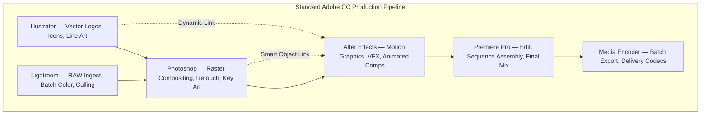
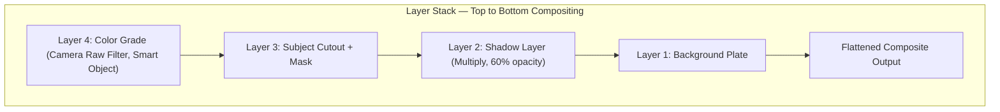
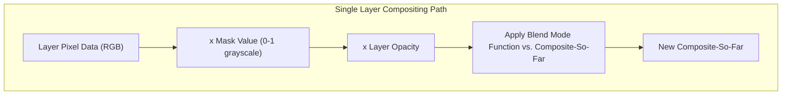
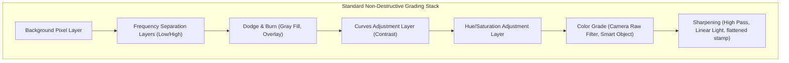
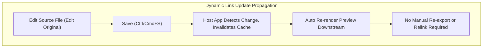

# Lesson 1: Adobe Creative Cloud Production Pipeline — Photoshop Compositing, Premiere/After Effects Handoff, and Cross-App File Discipline

## 1. Why the Suite Works: The 15% You Need and No More

Every Adobe Creative Cloud app shares two foundations: a **pixel/vector compositing model** (Photoshop, Illustrator, After Effects) and **Dynamic Link**, the live-reference system that lets one app's document update inside another without re-exporting. Understanding these two things tells you where 90% of production time either gets saved or wasted.

**The compositing model**, concretely: every document is a stack of layers, each with an opacity value and a blend mode, merged top-to-bottom into one visible result. A blend mode is a math function applied per channel, per pixel, between the layer above (the "blend" color) and everything composited below it (the "base" color):

- **Normal**: replaces base with blend, weighted by opacity.
- **Multiply**: `result = base × blend` (normalized 0–1). Always darkens — multiplying by ≤1 can't brighten. Use for shadows, grounding objects, ink on white.
- **Screen**: inverse of Multiply, `result = 1 − (1−base)(1−blend)`. Always brightens. Use for glows, light leaks, embers.
- **Overlay**: Multiply on the dark half of the blend layer, Screen on the light half, pivoting at 50% gray. This is why a 50%-gray Overlay layer adds contrast invisibly until you paint on it — gray contributes nothing, only deviation from gray darkens or lightens.
- **Soft Light**: a gentler Overlay. Better for skin retouching and subtle dodge/burn because it doesn't clip as hard.

A **mask** is a grayscale channel bolted onto a layer: white = 100% opacity, black = 0%, gray = partial. The engine multiplies the layer's alpha by the mask value before compositing. One multiplication. Feathering, gradient masks, luminosity selections — all of it is just manufacturing that grayscale map more intelligently.

**Dynamic Link**, concretely: when you place an Illustrator `.ai` file into Photoshop as a Smart Object, or send a Premiere sequence to After Effects via "Replace with After Effects Composition," the receiving app doesn't copy pixels — it holds a reference and a cached preview. Edit the source, save it, and every app downstream re-renders automatically. This is why a correctly built CC pipeline never requires re-exporting an asset by hand after a client note — you edit once, upstream, and everything downstream updates on its own.

You don't need more theory than this to be dangerous across the suite. The rest of mastery is tool fluency, file hygiene, and knowing which app owns which stage of the pipeline. That's what this lesson drills.

---

## 2. The Cross-App Pipeline: Who Owns What

Before opening any app, decide which tool owns each asset type. Mixing this up is the single biggest source of wasted rework in CC pipelines.

**Rule of thumb for ownership:**
- Anything that needs to scale infinitely without quality loss (logos, icons, type treatments) → **Illustrator**, vector, never rasterized until final flatten.
- Anything photographic requiring pixel-level retouch, masking, or compositing → **Photoshop**.
- Batch RAW processing across dozens or hundreds of images with consistent color → **Lightroom** (or Camera Raw inside Photoshop/Bridge for one-offs).
- Anything that moves or animates over time, including motion graphics built from PSD/AI layers → **After Effects**.
- Final sequencing, dialogue, music, color pass on a timeline → **Premiere Pro**.
- Batch rendering multiple deliverable codecs/resolutions from one or more finished sequences → **Media Encoder**, queued overnight, never exported one-by-one by hand from Premiere.

Treat this as a dependency graph, not a checklist — work flows downstream only. Never hand-retouch inside After Effects what should have been fixed in Photoshop; never hand-key color in Premiere what should have been graded once in Lightroom/Camera Raw before import.

---

## 3. Workspace Setup for Production Speed (Photoshop + Premiere)

**Photoshop Performance preferences** (`Cmd/Ctrl + K` → "Performance"):
- GPU acceleration: **On** — required for most 2024+ filters, Neural Filters, and Lens Blur.
- RAM allocation: **70–80%** of available system RAM, leave the rest for the OS.
- Scratch disk: your fastest NVMe drive, never the same physical drive as your OS page file.
- History states: default 50 is fine; raise to 100 only with RAM to spare.

**Premiere Pro Media Cache settings** (`Cmd/Ctrl + ,` → "Media Cache"):
- Set the cache database location to a fast local SSD, not a network drive — NLE scrubbing performance lives or dies on cache read speed.
- "Delete unused media cache files" after every 30 days — cache bloat on long-running projects is the #1 cause of mysterious disk-full errors.

**Essential panel layout:**
- Photoshop: Layers + Properties docked side by side (constant toggling during mask work), Channels and History as tabs behind them.
- Premiere: Program Monitor + Lumetri Color docked right, Timeline + Project panel left, Audio Meters always visible.

**Non-negotiable keyboard shortcuts to memorize this week:**

| Action | App | Shortcut (Win/Mac) |
|---|---|---|
| New layer | Photoshop | `Ctrl+Shift+N` / `Cmd+Shift+N` |
| Merge visible to new layer (stamp) | Photoshop | `Ctrl+Alt+Shift+E` / `Cmd+Opt+Shift+E` |
| Invert mask | Photoshop | `Ctrl+I` / `Cmd+I` (mask selected) |
| Clipping mask toggle | Photoshop | `Ctrl+Alt+G` / `Cmd+Opt+G` |
| Free Transform | Photoshop | `Ctrl+T` / `Cmd+T` |
| Convert to Smart Object | Photoshop | Right-click layer → Convert to Smart Object |
| Ripple delete + close gap | Premiere | `Shift+Delete` |
| Add edit at playhead | Premiere | `Ctrl+K` / `Cmd+K` |
| Replace with After Effects Composition | Premiere | Right-click clip in timeline |
| Collapse transform (no re-render) | After Effects | Toggle switch, Timeline panel column |
| Pre-compose | After Effects | `Ctrl+Shift+C` / `Cmd+Shift+C` |

---

## 4. Core Mechanics: The Layer Stack and Compositing Order

Photoshop evaluates from the **bottom layer upward**, merging each successive layer's pixels — modulated by its own mask and opacity — into the running result, until the top layer folds in last.

This is the entire engine. Every technique below — in Photoshop or After Effects, since AE's compositing model is the same stack logic extended across time — is a variation on feeding better pixel data and better masks into this pipeline.

---

## 5. Lab 1: Non-Destructive Portrait Retouch (Frequency Separation)

**Goal:** Smooth skin while preserving pore texture and fine detail. Fully non-destructive, fully re-editable.

**Materials:** A portrait photo, 300 DPI minimum, good lighting.

**Steps:**

1. Duplicate the background layer twice (`Ctrl+J` ×2). Name the bottom duplicate `Low Freq`, the top `High Freq`.
2. Hide `High Freq` temporarily. Select `Low Freq`.
3. Apply **Filter → Blur → Surface Blur**. Radius `12px`, Threshold `15`. Surface Blur respects edge contrast — it blurs skin while preserving hard edges (eyes, nostrils, hairline), unlike Gaussian Blur which smears everything equally.
4. Select `High Freq`. Apply **Image → Apply Image**: Layer = `Low Freq`, Blending = **Subtract**, Scale = `2`, Offset = `128`. This extracts the difference between the original and the blurred version — the texture/detail layer — and re-biases it to mid-gray so it can be added back.
5. Set `High Freq`'s blend mode to **Linear Light**. Make it visible. You should see the original image reconstructed (Low Freq + High Freq = original, by construction).
6. Select `Low Freq`. Add a **Layer Mask** (reveal all). Add a black mask (hide all) to Low Freq and paint with a soft white brush over blemish areas to selectively reveal the blurred skin. without touching eyes, lips, or hair.
7. On a new layer above both (`Ctrl+Shift+N`, Normal mode), use the **Healing Brush** (`J`), "Sample: Current & Below," for remaining spot blemishes — kept on its own layer so it's independently undoable.

**Why it works:** You've decomposed the image into a low-frequency layer (color/tone/blemishes) and a high-frequency layer (pore texture, hair strands, skin grain). Smoothing only the low-frequency layer removes blemishes while the high-frequency layer — recombined via Linear Light, which is pure additive/subtractive contrast — restores every bit of texture. This avoids the "plastic skin" look direct blurring causes.

**Common failure:** If `High Freq` looks like solid gray with no visible detail after step 4, your Surface Blur radius was too aggressive for the image resolution, or Offset wasn't exactly `128`. Undo and redo with Radius `8px`.

---

## 6. Lab 2: Advanced Masking — Hair/Fur Cutout with Select and Mask

**Goal:** Extract a subject with fine hair detail onto a new background. This is the most requested compositing skill in portrait, product, and key-art work, and the foundation for any composite that later moves into After Effects for animation.

**Steps:**

1. Make a rough selection with the **Object Selection Tool** (`W`) — drag a box around the subject; Photoshop's object-awareness auto-refines the boundary.
2. Click **Select and Mask** in the options bar (`Ctrl+Alt+R` / `Cmd+Opt+R`).
3. View Mode: **On Layers**, so you see the real background behind the mask preview.
4. Select the **Refine Edge Brush Tool** (`R` inside this workspace). Paint along the hair boundary only, not the whole silhouette — this tool detects fine hair strands and feathers the mask to include them.
5. In the right panel:
   - **Smooth**: `2` — removes jagged edges without eating hair detail.
   - **Feather**: `0.3px` — just enough to avoid a hard aliased edge.
   - **Contrast**: `15%` — snaps the edge transition tighter around strands.
   - **Shift Edge**: `-5%` — pulls the edge slightly inward to kill background color fringing (halo).
6. **Decontaminate Colors**: check this box. It strips background-color bleed from edge pixels — critical when pulling a subject off a green screen or bright sky onto a different-colored background.
7. Output To: **New Layer with Layer Mask**. Click OK.
8. Drop in the new background below the cutout layer. Inspect at 100% zoom (`Ctrl+1`) around the hairline for residual fringing; touch up with a small 1px soft brush on the mask if present.
9. If this composite is headed to After Effects for animation (parallax, camera moves), convert the cutout layer to a **Smart Object** now and save the PSD — this preserves the mask edge quality when AE imports it as a layered composition instead of a flattened image.

**Why Decontaminate Colors matters:** Edge pixels are optical blends of foreground and background color — the camera already baked in that blend at capture. Masking alone leaves the blended color intact, producing a visible halo against a new background. Decontaminate Colors estimates and strips the old background's contribution from those edge pixels before compositing onto the new one.

---

## 7. Blend Mode Cheat Sheet — When to Reach for What

| Blend Mode | Math Behavior | Studio Use Case |
|---|---|---|
| Multiply | Darkens, never brightens | Shadows, grounding cutouts, ink/line art on white |
| Screen | Brightens, never darkens | Light leaks, glows, embers, lens flares, starry skies |
| Overlay | Contrast boost, pivots on 50% gray | Dodge/burn on a gray fill layer, texture overlays |
| Soft Light | Gentle Overlay | Subtle skin dodge/burn, soft color grading |
| Linear Light | Additive/subtractive, high contrast | Frequency separation recombination, High Pass sharpening |
| Color | Keeps base luminosity, swaps hue/sat | Recoloring objects without affecting shading |
| Luminosity | Keeps base hue/sat, swaps brightness | Applying grade/contrast without shifting color |

**Drill:** Take a flat-lit product photo. Duplicate the layer, desaturate, set to **Overlay**, and manually paint dodge (white, low opacity) and burn (black, low opacity) on a separate gray-fill Overlay layer to build dimensional shading. Repeat until you can add convincing form-shadow in under 3 minutes.

---

## 8. Adjustment Layers vs. Direct Edits — The Non-Destructive Rule

**Never** use Image → Adjustments (Hue/Saturation, Curves, Levels) directly on a pixel layer in production work — it bakes the change in permanently. Always use the **Adjustment Layer** equivalent (half-black/half-white circle icon at the bottom of the Layers panel, or Layer menu → New Adjustment Layer).

Why this matters practically: an adjustment layer carries its own mask automatically, can be clipped to a single layer below it (`Ctrl+Alt+G`), can have its blend mode and opacity changed anytime, and can be deleted with zero data loss to the pixels underneath. A direct pixel edit requires History or a saved duplicate to undo once you've moved past it.

**Standard retouching stack order** (bottom to top):

Convert the background into a **Smart Object** before applying filters like Camera Raw or Blur Gallery — this keeps filter settings live and re-editable by double-clicking the filter name in the Layers panel, instead of burning the effect into pixels.

---

## 9. Dynamic Link in Practice: Photoshop → After Effects → Premiere

This is the part most self-taught users skip, and it's the highest-leverage habit in the whole suite: **edit once upstream, never re-export by hand.**

**Photoshop → After Effects:**
1. In Premiere or After Effects, `File → Import`, select the `.psd`, choose **Composition – Retain Layer Sizes**. This imports every layer as a separate AE layer at its native size and position, preserving all masks.
2. Animate freely in AE (position, scale, opacity keyframes, Puppet tools on the cutout layer from Lab 2).
3. Need to fix something in the original artwork? In AE, select the layer, `Edit → Edit Original` (`Ctrl+E` / `Cmd+E`) — this opens the source PSD directly in Photoshop. Make your fix, `Ctrl+S` / `Cmd+S` to save, close Photoshop. AE's composition updates automatically on the next render or RAM preview. No re-import, no relinking.

**After Effects → Premiere:**
1. In Premiere, drag a `.aep` project file directly into the Project panel. Premiere lets you pick which composition to import as a clip.
2. Alternatively, right-click an existing clip on the Premiere timeline → **Replace with After Effects Composition**. This creates a new AE project pre-linked to that exact clip's in/out points and frame rate — use this when a plate needs VFX work mid-edit without breaking the existing cut.
3. Edits made in AE propagate back to Premiere's timeline automatically on save, same Dynamic Link mechanism as the PSD case.

**Why this matters practically:** without Dynamic Link, a client note like "make the logo 10% bigger" means: open Illustrator, resize, export PNG, reimport to AE, re-render the comp, re-export to Premiere, relink, re-render the sequence. With Dynamic Link: open the Illustrator file through Edit Original, resize, save, done — every downstream app updates its cached preview on its own.

---

## 10. Lab 3: Building a Motion Graphics Lower-Third from a Photoshop Comp

**Goal:** Take a layered PSD built for a broadcast lower-third (name/title card) and animate it in After Effects with proper timing, then drop it into a Premiere sequence as a reusable Motion Graphics Template (MOGRT).

**Steps:**

1. In Photoshop, build the lower-third at your delivery resolution (1920×1080 for standard HD broadcast) with separate layers: `BG Bar`, `Name Text`, `Title Text`, `Accent Line`. Keep text as **live type layers**, not rasterized — AE can read editable text directly from a PSD type layer.
2. Save the PSD. In After Effects, `File → Import → Composition – Retain Layer Sizes`.
3. Build the entrance animation using **Essential Graphics**-compatible controls:
   - `BG Bar`: Scale X from `0%` to `100%`, 12 frames, Easy Ease both keyframes (`F9`).
   - `Accent Line`: Position slides in 8 frames after `BG Bar` starts, slight overshoot (105% then settle to 100%) for a natural motion feel — overshoot reads as physical weight, a flat stop-on-a-dime reads as robotic.
   - `Name Text` and `Title Text`: Opacity 0→100% over 10 frames, starting 4 frames after `Accent Line` lands, staggered so the eye reads Name before Title.
4. Open the **Essential Graphics** panel (`Window → Essential Graphics`). Click "Solo Supported Properties," then drag `Name Text` and `Title Text` source text properties into the panel as editable fields.
5. Click **Export As Motion Graphics Template**, save to Local Templates folder.
6. In Premiere, open **Essential Graphics → Browse**, drag the MOGRT onto the timeline above your video track. Double-click to edit Name/Title text directly in Premiere without touching After Effects again — this is the payoff: editors on deadline change on-screen names without needing AE skills or a round trip back to the motion designer.

**Why MOGRT matters practically:** on any project with repeating graphic elements (lower-thirds, title cards, episodic bugs), building once as a MOGRT and reusing it across dozens of edits saves hours per episode versus hand-animating or hand-compositing each instance.

---

## 11. File, Resolution, and Export Discipline

**Resolution and color targets by output:**
- Web/social: 72 DPI, long edge 2048px (Instagram), sRGB.
- Print (magazine, flyers): 300 DPI at final print dimensions, CMYK or sRGB per print house spec — ask before converting; CMYK conversion is destructive to vivid saturated colors (blue skies, neon) and isn't reversible by converting back.
- Broadcast/video delivery: match the project's working color space (Rec.709 for SDR), export plates as 16-bit TIFF or PNG sequence, never 8-bit JPEG, to avoid compounding compression artifacts through the pipeline.

**Export procedure, Photoshop (`Ctrl+Alt+Shift+W`):**
1. Flatten only a **duplicate** of the document (`Image → Duplicate`, `Ctrl+Shift+Alt+D`) — never flatten your working PSD.
2. PNG-24 for transparency-preserving web assets; JPEG quality 80–90 for photographic web delivery (diminishing returns above 90 — file size roughly doubles from 80→100 for near-invisible gain).
3. Keep the original layered `.psd` as source of truth; exports are disposable derivatives.

**Export procedure, Premiere via Media Encoder (never export directly from Premiere for final deliverables on deadline-sensitive work — queue it so Premiere stays usable):**
1. `File → Export → Media` in Premiere, but click **Queue** instead of **Export** — this sends the job to Media Encoder.
2. In Media Encoder, add every required deliverable format to the same queue: ProRes 422 HQ `.mov` for broadcast master, H.264 `.mp4` at 1920×1080 for web/social, DNxHR HQ for a facility that requires it.
3. Start the queue and keep working in Premiere on the next sequence — Media Encoder renders in the background on a separate process.

**Common failure mode — Smart Object bloat in large composites:** each **embedded** Smart Object stores a full copy of its source file inside the PSD. On a composite with 20+ placed assets, this balloons file size and slows every save. Convert repeated Smart Objects to **linked** Smart Objects (`File → Place Linked` instead of `Place Embedded`) to cut file bloat dramatically — the PSD then stores a reference and loads the source only when needed, same principle as Dynamic Link.

**Common failure mode — "Media Pending" or offline media in Premiere after moving a project:** Premiere stores absolute file paths. Use `File → Project Manager → Consolidate and Transcode` before archiving or moving a project to a new drive — this collects every referenced asset (including nested AE comps and PSDs) into one self-contained folder and relinks automatically.

---

## 12. Progressive Practice Plan

| Week | Drill | Target |
|---|---|---|
| 1 | Blend mode cheat sheet drill (Section 7) on 5 different product photos | Under 3 min per image for dodge/burn pass |
| 2 | Frequency separation retouch (Lab 1) on 3 different portraits | Under 15 min total, zero visible blur artifacts at 100% zoom |
| 3 | Hair cutout (Lab 2) on 3 images with varied hair color/background contrast | Zero visible fringe at 100% zoom on hairline |
| 4 | Full non-destructive grading stack (Section 8) on a complete composite | All 7 stack layers present, zero pixel layer directly edited |
| 5 | Dynamic Link round trip (Section 9): edit a placed PSD from inside AE via Edit Original, confirm auto-update in a Premiere sequence | Full round trip, source edit to Premiere update, under 2 minutes, no manual re-export |
| 6 | Build and deploy a MOGRT lower-third (Lab 3) | Editable Name/Title fields work correctly when the MOGRT is applied to a fresh Premiere sequence with no AE access |

Move to the next lesson (Camera Raw and color grading workflow across Photoshop/Lightroom, feeding into Premiere's Lumetri Color) once you can execute Lab 2 from a blank document to final MOGRT export in under 30 minutes without referencing this document.
