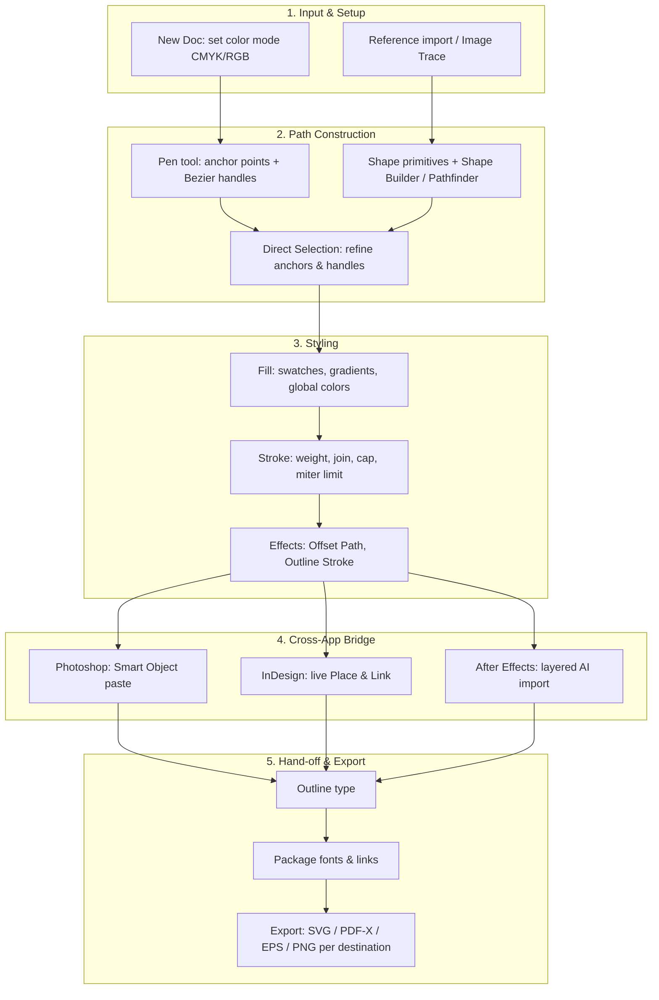

# Lesson 2: Illustrator Vector Graphics — The Pen Tool, Paths, and Production Workflow

## 1. Core Intuition: What a Path Actually Is (Read Once, Then Go Draw)

A vector path is a chain of anchor points connected by straight or curved segments. Every curved segment is a cubic Bézier: it has two endpoints (anchor points) and two control handles, one pulling out from each endpoint, that set the direction and strength of the curve — like a bent reed held at both ends. Drag a handle longer and the curve pulls harder toward it before bending back to the anchor. This is the only math you need to internalize: **handle direction = tangent direction of the curve at that anchor, handle length = how long the curve "obeys" that tangent before curving away.**

Because the shape lives as this handful of numbers (point positions, handle offsets) rather than as pixels, Illustrator can scale a logo from a business card to a billboard and recompute the same curve at any resolution with no blur, no stair-stepping. That's the entire practical payoff of vectors. Everything below is about getting your hand and eye good enough at placing and shaping those points that you stop fighting the tool.

Anchor points come in three flavors you will feel immediately once you're drawing:

| Point type | Handles | Visual result | When you use it |
|---|---|---|---|
| Corner (no handles) | none | sharp angle | box corners, logo spikes, pixel-perfect UI icons |
| Smooth | two handles, symmetrical, locked opposite | continuous flowing curve | circles, organic blobs, type outlines |
| Cusp / combination | two handles, independent angle and length | curve that changes direction sharply at the anchor | letterforms, leaf shapes, wave-into-point transitions |

Stop reading theory past this point. The skill is in your wrist and your click-drag timing, not in more paragraphs about Pierre Bézier.

---

## 2. Pen Tool Mechanics — The Drill That Actually Builds the Skill

This is the single highest-leverage practice session in all of Illustrator. Budget 20 minutes a day for two weeks before you touch a real project. Professionals who are fast with the Pen built that speed here, not by reading about anchor point data structures.

### Setup
- New document, 800×800 px, enable **View > Smart Guides** (Cmd/Ctrl+U) and **View > Snap to Point**.
- Select the Pen tool (`P`). Fill: None. Stroke: 2 pt, any visible color, so you can see exactly what you drew.
- Open **Window > Info** panel so you can watch the x/y readout while you drag — it trains your eye to predict handle length before you release the mouse.

### Drill 1 — Straight Segments (corner points only)
Click, don't drag, five points to form a 5-pointed irregular polygon, then click the first point again to close the path. Target: a clean closed shape with no accidental handles (if you see little lines poking out of a point, you dragged — undo and click only).
- Rep count: 20 polygons, varying point count (3 to 8).
- Pass criterion: no curve handles appear anywhere; every segment is dead straight.
- Hand mechanic: rest your wrist on the desk/tablet, move from the fingers and a stable mouse grip, not from the shoulder — this is what keeps click placement accurate rep after rep instead of drifting as you fatigue.

### Drill 2 — Symmetrical Curves (smooth points)
Click-and-drag at each point instead of clicking. Dragging *out* from the anchor sets both handles opposite each other automatically.
- Draw a wave: place 4 smooth points left to right, dragging alternately upward and downward about 50 px each time, same drag distance every time.
- Target shape: a perfectly even sine-like wave. Uneven humps = inconsistent drag length. Repeat until the humps match without looking at the ruler.
- Rep count: 15 waves, increasing drag distance each set (25px → 50px → 100px) to feel how handle length changes curve "tightness."
- Hold **Shift** while dragging to lock the handle to a 45°-increment angle — use this to build perfectly horizontal in/out tangents on a wave, which is what keeps the crest and trough symmetrical without eyeballing it.

### Drill 3 — The Direction Change (the move everyone botches first)
To go from a curve into a sharp corner, you must **break the handle** before placing the next point. Technique:
1. Drag out a smooth point as in Drill 2.
2. Before clicking the next point, **Option/Alt-click and drag on the same anchor point** — this pulls out a new single handle independent of the first, converting it from smooth to cusp.
3. Continue the path from that new handle direction.

Drill: draw a shape that alternates — curve, sharp corner, curve, sharp corner (like a comic-style speech bubble or a leaf outline). This single technique (Option-drag to re-angle a handle mid-path) is what separates clean letterform tracing from lumpy amateur paths.
- Rep count: trace 10 leaf or petal shapes from reference photos using only this technique.
- Common failure: dragging the *new* handle too long, which overshoots the next curve and forces an S-kink. Keep the re-angled handle roughly the same length as the segment you're about to draw, not longer.

### Drill 4 — Anchor Point Editing After the Fact
Draw a rough closed blob with 6 smooth points. Then, without redrawing:
- Use the **Direct Selection tool (`A`)**, click an anchor, drag its handle to reshape just that segment.
- Use **Convert Anchor Point** (Shift+Option+click with Pen, or the Anchor Point Conversion widget in the Control panel) to flip a smooth point to a corner and back.
- Delete an anchor with the Anchor Point tool or `Option/Alt+click` and watch how the path re-interpolates through the remaining points — this teaches you how few points you actually need for a smooth curve (professionals use the *minimum* anchor count; over-anchored paths are the #1 tell of a beginner file).

**Benchmark for competence:** trace a vector silhouette of a coffee cup (reference photo) using fewer than 25 anchor points, in under 4 minutes, with zero stray handles left visible. If you're over 25 points or 6 minutes, keep drilling.

---

## 3. Shape Building Without the Pen (Production Speed Techniques)

In real production work you reach for the Pen tool for maybe 30% of path creation. The rest is faster with these:

### Shape Builder Tool (`Shift+M`)
- Draw two or three overlapping basic shapes (Ellipse `L`, Rectangle `M`).
- Select all, activate Shape Builder.
- **Drag across** overlapping regions to merge them into one shape; **Option/Alt+click** a region to delete it from the compound.
- This is how logo marks and icon sets get built fast: crude overlapping circles/rects → Shape Builder → clean custom silhouette in under a minute.
- Hold **Shift** while dragging across regions to force the merge to snap along straight edges — useful for geometric/badge-style icon sets where every cut needs to land on a shared axis.

### Pathfinder Panel (`Shift+Ctrl/Cmd+F9`)
| Operation | Result | Typical use |
|---|---|---|
| Unite | merges all selected into one path | combining letterforms, badge shapes |
| Minus Front | subtracts top shape from shapes below | cutting a window/hole, notch details |
| Intersect | keeps only overlapping area | lens-flare shapes, venn-style icons |
| Exclude | keeps only non-overlapping area | checkerboard/donut effects |

Workflow habit: build icons from primitive shapes + Pathfinder before ever touching the Pen. It's faster and the resulting paths are cleaner (fewer anchors, perfectly even curves from the ellipse tool).

### Offset Path & Outline Stroke (production essentials for cutting/printing files)
- **Object > Path > Offset Path**: generates a parallel copy of a path at a fixed distance — essential for sticker "kiss-cut" borders, badge rings, and laser-cut clearance gaps. Set offset in the same units as your output (e.g., 2 mm for a laser cutter kerf allowance).
- **Object > Path > Outline Stroke**: converts a stroked line into a filled closed shape — mandatory before sending files to vinyl cutters or CNC software that only reads filled vector regions, not "invisible ink" strokes.

---

## 4. Precision Control: The Panels That Make You Fast

### Control Panel + Transform Panel (`Shift+F8`)
Never eyeball a position. Select an object, read/set exact **X, Y, W, H** numerically. For pixel-snapped UI icon work, turn on **View > Pixel Preview** and build on whole-pixel coordinates to avoid blurry anti-aliased edges at export.

### Align Panel (`Shift+F7`)
- Align to **Selection** for relative positioning among chosen objects.
- Align to **Key Object** (click one object twice to designate it) when you need everything to snap to one anchor object's edge — critical for lining up a row of icons to a master grid tile.
- **Distribute Spacing** (not just Distribute Center) when objects are different widths but need equal gaps — this is the field professionals use for evenly-spaced business card rows, button bars, etc.

### Smart Guides and the `Cmd/Ctrl` temporary Selection toggle
While drawing with the Pen, hold `Cmd/Ctrl` to momentarily switch to the Selection tool without deselecting the Pen — this is how fast operators adjust a just-placed point without breaking their rhythm. Practice this chord until it's reflexive; it alone will roughly double your Pen-tool speed.

### Scale and Rotate with the keyboard, not the mouse
- `Object > Transform > Scale/Rotate/Move` opens a dialog with an exact numeric field and a **Copy** button — the fastest way to generate a precise duplicate (e.g. rotate copy 30° six times to build a radial icon ring) without drift from repeated manual drags.
- `Cmd/Ctrl+D` repeats the last transform — build one offset copy by hand, then stamp out the rest with repeated D presses for perfectly even spacing.

---

## 5. Stroke, Corner, and Join Mechanics (Where Files Go Wrong at Print/Export)

- **Miter Limit** (Stroke panel): sharp corners beyond the miter limit angle get squared off instead of pointed. For sharp logo spikes, raise the miter limit (default 4, max 500) or they'll render flat-topped at export.
- **Join type**: Miter (sharp), Round (soft, good for thick line-art/badges), Bevel (flat-cut corner, used in technical/blueprint-style illustration).
- **Cap type**: Butt (flush, default), Round, Projecting (extends past the endpoint by half the stroke width) — Projecting caps are the standard choice for hand-drawn marker-style line art so strokes don't look clipped at their ends.
- **Align Stroke**: Center (default), Inside, Outside. For cut lines on packaging dielines, align stroke to **Inside** so the path's mathematical outline matches the physical cut edge exactly — this prevents a half-stroke-width registration error at the cutter.
- **Dashed strokes for die-lines**: set Dash/Gap values in the Stroke panel and check "Aligns dashes to corners and path ends" — unchecked, dashes drift at corners and the fold/cut line looks uneven on the physical board.

---

## 6. Color, Swatches, and Production-Safe Output

### Document Color Mode
Set at creation (File > New) or switch via **File > Document Color Mode**:
- **CMYK** for anything going to offset or digital press.
- **RGB** for screen, web, social, video overlay graphics.
Mixing modes inside one file (RGB images embedded in a CMYK doc, etc.) is the #1 cause of color-shift surprises at print — audit this before handing off a file.

### Global Swatches vs. Spot Colors
- Make brand colors **Global** (checkbox in swatch options) — editing the global swatch updates every object using it everywhere in the file instantly. Non-negotiable for any logo/brand file with repeated brand color use.
- **Spot color** swatches (Pantone library, Window > Swatch Libraries > Color Books) when the job is going to a commercial press running a dedicated ink — this preserves the exact Pantone number through to plate-making instead of letting it get CMYK-approximated.
- **Rich Black for large print areas**: pure K-only black (0/0/0/100) looks washed out on large coated-stock fills. Build a rich black at C60 M40 Y40 K100 for offset press jobs — check with your print vendor's spec sheet first, since total ink coverage limits vary by press and substrate.

### Export Checklist for Hand-off (run this every time, no exceptions)
1. **Outline all type** (Type > Create Outlines) before sending to any printer/vendor who may not have your fonts.
2. **Embed or package all linked images**: File > Package — generates a folder with the .ai file, fonts, and linked art together. Never hand off a file with broken links.
3. **Convert strokes you need as cut/print paths** to outlines (Section 3) if the receiving software/machine reads fills only.
4. Export flattened raster preview (PNG/JPG at 2x) alongside the vector file so non-Illustrator reviewers can sanity-check it without opening the AI file.
5. For web: **File > Export > Export As > SVG**, with "Minify" and "Responsive" options checked, Styling set to "Presentation Attributes" for cleanest embeddable code.
6. For print/press hand-off: **File > Save As > PDF**, preset "PDF/X-4:2008" — this preset auto-validates that fonts are embedded, color is CMYK-safe, and bleed is defined, catching most of items 1–3 automatically if you set bleed (typically 3 mm) under Marks and Bleeds before saving.

---

## 7. Cross-App Handoff: Illustrator, Photoshop, InDesign, After Effects

Real studio pipelines rarely stay inside one app. Know these exact bridges:

- **AI → Photoshop**: drag-and-drop or copy-paste a vector object into a PSD and choose "Smart Object" in the paste dialog — this keeps the artwork editable as a vector-backed layer that re-rasterizes cleanly on transform instead of pixelating like a flat paste.
- **AI → InDesign**: place the .ai file directly (`Cmd/Ctrl+D`) rather than exporting to PDF first — InDesign links to the live .ai and picks up edits automatically on File > Links > Update Link, which is the standard workflow for brand assets reused across a multi-page layout.
- **AI → After Effects**: each top-level layer in the .ai file becomes its own importable layer if you tick "Import As: Composition" on import — pre-separate parts you intend to animate (e.g. individual limbs of a logo mascot) into distinct named layers in Illustrator *before* export, because AE cannot split a single merged path into pieces after the fact.
- **Color consistency across the suite**: run **Edit > Color Settings** once and sync it (Creative Cloud > "Synchronize Color Settings" in Bridge, or match manually) across Illustrator, Photoshop, and InDesign — mismatched working spaces are the most common cause of a logo looking different when pasted between apps.

---

## 8. Troubleshooting Guide (Real Problems, Real Fixes)

| Symptom | Cause | Fix |
|---|---|---|
| Curve has a visible kink instead of smooth flow | Anchor point is a cusp, not smooth, or handles aren't collinear | Direct Selection the anchor, Option-drag one handle to re-align it opposite the other, or use the Anchor Point Conversion "make smooth" button |
| Path fills with unexpected color/void in the middle | Path isn't closed, or has a self-intersecting (figure-8) loop | Object > Path > Clean Up; or select all points, check status bar for "open path" warning; manually close with Pen by clicking the start point |
| Gradient looks banded at export | Gradient mesh/linear with too few stops rendered to low-bit raster export | Increase export resolution (300 ppi min for print), or add intermediate gradient stops to smooth the ramp |
| Text reflows or fonts substitute on another machine | Fonts not embedded/outlined | Create Outlines before export, or use File > Package when sending the editable .ai |
| Pathfinder "Unite" leaves faint hairline seams | Overlapping shapes don't fully overlap (gap of sub-point fraction) | Zoom to 1000%+, verify true overlap; use Shape Builder's drag-merge instead, which tolerates near-touching edges better |
| File is enormous for a "simple" logo | Hundreds of redundant anchor points from auto-trace (Image Trace) at default settings | Select All > Object > Path > Simplify, drag the curve precision slider while watching point count drop; target under 50 points for a typical logo mark |
| Live Image Trace result looks jagged / loses detail | Trace preset too aggressive/simplified for the source resolution | Image Trace panel: raise "Paths" and "Corners" sliders, lower "Noise" threshold, use a higher-res source raster |
| PDF export rejected by print vendor for "transparency flattening" | Live effects (drop shadow, opacity blends) not flattened for the target PDF standard | Save As PDF with preset PDF/X-1a (fully flattens transparency) instead of a transparency-preserving preset, or manually flatten via Object > Flatten Transparency first |
| Placed linked image looks fine in Illustrator but pixelated after handoff | Link points to a low-res proof copy, or image was scaled up past its native resolution | Window > Links > check effective PPI (right-click > Link Information); replace with a true high-res source before Package |

---

## 9. Production Workflow Map

---

## 10. 30-Day Practice Ladder

| Week | Daily drill | Target |
|---|---|---|
| 1 | Pen tool Drills 1–3 (straight, smooth, cusp) | Clean paths, no stray handles, under 5 min per shape |
| 2 | Trace 5 logo silhouettes/day from reference photos | Under 30 anchor points each, under 5 minutes each |
| 3 | Build 10 icon-set glyphs using Shape Builder + Pathfinder only | Consistent stroke weights, aligned to pixel grid |
| 4 | Full production piece: logo + 3 color variants + packaged export, test-placed into a Photoshop mockup and an InDesign one-pager | Passes full Section 6 export checklist with zero errors, links update cleanly in InDesign |

Hit every milestone at the stated time target before moving to the next week — speed under control is the actual skill; slow-and-accurate is only the first checkpoint.
