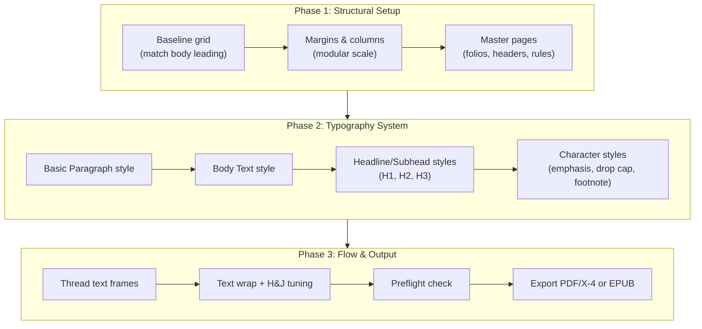
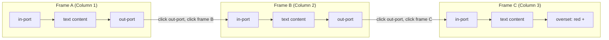

# Lesson 3: InDesign Layout and Typography — Production Workflow for Print and Digital Publishing

## 1. First-Principles Intuition: Why Grids and Type Scales Work

Your eye reads a page through contrast and alignment before it reads words. Two invariants drive every decision in this lesson.

**Proximity and alignment create perceived relationships.** Objects positioned on a shared baseline grid or column edge read as a unit even without borders or color. A misaligned caption looks "wrong" before you can name the pixel offset, because your visual system already flagged the broken relationship.

**Type scale and leading control reading speed, not just aesthetics.** Body text at 9–11pt with leading at 120–145% of point size (10pt/14pt = 140% leading) matches the eye's natural saccade length for comfortable line-to-line tracking. Push leading below 120% and lines visually fuse, so the eye re-reads words. Push above 150% and the eye loses the line on the return sweep. Line length compounds this: the readable range is 45–75 characters per line, shorter for dense multi-column work, longer only with generous leading.

That's the full theory load for this lesson. Everything else below is executable in InDesign.

---

## 2. Document Setup: Grids, Margins, and Master Pages



### 2.1 Building the baseline grid (do this before placing any text)

A baseline grid locks every line of text in every frame to the same horizontal rhythm, so columns align across the spread even when font sizes differ.

1. `Edit > Preferences > Grids` (Win) / `InDesign > Preferences > Grids` (Mac)
2. Set **Start**: match your top margin (e.g. 0.5in from top of page, not top of frame)
3. Set **Increment Every**: equal to your body text leading. If body is 10/14pt, set increment to **14pt** — work in points, not inches, for precision (`1in = 72pt`)
4. View it: `View > Grids & Guides > Show Baseline Grid` (`Cmd/Ctrl + Opt/Alt + '`)
5. Force paragraph styles to snap: in each paragraph style's **Indents and Spacing** panel, check **Align to Grid**

**Why a 14pt increment:** every paragraph style whose leading is a multiple of 14 (14, 28, 42...) locks to the grid cleanly. A headline style at 24/28pt leading lands on-grid every other line because 28 is a clean multiple of 14. Pick your base increment first, then derive every other leading value as a multiple of it.

### 2.2 Margins and columns via a modular scale

Rather than eyeballing margins, use `Layout > Margins and Columns` and derive numbers from a module. For an 8.5×11in page:

```
Margins: Top 0.75in, Bottom 1in (bottom slightly larger — optical weight,
         prevents the page from feeling like it's falling forward)
Columns: 3, Gutter 0.1667in (1/6 in — divides cleanly into picas)
```

For multi-page documents, open `Layout > Create Guides` for a quick starting scaffold, then fine-tune manually — it is not a final grid.

### 2.3 Master pages — the actual architecture

Master pages are template layers every document page inherits from. Build the skeleton once here, not per page.

1. `Window > Pages` → double-click **A-Master**
2. Place running elements: folio (`Type > Insert Special Character > Markers > Current Page Number`), header/footer rules, footer text
3. Create variants: right-click A-Master → **Master Options**, or drag A-Master onto a new master icon to build **B-Master** (e.g. a chapter-opener master with no folio and different margins)
4. Apply to pages: drag a master icon from the Pages panel onto target page thumbnails, or select pages → `Apply Master to Pages`
5. **Override** an individual instance locally: `Cmd/Ctrl + Shift + click` the master item on the actual page — this detaches just that instance without breaking inheritance for other pages

**Failure mode:** designers manually recreate footers and headers page by page. Any later change — a new page-numbering style, revised footer copy — then requires editing every page instead of one master. Build repeating elements on a master first, always.

---

## 3. Typography Mechanics: Styles, Hierarchy, and Fine Control

### 3.1 Paragraph and Character Styles — build the hierarchy before you format anything

Never hand-format text in a real layout job. Every visible formatting decision should trace to a style, so a global change (client wants headlines 2pt larger) is a one-click edit, not a find-and-replace nightmare.

**Build order (this sequence prevents rework):**

1. **[Basic Paragraph]** — set this first; it's the fallback every other style inherits from. Set your body font, size, leading, and **Align to Grid** here.
2. **Body Text** — based on [Basic Paragraph], override only what differs
3. **Headline / Subhead levels (H1, H2, H3)** — each based on Body Text, overriding size, weight, space-before, space-after
4. **Character styles** for inline exceptions: *Italic-emphasis*, **Bold-emphasis**, `Drop-cap`, superscript footnote markers

Open `Window > Styles > Paragraph Styles`, click the panel flyout → **New Paragraph Style**. Critical fields:

| Field | Setting | Why |
|---|---|---|
| Based On | Previous style in hierarchy | Enables cascading edits |
| Next Style | What auto-applies after pressing Enter | H1 → "Next Style: Body Text" means hitting Return after a headline auto-switches to body — a major speed gain in long documents |
| Keep Options | Keep with next: 1 line | Prevents a headline orphaned at the bottom of a column |
| Align to Grid | All Lines | Locks to the baseline grid from §2.1 |

### 3.2 Optical kerning vs. metrics kerning — when to use which

- **Metrics kerning** (default): uses kern pairs baked into the font by its designer. Correct for well-built professional typefaces — most Adobe Fonts and licensed type-foundry releases.
- **Optical kerning**: InDesign calculates spacing algorithmically from letterform shapes. Use it when:
  - Mixing typefaces on one line (optical normalizes spacing across different font metrics)
  - Working with poorly kerned free or cheap fonts
  - Setting large display type (24pt+), where metrics-kerning gaps become visually obvious

Set per-selection: highlight text → `Character panel > Kerning dropdown` (next to the AV icon).

**Manual kerning check for headlines (do this every time, it's fast):** zoom to 400%, select the headline, use `Opt/Alt + Left/Right arrow` to kern pairs manually. Common problem pairs: **AV, WA, To, Fl, rn** — "rn" can read as "m" if not kerned. Target visually *equal* perceived space between letter pairs, not equal pixel distance. Curved letters like "o" need tighter numeric kerning than straight letters like "l" to look equal.

### 3.3 Tracking, not kerning, for body-copy color

- **Kerning** adjusts space between a specific pair of letters.
- **Tracking** adjusts space uniformly across a whole selection.

When body text reads slightly "heavy" or "loose" as a block — what typographers call "color" — adjust tracking in increments of **+/-5 to +/-10** (units are 1/1000 em) rather than rebuilding the paragraph style. Select the paragraph → `Character panel > Tracking field`.

### 3.4 Drop caps, the correct way

`Paragraph panel flyout > Drop Caps and Nested Styles`, or directly in the Paragraph panel's **Drop Cap Number of Lines** field.

- Set lines-to-span: typically 3 for body text, matching cap height to roughly 3x the body x-height
- Create a **character style** for the drop cap (different weight or color is common) and assign it in the same dialog so it's reusable across the document, never a manual per-instance override

### 3.5 OpenType features — turn these on deliberately

`Character panel flyout > OpenType`. For body text set in a quality OpenType font:

- **Ligatures**: on — fixes the "fi"/"fl" collision where the ascender of f collides with the dot of i
- **Old-style figures**: on for running text with numerals inline with lowercase — these numerals have ascenders/descenders like lowercase letters, so they sit less jarringly mid-sentence
- **Lining figures**: on for tables and headlines, where numerals need to align to cap height
- **Discretionary ligatures / Swash**: display and headline type only, never body copy — they slow reading

---

## 4. Text Flow Mechanics: Threading, Wrap, and Composition

### 4.1 Threading frames

Text frames connect via **in-ports** (top-left square) and **out-ports** (bottom-right square).



1. Click the out-port of frame A with the **Selection tool** — the cursor becomes a loaded-text icon
2. Click inside frame B — text now flows A → B
3. A frame with overflow text shows a **red plus (+)** in the out-port — your signal there's more text than fits
4. Overset isn't flagged by Track Changes; check visually, or confirm via `Window > Output > Preflight`

**Auto-flow trick for long documents:** hold `Shift` while clicking with the loaded-text cursor. InDesign auto-creates new pages with frames matching the master page column structure until all text is placed. This is the single biggest time-saver for book or manuscript layout.

### 4.2 Text wrap around images

Select the image frame → `Window > Text Wrap` (`Cmd/Ctrl + Opt/Alt + W`):

- **Wrap around bounding box**: fast, works for rectangular crops
- **Wrap around object shape**: traces the alpha or clipping path — use for irregular cutouts (requires a clipping path or alpha channel from Photoshop)
- Offset values: set top/bottom/left/right independently. Standard magazine convention: **0.125–0.1875in (9–13pt)** — tight enough to show relationship, loose enough that letters don't touch the image edge

**Common failure:** text wrap set on the wrong frame layer makes the wrap apply to frames behind the image too, opening unwanted gaps across the whole spread. Fix: toggle `Object > Text Wrap > Include Inside Edges`, or move the image to its own layer above the text layers (`Window > Layers`) and restrict wrap scope.

### 4.3 Hyphenation and justification — the setting everyone gets wrong

`Paragraph panel flyout > Hyphenation`. Default settings are too aggressive for narrow columns and produce ladders of hyphens down the left margin — a clear failure mode in professional work.

Fix for narrow (under 2in) columns:
```
Words with at least: 6 letters (up from default 5)
After first: 3 letters
Before last: 3 letters
Hyphen limit: 2 (caps consecutive hyphenated lines, prevents the "ladder")
Hyphenation zone: increase for more ragged-right, fewer hyphens
```

For **justified** text specifically, open `Justification` in the same flyout menu and tighten the word/letter spacing ranges:
```
Word Spacing: Min 85% / Desired 100% / Max 115%
Letter Spacing: Min -2% / Desired 0% / Max 2%
```
Wider ranges than this produce visible "rivers" of white space running down justified columns — a classic amateur-layout tell.

---

## 5. Color, Images, and Print-Ready Output

### 5.1 Color mode discipline

Set working color space **before** placing assets, not after.

- `Edit > Transparency Blend Space` → Document CMYK for print jobs
- `Window > Color > Swatches` → build all brand colors as named swatches. Never use unnamed/default colors — a client color change then becomes a single swatch edit instead of a find-every-instance hunt.
- Spot colors (Pantone) for 1–2 color print jobs: in the New Color Swatch dialog, set **Color Type: Spot**, **Color Mode: Pantone+ Solid Coated** (or Uncoated, depending on stock)
- Rich black for large print areas: C=60 M=40 Y=40 K=100. Never use C=M=Y=K=100 — it causes registration and ink-saturation problems on press.

### 5.2 Linked images and the Links panel discipline

Always **link**, never embed, images during layout (`File > Place`, keep Link checked). `Window > Links` is your preflight checkpoint:

- Yellow triangle warning = image modified since placement — double-click to relink/update
- Red question mark = missing link — the document will not print or export correctly until fixed
- Resolution check: select the image with the Selection tool, `Window > Info` shows **Effective PPI**. For print, keep effective PPI at 300, or 225 minimum for acceptable quality. Anything below 200 effective PPI is visibly soft on press.

### 5.3 Preflight before export — do this every time, no exceptions

`Window > Output > Preflight` → create a custom profile matching your output target (RGB images in a CMYK doc, missing fonts, overset text, low-res images, missing links). A red dot in the bottom-left status bar of the document window means an active preflight error; the panel tells you exactly what and where.

### 5.4 Export settings

**Print/prepress PDF:** `File > Export > Adobe PDF (Print)` → preset **PDF/X-4:2008**, which supports live transparency and ICC color management and is the current industry standard for commercial print handoff. Under **Marks and Bleed**, set bleed to match your print house spec (standard commercial bleed: **0.125in / 3mm** on all sides), and enable crop marks only if the printer requests them — many prefer marks off, bleed-only.

**Digital/interactive PDF:** `File > Export > Adobe PDF (Interactive)` for PDFs with working hyperlinks, buttons, and embedded video. Standard PDF (Print) export flattens interactivity.

**EPUB / digital publishing:** `File > Export > EPUB (Reflowable)` requires the Articles panel (`Window > Articles`) to define reading order across frames. Without it, export order follows z-order/stacking, which is almost never the intended reading sequence.

---

## 6. Performance and Failure-Mode Troubleshooting

### 6.1 Large document slowdown — diagnosis and fix order

| Symptom | Likely cause | Fix |
|---|---|---|
| Scrolling/redraw lag | Display Performance set too high | `Object > Display Performance > Fast` while editing; switch to High Quality only before export |
| Slow save/open | Excessive embedded (not linked) images | Audit the Links panel, convert embeds back to links where possible |
| Overset text not obvious | No visual scan of every frame | `Window > Output > Preflight`, which flags overset automatically |
| Font substitution on open | Missing fonts not synced | `Type > Find Font` panel — shows every font in use, lets you batch-replace missing ones, or triggers Adobe Fonts auto-activation if available |
| Crash on export | Corrupt linked image or malformed PDF/EPS placed asset | Re-export the problem asset from its source app (Photoshop/Illustrator) as a fresh TIFF or native-saved PDF |

### 6.2 Style conflicts and the "clear overrides" recovery

When local overrides accumulate — text looks right but the style panel shows a `+` next to the applied style name, meaning manual overrides are layered on top — don't manually chase every override.

1. Select the affected text
2. `Window > Styles > Paragraph Styles` → `Opt/Alt + click` the style name. This clears all local overrides and reverts purely to the style definition.
3. If the override was actually wanted, redefine the style instead: format one instance correctly, place the cursor in that text, then panel flyout → **Redefine Style**. This propagates the change to every instance using that style.

### 6.3 File corruption and recovery

- Enable `Edit > Preferences > File Handling > Always Save Preview Images` for faster thumbnail previews and some added resilience
- If a file won't open: try opening the `.idml` export of a recent backup, or try `File > Open` first with no modifier. If that fails, check for an auto-recover file in InDesign's Recovery folder (`~/Library/Caches/Adobe InDesign/Version X/.../InDesign Recovery` on Mac, the equivalent AppData path on Windows)
- Best practice, not a recovery step: save incremental versions (`File > Save As` with a version-number suffix) at major milestones, not just continuous overwrite saves. A corrupted save file is unrecoverable if it's your only copy.

---

## 7. Practice Lab: Build a 4-Page Editorial Spread

**Objective:** apply every mechanic above in one deliverable.

1. New document: Letter, 4 pages, facing pages on, 0.125in bleed, 3-column grid, margins per §2.2
2. Build the baseline grid at a 14pt increment; build A-Master with folio and running header
3. Build the style hierarchy: [Basic Paragraph] → Body Text (10/14) → H1 (28/28, Align to Grid) → H2 (14/14) → Caption character style (8/10, italic)
4. Place 800+ words of placeholder text (`Type > Fill with Placeholder Text`), thread across 3 frames using Shift-click auto-flow
5. Place one image, apply object-shape text wrap at a 9pt offset
6. Set hyphenation per §4.3 for the 3-column body text
7. Run Preflight — fix every flagged error before export
8. Export PDF/X-4 with 0.125in bleed, no crop marks

**Target benchmark:** zero preflight errors, zero manual local overrides remaining (confirm via the Paragraph Styles panel — no `+` next to any applied style name), and baseline grid alignment holding across all three columns when viewed at `Cmd/Ctrl + Opt/Alt + '`.
