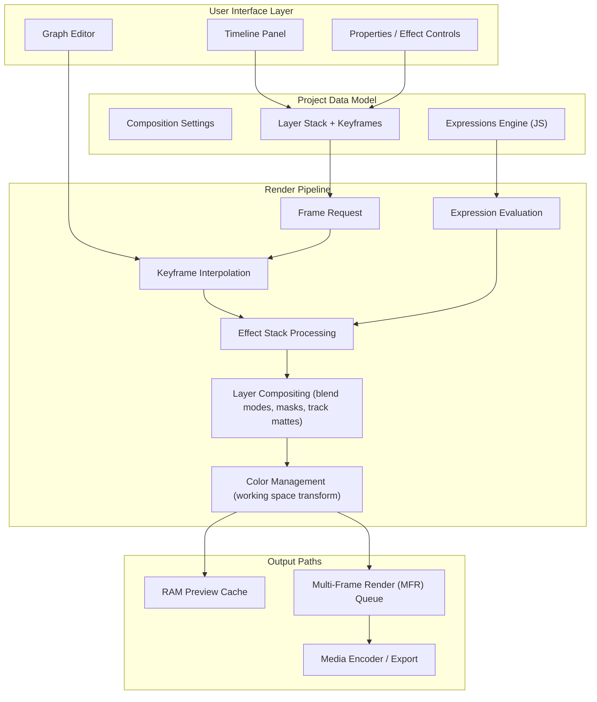

# Lesson 4: After Effects Animation Basics — Keyframes, Easing, and Expressions That Actually Ship

## 1. The Physics You Need, No More

Everything in After Effects boils down to one idea: a **property value at a point in time**. Position, Scale, Rotation, Opacity — each is just a number (or set of numbers) sampled at every frame. A keyframe pins that value at a specific time. Between two keyframes, AE interpolates — calculates the in-between values — and the *shape* of that interpolation curve is what separates amateur motion from professional motion.

There are exactly three interpolation families you need to internalize:

- **Linear** — constant velocity, mechanical and robotic. Rarely what you want for organic motion.
- **Bezier/Ease** — velocity ramps up and down (ease-in/ease-out). This mimics how real mass accelerates and decelerates — nothing in the physical world starts or stops instantly.
- **Hold** — no interpolation; value snaps at the next keyframe. Used for stop-motion/cel-animation looks and for switching discrete states (visibility toggles, step-changed text).

That's the entire theory cap. Everything else in this lesson is hands, mouse, and keyboard shortcuts.

## 2. Workspace Setup for Animation Work

Before animating anything, set up your project so you're not fighting the UI:

1. **Project settings**: `Composition > Composition Settings` (Ctrl/Cmd+K) — set frame rate to match delivery (23.976/24 for film, 29.97/30 for broadcast NTSC, 25 for PAL). Mismatched frame rates cause judder that no amount of keyframe polish fixes.
2. **Workspace**: `Window > Workspace > Animation` — this surfaces the Graph Editor dock by default.
3. **Preferences for scrubbing precision**: `Edit > Preferences > General` → enable "Snap keyframes and extent of selected properties to other keyframes" — critical for lining up multi-layer timing.
4. **RAM Preview setup**: `Edit > Preferences > Memory & Performance` — allocate at least 2 cores reserved for other applications; the rest goes to AE's background rendering (Multi-Frame Rendering, enabled by default since 22.3).

## 3. Core Keyframing Workflow (Step-by-Step)

### 3.1 Setting your first keyframes

1. Select a layer, press `P` to reveal Position in the Timeline (shortcut reveals *only* that property — essential for decluttering).
2. Move the playhead to frame 0, click the **stopwatch icon** next to Position — this arms keyframing and drops keyframe #1 at the current value.
3. Move the playhead forward (Page Down = 1 frame, Shift+Page Down = 10 frames), then drag the layer to a new position. AE auto-creates keyframe #2. You do **not** need to click the stopwatch again — once armed, any value change at a new time creates a new keyframe automatically.

**Property shortcut reference** (memorize these, they're the backbone of fast workflow):

| Key | Property | Key | Property |
|---|---|---|---|
| `P` | Position | `R` | Rotation |
| `S` | Scale | `T` | Opacity |
| `A` | Anchor Point | `U` | Show all animated properties |
| `Shift+[key]` | Add additional property to reveal | `UU` | Show all modified (non-default) properties |

### 3.2 Easing keyframes — the single highest-leverage skill

Default linear keyframes (hard diamond icons) look robotic. The professional move:

1. Select all keyframes on a property.
2. Right-click → **Keyframe Assistant > Easy Ease** (shortcut: `F9`). This converts the diamonds into hourglass-shaped ease icons — velocity now ramps in and out.
3. For asymmetric control, open the **Graph Editor** (click the graph icon in the Timeline toolbar, or press the graph toggle). Switch the dropdown at bottom to **Edit Speed Graph**.
4. Drag the Bezier handles on each keyframe to control acceleration independently for incoming and outgoing motion. A steep initial slope = fast start; a long flat tail = slow, lingering stop.

**Practical rule of thumb**: for UI motion and logo reveals, use **ease-out heavy** curves (fast start, slow finish) — it reads as responsive and intentional. For anticipation-driven character/cartoon motion, add a small **overshoot** by dragging the outgoing handle slightly past the keyframe value, then settling back (classic animation "squash before launch").

### 3.3 The 12 Principles, translated into AE keyframe moves

You don't need an animation degree to apply Disney's core principles — here's the direct AE translation:

- **Anticipation**: before a layer moves forward, add a small keyframe moving it slightly *backward* first (3–5 frames).
- **Squash & Stretch**: animate Scale non-uniformly (unlink the chain-link icon between X/Y scale) at the moment of impact — e.g., Y scale 100%→70%→110%→100% over 6 frames for a bounce landing.
- **Follow-through/Overshoot**: your rotation or position keyframe should overshoot the resting value by 5–10% and settle back — don't let motion stop dead.
- **Slow In/Slow Out**: this *is* Easy Ease. Non-negotiable default for anything that isn't mechanical.
- **Arcs**: natural motion rarely travels in a straight line. After setting Position keyframes, add a slight curve by adding a mid-point keyframe offset perpendicular to the straight path, or convert to Bezier spatial interpolation (right-click keyframe → Keyframe Interpolation → Spatial Interpolation: Bezier) and drag the motion path handle in the Composition viewer.

## 4. Pre-Compositions: Your Primary Organizational and Performance Tool

Select multiple layers → `Ctrl/Cmd+Shift+C` → **Pre-compose**. This nests the layers into a single composition layer.

Two concrete reasons to pre-comp, beyond "tidiness":

1. **Isolate effect processing order**: effects on a pre-comp apply to the *flattened* result of everything inside it. Want a glow applied to the combined silhouette of three shape layers, not each one individually? Pre-comp them first, then add Glow to the pre-comp layer.
2. **Collapse Transformations toggle** (the little sun/star icon in the Timeline switches column, only visible on pre-comp layers): when enabled, nested layer effects and transforms are recalculated using the parent comp's resolution and continuous-rasterization, preventing quality loss when you scale a pre-comp containing vector shapes or text. Leave this **off** when you need motion blur or effects to render using the pre-comp's own resolution/frame rate — it changes render order significantly.

## 5. Parenting and the Pick Whip — Rig Before You Animate

Instead of keyframing 15 individual layers for a group move, **parent child layers to a null object**:

1. `Layer > New > Null Object`.
2. In each child layer's Parent & Link column (enable via the Timeline panel's column toggle if hidden), drag the **pick whip spiral icon** to the null.
3. Animate the null's Position/Rotation/Scale — all parented layers follow proportionally, preserving their individual offsets.

This is the AE equivalent of rigging — always build your hierarchy before keyframing complex multi-layer moves. Re-parenting after animating breaks existing keyframe math unless you account for the offset.

## 6. Expressions: Automate What You'd Otherwise Hand-Key

Expressions are JavaScript-based (AE 2023+ uses a modernized expressions engine). Alt/Option-click the stopwatch of any property to open the expression field.

### 6.1 The three expressions you'll use constantly

**Wiggle (organic randomized motion)** — great for handheld camera shake, idle character movement, nervous energy on UI elements:
```javascript
// freq = oscillations per second, amp = pixels/degrees of deviation
wiggle(3, 15)
```
Apply directly to Position: `freq=3` wiggles 3 times per second with `amp=15` pixel deviation.

**Loop keyframes** — turn a short hand-animated cycle into an infinite loop without duplicating keyframes:
```javascript
loopOut("cycle")
```
Place this on a property that already has at least 2 keyframes; it repeats the keyframe pattern indefinitely after the last keyframe's time. Use `"pingpong"` instead of `"cycle"` for back-and-forth motion (good for breathing, swaying).

**Linking properties across layers (rig connections without parenting)**:
```javascript
// Pick-whip this expression's source into another layer's rotation value
thisComp.layer("Wheel_Back").transform.rotation
```
Drag the expression pick-whip (spiral icon next to the expression field) onto the target layer's property instead of typing this manually — faster and avoids typos.

### 6.2 Practical expression recipe: automatic bounce with decay

```javascript
// Apply to Position.y (or Scale) for a physically-decaying bounce on landing
n = 0;
if (numKeys > 0) {
  n = nearestKey(time).index;
  if (key(n).time > time) n--;
}
if (n == 0) {
  t = 0;
} else {
  t = time - key(n).time;
}
if (n > 0 && t < 3) {
  v = velocityAtTime(key(n).time - 0.001);
  amp = 0.05;   // amplitude of bounce decay
  freq = 3.0;   // oscillations per second
  decay = 6.0;  // how fast it settles
  value + v*amp*Math.sin(freq*t*2*Math.PI)/Math.exp(decay*t);
} else {
  value;
}
```
This takes a single hand-placed landing keyframe and auto-generates a decaying overshoot bounce — no manual secondary keyframes needed. Tune `amp`, `freq`, and `decay` interactively while scrubbing.

## 7. System Architecture: What Actually Happens When You Hit RAM Preview



Every frame you scrub through re-runs this entire pipeline. Expressions re-evaluate on *every* frame change, even ones that aren't animating — this is why heavy expression chains tank playback performance even on simple-looking comps.

## 8. Performance Optimization — Concrete, Measurable Actions

Generic advice ("minimize layers") doesn't help you fix a slow project today. Here's the actual troubleshooting sequence, in order of impact:

### 8.1 Diagnose first: use the flame graph

`Composition > Comp Flowchart` or, better, enable the **Composition Profiler** (click the snail icon in the lower-left of the Timeline panel to reveal the Render Time column). — it visually shows which layer/effect is consuming render time per frame. Don't guess; measure.

### 8.2 Concrete fixes, by cause

| Symptom | Cause | Fix |
|---|---|---|
| RAM Preview builds slowly, drops frames | Full-resolution preview on large footage | Set Resolution/Down Sample Factor to 1/2 or 1/4 in Comp viewer |
| Scrubbing lags on comps with many effects | Effects recalculated per-frame, uncached | Pre-render problem sections via `Composition > Pre-render`, swap in a proxy |
| Expression-heavy rig is sluggish | `wiggle()`/loop expressions on many layers evaluate every frame | Bake expressions: select property → right-click → Keyframe Assistant → Convert Expression to Keyframes |
| 4K footage chokes playback | No proxy workflow | `File > Create Proxy > Movie`, render a half-res ProRes proxy; toggle proxy on/off per layer via the Timeline switch |
| GPU-accelerated effects cause visual corruption/crashes | Outdated drivers or unsupported Mercury GPU acceleration path | ``File > Project Settings` → under Video Rendering and Effects, switch Use to **Mercury Software Only** to isolate; update GPU drivers; verify under Help → About for supported CUDA/Metal version to isolate; update GPU drivers; verify under Help → About for supported CUDA/Metal version |
| Final export looks washed out/flat vs. preview | Project working color space (e.g., Rec.709 vs sRGB) mismatched with export settings | `File > Project Settings > Color Management` — match working space intentionally, enable "Linearize Working Space" only if you understand the blending implications |

### 8.3 Pre-compose discipline

Rule: if a group of layers has **finished** its internal relative animation and now only needs a single combined transform (e.g., scaling a whole animated logo lockup), pre-comp it and collapse. This caps the render cost of that group instead of re-evaluating every nested keyframe and effect on every frame of the outer comp.

## 9. Practice Drill Sequence (Do These in Order)

1. **Drill 1 — Linear vs. Eased bounce**: Animate a circle shape layer dropping 400px in 20 frames using Position keyframes. Duplicate the layer. On the duplicate, select both keyframes and apply Easy Ease (`F9`). RAM preview both side by side. Identify by eye why the eased version reads as "real" and the linear one reads as "robotic."
2. **Drill 2 — Graph Editor precision**: On the eased bounce, open the Graph Editor and manually drag the incoming handle on the landing keyframe to create a sharp deceleration (near-vertical slope into the keyframe) versus a soft one. Render both; this is the difference between a "hard landing" and "floaty landing" read.
3. **Drill 3 — Anticipation + overshoot**: Add one keyframe before the drop that moves the ball up 20px (anticipation), and one keyframe after landing that overshoots the squash by scaling Y to 85% then settling to 100% over 8 frames.
4. **Drill 4 — Parent rig**: Build a 3-layer arm (shoulder, forearm, hand) as separate shape layers, each parented to the next up the pick-whip chain. Animate only the shoulder's rotation and observe correct hierarchical follow-through — fix anchor points first if pivot points look wrong (Pan-Behind tool, `Y`).
5. **Drill 5 — Expression loop**: Hand-key a 10-frame idle "breathing" scale cycle (100%→102%→100%) on a character layer. Add `loopOut("pingpong")` to the Scale property and extend the layer's out-point to 5 seconds. Confirm it loops seamlessly with no snap or pop at the loop boundary.
6. **Drill 6 — Proxy workflow under load**: Import a 4K clip, create a half-res ProRes proxy, confirm playback framerate improves in the Timeline's performance indicator (top-right of Composition panel), then disable the proxy before final export and verify the output renders at full source resolution.

Run each drill with RAM Preview (`0` on numpad) after every change — the goal is training your eye to recognize interpolation quality in real time, not just reading keyframe icons.
