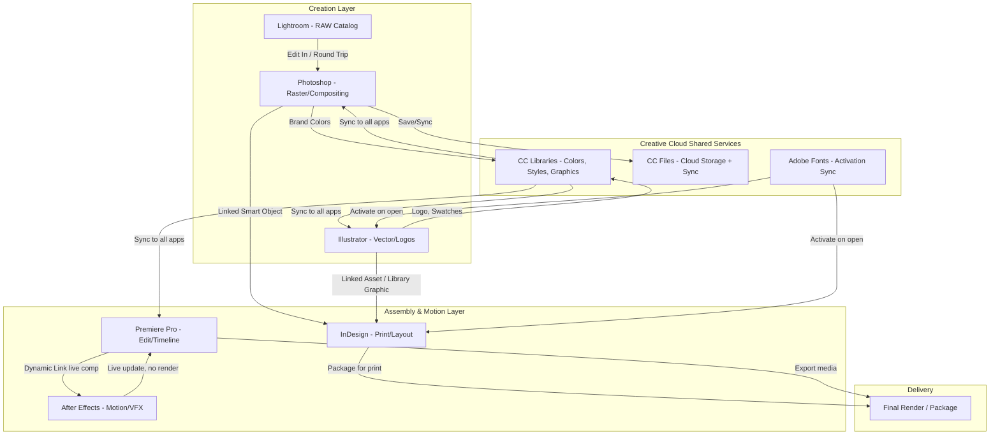

# Lesson 5: Adobe Creative Cloud Integration — Production Pipeline Mastery

## 1. Why Integration Matters: The Non-Destructive Pipeline Principle

Every Creative Cloud workflow problem reduces to one question: **can you change your mind later without redoing work?** That is the entire design philosophy behind Smart Objects, Linked Libraries, and Dynamic Link. A beginner flattens a Photoshop file and pastes a PNG into Illustrator. A professional links the PSD so that repainting a texture in Photoshop updates every placed instance across six Illustrator files and an After Effects comp automatically.

The data reality underneath this: Adobe's native formats (PSD, AI, INDD, PRPROJ, AEP) are **layered container formats**, not flat images. They store a tree of editable objects — pixel layers, vector paths, text runs, adjustment layers, smart filters — plus metadata (color profile, linked font references, GUID asset links). When App B imports App A's file as a **linked** (not embedded) asset, App B stores only a path/GUID reference and a low-res proxy for display. Round-trip editing works because both apps parse the same container spec, which is why "Edit Original" on an embedded link reopens the exact source app and layer stack — the file never lost its edit history crossing app boundaries.

Three invariants make or break a real pipeline:

1. **Link, don't flatten, until final export.** Flattening destroys the edit graph — the single most common professional mistake.
2. **One source of truth per asset.** A logo exists once, inside a CC Library or as a Linked Asset; everything else references it.
3. **Color management travels with the file.** A PSD tagged Adobe RGB opened in a Premiere project set to Rec.709 will shift — profile mismatches are the #1 cause of "why does it look different" tickets.

## 2. Core Integration Mechanisms (Hands-On)

### 2.1 Creative Cloud Libraries — Centralized Asset Truth

Libraries sync colors, text styles, graphics, and Adobe Stock assets across every CC app on every machine signed into the same account.

**Build a production library (5 minutes, do this now):**

1. In Illustrator: `Window > Libraries` → `+ Create New Library` → name it `BrandName_Master`.
2. Select a logo vector group → drag it into the Libraries panel. It uploads as a reusable **Graphic** asset.
3. Select brand swatches in the Swatches panel → drag into Libraries. These become **Color** assets, stored as actual CMYK/RGB/Lab values, not screenshots — critical, because a screenshot-derived swatch drifts under different monitor profiles while a stored Lab value does not.
4. Highlight a text frame set to your approved headline font/size/tracking → `+` icon in Libraries panel → **Add Character Style**.
5. Open Photoshop → the same Library appears in `Window > Libraries` (same CC account). Drag the logo onto the canvas — it imports as a **Linked Smart Object**, flagged with a small chain-link badge in the Layers panel.
6. Edit the master logo back in Illustrator, save. Return to Photoshop: a cloud-sync badge appears on the layer. Right-click → `Update Modified Content`. The Photoshop instance updates without you touching Photoshop's canvas manually.

**Why this matters in practice:** a 40-asset ad campaign with a last-minute logo color change becomes one edit at the source instead of 40 manual re-exports.

### 2.2 Linked Smart Objects vs. Embedded — The Decision That Determines Your File Size and Your Sanity

| | Embedded | Linked |
|---|---|---|
| File independence | Fully self-contained, portable | Breaks if source file moves/renamed |
| File size | Large (duplicates data per instance) | Small (stores path reference only) |
| Update propagation | Manual re-embed required | Automatic on source save |
| Best for | Final delivery, archival, client handoff | Active production, multi-instance assets (logos, textures, UI components) |

**Rule of thumb:** work linked, deliver embedded/flattened. Before final export: `File > Package` in InDesign, or in Photoshop select the linked layer → `Layer > Smart Objects > Embed Linked`, to freeze dependencies for delivery.

**Common failure — the broken link cascade.** A freelancer renames `logo_v2.psd` to `logo_final.psd` inside a shared project folder. Every app holding that linked reference throws a missing-link warning (yellow triangle badge) on next open. Fix procedure:

1. `File > Links` (Illustrator/InDesign) or check Layers panel badges (Photoshop).
2. Select the broken link → `Relink` → browse to the new filename.
3. If dozens of links broke from a folder restructure, relink the first instance and choose **"Relink All Instances"** when the dialog offers it — this batch-fixes every page/layer referencing that same missing file instead of relinking one occurrence at a time.

### 2.3 Dynamic Link — Premiere Pro ↔ After Effects Without Rendering

Dynamic Link is the single highest-leverage workflow trick for editors who also need motion graphics.

**Procedure:**

1. In Premiere Pro, select a clip on the timeline that needs a motion graphics treatment (lower third, title animation, VFX cleanup).
2. Right-click → `Replace with After Effects Composition`. Premiere auto-creates an AEP file and a new comp matching the clip's in/out points, frame rate, and resolution.
3. After Effects launches (or switches focus) with that comp open. Build the animation/VFX normally.
4. Switch back to Premiere: the timeline clip updates live, frame-accurately, with zero intermediate render or export. This is a live RAM-based link, not a file round-trip — Premiere is querying After Effects' render pipeline directly during playback.

**Performance reality:** Dynamic Link previews at reduced resolution or with frame skipping on complex comps (heavy particle sims, multiple 4K layers) because it is rendering AE's full comp live inside Premiere's playback engine. Fix: drop AE's comp preview resolution (`Full` → `Half`) during editorial, then do a final render pass once picture is locked. For long-form projects, convert Dynamic Link comps to rendered pre-comps (`Render and Replace`) before final color/mix — this recovers full playback performance and means AE no longer needs to stay open in the background.

### 2.4 Camera Raw / Lightroom ↔ Photoshop Round Trip

Non-destructive raw editing lives in a sidecar `.xmp` file or the catalog database, never baked into pixels until you explicitly rasterize.

1. In Lightroom Classic, develop a RAW file (exposure, white balance, masks).
2. `Photo > Edit In > Edit in Adobe Photoshop 2024`. Lightroom hands Photoshop a rendered pixel copy honoring your Develop settings — the original RAW file plus edit history stays untouched in Lightroom's catalog.
3. In Photoshop, apply `Filter > Camera Raw Filter` on a duplicated Smart Object layer to make *further* raw-style adjustments non-destructively, stacked on top of Lightroom's bake.
4. Save (`Ctrl/Cmd+S`, not Save As) — Photoshop writes a TIFF/PSD back into the Lightroom-managed folder, and Lightroom auto-detects it and re-imports it as a new version stacked with the original.

**Failure mode:** renaming the exported TIFF or moving it out of the watched folder breaks the stack relationship. Keep Lightroom-managed files inside the catalog's folder structure until final export.

## 3. Color Management Across the Pipeline — Where Most "It Looks Wrong" Tickets Originate

One paragraph of theory, no more: a color profile is an ICC mapping table that tells an app how to translate stored numeric pixel values into actual light output on a specific display or print process. Two files with identical RGB numbers (128, 64, 32) render as visibly different colors if tagged with different profiles — sRGB vs. Adobe RGB vs. Rec.709 — because each profile defines a different gamut (the range of colors it can represent) and gamma curve (how it maps numbers to brightness). Cross-app consistency requires every app in the chain to either share a profile or explicitly convert between them; never let an app guess.

**Practical sync checklist for a print + video + web campaign:**

| App | Set working space to | Where |
|---|---|---|
| Photoshop | Adobe RGB (1998) for print; sRGB for web-only assets | `Edit > Color Settings` |
| Illustrator | Match Photoshop's setting | `Edit > Color Settings` |
| Premiere Pro | Rec.709 (HD delivery) or Rec.2100 HLG/PQ (HDR) | `File > Project Settings > Color` |
| InDesign | CMYK (U.S. Web Coated SWOP v2, or a press-specific profile from your printer) | `Edit > Color Settings` |

Run `Edit > Color Settings > Load...` in Photoshop, Illustrator, and InDesign and point all three at the same `.csf` settings file your studio distributes. That single action is what prevents cross-app drift on a team — everyone opens the same mapping table instead of relying on each app's factory default.

## 4. Pipeline Architecture Diagram

## 5. Troubleshooting Guide — Real Failure Modes and Fixes

**Missing font on file open (red triangle in InDesign/Illustrator)**
- Cause: the document uses an Adobe Font or system font not activated/installed on this machine.
- Fix: `Type > Resolve Missing Fonts` (InDesign) auto-activates matching Adobe Fonts if cloud-synced. For non-Adobe fonts, install via the OS and relaunch, or use `Find Font` to substitute.

**Linked Smart Object shows stale content despite source edits**
- Cause: Photoshop caches the link's last-read timestamp; sync did not trigger because the source was edited on another device before full CC upload completed.
- Fix: right-click layer → `Update Modified Content`. If still stale, check `Creative Cloud desktop app > Cloud icon > sync status` for pending uploads — the source file may not have finished uploading yet.

**Premiere project colors look washed out/flat compared to the Photoshop mockup**
- Cause: Photoshop mockup is in Adobe RGB (wider gamut), Premiere project is in Rec.709 (narrower gamut), with no explicit conversion on import.
- Fix: convert the mockup's color profile explicitly before use — `Edit > Convert to Profile > sRGB` (or the Rec.709-equivalent) in Photoshop — before importing stills into Premiere.

**Illustrator file "explodes" into huge file size after Library asset use**
- Cause: Library graphics default to a connected/linked reference, but if **Embed** was mistakenly clicked on the placed instance, it duplicates full vector data per instance.
- Fix: select the asset → Links panel → verify it reads "Linked," not embedded, for any asset reused across many files.

**Dynamic Link comp causes Premiere to stutter or crash on playback**
- Cause: After Effects must stay running in the background and render the comp live; heavy comps (particle systems, many 4K layers, complex expressions) exceed real-time playback budget.
- Fix: lower AE comp preview resolution to Half/Quarter during editing. For the lock-picture final pass, render the AE comp to ProRes/DNxHR and use `Render and Replace` from Premiere's clip context menu to swap in the rendered file.

**Shared project folder causes duplicate/conflicting cloud versions ("file (2).psd")**
- Cause: two users edited the same Creative Cloud–synced file offline simultaneously; CC sync cannot auto-merge binary files, so it preserves both as a conflict copy.
- Fix: establish check-out discipline on shared binary assets — version comments in CC Files, or a lightweight "I have it checked out" convention via Slack/task tracker — rather than relying on cloud sync to resolve simultaneous edits.

## 6. Practice Drill — Build a Real Mini-Pipeline (60–90 min)

Do this once, end to end. It will save hours on your next real project.

1. **Asset creation (Illustrator, 15 min):** build a simple logo lockup (wordmark + icon). Push it to a new CC Library as a Graphic asset, plus three brand swatches as Color assets.
2. **Raster comp (Photoshop, 15 min):** create a 1920×1080 social banner. Drag the logo in from the Library as a Linked Smart Object. Apply the brand color swatches from the same Library to a background shape layer.
3. **Edit propagation test (5 min):** return to Illustrator, recolor the logo icon, save. Back in Photoshop, confirm the sync badge appears, run `Update Modified Content`, and verify the banner updates without re-importing manually.
4. **Motion extension (Premiere + After Effects, 20 min):** import the finished banner into a new Premiere sequence as a 5-second title card. Right-click the clip → `Replace with After Effects Composition`. In AE, animate the logo in with a simple scale+fade keyframe (0%–100% opacity, 90%–100% scale over 1 second). Return to Premiere and confirm the animation plays back live via Dynamic Link.
5. **Color check (5 min):** confirm Photoshop's document profile and Premiere's project color space match (both sRGB/Rec.709 for web delivery) via `Edit > Color Settings` and `File > Project Settings > Color`.
6. **Delivery lock (10 min):** in Photoshop, embed the linked Smart Object (`Layer > Smart Objects > Embed Linked`) before final flatten/export, so the delivered file is self-contained. In Premiere, render the AE comp and replace the Dynamic Link instance before final export (`File > Export > Media`, H.264 or ProRes depending on delivery spec).

**Success criteria:** you should be able to point to the exact step where an edit in one app propagated automatically to another without manual re-export. Reliable propagation, executed on command, is the entire skill this lesson teaches.
