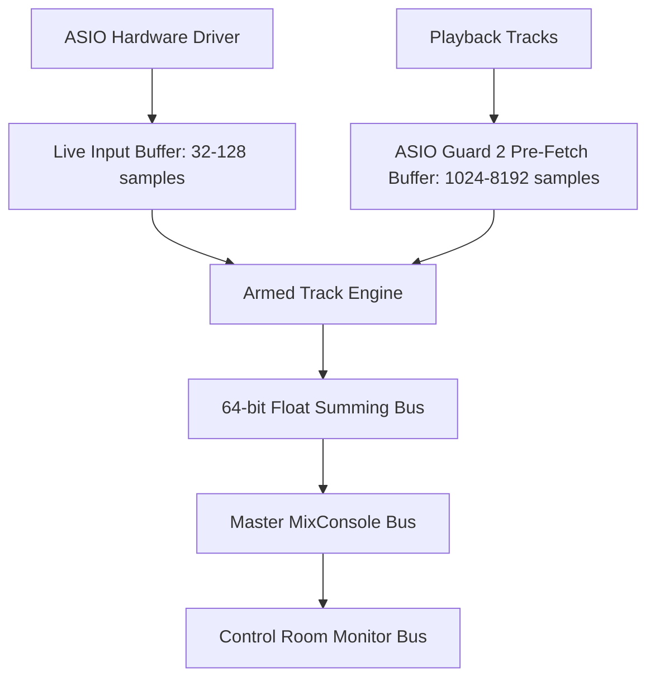
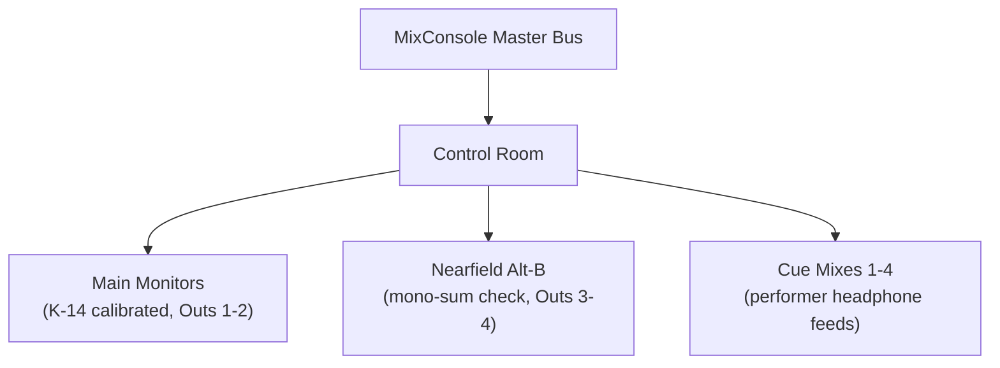

# Operational Mastery Labs: Steinberg Cubase Pro for Professional Production

## Why the Audio Engine Architecture Matters

Cubase's engine makes a hard trade-off every session: **latency vs. headroom**. Recording demands tiny buffers so you hear your performance instantly. Mixing a 150-track film score demands huge buffers so the CPU can pre-calculate everything that isn't being played live. ASIO Guard 2 is the mechanism that lets you have both at once by splitting the engine into two lanes — a low-latency lane for armed/live tracks, and a high-latency, pre-fetched lane for everything else. Understanding this split is the single most useful piece of theory in this document, because 90% of "my session is crackling" or "my latency is killing my take" problems trace back to not understanding which lane a track is in.



**The rule of thumb that governs every session:** buffer size trades latency for CPU stability. At 44.1kHz, a 64-sample buffer gives you ~1.5ms of input latency (round-trip closer to 3-6ms with driver overhead) — tight enough to track a drummer. A 1024-sample buffer gives you ~23ms — unplayable live, but it lets ASIO Guard pre-render dozens of VST instrument tracks days ahead of the playhead, so your CPU meter sits comfortably instead of clicking and popping under a dense template.

---

## Studio Setup: Audio System Calibration

Open `Studio -> Studio Setup -> Audio System` and configure in this order — order matters because driver selection resets some dependent fields:

1. **ASIO Driver**: Select your interface's native ASIO driver (RME TotalMix ASIO, Universal Audio TB ASIO, Focusrite USB ASIO). Never use Generic Low Latency ASIO Driver for real sessions — it wraps WDM/MME and adds 2-3x the latency of a native driver.
2. **Buffer Size**: Set via the driver's own control panel (opens from the same page). Use this ladder based on task:
   - **Tracking live instruments/vocals**: 32-128 samples (target under 6ms round trip).
   - **Tracking with heavy VST instrument monitoring** (e.g., playing a synth through amp-sim plugins): 128-256 samples — you need enough buffer for the plugin's own processing latency on top of the driver's.
   - **Mixing with dozens of plugin inserts, no live recording**: 512-1024 samples.
   - **Orchestral template mockup playback only**: 1024-2048 samples, let ASIO Guard do the heavy lifting.
3. **ASIO Guard Level**: Set to **High** for mixing/scoring sessions with no armed tracks. Set to **Low** or **Off** when you have multiple armed tracks monitoring through plugin chains (ASIO Guard cannot pre-fetch a track that's record-armed and being monitored — pushing it too high here just adds UI lag with no CPU benefit).
4. **Audio Priority**: **Boost** — raises the ASIO thread's OS scheduling priority above normal user processes. On Windows, also disable CPU throttling in power settings; on macOS, disable App Nap for Cubase in Terminal: `defaults write com.steinberg.cubase12 NSAppSleepDisabled -bool YES` (adjust bundle ID per version).
5. **Processing Precision**: **64-bit float**. This isn't about audible difference on a single plugin — it matters because gain-staging errors compound. A 32-bit float mix bus with 40 tracks summed and run through 6 serial plugins per channel will show measurably more quantization noise in the noise floor than the same chain at 64-bit. The CPU cost is negligible on anything built since 2015; there's no reason to leave this at 32-bit.

**Troubleshooting crackling/dropouts in order of likelihood:**
1. Buffer too small for the plugin load on armed tracks → raise buffer or lower ASIO Guard interference by disarming finished tracks.
2. USB/Thunderbolt bus contention (webcam, external drive sharing the same controller) → move interface to its own bus.
3. Disk streaming bottleneck on sample libraries (Kontakt, VSL) → check "Disk Cache" meter in Performance Meter (`F12`), move libraries to NVMe SSD.
4. Background sync processes (cloud drive indexing, antivirus real-time scan) → exclude your project/sample folders.

---

## Exercise 1: ASIO Guard Buffer Behavior & Orchestral Expression Maps

**Goal:** Build a playable, CPU-stable orchestral string template where one track performs six articulations via key-switching instead of six separate tracks eating six times the voice count and CPU.

### Step 1: Why Key-Switching Beats Multi-Tracking

Running six separate tracks per string section (legato, staccato, spiccato, pizz, tremolo, marcato) for a 5-section orchestra (1st Violins, 2nd Violins, Violas, Cellos, Basses) means **30 tracks** before you've written a note, each holding a loaded sample instance in RAM, most of them silent most of the time. Expression Maps let one instrument track host all six articulations and switch between them via MIDI key-switches sent from a reserved low octave that's below your library's playable range — typically C-1 to B-1 in VSL/Spitfire convention. This drops your orchestral template to 5 tracks per section group, cuts RAM load proportionally, and — critically for this lesson — means ASIO Guard only has to pre-fetch 5 voice streams instead of 30.

### Step 2: Build the Expression Map

1. Create an Instrument Track, load your multi-articulation string library (Spitfire Chamber Strings, VSL Synchron Strings, or similar).
2. Track Inspector → **Expression Map** slot → **Edit Map** (or `Project -> MIDI -> Expression Maps`).
3. Build six Sound Slots. "Direction" articulations are sustained/continuous states; "Attribute" articulations are one-shot triggers layered on top of the current direction:

| Slot Name | Type | Key Switch | Output Action | Gate Behavior |
| :--- | :--- | :--- | :--- | :--- |
| **Legato** | Direction | `C-1` | CC1 (Dynamics) + CC11 (Expression) continuous | Sustained, voice held until next key-switch |
| **Sustain** | Direction | `C#-1` | CC1 continuous | Sustained |
| **Staccato** | Attribute | `D-1` | Velocity-triggered, no CC needed | One-shot, short gate (~150ms) |
| **Spiccato** | Attribute | `D#-1` | Velocity-triggered | One-shot, very short gate (~80ms) |
| **Pizzicato** | Attribute | `E-1` | CC32=40 (sample bank select if library uses keyswitch+bank combo) | One-shot, natural decay |
| **Tremolo** | Direction | `F-1` | CC32=60, continuous | Sustained, loop point active |

4. In the **Articulation** tab of the editor, assign each slot's output color (this drives the colored lane markers in Key Editor so you can see articulation changes at a glance — not cosmetic, it's how you'll spot a missed key-switch at a glance in a dense cue).
5. Apply the map: in the track's **Expression Map** inspector slot, select your newly built map. The Key Editor now grows a dedicated **Articulation Lane** beneath the note grid.

### Step 3: Write and Verify the Switching

1. Open the Key Editor (double-click the MIDI part). In the Articulation Lane, click to insert a Legato marker at bar 1, write a slurred melodic phrase.
2. At the bar where you want punctuated stabs, click to insert a Spiccato marker *one tick before* the first stab note — key-switch notes need to land fractionally ahead of the notes they're meant to affect, because the sample engine needs the switch message processed before the next note-on arrives. Cubase's Expression Map editor has a **"Key Switches send before notes"** option (checkbox in map settings) — enable it; it auto-offsets the key-switch by a few ticks so you don't have to manually nudge every single one.
3. Play back. **Verification checklist:**
   - No stuck notes (a Direction articulation that never received its "off" key-switch will hold a drone — check the Articulation Lane for an orphaned Legato block with no following switch).
   - No clipped attacks (if Spiccato's gate is shorter than the sample's natural attack transient, you'll hear a clicked-off stub — lengthen the gate duration in the slot's Output Mapping tab).
   - No voice stealing (watch the VST instrument's own voice count meter; if your library caps polyphony and you stack held legato notes across sustain + tremolo without releasing, old notes get silently cut — this is a library-side limit, not a Cubase bug, fix by raising the instrument's max voice count in its own settings panel).

**Practice target:** write a 16-bar string passage alternating legato phrases with 2-bar spiccato punctuation figures, metronome at 90 BPM, and confirm zero stuck notes or clipped attacks on three consecutive playthroughs before moving to orchestration.

---

## Exercise 2: VariAudio 3 Pitch Correction & Chord-Track Harmony Generation

**Goal:** Correct a vocal take transparently (not robotically), then generate four phase-coherent harmony voices locked to a chord progression.

### Step 1: Understanding What Quantize Pitch and Straighten Pitch Actually Do

VariAudio segments the vocal into pitch blocks based on detected formant/fundamental continuity. Two sliders control correction character, and confusing them is the #1 cause of "my vocal tuning sounds fake":

- **Quantize Pitch (%)**: pulls the *center* of each segment toward the nearest scale/chord tone. At 100%, every segment snaps dead-on pitch (the classic hard-tuned effect). At 60-80%, it pulls most of the way there but leaves a small amount of natural pitch drift — this is what keeps a corrected vocal sounding human instead of quantized.
- **Straighten Pitch (%)**: flattens *vibrato and micro-fluctuation within* a segment, independent of where the segment's center sits. This is the control that removes "wobble" or erratic pitch wander, not the one that fixes being flat/sharp.

Using only Quantize Pitch at high values without touching Straighten Pitch gives you a vocal that's on pitch *on average* but still wobbly within each note. Using only Straighten Pitch gives you a vocal with smooth sustained notes that may still be a quartertone flat. You need both, and the right balance depends on genre: pop lead vocals typically run 70-90% quantize / 20-30% straighten; a jazz vocal you want barely touched runs 30-50% quantize / 10% straighten.

**Procedure:**
1. Import the vocal event, double-click to open Sample Editor, select the VariAudio tab (or press the dedicated VariAudio inspector button).
2. Select all segments (`Ctrl/Cmd+A` within the editor). Set **Quantize Pitch** to 75-80% as a starting point for a pop lead vocal.
3. Set **Straighten Pitch** to 20-25% — enough to tame erratic vibrato on sustained notes without flattening intentional vibrato into a synth-pad texture.
4. **Listen in isolation at unity gain** before touching anything else — pitch correction artifacts are far more audible solo than in a full mix, and over-correcting here will sound fine in-mix but fall apart on headphone-only playback systems (a common client complaint).
5. For individual problem segments only (not global), double-click a segment and drag its pitch curve manually, or hold `Alt` and drag the segment's pitch center directly in the waveform view for surgical single-note correction without touching the rest of the performance.
6. **Formant Shift**: a small +10 to +15 cent lift brightens nasal resonance on a vocal that was recorded with the mic too close (bass proximity effect muddying low formants) — but treat this as a corrective tool, not a creature-creation tool. Formant shifts beyond ±30 cents start audibly changing the singer's apparent vocal tract size/age, which reads as artificial.

### Step 2: Chord Track and Harmony Generation

1. `Project -> Add Track -> Chord Track`.
2. Enter the progression using Cubase's chord symbol entry (click in empty chord track lane, type directly): `Dm9 | G13 | Cmaj7 | A7(b13)`. Each chord symbol auto-parses into scale degrees Cubase uses for harmonization — verify the chord symbols display correctly above the track lane before proceeding (a mistyped `A7b13` without parentheses may parse incorrectly; use the on-screen chord picker if typing fails).
3. Select the corrected lead vocal event. In the VariAudio panel, locate **Create Chords from Melody** or **Generate Harmony Voices** (naming varies by Cubase version — in Cubase 12/13 this lives under the Audio menu as part of VariAudio's chord integration).
4. Choose **4 Voices**, enable **Follow Chord Track**, set Voicing to **Drop 2** — this inverts the chord by dropping the second-from-top voice down an octave, giving a wider, more idiomatic jazz/pop vocal stack than closed-position block harmony.
5. Cubase renders four new audio events with independently calculated pitch-shift and formant-preserving time-stretch applied per note, aligned to the chord changes.

**Critical manual check:** algorithmic harmony generation gets the *math* right (correct scale degree, correct interval) but doesn't know which chord tone sounds best doubled for your specific voicing taste. Listen to each generated harmony line solo — reject/regenerate any line that lands a harmony on a chord tone that clashes with the melody's passing tone (common on the A7(b13) bar where the b13 can create a harsh minor 9th against an unlucky harmony note). Manually drag individual notes in the harmony track's own VariAudio view to reassign them to a better chord tone when this happens — don't accept the algorithm's first pass as final on anything client-facing.

---

## Exercise 3: Control Room Calibration, K-System Metering, and LUFS Compliance

**Goal:** Separate your mix bus (which renders the actual audio) from your monitoring chain (which only affects what you hear), then verify the mix meets broadcast loudness targets.

### Why Control Room Exists

Without Control Room, your monitor volume knob *is* a fader on your signal path — turning down your speakers to rest your ears during a long session physically changes gain-staging feedback (you perceive the mix as quieter and compensate by pushing faders up, inflating your mix over hours). Control Room inserts a dedicated listening-level stage **after** the final mix bus, so your Main Stereo Out fader stays locked at 0dB (purely a rendering/export reference) and all monitoring volume changes happen in a stage that never touches the exported file.



### Step 1: Routing Configuration

1. `F4` opens Audio Connections → **Control Room** tab → check **Enable** at the top.
2. Add a **Main Monitor** bus, route to physical Outs 1-2.
3. Add a second monitor bus labeled Alt-B (nearfields or a mono-check speaker), route to Outs 3-4. Assign a MIDI-mappable or on-screen switch to A/B between them — critical for checking how a mix translates on smaller speakers before export.
4. `F3` opens MixConsole — confirm your **Main Stereo Out fader sits at 0.0dB and stays there**. All level changes for monitoring happen only via the Control Room volume control (large knob in the Control Room panel, or an assigned hardware monitor controller).

### Step 2: K-System Calibration

1. Control Room meter panel → switch display to **K-14**. K-System metering (Bob Katz) ties a fixed acoustic reference level (83dB SPL at the listening position for K-20, lower SPL references for K-14/K-12) to a specific VU-style meter zero point, so that "0 on the meter" always corresponds to the same perceived loudness regardless of genre.
2. K-14 is calibrated for 14dB of headroom above the 0 VU reference — appropriate for dynamic pop/rock masters that still need transient punch. (K-12 suits hotter, more compressed masters; K-20 suits classical/film dialogue needing wide dynamic range.)
3. Play your densest section (full chorus, full orchestral tutti). Gain-stage your mix bus trim so the meter's RMS needle sits around 0 VU on the K-14 scale during the loudest sustained passage, peaking into but not sustaining in the red zone above +4dB.

### Step 3: EBU R128 / LUFS Verification for Broadcast Delivery

1. Switch Control Room meter to **Loudness (EBU R128)** mode, or insert the **Supervision** or **Loudness Meter** plugin on the Master bus for a dedicated readout with history.
2. Reset the integrated measurement, play the **entire project from start to finish** (integrated loudness is a time-weighted average over the full measured duration — measuring only the chorus gives you a meaningless number).
3. Target values depend on the delivery spec — don't apply -14 LUFS blindly:
   - **Streaming (Spotify/Apple Music/YouTube)**: -14.0 LUFS integrated, ±0.5 LU tolerance, Max True Peak ≤ -1.0 dBTP.
   - **Broadcast TV (EBU R128 Europe)**: -23.0 LUFS integrated ±0.5 LU, Max True Peak ≤ -1.0 dBTP.
   - **Broadcast TV (ATSC A/85 US)**: -24.0 LUFS integrated ±2 LU.
   - **Film/Netflix delivery**: -27.0 LUFS integrated (dialogue-referenced), check the specific platform's current delivery spec — these change periodically.
4. **Short-term loudness** (3-second sliding window) should not exceed integrated target by more than roughly 4-6 LU on any sustained passage, or streaming platforms' own normalization will duck your loud sections more aggressively than quiet ones, flattening your intended dynamics.
5. If integrated loudness reads too hot: do not just turn down the master fader blindly — that doesn't fix an over-compressed mix, it just makes an over-compressed mix quieter. Instead back off limiter ceiling/gain-reduction amount on the master chain and re-measure.

---

## Exercise 4: Direct Offline Processing (DOP) and VCA Fader Grouping

**Goal:** Apply non-destructive, re-editable DSP directly to clips, then control group balance with VCA faders without disturbing internal mix relationships.

### Step 1: Direct Offline Processing

DOP matters because it decouples two things people often conflate: *destructive* processing (bakes into the file, can't be undone after you close the project) and *real-time insert plugins* (cost CPU continuously during playback). DOP processing is non-destructive AND pre-rendered — it writes to the clip's edit cache once, costs zero ongoing CPU during playback, and remains fully editable/reorderable/bypassable indefinitely via the Process History.

1. Select the snare audio event in the Project window.
2. `F7` opens **Direct Offline Processing**.
3. **Add Plug-in → Transient Designer type process**: Attack +4.0dB, Sustain -3.0dB. This tightens a snare that was recorded with excessive room bleed — boosting attack emphasizes the direct stick transient relative to the room tail, and reducing sustain shortens the decay so it sits better against a dense mix without needing a gate (which can chop off natural ring and sound unnatural on acoustic kits).
4. **Add a second process → Normalize**: Peak to -3.0dBFS. Order matters here — normalizing *after* the transient shaping means you're normalizing the post-shaped peak, giving a consistent, predictable headroom margin into your mixer channel regardless of how hot the original recording was.
5. In the **Process History** pane (visible at the bottom of the DOP window), each process is listed as a discrete, re-orderable step. Click any step to edit its parameters retroactively — moving the normalize step before the transient shaper, for instance, would normalize the *original* peak and then let the transient boost push beyond 0dBFS, clipping. This history view is where you catch and fix that kind of ordering mistake without starting over.
6. To revert any single step: select it in the history and click **Remove**, or toggle its bypass checkbox to A/B compare without losing the setting.

### Step 2: VCA Fader Grouping for Drum Bus Control

VCA faders control gain *without* summing audio through a shared bus — unlike a Group Channel, a VCA has no audio signal path at all, it's purely a gain-control fader that scales the output of every channel assigned to it. This matters because it means **zero added latency and zero phase/summing artifacts**, and because automation written on a VCA is a separate automation lane that multiplies against each channel's own fader automation rather than overwriting it.

1. `F3` → MixConsole. Select all 12 drum channel strips (click first, Shift+click last, or Ctrl/Cmd+click non-adjacent).
2. Right-click → **Add VCA Fader to Selected Channels**. Rename to `VCA_DRUMS`.
3. Move the VCA fader — all 12 channels attenuate proportionally in dB (not linearly), preserving their relative balance exactly, because VCA gain is additive in the dB domain to each channel's own fader value.
4. Press `W` on `VCA_DRUMS` to enable Automation Write. During playback, pull the VCA down -4dB through the verse section, release write at the chorus. Switch to Automation Read and verify: Kick, Snare, and Hats all drop by exactly -4dB together during the verse, and their *relative* levels to each other (e.g., snare sitting 2dB above kick) remain unchanged — confirming the VCA automation is multiplying against the mix rather than overwriting individual channel automation.
5. **Practical use case beyond this drill:** automate a VCA on a full orchestral brass section to duck under dialogue in a film score pass, or automate a vocal-bus VCA for a quick "turn the whole lead vocal stack down 2dB in this one line" fix — in both cases you're adjusting a group's overall presence without touching a single one of the individual balance decisions already baked into the sub-mix.

---

## Studio Delivery & Stem Export Verification Checklist

Run through this checklist before any client delivery, film scoring stage delivery, or mastering handoff. Each line is something that has actually caused a rejected delivery in professional practice — not theoretical caution.

```text
[ ] Export Path: File -> Export -> Audio Mixdown -> Channel Selection = 'Multiple Channels'
[ ] Stem Groups Checked: 'Dry Channels' (unprocessed sources), 'Group Busses' (sub-mixes), 'Full Master' (reference mix)
[ ] Broadcast Wave Format (BWF): BWF metadata chunk enabled, embedding correct Project SMPTE start timecode
      -- verify in Export dialog's Metadata tab BEFORE export, not after -- BWF chunk cannot be added retroactively
      without re-export
[ ] Bit Depth / Sample Rate: 24-bit/48kHz for broadcast and game audio; 32-bit float/48kHz (or session native rate)
      for film scoring stage deliveries where downstream dubbing stages need maximum headroom
[ ] Sample Rate Match: Export rate MATCHES project rate -- check Project Setup (Shift+F5) BEFORE export.
      A 44.1kHz project exported to a 48kHz target without proper SRC produces audible resampling artifacts;
      if a rate conversion is required, use an external high-quality SRC tool, not an on-the-fly mismatch.
[ ] Phase Correlation Safety: Stereo Phase Correlation meter (Control Room or Master Insert) reads positive
      (trending toward +1.0) across all stem passes -- values near 0 or negative indicate phase cancellation
      that will cause mono fold-down issues (broadcast and club PA mono-sum playback)
[ ] File Naming Convention: Confirm stem file names match delivery spec's required naming schema
      (e.g., "ProjectName_StemName_v01.wav") BEFORE batch export -- Cubase's naming pattern field in the
      Export dialog can auto-populate this if configured once and saved as an export preset
[ ] Tail Handling: Verify export range includes full reverb/delay tails past the last MIDI/audio event --
      check 'Export Range' is set past the last audible decay, not just to the last note-on
[ ] Reference Playback: Play the exported file back in a fresh session or external player (not the same
      Cubase session) to catch plugin-state-dependent rendering errors before sending to client
```

