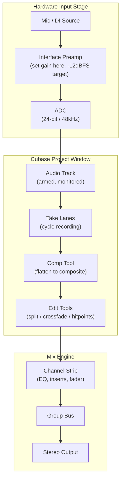

# Lesson 1: Recording and Editing Audio in Cubase

## 1. Signal Path Intuition: What You're Actually Capturing

Before touching the mixer, understand the signal's journey. A microphone or DI signal arrives as a continuous analog voltage. Your audio interface's ADC (analog-to-digital converter) slices that voltage into discrete samples at your chosen sample rate — 44.1 kHz for most music delivery, 48 kHz for anything touching video, 96 kHz if you're doing heavy time-stretching or pitch-correction and want headroom against artifacts. The Nyquist rule says you must sample at over twice your highest audible frequency (20 kHz) to reconstruct it without aliasing — this is why 44.1 kHz works at all, giving you a Nyquist ceiling of 22.05 kHz.

Bit depth is the other half: it sets your dynamic range, not your frequency response. Record at 24-bit, always. 16-bit gives you roughly 96 dB of dynamic range; 24-bit gives you roughly 144 dB. That headroom matters because it lets you record at a lower, safer level without audible noise-floor penalty — critical for avoiding clipping on unpredictable sources like a vocalist who gets louder on the take that matters.

**The one invariant that causes 90% of beginner recording disasters: digital clipping is not like analog saturation.** Analog tape and tube circuits round off peaks musically. Digital clipping hard-slices the waveform the instant it exceeds 0 dBFS, producing harsh, un-fixable distortion. Track with peaks around **-12 to -18 dBFS** on the input meter, never chasing 0. You have 24-bit headroom — use it instead of fighting it.

With that settled, everything else in this lesson is executing it in Cubase's actual interface: setting up a session correctly, recording clean takes, and editing with the real tools (not abstractions) that Cubase gives you.

## 2. Project Setup: Getting Configuration Right Before You Hit Record

Wrong setup decisions here compound into hours of cleanup later. Do this every time you start a new project.

### 2.1 Project constructor dialog

`File > New Project` → choose a template or "Empty" → set your project folder location (ideally a fast internal SSD, not a network drive — disk read/write latency under load is a real failure point with high track counts).

Immediately after creation, open `Project > Project Setup` (Shift+S) and set:

- **Sample Rate**: match your interface and your delivery target. 48 kHz if any chance of video sync.
- **Bit Depth (Record)**: 24-bit minimum.
- **Frame Rate**: only matters if locking to video; 29.97 or 25 fps depending on territory.

### 2.2 Audio interface and buffer size — the latency/stability trade-off

`Studio > Studio Setup > VST Audio System` → select your ASIO driver (Windows) or Core Audio (Mac).

The **buffer size** (samples per block) controls round-trip latency vs. CPU stability:

| Buffer Size | Latency @ 48kHz | Use Case |
|---|---|---|
| 32–64 samples | ~1–3 ms | Tracking live performers monitoring through plugins (amp sims, vocal chains) |
| 128–256 samples | ~3–6 ms | General tracking, acceptable for most monitoring |
| 512–1024 samples | ~11–22 ms | Mixing, mastering — no live monitoring needed, maximize plugin headroom |

**Rule**: drop the buffer low only while actually recording a performer who needs to hear themselves in near-real-time. Raise it back to 512 or 1024 before you start stacking reverbs, convolution, or heavy saturation plugins during mixdown — low buffers starve your CPU and cause clicks/dropouts under plugin load.

### 2.3 Input configuration

`Studio > Audio Connections` (F4) → Inputs tab. Label every input bus with the actual source ("SM7B Vocal," "DI Bass," "Overhead L") — not "Input 1." This single habit prevents routing mistakes in sessions with 20+ tracks.

## 3. Recording: Track Setup and Clean Takes

### 3.1 Creating and arming an audio track

`Project > Add Track > Audio` → choose mono (single mic/DI source) or stereo (room mic pairs, stereo synths). Name it immediately — Cubase uses track names for exported file names later.

Click the **Record Enable** button (red circle) on the track. Click **Monitor** (speaker icon) if you want to hear input through Cubase's own monitoring rather than direct hardware monitoring (direct hardware monitoring has zero added latency and is preferable for buffer sizes above 128 samples).

### 3.2 Setting input gain — on the interface, not in software

Gain staging happens at the **audio interface's preamp**, before the signal reaches Cubase. Cubase's input fader does not add analog gain; it only trims after the fact digitally, which does nothing for a signal that's already clipped at the ADC.

Procedure:
1. Have the performer run their loudest expected passage.
2. Watch the interface's own hardware meter (not Cubase yet).
3. Adjust the preamp gain knob until peaks sit around -12 dBFS.
4. Confirm in Cubase's channel meter that recorded peaks land in the same -12 to -18 dBFS zone.

### 3.3 Punch recording and cycle (loop) recording

- **Punch-in/out**: set Left/Right locators around the problem section, enable `Transport > Punch In/Out`, press record during playback — Cubase automatically starts/stops recording exactly at the locator points, preserving the rest of the existing take.
- **Cycle recording for comping**: enable Cycle mode (`/` key region looped between locators), set **Record Mode** in the Transport to "Stacked" (creates separate lanes for each pass, called **takes**) rather than "Overwrite" or "Mix." Each loop pass becomes its own lane in the track's **Lanes view** (open via the small lane icon on the track header). This gives you every take stacked for comping — the single most useful recording workflow for vocals and solos.

### 3.4 Comping a composite take from lanes

1. After cycle-recording 4–8 passes, open **Lanes** view on the track (track header → Lanes icon, or `Shift+click` the track to expand).
2. Each lane holds one full pass. Audition by soloing individual lanes.
3. Use the **Comp Tool** (scissors-and-glue icon in the toolbar, or press the dedicated Comp Tool key) to click-drag across the best sections of each lane — Cubase automatically crossfades at your cut points and builds the composite into a flattened top lane.
4. Right-click → **Flatten** when satisfied, which bounces the comp into a single clean audio clip and mutes the unused lanes (non-destructive — originals remain on their lanes).

## 4. Editing Mechanics: The Tools That Actually Matter

### 4.1 The Project window toolbar — tool shortcuts worth memorizing

| Tool | Key | Function |
|---|---|---|
| Object Selection | `1` | Move, resize, select clips |
| Range Selection | `2` | Select time-based regions across tracks, independent of clip boundaries |
| Split (Scissors) | `3` | Cut clips at playhead or click point |
| Glue | `4` | Rejoin adjacent split clips |
| Erase | `5` | Delete clips under cursor |
| Zoom | `6` | Magnify a dragged region |
| Mute | `7` | Silence individual clips without deleting |
| Draw | `8` | Hand-draw automation or MIDI data points |

Press `Ctrl` (Windows) / `Cmd` (Mac) while any tool is active to temporarily access **Object Selection** — this is the single most efficient editing habit: stay on Split or Range tool and tap Ctrl to grab/nudge without switching tools constantly.

### 4.2 Fades and crossfades — doing them right, not just "fast"

Every edit point where two clips meet needs a **crossfade**, not a hard cut, unless you're cutting at a true zero-crossing in a silent passage. A hard cut at non-zero amplitude produces an audible click — this is a physical consequence of the waveform's instantaneous discontinuity, not a software bug.

Procedure:
1. Select both adjacent clips with the Range tool (drag across the boundary).
2. `Audio > Crossfade` (shortcut `X`) — Cubase auto-creates a fade using your default curve shape.
3. Double-click the resulting fade handle to open the **Fade Editor** and adjust curve shape (equal-power is correct for most crossfades — it keeps perceived loudness constant through the transition, unlike a linear fade which dips in the middle).

For a single clip's start/end, drag the small triangle handles in the clip's top corners to create a fade-in/fade-out directly, or select the clip and press `Shift+F` for a fade dialog with numeric control over fade length and curve.

### 4.3 Hitpoint detection and audio quantization (drums, loops)

For rhythmic material you want gridded to tempo:
1. Select the audio clip → `Audio > Hitpoints > Calculate Hitpoints`. Cubase analyzes transients and places markers at detected attacks.
2. Adjust sensitivity slider in the Hitpoints panel — too high picks up noise, too low misses soft hits.
3. `Audio > Hitpoints > Create Audio Slices` converts hitpoints into actual slice points, turning the clip into independently movable segments inside a single container event.
4. With slices created, select the clip and run `Audio > Quantize` — slices snap to the nearest grid value, time-stretching the gaps algorithmically to preserve pitch (uses Cubase's built-in élastique algorithm under the hood).

This is how you tighten a slightly loose drum take or chop a loop into a new groove without destroying the original performance's timbre.

### 4.4 Time-stretching and pitch-shifting without artifacts

`Audio > Process > Time Stretch` opens a dialog with algorithm choice. For:
- **Drums/percussion**: élastique Pro — Time, optimized for transient preservation.
- **Vocals/monophonic melodic lines**: élastique Pro — Formant, preserves vocal timbre (formants) independent of pitch shift, preventing the "chipmunk" artifact.
- **Polyphonic material** (full mixes, piano chords): élastique Pro — Tape, mimics analog tape speed change behavior, most forgiving on complex harmonic content.

Push any algorithm past roughly ±15% stretch or shift and artifacts (graininess, smearing) become audible regardless of algorithm choice — this is a fundamental limit of time-domain resynthesis, not a setting you can tune away.

## 5. Project Window Signal Flow — Practical Architecture

## 6. Performance and CPU Management — Real Settings, Not Theory

Cubase's real-time performance lives and dies on three dials you actually control:

### 6.1 ASIO Guard

`Studio > Studio Setup > VST Audio System` → enable **ASIO Guard**, set level to **Normal** or **High**. ASIO Guard pre-renders plugin processing slightly ahead of playback position into a separate low-priority thread, decoupling plugin CPU load from your monitoring buffer latency. Set it to **High** when mixing (you don't need low monitoring latency); keep it **Low** or off when actively recording with live plugin monitoring, since ASIO Guard itself adds a small amount of latency.

### 6.2 Disk streaming vs. RAM — where audio actually lives during playback

Audio clips stream from disk in real time rather than fully loading into RAM (unlike samplers). This is why a failing or slow hard drive produces clicks and dropouts under high track counts even with spare CPU headroom. Fixes:
- Record and store projects on an SSD, not spinning HDD or network storage.
- `Studio > Studio Setup — increase the Disk Preload buffer if you still see dropouts on fast drives (trades a small amount of RAM for read-ahead safety margin).` — increase preload buffer if you still see dropouts on fast drives (trades a small amount of RAM for read-ahead safety margin).

### 6.3 Freeze and Render in Place — the actual CPU-saving workflow

When a track's plugin chain (particularly convolution reverb, amp sims, or orchestral sample instruments) is dragging your CPU meter near the red:

1. **Freeze** (right-click track → Freeze Channel): renders the track's current plugin chain to audio, disables the plugins (keeping settings intact for unfreezing later), and frees that CPU load. Reversible.
2. **Render in Place** (`Edit > Render in Place`, or right-click selection): bounces selected audio/MIDI with its full insert chain to a new audio clip, non-destructively leaving the original track available. Preferred over Freeze when you want to keep editing the rendered result as a normal clip (comping, further edits) rather than just toggling plugins off.

### 6.4 Diagnosing dropouts: the actual troubleshooting order

When you get clicks, pops, or the dreaded "audio engine overload" message, check in this order — it's ordered by how often each one is actually the cause:

1. **Buffer size too low for current plugin load** → raise buffer size in Studio Setup.
2. **ASIO Guard off or set too low** → enable/raise it.
3. **Disk read bottleneck** (common with many simultaneous audio tracks on an HDD) → check Cubase's Performance Meter (`F12`) — look specifically at the disk indicator, not just CPU.
4. **A single runaway plugin** (common with buggy third-party convolution reverbs) → open Performance Meter's per-track view (newer Cubase versions) to isolate which track spikes.
5. **Background processes** (cloud sync clients, antivirus scanning your project folder in real time) → exclude your project drive from antivirus real-time scanning; pause sync clients during sessions.

Open the **Performance Meter** (`F12`) at the start of every session with more than a handful of tracks — it's the single most useful diagnostic window in Cubase, showing real-time CPU, disk, and ASIO Guard load separately so you know exactly which resource to address instead of guessing.
