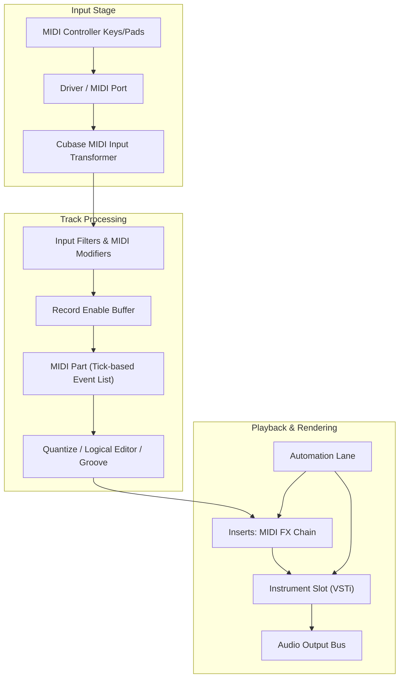

# Lesson 2: MIDI Performance and Arrangement in Cubase

## 1. What MIDI Actually Carries (and Why It Feels the Way It Feels)

MIDI never records sound. It records *performance instructions*: which key moved, how hard, when, and for how long. A MIDI note is three numbers — pitch (0–127, Middle C = 60), velocity (0–127, how hard you hit it), and timing (when the Note On and Note Off messages fire, measured by Cubase internally in pulses per quarter note — PPQ, usually 480 or 960 ticks/beat). Everything else — the actual piano or synth tone — is generated afterward by a virtual instrument reading those instructions.

This matters practically because it means **two completely different things can look like "the same note" in Cubase**: a note played live with natural micro-timing and velocity curve, versus a note drawn in with the pencil tool at dead-center quantization and flat velocity 100. They trigger the instrument identically in pitch, but one sounds alive and one sounds like a MIDI file from 1995. Your job as an arranger is to control timing and velocity deliberately — that's 90% of what separates "programmed" from "performed."

One timing fact you need memorized: MIDI data itself is not "slow" — the old 31.25 kbps serial spec is a non-issue inside a modern DAW running everything internally over USB/Thunderbolt and the audio engine's sample clock. The real latency you fight in Cubase comes from **audio buffer size** (Devices > Device Setup > VST Audio System > ASIO), not MIDI transmission. Drop the buffer to 128 samples (≈3ms at 44.1kHz) for tracking live MIDI performances through a VST instrument, and raise it to 512–1024 for mixing once performance is captured. This single setting is the #1 fix for "my keyboard feels laggy in Cubase."

## 2. Recording a Performance That Doesn't Need Fixing

### 2.1 Project and Track Setup
1. **Project > Add Track > Instrument** — not MIDI Track. An Instrument Track bundles the MIDI lane with a loaded VSTi (e.g., HALion Sonic, Groove Agent) so you monitor the real sound while recording, not a default sine beep.
2. Set the track's **MIDI Input** to "All MIDI Inputs" if you have one controller, or explicitly to your interface's port name if you run several controllers to avoid double-triggering.
3. **Transport > Click & Count-In** — enable Metronome Click, set Count-In to 2 bars. Always record with a 2-bar lead-in; recording into bar 1 beat 1 with no count-in is the #1 cause of rushed first notes.
4. **Precount tempo match:** if you're importing a reference track (a demo, a drum loop) first, use **Project > Tempo Detection** or manually tap tempo with Project > Tempo Track, then lock it before recording MIDI on top. Changing tempo after recording MIDI is fine (MIDI is tick-based and rescales automatically); changing tempo after recording *audio* is not free and requires time-stretching.

### 2.2 Recording Modes That Matter
In Edit > Preferences > Record > MIDI (or Cubase > Preferences > Record > MIDI on macOS), set **MIDI Record Mode**:
- **Normal** — new takes replace old ones. Use for your first pass.
- **Merge** — layers new notes onto existing ones on the same track. Use when overdubbing a second voice (e.g., adding a bass note under an existing chord part) without erasing what's there.
- **Cycle Record (loop recording)** set to **Mix** — every loop pass is merged, building up a groove hit by hit. This is how professional drum/percussion MIDI programming is actually done: record a 2-bar loop, add the kick on pass 1, hats on pass 2, snare ghost notes on pass 3, punching in live each time rather than programming by hand.

### 2.3 Quantization — Tightening Without Killing Feel
Hard quantize (Q button, snapping everything to the grid) is almost always the wrong first move; it removes the micro-timing that makes a performance human. Use these in order of preference:

| Tool | Location | Effect |
|---|---|---|
| **Quantize Strength** | MIDI > Quantize Panel (Q) | Pulls notes a % toward the grid (e.g. 60%) instead of snapping 100% — preserves some natural drift |
| **Iterative Quantize** | Shortcut `Q`, applied repeatedly | Nudges toward grid gradually each press; stop as soon as it "feels right," not fully locked |
| **Groove Quantize** | Quantize Panel > Presets, or extract a groove from an audio loop via **Audio > Hitpoints > Create Groove Map** | Snaps your MIDI to the *rhythmic feel of another performance* (e.g., a swung hi-hat loop) instead of a rigid grid |
| **Quantize Lengths only** | Quantize Panel, enable "Lengths Q" with Start Q off | Fixes sloppy note-offs without touching note starts — ideal for sustained pad/string parts |

**Rule of thumb:** quantize strength 60–80% for anything meant to groove (bass, drums, rhythm guitar comping); quantize strength 100% only for mechanical/sequenced parts (arpeggios, EDM plucks) where rigidity is the aesthetic.

### 2.4 Velocity Shaping
Open the **Key Editor** (double-click the MIDI part) and look at the velocity lane at the bottom.
- **Logical Editor preset "Fixed Velocity"** — flattens everything to one value; useful only for mechanical parts.
- **Velocity compression:** select notes, use **MIDI > Functions > Legato / Velocity** or draw a velocity curve by hand with the Line tool in the velocity lane set to a gentle upward ramp across a phrase to simulate a crescendo.
- **Humanize** (MIDI > Functions > Humanize) — adds controlled random offsets to timing and velocity. Set Timing Range to 8–12 ticks and Velocity Range to 10–15 for subtle realism on a quantized part; higher values start to sound drunk, not human.

## 3. Architecture: How Cubase Actually Processes Your Performance

Two things to internalize from this signal path:

1. **MIDI Inserts happen before the instrument, Audio Inserts happen after.** A MIDI FX like Arpache 5 or Chord Track-driven harmonizer reshapes the *notes themselves* before the synth ever sees them. An audio insert like EQ or compression shapes the *resulting sound*. If you want to change what notes are being played (transpose, arpeggiate, add harmony), that's a MIDI insert on the Instrument track's MIDI Inserts slot, not an audio plugin.
2. **The MIDI Part is just an editable list sitting in project time, independent of the instrument sound.** This is why you can swap the VSTi loaded on a track (say, from a piano patch to a string patch) without touching a single note — architecturally the performance data and the sound generator are decoupled. Use this: program a bassline with a basic sound first, confirm the arrangement works, then audition different patches later without re-recording.

## 4. Arrangement Workflow: Turning a Take Into a Track

### 4.1 Comping Takes (Lanes)
Record 3–4 passes of a MIDI phrase using **Cycle Record Mode = Takes** (not Mix) so each pass is kept on a separate lane instead of merged. Open the **Lanes view** (small icon on the track header), audition each lane, and use the **Comp Tool** to paint-select the best phrases from each take into one composite part — exactly like vocal comping, but applied to a MIDI solo or lead line. This is the fastest route to a "perfect" take built from several imperfect ones.

### 4.2 Chord Track for Arranging on the Fly
Insert a **Chord Track** (Project > Add Track > Chord Track). Type in a progression using chord symbols (Cmaj7, Am7, Dm7, G7) directly on the timeline. Then:
- Set any Instrument Track's MIDI Inserts to include the **Chord Track follow mode**, or drag-drop MIDI parts onto the Chord Track to auto-transpose them to match chord changes.
- Use this when sketching an arrangement: write a bass or pad part in C major, lay a Chord Track with your real progression underneath, and Cubase re-voices the part to follow the harmony — invaluable for fast demo arranging and modal interchange experiments (swap Am7 to A7#9 and hear the part react instantly).

### 4.3 Arranger Track for Song Structure
Add an **Arranger Track** to define sections (Intro, Verse, Chorus, Bridge, Outro) as draggable blocks independent of the underlying timeline. Reorder your song structure — try the chorus earlier, double the bridge — without cutting and pasting every track manually. Flatten the Arranger Track (right-click > Flatten) only once the structure is final; flattening is destructive to the arranger events (though undoable), so keep it as a sketch tool until arrangement is locked.

### 4.4 Expression Maps for Realistic Articulation Switching
For orchestral or solo instrument mockups (strings, brass, winds), raw velocity and sustain pedal aren't enough — real players switch between articulations (legato, staccato, pizzicato, tremolo). Set up an **Expression Map** (MIDI > Expression Maps) that binds keyswitches or CC values to articulation slots in your sample library (e.g., C0 = staccato, C#0 = legato, D0 = pizzicato on most orchestral libraries). Then in the Key Editor, use the **Expression Map lane** to assign articulations per note or phrase. This single feature is the difference between a string part that sounds like a synth pad and one that sounds like an ensemble actually bowing the phrase.

## 5. Failure Modes and Concrete Fixes

| Symptom | Root Cause | Fix |
|---|---|---|
| Notes trigger twice or stick on | Feedback loop: MIDI Thru enabled on both the controller's local mode and Cubase's "All MIDI Inputs" routing | Turn off Local Control on the keyboard, or set the Instrument track's input to the specific port only |
| Recorded notes land audibly late/early vs. what you played | Audio buffer size too high (512+) during tracking, adding monitoring latency | Devices > Device Setup > ASIO, drop buffer to 128 or 64 during recording passes |
| CPU overload / audio dropouts with many Instrument tracks | Too many VSTi instances loaded live instead of rendered | **Render in Place** (Edit > Render in Place > Render) finished MIDI parts to audio, freeing the VSTi; or use **Freeze** on the Instrument track (right-click track header > Freeze Channel) |
| Groove feels stiff after quantizing | 100% quantize strength applied to a performance part | Undo, reapply with Quantize Strength 60–75%, or use Iterative Quantize sparingly |
| Chord Track changes don't affect a part | Part not set to follow chords, or the track's MIDI Modifiers lack "Chord Track" enabled in the Inspector | In the Inspector panel for that track, set the Chord/Transpose mode to "Follow Chord Track" |
| Expression Map articulations silent or wrong sound | Keyswitch note range overlaps with your playable range, or map not matched to the exact sample library's articulation slots | Check the library's documentation for its keyswitch map; rebuild the Expression Map slot-by-slot rather than using a generic template |
| MIDI import from another DAW plays wrong tempo | Imported MIDI file carries its own embedded tempo map conflicting with the Cubase project tempo track | File > Import > MIDI File, uncheck "Create Tempo Track" if you want to keep your existing project tempo and only pull the notes |

## 6. Practice Drill: Build a 16-Bar Arrangement End to End

A concrete session to run start to finish, roughly 45 minutes:

1. **(5 min)** New project, Instrument Track with a piano VSTi. Count-in 2 bars, metronome on, record 16 bars of a simple chord progression (I–vi–IV–V) at 90 BPM, played loosely — don't aim for perfect timing yet.
2. **(5 min)** Open Key Editor, apply Quantize Strength 70%. Listen before/after; adjust strength until it tightens without feeling robotic.
3. **(5 min)** Add a Chord Track, enter the same I–vi–IV–V progression as symbols. Confirm the piano part was literally what you played (no change expected — it's the reference).
4. **(10 min)** Duplicate the piano track, swap the second copy's progression on the Chord Track to a reharmonized version (try vi–IV–I–V or add a tritone substitution on the V), and set that track to Follow Chord Track. Compare both versions back-to-back.
5. **(10 min)** Add an Instrument Track with a bass patch. Program a simple root-note bassline by hand with the Draw tool, locked to 100% quantize (mechanical is fine for bass foundation), then humanize timing ±8 ticks for feel.
6. **(5 min)** Add an Arranger Track, mark bars 1–8 as "A Section" and 9–16 as "B Section." Drag B before A and listen to the reordered structure. Flatten only if you like it better.
7. **(5 min)** Freeze the piano tracks (right-click > Freeze Channel) and verify CPU meter drop in the transport bar — confirms you understand the difference between live VSTi load and frozen audio playback.

Run this drill weekly with a different progression and instrument pairing (strings + Chord Track, drums + Groove Quantize, lead synth + Expression Map) until Chord Track following, comping, and quantize-strength judgment become reflexive rather than menu-hunted.
