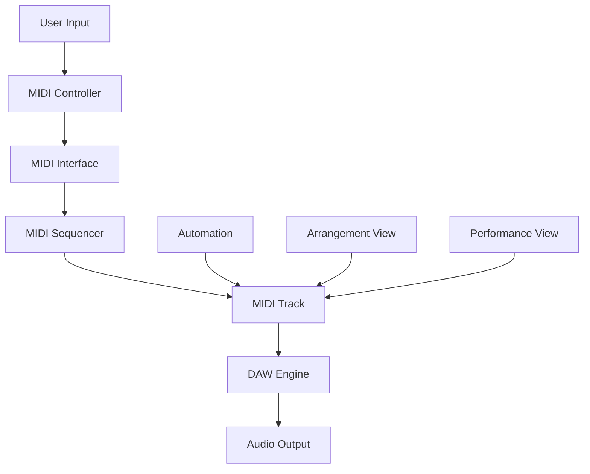

# Lesson 2: MIDI Performance and Arrangement

## 1. First-Principles Intuition & Invariants

MIDI, or Musical Instrument Digital Interface, is a protocol that enables electronic musical instruments, computers, and related devices to communicate. At its core, MIDI is a digital language that transmits control signals for triggering instrument sounds, changing parameters, and synchronizing performance. This protocol operates at a fundamental level of digital communication, encoding messages into a series of bytes that represent various musical events such as note on/off, velocity, pitch bend, and controller changes. The MIDI protocol is designed to be robust and flexible, supporting a wide range of applications from live performance to complex music production.

The theoretical foundation of MIDI performance and arrangement hinges on understanding the structure of MIDI messages and the timing precision they offer. MIDI messages are transmitted over a serial interface at a rate of 31.25 kbps, which is sufficient for real-time performance. Each MIDI message consists of a status byte followed by one or two data bytes. The status byte indicates the type of message (e.g., note on, note off, control change), while the data bytes provide specific information such as the note number and velocity. This structure allows MIDI to convey a vast array of musical information with minimal data overhead, making it an ideal choice for performance and arrangement in digital audio workstations (DAWs) like Cubase.

The invariants of MIDI performance and arrangement include the precision of timing and the reliability of message delivery. MIDI messages are timestamped relative to a common clock, ensuring that all devices in a MIDI network are synchronized. This timing precision is crucial for maintaining the integrity of musical performances, especially in complex arrangements involving multiple instruments and tracks. Additionally, the reliability of MIDI message delivery is ensured through the use of error-checking mechanisms and the ability to retransmit messages if necessary. These invariants form the foundation upon which MIDI performance and arrangement are built, enabling musicians and producers to create intricate and precise musical compositions.

## 2. Core Architecture & Mechanics

The architecture of MIDI performance and arrangement in Cubase is deeply intertwined with the underlying data structures and algorithms that govern MIDI message handling and track management. At the heart of this architecture is the MIDI track, which is a container for MIDI events representing a specific musical instrument or part. Each MIDI track in Cubase is composed of a series of MIDI events, each corresponding to a specific MIDI message. These events are stored in a data structure known as a MIDI sequence, which is a time-ordered list of MIDI messages.

The internal data structures used to represent MIDI sequences in Cubase are optimized for efficient storage and retrieval of MIDI events. These structures support a wide range of operations, including insertion, deletion, and modification of MIDI events, as well as the ability to transpose notes, adjust velocities, and apply various transformations to the MIDI data. The algorithms used to manipulate MIDI sequences are carefully designed to maintain the integrity of the MIDI data while providing a seamless user experience.

To illustrate the architecture of MIDI performance and arrangement in Cubase, consider a simplified diagram of the key components involved in MIDI message handling and track management:

In this diagram, user input from a MIDI controller is transmitted through a MIDI interface to the MIDI sequencer, which manages the MIDI tracks in the DAW. The MIDI sequencer stores MIDI events in MIDI tracks, which can be manipulated using various tools and views in the DAW, such as the arrangement view and performance view. The DAW engine processes the MIDI events and generates the corresponding audio output, which is then sent to the audio output device. Additionally, automation can be applied to MIDI tracks to control various parameters over time, further enhancing the flexibility and expressiveness of MIDI performance and arrangement.

## 3. High-Performance Optimization & Failure Modes

High-performance optimization in MIDI performance and arrangement in Cubase is achieved through a combination of efficient data structures, optimized algorithms, and intelligent resource management. The data structures used to represent MIDI sequences are designed to support fast insertion, deletion, and modification of MIDI events, ensuring that the DAW can handle complex arrangements with minimal latency. The algorithms used to process MIDI events are optimized for performance, minimizing the computational overhead associated with MIDI message handling and track management.

Concurrency is a critical aspect of high-performance optimization in MIDI performance and arrangement. Cubase is designed to handle multiple MIDI tracks and audio channels simultaneously, requiring efficient management of concurrent operations. The DAW engine uses a multi-threaded architecture to distribute the workload across multiple CPU cores, ensuring that the DAW can handle complex arrangements with minimal latency. Additionally, Cubase provides a range of tools and features for managing resources, such as the ability to allocate specific CPU cores to specific tasks and the ability to optimize memory usage.

Failure modes in MIDI performance and arrangement can arise from various sources, including hardware malfunctions, software bugs, and user error. One common failure mode is MIDI message loss, which can occur if the MIDI interface is overloaded or if there are issues with the MIDI controller. To mitigate this risk, Cubase provides features for troubleshooting and diagnosing MIDI issues, such as the ability to monitor MIDI messages in real-time and the ability to log MIDI events for analysis. Additionally, Cubase offers tools and features for managing resources, such as the ability to allocate specific CPU cores to specific tasks and the ability to optimize memory usage.

Another common failure mode is performance degradation, which can occur if the DAW is overloaded with too many MIDI tracks or audio channels. To mitigate this risk, Cubase provides features for optimizing performance, such as the ability to disable unnecessary plugins and the ability to optimize memory usage. These features ensure that Cubase remains responsive and efficient even under demanding conditions.
