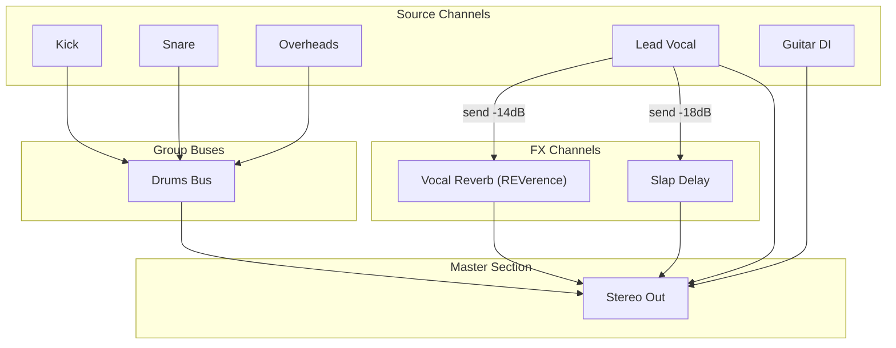

# Lesson 3: Cubase MixConsole — Signal Flow, Gain Staging, and Routing

## 1. Why the Signal Chain Order Matters (Core Intuition)

Every channel in Cubase's MixConsole processes audio in a fixed internal order: **Input Gain → Pre-fader Inserts → EQ → Fader → Post-fader Inserts → Sends → Panner → Output**. This order isn't arbitrary — it determines where in the chain a problem appears and where you should fix it.

Two invariants drive every mixing decision you'll make in Cubase:

- **Gain staging is cumulative.** Cubase's internal audio engine runs in 32-bit or 64-bit floating point, so you technically can't "clip" internally the way analog gear does — floats can represent huge headroom above 0 dBFS without hard distortion. But every plugin inserted on a channel has its *own* internal headroom assumptions, often modeled on analog circuits that *do* clip character-fully at hot levels. Slam a vintage-modeled compressor plugin at +12 dB input and it will saturate exactly like the hardware it emulates — intentionally or not. Stage your gain so each plugin sees the signal level it was designed for, typically peaking around -18 to -12 dBFS for channels feeding analog-modeled inserts.
- **Routing is a directed graph, and Cubase won't let you create a cycle.** You cannot send Channel A to Channel B and also send B back to A as a direct input — Cubase blocks true feedback loops in the routing matrix. What you *can* do (and what causes 90% of "why is there no sound" tickets) is misroute a Group or FX channel's output to a bus it isn't an input of, or leave a channel's output assigned to "No Bus" after a template edit.

That's the only theory you need up front. Everything else below is hands-on.

## 2. Opening and Navigating MixConsole

**Keyboard shortcut:** `F3` opens/closes MixConsole. Learn this cold — you'll hit it constantly.

- **MixConsole (F3):** the full mixer, floating or docked, all channels visible.
- **Lower Zone Mixer:** `Alt+F3` (or click the MixConsole icon in the Lower Zone toolbar) opens a compact mixer docked under the Project window — ideal for working on 2–3 channels while still seeing the arrange view.
- **Channel Settings window:** double-click any channel's name field, or press `E` with a channel/track selected, to open the single-channel detail editor with full-size EQ curve and insert rack.

### Zone layout inside MixConsole (left to right, per channel strip)

```text
Input Gain (trim) → Phase/Polarity → Pre-Fader Inserts (8 slots) → EQ (4-band + curve) →
Post-Fader Inserts (8 slots) → Sends (up to 8) → Fader + Pan → Mute/Solo → Output routing
```

Right-click the channel strip header and choose **Zone Configuration** to toggle which racks (EQ, Inserts, Sends, Channel Strip) are visible. Turn off what you're not using — it declutters the view and does not affect CPU load.

## 3. Gain Staging Drill: Setting Input Trim Correctly

This is the single most important habit for a clean mix. Do this on every track before touching EQ or compression.

1. Select a recorded audio track. Open its Channel Settings (`E`).
2. Find the **Input Gain** knob at the very top of the channel strip (above the inserts, below the track name). This is a *pre-insert* trim — it changes the level everything downstream sees, without touching your recorded file.
3. Play the loudest passage of the track on loop (`/` to set loop locators around a hot section, then press `Enter` to play from the start of the loop region).
4. Watch the channel meter. Adjust Input Gain until peaks sit around **-18 dBFS to -12 dBFS**. This is not a loudness target for the final mix — it's headroom so that saturating plugins, tape emulations, and analog-modeled EQs behave the way their designers intended.
5. Repeat for every channel in the session. A mix where every channel's peaks land in roughly the same window is dramatically easier to balance with faders later, because fader position correlates with perceived loudness instead of fighting inconsistent input levels.

**Troubleshooting:** If you recorded too hot and the *file itself* clips (meter shows a solid red clip indicator on playback with Input Gain at 0), Input Gain trim cannot undo already-clipped samples — that distortion is baked into the audio. Use **Audio → Offline Process History** to check if a clip-repair tool was applied, or re-record/re-render from the source if possible.

## 4. Routing: Groups, FX Channels, and Buses

### 4.1 Building a drum bus (Group Channel)

Groups are the workhorse of routing — use them to control multiple related channels with one fader and one set of processing.

1. **Project → Add Track → Group**. Name it "Drums Bus."
2. Select your kick, snare, OH, and room tracks (Ctrl/Cmd-click or Shift-click in the track list).
3. In the Inspector of any selected track, or in MixConsole, set the **Output routing** dropdown for all selected channels simultaneously: hold `Alt` and change one channel's output — this applies the change to all selected channels at once. Set output to "Drums Bus."
4. Now the Drums Bus group fader controls overall drum level; insert a bus compressor (glue compression) on the group itself, post all individual channel processing, pre-fader.

### 4.2 Sends and FX Channels (reverb, delay)

Never insert a reverb plugin directly on a vocal channel if you want to reuse that reverb across multiple tracks and save CPU.

1. **Project → Add Track → FX Channel**, select a reverb plugin (e.g., REVerence) when prompted. Name it "Vocal Reverb."
2. On your vocal channel strip, find the **Sends** rack (right of EQ). Click an empty send slot, choose "Vocal Reverb" as the destination.
3. Set the send level with the small rotary knob next to the slot — start around -12 dB to -18 dB, far enough back that reverb is felt, not seen.
4. Click the small power button next to the send slot to enable it (sends are bypassed by default when first assigned — a common "why can't I hear my reverb" trap).
5. **Pre/post-fader send toggle:** the small button marked with a fader icon on the send slot switches between post-fader (send level tracks the channel fader — reverb gets quieter as you pull the fader down, which is what you want 95% of the time) and pre-fader (send level is independent of the fader — useful for a monitor send to a performer that shouldn't change when you adjust the mix fader).

### 4.3 Routing diagram for a typical song session



Note the FX channels receive signal via **sends** (dotted conceptually, shown as labeled edges here) while still routing their own output directly to Stereo Out — the dry signal and the wet return travel separate, parallel paths that sum at the master bus.

## 5. EQ Module: Practical Shaping, Not Just Curves

Cubase's channel EQ gives you 4 fully parametric bands (or up to 8 in some configurations with the Channel Strip's additional filters), each switchable between **Low Shelf, Low-Pass, Peak (Bell), High Shelf, High-Pass**, and notch-style narrow cuts.

### Frequency-by-ear drill (do this before trusting your eyes on the curve)

1. Load a vocal or guitar track. Insert nothing else — isolate the EQ module alone.
2. Pick one band, set it to **Peak** mode, crank the gain to +12 dB (exaggerated, temporary — never a mix setting), and set a narrow Q (around 5–8).
3. Sweep the frequency knob slowly from 100 Hz to 8 kHz while the track loops. Listen for where the boost sounds most offensive, boxy, nasal, or harsh — that's a problem frequency, or conversely where it sounds most pleasing — that's a frequency you may want to gently lift in the final setting.
4. Once located, flip the gain from +12 dB to a small cut (-2 to -4 dB) if it was an offensive frequency, or back off the boost to +1 to +3 dB if it was a pleasing one. Widen the Q back to a natural 1.0–2.0 for musical (not surgical) moves.
5. Repeat per band, addressing no more than 2–3 moves per channel. If you're reaching for a fourth or fifth EQ move, the problem is usually in the arrangement or the mic placement, not fixable with more EQ.

### Common corrective moves (starting points, always verify by ear)

| Problem | Move |
|---|---|
| Muddy low-mids on vocal/guitar | High-pass at 80–120 Hz (removes rumble, mic stand noise); gentle bell cut -2 to -3 dB around 250–400 Hz |
| Boxy/nasal vocal | Bell cut -3 to -5 dB, Q ~2–3, around 800 Hz–1.2 kHz |
| Harsh sibilance region | Narrow bell cut, Q ~5+, 4–6 kHz (or better: use a de-esser, see below) |
| Lacking "air"/presence | Gentle high shelf +2 to +3 dB above 10 kHz |
| Kick lacking punch | Bell boost +3 dB around 60–80 Hz (fundamental) and +2 dB around 3–4 kHz (beater attack) |

## 6. Dynamics: Compressor Settings That Actually Work

Open the Compressor insert (pre- or post-EQ, your call — compress-then-EQ tames dynamics before shaping tone; EQ-then-compress lets the compressor react to the shaped tone). Cubase's stock Compressor has Threshold, Ratio, Attack, Release, Makeup Gain, and a Hold parameter.

### Vocal leveling drill

1. Insert Compressor post-EQ on a lead vocal.
2. Set **Ratio** to 3:1 — a moderate, musical starting point.
3. Set **Attack** to 10 ms (fast enough to catch peaks, slow enough to let initial transient "character" through) and **Release** to Auto (Cubase's auto-release tracks program material intelligently — reliable default for vocals).
4. Lower **Threshold** while watching the gain reduction meter until you see **4–6 dB of gain reduction** on the loudest phrases, not on every single word.
5. Raise **Makeup Gain** to compensate for the reduction so the compressed signal matches the bypassed level in loudness — use the bypass button to A/B at matched volume. If the compressed version sounds "better" only because it's louder, you haven't actually improved anything; trust your ears at equal loudness.

### Drum bus glue compression

1. On the Drums Bus group channel, insert Compressor.
2. Ratio: 4:1. Attack: 30 ms (let the transient punch through before compression grabs it). Release: 100–150 ms, or set to Auto and verify it's not pumping audibly on the beat.
3. Threshold down until you see 2–3 dB of gain reduction on snare hits — this is "glue," not squashing. If the drums start sounding flat and lifeless, you've gone too far; back the threshold up.

## 7. Latency, ASIO Guard, and Buffer Troubleshooting

When MixConsole channels sound delayed relative to each other (common with heavy VST instrument or plugin loads), the cause is almost always buffer-related, not a routing bug.

- **Studio → Studio Setup → Audio System**: set your ASIO driver. Buffer size directly trades latency for CPU stability: 64–128 samples for tracking (low latency, higher CPU demand), 512–1024 samples for mixing/mastering (higher latency is irrelevant once you're not playing in real time, and larger buffers dramatically reduce clicks/dropouts under heavy plugin load).
- **Toggle Constrain Delay Compensation using its button on the main toolbar/MixConsole, or adjust its latency threshold under Preferences → VST.**: if you're tracking live through heavy latency-inducing plugins (convolution reverbs, linear-phase EQs) on a monitor bus, enabling this temporarily bypasses or reduces the delay those plugins introduce, at the cost of their full processing quality — toggle it off again for final mixing.
- **Plugin Information window** (`F11` or Devices menu) shows per-plugin CPU load. If MixConsole meters show intermittent dropout clicks, this is where to find the offending plugin — usually a convolution reverb or oversampled saturation plugin on too many simultaneous instances.
- **Disk cache stutters** (audio tracks briefly muting or glitching) point to buffer underrun from slow storage — check **Studio → VST Audio System → Disk Preload** and increase it, or verify your audio files live on an SSD rather than a network drive or external HDD.

## 8. Metering and Gain-Staging Checkpoints

Insert a **Loudness Meter** or the stock **MultiScope/Level Meter** on your Stereo Out bus before you start final level decisions.

- Target during mixing: peaks around -6 dBFS on the Stereo Out, leaving headroom for mastering and preventing any accidental clip on bounce.
- Target for streaming-platform delivery: -14 LUFS integrated loudness is the common reference (Spotify, YouTube normalize around this); -23 LUFS for broadcast (EBU R128). Use Cubase's **Loudness Meter** plugin in integrated mode across a full playback pass to check your final bounce against the target before export.
- **Export (File → Export → Audio Mixdown)**: always render at a bit depth equal to or higher than your project bit depth (24-bit minimum for intermediate masters), and double-check the channel routing selector in the export dialog actually points at Stereo Out and not a leftover Group or FX channel from earlier routing experiments — this is the single most common "I exported silence" mistake.
