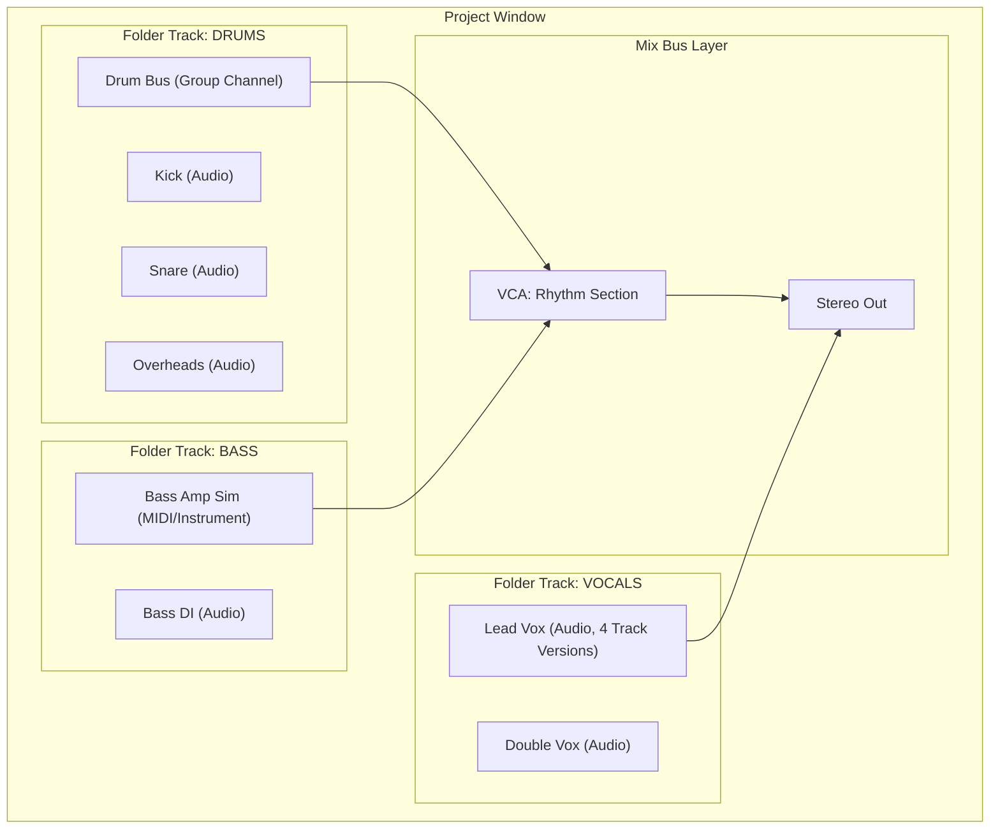
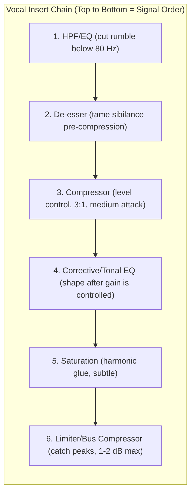

# Lesson 4: Cubase Advanced Workflows — Automation, VST Routing, and Session Architecture

## 1. First-Principles Intuition: Why Cubase Behaves the Way It Does

Cubase's engine is built around three things you touch constantly: the **Project Window timeline**, the **Mixer/signal path**, and the **automation subsystem**. Understanding the mechanics behind each lets you work fast instead of fighting the software.

**Automation is interpolation, and the curve type changes the sound.** When you draw two automation points (e.g., volume at bar 1 = 0 dB, volume at bar 5 = -12 dB), Cubase draws a line between them and recalculates the value every audio block (typically every 2–11 ms depending on buffer size). The curve shape between points is not cosmetic:
- **Linear** ramps change at a constant rate — fine for pans, bad for volume fades (your ear perceives loudness logarithmically, so a linear dB ramp sounds like it changes faster at the end).
- **Spline/Smooth** points ease in and out — use for musical swells, filter sweeps, anything that should feel "played."
- **Jump (step)** holds a value until the next point, then jumps instantly — use for mute automation, preset/program changes, and bypass toggles.

Knowing this up front stops you from fighting zipper noise or robotic-sounding fades.

**VST is a contract, not magic.** A VST plugin is a block of code that Cubase loads into its own process and calls at fixed intervals: "give me N samples of output given this input and these parameter values." Because every plugin obeys the same contract, Cubase can chain unrelated plugins from different vendors in any order on an insert slot. The practical consequence: **plugin order in the insert chain is a signal-processing decision, not a cosmetic one** (EQ before compression behaves very differently than compression before EQ — see §4).

**Latency is an invariant you manage, not eliminate.** Every plugin, every ASIO buffer, and every real-time monitoring path adds delay. Cubase's **Constrain Delay Compensation** and **ASIO Guard** exist specifically to trade latency against CPU headroom. You'll use these constantly during tracking vs. mixing.

With that grounding, everything below is execution.

---

## 2. Session Architecture: Folder Tracks, Track Versions, and VCA Groups

A real production session isn't a flat pile of tracks — it's a managed hierarchy. Build it like this from the first minute of a project, not after the mix gets messy.

**Build procedure:**

1. **Folder Tracks** (`Project > Add Track > Folder`): Drag related tracks into a folder to collapse them visually and to route a **Folder Output** — this is cosmetic organization, not an audio bus.
2. **Group Channel Tracks** (`Project > Add Track > Group`): This *is* an actual audio bus. Route your drum tracks' outputs to "Drum Bus" group instead of directly to Stereo Out. You now have one fader and one insert chain controlling the whole kit's glue compression.
3. **VCA Faders** (`Project > Add Track > VCA`): A VCA controls the *fader level* of everything assigned to it without being in the signal path — zero added latency, zero summing. Assign the Drum Bus and Bass groups to a "Rhythm Section" VCA so you can push the whole rhythm section up 2 dB during a chorus with one fader move, independent of each group's own automation.
4. **Track Versions** (right-click track header > `New Version`, or `Alt+click` the version slot): For a lead vocal, record 4 full takes as 4 versions on *one* track instead of 4 separate tracks. Use the **Comp Tool** in the Key Editor-style lane view to punch between versions and build a composite — this is the correct way to comp vocals, not stacking duplicate tracks.

**Rule of thumb:** if two tracks will always move together in level, they belong under one Group. If they need independent processing but shared macro-level control, use a VCA over both.

---

## 3. Automation: Writing, Shaping, and Troubleshooting

### 3.1 Write/Read modes — what each button actually does

| Mode | Behavior | When to use |
|---|---|---|
| **Read** | Plays back existing automation, ignores fader moves | Default state during playback |
| **Touch** | Writes while you hold the fader/control; reverts to prior automation on release | Riding a vocal fader live without overwriting the rest of the pass |
| **Latch** | Writes from the moment you touch the control until you stop playback; holds the last value after release | Fading something out and leaving it down for the rest of the song |
| **Trim** | Writes a relative offset on top of existing automation | Nudging an already-automated level up/down without destroying the shape |
| **Autolatch** | Latch, but drops back to existing curve a few ms after release | Spot-fixing one section of an otherwise good automation pass |

**Drill:** Automate a 4-bar vocal rise using Touch mode at a slow tempo (70 BPM project), then switch to Trim mode and add +1.5 dB across only bars 2–3 without touching bars 1 and 4. Confirm in the automation lane that only the targeted region shifted.

### 3.2 Curve shaping by right-click

Select two automation points, right-click the automation lane, and choose a curve type:
- `Linear` — mechanical, exposed fades, pitch bends that should feel exact
- `Spline/Slow-Fast-Slow` — natural-feeling swells, filter cutoff sweeps
- `Jump` — mute/bypass automation, instant program changes

**Troubleshooting zipper noise on automated filter cutoff:** this is almost always caused by too few automation points at too coarse a resolution combined with Linear curves on a logarithmic parameter (cutoff frequency is perceived log-scale). Fix: increase automation point density across the sweep, or switch the curve to Spline, or automate via a macro/MIDI CC mapped through **Quick Controls** instead of drawing points by hand — the live gesture captures natural curvature automatically.

### 3.3 MIDI CC automation vs. Audio parameter automation

MIDI CC automation (e.g., CC1 Mod Wheel, CC11 Expression) lives in the **MIDI track's automation lane** or inside the **Key Editor's controller lane**, and is sent as discrete MIDI messages to the instrument — resolution is capped at 128 steps (7-bit) unless the instrument supports MPE or 14-bit CC pairs. Audio/plugin parameter automation is continuous floating-point and has no such ceiling. **Practical implication:** for expressive woodwind/brass VST instrument swells, prefer CC11 Expression over track volume automation — Expression affects the instrument's own dynamic/timbral response (often tied to velocity-crossfaded samples), while track volume just turns down a fader after the fact and sounds flatter.

---

## 4. VST Signal Chains: Order, Routing, and Sidechain

### 4.1 Insert order is a decision

Default vocal chain, in order, with the reasoning for each position:

**Why de-esser before the main compressor, not after:** compression raises the average level of sibilant energy along with everything else, making a problem that was borderline suddenly prominent. De-essing first removes the energy before the compressor has a chance to amplify it relatively.

**Why corrective EQ after compression:** compression changes the spectral balance (it often brings up low-level harmonics and makes a signal sound brighter/boomier by raising sustain). EQ-ing before you know the post-compression tonal balance means you're correcting a signal that's about to change shape under you.

### 4.2 Sidechain compression setup (ducking bass under kick)

1. Insert a compressor (e.g., Cubase's stock Compressor or a dedicated sidechain-capable plugin) on the **Bass** channel.
2. Open the compressor's **Side-Chain** section, enable it.
3. On the **Kick** channel, go to the channel's output routing and add a **Send** to the bass compressor's sidechain input (Cubase exposes this as a sidechain source selector directly in the compressor GUI — select "Kick" from the input dropdown).
4. Set Threshold so the bass only ducks on kick hits (watch the gain reduction meter — target 2–4 dB of reduction per hit), Ratio around 4:1, fast Attack (1–5 ms), Release tuned to the tempo so the bass recovers before the next kick hit (start at 80–120 ms and adjust by ear).

**Drill:** At 120 BPM with a quarter-note kick pattern, dial release time until the bass gain-reduction meter fully recovers to 0 dB right before each new kick hit — too long a release causes audible pumping; too short causes no audible ducking effect at all.

### 4.3 Constrain Delay Compensation and ASIO Guard — when and why

- **Constrain Delay Compensation** (toolbar icon, clock with a line through it): forces all tracks to the latency of the lowest-latency channel by temporarily bypassing high-latency plugins (linear-phase EQs, lookahead limiters, convolution reverbs) on playback. **Use during tracking/overdubbing** when you need tight, real-time-feeling monitoring and don't need to hear final-mix plugins yet.
- **ASIO Guard** (`Studio > Studio Setup > Audio System`): decouples plugin processing from the hard real-time audio thread by processing non-time-critical tracks slightly ahead, in a separate thread, with extra buffering. **Use during mixing/mixdown** when CPU headroom matters more than ultra-low monitoring latency — set to "Normal" or "High" once you've stopped recording new audio for the session.

**Rule:** record with Constrain Delay Compensation ON and ASIO Guard LOW; mix with Constrain Delay Compensation OFF and ASIO Guard HIGH.

---

## 5. Project Management: Version Control Without Losing Work

Cubase's safety net is not automatic — you have to engage it deliberately.

1. **Project History** (`Edit > History`): full undo/redo stack, but it's lost when you close the project unless `Preferences > General > Levels of Undo` is set high enough to retain the session you need. Default is often too low for a long mixing day — raise it to 200–500 for complex sessions.
2. **Save New Version** (`File > Save New Version`): creates a numbered, timestamped `.cpr` snapshot without disrupting your working file. **Discipline:** save a new version at every major milestone — after tracking is complete, after comping vocals, before starting automation, before bouncing stems. This is cheap insurance; a `.cpr` file is typically a few hundred KB to a few MB.
3. **Backup Project** (`File > Backup Project`): copies the project *and* consolidates all referenced audio files into a new folder — use this before archiving or handing off a session to a mix engineer, since it guarantees no missing-file errors on another machine.
4. **Pool** (`Media > Open Pool Window`): shows every audio file referenced by the project, flags unused files (safe to remove via `Media > Remove Unused Media`) and missing files (red flag — relink via the Pool before you lose audio). Run a Pool check before every backup/archive.

**Troubleshooting "missing audio file" on project open:** almost always caused by moving/renaming the audio folder outside Cubase instead of through the Pool, or opening a project on a different machine without using Backup Project first. Fix: `Media > Pool > right-click missing file > Find Missing Files`, point it at the relocated folder; Cubase will relink by filename match.

---

## 6. Practice Routine: Building Workflow Speed

Treat DAW fluency like instrumental technique — drill it until it's automatic, not something you think about during a session.

| Drill | Target | Metronome/Time Target |
|---|---|---|
| Create folder + group + VCA structure for a 16-track session from scratch | Under 3 minutes | — |
| Automate a 4-bar volume swell with musical curve shape, no zipper noise | Clean on first pass | 90 BPM |
| Set up kick→bass sidechain duck from an empty session | Under 2 minutes | 120 BPM |
| Comp a 4-take vocal passage using Track Versions + Comp Tool | Under 5 minutes per phrase | 75 BPM |
| Switch session from "tracking" (Constrain Delay ON, low ASIO Guard) to "mixing" config | Under 30 seconds | — |

Run the full routine at the start of sessions for a month; it moves from checklist to muscle memory, which is the entire point — the software should disappear and leave only the music.
