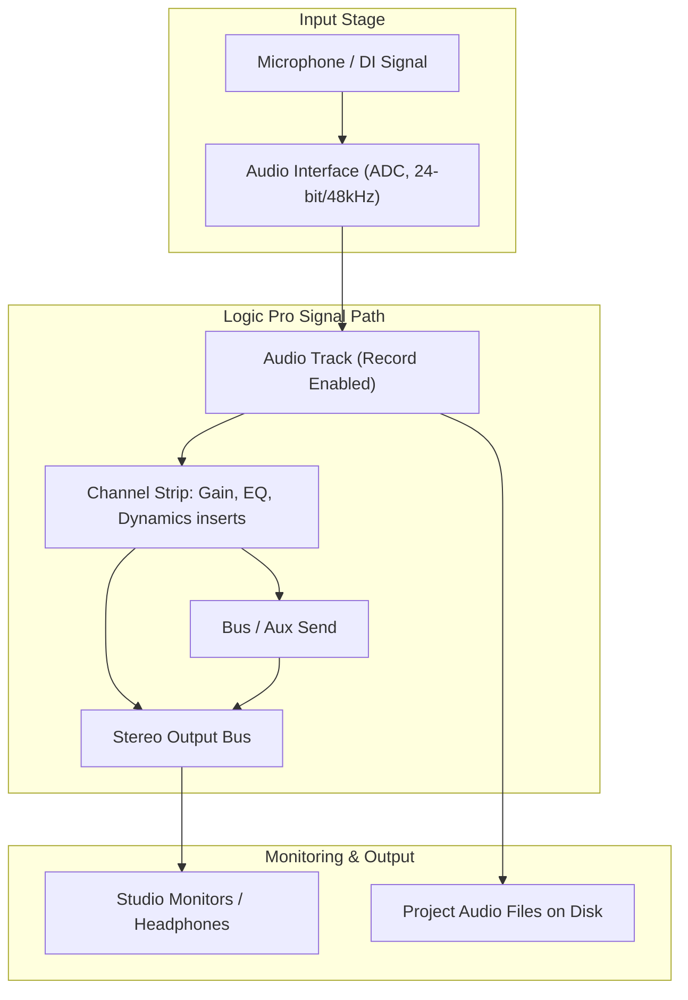

# Lesson 1: Audio Recording and Editing in Logic Pro

## 1. Why This Works: The Physics You Actually Need

A microphone converts air pressure changes into a voltage. An audio interface samples that voltage thousands of times per second and stores each measurement as a number. That's the entire concept — everything else in this lesson is about doing that capture and manipulation cleanly.

Two numbers govern fidelity, and you set both in Logic Pro's Project Settings > Audio before you record a single note:

- **Sample rate** — how many times per second you measure the waveform. 44.1 kHz is CD quality; 48 kHz is the video/broadcast standard; 96 kHz gives headroom for extreme time-stretching and pitch-shifting without artifacts. The Nyquist rule says you can only faithfully capture frequencies up to half your sample rate, so 48 kHz captures everything up to 24 kHz — above human hearing already. **Practical rule: pick 48 kHz for everything unless a client spec says otherwise. Don't record at 96 kHz "to be safe" — it doubles file size and CPU load for inaudible gain.**
- **Bit depth** — how finely each sample's amplitude is measured. 16-bit gives ~96 dB of dynamic range, 24-bit gives ~144 dB. **Always record at 24-bit.** The extra headroom means a quiet passage you recorded 12 dB too low still has usable resolution instead of audible quantization noise (that gritty digital hiss under quiet signals). You bounce down to 16-bit only at final delivery if required.

Gain staging matters more than any plugin you'll add later: aim for recorded peaks between **-18 dBFS and -6 dBFS** on the input meter. Too hot and you clip (a hard, unrecoverable digital ceiling at 0 dBFS, unlike analog tape which saturates musically). Too quiet and you're wasting bit depth. This is the one physical-world decision you can't fix later — EQ and compression are reversible-ish, clipping is not.

## 2. Setting Up a Session for Clean Recording

### 2.1 Project and I/O configuration
1. **File > New** — pick an empty project, not a template, when learning fundamentals.
2. **Logic Pro > Settings > Audio > Devices** — set your interface as both input and output device. Set **I/O Buffer Size**:
   - **32–64 samples** while tracking (lowest latency, higher CPU load) — critical when a performer needs to hear themselves without delay.
   - **256–512 samples** while mixing (stable processing, latency doesn't matter because you're not playing live into it).
3. **File > Project Settings > Audio** — confirm sample rate (48 kHz) and bit depth (24-bit) *before* the first take. Changing sample rate mid-project forces a sample-rate conversion on every existing file — avoid it.

### 2.2 Creating and arming a track
1. **Track > New Audio Track** (`Cmd+Opt+N`... actually use the Tracks menu or press `T` for the New Tracks dialog).
2. In the dialog: choose **Audio**, set **Input** to the correct interface channel, **Format** mono for a single mic/DI or stereo for a stereo pair.
3. Click the track's **Record Enable** button (the red circle) — only one track should be armed unless you're multitracking a band.
4. Set the **Input Monitoring** button so you can hear yourself through Logic's own low-latency monitoring path rather than relying on interface direct monitoring if you want plugins audible while tracking (e.g., monitoring through a compressor).

### 2.3 Setting record levels at the source
- Adjust gain at the **audio interface**, not in Logic. Software "input gain" on most interfaces is post-ADC and just amplifies digital noise along with the signal.
- Sing or play the loudest passage of the take *before* pressing record, watch the interface's own meter (or Logic's input meter in the channel strip), and set the loudest peak to land around -10 dBFS. Leave headroom for a performer getting more excited on the actual take than in the soundcheck.

### 2.4 Recording a take
1. Set the cycle/punch region if comping multiple takes (`C` to toggle cycle mode, drag in the ruler to set range).
2. Press `R` to record, or spacebar-then-R workflow if you prefer count-in — set **count-in bars** in Record Settings so the performer has a tempo reference before downbeat.
3. **Take Folders**: Logic automatically stacks multiple takes on the same track into a take folder when you record repeatedly over the same cycle range. This is how you comp a vocal from five passes without cluttering the timeline with five separate tracks.

## 3. Editing Mechanics — The Practical Toolkit

### 3.1 The core edit tools (learn these keyboard shortcuts, not just menu clicks)
| Action | Shortcut | What it actually does |
|---|---|---|
| Split region at playhead | `Cmd+T` | Cuts the audio region into two independent regions at that sample-accurate point — non-destructive, original file untouched |
| Join selected regions | `J` | Glues adjacent split regions back into one |
| Marquee tool (temporary) | Hold `Cmd` and drag | Select a *time-range across tracks*, not whole regions — essential for comping |
| Snap toggle | `Cmd+G` or the Snap menu | Controls whether edits lock to bar/beat/sample grid — turn OFF snap for sample-accurate crossfade work, ON for arrangement-level cuts |
| Fade tool | Drag from top corner of a region | Creates a fade-in/out without destroying underlying audio |
| Crossfade | Overlap two regions, select both, `Cmd+F` | Essential whenever you join two different takes — a hard cut at a non-zero-crossing point produces an audible click |

**Why crossfades matter physically:** a waveform cut exactly at a point where the amplitude isn't at zero creates a discontinuity — an instantaneous jump the speaker cone tries to reproduce, which your ear hears as a click or pop. A 5–20ms crossfade (or snapping the edit to a zero-crossing point, visible as the waveform crossing the center line) eliminates this. **Always zoom in to sample level before committing a hard edit on a sustained sound** (vocals, bass, sustained guitar). Drum transients are more forgiving since there's already a transient masking the join.

### 3.2 Comping a vocal take (real workflow)
1. Record 3–5 full passes into a cycle region — they stack automatically into a Take Folder.
2. Open the Take Folder (click the triangle/flip arrow on the region).
3. In the comp lanes, drag-select the best phrase from each take across the timeline — Logic auto-creates crossfades at your comp boundaries.
4. Flatten the comp (`Take Folder menu > Flatten`) once you're happy, which commits it to a single clean region — do this only after you're sure, since flattening discards the alternate takes from that folder (the audio files themselves remain on disk, recoverable from the Project Audio bin if needed).

### 3.3 Essential corrective editing
- **Strip Silence** (`Audio File menu > Strip Silence`, or select region and use the Strip Silence window): removes dead air between phrases automatically — set threshold around -30 dB for spoken word, lower for sparse musical passages. Always leave a few ms of pre-roll so it doesn't clip the consonant attack of the next phrase.
- **Flex Time** (`F` key with a region selected): time-corrects a performance without changing pitch. Choose the Flex mode matching the material:
  - **Monophonic** for solo melodic lines (vocals, bass, lead guitar) — tracks pitch and transients cleanly.
  - **Slicing** for drums — moves transients without stretching the audio, best for tightening a loose kick/snare to the grid.
  - **Polyphonic** for full chords/mixed material — more CPU-intensive, less surgically precise, use as a last resort.
- **Gain / Region Gain** (region inspector, or `Cmd+click-drag` vertically on a region's waveform): adjust level *per region* before the channel fader — useful for evening out a vocal take where one phrase was sung noticeably louder, without automating the fader.

## 4. Session Architecture: How Logic Actually Routes Signal

**Why this matters practically:** the recorded audio file on disk is captured *before* the channel strip. Any EQ, compression, or effect you add while tracking (unless you explicitly print/bounce it) is non-destructive — you can remove it later with zero quality loss, because the insert only affects what you hear and what gets routed to the output bus, not what's written to disk. This is why you should feel free to add a monitoring EQ or compressor to make tracking comfortable for a vocalist without fear of ruining the take.

## 5. Buffer Size, Latency, and the Real Trade-off

Latency is the delay between playing a note and hearing it back through the software. It comes from the **I/O buffer** — Logic processes audio in chunks (buffers) rather than one sample at a time, because per-sample processing would be computationally impossible at audio rates with any real plugin load.

| Buffer size (samples) | Latency @ 48kHz (approx.) | Use case |
|---|---|---|
| 32 | ~1.3 ms round trip (varies by interface/driver) | Tracking a drummer or fast transient instrument — any noticeable delay throws off timing |
| 64–128 | ~3–5 ms | General tracking of vocals, guitar, bass |
| 256 | ~10 ms | Light mixing sessions, software instrument playing |
| 512–1024 | ~20–40 ms | Heavy mixing/mastering sessions with dozens of plugins, no live input needed |

**The trade-off is real, not arbitrary:** smaller buffers mean the CPU has less time to finish processing each chunk before the next one arrives, so you get more frequent "pops/clicks" or the dreaded "CPU overload" error when running many plugins at small buffer sizes. **Practical procedure:** track at 32–64 samples, then raise the buffer to 256+ immediately after tracking, before you start stacking plugins for mixing. There's no quality difference at higher buffer sizes — only latency difference — so never record at 1024 and never mix at 32 unless your system genuinely has no CPU headroom problem.

## 6. Troubleshooting — Real Failure Modes and Fixes

| Symptom | Root Cause | Fix |
|---|---|---|
| Clicking/popping during playback, not during record | Buffer too small for current plugin load | Raise I/O buffer size in Settings > Audio |
| Audible click at an edit point | Hard cut at non-zero waveform crossing | Zoom to sample level, nudge edit point to a zero crossing, or apply a short crossfade (`Cmd+F`) |
| Recorded take sounds distorted/crackly on playback but input meter never hit red | Clipping happened at the interface's analog input stage (gain knob too hot), not visible in Logic's digital meter | Lower gain at the interface itself and re-record; digital clipping and analog overdrive clipping both show as flat-topped waveforms when zoomed in — look for this visually to diagnose after the fact |
| "Audio Engine overload" error during mixdown | Too many real-time plugin instances for current buffer/CPU combination | Freeze tracks (`Track menu > Freeze`) to render CPU-heavy instrument/effect chains to disk temporarily, or raise buffer size |
| Latency when monitoring through a plugin (e.g., amp sim) | Buffer size too high for live playing | Drop buffer to 32–64 during tracking; if your interface supports it, use its own zero-latency direct monitoring and only route the processed/monitoring signal through Logic for the performer's headphone mix |
| Comped take has audible seams even with crossfades | Crossfade too short for a sustained sound, or source takes have different room tone/mic bleed | Lengthen crossfade to 20–50 ms for sustained material; for noticeably different room tone between takes, consider automating a volume ride instead of a hard comp boundary |
| Flex Time introduces warbling artifact on a sustained note | Wrong Flex mode selected for material | Switch from Polyphonic to Monophonic mode for single-note melodic material; Monophonic mode's pitch-tracking algorithm is built for exactly this case |

## 7. Practice Drill: Build a Clean Multitrack Vocal Comp (30 minutes)

1. **(5 min) Setup** — new project, 48kHz/24-bit, create one mono audio track, set buffer to 64 samples, set interface gain so loudest practice line peaks at -10 dBFS.
2. **(10 min) Record** — set a 2-bar cycle region over a simple vocal phrase, record 4 passes back to back (Logic auto-comps into a Take Folder).
3. **(5 min) Comp** — open the take folder, select the best phrase-fragments from different takes across the 2 bars, let Logic auto-crossfade the boundaries.
4. **(5 min) Clean edges** — zoom into each comp boundary at sample level, confirm the crossfade lands on a clean transition with no click on loop playback.
5. **(5 min) Flatten and gain-stage** — flatten the take folder, use region gain to even out any phrase that's noticeably louder or quieter than the rest, bypassing the fader entirely for this.

**Progression target:** repeat this drill daily for a week, trying to shrink your total comp time from 30 minutes to under 10, which is the realistic turnaround time expected in professional session work.
