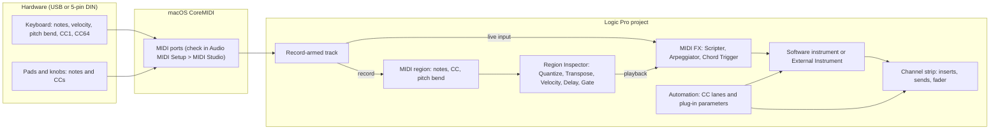
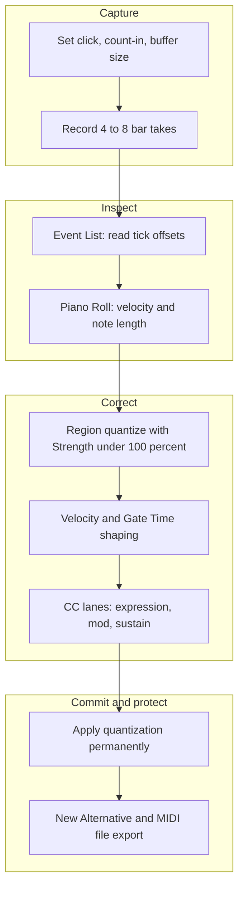

# Lesson 2: MIDI Control and Sequencing in Logic Pro

**Time:** about 3 hours of lab work, plus 4 short practice sessions.
**Prerequisites:** Logic Pro installed, a MIDI keyboard (USB or 5-pin DIN interface), headphones, and a project with one software instrument track.
**You will finish able to:** record a clean MIDI take against a click, read and fix timing in the Event List, quantize without killing the feel, draw controller automation, build a drum pattern, and diagnose the common MIDI failures (stuck notes, latency, wrong octave, data floods).

---

## 1. First-Principles Intuition & Invariants

MIDI sends *performance instructions*, not sound. A key press becomes a few bytes that say which note and how hard. The instrument in Logic Pro turns those bytes into audio. This is why you can change the piano to a string patch after recording, or fix one wrong note without re-playing the take.

### Message anatomy

Every message starts with a status byte (high bit = 1), followed by one or two data bytes (high bit = 0, so values run 0–127).

| Message | Status byte (hex, channel 1) | Data bytes | Example |
|---|---|---|---|
| Note On | `90` | note, velocity | `90 3C 64` = middle C, velocity 100 |
| Note Off | `80` | note, release velocity | `80 3C 40` (or `90 3C 00`) |
| Control Change (CC) | `B0` | controller number, value | `B0 40 7F` = sustain pedal down |
| Program Change | `C0` | program | `C0 05` |
| Channel Pressure | `D0` | pressure | `D0 50` |
| Pitch Bend | `E0` | LSB, MSB (14-bit) | `E0 00 40` = center (8192) |

The low nibble of the status byte is the channel (`0`–`F` for channels 1–16). Note On with velocity 0 counts as Note Off, which is why recorded data sometimes shows no explicit Note Off.

**Octave naming trap:** Logic names MIDI note 60 **C3**. Many other DAWs call it C4 and some call it C5. If a patch "plays an octave off," check this before you touch anything else.

### Controllers you will use constantly

| CC | Name | Typical use |
|---|---|---|
| 1 | Mod wheel | Vibrato depth, filter, layer crossfade |
| 7 | Channel volume | Track level from the instrument side |
| 10 | Pan | Stereo position |
| 11 | Expression | Swells and fades on strings, brass, pads |
| 64 | Sustain pedal | Values 0–63 off, 64–127 on |
| 74 | Brightness | Filter cutoff on many synths |

### The timing numbers that matter (the only math in this lesson)

A 5-pin DIN cable runs at 31,250 bits per second. Each byte takes 10 bits on the wire (start, 8 data, stop), so one byte takes 320 µs and a 3-byte Note On takes 0.96 ms. A 10-note chord therefore arrives smeared over about 9.6 ms on DIN, and the cable saturates near 1,000 messages per second. USB MIDI is far faster, so this limit rarely applies to USB keyboards, but it explains why dense pitch-bend or aftertouch streams on old DIN gear cause lag and stuck notes.

Logic's own timeline resolution is 960 ticks per quarter note. At 100 BPM, one tick is 0.625 ms. Use this conversion when you read the Event List:

> ticks of error = milliseconds × BPM × 0.016

So a 20 ms error is about 19 ticks at 60 BPM, 26 ticks at 80 BPM, and 32 ticks at 100 BPM. In 4/4, a 16th note is 240 ticks.

---

## 2. Core Architecture & Mechanics

### Routing: tracks, not channels

In Logic, **the selected or record-armed track receives your keyboard's MIDI, regardless of the MIDI channel number.** Each software instrument track has its own channel strip and instrument. The channel number only matters for multitimbral instruments, external hardware, and when you record several channels at once and split them into separate regions (Project Settings > Recording > *Auto Demix by Channel if Multitrack Recording*).



Three consequences follow from this diagram:

1. **Region Inspector settings are non-destructive.** Quantize, Transpose, Velocity, Delay, and Gate Time change playback only. The notes in the region stay as you played them until you commit the changes.
2. **MIDI FX sit before the instrument.** They process both live input and region playback, so a Scripter humanizer affects what you hear while you play.
3. **Automation has two paths.** CC data lives inside the region (travels with the region when you move or copy it). Track automation lives on the track timeline (stays put when regions move).

### The editing workflow



### Keyboard posture for MIDI recording

Timing and velocity problems often start in the body, not the software.

- **Bench height:** forearms level with the keys or slightly sloping down, elbows just in front of your torso.
- **Wrist and fingers:** wrists neutral (no drooping, no lifting), fingers curved as if holding a small ball.
- **Velocity control:** get loudness from forearm weight transferring into the key, not from stabbing with the fingertip. Slapped fingers give inconsistent velocity and hard, clicky attacks.
- **Controller setup:** if your keyboard has selectable velocity curves, pick the one where an easy mezzo-forte touch lands between 70 and 85 in the Event List. Fix this at the keyboard, then you do not need to compensate in every project.

---

## 3. Hands-On Labs

### Lab 0: Set up and verify the signal path (10 minutes)

1. Connect the keyboard. Open **Audio MIDI Setup > Window > Show MIDI Studio** and confirm the device appears with no red or greyed-out icon.
2. In Logic, create a **Software Instrument** track and load a piano patch.
3. Open **Logic Pro > Settings > Audio > Devices** and set the **I/O Buffer Size** to **64 samples** for recording (use 512 or 1024 when mixing).
4. Press a key. If you hear nothing, confirm the track is selected (highlighted) and the keyboard appears in the Control Bar's MIDI input indicator.
5. Turn on the metronome (`K`) and set the project to **60 BPM, 4/4**.
6. Open the Event List (`D`) and play one note. You should see a Note event with a pitch and velocity. Play a soft and a hard note and confirm velocities differ by at least 40.

### Lab 1: Record a clean take and read your own timing (30 minutes)

**Fingering for the exercise (C major, one octave, hands together):**

| Note | C | D | E | F | G | A | B | C |
|---|---|---|---|---|---|---|---|---|
| Right hand | 1 | 2 | 3 | 1 | 2 | 3 | 4 | 5 |
| Left hand (one octave below) | 5 | 4 | 3 | 2 | 1 | 3 | 2 | 1 |

**Tempo ladder.** Record 8 bars at each stage, playing the scale up and down in even eighth notes (`1 & 2 & 3 & 4 &`):

| Stage | BPM | Subdivision | Target |
|---|---|---|---|
| A | 60 | Eighths | Average error under 19 ticks (20 ms) |
| B | 80 | Eighths | Under 26 ticks |
| C | 100 | Eighths | Under 32 ticks |
| D | 70 | Sixteenths | Under 22 ticks |

**Dynamics:** record each stage twice, once at mezzo-piano (velocity 50–65) and once at mezzo-forte (70–85). Velocity spread within one pass should stay within ±8.

**Read the result:**

1. Select the region and open the Event List (`D`).
2. Find the **Position** column. For a note on the grid, the last number (ticks) should be near 1. For a 16th-note grid in 4/4, a note at 120 ticks past a division is exactly halfway between two grid points.
3. Check three things: (a) are you consistently early or late? (b) does the error grow at fast tempi? (c) is the left hand lagging behind the right?
4. A consistent offset (always 15 ticks late, for example) is a **latency problem** and is fixed with a smaller buffer or the Region **Delay** parameter. A scattered error is a **technique problem** and is fixed by slower practice.

### Lab 2: Quantize without flattening the performance (25 minutes)

Select the best take from Lab 1. In the Region Inspector, set these values:

| Goal | Quantize | Q-Strength | Q-Range | Q-Swingify |
|---|---|---|---|---|
| Keep human feel, tidy the worst misses | 1/16 Note | 50% | 0 | 50 (straight) |
| Tight pop or electronic | 1/16 Note | 100% | 0 | 50 |
| Light shuffle on 16ths | 1/16 Note | 85% | 0 | 58–62 |
| Rescue a messy chord part | 1/8 Note | 75% | 0 | 50 |

Press `Q` to apply the setting to the selected region, then play back. Procedure:

1. Start at Strength 50% and raise it in steps of 10% until the part sits in the groove with the click. Stop at the first value that sounds acceptable. Higher values only make it stiffer.
2. Toggle Quantize between **Off** and your setting during playback to hear the difference.
3. When satisfied, open the Piano Roll (`P`) and choose **Functions > Apply Quantization Settings Permanently**. This writes the new positions into the notes.
4. If you want to revert before committing, set Quantize to **Off**.

**Gate Time and Velocity in the Region Inspector:** use *Gate Time* to shorten overly long notes (fixes muddy overlaps) and *Velocity* with a small offset (such as −6) to bring a whole region down without redrawing.

### Lab 3: Controllers, pedal, and expression (30 minutes)

**A. Clean up sustain pedal data (CC64)**

1. Record a chord progression using the pedal: I–V–vi–IV in C (C, G, Am, F), one chord per bar at 70 BPM.
2. In the Piano Roll, open the **Automation** area at the bottom and pick **Sustain (CC64)** from the event-type menu.
3. You should see pedal-down (127) and pedal-up (0) at each chord change. Drag them so the pedal-up falls just *before* the next chord's beat and pedal-down lands just *after* it. This is "legato pedaling," which keeps harmonies clean.

**B. Draw an expression swell (CC11)**

1. Load a strings patch and record one held chord for 4 bars.
2. Switch the controller lane to **Expression (CC11)**.
3. Draw a ramp from value 40 at bar 1 to 110 at bar 3, then back to 70 at bar 5. Use the Pencil tool with the *Line* sub-tool if a curve feels jagged.
4. If you recorded a wiggly CC from a physical slider, delete it and redraw with a few points. Dense CC streams waste CPU and are harder to edit.

**C. Map a physical knob with Learn**

1. Open a synth (for example Retro Synth) and click its **Cutoff** knob.
2. Press `Command-L` (or choose **Logic Pro > Control Surfaces > Learn Assignment**), then turn the physical knob on your controller.
3. Press `Command-L` again to exit learn mode.
4. Record-arm the track and record a 4-bar filter sweep while playing a held chord. The knob movement is stored as automation.

**D. Pitch bend range check**

Bend your wheel fully up and play a note. Most patches default to ±2 semitones. Open the instrument's settings and set the range to the value you want (±12 for lead guitar-style bends). If the bend sounds steppy, the bend data is thin: use a keyboard with a 14-bit wheel and a slow, smooth motion.

### Lab 4: Drum pattern in the Step Sequencer or Piano Roll (20 minutes)

Create a **Drum Machine Designer** or **Drum Kit Designer** track at **92 BPM**. Use either the Step Sequencer or the Piano Roll with these pitches: kick = 36 (C1), snare = 38 (D1), closed hi-hat = 42 (F#1).

```text
Step:   1  2  3  4  5  6  7  8  9 10 11 12 13 14 15 16
Count:  1  e  &  a  2  e  &  a  3  e  &  a  4  e  &  a
Kick:   X  .  .  .  .  .  X  .  .  .  X  .  .  .  .  .
Snare:  .  .  .  .  X  .  .  .  .  .  .  .  X  .  .  g
Hat:    A  x  x  x  A  x  x  x  A  x  x  x  A  x  x  x
```

Velocities: `X` kick 110, snare backbeat 105, hat accent `A` 100, hat `x` 60, ghost snare `g` 28.

Practice tasks:

1. Program the pattern and loop 2 bars.
2. Turn on swing in the Step Sequencer (or Region Q-Swingify 56%) and listen to how the hats change.
3. Set the Step Sequencer's pattern length to 15 steps for one lane to hear a polymetric shift against the others.
4. Play a hi-hat pattern on your keyboard's pads at 92 BPM while the loop runs, record it, and compare the offsets with the programmed hats.

### Lab 5: Humanize with a working Scripter plug-in (20 minutes)

On the track's MIDI FX slot, insert **Scripter**, click **Open Script in Editor**, paste this script, and click **Run Script**:

```javascript
// Humanizer: randomizes velocity and adds a small positive timing delay.
// Note Offs get the same delay as their Note On so no notes get stuck.

var PluginParameters = [
  { name: "Velocity Spread", type: "lin", minValue: 0, maxValue: 30,
    numberOfSteps: 30, defaultValue: 8 },
  { name: "Max Delay (ms)", type: "lin", minValue: 0, maxValue: 30,
    numberOfSteps: 30, defaultValue: 6 }
];

var delays = [];
for (var i = 0; i < 128; i++) { delays[i] = 0; }

function HandleMIDI(event) {
  if (event instanceof NoteOn) {
    var spread = GetParameter("Velocity Spread");
    var v = event.velocity + Math.round((Math.random() * 2 - 1) * spread);
    event.velocity = Math.max(1, Math.min(127, v));

    var d = Math.random() * GetParameter("Max Delay (ms)");
    delays[event.pitch] = d;
    event.sendAfterMilliseconds(d);
  } else if (event instanceof NoteOff) {
    var od = delays[event.pitch];
    delays[event.pitch] = 0;
    event.sendAfterMilliseconds(od);
  } else {
    event.send();
  }
}
```

Test it on your Lab 4 hi-hat lane. Set Velocity Spread to 8 and Max Delay to 6 ms: the hats should sound less mechanical without losing the groove. At Max Delay above 20 ms the pattern starts to drag. Set both to 0 to confirm the script is transparent.

---

## 4. Practice Schedule

| Day | Focus | Drill | BPM ladder |
|---|---|---|---|
| 1 | Timing | Lab 1 scale, eighths | 60, 80, 100 |
| 2 | Velocity control | Lab 1 at mp and mf, check spread in Event List | 72, 84 |
| 3 | Quantize and pedal | Lab 2 and Lab 3A | 70, 90 |
| 4 | Drums and humanizing | Lab 4 and Lab 5 | 92, then 104 |

Only raise the tempo when the previous step meets its timing target twice in a row.

---

## 5. Optimization & Failure Modes

MIDI data is tiny. When Logic feels slow, the load almost always comes from software instruments, plug-ins, and buffer settings, not from the notes.

### Latency and CPU

- **Recording:** I/O Buffer 64 or 128 samples. If you hear crackles, raise it one step.
- **Mixing:** 512 or 1024 samples. The extra latency does not matter when you are not playing live.
- **Low Latency Mode** (Control Bar) bypasses high-latency plug-ins on live tracks during recording.
- **Process Buffer Range** (Settings > Audio > General): set to *Medium* or *Large* if you see "System Overload" with many instruments.
- **Freeze** heavy instrument tracks (`Freeze` button on the track header) so they stop using CPU while you edit others.

### Symptom table

| Symptom | Likely cause | Fix |
|---|---|---|
| Hanging (stuck) note | Note Off lost or overlapped | Run the Panic command (search "Panic" in Key Commands, `Option-K`). Check the Event List for a note with a very long length. |
| Notes sound an octave off | Naming mismatch (Logic C3 = 60) | Transpose region by ±12 or adjust the patch's octave setting. |
| Everything is consistently late | Large I/O buffer | Drop to 64 or 128 samples. Use Region Delay for a final tweak. |
| Timing is uneven | Technique or controller jitter | Re-record slower, then compare in the Event List. Test another USB port or cable. |
| Chord notes arrive spread out | 5-pin DIN serial limit or a USB hub | Use a direct USB connection. Avoid daisy-chained hubs. |
| Pedal gets stuck on | CC64 never reached 0 | Draw a CC64 = 0 at the end of the region. |
| Sound works on one track but not another | Input is going to a different track | Re-select the track, check the record-arm button, check Settings > MIDI > Inputs. |
| Quantized part sounds mechanical | Strength 100% | Lower Q-Strength to 50–70% and add Scripter humanizing. |
| Knob moves nothing | Assignment missing | Redo Learn (`Command-L`), then confirm the parameter is a Smart Control or plug-in parameter. |
| Playback glitches with long CC streams | Overly dense controller data | Delete the data and redraw with a few points. |

### Protect your work

1. **File > Alternatives > New Alternative** before big edits. This keeps the old version one click away.
2. Export important parts as standard MIDI files: select regions, then **File > Export > Selection as MIDI File**. A MIDI file is a portable backup that opens in any DAW.
3. Before applying quantization permanently, duplicate the region (`Option-drag`) and mute the copy. You keep the original performance.

### Done-when checklist

- [ ] Lab 1 timing targets met at 60, 80, and 100 BPM.
- [ ] One take quantized at 50–70% strength and applied permanently.
- [ ] Clean CC64 pedal data on a chord progression.
- [ ] CC11 swell drawn with 5 or fewer points.
- [ ] Drum pattern with ghost notes plays correctly in a loop.
- [ ] Scripter humanizer runs without stuck notes.
- [ ] A MIDI file export exists for the finished part.
