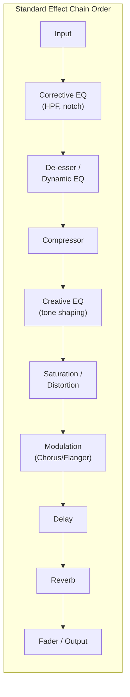

# Lesson 3: Instrument and Effect Racks in Logic Pro

## 1. Why Racks Exist (First-Principles, One Paragraph)

A **Channel Strip** in Logic Pro is a signal path: one audio or MIDI source feeds a vertical stack of processors, top to bottom, ending at a fader. A **Track Stack** (Logic's rack system) groups multiple channel strips — an instrument plus layered doubles, or a submix of several tracks — under one set of controls, with routing you can see and edit visually. The only physics you need: signal processed in series changes cumulatively (EQ before compression sounds different than compression before EQ, because the compressor reacts to whatever spectral shape it receives), and signal processed in parallel sums at the output, so matching levels and avoiding uncontrolled phase cancellation between parallel paths is the one invariant you must manage by ear and by meter, every time. Everything else in this lesson is execution.

---

## 2. Track Stacks: Summing vs. Folder

Logic gives you two fundamentally different rack behaviors. Picking the wrong one causes 90% of "my layered sound doesn't sum right" problems.

| Type | Behavior | Use case |
|---|---|---|
| **Summing Stack** | Sub-tracks route to one new summing track with its own channel strip, fader, and inserts. The sub-faders become *relative* to the sum fader. | Drum bus, layered synth stack you want to treat as one instrument, vocal doubles you want to compress together. |
| **Folder Stack** | Sub-tracks stay independently routed to the main output; the stack is just a visual container that folds/unfolds in the timeline. No new summing channel is created. | Organizing a song's 40 tracks into "Drums," "Guitars," "Vocals" folders for screen real estate only. |

**Build a Summing Stack (hands-on):**
1. Select 2+ tracks in the Tracks area (⌘-click to multi-select).
2. Track menu → **Create Track Stack** → choose **Summing Stack**.
3. Logic creates a new track above the selected ones labeled e.g. "Stack 1," with a disclosure triangle. This new track's channel strip is the sum point.
4. Open the Mixer (X) — you now see the sub-channels AND the new summing channel, with the sub-channels routed internally (no physical bus needed, no track count burned on your output bus).

**Practical test to confirm you built a Summing Stack, not a Folder Stack:** solo the stack header track. If the sub-tracks mute (because they're now pre-fader feeding the sum, and Logic routes solo logic through the parent), you built a Summing Stack correctly. If soloing the parent does nothing because the children are independently routed to Stereo Out, you built a Folder Stack.

---

## 3. Instrument Racks: Multi-Timbral Layering and Splits

An "Instrument Rack" in practice means a Summing Stack where each sub-track hosts a software instrument (EXS/Sampler/Alchemy/third-party plugin), layered or split, feeding one sum channel for cohesive processing.

### 3.1 Velocity-Switched Layering (e.g., soft/hard piano layers, or clean/distorted guitar layers)

1. Build a Summing Stack with 2 instrument tracks (Track A = soft layer, Track B = hard layer).
2. On each instrument track, open the **MIDI Environment** or simply use the track's **Input Filter** (Track Inspector in newer Logic versions has built-in Velocity Range) — or more reliably: use a **Transform MIDI effect** (Scripter/MIDI FX slot) on each sub-track set to pass only velocities in the desired range.
   - Track A (soft): Logic's MIDI FX → **Velocity Processor** → Range Limit 1–80, below range = mute.
   - Track B (hard): Velocity Processor → Range Limit 81–127.
3. Result: playing softly triggers only Layer A; playing hard crosses the threshold and triggers Layer B. This is how orchestral libraries and realistic piano/guitar layers achieve dynamic timbral change without you touching a knob.

### 3.2 Keyboard/Note-Range Splits (bass on left hand, pad on right hand)

1. Same Summing Stack structure.
2. On each sub-track's MIDI FX slot, insert **Modifier** or **Scripter → Keyboard Split** (or in modern Logic: Track Inspector → **Note Range** key-range drag directly on the piano strip in Smart Controls / Mapping).
3. Fastest GUI method: In the Mixer, click the sub-track, open **MIDI In** settings in the Track Inspector, drag the keyboard range bar to C3–C6 for the pad track and C-2–B2 for the bass track.
4. Practice drill: set split at middle C. Metronome at 70 BPM, play a walking bass line in the left hand (quarter notes) while comping a two-hand jazz voicing pattern in the right — this is the standard test for whether your split point and latency feel natural under live two-hand playing.

---

## 4. Effect Racks: Signal Chain Order and Why It Matters

Logic's Channel Strip insert slots process **strictly top to bottom**, pre-fader by default (you can also use post-fader sends). This ordering is not a UI convention — it's the actual DSP execution order, and it changes your sound.

### 4.1 The Standard Ordering Logic (and why)

```text
sub_chain ["Standard Effect Chain Order"]
```

**Canonical order for most sources (vocal, guitar, bass):**

1. **Corrective EQ** (high-pass to remove rumble, notch problem resonances) — clean the signal before anything reacts to it.
2. **De-esser / Dynamic EQ** — tame sibilance/resonance before compression amplifies it.
3. **Compressor** — control dynamics on a *clean* signal; if you compress before EQ, the compressor reacts to frequencies you're about to remove anyway, wasting gain-reduction headroom on content that won't survive.
4. **Creative/Tonal EQ** — shape the tone of the now-controlled dynamic signal (boost presence, warmth).
5. **Saturation/Distortion** — adds harmonics; placing after EQ means you're distorting the *shaped* tone, which is usually what you want (distorting a boosted 3kHz is very different from distorting flat signal then boosting 3kHz afterward — the latter also boosts noise added by the distortion).
6. **Modulation (Chorus, Flanger)** — applied to the harmonically-enriched signal.
7. **Time-based (Delay, Reverb)** — always last, or on a separate send bus, so later serial effects don't get smeared by the tails of the delay/reverb before they themselves are processed.

**Mermaid signal flow:**



### 4.2 Building a Parallel Compression Effect Rack (Real Procedure)

Parallel compression ("New York compression") adds punch without squashing transients — a textbook rack use case.

1. Select your drum bus track (ideally already a Summing Stack from Section 2).
2. Create a new **Aux** track: Mixer → click empty channel strip area → **New Aux Channel**, or right-click the drum bus channel → **Create → New Bus**.
3. On the drum bus channel strip, click a **Send** slot → choose the new Aux bus. Set send level around -10 dB initially (pre-fader send, so fader moves on the dry bus don't change the parallel blend ratio unexpectedly — actually for parallel comp, **post-fader send is usually correct** so both paths ride together; pre-fader is for monitor-independent sends like reverb cues).
4. On the Aux channel strip, insert **Compressor** (Logic's **Platinum Digital** or **Vintage FET** circuit model):
   - Threshold: very low (-30 dB to -40 dB)
   - Ratio: high (8:1 to 20:1, or "limiter" mode)
   - Attack: fast (0.1–1 ms) to catch transients
   - Release: fast-to-medium (50–150 ms), tune by ear to the groove
5. Bring the Aux fader up slowly while listening to the dry bus + aux blend. You are adding *crushed* signal under the *clean* transient signal — the clean transient punches through while the crushed signal adds sustain and perceived loudness.
6. **Practical check:** solo only the Aux. It should sound heavily squashed/pumping — that's correct and expected. The magic happens in the blend, not in the solo.

### 4.3 Bus-Based Reverb Send (Correct Routing, Avoiding CPU Waste)

Never insert a reverb plugin directly on every individual track — it multiplies CPU load by the number of tracks and breaks the shared-space illusion (every instrument gets its own disconnected room).

1. Create one Aux bus named "Reverb Hall."
2. Insert **ChromaVerb** or **Space Designer** on that Aux only, 100% wet (Dry/Wet knob fully wet, or mix knob at 100).
3. On every track that needs reverb, add a **Send** to "Reverb Hall" bus, adjusting each track's send level individually.
4. This gives you: one CPU-expensive reverb instance instead of twelve, a cohesive sense of shared acoustic space (all instruments "sound like they're in the same room"), and one fader to control overall wet balance during mixdown.

---

## 5. Channel Strip Settings: Save, Recall, and Share Your Racks

Logic lets you save an entire rack (instrument + all inserts + MIDI FX + routing) as a single recallable preset — critical for live performance consistency and template-building.

1. Build your full chain (e.g., EP1 Rhodes → Compressor → Tape Saturation → Chorus → Delay send).
2. Click the **Settings** menu at the top of the channel strip (small icon above the instrument slot) → **Save Channel Strip Setting As...**
3. Name it descriptively: `EP_Rhodes_Warm_Chorus_v1`.
4. This preset now appears in every project under Library → Channel Strip Settings, recallable on any new track instantly.
5. For full Track Stacks (multiple sub-tracks + sum), use **Track → Save as Track Stack / Patch** (Logic 10.5+) — this preserves the entire multi-track architecture including splits and layers, not just one strip.

**Workflow tip:** build a "Live Rig" template project containing your 4–5 most-used performance racks (Rhodes, layered pad, bass DI chain, vocal chain) as saved patches. Starting every new session from this template eliminates repetitive rack-building and keeps your signal chain decisions consistent across projects.

---

## 6. Troubleshooting Real Rack Problems

| Symptom | Cause | Fix |
|---|---|---|
| Layered instrument stack sounds thin/hollow compared to each layer soloed | Phase cancellation between layers (two oscillator-based patches with similar waveforms, slightly offset timing) | Nudge one layer's sample start by a few ms, or insert a phase-rotation/utility plugin; check with Correlation meter — should stay near +1 | 
| Summing Stack fader doesn't affect sub-track levels proportionally | You built a Folder Stack, not a Summing Stack | Un-group, rebuild via Track menu → Create Track Stack → **Summing Stack** explicitly |
| Parallel compression Aux adds no audible punch | Send routed pre-fader and fader automation is overriding blend, or Aux return fader too low | Switch send to post-fader for parallel comp; raise Aux fader in small 1 dB steps while A/B-ing |
| CPU spikes/dropouts when opening a dense instrument rack | Too many real-time convolution reverbs or oversampled saturation plugins stacked per-track instead of on a shared bus | Consolidate time-based effects to Aux sends (Section 4.3); freeze tracks (Track → Freeze) that are performance-complete |
| MIDI split/layer rack: notes near the split point trigger both layers | Velocity Processor or Note Range overlap in the two sub-tracks' MIDI FX | Check both sub-tracks' range settings — they must be mutually exclusive, not just independently "reasonable" |
| Saved Channel Strip Setting doesn't recall MIDI FX | You saved only the "Insert" slots, not the full strip | Use **Save Channel Strip Setting As** from the very top settings menu, not a slot-specific save, which only captures audio inserts |

---

## 7. Practice Drill: Build-From-Scratch Rack Exercise (30 Minutes)

A hands-on test that exercises everything above:

1. **(5 min)** Create a Summing Stack with 2 instrument tracks: a sampled piano and a synth pad. Set a velocity split at 90 so soft playing = piano only, hard playing = pad layers in.
2. **(5 min)** On the Summing Stack's sum channel, build the canonical chain: HPF at 80 Hz → Compressor (4:1, medium attack) → EQ boost at 2.5 kHz for presence.
3. **(5 min)** Create a Reverb Hall Aux bus with ChromaVerb, send both the piano/pad stack and (if present) a vocal track to it at different send levels.
4. **(5 min)** Build a parallel compression Aux off the stack's sum output, post-fader send, fast attack/high ratio compressor, blend in by ear.
5. **(5 min)** Save the entire Summing Stack as a Track Stack patch named `Piano_Pad_Split_v1`.
6. **(5 min)** Close and reopen the project (or start a blank one) and recall the patch from the Library to confirm full fidelity: split point, effect chain order, and bus sends all return correctly.

If step 6 reproduces your exact setup with zero manual rebuilding, your rack architecture is production-ready for live use or template reuse.
