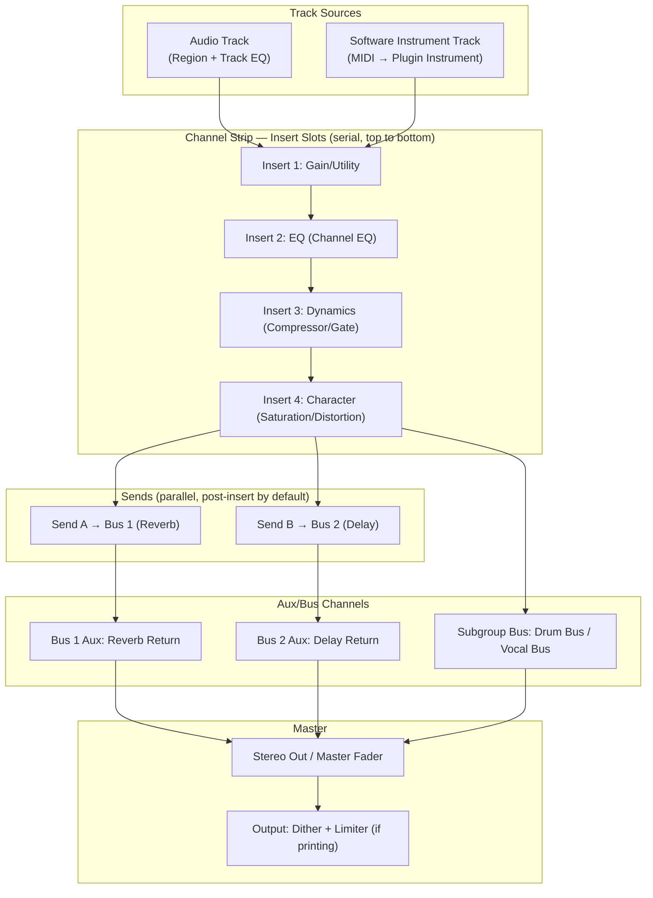

# Lesson 4: Arrangement and Mixing in Logic Pro

## 1. First-Principles Intuition: Why the Mix Works the Way It Does (15%)

A mix fails or succeeds on three physical/perceptual realities, and every move you make in Logic Pro is a lever against one of them:

**Frequency masking.** When two sounds share energy in the same frequency band at similar amplitude, your ear can't separate them — the louder or more transient one wins and the other turns to mud. A kick drum (50–100 Hz fundamental, click at 2–4 kHz) and a bass guitar (40–400 Hz) fight directly in the low end. The fix isn't "turn it up," it's carving complementary space with EQ so each instrument owns a frequency neighborhood.

**Equal-loudness perception (Fletcher-Munson / ISO 226).** Human hearing is far less sensitive to sub-100 Hz and above-10 kHz content at low volumes than at loud ones. This is why a mix that sounds balanced at 85 dB loses its bass and air when played quietly on a laptop — you're sliding down the equal-loudness contour. Practical consequence: always reference your mix at multiple volumes, and don't trust bass decisions made at low monitoring levels.

**Transient vs. sustain energy.** A sound's attack (first 10–50 ms) and its sustain/body occupy different psychoacoustic roles. Attack carries rhythmic clarity and cuts through a mix; sustain carries perceived loudness and tonal body. A compressor's attack/release settings are literally deciding how much of each character survives — fast attack tames transients (reduces punch, increases perceived sustain loudness), slow attack lets transients through (increases punch, "duck and recover" dynamics).

Everything below — every fader move, every EQ band, every bus routing decision — is an application of these three facts. Keep them in your head; they explain *why* a technique works, not just *that* it does.

---

## 2. Logic Pro's Mixing Architecture: Signal Flow You Must Internalize

Before touching faders, understand the signal path. Get this wrong and your gain staging, sidechains, and bus processing will behave unpredictably.

**Key architectural facts that change how you work:**

- **Inserts are serial and order-dependent.** EQ before compression shapes what the compressor reacts to (de-essing effect); compression before EQ lets you boost a frequency without re-triggering gain reduction on that boost. Default to EQ → Compression for corrective work, Compression → EQ for tonal shaping after the dynamics are controlled.
- **Sends are parallel and tap the signal post-fader by default** (changeable to pre-fader via the send's context menu). Post-fader sends mean your reverb level tracks your dry level automatically when you ride a fader — usually what you want. Pre-fader is for monitor mixes or "effect independent of fader rides."
- **Bus/Aux channels are full channel strips.** You can insert compression on a drum bus (bus compression / glue compression) or EQ on a vocal bus that carries five harmony tracks — this is more efficient and more musical than processing each track individually for shared coloration.
- **Summing is at 32-bit floating point internally**, regardless of track bit depth. Gain staging to "0 dB hot" like analog tape is unnecessary and risks clipping meters that still read in dBFS. Track peaks around -18 to -12 dBFS, mix bus peaks around -6 dBFS before any mastering limiter.

---

## 3. Arrangement: Building the Track Before You Touch a Fader

Arrangement decisions you make *before* mixing determine whether the mix is even possible. No EQ move fixes an arrangement where four instruments are rhythmically and harmonically fighting for the same space.

### 3.1 The Frequency Real-Estate Map

Assign each instrument a primary zone and stick to it. Use this as your starting allocation, then adjust by ear:

| Instrument | Fundamental zone | Presence/clarity zone | Air/harmonics |
|---|---|---|---|
| Kick drum | 50–100 Hz | 2–4 kHz (beater click) | — |
| Bass (synth/guitar) | 40–250 Hz | 700 Hz–1.2 kHz (finger/pick detail) | — |
| Snare/clap | 150–250 Hz (body) | 2–5 kHz (crack) | 8–10 kHz (snap) |
| Male vocal lead | 100–250 Hz (chest) | 1–3 kHz (intelligibility) | 5–10 kHz (air) |
| Female vocal lead | 150–350 Hz | 2–4 kHz | 8–12 kHz |
| Piano/keys pad | 200–800 Hz | 1–3 kHz | 5–8 kHz |
| Lead guitar/synth | 300 Hz–2 kHz | 2–4 kHz | 5–8 kHz |
| Cymbals/hats | — | 5–8 kHz | 10–16 kHz |

If two primary instruments share a zone (e.g., bass synth and piano both living at 200–800 Hz), the arrangement fix comes first: drop one an octave, change the piano voicing to open position, or have the bass play simpler, longer notes under a busier piano part. EQ is the second line of defense, not the first.

### 3.2 Arrangement Density Curve (Logic Pro Arrange Page Workflow)

Build sections in Logic's Tracks area using this density discipline — it's the single most impactful "mix" decision, made before mixing starts:

1. **Intro**: 1–3 elements max. Establish rhythm OR harmony, not both at full density.
2. **Verse**: Add the vocal/lead. Mute or thin secondary percussion. Target 4–6 simultaneous elements.
3. **Pre-chorus**: Introduce one new rhythmic or harmonic element (e.g., a rising synth, a new hat pattern) to create anticipation. This is a *build* track — automate a filter sweep (Channel EQ low-pass cutoff automation lane) rising from 500 Hz to 20 kHz over 4–8 bars.
4. **Chorus**: Full density — this is the only section allowed to use every planned element simultaneously. Double the lead vocal, add stacked harmonies, widen the stereo field.
5. **Breakdown/Bridge**: Subtract elements abruptly (drop the drums for 2 bars) — contrast sells the return more than any new sound does.

**Practical Logic Pro technique: Track Stack arrangement auditioning.** Select your drum tracks → `Track > Create Track Stack > Summing Stack`. This lets you solo/mute the entire kit as one fader while arranging, and gives you a single bus insert point for glue compression later without re-routing.

### 3.3 Arrangement Drill (do this before every mix session)

- Loop the chorus. Mute every track. Un-mute one at a time, in order of rhythmic importance (drums → bass → lead → harmony → ear candy). At each addition, ask: "did this make the groove better or just louder?" If an element adds nothing when isolated against the existing stack, cut it or automate it to appear only in specific sections.
- Target: get to a point where muting any single track makes the arrangement noticeably worse. That's a lean, mix-ready arrangement.

---

## 4. Gain Staging and Levels — The Non-Negotiable First Pass

Do this before any EQ or compression. A mix built on bad gain staging has to be redone.

1. Set every channel fader to **0 dB** (unity) before balancing. Balance using **clip gain** (Region Gain, `R` key shortcut in Logic, or Gain parameter in the region inspector) and the **Trim plugin or Gain insert**, not the channel fader, for the first pass. This keeps your fader travel available for mix-time automation later.
2. **Target levels**: individual tracks peaking -18 to -12 dBFS on the channel meter (check Logic's meter in RMS mode via the mixer's View menu for a more perceptually accurate read than peak).
3. Build the balance in this order, soloing nothing — always listen in context: **drums (kick+snare first, then full kit) → bass → lead vocal/melody → harmonic bed (keys/guitars) → ear candy/fills**.
4. Set the kick and bass relationship first and lock it. Use Logic's **Gain Reduction meter on a bus compressor** between kick and bass (see sidechain technique, §6.3) only after the raw fader balance between them feels stable.

---

## 5. EQ: Surgical Technique in Logic Pro's Channel EQ

Logic's **Channel EQ** (linear-phase mode available via the button in its top-left corner) is your primary tool. Understand the two modes:

- **Analog-modeled (default)**: introduces slight phase shift near filter cutoffs, mimics analog EQ character, lower CPU cost. Use for most tracks.
- **Linear phase**: zero phase distortion but adds latency (visible in the plugin header) and pre-ringing on steep cuts. Use on the master bus or mix bus where phase coherence across the stereo image matters, and on parallel-processed drum buses where phase misalignment against the dry signal causes comb filtering.

### 5.1 The Subtractive-First Workflow

1. **High-pass everything that isn't a bass-register instrument.** Vocals: HPF at 80–100 Hz. Guitars: 90–120 Hz. Even "full-range" synth pads: 40–60 Hz to remove sub-rumble that does nothing but eat headroom. This single move does more for mix clarity than any boost.
2. **Find and cut resonances with a narrow, high-Q sweep.** Set Q to ~8–10, boost +10 dB, sweep slowly across the spectrum while the track plays solo. When you hit a harsh, ringing frequency (common culprits: 300–500 Hz "boxiness," 2–3 kHz "harshness" on vocals/guitars), narrow the boost down to a -3 to -6 dB cut at that exact frequency, then widen Q slightly (to ~2–4) for a natural-sounding cut.
3. **Cut before you boost.** If an instrument sounds dull, your first instinct should be "what's masking it?" — cut the competing instrument's clashing frequency — before boosting the dull one's presence band.
4. **Boost with wide, gentle curves (Q ~0.7–1.2, +1 to +3 dB).** Wide boosts sound musical; narrow boosts sound like "an EQ was used."

### 5.2 Complementary EQ for the Kick/Bass Problem

This is the single most common masking conflict. Fix it with complementary carving on the Channel EQ:

- **Kick**: Low shelf/bell boost centered 60–80 Hz (its fundamental "thump"), narrow cut (Q~3) at 300–400 Hz (removes boxy mud), presence bump 3–4 kHz for beater click.
- **Bass**: Narrow cut (Q~3) at 60–80 Hz exactly where the kick's thump lives (carve a pocket for the kick), boost around 700 Hz–1 kHz for note definition and audibility on small speakers.

Automate this relationship with **Logic's Match EQ** on reference tracks first (Mix > Match EQ, capture curve from a reference mix, apply to learn what a professional low-end split looks like spectrally), then hand-tune.

---

## 6. Dynamics: Compression, Gates, and Sidechain Technique

### 6.1 Compressor Parameters and What They're Actually Doing

Logic's stock **Compressor** plugin includes circuit emulations (Platinum Digital, Studio VCA, Studio FET, Vintage VCA, Vintage Opto) — each models real hardware behavior:

- **Threshold**: level above which compression begins.
- **Ratio**: amount of gain reduction above threshold (4:1 = for every 4 dB over threshold, only 1 dB gets through).
- **Attack**: time to reach full gain reduction after threshold is crossed. **1–10 ms** = catches transients, tightens punch. **30–80 ms** = lets the transient through uncompressed, adds perceived punch while taming only the sustain/body.
- **Release**: time to return to no gain reduction after signal drops below threshold. Match to tempo — a release that "breathes" with the groove (roughly one 8th or 16th note at the song's BPM) avoids audible pumping on sustained material and keeps rhythmic material tight.
- **Knee**: soft knee (gradual onset around threshold) sounds transparent for vocals/bus compression; hard knee is more aggressive/obvious, good for drum bus "glue" or intentional pumping effects (EDM sidechain pumping).

### 6.2 Vocal Compression Recipe (Studio VCA circuit model)

Ratio 3:1, Attack 10–15 ms (let consonants through for intelligibility), Release Auto (Logic's Auto-Release adapts to program material — reliable starting point for vocals), Threshold set so gain reduction meter shows 3–6 dB on loud phrases. Follow with a second, gentler compressor (ratio 2:1, slower attack ~30ms) for "leveling" rather than character — two light compressors in series sound more transparent than one compressor doing all the work.

### 6.3 Sidechain Compression (Kick-Ducking-Bass, the EDM/Pop Standard)

This is the single highest-leverage dynamics technique for low-end clarity:

1. Insert Logic's **Compressor** on the bass channel (or bass bus).
2. Click the **Side Chain** selector at the top of the compressor plugin window, choose the kick track (or kick bus) as the sidechain source.
3. Set **Ratio 4:1–8:1, Attack 1–5 ms (fast, to duck immediately on the kick hit), Release 80–150 ms** (tuned so the bass recovers before the next kick hit at your tempo — at 120 BPM a quarter note is 500 ms, so a 100–150 ms release ducks and fully recovers within the gap).
4. Push Threshold down until you see 4–8 dB of gain reduction on each kick hit in the meter. You'll hear the bass "duck" rhythmically out of the kick's way — this is how modern pop/EDM gets a loud kick and a loud bass without them masking each other, since they're never both at full amplitude simultaneously.

### 6.4 Drum Bus Glue Compression

On the drum Summing Stack bus: Vintage VCA circuit model, Ratio 4:1, Attack 10 ms, Release Auto, Threshold for 2–4 dB gain reduction on the loudest hits only. This is subtle — it's gluing the kit into one cohesive sound, not squashing dynamics. If you can clearly hear the compressor working, pull the threshold back up.

---

## 7. Spatial Processing: Reverb, Delay, and Stereo Field

### 7.1 Send-Bus Reverb Setup (Logic Pro Correct Workflow)

1. Create a new Aux channel: `New Track > Bus`, or use the Send slot's "Create new Bus" option directly in a channel strip — select an open Bus number (e.g., Bus 10).
2. On the Aux channel, insert **Logic's Space Designer or ChromaVerb**. Set decay time by genre: ballad vocal 1.5–2.5s, pop vocal 0.8–1.2s, drum room ambience 0.3–0.6s.
3. From each source channel's Send slot, select the same Bus number, set send amount by ear (typically -15 to -6 dB send level — reverb should be felt as space, not heard as a distinct effect, unless intentionally stylistic).
4. **High-pass the reverb return itself** (insert a Channel EQ on the Aux, HPF at 200–300 Hz). Reverb tails build up low-frequency mud fast; cutting lows on the *return* keeps the space airy without muddying the mix.

### 7.2 Stereo Width Without Losing Mono Compatibility

- Use **Logic's Direction Mixer** or simple panning for width — avoid extreme stereo-widening plugins on anything with critical low-end content (bass, kick) since out-of-phase widening cancels in mono playback (phones, clubs, Bluetooth speakers summing to mono).
- Check mono compatibility constantly: Master channel's **Stereo Out > Balance** or insert Logic's **Gain plugin set to Mono** temporarily on the master bus (bypass before exporting) to audition the mono sum. If the bass or kick disappears or weakens drastically, you have phase cancellation to fix — usually by narrowing that element's stereo processing or panning strictly center.
- Pan complementary elements oppositely: rhythm guitar doubled hard-left/hard-right, percussion shakers at 20% L/R, keeping the center channel clear for kick, bass, snare, and lead vocal — the elements most critical to mono translation and rhythmic clarity.

---

## 8. Automation: Making the Mix Move

Static mixes sound flat because real performances aren't static. Logic's automation (toggle with `A` key, lanes appear under each track) should ride these parameters minimum:

- **Vocal fader rides**: +2 to +4 dB on quiet phrases, -1 to -2 dB on loud ad-libs, drawn by hand or using **Latch mode while performing the ride live with a MIDI fader/mouse**, then smoothing with the automation curve tool.
- **Filter sweeps for build-ups**: automate the Channel EQ's low-pass cutoff frequency parameter rising over 4–8 bars into a chorus/drop.
- **Send levels changing by section**: more reverb send on a bridge, drier in verses, for perceived depth changes without touching the dry level.
- **Track mute automation** for arrangement thinning (per §3.2) — automate mute regions directly rather than physically deleting regions, preserving flexibility.

**Workflow tip**: Write automation in **Touch mode** first pass (returns to the pre-automation value when you release the control), review, then switch problem areas to **Latch** or manually draw node points in the automation lane for precision edits.

---

## 9. CPU, Session Management, and Failure Modes

### 9.1 Real Performance Bottlenecks (and Fixes)

| Symptom | Likely cause | Fix |
|---|---|---|
| Crackling/dropouts during playback | I/O buffer too small for plugin load | Increase I/O Buffer Size (Logic Pro > Settings > Audio > Devices) from 128 to 256/512 samples during mixing; lower only for tracking live input |
| Spinning wheel, meter shows one core maxed while others idle | Single heavy plugin (e.g., a convolution reverb or amp sim) saturating one processing thread | Freeze that track (`Track > Freeze`) to render it to disk and release the CPU load, or bounce-in-place |
| Session won't open / crashes on load | Corrupted project file or missing plugin/sample library | Open the automatic backup (`File > Project Manager` or the `.logicx` package's `Alternatives` folder holds autosave versions); use `File > Save As` regularly with incrementing version numbers (`SongName_v12.logicx`) rather than relying on one file |
| Mix sounds different on headphones vs monitors vs car | Room acoustics/monitoring deficiencies, not a Logic problem | Reference on 3+ systems before finalizing; use Logic's **Mix > Loudness Meter** for integrated LUFS reference, not just peak levels |
| Latency/delay feels wrong on recorded takes with heavy plugin chains | Plugin-induced latency not compensated | Confirm **Low Latency Mode** (bottom of mixer) is active while tracking with heavy inserts; it auto-bypasses high-latency plugins on record-enabled tracks |

### 9.2 Session Hygiene Checklist (run before every mix session)

- [ ] Consolidate/clean up regions (`Track > Region > Normalize Regions` is NOT the same as loudness normalization — don't confuse with mastering)
- [ ] Color-code tracks by category (drums red, bass orange, vocals yellow, etc.) via the Track inspector color picker — speeds up navigation on large sessions
- [ ] Freeze any track not currently being tweaked to reclaim CPU
- [ ] Save incremental versions before major structural changes (new bus routing, deleting tracks)
- [ ] Bounce a reference mixdown (`File > Bounce > Project or Selection`) at key milestones so you can A/B against earlier decisions

---

## 10. Practice Drill: Full Mix Pass in 45 Minutes

Use this as a repeatable drill on any multitrack session (your own, or Logic's included multitrack demo sessions under the Help menu's "Browse Content"):

1. **(5 min)** Gain stage every track to -18 to -12 dBFS using clip/region gain only. No fader moves yet.
2. **(10 min)** Rough balance with faders in context, order: drums → bass → lead → harmony → ear candy. No soloing.
3. **(10 min)** High-pass every non-bass track. Sweep-and-cut one resonant frequency on each of the 4 most prominent tracks.
4. **(5 min)** Set up kick→bass sidechain compression (§6.3). Verify by ear that the low end tightens.
5. **(5 min)** One reverb bus, one delay bus. Send vocal and lead instrument only. Check mono compatibility.
6. **(5 min)** Automate one fader ride on the lead vocal across the loudest and quietest phrase of the song.
7. **(5 min)** Bounce, listen on headphones AND phone speaker. Note three fixes for the next pass — do not fix them now. Stop.

Repeating this drill against different genres (a dense rock mix vs. a sparse acoustic ballad vs. a bass-heavy electronic track) builds the pattern recognition that turns "mixing" from guesswork into diagnosis.
