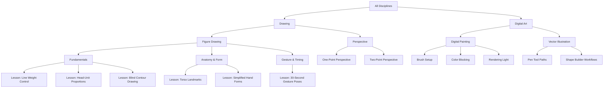
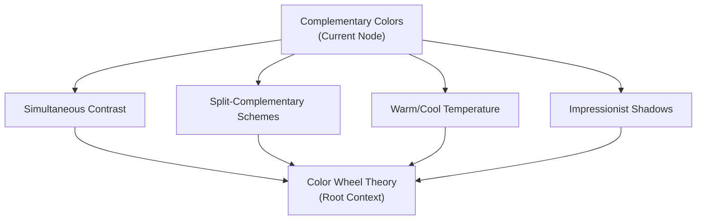

# Lesson 3: Information Architecture, Navigation, and System Organization

## 1. First-Principles Intuition & Invariants

Information architecture exists because human cognition operates within strict constraints. Working memory holds approximately seven discrete chunks of information at any given moment, a limitation first documented by cognitive psychologist George Miller in 1956 and refined through decades of subsequent research to a more conservative estimate of four to five chunks. When a user encounters a digital interface—whether a design system documentation site, a component library browser, or a portfolio website—they must construct a mental model of where things are, how to reach them, and what relationships exist between elements. If the architecture violates their expectations or exceeds their cognitive load threshold, disorientation follows. The user stops thinking about their creative goal and starts thinking about the interface itself, a context switch that bleeds momentum and trust.

The foundational invariant of information architecture is that structure must mirror the user's mental model, not the system's internal data structure. A design software suite might store layers, vector objects, effects, and project metadata in separate database tables optimized for query performance, but presenting that raw technical structure to a designer would be catastrophic. The designer thinks in terms of workflow stages: conceptualizing ideas, compositing elements, refining visuals, preparing output. Effective information architecture translates the system's technical reality into navigational pathways that align with these human task models. This alignment is not cosmetic—it determines whether the user can offload cognitive burden to the interface or must hold the entire system map in working memory while simultaneously executing creative work.

Navigation systems extend from this cognitive foundation. Every navigation pattern—hierarchical trees, hub-and-spoke architectures, linear sequences, or networked graphs—imposes a mental cost. Hierarchical navigation maps cleanly to taxonomic thinking: projects contain components, components contain elements, elements contain properties. Users navigate by progressively narrowing scope, a pattern that works exceptionally well when categories are mutually exclusive and the hierarchy is shallow. Beyond three levels of nesting, however, hierarchical navigation triggers the "click fatigue" failure mode. Users forget where they entered the hierarchy, lose track of sibling categories, and resort to search functions or abandon the task entirely. Hub-and-spoke architectures, where all sections radiate from a central dashboard, reduce navigation depth but demand that the hub itself remains cognitively scannable. A design tool's layers panel exemplifies this: controls radiate from a central interface, but if the item count exceeds screen real estate, the hub collapses into a scrolling list and the spatial advantage evaporates.

The concept of wayfinding, borrowed from environmental psychology and physical architecture, reveals how users orient themselves within information spaces. Kevin Lynch's work on urban legibility identified five elements that help people navigate cities: paths, edges, districts, nodes, and landmarks. Digital information architecture employs direct analogs. Paths are navigation flows—the sequence of clicks or gestures required to reach a destination. Edges are boundaries between content types or functional zones, often marked by visual separators, color shifts, or typographic hierarchy changes. Districts are thematic clusters: the "browse" section of a music app versus the "library" section. Nodes are decision points where multiple paths converge, such as a search results page or a contextual menu. Landmarks are distinctive UI elements that persist across views, providing constant spatial reference—a fixed top navigation bar, a persistent playback control strip, or an always-visible project timeline.

Users construct cognitive maps of these elements through repeated interaction, a process that relies on consistency. If a landmark shifts position between screens, if district boundaries blur, or if paths change behavior based on hidden state, the cognitive map fractures. The user must rebuild their mental model from scratch with each session, preventing the formation of procedural memory. Procedural memory is the deep, automatic knowledge that allows a graphic designer to execute a complex layout without conscious attention to individual tool controls. In interface terms, procedural memory allows a power user to navigate a complex tool purely through muscle memory and spatial intuition, freeing conscious thought for creative decision-making. Information architecture that disrupts procedural memory formation—through inconsistent patterns, context-dependent behavior, or unpredictable state changes—condemns users to perpetual novice status.

Taxonomies and classification schemes form the substrate upon which navigation systems operate. A taxonomy is a controlled vocabulary organized into hierarchical relationships. Visual design taxonomies, for instance, impose structure on inherently fuzzy stylistic concepts. Is a typeface "geometric" or "organic"? Does it belong in "playful" or "formal"? Rigid taxonomies force binary decisions that collapse nuance, while overly permissive tagging systems generate noise. The optimal approach depends on use case. A design inspiration platform prioritizes findability over precision, so it employs broad, overlapping tags and accepts some classification ambiguity. A component library for professional designers demands surgical precision, so it enforces strict taxonomies with controlled vocabularies: color palette, composition type, visual weight, and contrast level must be explicitly tagged and mutually exclusive.

Faceted classification systems offer a middle path. Instead of forcing a single hierarchical position, faceted taxonomies decompose items into multiple independent dimensions. A sound effect might be classified simultaneously by source (acoustic, synthesized, recorded), emotional quality (tense, calm, chaotic), temporal characteristic (sustained, percussive, evolving), and frequency range (sub-bass, mid-range, high-frequency). Users navigate by progressively applying filters across these facets, narrowing results without traversing a rigid tree. This approach maps naturally to how audio professionals think: "I need a dark, evolving pad with sub-bass presence" translates directly into facet selections. The cognitive cost shifts from "where is this item in the hierarchy?" to "which attributes describe what I need?", a question that aligns with creative intent.

Scaling information architecture to handle growth exposes structural weaknesses. A portfolio website with twelve projects can present them as a simple grid. At fifty projects, the grid becomes cognitively overwhelming and visually monotonous. At two hundred projects, it becomes unusable. The architect must introduce layering: a top-level filter by discipline or year, a secondary sort by project type, and a search function for direct access. Each layer adds navigation steps, so the decision becomes a trade-off between immediate visual density and progressive disclosure. Progressive disclosure is the principle of revealing complexity in stages, showing only what the user needs at each decision point. A music sequencer with hundreds of tracks might initially display only grouped buses, revealing individual tracks only when the user expands a group. This preserves visual clarity but introduces the risk that users forget what lives inside collapsed groups.

The invariant principle underlying all scaling strategies is that human attention is a finite, non-renewable resource. Every design decision either conserves or depletes this resource. Information architecture that conserves attention—through predictable patterns, minimal navigation steps, and perceptually grouped related elements—allows users to maintain flow state. Information architecture that depletes attention—through deep hierarchies, ambiguous labels, or layout inconsistency—forces constant context switching and cognitive repair. The architect's fundamental responsibility is to structure information in a way that makes the user's goal path feel inevitable, almost invisible, so that conscious thought can remain focused on creative execution rather than navigational problem-solving.

## 2. Core Architecture & Mechanics

Information architecture operates through four primary structural models: hierarchical trees, network graphs, sequential flows, and matrix organizations. Each model encodes different assumptions about content relationships and imposes distinct cognitive demands. Selecting the appropriate model depends on the inherent structure of the content, the user's mental model, and the frequency of different access patterns.

Hierarchical trees organize content into parent-child relationships where each item has exactly one parent. This structure excels when content exhibits natural taxonomic boundaries. An art education platform might organize lessons into a hierarchy: discipline at the top level, specific practices at the second level, technique categories at the third level, and individual lessons at the leaves. Users navigate by progressively narrowing scope, a pattern that maps cleanly to how humans categorize knowledge. The tree structure guarantees that users can always answer "where am I?" by tracing the path from root to current node. This spatial certainty is the tree's primary cognitive advantage.



The failure modes of hierarchical architecture emerge when content relationships resist strict categorization. A lesson on "quick gesture poses" could reasonably live under "Fundamentals" or "Gesture & Timing." Forcing a single hierarchical position requires the architect to predict which path users will most likely follow, a prediction that may diverge from actual user behavior. Cross-referencing—placing the same content in multiple branches—appears to solve this problem but violates the tree structure and introduces maintenance burden. If the lesson is updated, every instance must be synchronized. Alternatively, the architect can place the lesson in one location and provide a link from the other, but this transforms the pure tree into a hybrid structure and introduces the "where is the canonical version?" ambiguity.

Network graphs abandon strict hierarchy in favor of many-to-many relationships. Each node can connect to any other node, and users navigate by following links between related content. Wikipedia exemplifies this structure: articles link bidirectionally to related concepts, allowing users to explore knowledge associatively rather than taxonomically. For creative disciplines, network navigation maps naturally to conceptual relationships. A lesson on "color theory" might link to lessons on "complementary colors," "saturation and value," "perceptual contrast," and "cultural color symbolism," reflecting the actual conceptual web that designers navigate when learning this topic. Network architectures excel at supporting exploratory learning and serendipitous discovery.



The cognitive cost of network architectures is disorientation. Without a fixed hierarchical position, users can lose track of how they arrived at the current node and struggle to return to a starting point. Breadcrumb trails—visual indicators showing the path traversed—mitigate this by providing a linear history, but they only work for sequential exploration. If a user follows links in a branching pattern, the breadcrumb collapses into a single linear path that omits alternate branches explored. Effective network architectures must provide persistent orientation landmarks: a fixed navigation menu, a visible site map, or a "home" anchor that remains accessible from any node. Without these landmarks, users experience the "lost in hyperspace" phenomenon, where they know content exists but cannot construct a mental map of how to reach it reliably.

Sequential flows impose a linear progression where users advance through stages in a predetermined order. Onboarding tutorials, checkout processes, and multi-step configuration wizards employ sequential navigation. The cognitive advantage is clarity: users need only understand "what is the next step?" rather than mapping the entire system. Sequential flows prevent premature optimization—the tendency for novice users to skip foundational steps and attempt advanced tasks without prerequisite knowledge. A synthesizer patch tutorial might enforce a sequence: oscillator waveform selection, filter cutoff and resonance, envelope shaping, LFO modulation, and finally effects processing. Each stage builds on the previous, and the interface prevents users from jumping to stage five without completing stages one through four.

```text
Sequential Flow — Synthesizer Patch Tutorial

Step 1: Oscillator Selection
    ↓
    [Saw / Square / Triangle / Sine]
    ↓
Step 2: Filter Configuration
    ↓
    [Cutoff Frequency: 20Hz – 20kHz]
    [Resonance: 0% – 100%]
    ↓
Step 3: Amplitude Envelope
    ↓
    [Attack / Decay / Sustain / Release]
    ↓
Step 4: Modulation Routing
    ↓
    [LFO → Filter Cutoff]
    [Envelope → Oscillator Pitch]
    ↓
Step 5: Effects Chain
    ↓
    [Reverb / Delay / Distortion]
    ↓
Final Patch Output
```

The failure mode of sequential architecture is rigidity. Expert users who already understand the material find enforced linearity frustrating. They want to jump directly to advanced stages, iterate on specific parameters, or work out of sequence. The architect must decide whether to serve novices, experts, or attempt to accommodate both. A common solution is to provide a "skip tutorial" option for experts while defaulting to sequential flow for first-time users. More sophisticated implementations employ progressive disclosure with optional depth: the main sequence presents simplified controls, while expandable sections reveal advanced parameters for users who want them. This layered approach preserves the sequential clarity for novices while offering escape hatches for experts.

Matrix organizations structure content along two orthogonal dimensions, creating a grid where users navigate by selecting coordinates. A sample library browser might organize sounds along a vertical axis of instrument families and a horizontal axis of articulation types. Users scan the matrix to find the intersection of desired attributes: "Strings + Staccato" or "Brass + Sustained Legato." Matrix navigation works exceptionally well when content naturally decomposes into two dominant facets and when the resulting grid remains small enough to display in a single view. Beyond approximately fifty cells, matrix layouts become visually dense and require scrolling or pagination, which undermines their spatial clarity advantage.

```mermaid
flowchart TD
    Title["Matrix Organization — Sample Library Browser"]
    
    Title --> StringsSection["Strings Section"]
    Title --> BrassSection["Brass Section"]
    Title --> Woodwinds["Woodwinds"]
    Title --> Percussion["Percussion"]
    
    StringsSection --> S_Staccato["Staccato<br/>48 samples"]
    StringsSection --> S_Legato["Legato<br/>72 samples"]
    StringsSection --> S_Pizzicato["Pizzicato<br/>36 samples"]
    StringsSection --> S_Tremolo["Tremolo<br/>24 samples"]
    
    BrassSection --> B_Staccato["Staccato<br/>32 samples"]
    BrassSection --> B_Legato["Legato<br/>56 samples"]
    BrassSection --> B_Pizzicato["Pizzicato<br/>—"]
    BrassSection --> B_Tremolo["Tremolo<br/>16 samples"]
    
    Woodwinds --> W_Staccato["Staccato<br/>28 samples"]
    Woodwinds --> W_Legato["Legato<br/>44 samples"]
    Woodwinds --> W_Pizzicato["Pizzicato<br/>—"]
    Woodwinds --> W_Tremolo["Tremolo<br/>—"]
    
    Percussion --> P_Staccato["Staccato<br/>64 samples"]
    Percussion --> P_Legato["Legato<br/>—"]
    Percussion --> P_Pizzicato["Pizzicato<br/>—"]
    Percussion --> P_Tremolo["Tremolo<br/>12 samples"]
```



Hybrid architectures combine multiple models to leverage their respective strengths. A music streaming service typically employs a hierarchical top-level navigation (Home, Browse, Library, Search), network-style content relationships within playlists (algorithmically linked songs, "listeners also enjoyed"), sequential flows for onboarding new users, and matrix layouts for browsing grid-based content like album covers. The challenge in hybrid design is maintaining consistency at transition boundaries. When a user moves from a hierarchical section to a network-linked recommendation, do they maintain positional context? Does the back button return them to the hierarchical position or to the previous network node? Inconsistent behavior at these boundaries fragments the user's mental model and forces them to relearn navigation rules contextually.

Labeling and nomenclature constitute a critical but often underestimated architectural component. Every navigation element—menu item, button label, section header—requires a text label that clearly communicates its destination or function. Effective labels balance specificity and brevity. "Synthesizer Tutorials" is more specific than "Tutorials" but less specific than "Subtractive Synthesis Patch Programming for Hardware Modular Systems." The optimal label depends on context. If the label appears within a section already titled "Synthesizers," the redundancy can be dropped. If it appears in a global navigation menu alongside other instrument categories, the specificity is necessary for disambiguation.

Controlled vocabularies enforce consistency in labeling across an entire system. A design system might standardize on "Component" rather than allowing "Element," "Module," or "Part" to appear interchangeably. Inconsistent terminology forces users to learn that multiple labels refer to the same concept, a cognitive tax that scales poorly. Large systems require explicit style guides that document approved terms, prohibited synonyms, and capitalization conventions. Without governance, labels drift over time as different designers and content authors introduce their own variations.

Search functionality serves as a bypass mechanism for users who know exactly what they want and find navigation too slow. Search architecture involves three components: the query interface, the indexing strategy, and the results ranking algorithm. Query interfaces range from simple single-field text boxes to advanced search forms with multiple filter fields. The simplicity of a single field reduces cognitive load but limits precision. Advanced forms improve precision but require users to understand the underlying data schema. The trade-off depends on user sophistication and content complexity.

Indexing strategy determines what content is searchable and at what granularity. A visual-arts education platform might index lesson titles only, or it might index full transcripts of video lessons, allowing users to search for specific phrases spoken in a tutorial. Deeper indexing improves findability but increases computational cost and storage requirements. For user-generated content platforms, indexing must handle misspellings, alternate phrasings, and ambiguous terminology. A search for "color palettes" should ideally also return results for "color schemes" and "color harmonies," requiring synonym expansion or semantic search capabilities.

Results ranking algorithms determine which results appear first. Relevance ranking typically combines text matching scores with contextual factors: user behavior data, content popularity, recency, and user profile attributes. A photographer searching for "blur" might receive results biased toward camera lens and software effects plugins, while a UX designer searching the same term might see results biased toward motion blur documentation for design systems. Personalized ranking improves precision but introduces opacity—users cannot always predict why certain results rank highly, which can undermine trust if the ranking appears arbitrary or misaligned with intent.

## 3. High-Performance Optimization & Failure Modes

Optimizing information architecture for performance means minimizing the cognitive and temporal cost of reaching content. The primary performance metric is time-to-task-completion: how many seconds elapse between the user forming an intent ("I want to learn about modal interchange") and reaching the content that satisfies that intent. This metric decomposes into navigation steps, decision time per step, and loading latency. Reducing navigation steps often requires flattening hierarchies or introducing direct-access patterns like search and shortcuts. Reducing decision time per step requires clear labeling, perceptually grouped options, and progressive disclosure to avoid overwhelming choice sets.

Shallow hierarchies reduce navigation steps but increase breadth at each level. A music education platform with fifty top-level categories requires users to scan a longer menu than one with five top-level categories, but it eliminates one or two hierarchical levels. The optimal balance depends on perceptual grouping. If the fifty categories can be visually clustered into five thematic groups through spatial layout, typography, or color coding, the breadth becomes manageable. If they present as a flat, undifferentiated list, the cognitive load exceeds working memory capacity and users resort to scanning linearly rather than recognizing patterns.

Persistent navigation elements—menus, sidebars, breadcrumbs, and global search—reduce the need for users to memorize paths. A fixed top navigation bar that remains visible during scrolling allows users to pivot between sections at any time without backtracking. This reduces navigation latency but consumes screen real estate. On mobile devices where vertical space is limited, persistent navigation must collapse into a hamburger menu or slide-out drawer, trading visibility for space. The optimal choice depends on usage frequency. If navigation happens constantly, the visibility trade-off favors persistence. If users typically enter a section and remain there for extended sessions, the space trade-off favors hiding navigation until explicitly invoked.

Anticipatory design reduces decision time by predicting user intent and pre-loading likely next steps. A design tool might observe that users frequently open the layers panel immediately after creating a new object, so it could automatically surface a "Go to Layers" prompt after the object is placed. Anticipatory patterns work well when behavior is predictable and the suggestion aligns with actual intent. When anticipation misfires—offering a prompt the user does not want—it becomes an interruption that breaks flow and trains users to ignore future prompts. The architect must balance anticipation with user control, ensuring that suggestions remain non-intrusive and easily dismissed.

Keyboard shortcuts and command palettes provide expert-level direct-access patterns. A command palette—popularized by tools like Spotlight on macOS and Cmd+K interfaces in web applications—allows users to type a few characters of a command name and jump directly to that function without navigating through menus. This pattern is extraordinarily efficient for users who have memorized command names but useless for novices who do not yet know what commands exist. Effective command palette implementations include fuzzy matching, synonym expansion, and inline documentation that appears as users type, balancing expert efficiency with novice discoverability.

Caching and prefetching optimize loading latency. A portfolio website might preload thumbnails for the next page of projects while the user views the current page, eliminating perceived loading time when they advance. Aggressive prefetching consumes bandwidth and client resources, so it should target the highest-probability next actions. Analytics data reveals which navigation paths occur most frequently, allowing architects to optimize the hot paths while accepting slower performance on less common routes.

Failure modes in information architecture manifest as navigation dead ends, ambiguous labels, brittle taxonomies, and search failure. Navigation dead ends occur when users reach a page with no clear next action. A portfolio project detail page that omits links to related projects or back-to-index navigation forces users to use the browser back button, a breakdown of the designed navigation system. Every terminal node in a navigation structure should provide at least two onward paths: back to the previous context and forward to related content.

Ambiguous labels create decision paralysis. If two menu items appear synonymous or if a label's meaning depends on unstated context, users must guess which option to select. Guessing imposes cognitive cost—the user must hold their original intent in working memory while exploring the first option, then backtrack if it was incorrect. Three incorrect guesses typically trigger abandonment. Disambiguating labels requires understanding the user's decision-making context. If "Mixing" and "Mastering" appear as peer menu items in a music production tutorial site, users who do not yet understand the distinction between these disciplines will not know which to select. Adding clarifying subtext—"Mixing: Balance individual tracks" versus "Mastering: Final polish and loudness"—resolves the ambiguity.

Brittle taxonomies break when content evolves beyond the original classification scheme. A sample library initially organized by instrument family faces architectural strain when hybrid instruments appear: is a "piano processed through guitar pedals" filed under keyboards or effects? Resilient taxonomies anticipate boundary cases and provide mechanisms for reclassification. Faceted classification systems handle this gracefully because items are not locked into a single hierarchical position. The hybrid instrument can be tagged with both "Piano" and "Effects Processing" facets, appearing in results for either query.

Search failure occurs when users know content exists but cannot construct a query that retrieves it. Common causes include vocabulary mismatch (the user searches for "tremolo" but the content is labeled "vibrato"), insufficient indexing depth (the term exists in the content but was not indexed), or poor ranking that buries relevant results below dozens of irrelevant ones. Mitigating search failure requires synonym expansion, full-text indexing, and continuous refinement of ranking algorithms based on user behavior data. If users frequently click result number seven rather than result number one, the ranking algorithm is failing to predict relevance accurately.

Cognitive overload failure occurs when the interface presents too many choices simultaneously. A design tool with two hundred visible menu items across multiple nested submenus overwhelms working memory. Users cannot build a mental map of where functionality lives, so they resort to trial-and-error exploration or external documentation. Mitigating cognitive overload requires progressive disclosure, contextual menus that show only relevant options for the current task, and search-driven interfaces that bypass navigation entirely. The principle is to reveal complexity on demand rather than displaying it all simultaneously.

Inconsistent navigation patterns force users to learn multiple mental models within a single system. If the hierarchical browse section uses left-sidebar navigation, the search results use top-tab navigation, and the library uses a matrix grid, users must context-switch between different spatial logic systems. Consistency does not mean every section must use identical layouts—it means that similar tasks should employ similar patterns. All content browsing interfaces should use related navigation paradigms, all configuration interfaces should follow related conventions, and transitions between contexts should be explicitly marked so users recognize when mental model shifts are required.

Scalability stress tests reveal architectural weaknesses. A navigation system that works elegantly with fifty items may collapse under five thousand. Architects should design for order-of-magnitude growth: if the system currently holds one hundred projects, the architecture should gracefully handle one thousand without requiring fundamental restructuring. This typically requires hybrid approaches: hierarchical or faceted navigation for browsing, search for direct access, and algorithmic recommendation surfaces to highlight high-value content that might otherwise drown in scale.

The ultimate optimization is making navigation feel invisible. Users should arrive at content through paths that feel obvious, almost preordained, rather than through conscious problem-solving. This invisibility emerges from deep alignment between the architectural structure and the user's mental model, from labels that precisely match user vocabulary, and from consistency that allows procedural memory to form. When navigation feels invisible, users can allocate full cognitive capacity to creative work, the architecture receding into the background as the transparent medium through which intent becomes action.
